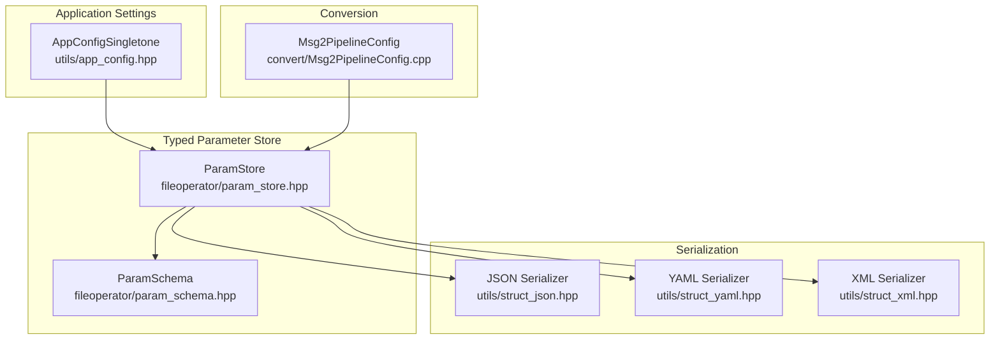
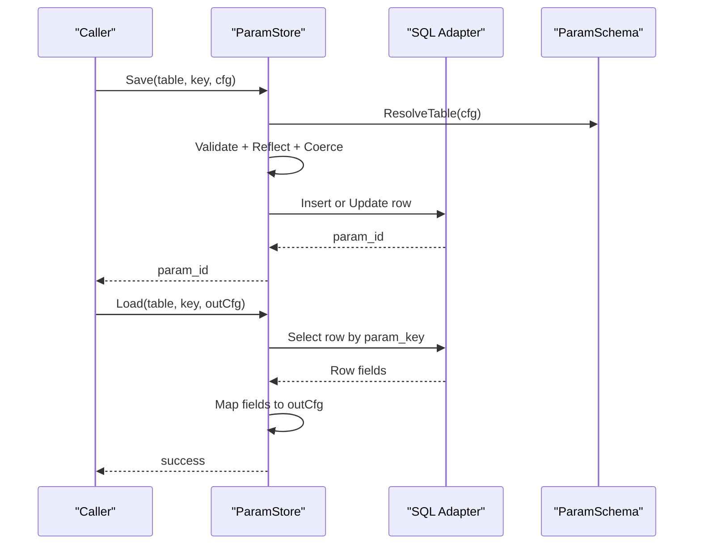
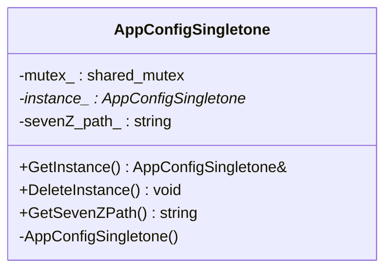
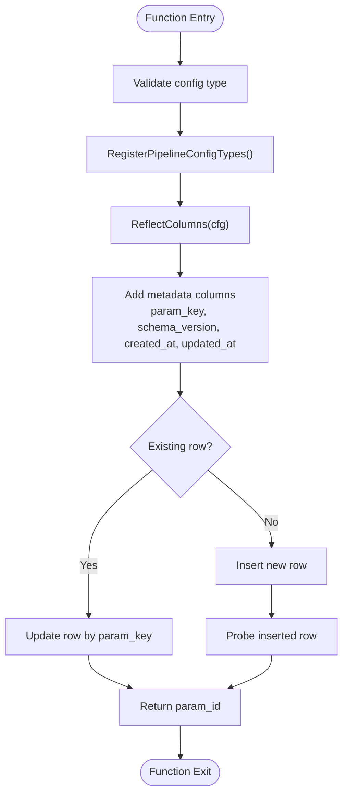
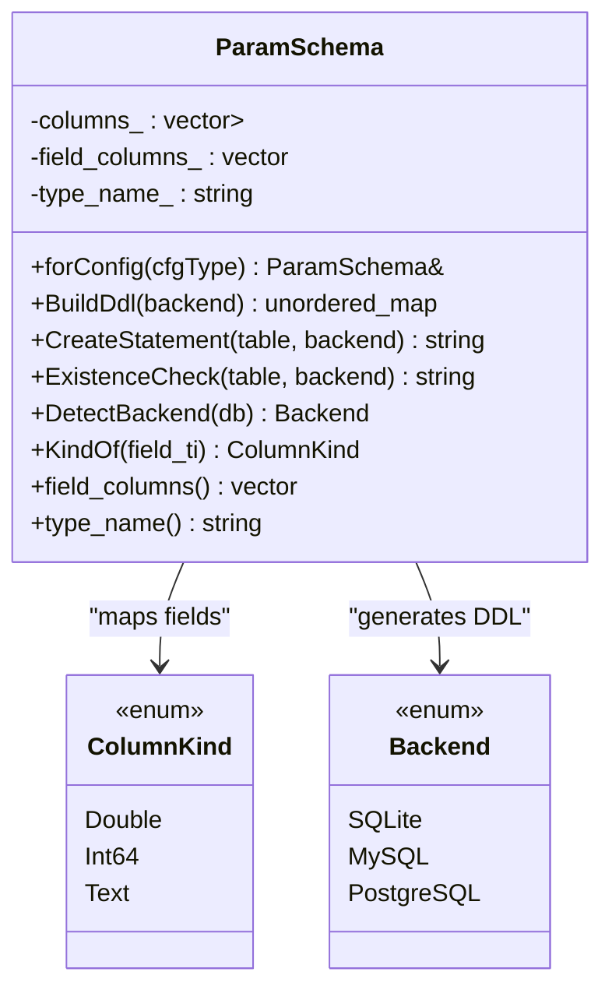
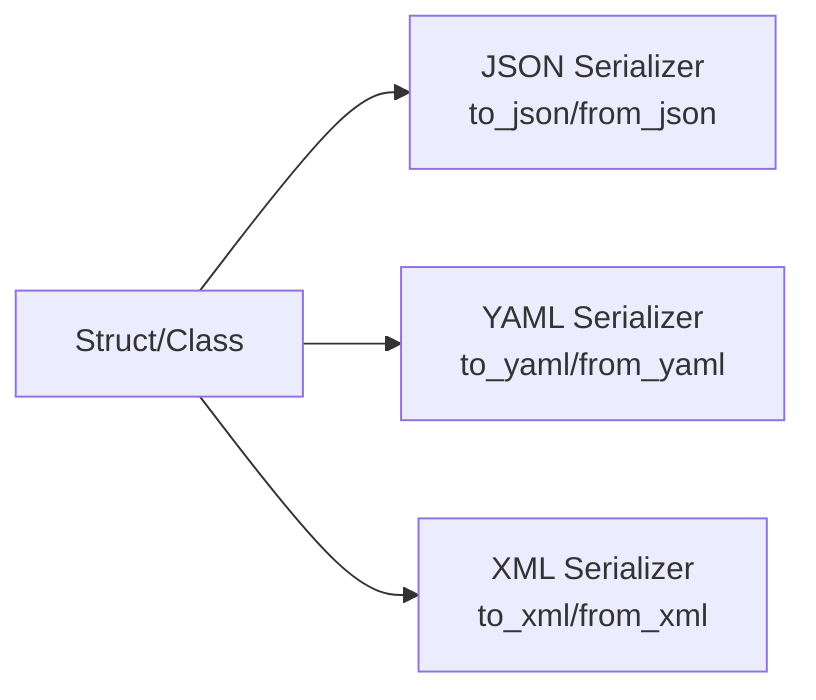
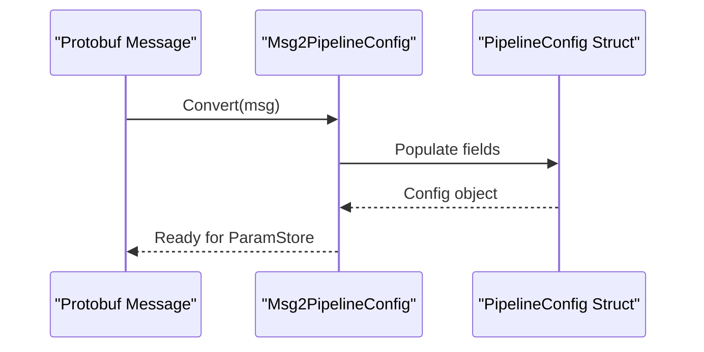
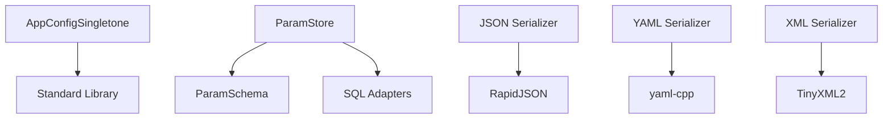

# Configuration Management / 配置管理

<cite>
**Referenced Files in This Document**   
- [app_config.hpp](file://utils/app_config.hpp)
- [app_config.cpp](file://utils/app_config.cpp)
- [param_store.hpp](file://fileoperator/param_store.hpp)
- [param_store.cpp](file://fileoperator/param_store.cpp)
- [param_schema.hpp](file://fileoperator/param_schema.hpp)
- [param_schema.cpp](file://fileoperator/param_schema.cpp)
- [struct_json.hpp](file://utils/struct_json.hpp)
- [struct_yaml.hpp](file://utils/struct_yaml.hpp)
- [struct_xml.hpp](file://utils/struct_xml.hpp)
- [Msg2PipelineConfig.cpp](file://convert/Msg2PipelineConfig.cpp)
</cite>

## Table of Contents
1. [Introduction](#introduction)
2. [Project Structure](#project-structure)
3. [Core Components](#core-components)
4. [Architecture Overview](#architecture-overview)
5. [Detailed Component Analysis](#detailed-component-analysis)
6. [Dependency Analysis](#dependency-analysis)
7. [Performance Considerations](#performance-considerations)
8. [Troubleshooting Guide](#troubleshooting-guide)
9. [Conclusion](#conclusion)
10. [Appendices](#appendices)

## Introduction
This document explains HsBaSlicer’s configuration management system with a focus on:
- Application configuration loading, parsing, and validation
- Parameter storage backed by a typed schema and SQL persistence
- Serialization to JSON, YAML, and XML
- Platform-specific file locations (where applicable)
- Inheritance, default value resolution, and runtime updates
- Security considerations for sensitive parameters
- Backup/restore patterns and distributed configuration strategies

The system is composed of:
- A lightweight application configuration singleton for process-wide settings
- A typed parameter store that persists pipeline configurations into SQL backends
- Reflection-driven serializers for JSON, YAML, and XML

## Project Structure
Configuration-related code is primarily located under:
- utils/app_config.* — thread-safe application configuration singleton
- fileoperator/param_store.* — typed parameter persistence layer
- fileoperator/param_schema.* — schema derivation and DDL generation
- utils/struct_json.hpp, struct_yaml.hpp, struct_xml.hpp — reflection-based serialization libraries
- convert/Msg2PipelineConfig.cpp — conversion from protobuf messages to pipeline config structs

**Diagram sources**
- [app_config.hpp:19-46](file://utils/app_config.hpp#L19-L46)
- [param_store.hpp:33-105](file://fileoperator/param_store.hpp#L33-L105)
- [param_schema.hpp:58-92](file://fileoperator/param_schema.hpp#L58-L92)
- [struct_json.hpp:473-800](file://utils/struct_json.hpp#L473-L800)
- [struct_yaml.hpp:455-672](file://utils/struct_yaml.hpp#L455-L672)
- [struct_xml.hpp:541-800](file://utils/struct_xml.hpp#L541-L800)
- [Msg2PipelineConfig.cpp:46-67](file://convert/Msg2PipelineConfig.cpp#L46-L67)

**Section sources**
- [app_config.hpp:1-50](file://utils/app_config.hpp#L1-L50)
- [param_store.hpp:1-109](file://fileoperator/param_store.hpp#L1-L109)
- [param_schema.hpp:1-96](file://fileoperator/param_schema.hpp#L1-L96)
- [struct_json.hpp:1-800](file://utils/struct_json.hpp#L1-L800)
- [struct_yaml.hpp:1-672](file://utils/struct_yaml.hpp#L1-L672)
- [struct_xml.hpp:1-800](file://utils/struct_xml.hpp#L1-L800)
- [Msg2PipelineConfig.cpp:46-67](file://convert/Msg2PipelineConfig.cpp#L46-L67)

## Core Components
- AppConfigSingletone: Thread-safe singleton exposing shared application settings such as external tool paths. It provides instance lifecycle control and read accessors.
- ParamStore: Persists pipeline configurations using a staged Save flow (Validate -> Reflect -> Coerce -> Upsert), batch transactions, progress callbacks, migration hooks, and error reporting.
- ParamSchema: Derives table schemas from reflected Config types, maps field types to backend-specific column types, generates CREATE TABLE statements, and detects the SQL backend.
- Serialization Libraries: Reflection-driven JSON, YAML, and XML serializers supporting aggregate types, reflectable types, enums, optional-like values, and ranges.

Key responsibilities:
- Loading and validating user inputs through reflection and schema mapping
- Persisting structured configuration data to SQL backends
- Serializing/deserializing configuration objects to/from multiple formats
- Providing safe defaults and type safety via reflection and schema mapping

**Section sources**
- [app_config.hpp:19-46](file://utils/app_config.hpp#L19-L46)
- [param_store.hpp:33-105](file://fileoperator/param_store.hpp#L33-L105)
- [param_schema.hpp:58-92](file://fileoperator/param_schema.hpp#L58-L92)
- [struct_json.hpp:473-800](file://utils/struct_json.hpp#L473-L800)
- [struct_yaml.hpp:455-672](file://utils/struct_yaml.hpp#L455-L672)
- [struct_xml.hpp:541-800](file://utils/struct_xml.hpp#L541-L800)

## Architecture Overview
The configuration architecture separates concerns across three layers:
- Application-level settings managed by AppConfigSingletone
- Typed parameter persistence via ParamStore backed by ParamSchema
- Format-agnostic serialization via reflection-based libraries

**Diagram sources**
- [param_store.cpp:177-239](file://fileoperator/param_store.cpp#L177-L239)
- [param_store.cpp:289-318](file://fileoperator/param_store.cpp#L289-L318)
- [param_schema.cpp:120-193](file://fileoperator/param_schema.cpp#L120-L193)

## Detailed Component Analysis

### AppConfigSingletone
Responsibilities:
- Provide a single global instance for application-wide settings
- Protect concurrent access with shared_mutex
- Expose getters for configured paths (e.g., external tool path)

Thread-safety:
- Instance creation and deletion are guarded by a mutex
- Read access uses shared_lock for concurrent reads

**Diagram sources**
- [app_config.hpp:19-46](file://utils/app_config.hpp#L19-L46)
- [app_config.cpp:14-42](file://utils/app_config.cpp#L14-L42)

**Section sources**
- [app_config.hpp:1-50](file://utils/app_config.hpp#L1-L50)
- [app_config.cpp:1-43](file://utils/app_config.cpp#L1-L43)

### ParamStore
Responsibilities:
- CRUD operations for pipeline configurations
- Staged Save flow: Validate -> Reflect -> Coerce -> Upsert
- Batch save wrapped in a transaction
- Progress callback and migration hook support
- Error propagation with last_error tracking

Save Flow:
- Validates that the config type is registered
- Reflects fields into column map
- Adds metadata columns (param_key, schema_version, timestamps)
- Performs upsert based on param_key uniqueness

Load Flow:
- Queries row by param_key
- Maps database fields back to target struct fields
- Uses StringArena for const char* fields

Batch Save:
- Wraps multiple saves in BEGIN/COMMIT/ROLLBACK
- Ensures rollback on failure while preserving original exception

**Diagram sources**
- [param_store.cpp:177-239](file://fileoperator/param_store.cpp#L177-L239)

**Section sources**
- [param_store.hpp:33-105](file://fileoperator/param_store.hpp#L33-L105)
- [param_store.cpp:177-239](file://fileoperator/param_store.cpp#L177-L239)
- [param_store.cpp:242-287](file://fileoperator/param_store.cpp#L242-L287)
- [param_store.cpp:289-318](file://fileoperator/param_store.cpp#L289-L318)

### ParamSchema
Responsibilities:
- Derive table schema from Config TypeInfo fields
- Map field types to backend-specific column types
- Generate CREATE TABLE statements per backend
- Detect backend via dynamic_cast against ISQLAdapter implementations

Column Mapping:
- Double(float/double) -> REAL/DOUBLE/DOUBLE PRECISION
- Int64(int/int64_t/enums) -> BIGINT
- Text(const char*/std::string) -> TEXT

Backend Detection:
- SQLite, MySQL, PostgreSQL supported
- Mobile targets always use SQLite

DDL Generation:
- Fixed metadata columns: param_id, param_key, schema_version, created_at, updated_at
- Backend-specific syntax differences handled

**Diagram sources**
- [param_schema.hpp:58-92](file://fileoperator/param_schema.hpp#L58-L92)
- [param_schema.cpp:71-193](file://fileoperator/param_schema.cpp#L71-L193)

**Section sources**
- [param_schema.hpp:1-96](file://fileoperator/param_schema.hpp#L1-L96)
- [param_schema.cpp:1-217](file://fileoperator/param_schema.cpp#L1-L217)

### Serialization Libraries (JSON, YAML, XML)
All three serializers share common design principles:
- Reflection-driven traversal of struct fields
- Support for aggregate types, reflectable types, enums, optional-like values, and ranges
- Type-safe deserialization with explicit error handling

JSON Serializer:
- RapidJSON-based
- Provides to_json/from_json overloads for various types
- Supports pretty printing and file I/O

YAML Serializer:
- yaml-cpp-based
- Provides to_yaml/from_yaml overloads
- Handles sequences and mappings robustly

XML Serializer:
- TinyXML2-based
- Provides to_xml/from_xml overloads
- Handles nested elements and arrays

**Diagram sources**
- [struct_json.hpp:473-800](file://utils/struct_json.hpp#L473-L800)
- [struct_yaml.hpp:455-672](file://utils/struct_yaml.hpp#L455-L672)
- [struct_xml.hpp:541-800](file://utils/struct_xml.hpp#L541-L800)

**Section sources**
- [struct_json.hpp:1-800](file://utils/struct_json.hpp#L1-L800)
- [struct_yaml.hpp:1-672](file://utils/struct_yaml.hpp#L1-L672)
- [struct_xml.hpp:1-800](file://utils/struct_xml.hpp#L1-L800)

### Pipeline Configuration Conversion
The conversion layer transforms protobuf messages into pipeline configuration structs, enabling integration with existing message-based workflows.

**Diagram sources**
- [Msg2PipelineConfig.cpp:46-67](file://convert/Msg2PipelineConfig.cpp#L46-L67)

**Section sources**
- [Msg2PipelineConfig.cpp:46-67](file://convert/Msg2PipelineConfig.cpp#L46-L67)

## Dependency Analysis
The configuration system exhibits clear separation of concerns:
- AppConfigSingletone depends only on standard library threading primitives
- ParamStore depends on ParamSchema for DDL generation and SQL adapters for persistence
- Serialization libraries depend on reflection utilities and third-party parsers

**Diagram sources**
- [app_config.cpp:1-43](file://utils/app_config.cpp#L1-L43)
- [param_store.cpp:1-416](file://fileoperator/param_store.cpp#L1-L416)
- [param_schema.cpp:1-217](file://fileoperator/param_schema.cpp#L1-L217)
- [struct_json.hpp:1-800](file://utils/struct_json.hpp#L1-L800)
- [struct_yaml.hpp:1-672](file://utils/struct_yaml.hpp#L1-L672)
- [struct_xml.hpp:1-800](file://utils/struct_xml.hpp#L1-L800)

**Section sources**
- [param_store.hpp:1-109](file://fileoperator/param_store.hpp#L1-L109)
- [param_schema.hpp:1-96](file://fileoperator/param_schema.hpp#L1-L96)

## Performance Considerations
- ParamStore Save flow minimizes database round-trips by combining validation, reflection, and upsert in a single operation
- Batch save uses transactions to reduce overhead and ensure atomicity
- Schema caching avoids repeated DDL generation for the same Config types
- Reflection-based serialization incurs compile-time template expansion but runtime overhead is proportional to field count

Recommendations:
- Use batch APIs for bulk configuration updates
- Leverage schema caching by registering all Config types at startup
- Avoid excessive logging during high-throughput configuration operations

[No sources needed since this section provides general guidance]

## Troubleshooting Guide
Common issues and resolutions:
- Unknown config type errors: Ensure the Config type is registered before calling ParamStore methods
- Missing table errors: Call EnsureSchema() or EnsureTable() before persisting configurations
- Backend detection failures: Verify that the correct SQL adapter implementation is provided
- Serialization errors: Check that all fields are supported by the serializer (enums, strings, arithmetic types, optional-like values, ranges)

Error handling:
- ParamStore records last_error and rethrows exceptions so callers can handle them appropriately
- Serialization libraries throw specific exceptions for unsupported types or malformed input

**Section sources**
- [param_store.cpp:92-112](file://fileoperator/param_store.cpp#L92-L112)
- [param_store.cpp:142-175](file://fileoperator/param_store.cpp#L142-L175)
- [param_schema.cpp:195-214](file://fileoperator/param_schema.cpp#L195-L214)

## Conclusion
HsBaSlicer’s configuration management system provides a robust, type-safe foundation for managing application and pipeline configurations. The separation between application settings, typed parameter persistence, and format-agnostic serialization enables flexible deployment across different platforms and backends. By leveraging reflection and schema derivation, the system ensures type safety, business rule enforcement, and maintainability.

[No sources needed since this section summarizes without analyzing specific files]

## Appendices

### Configuration File Locations
- Application configuration (AppConfigSingletone): Managed in-memory; external tool paths are stored as strings within the singleton
- Pipeline configurations: Persisted in SQL backends (SQLite, MySQL, PostgreSQL) with platform-specific database file locations determined by the SQL adapter implementation

Note: Platform-specific file location logic is delegated to the SQL adapter implementations and is not directly exposed by the configuration components analyzed here.

[No sources needed since this section provides general guidance]

### Security Considerations
- Sensitive parameters should be encrypted before storage if required by application policy
- Avoid logging sensitive configuration values
- Use secure channels for distributed configuration synchronization
- Implement access controls around configuration endpoints in distributed environments

[No sources needed since this section provides general guidance]

### Backup and Restore Patterns
- Use ParamStore List API to enumerate configuration keys
- Serialize configurations to JSON/YAML/XML for backup
- Restore by deserializing and calling ParamStore Save with appropriate keys

[No sources needed since this section provides general guidance]

### Distributed Configuration Management
- Centralized configuration server storing configurations in SQL backends
- Clients synchronize configurations periodically or on-demand
- Version control via schema_version field for migration compatibility

[No sources needed since this section provides general guidance]