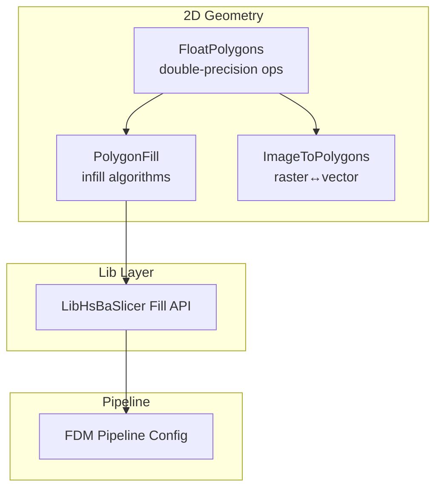
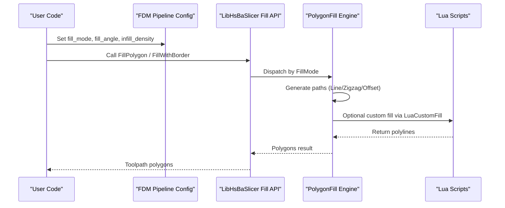
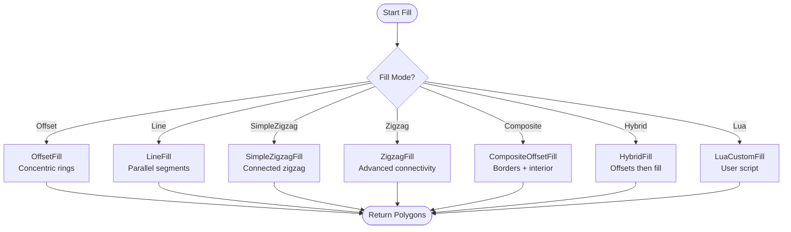
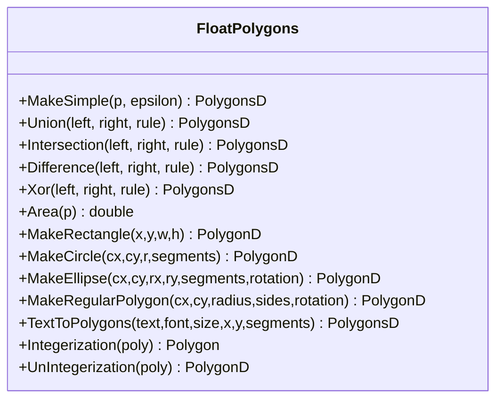
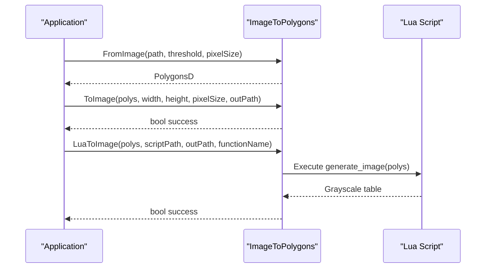
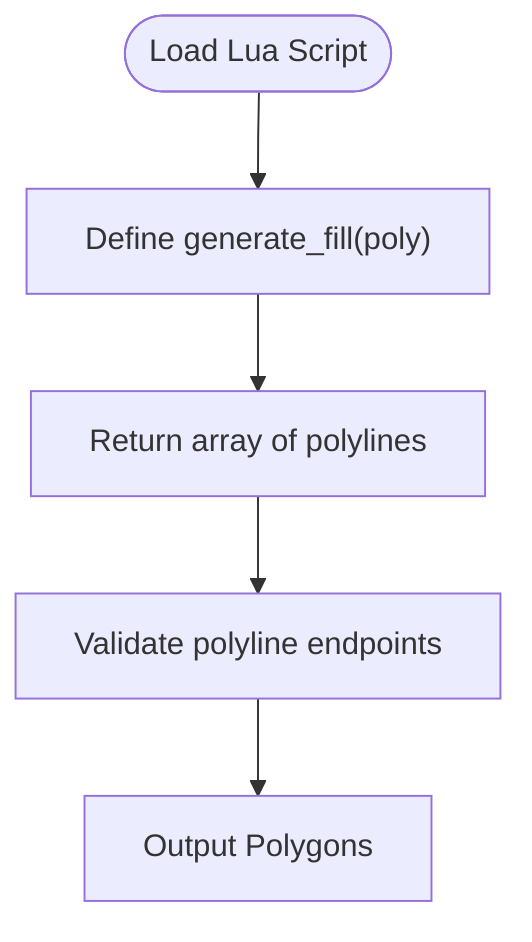
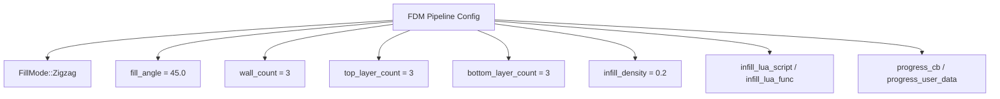
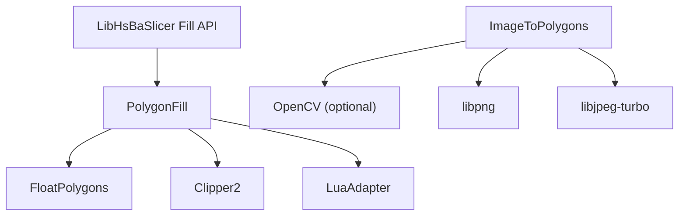

# Fill Patterns and Infill Strategies

<cite>
**Referenced Files in This Document**
- [PolygonFill.hpp](file://2D/PolygonFill.hpp)
- [PolygonFill.cpp](file://2D/PolygonFill.cpp)
- [FloatPolygons.hpp](file://2D/FloatPolygons.hpp)
- [FloatPolygons.cpp](file://2D/FloatPolygons.cpp)
- [ImageToPolygons.hpp](file://2D/ImageToPolygons.hpp)
- [ImageToPolygons.cpp](file://2D/ImageToPolygons.cpp)
- [polygon_fill.hpp](file://LibHsBaSlicer/Fill/polygon_fill.hpp)
- [polygon_fill.cpp](file://LibHsBaSlicer/Fill/polygon_fill.cpp)
- [fdm_pipeline.cpp](file://DllHsBaSlicer/fdm_pipeline.cpp)
- [custom_fill.lua](file://tests/PolygonFill/custom_fill.lua)
- [image_from_polygons.lua](file://tests/PolygonFill/image_from_polygons.lua)
- [polygon_fill_test.cpp](file://tests/PolygonFill/polygon_fill_test.cpp)
- [float_polygons_test.cpp](file://tests/PolygonFill/float_polygons_test.cpp)
</cite>

## Table of Contents
1. [Introduction](#introduction)
2. [Project Structure](#project-structure)
3. [Core Components](#core-components)
4. [Architecture Overview](#architecture-overview)
5. [Detailed Component Analysis](#detailed-component-analysis)
6. [Dependency Analysis](#dependency-analysis)
7. [Performance Considerations](#performance-considerations)
8. [Troubleshooting Guide](#troubleshooting-guide)
9. [Conclusion](#conclusion)

## Introduction
This document explains HsBaSlicer’s fill pattern and infill strategy systems. It covers:
- Polygon-based infill algorithms: offset rings, parallel lines, zigzag variants, composite/hybrid fills, and Lua-driven custom patterns.
- The PolygonFill class family for converting 2D polygons into optimized toolpaths.
- FloatPolygons operations for precise polygon manipulation and boolean operations.
- ImageToPolygons functionality for converting bitmap images to vector-based infill patterns.
- Examples of implementing custom fill patterns through Lua scripting.
- Performance optimization techniques for dense infills and memory management strategies for large polygon operations.
- Integration with the main slicing pipeline and real-time progress reporting during fill generation.

## Project Structure
The fill system is implemented across several modules:
- 2D geometry primitives and algorithms:
  - IntPolygon types and Clipper2 integration.
  - FloatPolygons for double-precision polygon operations and shape generators.
  - PolygonFill for infill algorithms and Lua integration.
  - ImageToPolygons for raster-to-vector conversion and image rendering.
- LibHsBaSlicer API layer exposing fill functions to higher-level pipelines.
- DllHsBaSlicer FDM pipeline configuration including fill mode, angle, density, and Lua script hooks.

**Diagram sources**
- [FloatPolygons.hpp:1-271](file://2D/FloatPolygons.hpp#L1-L271)
- [PolygonFill.hpp:1-141](file://2D/PolygonFill.hpp#L1-L141)
- [ImageToPolygons.hpp:1-83](file://2D/ImageToPolygons.hpp#L1-L83)
- [polygon_fill.hpp:1-58](file://LibHsBaSlicer/Fill/polygon_fill.hpp#L1-L58)
- [fdm_pipeline.cpp:49-68](file://DllHsBaSlicer/fdm_pipeline.cpp#L49-L68)

**Section sources**
- [PolygonFill.hpp:1-141](file://2D/PolygonFill.hpp#L1-L141)
- [FloatPolygons.hpp:1-271](file://2D/FloatPolygons.hpp#L1-L271)
- [ImageToPolygons.hpp:1-83](file://2D/ImageToPolygons.hpp#L1-L83)
- [polygon_fill.hpp:1-58](file://LibHsBaSlicer/Fill/polygon_fill.hpp#L1-L58)
- [fdm_pipeline.cpp:49-68](file://DllHsBaSlicer/fdm_pipeline.cpp#L49-L68)

## Core Components
- PolygonFill provides:
  - Offset-based concentric ring generation.
  - Parallel line filling at a given angle.
  - Simple and advanced zigzag infill with connectivity handling.
  - Composite and hybrid fills combining offsets and internal patterns.
  - LuaCustomFill and LuaCustomFillString for user-defined patterns.
- FloatPolygons provides:
  - Double-precision polygon types and helpers.
  - Boolean operations (union, intersection, difference, xor).
  - Area computation, simplification, and shape generators (rectangle, circle, ellipse, regular polygon).
  - Integerization/un-integerization for precision control.
- ImageToPolygons provides:
  - FromImage and FromImageMulti for thresholding grayscale images to polygons.
  - ToImage for rendering polygons back to raster or SVG.
  - LuaToImage and LuaToImageString for custom image generation via Lua.

**Section sources**
- [PolygonFill.hpp:20-136](file://2D/PolygonFill.hpp#L20-L136)
- [FloatPolygons.hpp:27-221](file://2D/FloatPolygons.hpp#L27-L221)
- [ImageToPolygons.hpp:22-79](file://2D/ImageToPolygons.hpp#L22-L79)

## Architecture Overview
The fill system integrates with the slicing pipeline as follows:
- The FDM pipeline configures fill parameters such as mode, angle, wall count, top/bottom layers, infill density, and optional Lua scripts for support and infill customization.
- The LibHsBaSlicer Fill API exposes high-level functions like FillPolygon and FillWithBorder that wrap the 2D engine.
- The 2D engine implements concrete algorithms and Lua bridges.

**Diagram sources**
- [fdm_pipeline.cpp:49-68](file://DllHsBaSlicer/fdm_pipeline.cpp#L49-L68)
- [polygon_fill.cpp:13-48](file://LibHsBaSlicer/Fill/polygon_fill.cpp#L13-L48)
- [PolygonFill.cpp:185-420](file://2D/PolygonFill.cpp#L185-L420)

**Section sources**
- [fdm_pipeline.cpp:49-68](file://DllHsBaSlicer/fdm_pipeline.cpp#L49-L68)
- [polygon_fill.cpp:13-48](file://LibHsBaSlicer/Fill/polygon_fill.cpp#L13-L48)

## Detailed Component Analysis

### PolygonFill Algorithms
- OffsetFill: Generates concentric rings by repeatedly offsetting inward until the polygon vanishes; each ring is closed.
- LineFill: Produces independent straight-line segments within the polygon at a specified spacing and angle.
- SimpleZigzagFill: Connects centers of line segments across scanlines to form connected zigzag paths, ensuring vertices remain inside the original polygon.
- ZigzagFill: Advanced zigzag with improved connectivity using union-find to merge overlapping intervals between adjacent rows.
- CompositeOffsetFill: Combines outward/inward offset borders with an internal fill mode (Line/SimpleZigzag/Zigzag).
- HybridFill: Applies offsets first, then fills the last offset region with the selected mode.
- LuaCustomFill/LuaCustomFillString: Executes user-defined Lua functions to generate custom polylines.

**Diagram sources**
- [PolygonFill.hpp:20-136](file://2D/PolygonFill.hpp#L20-L136)
- [PolygonFill.cpp:422-800](file://2D/PolygonFill.cpp#L422-L800)

**Section sources**
- [PolygonFill.hpp:20-136](file://2D/PolygonFill.hpp#L20-L136)
- [PolygonFill.cpp:422-800](file://2D/PolygonFill.cpp#L422-L800)

### FloatPolygons Operations
- Simplification: Remove collinear points to reduce vertex count while preserving area.
- Boolean operations: Union, Intersection, Difference, Xor on single polygons and sets.
- Area calculation: Signed area for orientation-aware net area computation.
- Shape generators: Rectangle, Circle, Ellipse, Regular polygon creation.
- Text-to-polygons: Convert text to vector outlines using FreeType when available.
- Integerization: Convert between double-precision and integer coordinates for robust geometric operations.

**Diagram sources**
- [FloatPolygons.hpp:27-221](file://2D/FloatPolygons.hpp#L27-L221)
- [FloatPolygons.cpp:25-213](file://2D/FloatPolygons.cpp#L25-L213)

**Section sources**
- [FloatPolygons.hpp:27-221](file://2D/FloatPolygons.hpp#L27-L221)
- [FloatPolygons.cpp:25-213](file://2D/FloatPolygons.cpp#L25-L213)

### ImageToPolygons Functionality
- FromImage: Thresholds a grayscale image to extract contours as polygons.
- FromImageMulti: Multi-threshold extraction returning multiple polygon sets.
- ToImage: Rasterizes polygons to PNG/JPEG or writes SVG vector output.
- LuaToImage/LuaToImageString: Custom image generation via Lua scripts that return grayscale byte arrays.

**Diagram sources**
- [ImageToPolygons.hpp:22-79](file://2D/ImageToPolygons.hpp#L22-L79)
- [ImageToPolygons.cpp:282-546](file://2D/ImageToPolygons.cpp#L282-L546)

**Section sources**
- [ImageToPolygons.hpp:22-79](file://2D/ImageToPolygons.hpp#L22-L79)
- [ImageToPolygons.cpp:282-546](file://2D/ImageToPolygons.cpp#L282-L546)

### Custom Fill Patterns via Lua
- LuaCustomFill and LuaCustomFillString allow users to define custom fill patterns by returning polylines from a Lua function.
- Example script returns two diagonal polylines across a square.
- Tests verify exact coordinate outputs and polyline counts.

**Diagram sources**
- [custom_fill.lua:1-16](file://tests/PolygonFill/custom_fill.lua#L1-L16)
- [polygon_fill_test.cpp:140-175](file://tests/PolygonFill/polygon_fill_test.cpp#L140-L175)

**Section sources**
- [custom_fill.lua:1-16](file://tests/PolygonFill/custom_fill.lua#L1-L16)
- [polygon_fill_test.cpp:140-175](file://tests/PolygonFill/polygon_fill_test.cpp#L140-L175)

### Integration with Main Slicing Pipeline
- FDM pipeline configuration includes fill mode, angle, wall count, top/bottom layers, infill density, and optional Lua scripts for support and infill.
- Progress callback fields are present in the configuration structure, enabling real-time progress reporting during slicing tasks.

**Diagram sources**
- [fdm_pipeline.cpp:49-68](file://DllHsBaSlicer/fdm_pipeline.cpp#L49-L68)

**Section sources**
- [fdm_pipeline.cpp:49-68](file://DllHsBaSlicer/fdm_pipeline.cpp#L49-L68)

## Dependency Analysis
- PolygonFill depends on:
  - FloatPolygons for polygon types and operations.
  - Clipper2 for boolean and offset operations.
  - LuaAdapter for Lua integration.
- LibHsBaSlicer Fill API wraps PolygonFill and adds path optimization registration for Lua scripts.
- ImageToPolygons depends on OpenCV (optional), libpng, and libjpeg-turbo for image I/O.

**Diagram sources**
- [PolygonFill.cpp:5-16](file://2D/PolygonFill.cpp#L5-L16)
- [FloatPolygons.cpp:5-21](file://2D/FloatPolygons.cpp#L5-L21)
- [ImageToPolygons.cpp:15-26](file://2D/ImageToPolygons.cpp#L15-L26)
- [polygon_fill.cpp:5-9](file://LibHsBaSlicer/Fill/polygon_fill.cpp#L5-L9)

**Section sources**
- [PolygonFill.cpp:5-16](file://2D/PolygonFill.cpp#L5-L16)
- [FloatPolygons.cpp:5-21](file://2D/FloatPolygons.cpp#L5-L21)
- [ImageToPolygons.cpp:15-26](file://2D/ImageToPolygons.cpp#L15-L26)
- [polygon_fill.cpp:5-9](file://LibHsBaSlicer/Fill/polygon_fill.cpp#L5-L9)

## Performance Considerations
- Dense infills benefit from:
  - Using ZigzagFill for better connectivity and reduced retraction compared to LineFill.
  - Adjusting spacing based on infill density to balance strength and print time.
  - Leveraging CompositeOffsetFill to create strong borders with efficient internal fills.
- Memory management:
  - Prefer PolygonsD for intermediate calculations to maintain precision, then convert to integer Polygons for final output.
  - Use MakeSimple to reduce vertex count before heavy boolean operations.
  - Avoid excessive nested offsets; limit outwardCount/inwardCount to reasonable values.
- Real-time progress:
  - The FDM pipeline configuration supports progress callbacks; integrate progress updates during long-running fill operations by hooking into the pipeline’s progress mechanism.

[No sources needed since this section provides general guidance]

## Troubleshooting Guide
- Lua script errors:
  - Ensure the Lua function name matches the expected signature and returns a table of polylines.
  - Validate polygon coordinates and ensure they lie within the input polygon bounds.
- Image processing issues:
  - Verify image format and availability of OpenCV; fallback to manual rasterization if OpenCV is not enabled.
  - Check threshold values to avoid empty or overly noisy polygon extraction.
- Boolean operation failures:
  - Normalize polygon winding (outer CCW, holes CW) before operations to prevent incorrect results.
  - Use MakeSimple to remove collinear points and self-intersections.

**Section sources**
- [polygon_fill_test.cpp:140-175](file://tests/PolygonFill/polygon_fill_test.cpp#L140-L175)
- [ImageToPolygons.cpp:35-84](file://2D/ImageToPolygons.cpp#L35-L84)
- [FloatPolygons.cpp:25-32](file://2D/FloatPolygons.cpp#L25-L32)

## Conclusion
HsBaSlicer’s fill system provides a comprehensive set of infill algorithms and tools for converting 2D polygons into optimized toolpaths. The architecture separates concerns between geometry operations, algorithm implementation, and pipeline integration, enabling flexible customization through Lua scripting. By leveraging FloatPolygons for precise manipulations and ImageToPolygons for raster-to-vector conversions, users can implement sophisticated fill strategies tailored to their printing needs. Performance optimizations and memory management best practices ensure efficient processing even for complex models.

[No sources needed since this section summarizes without analyzing specific files]