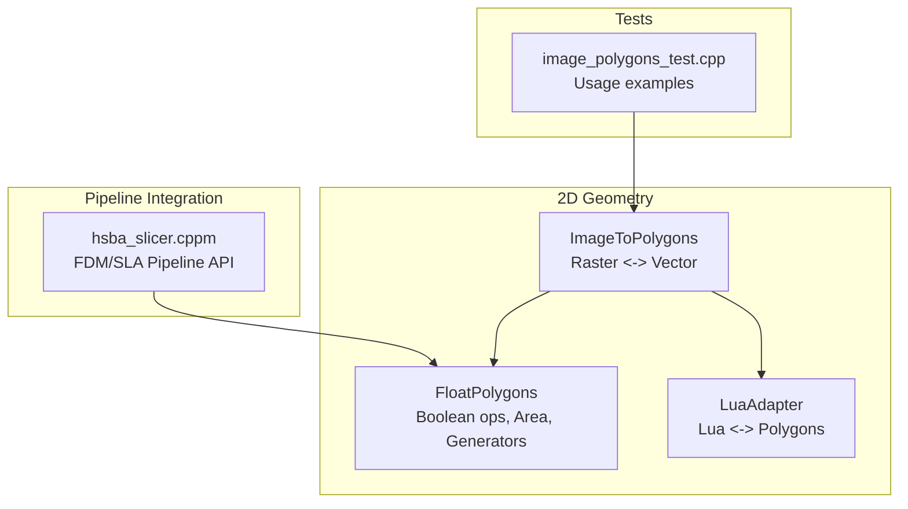
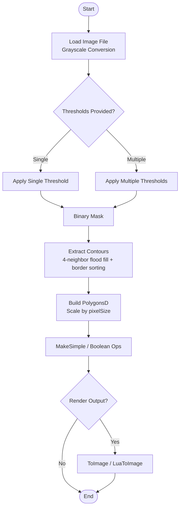
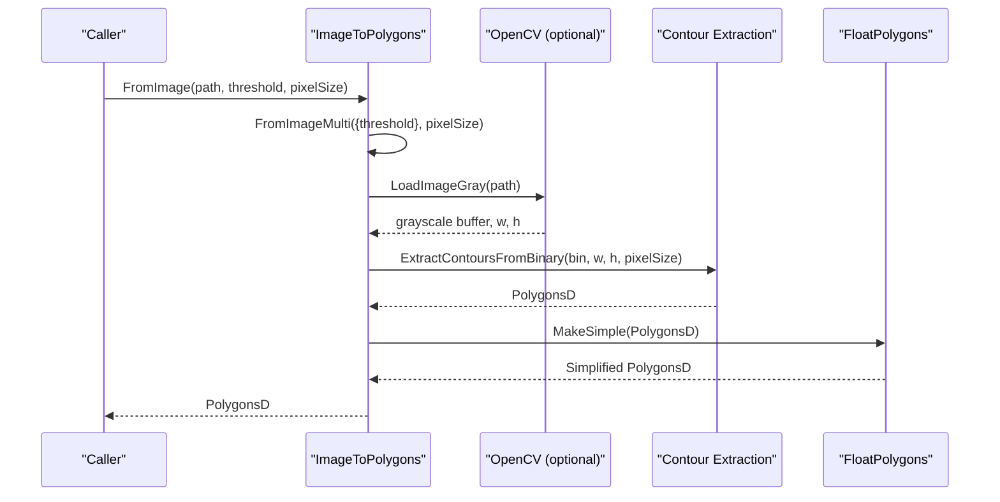
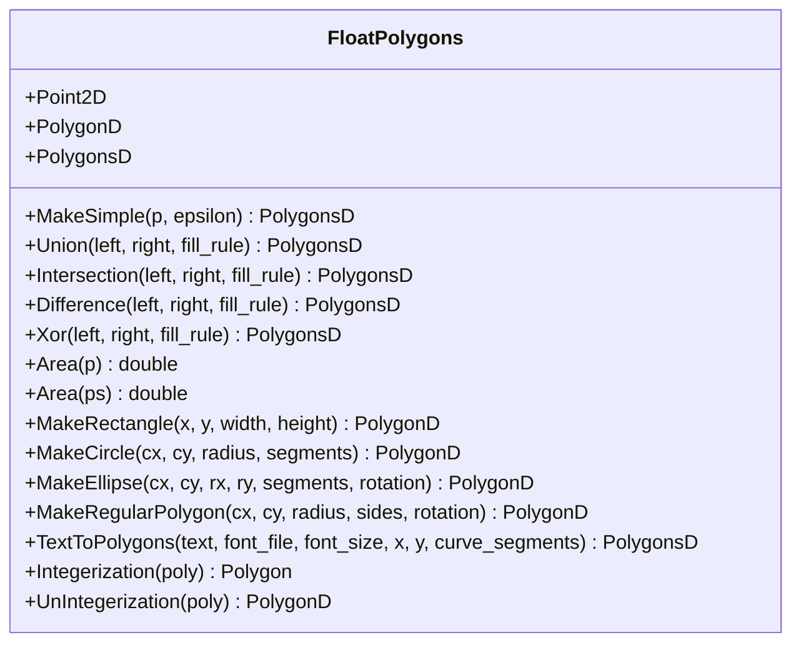
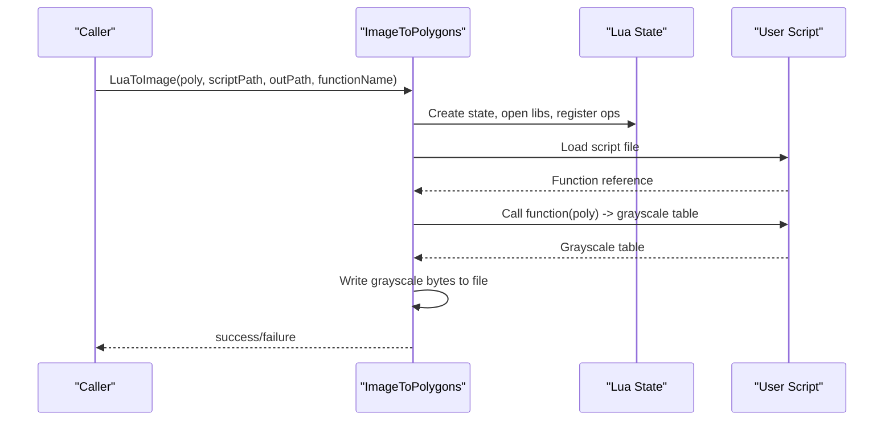
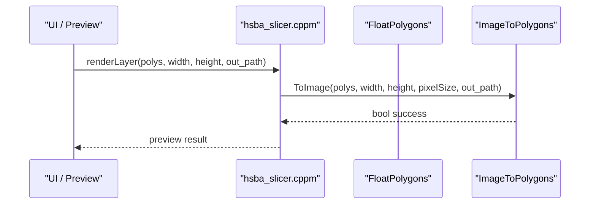
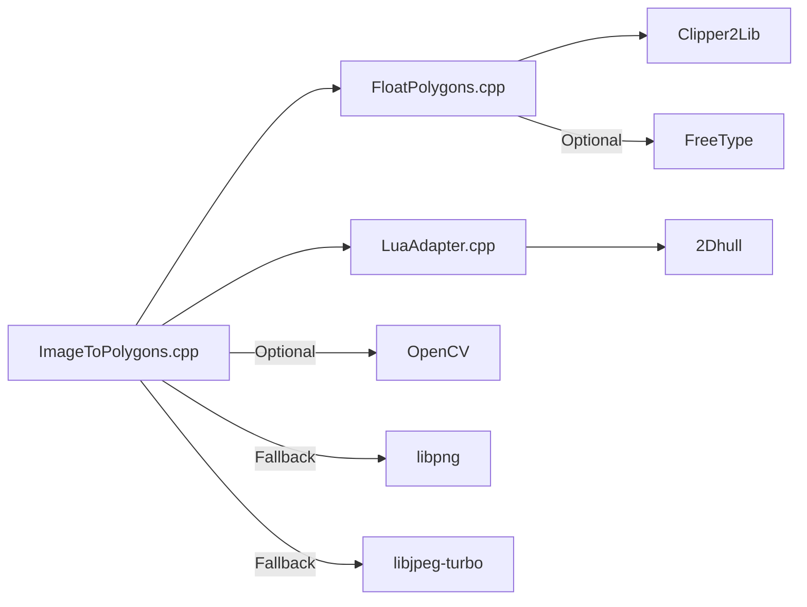

# Image to Polygon Conversion

<cite>
**Referenced Files in This Document**   
- [ImageToPolygons.hpp](file://2D/ImageToPolygons.hpp)
- [ImageToPolygons.cpp](file://2D/ImageToPolygons.cpp)
- [FloatPolygons.hpp](file://2D/FloatPolygons.hpp)
- [FloatPolygons.cpp](file://2D/FloatPolygons.cpp)
- [LuaAdapter.hpp](file://2D/LuaAdapter.hpp)
- [LuaAdapter.cpp](file://2D/LuaAdapter.cpp)
- [hsba_slicer.cppm](file://ModuleHsBaSlicer/hsba_slicer.cppm)
- [image_polygons_test.cpp](file://tests/PolygonFill/image_polygons_test.cpp)
</cite>

## Table of Contents
1. [Introduction](#introduction)
2. [Project Structure](#project-structure)
3. [Core Components](#core-components)
4. [Architecture Overview](#architecture-overview)
5. [Detailed Component Analysis](#detailed-component-analysis)
6. [Dependency Analysis](#dependency-analysis)
7. [Performance Considerations](#performance-considerations)
8. [Troubleshooting Guide](#troubleshooting-guide)
9. [Conclusion](#conclusion)
10. [Appendices](#appendices)

## Introduction
This document explains how the repository converts bitmap images into vector-based polygon infill patterns using the ImageToPolygons functionality, and how it integrates with FloatPolygons for precise geometric manipulation. It covers the image processing pipeline (thresholding, contour extraction), supported image formats, color-to-gray conversion, resolution settings, Lua-driven rendering, boolean operations, geometric transformations, memory management, performance optimization, and integration points with the slicing pipeline for preview workflows.

## Project Structure
The relevant code is organized under the 2D geometry module and related utilities:
- 2D/ImageToPolygons.* implements raster-to-polygon and polygon-to-raster conversions, including multi-threshold extraction and Lua-driven generation.
- 2D/FloatPolygons.* defines double-precision polygon types and provides boolean operations, area computation, shape generators, and integerization helpers.
- 2D/LuaAdapter.* bridges Lua tables and C++ polygon types, exposing polygon operations to Lua scripts.
- ModuleHsBaSlicer/hsba_slicer.cppm exposes high-level pipeline APIs that can consume or render polygons.
- tests/PolygonFill/image_polygons_test.cpp demonstrates usage of FromImage and FromImageMulti.

**Diagram sources**
- [ImageToPolygons.hpp:22-79](file://2D/ImageToPolygons.hpp#L22-L79)
- [FloatPolygons.hpp:18-221](file://2D/FloatPolygons.hpp#L18-L221)
- [LuaAdapter.hpp:16-81](file://2D/LuaAdapter.hpp#L16-L81)
- [hsba_slicer.cppm:204-252](file://ModuleHsBaSlicer/hsba_slicer.cppm#L204-L252)
- [image_polygons_test.cpp:39-46](file://tests/PolygonFill/image_polygons_test.cpp#L39-L46)

**Section sources**
- [ImageToPolygons.hpp:22-79](file://2D/ImageToPolygons.hpp#L22-L79)
- [FloatPolygons.hpp:18-221](file://2D/FloatPolygons.hpp#L18-L221)
- [LuaAdapter.hpp:16-81](file://2D/LuaAdapter.hpp#L16-L81)
- [hsba_slicer.cppm:204-252](file://ModuleHsBaSlicer/hsba_slicer.cppm#L204-L252)
- [image_polygons_test.cpp:39-46](file://tests/PolygonFill/image_polygons_test.cpp#L39-L46)

## Core Components
- ImageToPolygons: Provides functions to convert images to polygons via thresholding and to render polygons back to images (PNG/JPEG/SVG). Supports single and multi-threshold extraction.
- FloatPolygons: Defines double-precision polygon types and offers boolean operations (union, intersection, difference, xor), area calculation, shape generators (rectangle, circle, ellipse, regular polygon), text-to-polygons, and integerization utilities.
- LuaAdapter: Exposes polygon operations to Lua, enabling script-driven generation and manipulation of polygons and images.

Key responsibilities:
- Raster loading and grayscale conversion.
- Binary thresholding and contour extraction.
- Polygon simplification and boolean operations.
- Rendering polygons to images or SVG.
- Lua scripting for custom texture and gradient infills.

**Section sources**
- [ImageToPolygons.hpp:22-79](file://2D/ImageToPolygons.hpp#L22-L79)
- [FloatPolygons.hpp:18-221](file://2D/FloatPolygons.hpp#L18-L221)
- [LuaAdapter.hpp:16-81](file://2D/LuaAdapter.hpp#L16-L81)

## Architecture Overview
The image-to-polygon pipeline consists of:
1. Loading an image file and converting it to grayscale.
2. Applying one or more thresholds to produce binary masks.
3. Extracting contours from each binary mask and converting them to double-precision polygons.
4. Optionally simplifying polygons and performing boolean operations.
5. Rendering polygons back to images or exporting as SVG for visualization.

**Diagram sources**
- [ImageToPolygons.cpp:34-65](file://2D/ImageToPolygons.cpp#L34-L65)
- [ImageToPolygons.cpp:87-174](file://2D/ImageToPolygons.cpp#L87-L174)
- [ImageToPolygons.cpp:282-288](file://2D/ImageToPolygons.cpp#L282-L288)
- [ImageToPolygons.cpp:395-415](file://2D/ImageToPolygons.cpp#L395-L415)
- [ImageToPolygons.cpp:291-393](file://2D/ImageToPolygons.cpp#L291-L393)

**Section sources**
- [ImageToPolygons.cpp:34-65](file://2D/ImageToPolygons.cpp#L34-L65)
- [ImageToPolygons.cpp:87-174](file://2D/ImageToPolygons.cpp#L87-L174)
- [ImageToPolygons.cpp:282-288](file://2D/ImageToPolygons.cpp#L282-L288)
- [ImageToPolygons.cpp:395-415](file://2D/ImageToPolygons.cpp#L395-L415)
- [ImageToPolygons.cpp:291-393](file://2D/ImageToPolygons.cpp#L291-L393)

## Detailed Component Analysis

### Image Processing Pipeline
- Grayscale conversion: When OpenCV is available, images are loaded and converted to grayscale; otherwise, fallback paths exist.
- Thresholding: For each provided threshold, a binary mask is created where pixels above the threshold become foreground.
- Contour extraction: A 4-neighbor flood fill identifies connected components; border pixels are sorted angularly around the component centroid to form closed polygons.
- Scaling: Polygon coordinates are scaled by pixelSize to map pixel indices to output units.

**Diagram sources**
- [ImageToPolygons.cpp:282-288](file://2D/ImageToPolygons.cpp#L282-L288)
- [ImageToPolygons.cpp:395-415](file://2D/ImageToPolygons.cpp#L395-L415)
- [ImageToPolygons.cpp:87-174](file://2D/ImageToPolygons.cpp#L87-L174)
- [FloatPolygons.cpp:25-32](file://2D/FloatPolygons.cpp#L25-L32)

**Section sources**
- [ImageToPolygons.cpp:34-65](file://2D/ImageToPolygons.cpp#L34-L65)
- [ImageToPolygons.cpp:87-174](file://2D/ImageToPolygons.cpp#L87-L174)
- [ImageToPolygons.cpp:282-288](file://2D/ImageToPolygons.cpp#L282-L288)
- [ImageToPolygons.cpp:395-415](file://2D/ImageToPolygons.cpp#L395-L415)

### Supported Image Formats and Color-to-Gray Conversion
- Input formats: The implementation uses OpenCV’s imread when available, which supports common formats such as PNG, JPEG, BMP, etc. If OpenCV is not enabled, the code path returns false for loading.
- Grayscale conversion: Uses cvtColor BGR2GRAY when the image has multiple channels; single-channel images are used directly.
- Output formats:
  - PNG: Always available via libpng fallback if OpenCV is disabled; otherwise via OpenCV imwrite.
  - JPEG: Available via libjpeg-turbo when OpenCV is disabled; otherwise via OpenCV.
  - SVG: Vector export of polygons to simple SVG with background rect and polygon elements.

**Section sources**
- [ImageToPolygons.cpp:34-65](file://2D/ImageToPolygons.cpp#L34-L65)
- [ImageToPolygons.cpp:194-258](file://2D/ImageToPolygons.cpp#L194-L258)
- [ImageToPolygons.cpp:325-393](file://2D/ImageToPolygons.cpp#L325-L393)

### Resolution Settings and Output Quality
- pixelSize controls the mapping from pixel indices to output coordinates. Larger pixelSize increases physical size per pixel, affecting detail and density of extracted polygons.
- width and height parameters in ToImage define the raster canvas size for rendering polygons back to images.
- Foreground/background colors control contrast in rendered outputs.

Recommendations:
- Choose pixelSize based on desired feature resolution relative to model units.
- Use appropriate width/height to avoid excessive rasterization cost while maintaining visual fidelity.

**Section sources**
- [ImageToPolygons.hpp:22-53](file://2D/ImageToPolygons.hpp#L22-L53)
- [ImageToPolygons.cpp:291-393](file://2D/ImageToPolygons.cpp#L291-L393)

### FloatPolygons Operations
- Types: Point2D, PolygonD, PolygonsD are double-precision types backed by Clipper2Lib.
- Boolean operations: Union, Intersection, Difference, Xor for both single polygons and sets of polygons.
- Area: Computes signed area for polygons and total area for polygon sets.
- Generators: Rectangle, Circle, Ellipse, RegularPolygon, TextToPolygons (requires FreeType).
- Integerization: Converts between double-precision and integer coordinates using a scaling factor.

**Diagram sources**
- [FloatPolygons.hpp:18-221](file://2D/FloatPolygons.hpp#L18-L221)
- [FloatPolygons.cpp:25-75](file://2D/FloatPolygons.cpp#L25-L75)
- [FloatPolygons.cpp:176-213](file://2D/FloatPolygons.cpp#L176-L213)
- [FloatPolygons.cpp:314-407](file://2D/FloatPolygons.cpp#L314-L407)

**Section sources**
- [FloatPolygons.hpp:18-221](file://2D/FloatPolygons.hpp#L18-L221)
- [FloatPolygons.cpp:25-75](file://2D/FloatPolygons.cpp#L25-L75)
- [FloatPolygons.cpp:176-213](file://2D/FloatPolygons.cpp#L176-L213)
- [FloatPolygons.cpp:314-407](file://2D/FloatPolygons.cpp#L314-L407)

### Lua-Driven Image Generation and Custom Effects
- LuaToImage and LuaToImageString allow executing Lua scripts to generate grayscale images from polygons. Scripts receive polygons and return a table of grayscale values.
- RegisterLuaPolygonOperations exposes polygon operations (boolean ops, offsets, hulls, area, shape generators, text-to-polygons) to Lua via a PolygonOperations table.

**Diagram sources**
- [ImageToPolygons.cpp:417-478](file://2D/ImageToPolygons.cpp#L417-L478)
- [LuaAdapter.cpp:415-419](file://2D/LuaAdapter.cpp#L415-L419)

**Section sources**
- [ImageToPolygons.cpp:417-478](file://2D/ImageToPolygons.cpp#L417-L478)
- [LuaAdapter.cpp:22-42](file://2D/LuaAdapter.cpp#L22-L42)
- [LuaAdapter.cpp:88-127](file://2D/LuaAdapter.cpp#L88-L127)
- [LuaAdapter.cpp:139-221](file://2D/LuaAdapter.cpp#L139-L221)
- [LuaAdapter.cpp:415-419](file://2D/LuaAdapter.cpp#L415-L419)

### Examples of Texture-Based Infills, Gradient Patterns, and Custom Visual Effects
- Texture-based infills: Provide a texture image path and use FromImage or FromImageMulti with multiple thresholds to extract layered polygons representing different intensity bands. Combine results using FloatPolygons union/difference to create complex patterns.
- Gradient patterns: Generate grayscale gradients programmatically in Lua and pass through LuaToImageString to obtain rasterized layers; then process those layers into polygons for further manipulation.
- Custom visual effects: Use Lua scripts to apply morphological operations, noise, or procedural patterns before saving intermediate images or generating final polygons.

Practical workflow:
1. Prepare a grayscale image or generate one in Lua.
2. Choose thresholds to isolate features.
3. Extract polygons and simplify.
4. Apply boolean operations to combine or subtract regions.
5. Render to image or integrate into slicing pipeline.

**Section sources**
- [ImageToPolygons.cpp:395-415](file://2D/ImageToPolygons.cpp#L395-L415)
- [ImageToPolygons.cpp:417-478](file://2D/ImageToPolygons.cpp#L417-L478)
- [FloatPolygons.cpp:34-66](file://2D/FloatPolygons.cpp#L34-L66)

### Integration with Slicing Pipeline for Real-Time Preview
- hsba_slicer.cppm exposes FdmPipeline::fill and SlaPipeline::renderLayer, which can be used to integrate polygon infills and layer previews.
- While direct calls to ImageToPolygons within these pipelines are not shown in the referenced snippet, the pipeline APIs accept PolygonsD and provide rendering capabilities suitable for real-time preview.

**Diagram sources**
- [hsba_slicer.cppm:248-252](file://ModuleHsBaSlicer/hsba_slicer.cppm#L248-L252)
- [ImageToPolygons.cpp:291-393](file://2D/ImageToPolygons.cpp#L291-L393)

**Section sources**
- [hsba_slicer.cppm:248-252](file://ModuleHsBaSlicer/hsba_slicer.cppm#L248-L252)
- [ImageToPolygons.cpp:291-393](file://2D/ImageToPolygons.cpp#L291-L393)

## Dependency Analysis
- ImageToPolygons depends on:
  - FloatPolygons for polygon types and simplification.
  - Optional OpenCV for image IO and grayscale conversion.
  - libpng and libjpeg-turbo for fallback image writing.
  - Lua for script-driven generation.
- FloatPolygons depends on:
  - Clipper2Lib for boolean operations and area calculations.
  - Optional FreeType for text-to-polygons.
- LuaAdapter depends on:
  - FloatPolygons and IntPolygon for type conversions.
  - 2Dhull for convex/concave hull operations exposed to Lua.

**Diagram sources**
- [ImageToPolygons.cpp:15-26](file://2D/ImageToPolygons.cpp#L15-L26)
- [FloatPolygons.cpp:7-21](file://2D/FloatPolygons.cpp#L7-L21)
- [LuaAdapter.cpp:9-10](file://2D/LuaAdapter.cpp#L9-L10)

**Section sources**
- [ImageToPolygons.cpp:15-26](file://2D/ImageToPolygons.cpp#L15-L26)
- [FloatPolygons.cpp:7-21](file://2D/FloatPolygons.cpp#L7-L21)
- [LuaAdapter.cpp:9-10](file://2D/LuaAdapter.cpp#L9-L10)

## Performance Considerations
- Memory management:
  - Large images allocate contiguous buffers for grayscale and binary masks; ensure sufficient heap space and consider downsampling very large inputs.
  - Avoid unnecessary copies by moving vectors where possible (e.g., std::move in contour extraction).
- Optimization techniques:
  - Prefer OpenCV-enabled builds for faster image IO and rasterization.
  - Use fewer thresholds to reduce repeated processing.
  - Simplify polygons aggressively with MakeSimple to reduce vertex count.
  - Batch boolean operations on polygon sets rather than iterating individually.
- Real-time preview:
  - Limit width/height for preview renders.
  - Cache intermediate grayscale images and binary masks when reusing thresholds.
  - Offload heavy Lua computations to background threads if needed.

[No sources needed since this section provides general guidance]

## Troubleshooting Guide
Common issues and resolutions:
- Image loading fails:
  - Ensure OpenCV is enabled and the image path is valid.
  - Verify supported formats and channel layout.
- No polygons extracted:
  - Adjust thresholds to separate foreground from background.
  - Check pixelSize scaling; too small may yield negligible features.
- Lua script errors:
  - Validate function name and argument types.
  - Ensure returned table contains integers clamped to grayscale range.
- Rendering failures:
  - Confirm output directory permissions.
  - For SVG, verify polygon coordinates are finite and non-empty.

**Section sources**
- [ImageToPolygons.cpp:34-65](file://2D/ImageToPolygons.cpp#L34-L65)
- [ImageToPolygons.cpp:417-478](file://2D/ImageToPolygons.cpp#L417-L478)
- [ImagePolygonsTest:39-46](file://tests/PolygonFill/image_polygons_test.cpp#L39-L46)

## Conclusion
The ImageToPolygons module provides a robust pipeline for converting raster images into vector polygons suitable for infill patterns. Combined with FloatPolygons’ boolean operations and Lua-driven customization, users can create sophisticated textures, gradients, and visual effects. Proper configuration of thresholds, pixelSize, and rendering dimensions ensures high-quality outputs while balancing performance and memory usage. Integration points with the slicing pipeline enable real-time previews and seamless adoption in production workflows.

[No sources needed since this section summarizes without analyzing specific files]

## Appendices

### Usage Examples from Tests
- Basic conversion:
  - FromImage(path, threshold=128, pixelSize=1.0)
  - FromImageMulti(path, thresholds=[...], pixelSize=1.0)
- Error handling:
  - Missing image paths return empty polygon sets.

**Section sources**
- [image_polygons_test.cpp:39-46](file://tests/PolygonFill/image_polygons_test.cpp#L39-L46)
- [image_polygons_test.cpp:170-175](file://tests/PolygonFill/image_polygons_test.cpp#L170-L175)