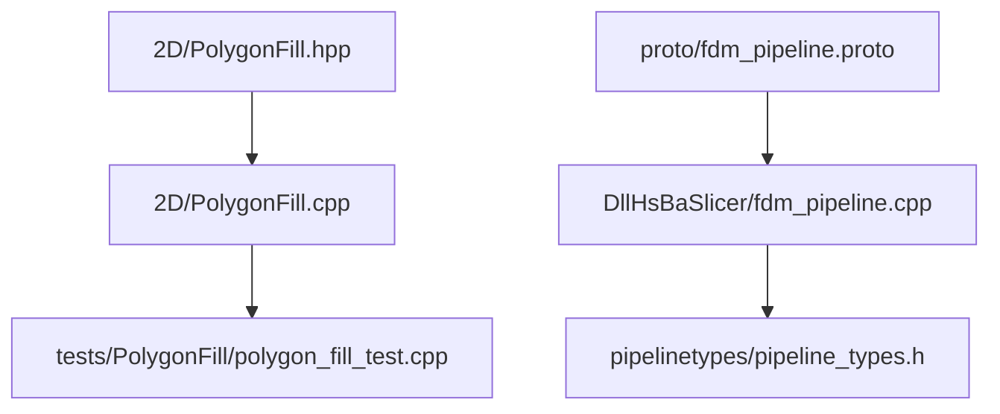
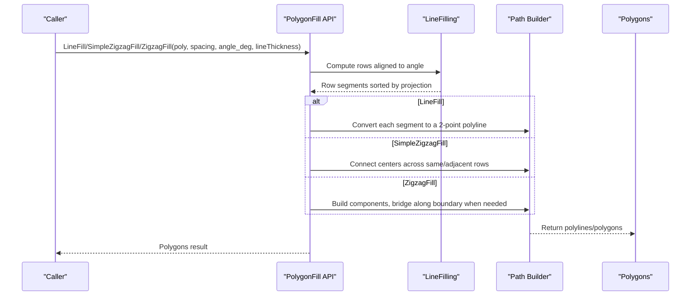
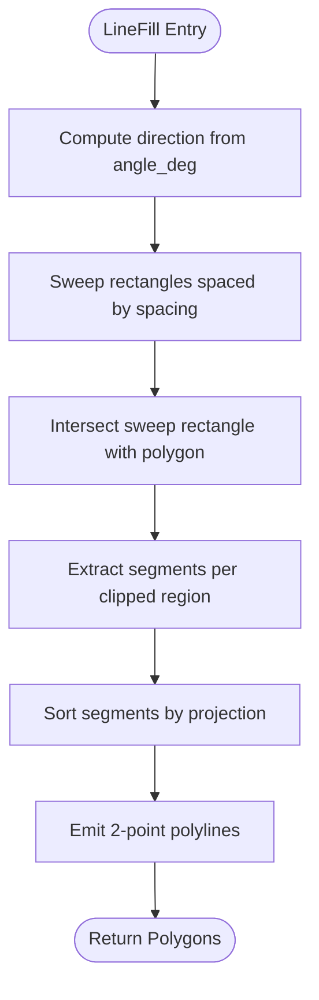
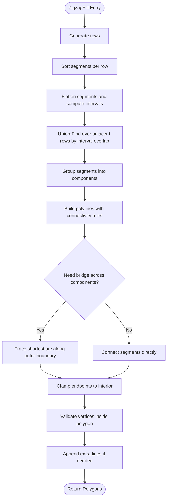
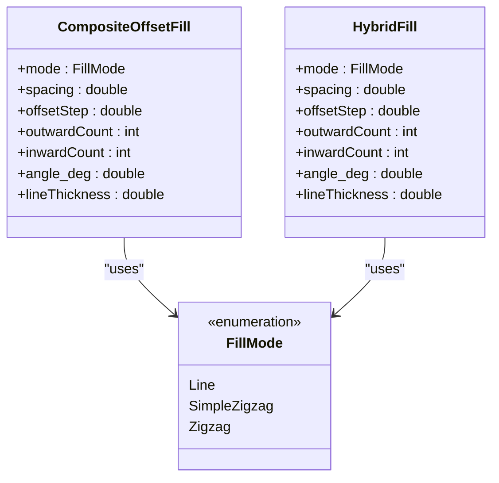
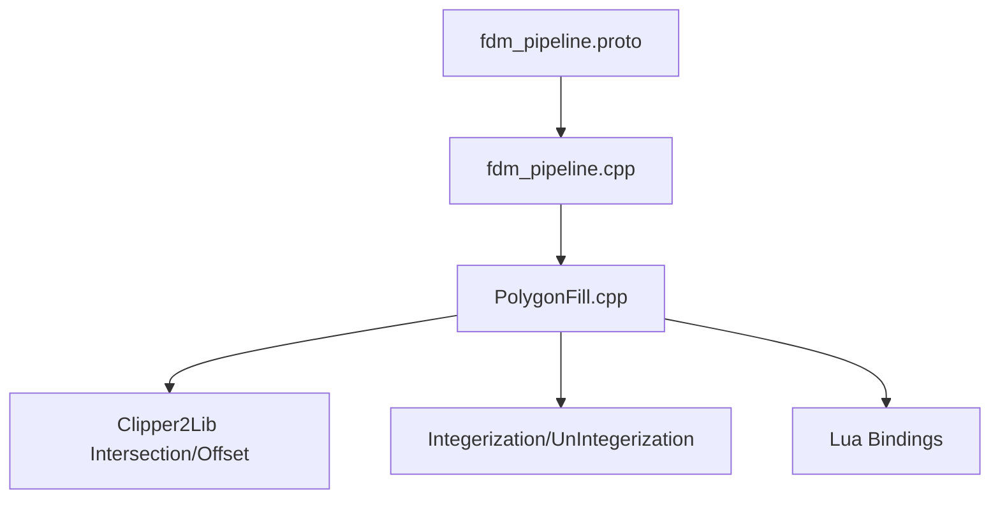

# Line and Zigzag Fill Patterns

<cite>
**Referenced Files in This Document**
- [PolygonFill.hpp](file://2D/PolygonFill.hpp)
- [PolygonFill.cpp](file://2D/PolygonFill.cpp)
- [polygon_fill_test.cpp](file://tests/PolygonFill/polygon_fill_test.cpp)
- [fdm_pipeline.cpp](file://DllHsBaSlicer/fdm_pipeline.cpp)
- [pipeline_types.h](file://pipelinetypes/pipeline_types.h)
- [fdm_pipeline.proto](file://proto/fdm_pipeline.proto)
</cite>

## Table of Contents
1. [Introduction](#introduction)
2. [Project Structure](#project-structure)
3. [Core Components](#core-components)
4. [Architecture Overview](#architecture-overview)
5. [Detailed Component Analysis](#detailed-component-analysis)
6. [Dependency Analysis](#dependency-analysis)
7. [Performance Considerations](#performance-considerations)
8. [Troubleshooting Guide](#troubleshooting-guide)
9. [Conclusion](#conclusion)

## Introduction
This document explains the line-based and zigzag fill algorithms implemented in HsBaSlicer’s 2D polygon fill module. It focuses on:
- The LineFill function for generating parallel line patterns with configurable angles and spacing.
- The differences between SimpleZigzagFill and the advanced ZigzagFill, including corner handling and path continuity.
- The FillMode enumeration and how it controls fill behavior in composite/hybrid fills.
- Practical guidance on angle_deg effects on print strength and material usage, lineThickness optimization across materials, and performance tuning for high-density fills.
- Common issues such as path overlap and strategies to avoid gaps.

## Project Structure
The fill algorithms are implemented in the 2D geometry layer and exposed via a C++ API and Lua bindings. Tests validate correctness for basic shapes, concave geometries, and multi-contour inputs.

**Diagram sources**
- [PolygonFill.hpp:1-141](file://2D/PolygonFill.hpp#L1-L141)
- [PolygonFill.cpp:1-1449](file://2D/PolygonFill.cpp#L1-L1449)
- [polygon_fill_test.cpp:1-200](file://tests/PolygonFill/polygon_fill_test.cpp#L1-L200)
- [fdm_pipeline.cpp:49-68](file://DllHsBaSlicer/fdm_pipeline.cpp#L49-L68)
- [pipeline_types.h:73-91](file://pipelinetypes/pipeline_types.h#L73-L91)
- [fdm_pipeline.proto:5-10](file://proto/fdm_pipeline.proto#L5-L10)

**Section sources**
- [PolygonFill.hpp:1-141](file://2D/PolygonFill.hpp#L1-L141)
- [PolygonFill.cpp:1-1449](file://2D/PolygonFill.cpp#L1-L1449)
- [polygon_fill_test.cpp:1-200](file://tests/PolygonFill/polygon_fill_test.cpp#L1-L200)
- [fdm_pipeline.cpp:49-68](file://DllHsBaSlicer/fdm_pipeline.cpp#L49-L68)
- [pipeline_types.h:73-91](file://pipelinetypes/pipeline_types.h#L73-L91)
- [fdm_pipeline.proto:5-10](file://proto/fdm_pipeline.proto#L5-L10)

## Core Components
- LineFill: Generates independent parallel line segments across the polygon at a given angle and spacing.
- SimpleZigzagFill: Builds a connected serpentine path by linking segment centers across adjacent scanlines; limited connectivity rules.
- ZigzagFill: Advanced zigzag with improved corner handling, component-aware bridging along polygon boundaries, and robust fallbacks.
- FillMode: Enumeration controlling which fill algorithm is used inside CompositeOffsetFill and HybridFill.

Key responsibilities:
- Polygon clipping and row generation (LineFilling).
- Path construction and connectivity decisions.
- Boundary adherence and bridge generation for complex shapes.

**Section sources**
- [PolygonFill.hpp:30-68](file://2D/PolygonFill.hpp#L30-L68)
- [PolygonFill.cpp:39-137](file://2D/PolygonFill.cpp#L39-L137)
- [PolygonFill.cpp:453-674](file://2D/PolygonFill.cpp#L453-L674)
- [PolygonFill.cpp:676-1175](file://2D/PolygonFill.cpp#L676-L1175)

## Architecture Overview
The fill pipeline starts from input polygons, computes scanline rows aligned to the chosen angle, and then constructs either independent lines or connected zigzag paths. Composite and hybrid fills apply offsets around the base polygon and reuse the selected fill mode internally.

**Diagram sources**
- [PolygonFill.cpp:39-137](file://2D/PolygonFill.cpp#L39-L137)
- [PolygonFill.cpp:453-674](file://2D/PolygonFill.cpp#L453-L674)
- [PolygonFill.cpp:676-1175](file://2D/PolygonFill.cpp#L676-L1175)

## Detailed Component Analysis

### LineFill: Parallel Lines
LineFill produces independent straight-line segments per scanline. Internally, it uses a shared row generator that:
- Computes the direction vector from angle_deg.
- Sweeps parallel lines spaced by spacing.
- Clips each sweep rectangle against the polygon to obtain segments.
- Sorts segments along the sweep axis.

Complexity considerations:
- Row generation involves intersection operations proportional to polygon complexity and number of sweeps.
- Sorting per row adds O(k log k) where k is the number of segments per row.

Practical implications:
- Angle_deg rotates the sweep direction; 0° yields horizontal lines.
- Spacing controls density; smaller spacing increases path count and material usage.
- lineThickness is not applied to output segments here (used internally for sweep width), so extrusion settings should be handled downstream.

**Diagram sources**
- [PolygonFill.cpp:39-137](file://2D/PolygonFill.cpp#L39-L137)
- [PolygonFill.cpp:453-473](file://2D/PolygonFill.cpp#L453-L473)

**Section sources**
- [PolygonFill.cpp:39-137](file://2D/PolygonFill.cpp#L39-L137)
- [PolygonFill.cpp:453-473](file://2D/PolygonFill.cpp#L453-L473)

### SimpleZigzagFill vs ZigzagFill
Both functions build on the same row generation but differ in connectivity and corner handling.

SimpleZigzagFill:
- Connects segment centers across the same row or immediately adjacent rows.
- Uses binary search to clamp endpoints to the interior of the polygon.
- Avoids connecting across non-adjacent rows to prevent loops.

ZigzagFill (advanced):
- Computes connectivity using interval overlaps between adjacent rows and union-find to group segments into components.
- When switching components across adjacent rows, attempts to build a bridge along the outer boundary to maintain continuity.
- Falls back to midpoint checks or emits extra straight segments if bridging fails.
- Ensures all vertices remain within the original polygon bounds.

**Diagram sources**
- [PolygonFill.cpp:676-1175](file://2D/PolygonFill.cpp#L676-L1175)

Key differences summarized:
- Connectivity: SimpleZigzag restricts connections to same/adjacent rows; Zigzag uses interval overlap and union-find for robust connectivity.
- Corner handling: Zigzag builds bridges along the polygon boundary to route around open notches and concavities.
- Robustness: Zigzag includes multiple fallbacks (midpoint check, extra lines) to avoid gaps and invalid vertices.

**Section sources**
- [PolygonFill.cpp:475-674](file://2D/PolygonFill.cpp#L475-L674)
- [PolygonFill.cpp:676-1175](file://2D/PolygonFill.cpp#L676-L1175)

### FillMode Enumeration
FillMode selects the internal fill algorithm used by CompositeOffsetFill and HybridFill:
- Line: Parallel line fill.
- SimpleZigzag: Simple zigzag fill.
- Zigzag: Advanced zigzag fill.

CompositeOffsetFill applies the selected fill mode to the base polygon and to outward/inward offset layers. HybridFill generates offset borders and fills the final inward offset region using the selected mode.

**Diagram sources**
- [PolygonFill.hpp:60-68](file://2D/PolygonFill.hpp#L60-L68)
- [PolygonFill.cpp:1177-1228](file://2D/PolygonFill.cpp#L1177-L1228)
- [PolygonFill.cpp:1230-1281](file://2D/PolygonFill.cpp#L1230-L1281)

**Section sources**
- [PolygonFill.hpp:60-68](file://2D/PolygonFill.hpp#L60-L68)
- [PolygonFill.cpp:1177-1228](file://2D/PolygonFill.cpp#L1177-L1228)
- [PolygonFill.cpp:1230-1281](file://2D/PolygonFill.cpp#L1230-L1281)

### Practical Examples and Guidance

#### Angle Effects on Print Strength and Material Usage
- Angle_deg rotates the fill pattern relative to the model axes. For isotropic strength, consider alternating angles across layers (e.g., 45°/−45°).
- At 0°, lines are horizontal; at 90°, vertical. Intermediate angles distribute stresses differently depending on load directions.
- Smaller spacing increases density and material usage; larger spacing reduces infill mass but may weaken inter-layer bonding.

Validation references:
- Tests assert that horizontal lines at 0° align with polygon boundaries and lie entirely inside the shape.

**Section sources**
- [polygon_fill_test.cpp:39-56](file://tests/PolygonFill/polygon_fill_test.cpp#L39-L56)

#### lineThickness Optimization for Different Materials
- In LineFill, lineThickness is used internally for sweep width rather than directly setting extrusion width; downstream extrusion settings control actual printed line width.
- For brittle materials (e.g., PLA), moderate lineThickness and spacing can reduce stress concentrations.
- For flexible materials (e.g., TPU), slightly larger spacing with consistent lineThickness improves flexibility while maintaining strength.
- High-density fills benefit from balancing spacing and lineThickness to avoid excessive overlap and under-extrusion.

Implementation notes:
- The sweep width in row generation scales with lineThickness, affecting segment extraction accuracy.

**Section sources**
- [PolygonFill.cpp:39-137](file://2D/PolygonFill.cpp#L39-L137)
- [PolygonFill.cpp:453-473](file://2D/PolygonFill.cpp#L453-L473)

#### Performance Tuning for High-Density Fills
- MAX_FILL_ITERATIONS caps nested offset iterations to prevent runaway loops.
- MAX_BINARY_SEARCH_ITERATIONS limits precision searches for clamping endpoints; reducing this can speed up processing at the cost of minor boundary precision.
- LARGE_ROW_OFFSET ensures safe row indexing when building polylines.
- Prefer ZigzagFill for complex shapes due to its robust connectivity and bridging logic, even though it performs more computations.

Tuning recommendations:
- Increase spacing to reduce path count for large areas.
- Use ZigzagFill for concave or multi-island geometries to minimize gaps.
- Keep lineThickness reasonable to avoid excessive computational overhead during sweep clipping.

**Section sources**
- [PolygonFill.cpp:23-28](file://2D/PolygonFill.cpp#L23-L28)
- [PolygonFill.cpp:442-450](file://2D/PolygonFill.cpp#L442-L450)
- [PolygonFill.cpp:503-531](file://2D/PolygonFill.cpp#L503-L531)
- [PolygonFill.cpp:808-837](file://2D/PolygonFill.cpp#L808-L837)

## Dependency Analysis
The fill APIs depend on polygon math utilities (intersection, offset, area) and integerization helpers. They are integrated into higher-level pipelines (FDM/SLA) and exposed via Lua for custom scripts.

**Diagram sources**
- [PolygonFill.cpp:1-1449](file://2D/PolygonFill.cpp#L1-L1449)
- [fdm_pipeline.cpp:49-68](file://DllHsBaSlicer/fdm_pipeline.cpp#L49-L68)
- [fdm_pipeline.proto:5-10](file://proto/fdm_pipeline.proto#L5-L10)

**Section sources**
- [PolygonFill.cpp:1-1449](file://2D/PolygonFill.cpp#L1-L1449)
- [fdm_pipeline.cpp:49-68](file://DllHsBaSlicer/fdm_pipeline.cpp#L49-L68)
- [fdm_pipeline.proto:5-10](file://proto/fdm_pipeline.proto#L5-L10)

## Performance Considerations
- Time complexity:
  - Row generation: O(n_sweeps × n_polygon_edges) for intersections.
  - Sorting per row: O(k log k).
  - Zigzag connectivity: O(N^2) naive adjacency checks mitigated by interval overlap and union-find grouping.
- Memory usage:
  - Stores rows, segment lists, and polylines; keep spacing reasonable to limit row counts.
- Numerical stability:
  - Binary search clamping uses fixed iteration counts; ensure coordinates are scaled appropriately via integerization.

[No sources needed since this section provides general guidance]

## Troubleshooting Guide

Common issues and resolutions:
- Path overlap:
  - Cause: Too small spacing relative to lineThickness causing overlapping sweeps.
  - Resolution: Increase spacing or adjust lineThickness; verify with tests that segments lie inside the polygon.
- Gaps in zigzag paths:
  - Cause: Disconnected components across rows without proper bridging.
  - Resolution: Use ZigzagFill for better bridging; ensure spacing is not too large relative to feature size.
- Vertices outside polygon bounds:
  - Cause: Incorrect clamping or invalid segment endpoints.
  - Resolution: Verify clamping logic and binary search parameters; tests assert all vertices are inside or on the boundary.
- Excessive computation time:
  - Cause: Very small spacing or overly precise binary search.
  - Resolution: Tune spacing and consider reducing MAX_BINARY_SEARCH_ITERATIONS if acceptable.

Validation references:
- Tests confirm that zigzag outputs remain within polygon bounds and cover contours for both simple and multi-contour cases.

**Section sources**
- [polygon_fill_test.cpp:58-83](file://tests/PolygonFill/polygon_fill_test.cpp#L58-L83)
- [polygon_fill_test.cpp:620-647](file://tests/PolygonFill/polygon_fill_test.cpp#L620-L647)
- [polygon_fill_test.cpp:649-679](file://tests/PolygonFill/polygon_fill_test.cpp#L649-L679)

## Conclusion
HsBaSlicer’s fill algorithms provide robust options for generating parallel lines and zigzag patterns. LineFill offers simplicity and speed, while ZigzagFill delivers advanced connectivity and corner handling suitable for complex geometries. FillMode allows flexible composition with offset borders. By carefully selecting angle_deg, spacing, and lineThickness, users can balance print strength, material usage, and performance. The provided tests and implementation details serve as reliable references for validating and optimizing fill patterns.

[No sources needed since this section summarizes without analyzing specific files]