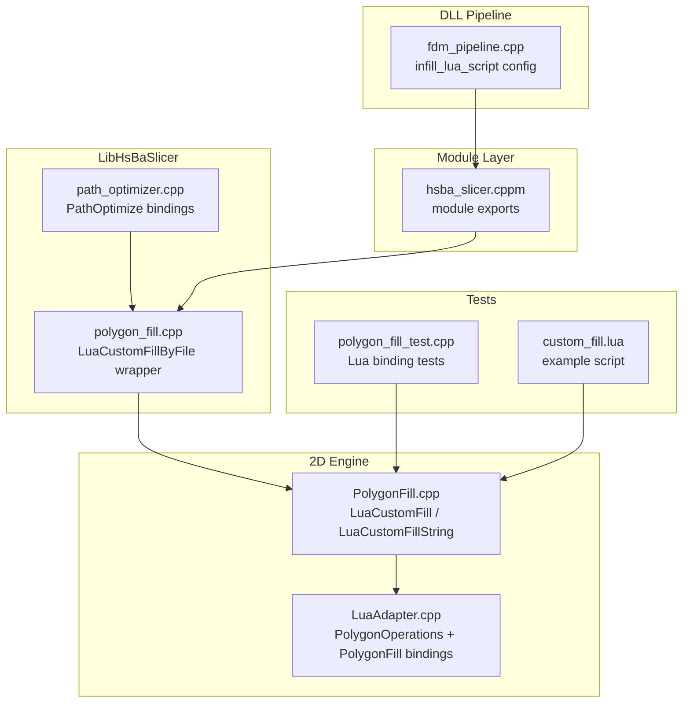
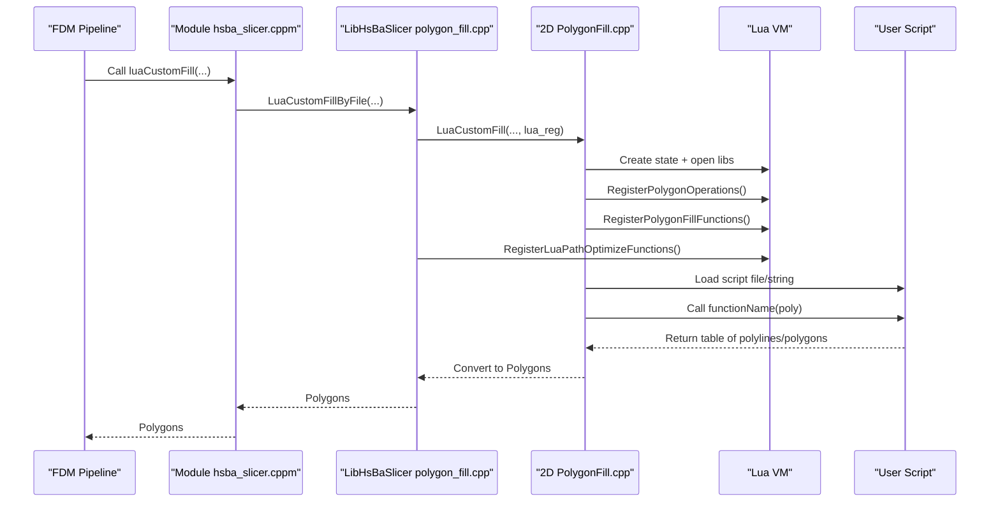
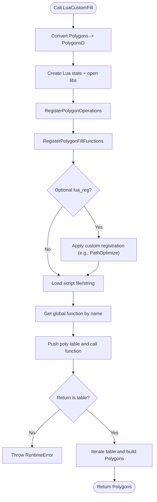
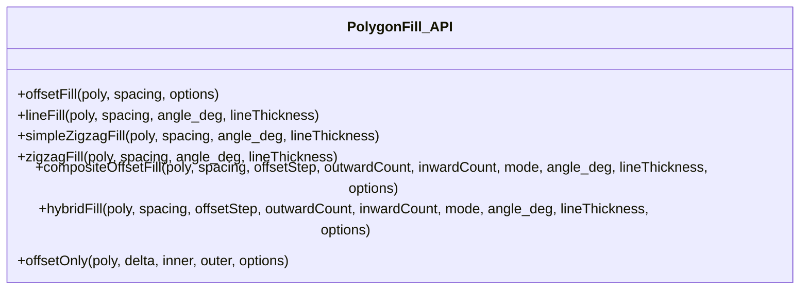
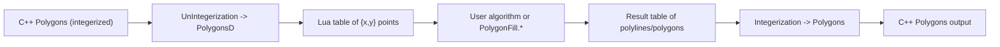
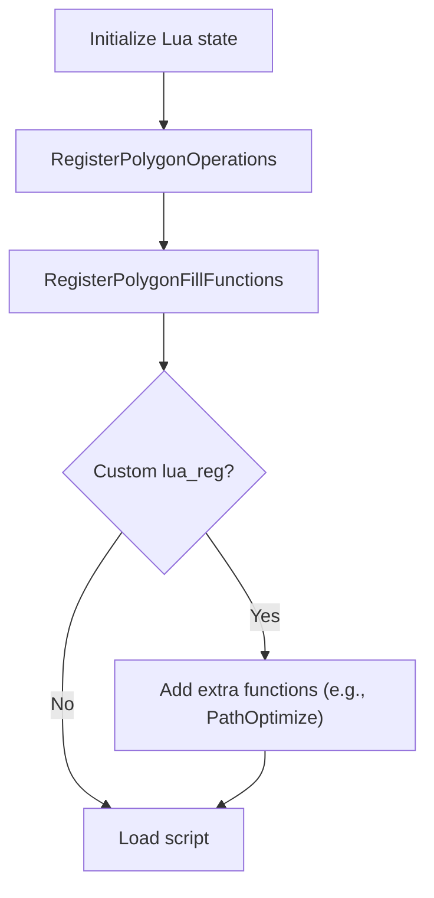
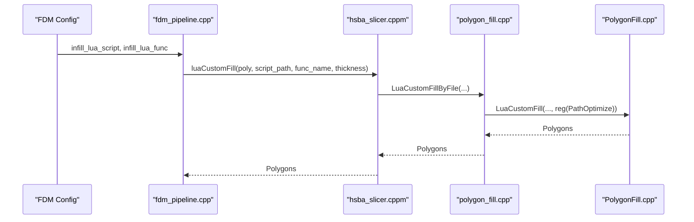
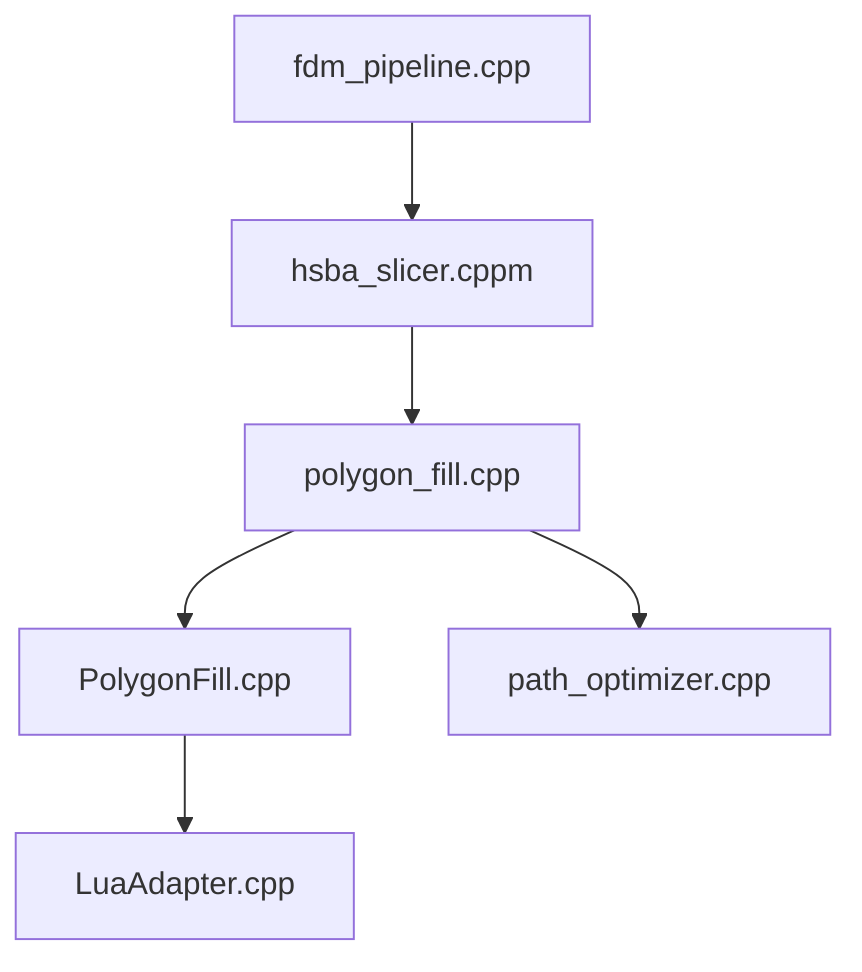

# Lua Custom Fill Patterns

<cite>
**Referenced Files in This Document**
- [PolygonFill.cpp](file://2D/PolygonFill.cpp)
- [PolygonFill.hpp](file://2D/PolygonFill.hpp)
- [LuaAdapter.cpp](file://2D/LuaAdapter.cpp)
- [LuaAdapter.hpp](file://2D/LuaAdapter.hpp)
- [polygon_fill.cpp](file://LibHsBaSlicer/Fill/polygon_fill.cpp)
- [polygon_fill.hpp](file://LibHsBaSlicer/Fill/polygon_fill.hpp)
- [hsba_slicer.cppm](file://ModuleHsBaSlicer/hsba_slicer.cppm)
- [fdm_pipeline.cpp](file://DllHsBaSlicer/fdm_pipeline.cpp)
- [custom_fill.lua](file://tests/PolygonFill/custom_fill.lua)
- [polygon_fill_test.cpp](file://tests/PolygonFill/polygon_fill_test.cpp)
- [path_optimizer.cpp](file://LibHsBaSlicer/Path/path_optimizer.cpp)
- [path_optimizer.hpp](file://LibHsBaSlicer/Path/path_optimizer.hpp)
</cite>

## Table of Contents
1. [Introduction](#introduction)
2. [Project Structure](#project-structure)
3. [Core Components](#core-components)
4. [Architecture Overview](#architecture-overview)
5. [Detailed Component Analysis](#detailed-component-analysis)
6. [Dependency Analysis](#dependency-analysis)
7. [Performance Considerations](#performance-considerations)
8. [Troubleshooting Guide](#troubleshooting-guide)
9. [Conclusion](#conclusion)

## Introduction
This document explains how to implement custom fill patterns in HsBaSlicer through Lua scripting. It focuses on the entry points `LuaCustomFill` and `LuaCustomFillString`, the expected script function signature `generate_fill`, and the PolygonFill API functions available from Lua, including `offsetFill`, `lineFill`, `simpleZigzagFill`, and `zigzagFill`. It also covers data type conversions between C++ Polygons and Lua tables, error handling, performance optimization techniques, script registration mechanisms, debugging approaches, and integration with the main slicing pipeline.

## Project Structure
The custom fill feature spans several layers:
- 2D geometry engine and Lua bindings for polygon operations and fill algorithms live under `2D/`.
- The LibHsBaSlicer wrapper exposes a convenient API that composes external 2D functions and path optimization into the Lua environment.
- The Module layer integrates the API into the module surface used by higher-level components.
- The Dll layer wires configuration-driven infill scripts into the FDM pipeline.
- Tests provide concrete usage examples and validation.

**Diagram sources**
- [PolygonFill.cpp:1283-1449](file://2D/PolygonFill.cpp#L1283-L1449)
- [LuaAdapter.cpp:406-420](file://2D/LuaAdapter.cpp#L406-L420)
- [polygon_fill.cpp:36-48](file://LibHsBaSlicer/Fill/polygon_fill.cpp#L36-L48)
- [path_optimizer.cpp:572-631](file://LibHsBaSlicer/Path/path_optimizer.cpp#L572-L631)
- [hsba_slicer.cppm:1183-1214](file://ModuleHsBaSlicer/hsba_slicer.cppm#L1183-L1214)
- [fdm_pipeline.cpp:312-351](file://DllHsBaSlicer/fdm_pipeline.cpp#L312-L351)
- [polygon_fill_test.cpp:202-258](file://tests/PolygonFill/polygon_fill_test.cpp#L202-L258)
- [custom_fill.lua:1-16](file://tests/PolygonFill/custom_fill.lua#L1-L16)

**Section sources**
- [PolygonFill.cpp:1283-1449](file://2D/PolygonFill.cpp#L1283-L1449)
- [polygon_fill.cpp:36-48](file://LibHsBaSlicer/Fill/polygon_fill.cpp#L36-L48)
- [hsba_slicer.cppm:1183-1214](file://ModuleHsBaSlicer/hsba_slicer.cppm#L1183-L1214)
- [fdm_pipeline.cpp:312-351](file://DllHsBaSlicer/fdm_pipeline.cpp#L312-L351)

## Core Components
- `LuaCustomFill`: Loads an external Lua script file, registers polygon operations and fill functions, calls the specified function with input polygons, and returns generated polylines/polygons as C++ Polygons.
- `LuaCustomFillString`: Same as above but loads inline Lua code string instead of a file.
- Expected script function: `generate_fill(poly)` (or any name you pass via the `functionName` parameter). It must return a table of polylines or polygons.
- PolygonFill API exposed to Lua:
  - `PolygonFill.offsetFill(poly, spacing, { join_type = ... })`
  - `PolygonFill.lineFill(poly, spacing, angle_deg, lineThickness)`
  - `PolygonFill.simpleZigzagFill(poly, spacing, angle_deg, lineThickness)`
  - `PolygonFill.zigzagFill(poly, spacing, angle_deg, lineThickness)`
  - Additional helpers like `compositeOffsetFill`, `hybridFill`, and `offsetOnly` are also registered.

Data types:
- Input `poly` is a Lua table of polygons; each polygon is a table of points `{x=..., y=...}`.
- Output must be a table of polylines/polygons using the same point format.
- Internally, coordinates are converted between double-precision (`PolygonsD`) and integerized (`Polygons`) representations.

Error handling:
- Script load errors, missing functions, non-table returns, and runtime errors in Lua are wrapped into C++ exceptions.

**Section sources**
- [PolygonFill.hpp:106-136](file://2D/PolygonFill.hpp#L106-L136)
- [PolygonFill.cpp:185-420](file://2D/PolygonFill.cpp#L185-L420)
- [PolygonFill.cpp:1283-1449](file://2D/PolygonFill.cpp#L1283-L1449)
- [LuaAdapter.cpp:272-420](file://2D/LuaAdapter.cpp#L272-L420)

## Architecture Overview
The custom fill workflow connects the slicing pipeline to a Lua VM, executes user-defined logic, and returns paths compatible with downstream processing.

**Diagram sources**
- [fdm_pipeline.cpp:312-351](file://DllHsBaSlicer/fdm_pipeline.cpp#L312-L351)
- [hsba_slicer.cppm:1183-1188](file://ModuleHsBaSlicer/hsba_slicer.cppm#L1183-L1188)
- [polygon_fill.cpp:36-48](file://LibHsBaSlicer/Fill/polygon_fill.cpp#L36-L48)
- [PolygonFill.cpp:1283-1449](file://2D/PolygonFill.cpp#L1283-L1449)
- [path_optimizer.cpp:572-631](file://LibHsBaSlicer/Path/path_optimizer.cpp#L572-L631)

## Detailed Component Analysis

### Lua Custom Fill Entry Points
- `LuaCustomFill`:
  - Converts input `Polygons` to `PolygonsD` for Lua.
  - Creates a new Lua state, opens standard libraries.
  - Registers `PolygonOperations` and `PolygonFill` APIs.
  - Optionally applies a custom registration callback (`lua_reg`) to add more functions (e.g., `PathOptimize`).
  - Loads the script file or string and invokes the named function with one argument.
  - Validates the returned value is a table and iterates it to collect polylines/polygons.
  - Converts each polyline/polygon back to integerized `Polygon` and returns them as `Polygons`.

- `LuaCustomFillString`:
  - Same flow as above, but loads inline Lua code via `luaL_loadstring`.

Key behaviors:
- If the function does not exist, throws a runtime error.
- If the function returns a non-table, throws a runtime error.
- If calling the function raises a Lua error, wraps it into a C++ exception.

**Diagram sources**
- [PolygonFill.cpp:1283-1449](file://2D/PolygonFill.cpp#L1283-L1449)

**Section sources**
- [PolygonFill.cpp:1283-1449](file://2D/PolygonFill.cpp#L1283-L1449)

### PolygonFill API Functions Available from Lua
The following functions are registered under the global `PolygonFill` table:
- `offsetFill(poly, spacing, { join_type = "Square"|"Bevel"|"Round"|"Miter" })`
- `lineFill(poly, spacing, angle_deg, lineThickness)`
- `simpleZigzagFill(poly, spacing, angle_deg, lineThickness)`
- `zigzagFill(poly, spacing, angle_deg, lineThickness)`
- `compositeOffsetFill(poly, spacing, offsetStep, outwardCount, inwardCount, mode, angle_deg, lineThickness, { join_type = ... })`
- `hybridFill(poly, spacing, offsetStep, outwardCount, inwardCount, mode, angle_deg, lineThickness, { join_type = ... })`
- `offsetOnly(poly, delta, inner, outer, { join_type = ... })`

Parameters:
- `poly`: Table of polygons (each polygon is a table of points `{x,y}`).
- `spacing`, `angle_deg`, `lineThickness`, `offsetStep`, `outwardCount`, `inwardCount`, `delta`, `inner`, `outer`: Numeric parameters controlling geometry.
- `mode`: String `"Line"`, `"SimpleZigzag"`, or `"Zigzag"` for composite/hybrid fills.
- `join_type`: Optional table field with string values `"Square"`, `"Bevel"`, `"Round"`, `"Miter"`.

Return values:
- Tables of polygons/polylines using the same point format.

**Diagram sources**
- [PolygonFill.cpp:193-420](file://2D/PolygonFill.cpp#L193-L420)

**Section sources**
- [PolygonFill.cpp:193-420](file://2D/PolygonFill.cpp#L193-L420)

### Data Type Conversions Between C++ Polygons and Lua Tables
- Input conversion:
  - `LuaTableToPolygonsD` reads a Lua table of polygons where each polygon is a table of points `{x,y}`.
  - `LuaTableToPolygonD` reads a single polygon table.
- Output conversion:
  - `PushPolygonsDToLua` pushes a `PolygonsD` as a nested Lua table structure.
  - `PushPolygonDToLua` pushes a single `PolygonD`.
- Integerization:
  - Internal algorithms operate on integerized `Polygons` for precision and compatibility with geometric libraries.
  - Before passing to Lua, `UnIntegerization` converts to double-precision `PolygonsD`.
  - After receiving results from Lua, `Integerization` converts back to integerized `Polygon`.

**Diagram sources**
- [LuaAdapter.cpp:272-420](file://2D/LuaAdapter.cpp#L272-L420)
- [FloatPolygons.hpp:206-221](file://2D/FloatPolygons.hpp#L206-L221)
- [PolygonFill.cpp:1283-1449](file://2D/PolygonFill.cpp#L1283-L1449)

**Section sources**
- [LuaAdapter.cpp:272-420](file://2D/LuaAdapter.cpp#L272-L420)
- [FloatPolygons.hpp:206-221](file://2D/FloatPolygons.hpp#L206-L221)
- [PolygonFill.cpp:1283-1449](file://2D/PolygonFill.cpp#L1283-L1449)

### Error Handling Patterns
- Missing Lua function: Throws a runtime error indicating the function name was not found.
- Non-table return: Throws a runtime error stating the function did not return a table.
- Lua runtime errors: Wrapped into C++ exceptions with messages from the Lua stack.
- Script load failures: For both file and string loading, errors are caught and thrown as runtime exceptions.

Best practices:
- Always validate the return type in your Lua script.
- Use assertions or checks inside your script to catch invalid inputs early.
- Keep error messages descriptive to aid debugging.

**Section sources**
- [PolygonFill.cpp:1303-1328](file://2D/PolygonFill.cpp#L1303-L1328)
- [PolygonFill.cpp:1386-1413](file://2D/PolygonFill.cpp#L1386-L1413)

### Script Registration Mechanisms
- External 2D functions:
  - `RegisterLuaPolygonOperations` registers `PolygonOperations` (boolean ops, hulls, area, shape generators, text-to-polygons).
- Fill functions:
  - `RegisterLuaPolygonFillFunctions` registers `PolygonFill` (offset, line, zigzag, composite, hybrid, offset-only).
- Path optimization:
  - `RegisterLuaPathOptimizeFunctions` registers `PathOptimize` (one-shot and object-based optimization).
- Custom registration callback:
  - Both `LuaCustomFill` and `LuaCustomFillString` accept an optional `lua_reg` callback to register additional functions per use case.
  - The Lib wrapper composes external 2D functions and path optimization into this callback when exposing `LuaCustomFillByFile`.

**Diagram sources**
- [PolygonFill.cpp:1296-1300](file://2D/PolygonFill.cpp#L1296-L1300)
- [polygon_fill.cpp:36-48](file://LibHsBaSlicer/Fill/polygon_fill.cpp#L36-L48)
- [path_optimizer.cpp:572-631](file://LibHsBaSlicer/Path/path_optimizer.cpp#L572-L631)

**Section sources**
- [LuaAdapter.cpp:415-420](file://2D/LuaAdapter.cpp#L415-L420)
- [PolygonFill.cpp:406-420](file://2D/PolygonFill.cpp#L406-L420)
- [polygon_fill.cpp:36-48](file://LibHsBaSlicer/Fill/polygon_fill.cpp#L36-L48)
- [path_optimizer.cpp:572-631](file://LibHsBaSlicer/Path/path_optimizer.cpp#L572-L631)

### Complete Examples of Custom Fill Algorithms
Example script returning two diagonal polylines:
- See [custom_fill.lua:7-13](file://tests/PolygonFill/custom_fill.lua#L7-L13).

Comprehensive test exercising all PolygonFill bindings:
- See [polygon_fill_test.cpp:202-258](file://tests/PolygonFill/polygon_fill_test.cpp#L202-L258).

Usage patterns:
- Define a function (e.g., `generate_fill` or any name passed via `functionName`) that accepts a polygon table and returns a table of polylines/polygons.
- Use `PolygonFill.*` functions to compose complex fills.
- Optionally use `PathOptimize` to optimize region ordering before generating final paths.

**Section sources**
- [custom_fill.lua:1-16](file://tests/PolygonFill/custom_fill.lua#L1-L16)
- [polygon_fill_test.cpp:202-258](file://tests/PolygonFill/polygon_fill_test.cpp#L202-L258)

### Integration with the Main Slicing Pipeline
- FDM pipeline configuration:
  - Reads `infill_lua_script` and `infill_lua_func` from configuration.
  - Calls `LuaCustomFillByFile` with these settings.
- Module layer:
  - Exposes `luaCustomFill` which delegates to `LuaCustomFillByFile`.
- Lib wrapper:
  - Composes external 2D functions and path optimization into the Lua environment.

**Diagram sources**
- [fdm_pipeline.cpp:312-351](file://DllHsBaSlicer/fdm_pipeline.cpp#L312-L351)
- [hsba_slicer.cppm:1183-1188](file://ModuleHsBaSlicer/hsba_slicer.cppm#L1183-L1188)
- [polygon_fill.cpp:36-48](file://LibHsBaSlicer/Fill/polygon_fill.cpp#L36-L48)
- [PolygonFill.cpp:1283-1449](file://2D/PolygonFill.cpp#L1283-L1449)

**Section sources**
- [fdm_pipeline.cpp:312-351](file://DllHsBaSlicer/fdm_pipeline.cpp#L312-L351)
- [hsba_slicer.cppm:1183-1188](file://ModuleHsBaSlicer/hsba_slicer.cppm#L1183-L1188)
- [polygon_fill.cpp:36-48](file://LibHsBaSlicer/Fill/polygon_fill.cpp#L36-L48)

## Dependency Analysis
- `LuaCustomFill` depends on:
  - Lua state creation and library initialization.
  - `RegisterLuaPolygonOperations` and `RegisterLuaPolygonFillFunctions`.
  - Optional `lua_reg` callback for additional registrations (e.g., `PathOptimize`).
- `LuaCustomFillByFile` composes external 2D functions and path optimization into the Lua environment.
- The FDM pipeline depends on configuration to select script path and function name.

**Diagram sources**
- [fdm_pipeline.cpp:312-351](file://DllHsBaSlicer/fdm_pipeline.cpp#L312-L351)
- [hsba_slicer.cppm:1183-1188](file://ModuleHsBaSlicer/hsba_slicer.cppm#L1183-L1188)
- [polygon_fill.cpp:36-48](file://LibHsBaSlicer/Fill/polygon_fill.cpp#L36-L48)
- [PolygonFill.cpp:1283-1449](file://2D/PolygonFill.cpp#L1283-L1449)
- [LuaAdapter.cpp:415-420](file://2D/LuaAdapter.cpp#L415-L420)
- [path_optimizer.cpp:572-631](file://LibHsBaSlicer/Path/path_optimizer.cpp#L572-L631)

**Section sources**
- [fdm_pipeline.cpp:312-351](file://DllHsBaSlicer/fdm_pipeline.cpp#L312-L351)
- [hsba_slicer.cppm:1183-1188](file://ModuleHsBaSlicer/hsba_slicer.cppm#L1183-L1188)
- [polygon_fill.cpp:36-48](file://LibHsBaSlicer/Fill/polygon_fill.cpp#L36-L48)
- [PolygonFill.cpp:1283-1449](file://2D/PolygonFill.cpp#L1283-L1449)

## Performance Considerations
- Minimize coordinate conversions:
  - Avoid excessive switching between `PolygonsD` and `Polygons`; batch operations where possible.
- Prefer built-in PolygonFill functions:
  - Use `PolygonFill.*` for common patterns rather than implementing expensive geometry in Lua.
- Optimize region ordering:
  - Use `PathOptimize.optimizeRegions` or `PathOptimize.optimizePolygons` to reduce travel distance between regions.
- Limit polygon complexity:
  - Simplify polygons before passing to heavy algorithms; avoid unnecessary vertices.
- Control iteration limits:
  - Be mindful of internal iteration bounds (e.g., MAX_FILL_ITERATIONS) to prevent long-running loops.
- Reuse Lua states when feasible:
  - While current implementation creates a new state per call, consider caching compiled scripts if you extend the system.

[No sources needed since this section provides general guidance]

## Troubleshooting Guide
Common issues and resolutions:
- Script load failure:
  - Verify the script path exists and is readable.
  - Check syntax errors in the Lua script.
- Function not found:
  - Ensure the function name matches what you pass to `LuaCustomFill`/`LuaCustomFillString`.
- Non-table return:
  - Your function must return a table of polylines/polygons.
- Invalid parameters:
  - Validate numeric parameters and join_type strings in your script.
- Debugging:
  - Use `PolygonOperations.textToPolygons` or helper utilities to generate known shapes for testing.
  - Inspect intermediate results by composing multiple `PolygonFill.*` calls and verifying outputs.

**Section sources**
- [PolygonFill.cpp:1303-1328](file://2D/PolygonFill.cpp#L1303-L1328)
- [PolygonFill.cpp:1386-1413](file://2D/PolygonFill.cpp#L1386-L1413)
- [polygon_fill_test.cpp:255-258](file://tests/PolygonFill/polygon_fill_test.cpp#L255-L258)

## Conclusion
HsBaSlicer’s Lua-based custom fill system provides a flexible and powerful way to implement specialized infill patterns. By leveraging `LuaCustomFill` and `LuaCustomFillString`, you can define custom algorithms in Lua while benefiting from robust C++ geometry engines. The PolygonFill API offers essential building blocks, and PathOptimize enables efficient region traversal. With careful attention to data conversions, error handling, and performance optimization, you can create high-quality custom fills integrated seamlessly into the slicing pipeline.

[No sources needed since this section summarizes without analyzing specific files]