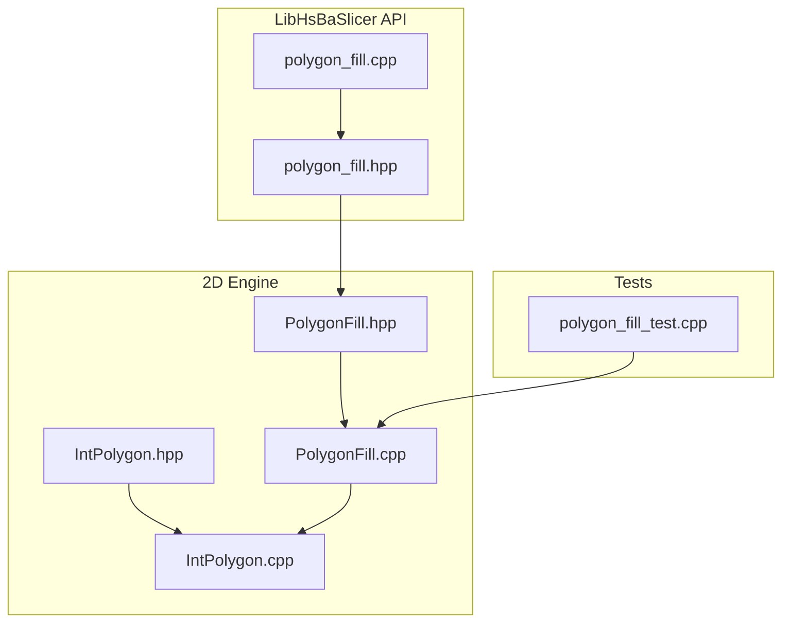
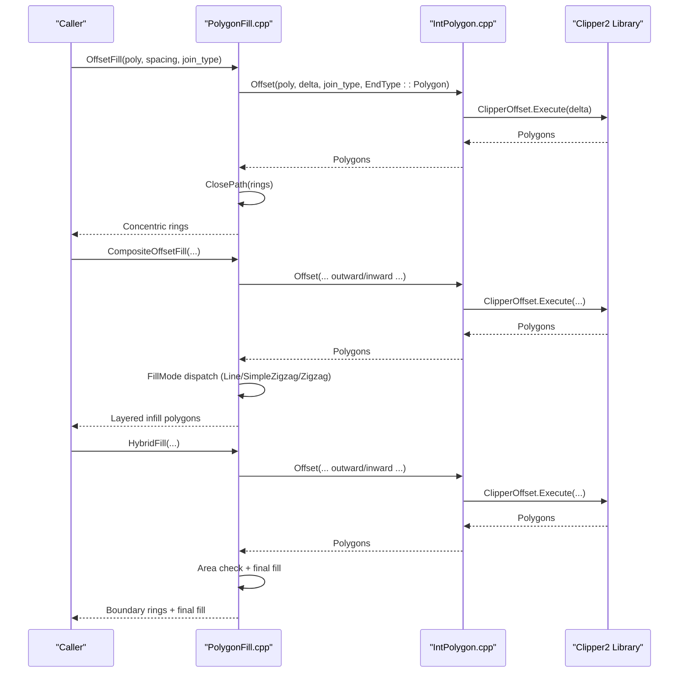
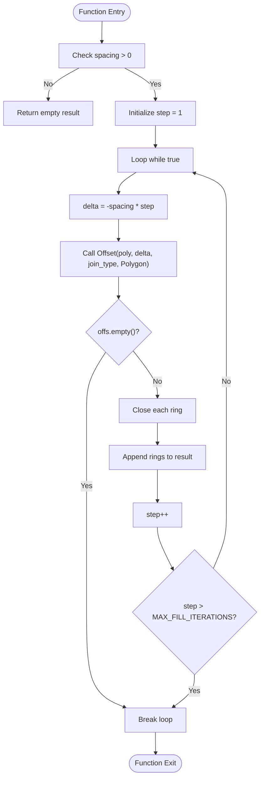
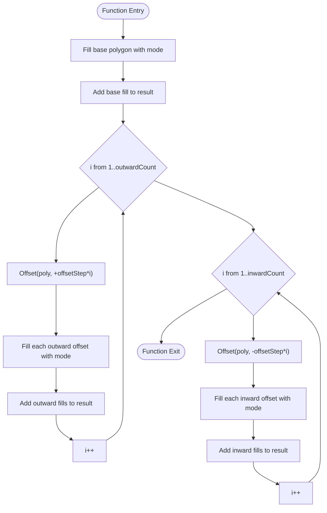
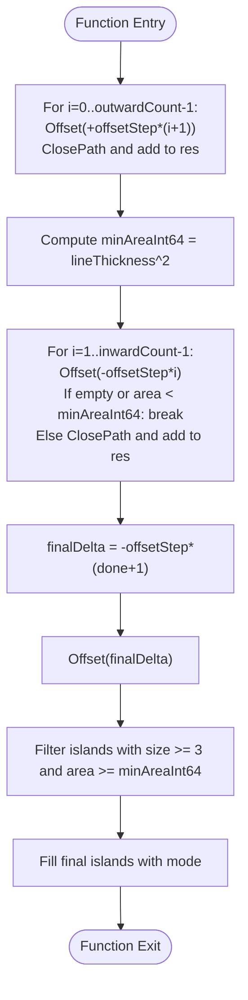
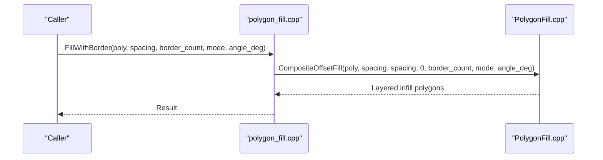
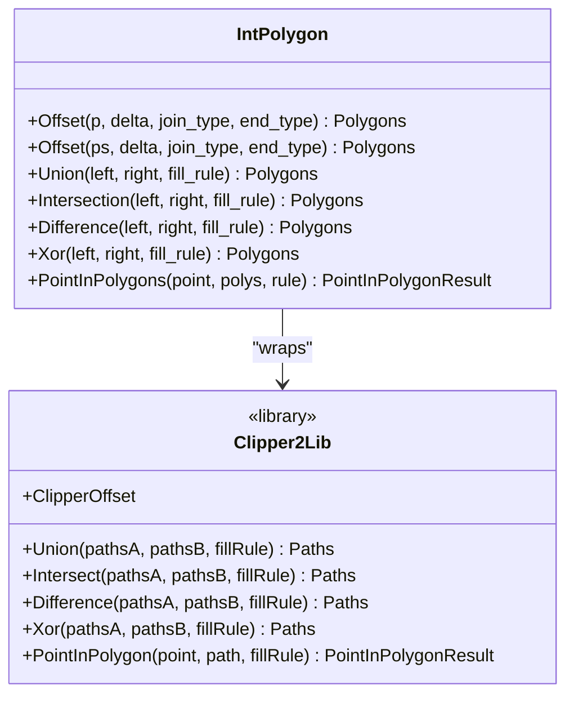
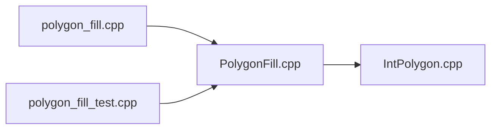

# Offset-Based Fill Patterns

<cite>
**Referenced Files in This Document**
- [PolygonFill.hpp](file://2D/PolygonFill.hpp)
- [PolygonFill.cpp](file://2D/PolygonFill.cpp)
- [IntPolygon.hpp](file://2D/IntPolygon.hpp)
- [IntPolygon.cpp](file://2D/IntPolygon.cpp)
- [polygon_fill.hpp](file://LibHsBaSlicer/Fill/polygon_fill.hpp)
- [polygon_fill.cpp](file://LibHsBaSlicer/Fill/polygon_fill.cpp)
- [polygon_fill_test.cpp](file://tests/PolygonFill/polygon_fill_test.cpp)
</cite>

## Table of Contents
1. [Introduction](#introduction)
2. [Project Structure](#project-structure)
3. [Core Components](#core-components)
4. [Architecture Overview](#architecture-overview)
5. [Detailed Component Analysis](#detailed-component-analysis)
6. [Dependency Analysis](#dependency-analysis)
7. [Performance Considerations](#performance-considerations)
8. [Troubleshooting Guide](#troubleshooting-guide)
9. [Conclusion](#conclusion)

## Introduction
This document explains offset-based fill pattern generation in HsBaSlicer, focusing on how concentric offset patterns are created within polygon boundaries and how they integrate with line and zigzag infill strategies. It documents the core functions OffsetFill, CompositeOffsetFill, and HybridFill, including spacing control, corner join types (Square, Round, Miter, Bevel), and performance considerations for complex geometries. It also covers the relationship between these operations and the Clipper2 library integration, memory management strategies for large polygon offsets, and optimization techniques for dense offset patterns.

## Project Structure
The offset-based fill logic is implemented in the 2D geometry layer and exposed through a higher-level LibHsBaSlicer API:
- The 2D engine defines polygon types, Clipper2 wrappers, and fill algorithms.
- The LibHsBaSlicer wrapper provides convenient APIs such as FillWithBorder that internally use composite offset fills.
- Tests validate behavior for offset-only, composite, and hybrid fills.

**Diagram sources**
- [PolygonFill.hpp:1-141](file://2D/PolygonFill.hpp#L1-L141)
- [PolygonFill.cpp:422-450](file://2D/PolygonFill.cpp#L422-L450)
- [IntPolygon.hpp:148-167](file://2D/IntPolygon.hpp#L148-L167)
- [IntPolygon.cpp:62-77](file://2D/IntPolygon.cpp#L62-L77)
- [polygon_fill.hpp:27-37](file://LibHsBaSlicer/Fill/polygon_fill.hpp#L27-L37)
- [polygon_fill.cpp:28-34](file://LibHsBaSlicer/Fill/polygon_fill.cpp#L28-L34)
- [polygon_fill_test.cpp:119-132](file://tests/PolygonFill/polygon_fill_test.cpp#L119-L132)

**Section sources**
- [PolygonFill.hpp:1-141](file://2D/PolygonFill.hpp#L1-L141)
- [IntPolygon.hpp:148-167](file://2D/IntPolygon.hpp#L148-L167)
- [polygon_fill.hpp:27-37](file://LibHsBaSlicer/Fill/polygon_fill.hpp#L27-L37)

## Core Components
- OffsetFill: Generates concentric inward offset rings until the polygon vanishes. Each ring is closed to ensure consistent path representation.
- CompositeOffsetFill: Produces layered infill by filling the base polygon and then applying outward and inward offset layers, each filled using a chosen mode (Line, SimpleZigzag, Zigzag).
- HybridFill: Creates outward offset boundary rings and inward offset rings up to a threshold, then fills only the final inward offset island(s) with the selected mode.
- FillWithBorder (LibHsBaSlicer): A convenience API that uses CompositeOffsetFill to generate border offsets plus interior fill.

Key parameters:
- spacing: Controls distance between parallel lines or internal fill lines.
- offsetStep: Step size for successive offset operations.
- outwardCount / inwardCount: Number of outward/inward offset layers.
- join_type: Corner handling for offset operations (Square, Round, Miter, Bevel).
- angle_deg: Angle of fill lines in degrees.
- lineThickness: Thickness used for area checks and fill rendering.

**Section sources**
- [PolygonFill.hpp:20-28](file://2D/PolygonFill.hpp#L20-L28)
- [PolygonFill.hpp:70-102](file://2D/PolygonFill.hpp#L70-L102)
- [polygon_fill.hpp:27-37](file://LibHsBaSlicer/Fill/polygon_fill.hpp#L27-L37)

## Architecture Overview
The fill pipeline integrates geometric primitives, boolean/offset operations via Clipper2, and fill pattern generators.

**Diagram sources**
- [PolygonFill.cpp:422-450](file://2D/PolygonFill.cpp#L422-L450)
- [PolygonFill.cpp:1177-1228](file://2D/PolygonFill.cpp#L1177-L1228)
- [PolygonFill.cpp:1230-1281](file://2D/PolygonFill.cpp#L1230-L1281)
- [IntPolygon.cpp:62-77](file://2D/IntPolygon.cpp#L62-L77)

## Detailed Component Analysis

### OffsetFill
OffsetFill creates concentric offset rings inside the input polygon by repeatedly applying negative offsets until no more valid polygons remain. Each resulting ring is closed to ensure the first and last vertices coincide.

Behavior highlights:
- Spacing parameter controls the step size for each inward offset.
- Join type determines corner treatment during offset computation.
- Maximum iteration guard prevents infinite loops on pathological inputs.

**Diagram sources**
- [PolygonFill.cpp:422-450](file://2D/PolygonFill.cpp#L422-L450)

**Section sources**
- [PolygonFill.cpp:422-450](file://2D/PolygonFill.cpp#L422-L450)

### CompositeOffsetFill
CompositeOffsetFill generates layered infill structures:
- Base polygon is filled using the selected mode.
- Outward offset layers are generated and filled individually.
- Inward offset layers are generated and filled individually.

Parameters:
- spacing: Internal fill spacing.
- offsetStep: Step size for offset operations.
- outwardCount / inwardCount: Number of outward/inward layers.
- mode: FillMode (Line, SimpleZigzag, Zigzag).
- angle_deg: Fill angle.
- lineThickness: Used by fill modes.
- join_type: Corner handling for offsets.

**Diagram sources**
- [PolygonFill.cpp:1177-1228](file://2D/PolygonFill.cpp#L1177-L1228)

**Section sources**
- [PolygonFill.cpp:1177-1228](file://2D/PolygonFill.cpp#L1177-L1228)

### HybridFill
HybridFill builds boundary rings and fills only the final inward offset island(s):
- Adds outward offset rings as closed paths.
- Iteratively adds inward offset rings until area or vertex count thresholds are met.
- Computes a final inward offset and fills it if it meets minimum area criteria.

**Diagram sources**
- [PolygonFill.cpp:1230-1281](file://2D/PolygonFill.cpp#L1230-L1281)

**Section sources**
- [PolygonFill.cpp:1230-1281](file://2D/PolygonFill.cpp#L1230-L1281)

### LibHsBaSlicer Integration: FillWithBorder
FillWithBorder wraps CompositeOffsetFill to provide a simple border-offset plus interior fill API:
- outwardCount=0 means no outward offset.
- inwardCount=border_count forms the border rings.
- Interior region is filled using the specified mode and angle.

**Diagram sources**
- [polygon_fill.cpp:28-34](file://LibHsBaSlicer/Fill/polygon_fill.cpp#L28-L34)
- [PolygonFill.cpp:1177-1228](file://2D/PolygonFill.cpp#L1177-L1228)

**Section sources**
- [polygon_fill.cpp:28-34](file://LibHsBaSlicer/Fill/polygon_fill.cpp#L28-L34)

### Join Type Options
Join types control corner handling during offset operations:
- Square: Default; sharp corners.
- Round: Rounded corners.
- Miter: Extended miter joins.
- Bevel: Flattened beveled corners.

These options are passed through to Clipper2’s ClipperOffset when computing offsets.

**Section sources**
- [PolygonFill.cpp:198-210](file://2D/PolygonFill.cpp#L198-L210)
- [PolygonFill.cpp:291-303](file://2D/PolygonFill.cpp#L291-L303)
- [PolygonFill.cpp:335-347](file://2D/PolygonFill.cpp#L335-L347)
- [PolygonFill.cpp:367-379](file://2D/PolygonFill.cpp#L367-L379)

### Clipper2 Integration
All offset operations delegate to Clipper2 via IntPolygon wrappers:
- Offset(Polygon, delta, join_type, end_type) constructs a ClipperOffset, adds the path(s), and executes the offset.
- Boolean operations (Union, Intersection, Difference, Xor) and point-in-polygon tests also rely on Clipper2.

**Diagram sources**
- [IntPolygon.cpp:62-77](file://2D/IntPolygon.cpp#L62-L77)
- [IntPolygon.hpp:148-167](file://2D/IntPolygon.hpp#L148-L167)

**Section sources**
- [IntPolygon.cpp:62-77](file://2D/IntPolygon.cpp#L62-L77)
- [IntPolygon.hpp:148-167](file://2D/IntPolygon.hpp#L148-L167)

## Dependency Analysis
The fill functions depend on:
- PolygonFill.cpp for algorithmic logic (OffsetFill, CompositeOffsetFill, HybridFill).
- IntPolygon.cpp for Clipper2-based geometry operations.
- LibHsBaSlicer polygon_fill.cpp for high-level APIs like FillWithBorder.

**Diagram sources**
- [PolygonFill.cpp:422-450](file://2D/PolygonFill.cpp#L422-L450)
- [polygon_fill.cpp:28-34](file://LibHsBaSlicer/Fill/polygon_fill.cpp#L28-L34)
- [polygon_fill_test.cpp:119-132](file://tests/PolygonFill/polygon_fill_test.cpp#L119-L132)

**Section sources**
- [PolygonFill.cpp:422-450](file://2D/PolygonFill.cpp#L422-L450)
- [polygon_fill.cpp:28-34](file://LibHsBaSlicer/Fill/polygon_fill.cpp#L28-L34)
- [polygon_fill_test.cpp:119-132](file://tests/PolygonFill/polygon_fill_test.cpp#L119-L132)

## Performance Considerations
- Dense offset patterns:
  - Large outwardCount/inwardCount can produce many offset layers; each layer triggers an Offset call and potentially a fill pass.
  - Use reasonable offsetStep values to avoid excessive layers.
- Complex geometries:
  - Clipper2 operations scale with polygon complexity; simplify inputs where possible.
  - Avoid extremely small spacing relative to polygon dimensions to reduce numerical issues.
- Memory management:
  - Accumulating many offset rings and fill segments increases memory usage.
  - Prefer streaming results or limiting counts for very large models.
- Optimization techniques:
  - For HybridFill, early termination based on area thresholds reduces unnecessary computations.
  - Choose appropriate join_type; Round may increase vertex count compared to Square.
  - Tune lineThickness to balance accuracy and performance.

[No sources needed since this section provides general guidance]

## Troubleshooting Guide
Common issues and resolutions:
- Empty results from OffsetFill:
  - Ensure spacing > 0; zero or negative spacing returns empty.
  - Very small polygons or tiny spacing may cause immediate termination.
- Unexpected corner artifacts:
  - Adjust join_type to Round or Bevel for smoother corners.
  - Miter can create long spikes; consider Bevel for stability.
- Excessive memory usage:
  - Reduce outwardCount/inwardCount or increase offsetStep.
  - Limit lineThickness to avoid overly fine fills.
- HybridFill not filling inner regions:
  - Verify inwardCount and lineThickness; area threshold may prevent filling small islands.

**Section sources**
- [PolygonFill.cpp:422-450](file://2D/PolygonFill.cpp#L422-L450)
- [PolygonFill.cpp:1230-1281](file://2D/PolygonFill.cpp#L1230-L1281)

## Conclusion
Offset-based fill patterns in HsBaSlicer provide flexible and powerful tools for generating concentric offset rings and layered infill structures. OffsetFill produces nested rings, while CompositeOffsetFill and HybridFill combine offsets with line/zigzag fills to create robust boundary and interior patterns. The system integrates tightly with Clipper2 for reliable geometry operations and offers configurable join types for corner handling. By tuning spacing, offsetStep, counts, and join_type, users can optimize performance and quality for complex geometries and dense patterns.

[No sources needed since this section summarizes without analyzing specific files]