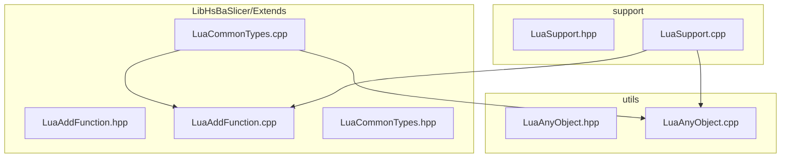
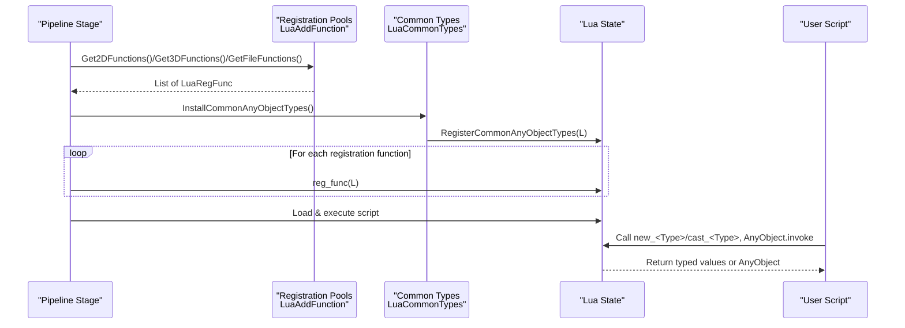
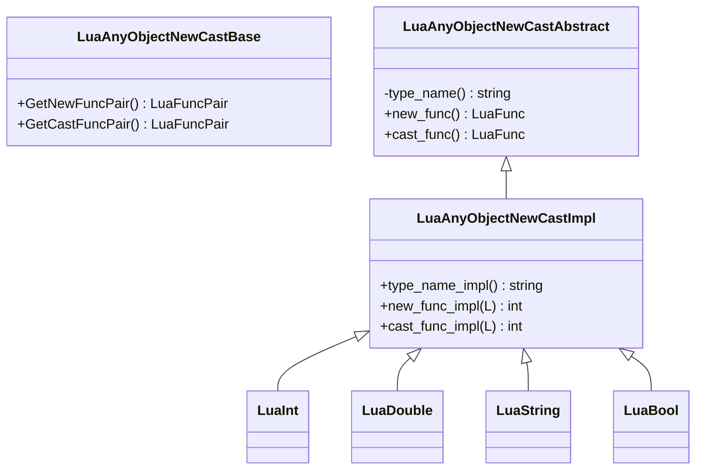
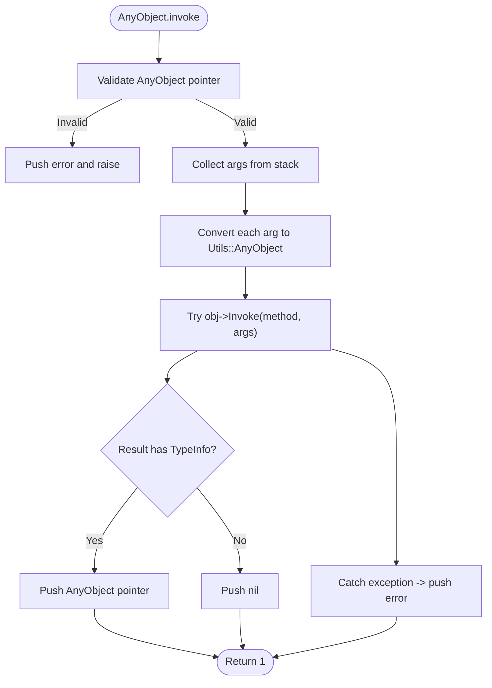
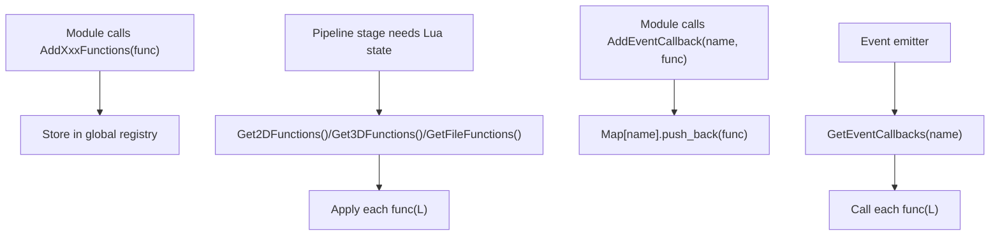
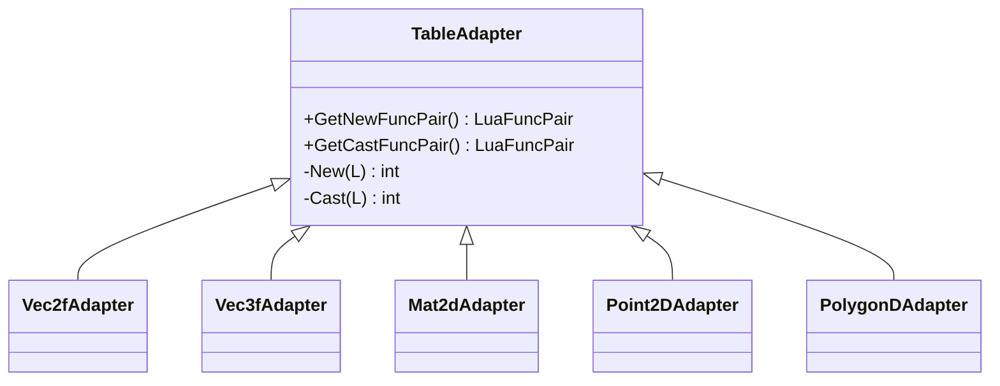
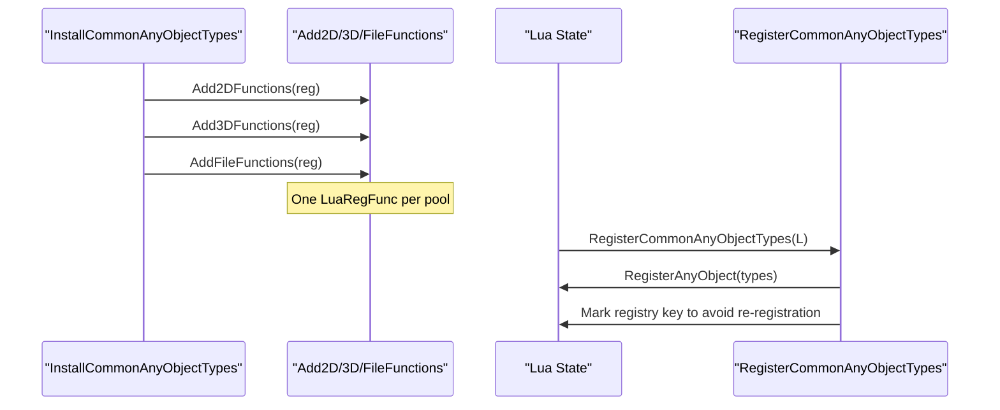
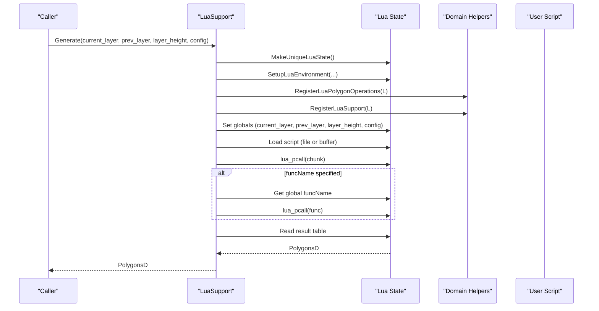
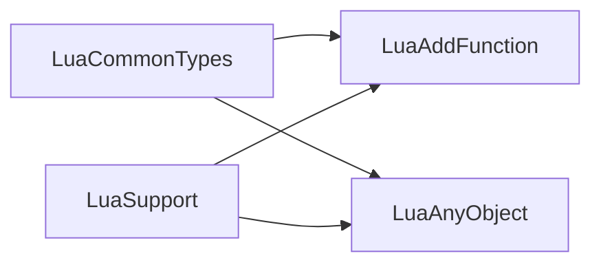

# Lua Integration Architecture

<cite>
**Referenced Files in This Document**
- [LuaAnyObject.hpp](file://utils/LuaAnyObject.hpp)
- [LuaAnyObject.cpp](file://utils/LuaAnyObject.cpp)
- [LuaAddFunction.hpp](file://LibHsBaSlicer/Extends/LuaAddFunction.hpp)
- [LuaAddFunction.cpp](file://LibHsBaSlicer/Extends/LuaAddFunction.cpp)
- [LuaCommonTypes.hpp](file://LibHsBaSlicer/Extends/LuaCommonTypes.hpp)
- [LuaCommonTypes.cpp](file://LibHsBaSlicer/Extends/LuaCommonTypes.cpp)
- [LuaSupport.hpp](file://support/LuaSupport.hpp)
- [LuaSupport.cpp](file://support/LuaSupport.cpp)
</cite>

## Table of Contents
1. [Introduction](#introduction)
2. [Project Structure](#project-structure)
3. [Core Components](#core-components)
4. [Architecture Overview](#architecture-overview)
5. [Detailed Component Analysis](#detailed-component-analysis)
6. [Dependency Analysis](#dependency-analysis)
7. [Performance Considerations](#performance-considerations)
8. [Troubleshooting Guide](#troubleshooting-guide)
9. [Conclusion](#conclusion)
10. [Appendices](#appendices)

## Introduction
This document explains HsBaSlicer’s Lua integration architecture with a focus on:
- The LuaAnyObject class and its adapter system for seamless C++-to-Lua type conversion and dynamic object handling.
- The LuaAddFunction registration system that exposes C++ functionality to Lua scripts by pipeline dimension.
- The LuaCommonTypes shared type definitions and table adapters for Eigen, Clipper2, and polygon types.
- Event system integration, callback mechanisms, and memory management between C++ and Lua contexts.
- Practical examples for extending the Lua environment, creating custom types, and implementing complex workflows through scripting.
- Performance considerations, garbage collection interaction, debugging strategies, and security guidance for executing user-provided Lua scripts.

## Project Structure
The Lua integration spans several modules:
- utils: core LuaAnyObject bridge and metatable implementation.
- LibHsBaSlicer/Extends: registration pools (LuaAddFunction) and common type adapters (LuaCommonTypes).
- support: example of a script-driven algorithm (LuaSupport) showing how to set up a sandboxed Lua state and expose domain helpers.

**Diagram sources**
- [LuaAnyObject.hpp:1-523](file://utils/LuaAnyObject.hpp#L1-L523)
- [LuaAnyObject.cpp:1-180](file://utils/LuaAnyObject.cpp#L1-L180)
- [LuaAddFunction.hpp:1-78](file://LibHsBaSlicer/Extends/LuaAddFunction.hpp#L1-L78)
- [LuaAddFunction.cpp:1-68](file://LibHsBaSlicer/Extends/LuaAddFunction.cpp#L1-L68)
- [LuaCommonTypes.hpp:1-187](file://LibHsBaSlicer/Extends/LuaCommonTypes.hpp#L1-L187)
- [LuaCommonTypes.cpp:1-534](file://LibHsBaSlicer/Extends/LuaCommonTypes.cpp#L1-L534)
- [LuaSupport.hpp:1-85](file://support/LuaSupport.hpp#L1-L85)
- [LuaSupport.cpp:1-180](file://support/LuaSupport.cpp#L1-L180)

**Section sources**
- [LuaAnyObject.hpp:1-523](file://utils/LuaAnyObject.hpp#L1-L523)
- [LuaAnyObject.cpp:1-180](file://utils/LuaAnyObject.cpp#L1-L180)
- [LuaAddFunction.hpp:1-78](file://LibHsBaSlicer/Extends/LuaAddFunction.hpp#L1-L78)
- [LuaAddFunction.cpp:1-68](file://LibHsBaSlicer/Extends/LuaAddFunction.cpp#L1-L68)
- [LuaCommonTypes.hpp:1-187](file://LibHsBaSlicer/Extends/LuaCommonTypes.hpp#L1-L187)
- [LuaCommonTypes.cpp:1-534](file://LibHsBaSlicer/Extends/LuaCommonTypes.cpp#L1-L534)
- [LuaSupport.hpp:1-85](file://support/LuaSupport.hpp#L1-L85)
- [LuaSupport.cpp:1-180](file://support/LuaSupport.cpp#L1-L180)

## Core Components
- LuaAnyObject: Provides a metatable and global `AnyObject` API for creating, invoking methods, iterating fields, and casting between Lua values and C++ `Utils::AnyObject`. It also defines CRTP-based adapters for basic types and supports registering additional new/cast pairs.
- LuaAddFunction: Maintains per-dimension registration pools (2D, 3D, File) and named event callbacks. Pipeline stages can register functions once and reuse them across multiple Lua states.
- LuaCommonTypes: Declares reflection metadata for common custom types (Eigen vectors/matrices/quaternions, Clipper2 points/polygons) and provides table adapters for converting these types to/from Lua tables. It also installs these adapters into the generic registration pools.
- LuaSupport: Demonstrates a complete workflow for loading and executing a Lua script in an isolated state, exposing domain helpers, passing configuration, and retrieving results.

**Section sources**
- [LuaAnyObject.hpp:11-44](file://utils/LuaAnyObject.hpp#L11-L44)
- [LuaAnyObject.cpp:11-178](file://utils/LuaAnyObject.cpp#L11-L178)
- [LuaAddFunction.hpp:21-74](file://LibHsBaSlicer/Extends/LuaAddFunction.hpp#L21-L74)
- [LuaAddFunction.cpp:13-67](file://LibHsBaSlicer/Extends/LuaAddFunction.cpp#L13-L67)
- [LuaCommonTypes.hpp:20-45](file://LibHsBaSlicer/Extends/LuaCommonTypes.hpp#L20-L45)
- [LuaCommonTypes.cpp:27-436](file://LibHsBaSlicer/Extends/LuaCommonTypes.cpp#L27-L436)
- [LuaSupport.hpp:21-81](file://support/LuaSupport.hpp#L21-L81)
- [LuaSupport.cpp:19-177](file://support/LuaSupport.cpp#L19-L177)

## Architecture Overview
At runtime, HsBaSlicer builds Lua states for different pipeline stages. Each stage may consume one or more registration pools (2D, 3D, File). During pool consumption, common types are installed once per Lua state, and domain-specific functions are registered via the LuaAddFunction pools. Scripts then interact with C++ through:
- Global `AnyObject` API for dynamic invocation and field iteration.
- Typed adapters (`new_<Type>` / `cast_<Type>`) for geometry and math types.
- Domain helper modules exposed by each stage (e.g., polygon operations, support generation).

**Diagram sources**
- [LuaAddFunction.cpp:21-49](file://LibHsBaSlicer/Extends/LuaAddFunction.cpp#L21-L49)
- [LuaCommonTypes.cpp:469-531](file://LibHsBaSlicer/Extends/LuaCommonTypes.cpp#L469-L531)
- [LuaSupport.cpp:113-177](file://support/LuaSupport.cpp#L113-L177)

## Detailed Component Analysis

### LuaAnyObject: Dynamic Object Bridge
LuaAnyObject implements:
- A metatable for `AnyObject` instances with `__gc`, `invoke`, and `foreach_field`.
- Global `AnyObject.new`, `AnyObject.invoke`, and `AnyObject.foreach_field`.
- Registration of type-specific `new_<T>` and `cast_<T>` functions via `RegisterAnyObject`.
- Adapters for built-in types (int, long, longlong, size_t, double, float, bool, string, cstring).

Key behaviors:
- `Invoke` collects arguments from Lua, converts them to `Utils::AnyObject`, calls the underlying method, and returns either another `AnyObject` pointer or nil.
- `ForeachField` iterates reflected fields and invokes a Lua callback with name/value pairs.
- `_gc` uses a helper to safely destroy wrapped objects.

**Diagram sources**
- [LuaAnyObject.hpp:32-112](file://utils/LuaAnyObject.hpp#L32-L112)
- [LuaAnyObject.hpp:118-127](file://utils/LuaAnyObject.hpp#L118-L127)
- [LuaAnyObject.hpp:129-168](file://utils/LuaAnyObject.hpp#L129-L168)
- [LuaAnyObject.hpp:341-382](file://utils/LuaAnyObject.hpp#L341-L382)
- [LuaAnyObject.hpp:427-467](file://utils/LuaAnyObject.hpp#L427-L467)
- [LuaAnyObject.hpp:384-424](file://utils/LuaAnyObject.hpp#L384-L424)

**Diagram sources**
- [LuaAnyObject.cpp:17-87](file://utils/LuaAnyObject.cpp#L17-L87)

**Section sources**
- [LuaAnyObject.hpp:11-44](file://utils/LuaAnyObject.hpp#L11-L44)
- [LuaAnyObject.hpp:66-112](file://utils/LuaAnyObject.hpp#L66-L112)
- [LuaAnyObject.hpp:118-127](file://utils/LuaAnyObject.hpp#L118-L127)
- [LuaAnyObject.cpp:11-178](file://utils/LuaAnyObject.cpp#L11-L178)

### LuaAddFunction: Function and Event Callback Registry
LuaAddFunction maintains:
- Three global registries for 2D, 3D, and File Lua registration functions.
- A map of named events to lists of registration functions.
- Accessors to retrieve and add functions/callbacks.

Usage pattern:
- Modules call Add2DFunctions/Add3DFunctions/AddFileFunctions to register their Lua setup functions.
- At pipeline initialization, each stage retrieves the relevant list and applies them to the Lua state.
- Event-driven modules (e.g., Zipper, DB) use AddEventCallback to bind Lua-side handlers.

**Diagram sources**
- [LuaAddFunction.cpp:13-49](file://LibHsBaSlicer/Extends/LuaAddFunction.cpp#L13-L49)
- [LuaAddFunction.cpp:53-67](file://LibHsBaSlicer/Extends/LuaAddFunction.cpp#L53-L67)

**Section sources**
- [LuaAddFunction.hpp:21-74](file://LibHsBaSlicer/Extends/LuaAddFunction.hpp#L21-L74)
- [LuaAddFunction.cpp:13-67](file://LibHsBaSlicer/Extends/LuaAddFunction.cpp#L13-L67)

### LuaCommonTypes: Shared Type Definitions and Table Adapters
LuaCommonTypes provides:
- Reflection metadata macros for scalar components and opaque types.
- Type names and cast methods for Eigen vectors/matrices/quaternions and Clipper2 points/polygons.
- Table adapters that convert between Lua tables and native types.
- A convenience wrapper to install all common types plus built-in scalars into a Lua state.
- Installation into the generic registration pools so every pipeline stage gets these types automatically.

Table encoding rules:
- Fixed vectors/quaternions: maps with keys x, y, z, w; sequences accepted as fallback.
- Matrices: nested row sequences.
- Clipper points: maps with x, y.
- Polygons/Polygons: sequences of points/polygons.

**Diagram sources**
- [LuaCommonTypes.cpp:342-389](file://LibHsBaSlicer/Extends/LuaCommonTypes.cpp#L342-L389)
- [LuaCommonTypes.cpp:392-435](file://LibHsBaSlicer/Extends/LuaCommonTypes.cpp#L392-L435)

**Diagram sources**
- [LuaCommonTypes.cpp:514-531](file://LibHsBaSlicer/Extends/LuaCommonTypes.cpp#L514-L531)
- [LuaCommonTypes.cpp:469-512](file://LibHsBaSlicer/Extends/LuaCommonTypes.cpp#L469-L512)

**Section sources**
- [LuaCommonTypes.hpp:20-45](file://LibHsBaSlicer/Extends/LuaCommonTypes.hpp#L20-L45)
- [LuaCommonTypes.hpp:84-143](file://LibHsBaSlicer/Extends/LuaCommonTypes.hpp#L84-L143)
- [LuaCommonTypes.hpp:148-183](file://LibHsBaSlicer/Extends/LuaCommonTypes.hpp#L148-L183)
- [LuaCommonTypes.cpp:27-436](file://LibHsBaSlicer/Extends/LuaCommonTypes.cpp#L27-L436)
- [LuaCommonTypes.cpp:438-531](file://LibHsBaSlicer/Extends/LuaCommonTypes.cpp#L438-L531)

### LuaSupport: Script-Based Custom Workflow Example
LuaSupport demonstrates:
- Creating a unique Lua state per execution.
- Opening standard libraries and registering domain helpers (polygon operations, support module).
- Exposing current layer, previous layer, layer height, and config as globals.
- Loading inline or file-based scripts, calling a specific function if provided, and returning polygons.

**Diagram sources**
- [LuaSupport.cpp:19-90](file://support/LuaSupport.cpp#L19-L90)
- [LuaSupport.cpp:113-177](file://support/LuaSupport.cpp#L113-L177)

**Section sources**
- [LuaSupport.hpp:21-81](file://support/LuaSupport.hpp#L21-L81)
- [LuaSupport.cpp:19-177](file://support/LuaSupport.cpp#L19-L177)

## Dependency Analysis
High-level dependencies:
- LuaCommonTypes depends on LuaAddFunction to install itself into the generic registration pools.
- LuaCommonTypes depends on LuaAnyObject to register new/cast adapters and build the global `AnyObject` table.
- LuaSupport depends on LuaAnyObject indirectly through common types and directly via domain helpers that may return or accept `AnyObject`-wrapped values.
- All modules depend on the base `Utils::AnyObject` container for dynamic value storage and reflection.

**Diagram sources**
- [LuaCommonTypes.cpp:18-21](file://LibHsBaSlicer/Extends/LuaCommonTypes.cpp#L18-L21)
- [LuaCommonTypes.cpp:469-531](file://LibHsBaSlicer/Extends/LuaCommonTypes.cpp#L469-L531)
- [LuaSupport.cpp:10-13](file://support/LuaSupport.cpp#L10-L13)

**Section sources**
- [LuaCommonTypes.cpp:18-21](file://LibHsBaSlicer/Extends/LuaCommonTypes.cpp#L18-L21)
- [LuaSupport.cpp:10-13](file://support/LuaSupport.cpp#L10-L13)

## Performance Considerations
- Avoid excessive conversions: Prefer passing `AnyObject` pointers where possible and only materialize values when needed.
- Reuse registration: Use `InstallCommonAnyObjectTypes` to ensure common types are registered once per Lua state; repeated calls are guarded internally.
- Minimize allocations: When reading matrices/vectors from Lua tables, prefer direct element access and avoid intermediate copies.
- Garbage collection: `AnyObject` metatable sets `__gc` to release wrapped objects; ensure you do not hold raw pointers beyond the lifetime of the Lua object.
- Field iteration: `ForeachField` is efficient for introspection but should be used judiciously in hot paths.

[No sources needed since this section provides general guidance]

## Troubleshooting Guide
Common issues and remedies:
- Invalid AnyObject pointer errors: Occur when casting or invoking on nil or wrong-type objects. Validate inputs before calling `cast_*` or `invoke`.
- Type mismatch during `new_<Type>`: Ensure the Lua table matches the expected structure (named keys for vectors/quaternions, nested rows for matrices).
- Script load/runtime errors: Inspect the error message returned by `luaL_load*` and `lua_pcall`; wrap calls with try/catch around RuntimeError where applicable.
- Double deconstruction: Use `cast_new` instead of direct casts to avoid double destruction in `_gc`.
- Event callbacks not firing: Verify that `AddEventCallback` was called with the correct event name and that the emitter uses `GetEventCallbacks` to invoke them.

**Section sources**
- [LuaAnyObject.cpp:17-87](file://utils/LuaAnyObject.cpp#L17-L87)
- [LuaAnyObject.cpp:89-127](file://utils/LuaAnyObject.cpp#L89-L127)
- [LuaCommonTypes.cpp:356-389](file://LibHsBaSlicer/Extends/LuaCommonTypes.cpp#L356-L389)
- [LuaSupport.cpp:131-177](file://support/LuaSupport.cpp#L131-L177)

## Conclusion
HsBaSlicer’s Lua integration centers on a robust `AnyObject` bridge, a flexible registration system for exposing C++ functionality, and comprehensive type adapters for geometry and math primitives. By combining these building blocks, developers can extend pipeline stages with Lua scripts, create custom types, and implement complex workflows while maintaining safe memory management and predictable performance.

[No sources needed since this section summarizes without analyzing specific files]

## Appendices

### Practical Examples

#### Extending the Lua Environment
- Register domain helpers using the appropriate pool:
  - 2D features: call `Add2DFunctions` with a function that registers polygon utilities.
  - 3D features: call `Add3DFunctions` with a function that registers slicing/support helpers.
  - File I/O features: call `AddFileFunctions` with a function that registers export utilities.
- Ensure `InstallCommonAnyObjectTypes` is called early so all stages receive common types.

**Section sources**
- [LuaAddFunction.hpp:21-40](file://LibHsBaSlicer/Extends/LuaAddFunction.hpp#L21-L40)
- [LuaCommonTypes.cpp:514-531](file://LibHsBaSlicer/Extends/LuaCommonTypes.cpp#L514-L531)

#### Creating Custom Types
- Define a new adapter by specializing or adding a `TableAdapter` instance for your type.
- Provide `push_*` and `read_*` functions that encode/decode Lua tables according to the documented conventions.
- Add the adapter to `GetCommonAnyObjectTypes` so it becomes available as `new_<Name>` and `cast_<Name>`.

**Section sources**
- [LuaCommonTypes.cpp:342-436](file://LibHsBaSlicer/Extends/LuaCommonTypes.cpp#L342-L436)
- [LuaCommonTypes.cpp:438-467](file://LibHsBaSlicer/Extends/LuaCommonTypes.cpp#L438-L467)

#### Implementing Complex Workflows Through Scripting
- Create a `LuaSupport` instance with inline code or a script file.
- Optionally provide a custom function name to call after loading the script.
- Use domain helpers (polygon operations, support generators) exposed by the stage to manipulate data and return results.

**Section sources**
- [LuaSupport.hpp:43-64](file://support/LuaSupport.hpp#L43-L64)
- [LuaSupport.cpp:113-177](file://support/LuaSupport.cpp#L113-L177)

### Security Considerations for User Scripts
- Isolation: Always create a fresh Lua state per script execution and do not share mutable globals across users.
- Library exposure: Only open necessary libraries; avoid exposing dangerous modules (e.g., os, io) unless absolutely required.
- Resource limits: Enforce timeouts and memory caps around `lua_pcall` and script execution.
- Input validation: Validate all Lua tables passed to `new_<Type>` and sanitize any file paths or network operations invoked from scripts.
- Error handling: Wrap script execution in try/catch and log detailed errors without leaking internal state.

[No sources needed since this section provides general guidance]