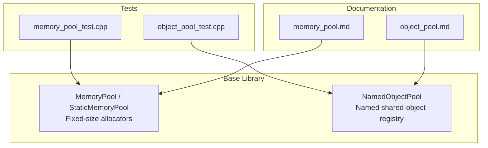
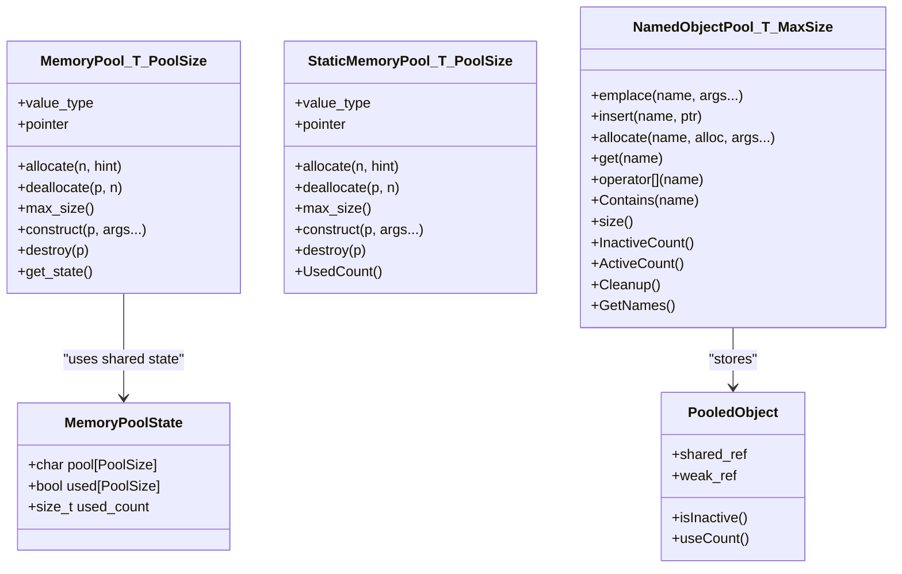
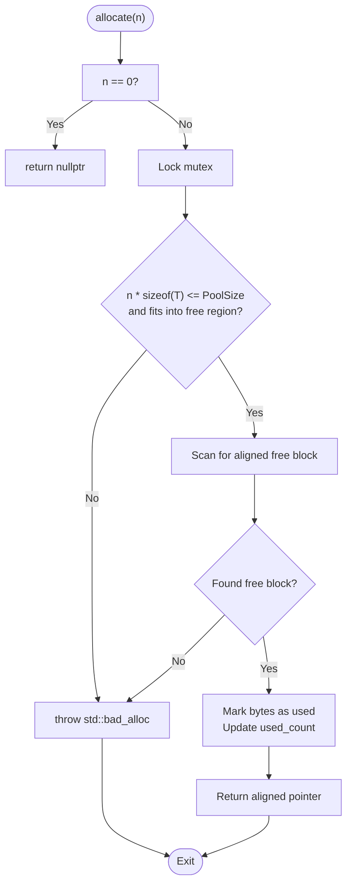
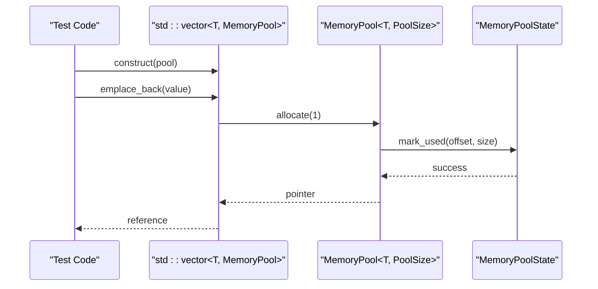
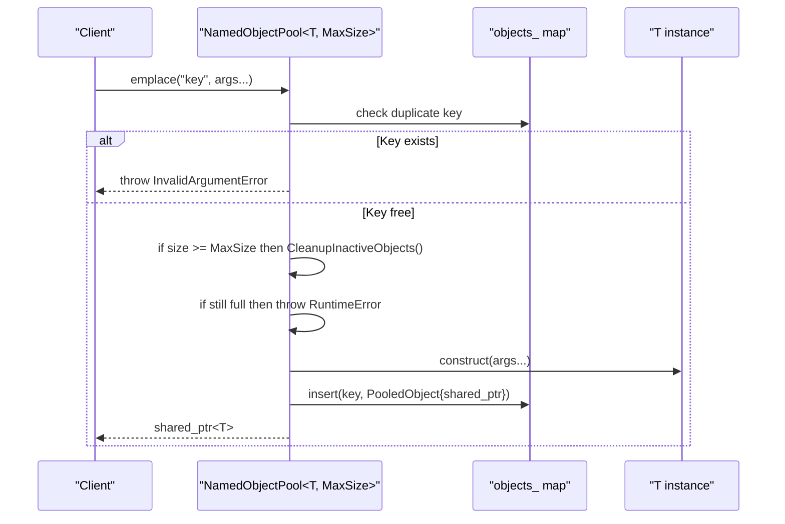
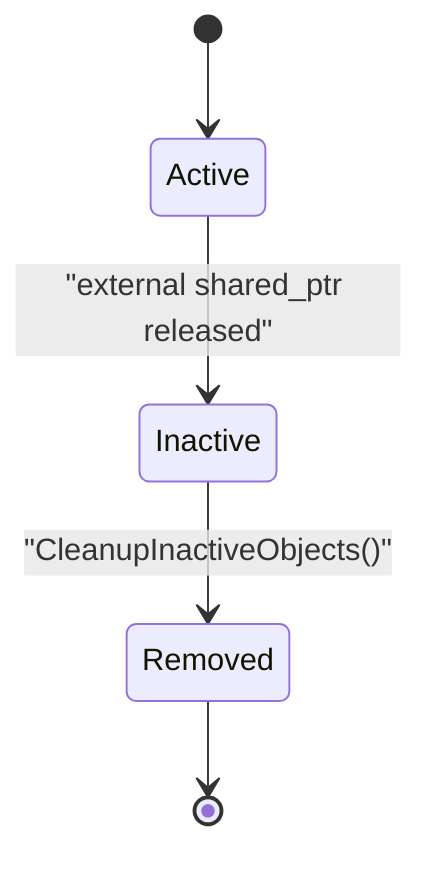
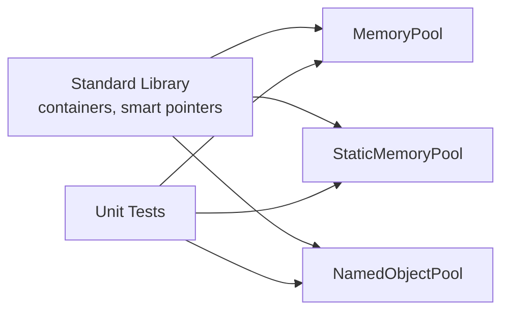

# Memory Management

<cite>
**Referenced Files in This Document**   
- [memory_pool.hpp](file://base/memory_pool.hpp)
- [object_pool.hpp](file://base/object_pool.hpp)
- [memory_pool.md](file://docs/en/base/memory_pool.md)
- [object_pool.md](file://docs/en/base/object_pool.md)
- [memory_pool_test.cpp](file://tests/Pool/memory_pool_test.cpp)
- [object_pool_test.cpp](file://tests/Pool/object_pool_test.cpp)
</cite>

## Table of Contents
1. [Introduction](#introduction)
2. [Project Structure](#project-structure)
3. [Core Components](#core-components)
4. [Architecture Overview](#architecture-overview)
5. [Detailed Component Analysis](#detailed-component-analysis)
6. [Dependency Analysis](#dependency-analysis)
7. [Performance Considerations](#performance-considerations)
8. [Troubleshooting Guide](#troubleshooting-guide)
9. [Conclusion](#conclusion)
10. [Appendices](#appendices)

## Introduction
This document explains HsBaSlicer’s advanced memory management system with a focus on:
- Custom allocation strategies through `MemoryPool` and `StaticMemoryPool`.
- Efficient object lifecycle management through `NamedObjectPool`.
- Memory alignment, cache-friendly data layout, and zero-copy patterns.
- Practical techniques for profiling, leak detection, fragmentation reduction, and performance analysis.
- Guidance for memory mapping large datasets, smart pointer usage, RAII principles, platform-specific optimizations, and troubleshooting common issues.

The content is grounded in the repository’s core base components and their tests and documentation.

## Project Structure
HsBaSlicer organizes low-level utilities under `base/`, including the two primary memory abstractions used throughout the project:
- `base/memory_pool.hpp`: STL-compatible allocators backed by fixed-size pools.
- `base/object_pool.hpp`: A named, thread-safe object registry with automatic cleanup.

**Diagram sources**
- [memory_pool.hpp:1-375](file://base/memory_pool.hpp#L1-L375)
- [object_pool.hpp:1-286](file://base/object_pool.hpp#L1-L286)
- [memory_pool_test.cpp:1-100](file://tests/Pool/memory_pool_test.cpp#L1-L100)
- [object_pool_test.cpp:1-162](file://tests/Pool/object_pool_test.cpp#L1-L162)
- [memory_pool.md:1-325](file://docs/en/base/memory_pool.md#L1-L325)
- [object_pool.md:1-274](file://docs/en/base/object_pool.md#L1-L274)

**Section sources**
- [memory_pool.hpp:1-375](file://base/memory_pool.hpp#L1-L375)
- [object_pool.hpp:1-286](file://base/object_pool.hpp#L1-L286)

## Core Components
HsBaSlicer provides two complementary layers:
- Low-level memory pool allocators for predictable, contiguous, and aligned allocations.
- High-level named object pooling for lifecycle management, sharing, and cleanup.

Key responsibilities:
- `MemoryPool<T, PoolSize>`: Per-instance allocator backed by a shared state buffer.
- `StaticMemoryPool<T, PoolSize>`: Global static allocator where all instances are equal.
- `NamedObjectPool<T, MaxSize>`: Thread-safe registry of named `std::shared_ptr<T>` objects with lazy cleanup.

**Section sources**
- [memory_pool.hpp:18-208](file://base/memory_pool.hpp#L18-L208)
- [memory_pool.hpp:215-372](file://base/memory_pool.hpp#L215-L372)
- [object_pool.hpp:16-283](file://base/object_pool.hpp#L16-L283)

## Architecture Overview
The memory subsystem follows a layered design:
- Allocator layer (`MemoryPool`, `StaticMemoryPool`) implements the STL allocator interface to integrate seamlessly with standard containers and smart pointers.
- Object registry layer (`NamedObjectPool`) manages named objects using `std::shared_ptr`, enabling safe sharing and automatic cleanup when no external references remain.

**Diagram sources**
- [memory_pool.hpp:28-34](file://base/memory_pool.hpp#L28-L34)
- [memory_pool.hpp:43-208](file://base/memory_pool.hpp#L43-L208)
- [memory_pool.hpp:215-372](file://base/memory_pool.hpp#L215-L372)
- [object_pool.hpp:22-46](file://base/object_pool.hpp#L22-L46)
- [object_pool.hpp:22-283](file://base/object_pool.hpp#L22-L283)

## Detailed Component Analysis

### MemoryPool and StaticMemoryPool
Both classes implement the STL allocator interface and provide fixed-size, thread-safe allocation within a preallocated buffer.

Highlights:
- Alignment: Buffers are aligned to `std::max_align_t`, ensuring suitability for any type.
- Contiguous storage: The underlying buffer is a byte array; allocations are first-fit scans over the buffer.
- Thread safety: Allocation and deallocation are protected by a mutex.
- Capacity checks: Allocations that exceed capacity or overlap existing blocks throw `std::bad_alloc`; invalid deallocation offsets throw `std::invalid_argument`.
- Shared vs static:
  - `MemoryPool` shares state via `std::shared_ptr<MemoryPoolState>`.
  - `StaticMemoryPool` uses static storage so all instances are equal and share one global buffer.

**Diagram sources**
- [memory_pool.hpp:111-142](file://base/memory_pool.hpp#L111-L142)
- [memory_pool.hpp:266-296](file://base/memory_pool.hpp#L266-L296)

Usage patterns validated by tests:
- Integration with `std::vector` and `std::list`.
- Integration with `std::shared_ptr` via `std::allocate_shared`.
- Coroutine integration through custom allocator registration.

**Diagram sources**
- [memory_pool_test.cpp:30-39](file://tests/Pool/memory_pool_test.cpp#L30-L39)
- [memory_pool.hpp:111-142](file://base/memory_pool.hpp#L111-L142)

Practical guidance derived from implementation and tests:
- Prefer small, frequently allocated/deallocated types for pool-backed containers.
- Use `std::allocate_shared` with the pool allocator to keep control blocks and payload in the same pool.
- For cross-process or global sharing, prefer `StaticMemoryPool` because all instances are equal and share one buffer.

**Section sources**
- [memory_pool.hpp:28-34](file://base/memory_pool.hpp#L28-L34)
- [memory_pool.hpp:43-208](file://base/memory_pool.hpp#L43-L208)
- [memory_pool.hpp:215-372](file://base/memory_pool.hpp#L215-L372)
- [memory_pool_test.cpp:30-74](file://tests/Pool/memory_pool_test.cpp#L30-L74)
- [memory_pool.md:1-325](file://docs/en/base/memory_pool.md#L1-L325)

### NamedObjectPool
`NamedObjectPool<T, MaxSize>` is a thread-safe registry of named objects managed by `std::shared_ptr`. It supports:
- Creation via `emplace` (default allocator) or `allocate` (custom allocator).
- Retrieval via `get` and `operator[]`.
- Capacity enforcement with lazy cleanup of inactive objects.
- Querying active/inactive counts and listing names.

**Diagram sources**
- [object_pool.hpp:66-92](file://base/object_pool.hpp#L66-L92)
- [object_pool.hpp:262-279](file://base/object_pool.hpp#L262-L279)

Lifecycle behavior:
- An object is considered inactive when its `shared_ptr` use count equals 1 (only held by the pool).
- Automatic cleanup is triggered lazily when adding new objects and the pool is at capacity.
- Manual cleanup can be invoked via `Cleanup`.

**Diagram sources**
- [object_pool.hpp:35-46](file://base/object_pool.hpp#L35-L46)
- [object_pool.hpp:262-279](file://base/object_pool.hpp#L262-L279)

Validated behaviors from tests:
- Basic creation, retrieval, and operator overload.
- RAII semantics: objects become inactive after external references drop.
- Mixed allocation modes: default and custom allocator usage in the same pool.
- Capacity limits and exception handling.

**Section sources**
- [object_pool.hpp:16-283](file://base/object_pool.hpp#L16-L283)
- [object_pool_test.cpp:9-160](file://tests/Pool/object_pool_test.cpp#L9-L160)
- [object_pool.md:1-274](file://docs/en/base/object_pool.md#L1-L274)

## Dependency Analysis
The memory subsystem has minimal coupling:
- `MemoryPool` depends on standard library primitives and a mutex for synchronization.
- `StaticMemoryPool` adds static storage and equality semantics.
- `NamedObjectPool` depends on `std::shared_ptr`, `std::unordered_map`, and a shared mutex for read/write separation.
- Tests depend on both components to validate container and smart pointer integration.

**Diagram sources**
- [memory_pool.hpp:13-17](file://base/memory_pool.hpp#L13-L17)
- [object_pool.hpp:9-14](file://base/object_pool.hpp#L9-L14)
- [memory_pool_test.cpp:1-10](file://tests/Pool/memory_pool_test.cpp#L1-L10)
- [object_pool_test.cpp:1-6](file://tests/Pool/object_pool_test.cpp#L1-L6)

**Section sources**
- [memory_pool.hpp:13-17](file://base/memory_pool.hpp#L13-L17)
- [object_pool.hpp:9-14](file://base/object_pool.hpp#L9-L14)

## Performance Considerations
- Contiguous allocation and alignment:
  - Both pool allocators align buffers to `std::max_align_t`, improving cache locality and avoiding misaligned access penalties.
- First-fit scanning:
  - Allocation scans the buffer linearly; repeated small allocations may fragment the free space. Consider batched allocations or larger pool sizes to reduce fragmentation overhead.
- Thread safety overhead:
  - Mutexes protect critical sections; contention increases with high concurrency. If your workload is single-threaded per pool, consider partitioning pools to reduce lock contention.
- Container integration:
  - Using pool-backed containers reduces heap churn and improves locality for dense data structures like vectors and lists.
- Smart pointers:
  - Combine `std::allocate_shared` with pool allocators to co-locate control blocks and payloads, reducing indirection and improving cache behavior.
- Lazy cleanup in object pools:
  - `NamedObjectPool` cleans up only when necessary, minimizing unnecessary traversal and destruction costs.

[No sources needed since this section provides general guidance]

## Troubleshooting Guide
Common issues and resolutions:
- Out-of-memory errors during allocation:
  - Cause: Request exceeds pool capacity or cannot find a contiguous free block.
  - Resolution: Increase `PoolSize`, reduce concurrent allocations, or restructure allocation patterns to favor larger contiguous blocks.
- Invalid pointer deallocation:
  - Cause: Passing an out-of-bounds pointer to `deallocate`.
  - Resolution: Ensure pointers originate from the same pool instance and match the requested size.
- Duplicate object names:
  - Cause: Inserting an object with an existing name into `NamedObjectPool`.
  - Resolution: Use unique names or remove the existing entry before insertion.
- Pool full exceptions:
  - Cause: Adding objects beyond `MaxSize` without freeing inactive ones.
  - Resolution: Release external `shared_ptr`s to make objects inactive, then call `Cleanup` or rely on lazy cleanup.
- Fragmentation symptoms:
  - Cause: Many small, interleaved allocations and deallocations.
  - Resolution: Batch allocations, reuse pools, or switch to object pools for complex objects.

Operational tips:
- Monitor pool usage:
  - For `StaticMemoryPool`, query `UsedCount()` to track bytes allocated.
  - For `NamedObjectPool`, monitor `size()`, `ActiveCount()`, and `InactiveCount()` to detect leaks or excessive retention.
- Validate correctness with tests:
  - Refer to `memory_pool_test.cpp` and `object_pool_test.cpp` for patterns validating container and smart pointer integration, RAII behavior, and capacity limits.

**Section sources**
- [memory_pool.hpp:111-175](file://base/memory_pool.hpp#L111-L175)
- [memory_pool.hpp:266-324](file://base/memory_pool.hpp#L266-L324)
- [memory_pool.hpp:361-365](file://base/memory_pool.hpp#L361-L365)
- [object_pool.hpp:66-155](file://base/object_pool.hpp#L66-L155)
- [object_pool.hpp:219-245](file://base/object_pool.hpp#L219-L245)
- [memory_pool_test.cpp:30-74](file://tests/Pool/memory_pool_test.cpp#L30-L74)
- [object_pool_test.cpp:35-141](file://tests/Pool/object_pool_test.cpp#L35-L141)

## Conclusion
HsBaSlicer’s memory management combines low-level, aligned, fixed-size allocators with a high-level, named object registry. Together they enable:
- Predictable allocation behavior and reduced heap churn.
- Cache-friendly layouts through alignment and contiguous storage.
- Safe, shared ownership with automatic cleanup.
- Scalable patterns for high-frequency allocations and object lifecycle management.

Adopt these components judiciously: use pool-backed containers for dense, short-lived data; use `NamedObjectPool` for long-lived, shared resources; and profile continuously to balance throughput, latency, and memory footprint.

[No sources needed since this section summarizes without analyzing specific files]

## Appendices

### Memory Mapping for Large Datasets
While the current codebase does not include direct memory-mapped file I/O, you can extend HsBaSlicer’s memory model by:
- Mapping large files into virtual memory and treating them as read-only views.
- Wrapping mapped regions with custom allocators or view types to avoid copying.
- Combining mapped views with `NamedObjectPool` for metadata and indices while keeping raw data unmapped until needed.

[No sources needed since this section provides conceptual guidance]

### Smart Pointer Usage Patterns and RAII Principles
Recommended practices:
- Prefer `std::shared_ptr` for shared ownership across pipeline stages; pair with `NamedObjectPool` for centralized lifecycle control.
- Use `std::unique_ptr` for exclusive ownership and deterministic cleanup.
- Combine `std::allocate_shared` with pool allocators to minimize allocations and improve locality.
- Apply RAII consistently: wrap resources in scoped objects so cleanup occurs automatically on scope exit or exception.

**Section sources**
- [memory_pool_test.cpp:41-51](file://tests/Pool/memory_pool_test.cpp#L41-L51)
- [object_pool_test.cpp:35-59](file://tests/Pool/object_pool_test.cpp#L35-L59)

### Platform-Specific Optimizations
Guidance:
- On Windows, consider NUMA-aware allocation for multi-socket systems and align buffers to page boundaries where appropriate.
- On Linux, explore `mmap` for large read-only datasets and `memalign`/`posix_memalign` for aligned allocations if needed.
- On Android/iOS, tune pool sizes based on device memory constraints and background process limits.

[No sources needed since this section provides general guidance]