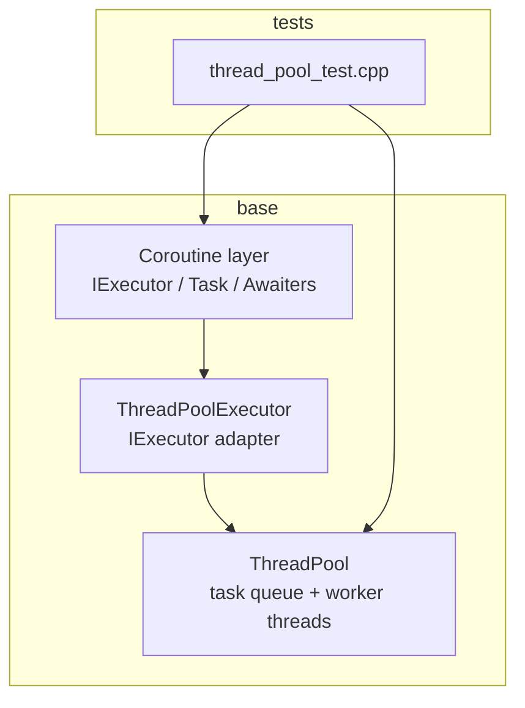
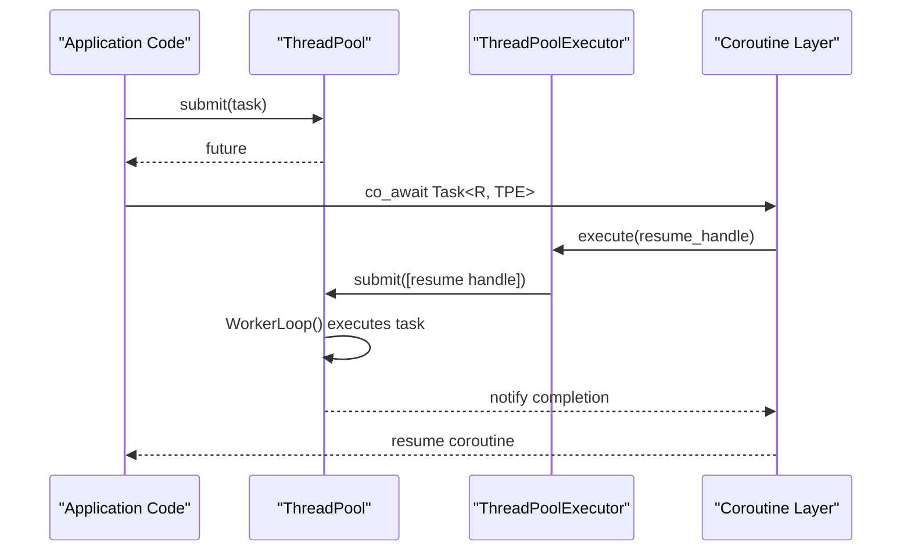
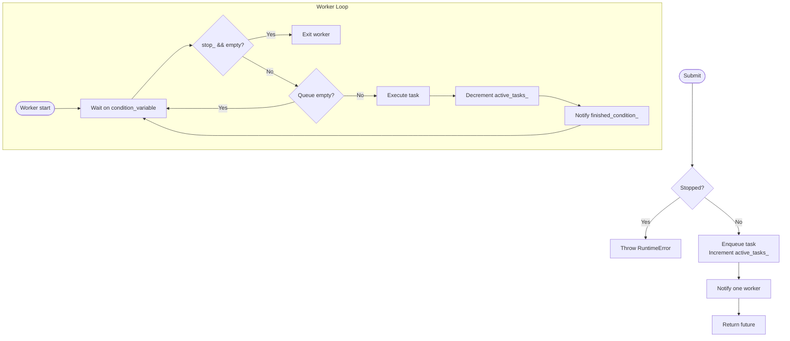
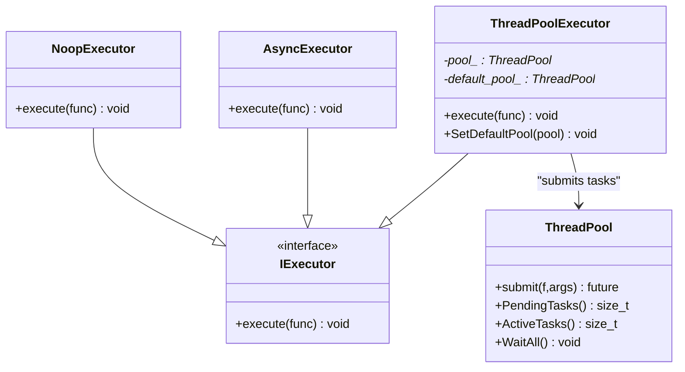
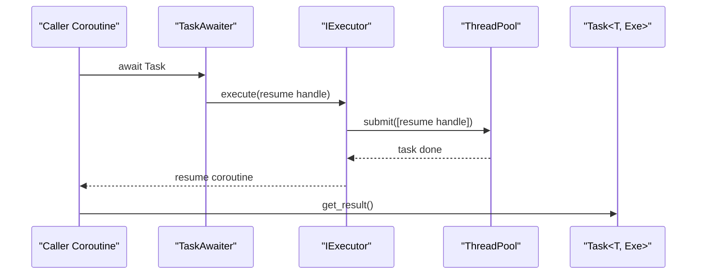
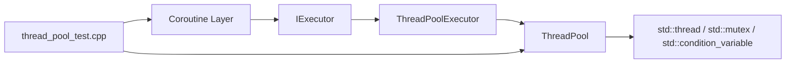

# Parallel Processing

<cite>
**Referenced Files in This Document**
- [thread_pool.hpp](file://base/thread_pool.hpp)
- [coroutine.hpp](file://base/coroutine.hpp)
- [thread_pool_test.cpp](file://tests/Pool/thread_pool_test.cpp)
</cite>

## Table of Contents
1. [Introduction](#introduction)
2. [Project Structure](#project-structure)
3. [Core Components](#core-components)
4. [Architecture Overview](#architecture-overview)
5. [Detailed Component Analysis](#detailed-component-analysis)
6. [Dependency Analysis](#dependency-analysis)
7. [Performance Considerations](#performance-considerations)
8. [Troubleshooting Guide](#troubleshooting-guide)
9. [Conclusion](#conclusion)
10. [Appendices](#appendices)

## Introduction
This document explains HsBaSlicer’s parallel processing capabilities with a focus on the ThreadPool implementation, its coroutine integration through IExecutor and ThreadPoolExecutor, and practical guidance for parallelizing slicing workloads. It covers thread management, task submission, synchronization, performance tuning, thread safety, exception handling in concurrent contexts, debugging strategies, and benchmarking recommendations.

## Project Structure
The parallel execution primitives are implemented under base:
- ThreadPool and ThreadPoolExecutor live in base/thread_pool.hpp.
- The coroutine abstraction, including IExecutor, Task, DispatchAwaiter, NoopExecutor, AsyncExecutor, and Generator utilities, lives in base/coroutine.hpp.
- Unit tests demonstrating usage patterns are in tests/Pool/thread_pool_test.cpp.

**Diagram sources**
- [thread_pool.hpp:29-162](file://base/thread_pool.hpp#L29-L162)
- [thread_pool.hpp:170-206](file://base/thread_pool.hpp#L170-L206)
- [coroutine.hpp:47-70](file://base/coroutine.hpp#L47-L70)
- [thread_pool_test.cpp:14-85](file://tests/Pool/thread_pool_test.cpp#L14-L85)

**Section sources**
- [thread_pool.hpp:1-214](file://base/thread_pool.hpp#L1-L214)
- [coroutine.hpp:1-1091](file://base/coroutine.hpp#L1-L1091)
- [thread_pool_test.cpp:1-87](file://tests/Pool/thread_pool_test.cpp#L1-L87)

## Core Components
- ThreadPool: A bounded pool of worker threads that execute submitted tasks concurrently. It provides task submission via futures, pending/active task counters, and a WaitAll barrier.
- IExecutor: An abstract executor interface used by the coroutine layer to dispatch work. Implementations include NoopExecutor (inline), AsyncExecutor (std::async), and ThreadPoolExecutor (backed by ThreadPool).
- ThreadPoolExecutor: Bridges coroutines to ThreadPool by submitting lambdas to the underlying pool. It supports a default pool and per-instance pools.
- Task and awaiters: Coroutine-friendly abstractions that suspend/resume across executors, propagate exceptions safely, and support chaining callbacks.

Key responsibilities:
- Thread lifecycle management and graceful shutdown in ThreadPool.
- Synchronization between producer (submitter) and consumers (workers) using mutexes and condition variables.
- Executor-driven coroutine scheduling via IExecutor.

**Section sources**
- [thread_pool.hpp:29-162](file://base/thread_pool.hpp#L29-L162)
- [thread_pool.hpp:170-206](file://base/thread_pool.hpp#L170-L206)
- [coroutine.hpp:47-70](file://base/coroutine.hpp#L47-L70)
- [coroutine.hpp:81-122](file://base/coroutine.hpp#L81-L122)
- [coroutine.hpp:184-198](file://base/coroutine.hpp#L184-L198)
- [coroutine.hpp:205-382](file://base/coroutine.hpp#L205-L382)
- [coroutine.hpp:388-555](file://base/coroutine.hpp#L388-L555)

## Architecture Overview
The system composes three layers:
- Application code submits CPU-bound or IO-bound work as std::function objects or coroutine Tasks.
- ThreadPoolExecutor adapts IExecutor to ThreadPool.submit.
- Coroutine machinery uses IExecutor to resume coroutines on the appropriate execution context.

**Diagram sources**
- [thread_pool.hpp:67-90](file://base/thread_pool.hpp#L67-L90)
- [thread_pool.hpp:118-154](file://base/thread_pool.hpp#L118-L154)
- [thread_pool.hpp:180-184](file://base/thread_pool.hpp#L180-L184)
- [coroutine.hpp:99-106](file://base/coroutine.hpp#L99-L106)
- [coroutine.hpp:187-193](file://base/coroutine.hpp#L187-L193)

## Detailed Component Analysis

### ThreadPool Implementation
ThreadPool manages:
- A vector of std::thread workers.
- A FIFO queue of std::function<void()> tasks.
- A mutex protecting the queue and stop flag.
- Two condition variables: one for waking workers when new tasks arrive, another for signaling completion to WaitAll.
- Atomic counters for active tasks and a boolean stop flag.

Lifecycle:
- Constructor validates thread count > 0 and launches workers.
- Destructor sets stop flag, notifies all workers, and joins threads.
- submit wraps callable into packaged_task, enqueues it, increments active_tasks_, and notifies a worker.
- PendingTasks returns queue size; ActiveTasks returns atomic counter.
- WaitAll blocks until queue is empty and active_tasks_ is zero.

Worker loop:
- Waits on condition variable until stop or non-empty queue.
- Pops a task, executes it inside try/catch, decrements active_tasks_, and signals finished_condition_.

Thread safety notes:
- All shared state access is guarded by queue_mutex_.
- Exceptions thrown by tasks are caught and do not crash workers; active_tasks_ still decrements.
- Stop flag prevents new submissions after shutdown.

**Diagram sources**
- [thread_pool.hpp:67-90](file://base/thread_pool.hpp#L67-L90)
- [thread_pool.hpp:118-154](file://base/thread_pool.hpp#L118-L154)

**Section sources**
- [thread_pool.hpp:29-162](file://base/thread_pool.hpp#L29-L162)

### IExecutor and ThreadPoolExecutor Integration
IExecutor defines a single execute method taking an rvalue std::function<void()>. Implementations:
- NoopExecutor: runs inline synchronously.
- AsyncExecutor: uses std::async with async launch policy.
- ThreadPoolExecutor: forwards to ThreadPool.submit.

ThreadPoolExecutor behavior:
- Can be constructed with a specific ThreadPool or use a default pool.
- SetDefaultPool allows global configuration of the default executor.
- get_pool resolves instance pool, then default pool, then creates a static default pool sized to hardware_concurrency if none provided.

**Diagram sources**
- [coroutine.hpp:47-70](file://base/coroutine.hpp#L47-L70)
- [thread_pool.hpp:170-206](file://base/thread_pool.hpp#L170-L206)

**Section sources**
- [coroutine.hpp:47-70](file://base/coroutine.hpp#L47-L70)
- [thread_pool.hpp:170-206](file://base/thread_pool.hpp#L170-L206)

### Coroutine-Based Async Operations
The coroutine layer provides:
- Task<T, Executor>: a promise-based asynchronous result wrapper with initial suspension via DispatchAwaiter.
- TaskAwaiter: bridges awaiting a Task to resuming the caller coroutine on the executor.
- DispatchAwaiter: schedules coroutine resumption through IExecutor.
- CustomAllocatorTask and related awaiters: allow custom allocators for coroutine allocations.

Execution flow:
- When a coroutine awaits a Task, TaskAwaiter registers a finally callback that resumes the coroutine on the executor once the Task completes.
- Initial suspension ensures the first step runs on the executor rather than the calling thread.

**Diagram sources**
- [coroutine.hpp:99-106](file://base/coroutine.hpp#L99-L106)
- [coroutine.hpp:187-193](file://base/coroutine.hpp#L187-L193)
- [coroutine.hpp:277-285](file://base/coroutine.hpp#L277-L285)

**Section sources**
- [coroutine.hpp:81-122](file://base/coroutine.hpp#L81-L122)
- [coroutine.hpp:184-198](file://base/coroutine.hpp#L184-L198)
- [coroutine.hpp:205-382](file://base/coroutine.hpp#L205-L382)
- [coroutine.hpp:388-555](file://base/coroutine.hpp#L388-L555)

### Practical Examples from Tests
The unit tests demonstrate:
- Submitting multiple tasks and collecting results via futures.
- Using ThreadPoolExecutor with coroutines by setting a default pool.
- Mixing std::future-based tasks and coroutine Tasks within the same pool.

These examples illustrate:
- Proper pool sizing and lifecycle.
- Safe interaction between futures and coroutines.
- Cleanup of default executor configuration.

**Section sources**
- [thread_pool_test.cpp:14-37](file://tests/Pool/thread_pool_test.cpp#L14-L37)
- [thread_pool_test.cpp:39-58](file://tests/Pool/thread_pool_test.cpp#L39-L58)
- [thread_pool_test.cpp:60-85](file://tests/Pool/thread_pool_test.cpp#L60-L85)

## Dependency Analysis
- ThreadPool depends on standard concurrency primitives and error types.
- ThreadPoolExecutor depends on IExecutor and ThreadPool.
- Coroutine layer depends on IExecutor implementations to schedule work.
- Tests depend on both ThreadPool and coroutine abstractions.

**Diagram sources**
- [thread_pool.hpp:13-23](file://base/thread_pool.hpp#L13-L23)
- [thread_pool.hpp:170-206](file://base/thread_pool.hpp#L170-L206)
- [coroutine.hpp:47-70](file://base/coroutine.hpp#L47-L70)
- [thread_pool_test.cpp:6-7](file://tests/Pool/thread_pool_test.cpp#L6-L7)

**Section sources**
- [thread_pool.hpp:1-214](file://base/thread_pool.hpp#L1-L214)
- [coroutine.hpp:1-1091](file://base/coroutine.hpp#L1-L1091)
- [thread_pool_test.cpp:1-87](file://tests/Pool/thread_pool_test.cpp#L1-L87)

## Performance Considerations
Hardware concurrency detection:
- ThreadPool constructor defaults to std::thread::hardware_concurrency().
- ThreadPoolExecutor fallback default pool also uses hardware_concurrency(), clamped to at least 1.

Task queue management:
- ThreadPool uses a simple FIFO queue protected by a mutex.
- Workers wake on condition_variable notifications.
- WaitAll uses a separate condition_variable to block until all tasks complete.

Memory barriers and atomics:
- active_tasks_ is atomic<size_t>, ensuring safe cross-thread visibility without additional locks.
- stop_ is atomic<bool>, enabling lock-free checks in worker loops.

Optimization opportunities:
- For high-throughput slicing, consider batching small tasks to reduce queue contention.
- Use dedicated pools per workload type to avoid priority inversion.
- Tune pool size based on workload characteristics (CPU-bound vs IO-bound).
- Avoid excessive logging or heavy operations inside hot paths to minimize lock hold times.

Benchmarking guidelines:
- Measure throughput and latency across varying pool sizes.
- Compare std::future-based tasks versus coroutine Tasks for similar workloads.
- Profile cache locality and memory allocation patterns when slicing large meshes.
- Validate scalability on multi-core systems and compare against single-threaded baselines.

[No sources needed since this section provides general guidance]

## Troubleshooting Guide
Common issues and remedies:
- Submitting tasks after shutdown:
  - ThreadPool throws a runtime error if submit is called after stop flag is set. Ensure application logic does not submit after destruction or explicit shutdown.
- Deadlocks or hangs:
  - Verify that WaitAll is only called when no more tasks will be submitted.
  - Ensure coroutines are awaited or their results consumed to prevent resource leaks.
- Exception handling:
  - ThreadPool catches exceptions from tasks but still decrements active_tasks_; ensure your tasks report errors appropriately.
  - Coroutine Task propagates exceptions via Result::get_or_throw; use catching or then chains to handle them.
- Debugging concurrent code:
  - Use PendingTasks and ActiveTasks to monitor pool state.
  - Add structured logging around task boundaries to trace execution order.
  - In tests, verify final states and counters to detect races.

Relevant behaviors:
- ThreadPool destructor sets stop flag and joins threads.
- Worker loop catches std::exception and continues processing remaining tasks.
- Coroutine promise stores exceptions and rethrows on get_result or get_or_throw.

**Section sources**
- [thread_pool.hpp:47-61](file://base/thread_pool.hpp#L47-L61)
- [thread_pool.hpp:77-89](file://base/thread_pool.hpp#L77-L89)
- [thread_pool.hpp:140-153](file://base/thread_pool.hpp#L140-L153)
- [coroutine.hpp:277-285](file://base/coroutine.hpp#L277-L285)
- [coroutine.hpp:449-457](file://base/coroutine.hpp#L449-L457)

## Conclusion
HsBaSlicer’s parallel processing stack centers on a robust ThreadPool and a flexible coroutine framework built on IExecutor. ThreadPool provides reliable task execution, synchronization, and lifecycle management. ThreadPoolExecutor integrates seamlessly with the coroutine layer, allowing ergonomic asynchronous programming while leveraging the underlying thread pool. By understanding these components, you can design efficient parallel slicing pipelines, tune performance for different workloads, and maintain thread safety and correctness.

[No sources needed since this section summarizes without analyzing specific files]

## Appendices

### API Reference Summary
- ThreadPool:
  - submit: Enqueues a task and returns a future.
  - PendingTasks: Returns number of queued tasks.
  - ActiveTasks: Returns number of currently executing tasks.
  - WaitAll: Blocks until all tasks complete.
- ThreadPoolExecutor:
  - execute: Submits a function to the underlying ThreadPool.
  - SetDefaultPool: Configures the default pool for coroutine tasks.
- IExecutor:
  - execute: Abstract interface for scheduling functions.

**Section sources**
- [thread_pool.hpp:67-111](file://base/thread_pool.hpp#L67-L111)
- [thread_pool.hpp:180-188](file://base/thread_pool.hpp#L180-L188)
- [coroutine.hpp:47-53](file://base/coroutine.hpp#L47-L53)