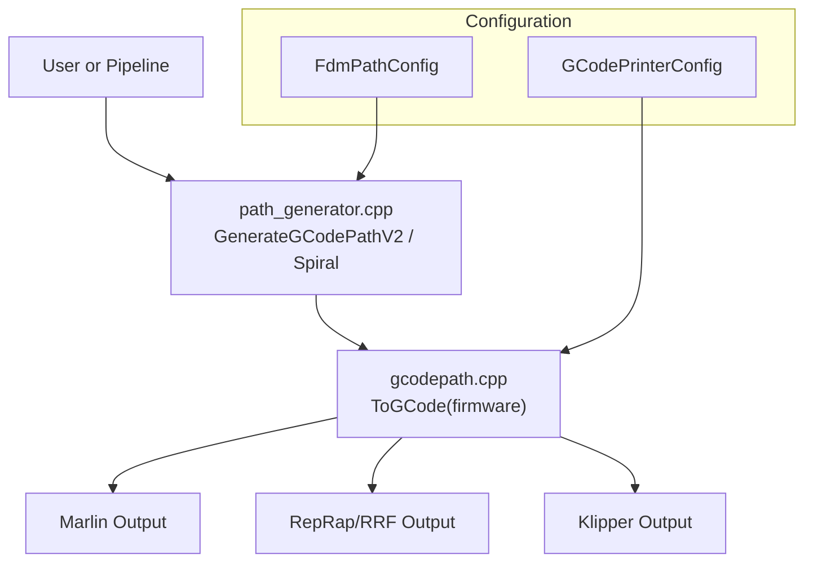
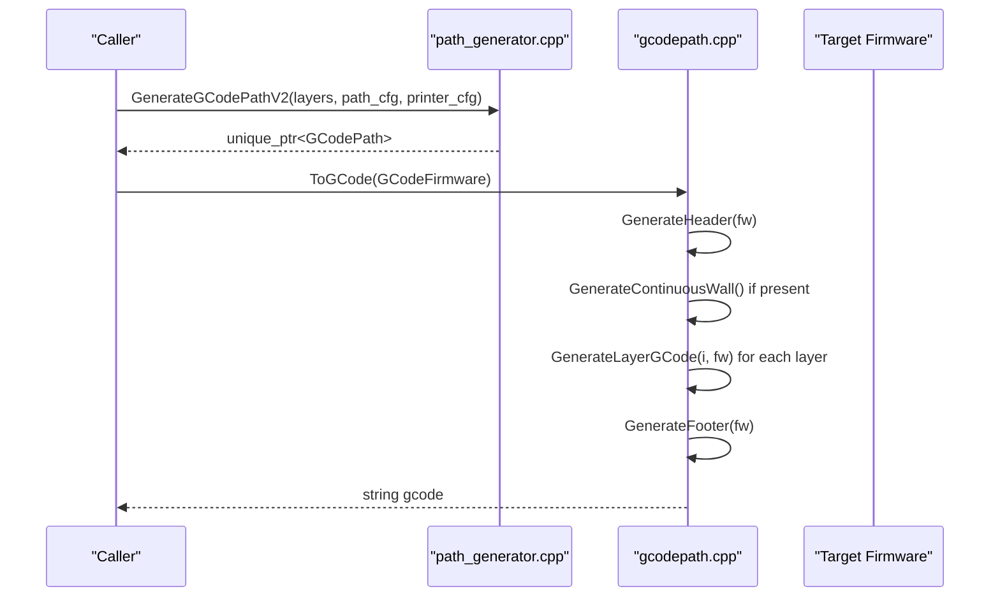
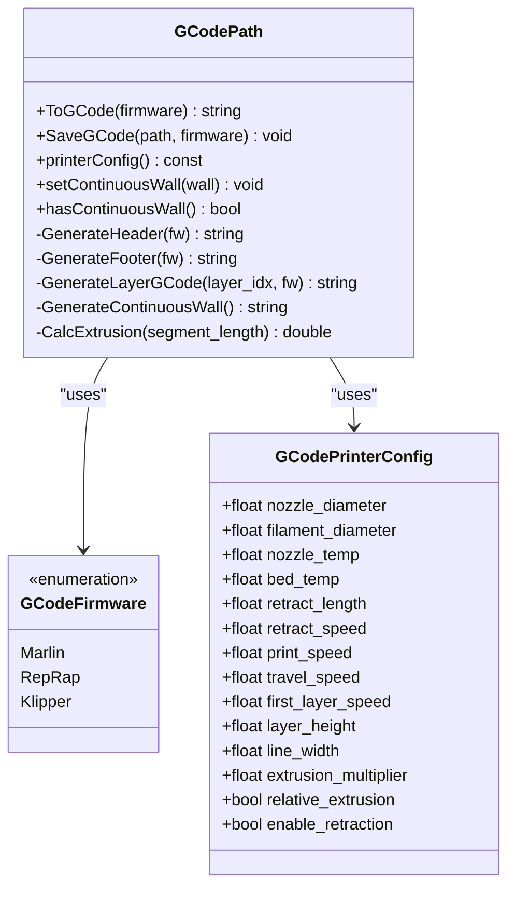
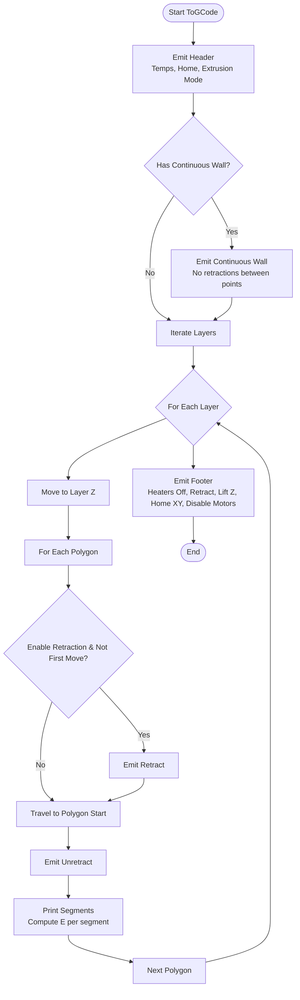
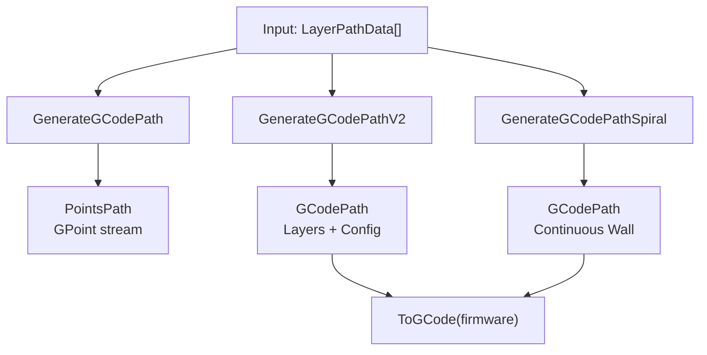
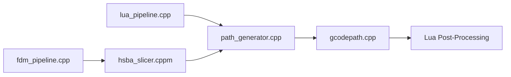

# Firmware-Specific Optimization

<cite>
**Referenced Files in This Document**
- [gcodepath.hpp](file://paths/gcodepath.hpp)
- [gcodepath.cpp](file://paths/gcodepath.cpp)
- [path_generator.hpp](file://LibHsBaSlicer/Path/path_generator.hpp)
- [path_generator.cpp](file://LibHsBaSlicer/Path/path_generator.cpp)
- [lua_pipeline.cpp](file://LibHsBaSlicer/Extends/lua_pipeline.cpp)
- [fdm_pipeline.cpp](file://DllHsBaSlicer/fdm_pipeline.cpp)
- [hsba_slicer.cppm](file://ModuleHsBaSlicer/hsba_slicer.cppm)
- [README.md](file://docs/en/LibHsBaSlicer/README.md)
- [gcode_path_test.cpp](file://tests/PathsOut/gcode_path_test.cpp)
</cite>

## Table of Contents
1. [Introduction](#introduction)
2. [Project Structure](#project-structure)
3. [Core Components](#core-components)
4. [Architecture Overview](#architecture-overview)
5. [Detailed Component Analysis](#detailed-component-analysis)
6. [Dependency Analysis](#dependency-analysis)
7. [Performance Considerations](#performance-considerations)
8. [Troubleshooting Guide](#troubleshooting-guide)
9. [Conclusion](#conclusion)

## Introduction
This document explains how the slicer generates firmware-specific G-code and how to optimize it for different FDM printer controllers. It focuses on:
- The GCodePrinterConfig structure and its role in shaping printer-specific output.
- Multi-firmware support for Marlin, RepRap/RRF, and Klipper.
- Firmware-specific optimizations such as temperature control, fan control, extrusion mode, and advanced motion commands.
- The enhanced GenerateGCodePathV2 API compared with basic path generation.
- Practical configuration examples and guidance for advanced features like pressure advance and linear advance.

## Project Structure
The firmware-specific G-code pipeline is implemented across a few focused modules:
- paths/gcodepath.{hpp,cpp}: Defines GCodePath, GCodeFirmware, and GCodePrinterConfig; implements header/footer/layer emission per firmware.
- LibHsBaSlicer/Path/path_generator.{hpp,cpp}: Provides high-level APIs including GenerateGCodePathV2 and spiral/vase mode.
- LibHsBaSlicer/Extends/lua_pipeline.cpp: Exposes Lua bindings that parse user-provided configurations and call GenerateGCodePathV2.
- DllHsBaSlicer/fdm_pipeline.cpp and ModuleHsBaSlicer/hsba_slicer.cppm: Integrate slicing, supports, fills, and G-code generation into end-to-end pipelines.
- docs/en/LibHsBaSlicer/README.md: Public documentation describing multi-firmware output and supported features.
- tests/PathsOut/gcode_path_test.cpp: Validates firmware-specific behavior (temperature waits, fan commands, pressure advance, retraction).

**Diagram sources**
- [path_generator.cpp:95-136](file://LibHsBaSlicer/Path/path_generator.cpp#L95-L136)
- [gcodepath.cpp:65-142](file://paths/gcodepath.cpp#L65-L142)

**Section sources**
- [gcodepath.hpp:24-49](file://paths/gcodepath.hpp#L24-L49)
- [path_generator.hpp:20-70](file://LibHsBaSlicer/Path/path_generator.hpp#L20-L70)

## Core Components
- GCodeFirmware: Enumerates target firmware variants (Marlin, RepRap, Klipper).
- GCodePrinterConfig: Holds printer parameters used during G-code emission (temperatures, speeds, retraction, extrusion settings).
- GCodePath: Extends LayersPath to emit standard 3D printer G-code tailored to a selected firmware. Supports continuous spiral walls for vase mode.
- FdmPathConfig and LayerPathData: Define path-generation parameters and per-layer geometry (outlines, fills, supports).
- GenerateGCodePathV2: Builds a GCodePath from layered data and printer configuration.
- GenerateGCodePathSpiral: Builds a GCodePath with a single continuous outer wall rising through layers (vase mode).

Key responsibilities:
- GCodePrinterConfig drives temperature setup, travel/print speeds, retraction, and extrusion mode.
- GCodePath::ToGCode emits firmware-specific headers, layer moves, and footers.
- Path generators assemble layer data and optionally produce a continuous helix for vase mode.

**Section sources**
- [gcodepath.hpp:24-107](file://paths/gcodepath.hpp#L24-L107)
- [path_generator.hpp:20-70](file://LibHsBaSlicer/Path/path_generator.hpp#L20-L70)

## Architecture Overview
The G-code generation flow:
1. Slicing produces per-layer outlines, infill, and supports.
2. Path generator converts polygons to GPoints or directly builds GCodePath via GenerateGCodePathV2.
3. For vase mode, GenerateGCodePathSpiral merges outer contours into a continuous 3D wall.
4. ToGCode(firmware) renders header, optional continuous wall, per-layer moves, and footer according to the selected firmware.

**Diagram sources**
- [path_generator.cpp:95-136](file://LibHsBaSlicer/Path/path_generator.cpp#L95-L136)
- [gcodepath.cpp:310-327](file://paths/gcodepath.cpp#L310-L327)

## Detailed Component Analysis

### GCodePrinterConfig and Its Role
GCodePrinterConfig encapsulates all printer-related parameters required to generate accurate G-code:
- Nozzle and filament dimensions.
- Temperatures for nozzle and bed.
- Retraction length and speed.
- Print and travel speeds, including first-layer speed.
- Layer height and line width.
- Extrusion multiplier.
- Relative vs absolute extrusion mode.
- Whether to enable retraction on travel moves.

These fields are used by:
- Header generation to set temperatures, home axes, select extrusion mode, and initialize firmware-specific features.
- Layer generation to compute feed rates, retraction/unretraction, and E values.
- Footer generation to retract, lift Z, home XY, and disable motors.

Practical implications:
- Adjusting print_speed and travel_speed changes F values in G1/G0 moves.
- Changing relative_extrusion toggles M82/M83.
- Enabling retraction inserts E moves before and after travel segments.

**Section sources**
- [gcodepath.hpp:32-49](file://paths/gcodepath.hpp#L32-L49)
- [gcodepath.cpp:53-63](file://paths/gcodepath.cpp#L53-L63)
- [gcodepath.cpp:195-269](file://paths/gcodepath.cpp#L195-L269)

### Multi-Firmware Support: Marlin, RepRap/RRF, Klipper
GCodeFirmware enumerates supported targets. GCodePath::GenerateHeader and GenerateFooter switch on this enum to emit appropriate commands:

- Marlin:
  - Temperature setup and waits (M104/M109, M140/M190).
  - Home axes (G28).
  - Reset extruder (G92 E0).
  - Absolute or relative extrusion (M82/M83).
  - Lift nozzle (G1 Z...).
  - Footer: turn off heaters, retract, lift Z, home XY, disable motors (M84).

- RepRap/RRF:
  - Similar to Marlin but includes explicit fan control (M106 on, M107 off).

- Klipper:
  - Includes SET_PRESSURE_ADVANCE, M220/M221 for speed/flow percentage, and SET_FAN_SPEED for part fan.

Coordinate systems and units:
- All outputs use G0/G1 moves with X/Y/Z/E coordinates.
- Feed rates are converted from mm/s to mm/min using a constant factor.
- First layer uses first_layer_speed; subsequent layers use print_speed.

**Diagram sources**
- [gcodepath.hpp:24-107](file://paths/gcodepath.hpp#L24-L107)
- [gcodepath.cpp:65-142](file://paths/gcodepath.cpp#L65-L142)

**Section sources**
- [gcodepath.cpp:65-142](file://paths/gcodepath.cpp#L65-L142)
- [gcodepath.cpp:144-193](file://paths/gcodepath.cpp#L144-L193)
- [gcode_path_test.cpp:50-82](file://tests/PathsOut/gcode_path_test.cpp#L50-L82)

### Firmware-Specific Optimizations
Temperature control:
- All targets set nozzle and bed temperatures and wait for them to stabilize.
- Klipper additionally sets pressure advance and fan speed explicitly.

Retraction and travel:
- Retraction is inserted between polygons when enabled.
- Unretraction occurs before printing starts on a new polygon.
- Footer retracts and lifts Z before homing and disabling motors.

Extrusion mode:
- Absolute (M82) vs relative (M83) controlled by GCodePrinterConfig.relative_extrusion.

Advanced motion control:
- Klipper header includes SET_PRESSURE_ADVANCE and M220/M221 for speed/flow percentages.
- Linear advance is not emitted by default; it can be added via Lua post-processing.

Fan control:
- RepRap/RRF uses M106/M107.
- Klipper uses SET_FAN_SPEED.

**Diagram sources**
- [gcodepath.cpp:310-327](file://paths/gcodepath.cpp#L310-L327)
- [gcodepath.cpp:195-269](file://paths/gcodepath.cpp#L195-L269)

**Section sources**
- [gcodepath.cpp:195-269](file://paths/gcodepath.cpp#L195-L269)
- [gcodepath.cpp:310-327](file://paths/gcodepath.cpp#L310-L327)

### GenerateGCodePathV2 vs Basic Path Generation
Basic path generation:
- GenerateGCodePath returns a PointsPath containing GPoint objects with types (travel/extrude), positions, velocities, and extrusion values. It does not include firmware-specific headers/footers.

Enhanced V2 path generation:
- GenerateGCodePathV2 returns a GCodePath that stores per-layer polygons and their Z heights, enabling firmware-aware ToGCode rendering.
- It combines outlines, fills, and supports per layer and encodes Z height in a layer config string.
- It allows later calls to ToGCode(firmware) to emit complete G-code with firmware-specific commands.

Spiral/vase mode:
- GenerateGCodePathSpiral merges outer contours into a continuous 3D wall and disables per-layer polygon emission, ideal for uniform-cross-section models.

**Diagram sources**
- [path_generator.cpp:61-136](file://LibHsBaSlicer/Path/path_generator.cpp#L61-L136)

**Section sources**
- [path_generator.cpp:61-136](file://LibHsBaSlicer/Path/path_generator.cpp#L61-L136)
- [gcode_path_test.cpp:77-119](file://tests/PathsOut/gcode_path_test.cpp#L77-L119)

### Practical Configuration Examples
- Configure printer parameters:
  - Set nozzle and bed temperatures, filament diameter, retraction length/speed, print/travel speeds, layer height, line width, and extrusion multiplier.
  - Choose relative vs absolute extrusion based on your workflow.
- Select firmware target:
  - Use GCodeFirmware::Marlin, GCodeFirmware::RepRap, or GCodeFirmware::Klipper when calling ToGCode or saving files.
- Optimize for specific printers:
  - For Klipper, consider tuning SET_PRESSURE_ADVANCE and M220/M221 via Lua post-processing if needed.
  - For RepRap/RRF, ensure fan control commands align with your machine’s fan mapping.

Lua integration:
- The Lua pipeline parses a table with fields like layerHeight, lineWidth, printSpeed, travelSpeed, extrusionMultiplier, firmware, nozzleDiameter, filamentDiameter, nozzleTemp, bedTemp, retractLength, retractSpeed.
- It then calls GenerateGCodePathV2 and ToGCode(firmware).

**Section sources**
- [lua_pipeline.cpp:618-653](file://LibHsBaSlicer/Extends/lua_pipeline.cpp#L618-L653)
- [README.md:380-413](file://docs/en/LibHsBaSlicer/README.md#L380-L413)

### Handling Advanced Motion Control Features
- Pressure advance:
  - Klipper header includes SET_PRESSURE_ADVANCE. Tune the value for your filament and flow characteristics.
- Linear advance:
  - Not emitted by default. Add via Lua post-processing script to inject firmware-specific commands (e.g., M900 for Marlin) at appropriate locations.
- Speed and flow percentages:
  - Klipper header includes M220/M221. Adjust via Lua post-processing if you need dynamic overrides.
- Fan control:
  - RepRap/RRF uses M106/M107; Klipper uses SET_FAN_SPEED. Ensure your scripts reference the correct fan names.

Post-processing with Lua:
- ToGCode(firmware, script, lua_reg) runs a Lua script that receives:
  - gcode: base G-code string.
  - firmware: string indicating target ("marlin", "reprap", "klipper").
  - printer_config: table with nozzle_temp, bed_temp, print_speed, travel_speed, layer_height, line_width, total_layers.
- The script can return a modified G-code string or set a global result.

**Section sources**
- [gcodepath.cpp:340-422](file://paths/gcodepath.cpp#L340-L422)
- [gcode_path_test.cpp:64-70](file://tests/PathsOut/gcode_path_test.cpp#L64-L70)

## Dependency Analysis
High-level dependencies:
- path_generator depends on spiral_path and constructs GCodePath instances.
- gcodepath depends on layerspath and Lua utilities for post-processing.
- lua_pipeline bridges Lua tables to C++ structures and invokes GenerateGCodePathV2.
- fdm_pipeline and hsba_slicer integrate slicing, support, fill, and G-code generation.

**Diagram sources**
- [lua_pipeline.cpp:618-653](file://LibHsBaSlicer/Extends/lua_pipeline.cpp#L618-L653)
- [path_generator.cpp:95-136](file://LibHsBaSlicer/Path/path_generator.cpp#L95-L136)
- [gcodepath.cpp:340-422](file://paths/gcodepath.cpp#L340-L422)
- [fdm_pipeline.cpp:64-70](file://DllHsBaSlicer/fdm_pipeline.cpp#L64-L70)
- [hsba_slicer.cppm:695-702](file://ModuleHsBaSlicer/hsba_slicer.cppm#L695-L702)

**Section sources**
- [lua_pipeline.cpp:618-653](file://LibHsBaSlicer/Extends/lua_pipeline.cpp#L618-L653)
- [path_generator.cpp:95-136](file://LibHsBaSlicer/Path/path_generator.cpp#L95-L136)
- [gcodepath.cpp:340-422](file://paths/gcodepath.cpp#L340-L422)
- [fdm_pipeline.cpp:64-70](file://DllHsBaSlicer/fdm_pipeline.cpp#L64-L70)
- [hsba_slicer.cppm:695-702](file://ModuleHsBaSlicer/hsba_slicer.cppm#L695-L702)

## Performance Considerations
- Feed rate conversion:
  - All moves convert mm/s to mm/min using a constant factor; ensure speeds are realistic for your hardware.
- Retractions:
  - Frequent retractions increase G-code size and print time; tune enable_retraction and retract_length/speed for your filament and hotend.
- Spiral mode:
  - Continuous wall avoids inter-segment retractions and reduces G-code overhead; best for vase-like geometries.
- Lua post-processing:
  - Adds runtime overhead; use only when necessary for advanced features.

[No sources needed since this section provides general guidance]

## Troubleshooting Guide
Common issues and checks:
- Incorrect temperatures or waits:
  - Verify nozzle_temp and bed_temp in GCodePrinterConfig and confirm firmware-specific waits are present.
- Unexpected fan behavior:
  - RepRap/RRF uses M106/M107; Klipper uses SET_FAN_SPEED. Ensure your machine’s fan mapping matches these commands.
- Extrusion anomalies:
  - Check relative_extrusion setting; absolute vs relative affects E values and cumulative tracking.
- Pressure advance not applied:
  - Klipper header includes SET_PRESSURE_ADVANCE; tune the value or add via Lua post-processing.
- File write errors:
  - SaveGCode throws an error if the output file cannot be opened; verify path permissions and disk space.

Validation references:
- Tests assert firmware-specific commands (temperature waits, fan control, pressure advance, retraction).

**Section sources**
- [gcode_path_test.cpp:50-82](file://tests/PathsOut/gcode_path_test.cpp#L50-L82)
- [gcodepath.cpp:329-338](file://paths/gcodepath.cpp#L329-L338)

## Conclusion
The firmware-specific optimization system centers on GCodePrinterConfig and GCodePath to tailor G-code for Marlin, RepRap/RRF, and Klipper. GenerateGCodePathV2 enhances basic path generation by producing a GCodePath that can render complete, firmware-aware G-code, including headers, layer moves, and footers. Spiral/vase mode further optimizes output by emitting a continuous wall without retractions. Advanced motion control features like pressure advance are integrated for Klipper, while linear advance and other custom behaviors can be injected via Lua post-processing. Properly configuring GCodePrinterConfig and selecting the correct firmware target ensures reliable, optimized prints across diverse FDM printers.

[No sources needed since this section summarizes without analyzing specific files]