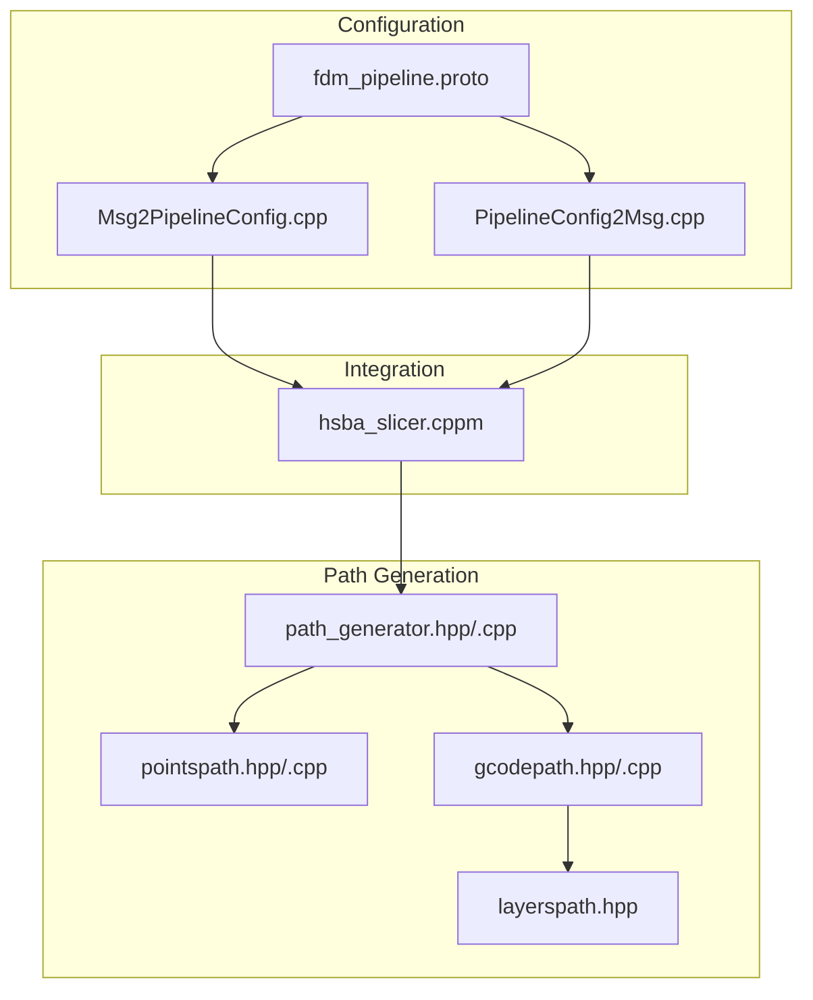
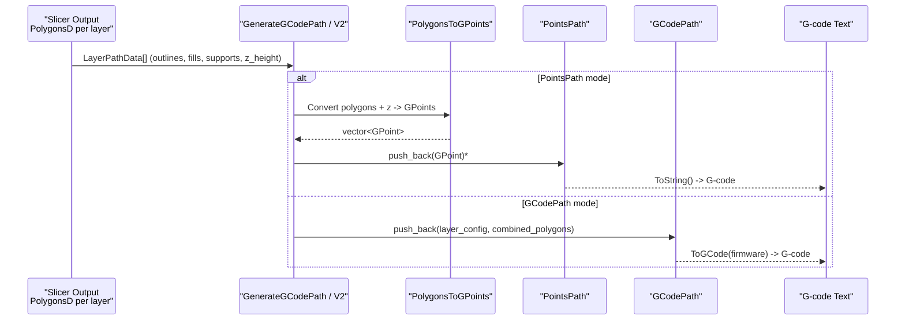
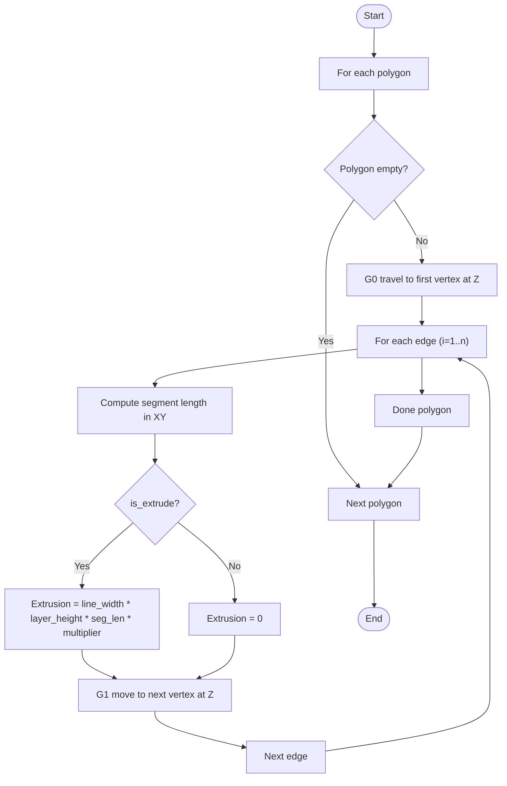
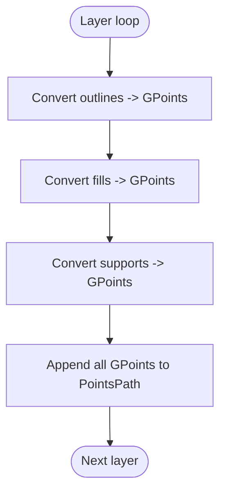
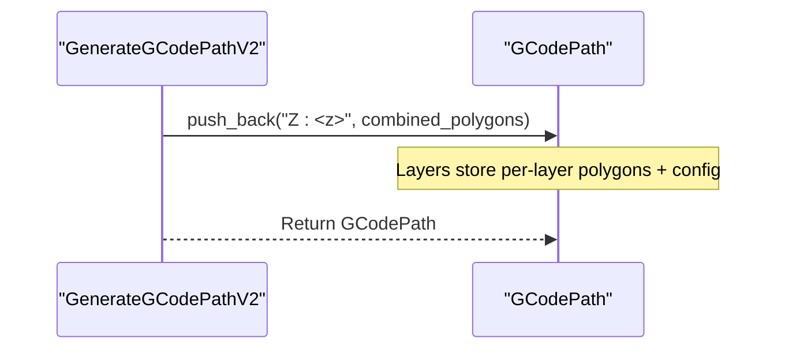
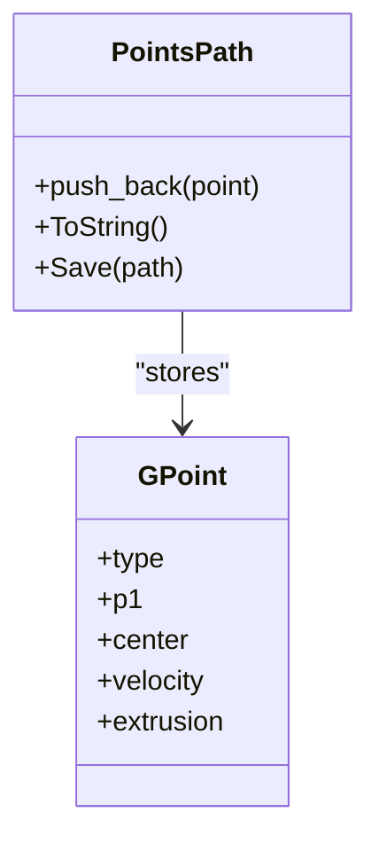
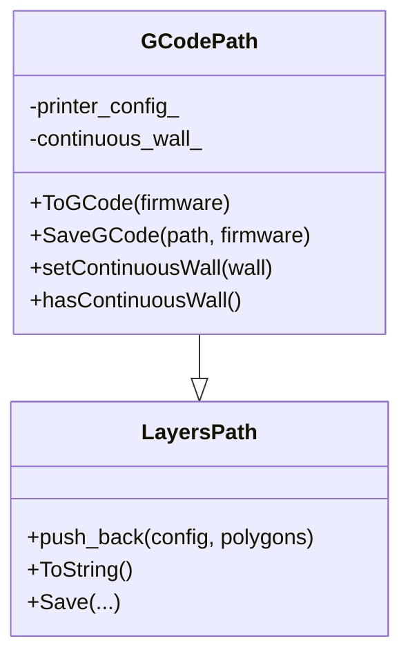
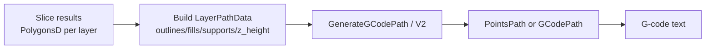
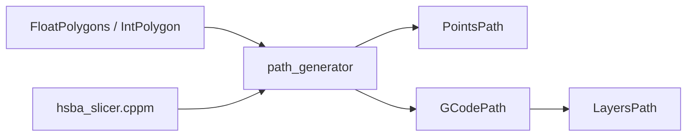

# G-code Generation Fundamentals

<cite>
**Referenced Files in This Document**
- [path_generator.hpp](file://LibHsBaSlicer/Path/path_generator.hpp)
- [path_generator.cpp](file://LibHsBaSlicer/Path/path_generator.cpp)
- [gcodepath.hpp](file://paths/gcodepath.hpp)
- [gcodepath.cpp](file://paths/gcodepath.cpp)
- [layerspath.hpp](file://paths/layerspath.hpp)
- [pointspath.hpp](file://paths/pointspath.hpp)
- [pointspath.cpp](file://paths/pointspath.cpp)
- [hsba_slicer.cppm](file://ModuleHsBaSlicer/hsba_slicer.cppm)
- [Msg2PipelineConfig.cpp](file://convert/Msg2PipelineConfig.cpp)
- [PipelineConfig2Msg.cpp](file://convert/PipelineConfig2Msg.cpp)
- [fdm_pipeline.proto](file://proto/fdm_pipeline.proto)
- [main_header.cpp](file://samples/LibHsBaSlicer/main_header.cpp)
</cite>

## Table of Contents
1. [Introduction](#introduction)
2. [Project Structure](#project-structure)
3. [Core Components](#core-components)
4. [Architecture Overview](#architecture-overview)
5. [Detailed Component Analysis](#detailed-component-analysis)
6. [Dependency Analysis](#dependency-analysis)
7. [Performance Considerations](#performance-considerations)
8. [Troubleshooting Guide](#troubleshooting-guide)
9. [Conclusion](#conclusion)

## Introduction
This document explains the fundamentals of G-code generation in HsBaSlicer, focusing on how 2D polygon slices are transformed into 3D G-code paths. It covers:
- The LayerPathData structure (outlines, fills, supports, and z_height).
- FdmPathConfig parameters (layer_height, line_width, print_speed, travel_speed, extrusion_multiplier, units).
- The GenerateGCodePath workflow from PolygonsD to PointsPath.
- GPoint sequence generation, coordinate transformations, and the mapping between 2D polygons and 3D G-code coordinates.
- Practical examples for configuring path generation and handling different layer types.

## Project Structure
The G-code generation pipeline spans several modules:
- Path configuration and conversion: LibHsBaSlicer/Path
- Path data structures and serialization: paths
- Module integration and end-to-end flow: ModuleHsBaSlicer
- Configuration bridging: convert and proto

**Diagram sources**
- [path_generator.hpp:20-91](file://LibHsBaSlicer/Path/path_generator.hpp#L20-L91)
- [path_generator.cpp:14-136](file://LibHsBaSlicer/Path/path_generator.cpp#L14-L136)
- [pointspath.hpp:44-94](file://paths/pointspath.hpp#L44-L94)
- [layerspath.hpp:17-60](file://paths/layerspath.hpp#L17-L60)
- [gcodepath.hpp:24-107](file://paths/gcodepath.hpp#L24-L107)
- [hsba_slicer.cppm:695-701](file://ModuleHsBaSlicer/hsba_slicer.cppm#L695-L701)
- [Msg2PipelineConfig.cpp:43-65](file://convert/Msg2PipelineConfig.cpp#L43-L65)
- [PipelineConfig2Msg.cpp:31-53](file://convert/PipelineConfig2Msg.cpp#L31-L53)
- [fdm_pipeline.proto:39-61](file://proto/fdm_pipeline.proto#L39-L61)

**Section sources**
- [path_generator.hpp:20-91](file://LibHsBaSlicer/Path/path_generator.hpp#L20-L91)
- [pointspath.hpp:44-94](file://paths/pointspath.hpp#L44-L94)
- [layerspath.hpp:17-60](file://paths/layerspath.hpp#L17-L60)
- [gcodepath.hpp:24-107](file://paths/gcodepath.hpp#L24-L107)
- [hsba_slicer.cppm:695-701](file://ModuleHsBaSlicer/hsba_slicer.cppm#L695-L701)
- [Msg2PipelineConfig.cpp:43-65](file://convert/Msg2PipelineConfig.cpp#L43-L65)
- [PipelineConfig2Msg.cpp:31-53](file://convert/PipelineConfig2Msg.cpp#L31-L53)
- [fdm_pipeline.proto:39-61](file://proto/fdm_pipeline.proto#L39-L61)

## Core Components
- LayerPathData: Holds per-layer outlines, fills, supports, and z_height.
- FdmPathConfig: Defines slicing/printing parameters used to generate GPoints.
- PolygonsToGPoints: Converts 2D polygons at a given Z into a sequence of GPoints with velocities and extrusion values.
- GenerateGCodePath: Builds a PointsPath by processing each layer’s outlines, fills, and supports.
- GenerateGCodePathV2: Produces a GCodePath with per-layer polygon groups and firmware-aware output.
- GCodePrinterConfig: Printer-specific settings for header/footer and extrusion calculations.
- PointsPath: Accumulates GPoints and serializes them to G-code text.
- LayersPath: Stores per-layer polygon groups with config strings.
- GCodePath: Extends LayersPath to emit firmware-specific G-code and continuous spiral walls.

**Section sources**
- [path_generator.hpp:20-91](file://LibHsBaSlicer/Path/path_generator.hpp#L20-L91)
- [path_generator.cpp:14-136](file://LibHsBaSlicer/Path/path_generator.cpp#L14-L136)
- [pointspath.hpp:44-94](file://paths/pointspath.hpp#L44-L94)
- [layerspath.hpp:17-60](file://paths/layerspath.hpp#L17-L60)
- [gcodepath.hpp:24-107](file://paths/gcodepath.hpp#L24-L107)

## Architecture Overview
The high-level flow is:
- Slicing produces per-layer 2D polygons (PolygonsD).
- Path generation converts these polygons into GPoints or per-layer polygon groups.
- Serialization emits standard G-code for target firmware.

**Diagram sources**
- [path_generator.cpp:61-116](file://LibHsBaSlicer/Path/path_generator.cpp#L61-L116)
- [pointspath.cpp:66-114](file://paths/pointspath.cpp#L66-L114)
- [gcodepath.cpp:310-327](file://paths/gcodepath.cpp#L310-L327)

## Detailed Component Analysis

### LayerPathData and FdmPathConfig
- LayerPathData fields:
  - outlines: outer wall polygons
  - fills: infill polygons
  - supports: support polygons
  - z_height: build height for the layer
- FdmPathConfig fields:
  - layer_height: mm
  - line_width: mm
  - print_speed: mm/s
  - travel_speed: mm/s
  - extrusion_multiplier: scalar
  - units: GCodeUnits (mm or inch)

These define how 2D polygons become 3D motion commands and how much filament is extruded.

**Section sources**
- [path_generator.hpp:20-42](file://LibHsBaSlicer/Path/path_generator.hpp#L20-L42)

### PolygonsToGPoints: 2D Polygon to GPoint Sequence
- Input: PolygonsD, z, FdmPathConfig, is_extrude flag
- Behavior:
  - For each polygon:
    - Emit a G0 travel move to the first vertex at Z=z
    - For each edge, emit a G1 linear move to the next vertex at Z=z
    - If is_extrude is true, compute extrusion using line_width, layer_height, segment length, and extrusion_multiplier; otherwise set extrusion to zero
  - Velocity is print_speed for extruding moves and travel_speed for non-extruding moves

Coordinate transformation:
- 2D polygon vertices (x, y) are lifted to 3D by appending z from the current layer.
- Segment lengths are computed in XY to determine extrusion volume.

**Diagram sources**
- [path_generator.cpp:14-59](file://LibHsBaSlicer/Path/path_generator.cpp#L14-L59)

**Section sources**
- [path_generator.cpp:14-59](file://LibHsBaSlicer/Path/path_generator.cpp#L14-L59)

### GenerateGCodePath: From LayerPathData to PointsPath
- Iterates over layers:
  - For each layer, convert outlines, fills, and supports to GPoints via PolygonsToGPoints with is_extrude=true
  - Append all resulting GPoints to a PointsPath
- Output: PointsPath containing ordered G0/G1 moves with XYZ and E values

**Diagram sources**
- [path_generator.cpp:61-93](file://LibHsBaSlicer/Path/path_generator.cpp#L61-L93)

**Section sources**
- [path_generator.cpp:61-93](file://LibHsBaSlicer/Path/path_generator.cpp#L61-L93)

### GenerateGCodePathV2: Per-layer GCodePath
- Creates a GCodePath with printer_config
- For each layer:
  - Encodes z_height into a layer config string
  - Combines outlines, fills, and supports into one PolygonsD group
  - Pushes the combined polygons with the layer config into GCodePath
- Output: GCodePath suitable for firmware-specific ToGCode emission

**Diagram sources**
- [path_generator.cpp:95-116](file://LibHsBaSlicer/Path/path_generator.cpp#L95-L116)
- [layerspath.hpp:49-60](file://paths/layerspath.hpp#L49-L60)

**Section sources**
- [path_generator.cpp:95-116](file://LibHsBaSlicer/Path/path_generator.cpp#L95-L116)
- [layerspath.hpp:49-60](file://paths/layerspath.hpp#L49-L60)

### GPoint and PointsPath: Motion Commands and Serialization
- GPoint fields:
  - type: G0/G1/G2/G3
  - p1: target point (X,Y,Z)
  - center: arc center (for G2/G3)
  - velocity: feed rate
  - extrusion: E value
- PointsPath:
  - Stores a sequence of GPoints
  - Serializes to G-code including units (G20/G21), absolute positioning (G90), start position, and moves with XYZ/E/F

**Diagram sources**
- [pointspath.hpp:44-94](file://paths/pointspath.hpp#L44-L94)
- [pointspath.cpp:66-114](file://paths/pointspath.cpp#L66-L114)

**Section sources**
- [pointspath.hpp:44-94](file://paths/pointspath.hpp#L44-L94)
- [pointspath.cpp:66-114](file://paths/pointspath.cpp#L66-L114)

### GCodePath: Firmware-aware G-code Emission
- Extends LayersPath to add:
  - ToGCode(firmware): generates header, optional continuous wall, per-layer G-code, and footer
  - SaveGCode(path, firmware): writes G-code to file
  - Continuous wall support for vase/spiral mode
- Printer configuration:
  - nozzle_diameter, filament_diameter, temperatures, speeds, retraction, relative/extrusion modes
- Extrusion calculation:
  - Uses line_width, layer_height, segment length, and filament cross-section area to compute E values

**Diagram sources**
- [layerspath.hpp:17-60](file://paths/layerspath.hpp#L17-L60)
- [gcodepath.hpp:24-107](file://paths/gcodepath.hpp#L24-L107)
- [gcodepath.cpp:53-63](file://paths/gcodepath.cpp#L53-L63)
- [gcodepath.cpp:310-327](file://paths/gcodepath.cpp#L310-L327)

**Section sources**
- [gcodepath.hpp:24-107](file://paths/gcodepath.hpp#L24-L107)
- [gcodepath.cpp:53-63](file://paths/gcodepath.cpp#L53-L63)
- [gcodepath.cpp:310-327](file://paths/gcodepath.cpp#L310-L327)

### Practical Examples and Data Flow

#### Example: Configuring Path Generation Parameters
- Set FdmPathConfig:
  - layer_height, line_width, print_speed, travel_speed, extrusion_multiplier, units
- Use GenerateGCodePath to produce PointsPath for simple G-code sequences
- Use GenerateGCodePathV2 to produce GCodePath for firmware-specific output

Reference usage pattern:
- Build LayerPathData per layer with outlines, fills, supports, and z_height
- Call GenerateGCodePath or GenerateGCodePathV2 with FdmPathConfig

**Section sources**
- [path_generator.hpp:20-91](file://LibHsBaSlicer/Path/path_generator.hpp#L20-L91)
- [path_generator.cpp:61-116](file://LibHsBaSlicer/Path/path_generator.cpp#L61-L116)

#### Handling Different Layer Types
- Outlines: Outer walls printed first; extrusion enabled
- Fills: Infill patterns printed after outlines; extrusion enabled
- Supports: Support structures printed last; extrusion enabled
- All three arrays are processed identically by PolygonsToGPoints when is_extrude=true

**Section sources**
- [path_generator.cpp:61-93](file://LibHsBaSlicer/Path/path_generator.cpp#L61-L93)

#### Understanding Data Flow from Slicing to G-code
- Slicing outputs PolygonsD per layer
- Samples show building LayerPathData with outlines, fills, supports, and z_height
- Integration module maps user/configured parameters to FdmPathConfig and GCodePrinterConfig
- Final output is either PointsPath (raw GPoints) or GCodePath (firmware-aware G-code)

**Diagram sources**
- [main_header.cpp:120-156](file://samples/LibHsBaSlicer/main_header.cpp#L120-L156)
- [hsba_slicer.cppm:695-701](file://ModuleHsBaSlicer/hsba_slicer.cppm#L695-L701)

**Section sources**
- [main_header.cpp:120-156](file://samples/LibHsBaSlicer/main_header.cpp#L120-L156)
- [hsba_slicer.cppm:695-701](file://ModuleHsBaSlicer/hsba_slicer.cppm#L695-L701)

## Dependency Analysis
Key relationships:
- path_generator depends on FloatPolygons and IntPolygon types and outputs PointsPath or GCodePath
- gcodepath extends layerspath and uses GCodePrinterConfig for firmware-specific emission
- pointspath provides low-level G-point storage and serialization
- Module integration maps external configuration to internal configs

**Diagram sources**
- [path_generator.hpp:12-16](file://LibHsBaSlicer/Path/path_generator.hpp#L12-L16)
- [gcodepath.hpp:16-107](file://paths/gcodepath.hpp#L16-L107)
- [pointspath.hpp:12-94](file://paths/pointspath.hpp#L12-L94)
- [hsba_slicer.cppm:695-701](file://ModuleHsBaSlicer/hsba_slicer.cppm#L695-L701)

**Section sources**
- [path_generator.hpp:12-16](file://LibHsBaSlicer/Path/path_generator.hpp#L12-L16)
- [gcodepath.hpp:16-107](file://paths/gcodepath.hpp#L16-L107)
- [pointspath.hpp:12-94](file://paths/pointspath.hpp#L12-L94)
- [hsba_slicer.cppm:695-701](file://ModuleHsBaSlicer/hsba_slicer.cppm#L695-L701)

## Performance Considerations
- PolygonsToGPoints pre-reserves memory based on polygon count to reduce allocations.
- Using GenerateGCodePathV2 avoids repeated extrusion computations by deferring to GCodePath’s optimized emission.
- Spiral/vase mode (continuous wall) eliminates per-layer travel/retraction overhead, improving print continuity.

[No sources needed since this section provides general guidance]

## Troubleshooting Guide
- Unexpected extrusion values:
  - Verify FdmPathConfig.line_width, layer_height, and extrusion_multiplier
  - Ensure is_extrude is true for printing segments
- Incorrect Z heights:
  - Confirm LayerPathData.z_height matches intended layer index
  - Check that GenerateGCodePathV2 encodes Z correctly in layer config
- Firmware-specific issues:
  - Validate GCodePrinterConfig settings (nozzle/filament diameter, temperatures, retraction)
  - Ensure correct GCodeFirmware selection when calling ToGCode

**Section sources**
- [path_generator.cpp:14-59](file://LibHsBaSlicer/Path/path_generator.cpp#L14-L59)
- [gcodepath.cpp:53-63](file://paths/gcodepath.cpp#L53-L63)
- [gcodepath.cpp:310-327](file://paths/gcodepath.cpp#L310-L327)

## Conclusion
HsBaSlicer’s G-code generation transforms 2D slice polygons into precise 3D motion commands through well-defined structures and functions. LayerPathData organizes per-layer geometry, FdmPathConfig controls motion and extrusion behavior, and PolygonsToGPoints bridges 2D shapes to GPoints. GenerateGCodePath and GenerateGCodePathV2 provide flexible pathways to PointsPath or firmware-aware GCodePath outputs, enabling both raw point streams and production-ready G-code.

[No sources needed since this section summarizes without analyzing specific files]