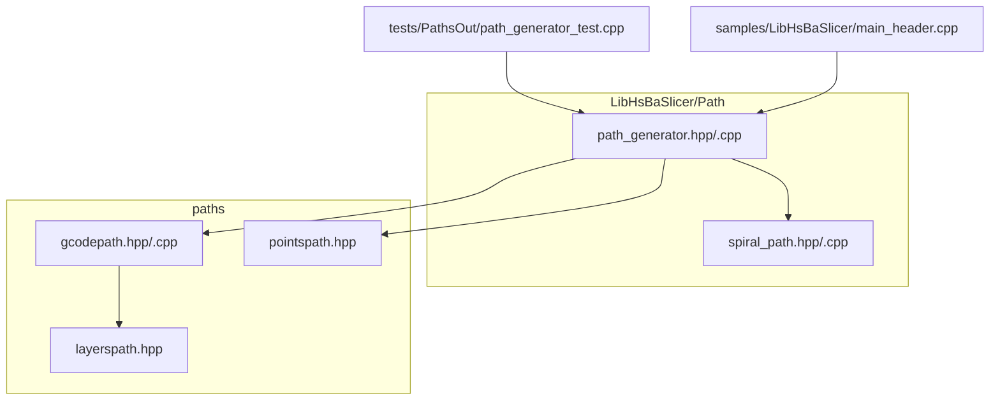
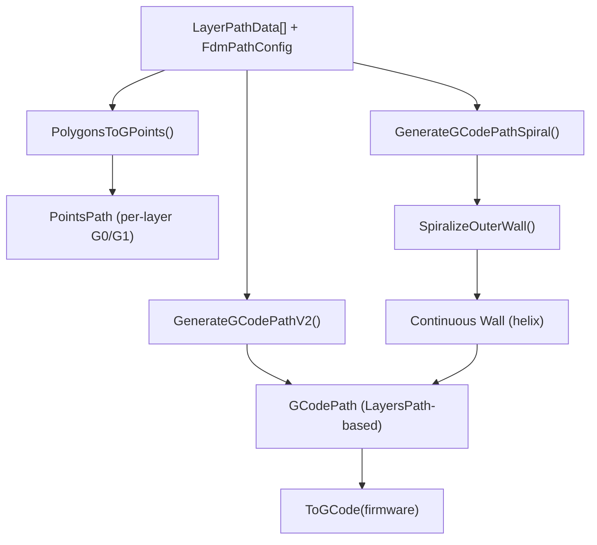
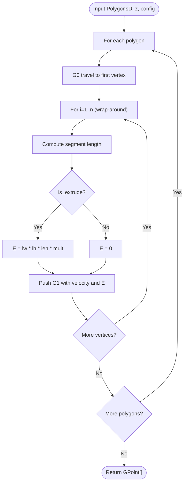
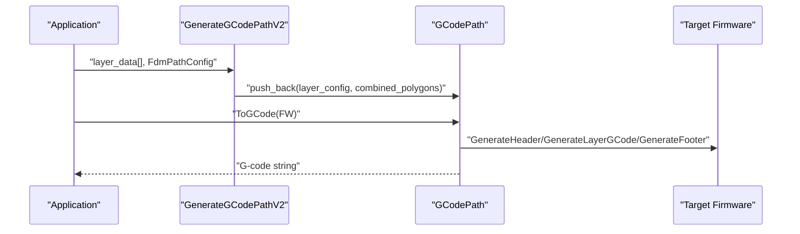
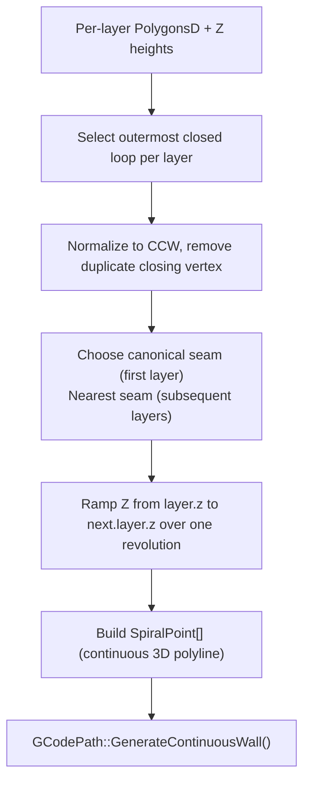
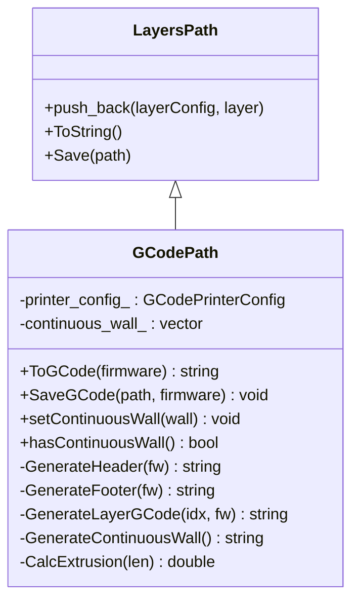
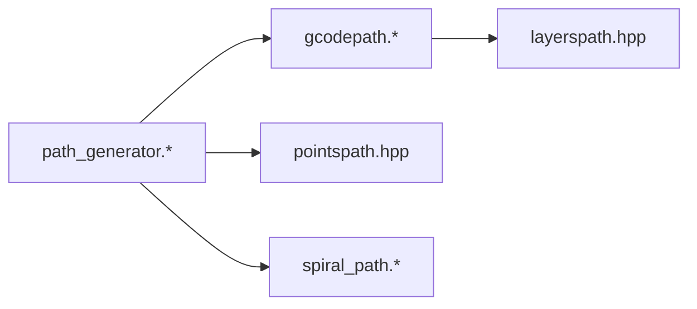

# Path Generation and Optimization

<cite>
**Referenced Files in This Document**
- [path_generator.hpp](file://LibHsBaSlicer/Path/path_generator.hpp)
- [path_generator.cpp](file://LibHsBaSlicer/Path/path_generator.cpp)
- [spiral_path.hpp](file://LibHsBaSlicer/Path/spiral_path.hpp)
- [spiral_path.cpp](file://LibHsBaSlicer/Path/spiral_path.cpp)
- [gcodepath.hpp](file://paths/gcodepath.hpp)
- [gcodepath.cpp](file://paths/gcodepath.cpp)
- [layerspath.hpp](file://paths/layerspath.hpp)
- [pointspath.hpp](file://paths/pointspath.hpp)
- [path_generator_test.cpp](file://tests/PathsOut/path_generator_test.cpp)
- [main_header.cpp](file://samples/LibHsBaSlicer/main_header.cpp)
</cite>

## Table of Contents
1. [Introduction](#introduction)
2. [Project Structure](#project-structure)
3. [Core Components](#core-components)
4. [Architecture Overview](#architecture-overview)
5. [Detailed Component Analysis](#detailed-component-analysis)
6. [Dependency Analysis](#dependency-analysis)
7. [Performance Considerations](#performance-considerations)
8. [Troubleshooting Guide](#troubleshooting-guide)
9. [Conclusion](#conclusion)

## Introduction
This document explains HsBaSlicer’s advanced FDM G-code path generation and optimization systems. It covers the per-layer path pipeline, multi-firmware G-code output (Marlin, RepRap, Klipper), spiral/vase mode via SpiralizeOuterWall, and the core data structures LayerPathData, FdmPathConfig, GCodePath, and GPoint sequences. It also includes concrete usage examples for GenerateGCodePathV2, printer configuration setup, and performance tuning strategies.

## Project Structure
The path generation and G-code output are implemented across a small set of focused modules:
- LibHsBaSlicer/Path: high-level FDM path generation API and spiral algorithm
- paths: low-level path containers and firmware-specific G-code emission
- tests and samples: usage examples and validation

**Diagram sources**
- [path_generator.hpp:1-96](file://LibHsBaSlicer/Path/path_generator.hpp#L1-L96)
- [path_generator.cpp:1-139](file://LibHsBaSlicer/Path/path_generator.cpp#L1-L139)
- [spiral_path.hpp:1-63](file://LibHsBaSlicer/Path/spiral_path.hpp#L1-L63)
- [gcodepath.hpp:1-112](file://paths/gcodepath.hpp#L1-L112)
- [layerspath.hpp:1-64](file://paths/layerspath.hpp#L1-L64)
- [pointspath.hpp:1-99](file://paths/pointspath.hpp#L1-L99)

**Section sources**
- [path_generator.hpp:1-96](file://LibHsBaSlicer/Path/path_generator.hpp#L1-L96)
- [gcodepath.hpp:1-112](file://paths/gcodepath.hpp#L1-L112)

## Core Components
- LayerPathData: represents one layer with outlines, fills, supports, and Z height.
- FdmPathConfig: controls layer height, line width, print/travel speeds, extrusion multiplier, and units.
- PolygonsToGPoints: converts polygonal layers into ordered GPoint sequences with travel and extrude moves.
- GenerateGCodePath: builds a PointsPath by stacking outline/fill/support points per layer.
- GenerateGCodePathV2: builds a GCodePath with per-layer polygons and firmware-aware output.
- GenerateGCodePathSpiral: builds a continuous helical wall using SpiralizeOuterWall for vase mode.
- GCodePath: emits standard G-code for Marlin, RepRap, or Klipper; supports relative/absolute extrusion, retraction, and Lua post-processing.

**Section sources**
- [path_generator.hpp:20-91](file://LibHsBaSlicer/Path/path_generator.hpp#L20-L91)
- [path_generator.cpp:14-136](file://LibHsBaSlicer/Path/path_generator.cpp#L14-L136)
- [gcodepath.hpp:24-107](file://paths/gcodepath.hpp#L24-L107)

## Architecture Overview
The FDM G-code pipeline has two main branches:
- Per-layer path generation (PointsPath): fast, simple sequence of G0/G1 moves.
- Firmware-aware path generation (GCodePath): structured layers plus header/footer tailored to target firmware.

**Diagram sources**
- [path_generator.cpp:14-136](file://LibHsBaSlicer/Path/path_generator.cpp#L14-L136)
- [spiral_path.cpp:88-163](file://LibHsBaSlicer/Path/spiral_path.cpp#L88-L163)
- [gcodepath.cpp:310-327](file://paths/gcodepath.cpp#L310-L327)

## Detailed Component Analysis

### LayerPathData and FdmPathConfig
- LayerPathData groups per-layer geometry (outlines, fills, supports) and its Z height.
- FdmPathConfig defines slicing/printing parameters used to compute velocities and extrusion amounts.

Key responsibilities:
- Provide consistent input to both PointsPath and GCodePath pipelines.
- Control extrusion volume calculation through line_width, layer_height, and extrusion_multiplier.

**Section sources**
- [path_generator.hpp:20-42](file://LibHsBaSlicer/Path/path_generator.hpp#L20-L42)

### PolygonsToGPoints and GPoint Sequence Generation
PolygonsToGPoints transforms each polygon into:
- A leading G0 travel move to the first vertex.
- Subsequent G1 moves along vertices, setting velocity based on whether it is an extrude or travel segment.
- Extrusion amount computed as line_width × layer_height × segment_length × extrusion_multiplier when printing.

Complexity:
- O(V) where V is total number of vertices across all polygons.
- Memory allocation is pre-reserved to reduce reallocations.

**Diagram sources**
- [path_generator.cpp:14-58](file://LibHsBaSlicer/Path/path_generator.cpp#L14-L58)
- [pointspath.hpp:44-52](file://paths/pointspath.hpp#L44-L52)

**Section sources**
- [path_generator.cpp:14-58](file://LibHsBaSlicer/Path/path_generator.cpp#L14-L58)
- [pointspath.hpp:44-52](file://paths/pointspath.hpp#L44-L52)

### GenerateGCodePath (PointsPath)
- Iterates over layers and appends outline, fill, and support GPoint sequences.
- Suitable for simple point-based workflows without firmware-specific headers.

Usage example reference:
- See sample code that constructs FdmPathConfig and calls GenerateGCodePath.

**Section sources**
- [path_generator.cpp:61-93](file://LibHsBaSlicer/Path/path_generator.cpp#L61-L93)
- [main_header.cpp:164-177](file://samples/LibHsBaSlicer/main_header.cpp#L164-L177)

### GenerateGCodePathV2 (Firmware-Aware GCodePath)
- Encodes each layer’s Z height in a config string and stores combined polygons (outlines + fills + supports).
- Returns a GCodePath object that can emit firmware-specific G-code.

**Diagram sources**
- [path_generator.cpp:95-116](file://LibHsBaSlicer/Path/path_generator.cpp#L95-L116)
- [gcodepath.cpp:310-327](file://paths/gcodepath.cpp#L310-L327)

**Section sources**
- [path_generator.cpp:95-116](file://LibHsBaSlicer/Path/path_generator.cpp#L95-L116)
- [gcodepath.cpp:310-327](file://paths/gcodepath.cpp#L310-L327)

### Spiral/Vase Mode: SpiralizeOuterWall and Continuous Wall
SpiralizeOuterWall produces a single continuous 3D polyline whose Z rises by exactly one layer per revolution:
- Selects the outermost closed contour per layer (largest absolute signed area).
- Normalizes loops to CCW orientation and removes duplicate closing vertices.
- Aligns seams across layers to keep a fixed seam line.
- Emits m+1 points per loop so the seam closes continuously at the next layer’s start.

GCodePath::GenerateContinuousWall then emits this helix as one unbroken extrusion path, with no retractions between points.

**Diagram sources**
- [spiral_path.cpp:18-52](file://LibHsBaSlicer/Path/spiral_path.cpp#L18-L52)
- [spiral_path.cpp:88-163](file://LibHsBaSlicer/Path/spiral_path.cpp#L88-L163)
- [gcodepath.cpp:271-308](file://paths/gcodepath.cpp#L271-L308)

**Section sources**
- [spiral_path.hpp:16-58](file://LibHsBaSlicer/Path/spiral_path.hpp#L16-L58)
- [spiral_path.cpp:88-163](file://LibHsBaSlicer/Path/spiral_path.cpp#L88-L163)
- [path_generator.cpp:118-136](file://LibHsBaSlicer/Path/path_generator.cpp#L118-L136)
- [gcodepath.cpp:271-308](file://paths/gcodepath.cpp#L271-L308)

### GCodePath Class Functionality and Multi-Firmware Output
GCodePath extends LayersPath and adds:
- ToGCode(firmware) producing Marlin, RepRap, or Klipper G-code.
- Header/footer generation with firmware-specific commands (temperature waits, fan control, pressure advance, speed/flow factors).
- Relative vs absolute extrusion modes (M82/M83).
- Retraction handling on travel moves.
- Optional Lua post-processing script integration.

**Diagram sources**
- [layerspath.hpp:17-60](file://paths/layerspath.hpp#L17-L60)
- [gcodepath.hpp:66-107](file://paths/gcodepath.hpp#L66-L107)
- [gcodepath.cpp:47-63](file://paths/gcodepath.cpp#L47-L63)

**Section sources**
- [gcodepath.hpp:24-107](file://paths/gcodepath.hpp#L24-L107)
- [gcodepath.cpp:65-142](file://paths/gcodepath.cpp#L65-L142)
- [gcodepath.cpp:195-269](file://paths/gcodepath.cpp#L195-L269)
- [gcodepath.cpp:310-327](file://paths/gcodepath.cpp#L310-L327)

### Concrete Usage Examples

#### Example: GenerateGCodePathV2 with Printer Configuration
- Construct FdmPathConfig and GCodePrinterConfig.
- Build LayerPathData for each layer (outlines, fills, supports, z_height).
- Call GenerateGCodePathV2 and then ToGCode for desired firmware.

Reference implementation:
- See sample code that sets FdmPathConfig fields and saves G-code.

**Section sources**
- [main_header.cpp:164-177](file://samples/LibHsBaSlicer/main_header.cpp#L164-L177)
- [path_generator_test.cpp:93-106](file://tests/PathsOut/path_generator_test.cpp#L93-L106)

#### Example: Spiral/Vase Mode
- Prepare per-layer outer contours and corresponding Z heights.
- Call GenerateGCodePathSpiral to obtain a GCodePath with a continuous wall.
- Emit ToGCode for the target firmware.

Validation references:
- Tests confirm spiral behavior and continuous wall properties.

**Section sources**
- [path_generator.cpp:118-136](file://LibHsBaSlicer/Path/path_generator.cpp#L118-L136)
- [path_generator_test.cpp:108-120](file://tests/PathsOut/path_generator_test.cpp#L108-L120)

## Dependency Analysis
High-level dependencies among components:

- path_generator depends on spiral_path for vase mode and on gcodepath/pointspath for outputs.
- gcodepath inherits from layerspath and uses printer configuration to format firmware-specific G-code.

**Diagram sources**
- [path_generator.cpp:1-139](file://LibHsBaSlicer/Path/path_generator.cpp#L1-L139)
- [gcodepath.cpp:1-425](file://paths/gcodepath.cpp#L1-L425)
- [layerspath.hpp:1-64](file://paths/layerspath.hpp#L1-L64)
- [pointspath.hpp:1-99](file://paths/pointspath.hpp#L1-L99)
- [spiral_path.cpp:1-167](file://LibHsBaSlicer/Path/spiral_path.cpp#L1-L167)

**Section sources**
- [path_generator.cpp:1-139](file://LibHsBaSlicer/Path/path_generator.cpp#L1-L139)
- [gcodepath.cpp:1-425](file://paths/gcodepath.cpp#L1-L425)

## Performance Considerations
- Travel speed optimization:
  - Use higher travel_speed in FdmPathConfig and GCodePrinterConfig to reduce non-printing time.
  - Ensure enable_retraction is configured appropriately to avoid unnecessary retracts during short travels.
- Extrusion multiplier control:
  - Tune extrusion_multiplier in FdmPathConfig and GCodePrinterConfig to match filament diameter and nozzle characteristics.
  - For spiral mode, ensure consistent line_width and layer_height to maintain uniform wall thickness.
- Firmware-specific output formatting:
  - Choose appropriate firmware (Marlin/RepRap/Klipper) to leverage built-in optimizations like pressure advance and flow/speed factors.
  - Use relative_extrusion when your workflow benefits from M83 semantics.
- Data structure efficiency:
  - PolygonsToGPoints pre-reserves memory proportional to polygon count to minimize allocations.
  - SpiralizeOuterWall selects only the outermost loop per layer, reducing computation for complex cross-sections.

[No sources needed since this section provides general guidance]

## Troubleshooting Guide
- Empty or invalid polygons:
  - PolygonsToGPoints skips empty polygons; ensure inputs contain valid closed loops.
- Spiral mode issues:
  - If fewer than one valid contour exists, SpiralizeOuterWall returns an empty path; verify per-layer outer contours and Z heights.
- Firmware output mismatches:
  - Confirm GCodeFirmware selection matches your printer’s firmware.
  - Check relative_extrusion settings align with M82/M83 expectations.
- File write errors:
  - SaveGCode throws an error if the output file cannot be opened; verify path permissions and disk space.

**Section sources**
- [path_generator.cpp:20-23](file://LibHsBaSlicer/Path/path_generator.cpp#L20-L23)
- [spiral_path.cpp:91-96](file://LibHsBaSlicer/Path/spiral_path.cpp#L91-L96)
- [gcodepath.cpp:329-338](file://paths/gcodepath.cpp#L329-L338)

## Conclusion
HsBaSlicer’s path generation system provides a robust, modular pipeline for FDM G-code production. The per-layer PointsPath approach offers simplicity, while GCodePath delivers firmware-aware, optimized output for Marlin, RepRap, and Klipper. SpiralizeOuterWall enables efficient vase-mode printing by generating a continuous, Z-rising wall. With configurable travel speeds, extrusion multipliers, and firmware-specific formatting, users can tune performance for diverse printing scenarios.

[No sources needed since this section summarizes without analyzing specific files]