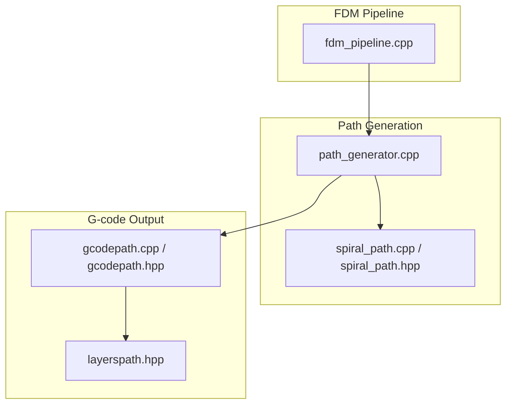
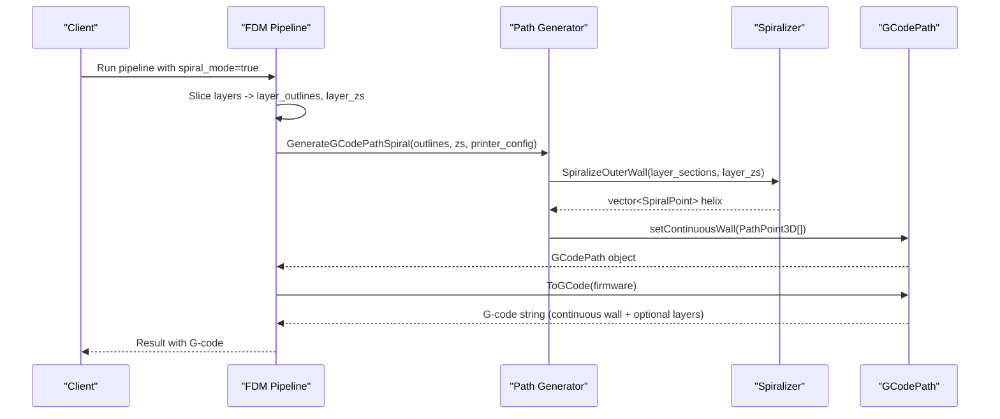
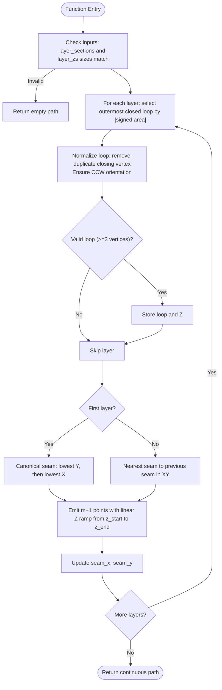
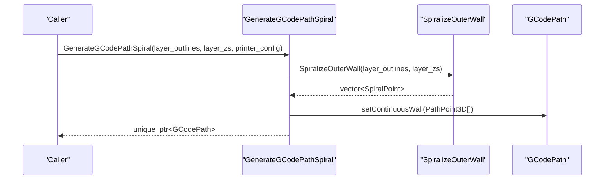
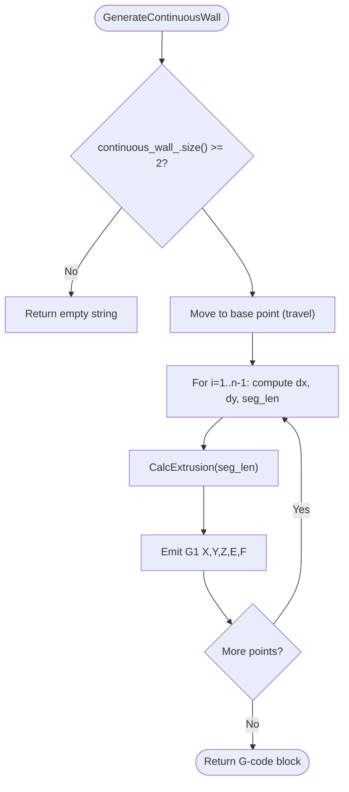
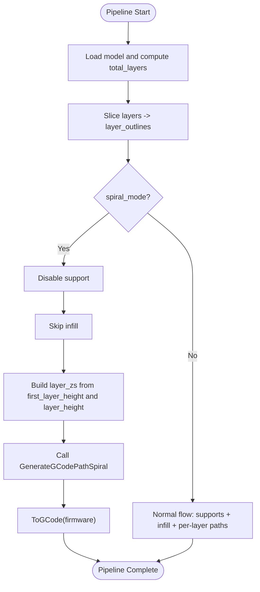
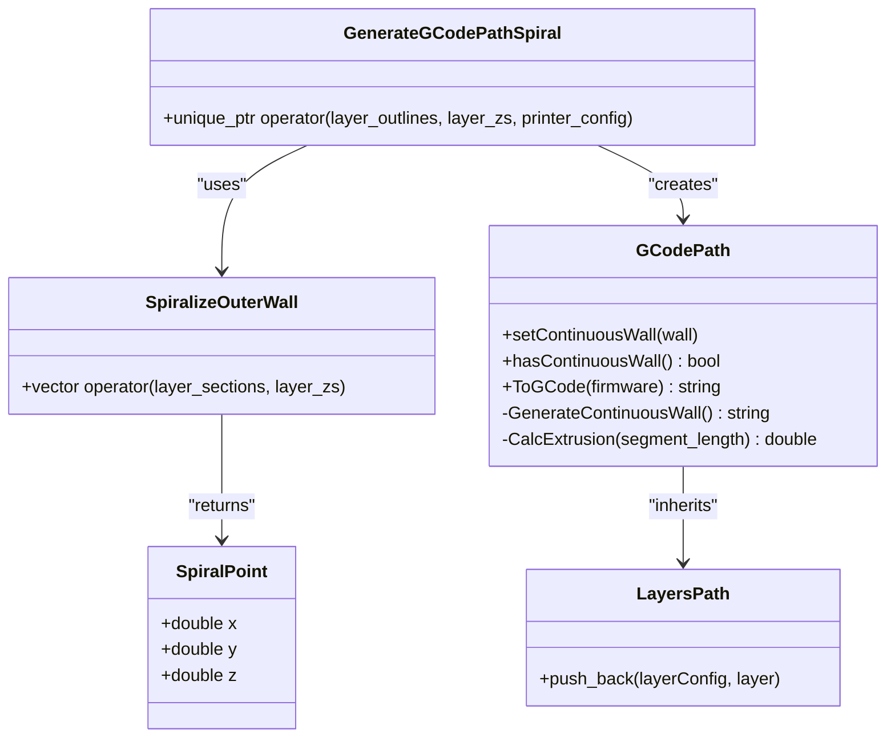

# Spiral Path Algorithms

<cite>
**Referenced Files in This Document**
- [spiral_path.cpp](file://LibHsBaSlicer/Path/spiral_path.cpp)
- [spiral_path.hpp](file://LibHsBaSlicer/Path/spiral_path.hpp)
- [path_generator.cpp](file://LibHsBaSlicer/Path/path_generator.cpp)
- [gcodepath.cpp](file://paths/gcodepath.cpp)
- [gcodepath.hpp](file://paths/gcodepath.hpp)
- [layerspath.hpp](file://paths/layerspath.hpp)
- [fdm_pipeline.cpp](file://DllHsBaSlicer/fdm_pipeline.cpp)
- [spiral_path_test.cpp](file://tests/SpiralPath/spiral_path_test.cpp)
- [path_generator_test.cpp](file://tests/PathsOut/path_generator_test.cpp)
</cite>

## Table of Contents
1. [Introduction](#introduction)
2. [Project Structure](#project-structure)
3. [Core Components](#core-components)
4. [Architecture Overview](#architecture-overview)
5. [Detailed Component Analysis](#detailed-component-analysis)
6. [Dependency Analysis](#dependency-analysis)
7. [Performance Considerations](#performance-considerations)
8. [Troubleshooting Guide](#troubleshooting-guide)
9. [Conclusion](#conclusion)

## Introduction
This document explains the spiral/vase mode path generation algorithms implemented in HsBaSlicer. It focuses on how per-layer outer contours are merged into a single continuous, Z-rising extrusion line that eliminates per-layer travel moves and infill operations. The core algorithm is SpiralizeOuterWall, which computes a helical wall from layer_outlines and layer_zs. The pipeline entry point GenerateGCodePathSpiral integrates this algorithm with G-code output for FDM printers.

The documentation covers:
- How SpiralizeOuterWall selects and normalizes outer loops per layer
- How seam alignment ensures continuity between layers
- How Z is ramped continuously across revolutions
- How G-code is generated without retractions or per-layer jumps
- Configuration examples and optimal model requirements for vase printing
- Troubleshooting common issues such as gaps or over-extrusion at layer transitions

## Project Structure
The spiral/vase feature spans several modules:
- Spiral geometry computation: LibHsBaSlicer/Path/spiral_path.*
- Path generation integration: LibHsBaSlicer/Path/path_generator.cpp
- G-code output and continuous wall emission: paths/gcodepath.*
- FDM pipeline orchestration (including spiral mode): DllHsBaSlicer/fdm_pipeline.cpp
- Tests validating behavior: tests/SpiralPath/spiral_path_test.cpp and tests/PathsOut/path_generator_test.cpp

**Diagram sources**
- [fdm_pipeline.cpp:374-395](file://DllHsBaSlicer/fdm_pipeline.cpp#L374-L395)
- [path_generator.cpp:118-136](file://LibHsBaSlicer/Path/path_generator.cpp#L118-L136)
- [spiral_path.cpp:88-163](file://LibHsBaSlicer/Path/spiral_path.cpp#L88-L163)
- [gcodepath.cpp:271-327](file://paths/gcodepath.cpp#L271-L327)
- [layerspath.hpp:17-60](file://paths/layerspath.hpp#L17-L60)

**Section sources**
- [fdm_pipeline.cpp:374-395](file://DllHsBaSlicer/fdm_pipeline.cpp#L374-L395)
- [path_generator.cpp:118-136](file://LibHsBaSlicer/Path/path_generator.cpp#L118-L136)
- [spiral_path.cpp:88-163](file://LibHsBaSlicer/Path/spiral_path.cpp#L88-L163)
- [gcodepath.cpp:271-327](file://paths/gcodepath.cpp#L271-L327)
- [layerspath.hpp:17-60](file://paths/layerspath.hpp#L17-L60)

## Core Components
- SpiralPoint: A 3D point used to represent positions along the continuous helix.
- SpiralizeOuterWall: Computes the continuous helical wall from per-layer outer contours and Z heights.
- GenerateGCodePathSpiral: Bridges sliced outlines and Z heights to produce a GCodePath with a continuous wall.
- GCodePath::GenerateContinuousWall: Emits the continuous wall as G-code without retractions or per-layer travel.

Key responsibilities:
- Spiral geometry: select outermost loop, normalize orientation, align seams, interpolate Z.
- Path generation: convert SpiralPoint sequence to PathPoint3D and attach to GCodePath.
- G-code emission: compute extrusion per segment using nozzle and filament parameters; avoid retraction/travel between points.

**Section sources**
- [spiral_path.hpp:24-58](file://LibHsBaSlicer/Path/spiral_path.hpp#L24-L58)
- [spiral_path.cpp:88-163](file://LibHsBaSlicer/Path/spiral_path.cpp#L88-L163)
- [path_generator.cpp:118-136](file://LibHsBaSlicer/Path/path_generator.cpp#L118-L136)
- [gcodepath.hpp:51-106](file://paths/gcodepath.hpp#L51-L106)
- [gcodepath.cpp:53-63](file://paths/gcodepath.cpp#L53-L63)
- [gcodepath.cpp:271-327](file://paths/gcodepath.cpp#L271-L327)

## Architecture Overview
The FDM pipeline detects spiral_mode and bypasses support/infill stages. It then builds layer_outlines and layer_zs and calls GenerateGCodePathSpiral. That function uses SpiralizeOuterWall to create a continuous helix and attaches it to GCodePath. During ToGCode, the continuous wall is emitted first as an unbroken extrusion line.

**Diagram sources**
- [fdm_pipeline.cpp:374-395](file://DllHsBaSlicer/fdm_pipeline.cpp#L374-L395)
- [path_generator.cpp:118-136](file://LibHsBaSlicer/Path/path_generator.cpp#L118-L136)
- [spiral_path.cpp:88-163](file://LibHsBaSlicer/Path/spiral_path.cpp#L88-L163)
- [gcodepath.cpp:310-327](file://paths/gcodepath.cpp#L310-L327)

## Detailed Component Analysis

### SpiralizeOuterWall Algorithm
SpiralizeOuterWall takes per-layer closed polygons and absolute Z heights and returns a continuous 3D polyline.

Algorithm steps:
- For each layer, select the outermost closed contour by largest absolute signed area.
- Normalize each selected polygon:
  - Remove duplicate closing vertex.
  - Ensure CCW orientation using signed area.
  - Skip invalid loops with fewer than three distinct vertices.
- Determine seam:
  - First layer seam is canonical: lowest Y, then lowest X.
  - Subsequent layers align seam to the nearest XY vertex to previous seam.
- Emit points:
  - Traverse the normalized loop starting at seam.
  - For each vertex k in [0..m], emit a point whose Z is linearly interpolated between current layer Z and next layer Z.
  - Last layer is traversed flat at its own Z.

Mathematical principles:
- Signed area determines orientation; positive means CCW.
- Seam alignment minimizes XY discontinuity between layers.
- Linear interpolation of Z across one revolution yields a smooth helix.

Complexity:
- Outer loop selection: O(Polygons per layer).
- Normalization and seam selection: O(V) per layer where V is number of vertices.
- Point emission: O(V) per layer.
- Overall time complexity: O(total vertices across all layers). Space: proportional to output size.

Error handling:
- Empty input or mismatched sizes return empty path.
- Layers without valid closed contours are skipped.

**Diagram sources**
- [spiral_path.cpp:16-85](file://LibHsBaSlicer/Path/spiral_path.cpp#L16-L85)
- [spiral_path.cpp:88-163](file://LibHsBaSlicer/Path/spiral_path.cpp#L88-L163)

**Section sources**
- [spiral_path.cpp:16-85](file://LibHsBaSlicer/Path/spiral_path.cpp#L16-L85)
- [spiral_path.cpp:88-163](file://LibHsBaSlicer/Path/spiral_path.cpp#L88-L163)
- [spiral_path.hpp:31-58](file://LibHsBaSlicer/Path/spiral_path.hpp#L31-L58)

### GenerateGCodePathSpiral Integration
GenerateGCodePathSpiral bridges sliced data to the spiralizer and G-code output:
- Calls SpiralizeOuterWall with layer_outlines and layer_zs.
- Converts SpiralPoint array to PathPoint3D array.
- Sets the continuous wall on GCodePath.
- Returns a GCodePath ready for ToGCode.

Behavior:
- In pure vase mode, no per-layer polygons are added; only the continuous wall is emitted.
- The resulting G-code contains header, continuous wall, optional layers, and footer.

**Diagram sources**
- [path_generator.cpp:118-136](file://LibHsBaSlicer/Path/path_generator.cpp#L118-L136)
- [spiral_path.cpp:88-163](file://LibHsBaSlicer/Path/spiral_path.cpp#L88-L163)
- [gcodepath.hpp:87-96](file://paths/gcodepath.hpp#L87-L96)

**Section sources**
- [path_generator.cpp:118-136](file://LibHsBaSlicer/Path/path_generator.cpp#L118-L136)

### Continuous Wall G-code Emission
GCodePath::GenerateContinuousWall emits the continuous wall as a single unbroken extrusion line:
- Moves to the base point with travel speed.
- Iterates through consecutive points, computing segment length and extrusion amount.
- Uses either relative or absolute extrusion based on configuration.
- No retractions or travel moves between points; Z rises continuously.

Extrusion calculation:
- Volume = line_width * layer_height * segment_length.
- Filament cross-section area = π * (filament_diameter / 2)^2.
- E value = volume / area * extrusion_multiplier.

**Diagram sources**
- [gcodepath.cpp:271-307](file://paths/gcodepath.cpp#L271-L307)
- [gcodepath.cpp:53-63](file://paths/gcodepath.cpp#L53-L63)

**Section sources**
- [gcodepath.cpp:271-307](file://paths/gcodepath.cpp#L271-L307)
- [gcodepath.cpp:53-63](file://paths/gcodepath.cpp#L53-L63)

### FDM Pipeline Integration
The FDM pipeline orchestrates slicing, support, infill, and path generation. When spiral_mode is enabled:
- Support generation is disabled.
- Infill generation is skipped.
- Layer Z values are computed from first_layer_height and layer_height.
- GenerateGCodePathSpiral is called with layer_outlines and layer_zs.
- The resulting G-code is returned.

**Diagram sources**
- [fdm_pipeline.cpp:274-302](file://DllHsBaSlicer/fdm_pipeline.cpp#L274-L302)
- [fdm_pipeline.cpp:304-372](file://DllHsBaSlicer/fdm_pipeline.cpp#L304-L372)
- [fdm_pipeline.cpp:374-395](file://DllHsBaSlicer/fdm_pipeline.cpp#L374-L395)

**Section sources**
- [fdm_pipeline.cpp:274-302](file://DllHsBaSlicer/fdm_pipeline.cpp#L274-L302)
- [fdm_pipeline.cpp:304-372](file://DllHsBaSlicer/fdm_pipeline.cpp#L304-L372)
- [fdm_pipeline.cpp:374-395](file://DllHsBaSlicer/fdm_pipeline.cpp#L374-L395)

## Dependency Analysis
The following diagram shows key dependencies among components involved in spiral/vase mode:

**Diagram sources**
- [spiral_path.hpp:24-58](file://LibHsBaSlicer/Path/spiral_path.hpp#L24-L58)
- [path_generator.cpp:118-136](file://LibHsBaSlicer/Path/path_generator.cpp#L118-L136)
- [gcodepath.hpp:66-106](file://paths/gcodepath.hpp#L66-L106)
- [layerspath.hpp:17-60](file://paths/layerspath.hpp#L17-L60)

**Section sources**
- [spiral_path.hpp:24-58](file://LibHsBaSlicer/Path/spiral_path.hpp#L24-L58)
- [path_generator.cpp:118-136](file://LibHsBaSlicer/Path/path_generator.cpp#L118-L136)
- [gcodepath.hpp:66-106](file://paths/gcodepath.hpp#L66-L106)
- [layerspath.hpp:17-60](file://paths/layerspath.hpp#L17-L60)

## Performance Considerations
- Time complexity: SpiralizeOuterWall is linear in the total number of vertices across all layers.
- Memory usage: Proportional to the output path size; intermediate structures store normalized loops and seam information.
- Extrusion calculation: Constant-time per segment; avoids expensive operations inside tight loops.
- Parallelism: The FDM pipeline parallelizes slicing and filling when not in spiral mode; in spiral mode, support and infill are skipped, reducing overall work.

[No sources needed since this section provides general guidance]

## Troubleshooting Guide
Common issues and remedies:
- Gaps at layer transitions:
  - Cause: Misaligned seams or non-CCW loops causing discontinuities.
  - Remedy: Ensure input polygons are closed and consistently oriented; SpiralizeOuterWall normalizes orientation and aligns seams.
- Over-extrusion at layer transitions:
  - Cause: Incorrect layer height or line width settings leading to excessive E values.
  - Remedy: Verify printer_config.layer_height and printer_config.line_width; ensure extrusion_multiplier is appropriate.
- Missing continuous wall:
  - Cause: No valid outer contours or mismatched layer counts.
  - Remedy: Validate layer_outlines and layer_zs sizes; ensure at least one valid closed contour per intended layer.
- Excessive travel/retraction in G-code:
  - Cause: Using standard per-layer path generation instead of spiral mode.
  - Remedy: Enable spiral_mode in FDM pipeline configuration; use GenerateGCodePathSpiral.

Validation references:
- Tests assert monotonic Z progression, seam continuity, and correct handling of invalid layers.

**Section sources**
- [spiral_path_test.cpp:43-58](file://tests/SpiralPath/spiral_path_test.cpp#L43-L58)
- [spiral_path_test.cpp:60-110](file://tests/SpiralPath/spiral_path_test.cpp#L60-L110)
- [spiral_path_test.cpp:112-148](file://tests/SpiralPath/spiral_path_test.cpp#L112-L148)
- [spiral_path_test.cpp:150-165](file://tests/SpiralPath/spiral_path_test.cpp#L150-L165)
- [path_generator_test.cpp:108-119](file://tests/PathsOut/path_generator_test.cpp#L108-L119)

## Conclusion
Spiral/vase mode in HsBaSlicer merges per-layer outer contours into a single continuous helical wall. SpiralizeOuterWall selects the outermost loop per layer, normalizes orientation, aligns seams, and interpolates Z linearly across revolutions. GenerateGCodePathSpiral integrates this algorithm with G-code output, emitting an unbroken extrusion line without retractions or per-layer travel. Proper configuration of layer height, line width, and extrusion multiplier ensures consistent extrusion rates and high-quality prints. The FDM pipeline disables support and infill in spiral mode, focusing exclusively on the continuous wall.

[No sources needed since this section summarizes without analyzing specific files]