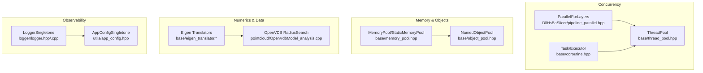
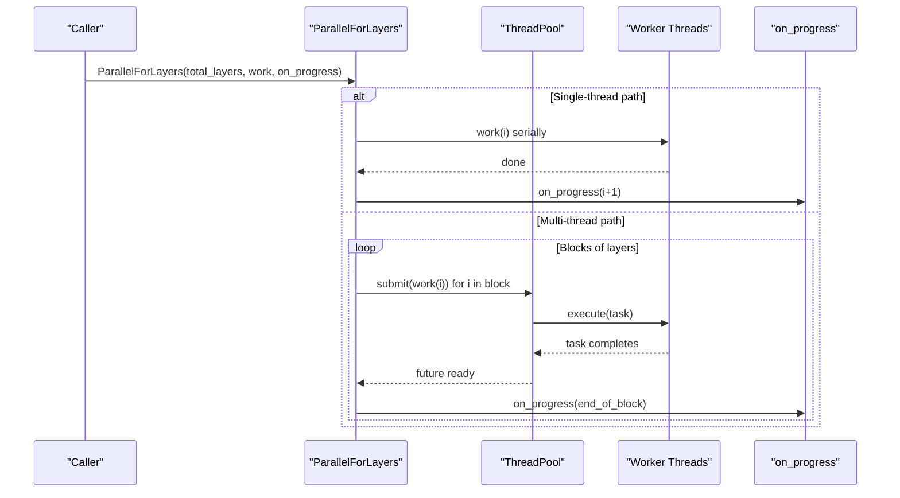
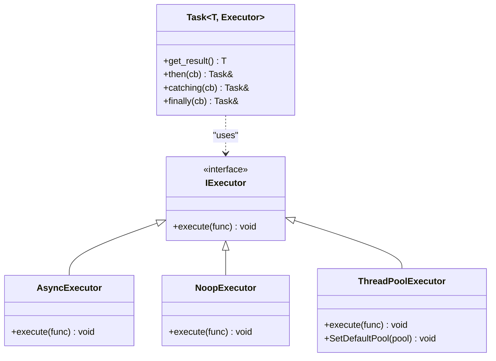
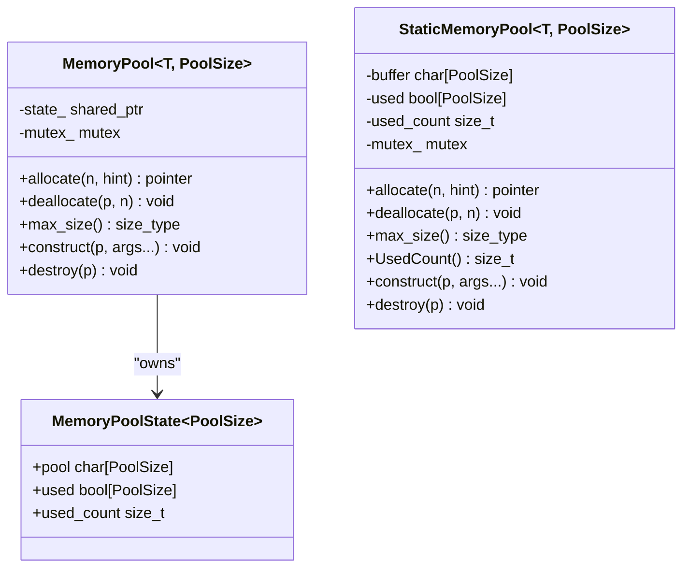
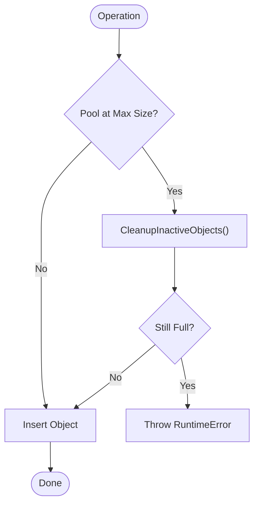
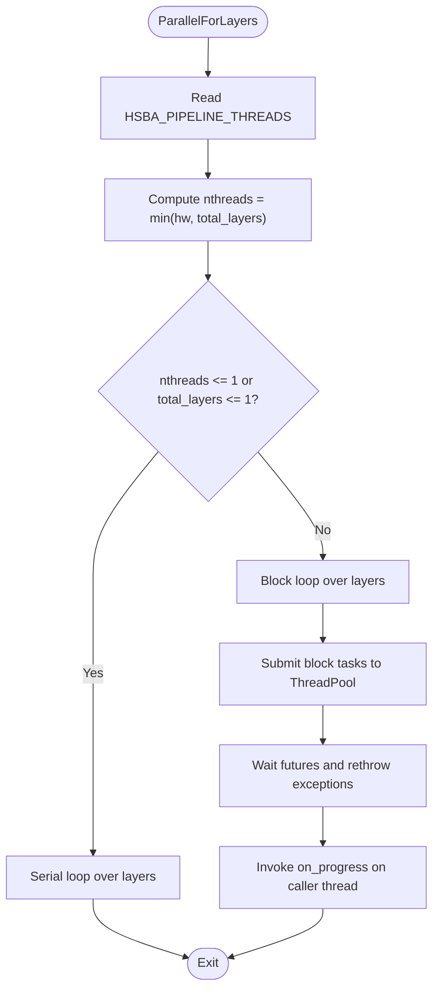
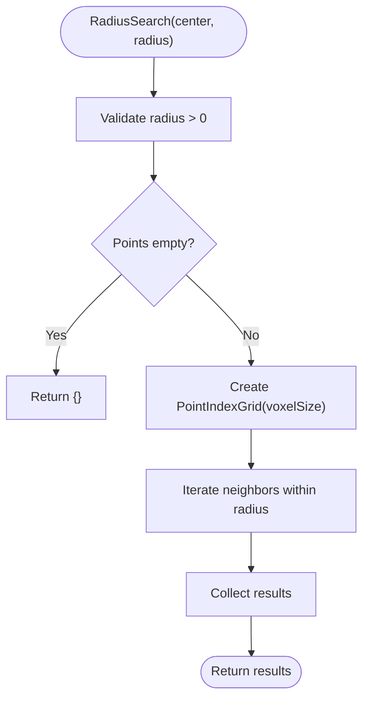
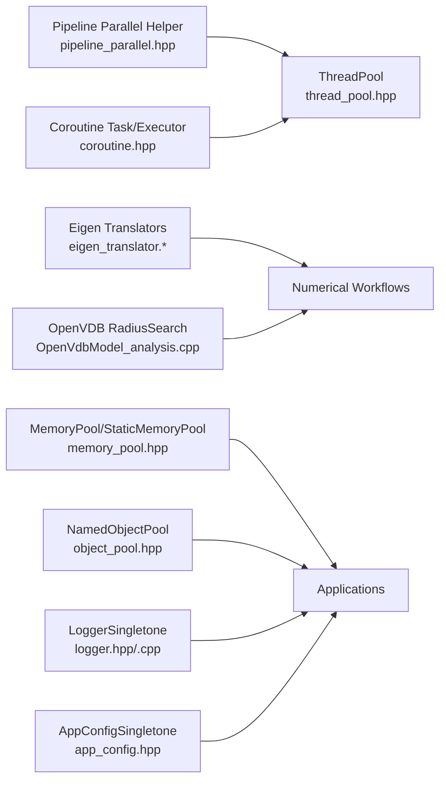

# Performance Optimization / 性能优化

<cite>
**Referenced Files in This Document**
- [thread_pool.hpp](file://base/thread_pool.hpp)
- [coroutine.hpp](file://base/coroutine.hpp)
- [memory_pool.hpp](file://base/memory_pool.hpp)
- [object_pool.hpp](file://base/object_pool.hpp)
- [pipeline_parallel.hpp](file://DllHsBaSlicer/pipeline_parallel.hpp)
- [eigen_translator.hpp](file://base/eigen_translator.hpp)
- [eigen_translator.cpp](file://base/eigen_translator.cpp)
- [OpenVdbModel_analysis.cpp](file://pointcloud/OpenVdbModel_analysis.cpp)
- [logger.hpp](file://logger/logger.hpp)
- [logger.cpp](file://logger/logger.cpp)
- [app_config.hpp](file://utils/app_config.hpp)
</cite>

## Table of Contents
1. [Introduction](#introduction)
2. [Project Structure](#project-structure)
3. [Core Components](#core-components)
4. [Architecture Overview](#architecture-overview)
5. [Detailed Component Analysis](#detailed-component-analysis)
6. [Dependency Analysis](#dependency-analysis)
7. [Performance Considerations](#performance-considerations)
8. [Troubleshooting Guide](#troubleshooting-guide)
9. [Conclusion](#conclusion)
10. [Appendices](#appendices)

## Introduction
This document explains HsBaSlicer’s performance optimization techniques and high-performance computing features. It focuses on:
- Parallel processing with thread pools for multi-core utilization
- Coroutine-based asynchronous operations for non-blocking execution
- Memory pooling strategies for efficient resource management
- SIMD vectorization opportunities, cache-friendly data structures, and algorithm optimizations
- Performance monitoring tools, profiling techniques, and benchmarking methodologies
- Practical examples of parallelizing slicing operations, optimizing memory allocation patterns, and implementing efficient data processing pipelines
- Scalability considerations, load balancing strategies, and tuning guidelines across hardware configurations

## Project Structure
The performance-related infrastructure is primarily located under base utilities and Dll pipeline helpers:
- Threading and concurrency: ThreadPool, coroutine Task/Executor, and pipeline-level parallel helper
- Memory and object pools: fixed-size memory pool allocator and named shared-object pool
- Vector math integration: Eigen translators used by configuration and IO paths
- Point cloud analysis: spatial indexing using OpenVDB for scalable queries
- Logging and configuration: thread-safe logger singleton and application config singleton



**Diagram sources**
- [thread_pool.hpp:29-162](file://base/thread_pool.hpp#L29-L162)
- [coroutine.hpp:47-122](file://base/coroutine.hpp#L47-L122)
- [pipeline_parallel.hpp:41-117](file://DllHsBaSlicer/pipeline_parallel.hpp#L41-L117)
- [memory_pool.hpp:43-208](file://base/memory_pool.hpp#L43-L208)
- [object_pool.hpp:22-92](file://base/object_pool.hpp#L22-L92)
- [eigen_translator.hpp:21-107](file://base/eigen_translator.hpp#L21-L107)
- [OpenVdbModel_analysis.cpp:27-46](file://pointcloud/OpenVdbModel_analysis.cpp#L27-L46)
- [logger.hpp:35-122](file://logger/logger.hpp#L35-L122)
- [app_config.hpp:19-46](file://utils/app_config.hpp#L19-L46)

**Section sources**
- [thread_pool.hpp:29-162](file://base/thread_pool.hpp#L29-L162)
- [coroutine.hpp:47-122](file://base/coroutine.hpp#L47-L122)
- [pipeline_parallel.hpp:41-117](file://DllHsBaSlicer/pipeline_parallel.hpp#L41-L117)
- [memory_pool.hpp:43-208](file://base/memory_pool.hpp#L43-L208)
- [object_pool.hpp:22-92](file://base/object_pool.hpp#L22-L92)
- [eigen_translator.hpp:21-107](file://base/eigen_translator.hpp#L21-L107)
- [OpenVdbModel_analysis.cpp:27-46](file://pointcloud/OpenVdbModel_analysis.cpp#L27-L46)
- [logger.hpp:35-122](file://logger/logger.hpp#L35-L122)
- [app_config.hpp:19-46](file://utils/app_config.hpp#L19-L46)

## Core Components
- ThreadPool: A bounded worker-thread pool that submits tasks via std::future, tracks active/pending work, and supports a C++20 executor interface when available.
- Coroutine Task/Executor: A lightweight async task abstraction with pluggable executors (AsyncExecutor, NoopExecutor, ThreadPoolExecutor).
- MemoryPool and StaticMemoryPool: STL-compatible allocators backed by fixed-size buffers with per-byte usage tracking and mutex protection.
- NamedObjectPool: Thread-safe named registry of shared objects with automatic cleanup of inactive entries.
- Pipeline parallel helper: Layer-wise parallelism for slicing/fill hot paths with block scheduling and progress callbacks.
- Eigen translators: Convert Eigen vectors to/from string representations for configuration persistence.
- OpenVDB radius search: Spatial index construction and iteration for point cloud queries.
- LoggerSingletone and AppConfigSingletone: Thread-safe singletons for logging and app settings.

**Section sources**
- [thread_pool.hpp:29-162](file://base/thread_pool.hpp#L29-L162)
- [coroutine.hpp:47-122](file://base/coroutine.hpp#L47-L122)
- [memory_pool.hpp:43-208](file://base/memory_pool.hpp#L43-L208)
- [object_pool.hpp:22-92](file://base/object_pool.hpp#L22-L92)
- [pipeline_parallel.hpp:41-117](file://DllHsBaSlicer/pipeline_parallel.hpp#L41-L117)
- [eigen_translator.hpp:21-107](file://base/eigen_translator.hpp#L21-L107)
- [OpenVdbModel_analysis.cpp:27-46](file://pointcloud/OpenVdbModel_analysis.cpp#L27-L46)
- [logger.hpp:35-122](file://logger/logger.hpp#L35-L122)
- [app_config.hpp:19-46](file://utils/app_config.hpp#L19-L46)

## Architecture Overview
The performance architecture layers concurrency over data processing:
- Pipeline layer uses ParallelForLayers to distribute independent layer work across ThreadPool workers.
- Coroutines can be scheduled onto the same ThreadPool via ThreadPoolExecutor or other executors.
- Data structures are allocated from MemoryPool/StaticMemoryPool to reduce heap churn; large shared objects are managed by NamedObjectPool.
- Numerical routines use Eigen types; configuration I/O leverages Eigen translators.
- Observability is provided by LoggerSingletone; runtime behavior may depend on AppConfigSingletone.



**Diagram sources**
- [pipeline_parallel.hpp:41-117](file://DllHsBaSlicer/pipeline_parallel.hpp#L41-L117)
- [thread_pool.hpp:62-111](file://base/thread_pool.hpp#L62-L111)

## Detailed Component Analysis

### Parallel Processing with ThreadPool
ThreadPool manages a fixed number of worker threads, queues tasks, and exposes futures for results. It also provides an executor interface for coroutines when enabled.

Key behaviors:
- Construction validates thread count and spawns workers.
- submit wraps user functions into packaged tasks and enqueues them.
- PendingTasks/ActiveTasks provide visibility into queue state.
- WaitAll blocks until all tasks complete.
- WorkerLoop handles spurious wakeups, decrements active_tasks, and notifies completion.

```mermaid
classDiagram
class ThreadPool {
+submit(f, args...) future
+PendingTasks() size_t
+ActiveTasks() size_t
+WaitAll() void
-WorkerLoop() void
-workers_ vector<thread>
-tasks_ queue<function<void()>>
-queue_mutex_ mutex
-condition_ condition_variable
-finished_condition_ condition_variable
-stop_ atomic<bool>
-active_tasks_ atomic<size_t>
}
```

**Diagram sources**
- [thread_pool.hpp:29-162](file://base/thread_pool.hpp#L29-L162)

Practical guidance:
- Use one ThreadPool per process or subsystem to avoid contention.
- Batch small tasks to reduce queue overhead.
- For CPU-bound work, set thread count near hardware_concurrency.
- For I/O-bound work, consider more threads than cores.

**Section sources**
- [thread_pool.hpp:29-162](file://base/thread_pool.hpp#L29-L162)

### Coroutine-Based Asynchronous Operations
Coroutines are modeled by Task<T, Executor> with pluggable executors:
- IExecutor defines execute(std::function<void()>&&).
- AsyncExecutor runs via std::async.
- NoopExecutor runs inline.
- ThreadPoolExecutor dispatches to a ThreadPool instance.

Awaiters coordinate suspension/resumption and result delivery. CustomAllocatorTask allows custom allocators for promise storage.



**Diagram sources**
- [coroutine.hpp:47-122](file://base/coroutine.hpp#L47-L122)
- [coroutine.hpp:205-382](file://base/coroutine.hpp#L205-L382)
- [coroutine.hpp:563-772](file://base/coroutine.hpp#L563-L772)

Usage notes:
- Prefer ThreadPoolExecutor for CPU-bound coroutine workloads.
- Use AsyncExecutor for fire-and-forget background tasks.
- Chain then/catching/finally for structured error handling and cleanup.

**Section sources**
- [coroutine.hpp:47-122](file://base/coroutine.hpp#L47-L122)
- [coroutine.hpp:205-382](file://base/coroutine.hpp#L205-L382)
- [coroutine.hpp:563-772](file://base/coroutine.hpp#L563-L772)

### Memory Pooling Strategies
MemoryPool and StaticMemoryPool implement STL-compatible allocators backed by fixed-size buffers:
- Fixed buffer with per-byte usage flags and alignment to max_align_t.
- Mutex-protected allocate/deallocate with bounds checks.
- Shared state for MemoryPool via shared_ptr; static global buffer for StaticMemoryPool.



**Diagram sources**
- [memory_pool.hpp:28-34](file://base/memory_pool.hpp#L28-L34)
- [memory_pool.hpp:43-208](file://base/memory_pool.hpp#L43-L208)
- [memory_pool.hpp:215-372](file://base/memory_pool.hpp#L215-L372)

Guidance:
- Use MemoryPool for per-scope allocations with known lifetime.
- Use StaticMemoryPool for global, zero-instance-overhead pools.
- Avoid mixing lifetimes; ensure matching construct/destroy calls.

**Section sources**
- [memory_pool.hpp:43-208](file://base/memory_pool.hpp#L43-L208)
- [memory_pool.hpp:215-372](file://base/memory_pool.hpp#L215-L372)

### Named Object Pool for Resource Management
NamedObjectPool maintains a named registry of shared objects with read/write concurrency control:
- emplace/insert/allocate create or register objects.
- get returns shared pointers; Contains checks existence.
- CleanupInactiveObjects removes entries whose use_count equals 1.



**Diagram sources**
- [object_pool.hpp:66-92](file://base/object_pool.hpp#L66-L92)
- [object_pool.hpp:262-279](file://base/object_pool.hpp#L262-L279)

**Section sources**
- [object_pool.hpp:22-92](file://base/object_pool.hpp#L22-L92)
- [object_pool.hpp:262-279](file://base/object_pool.hpp#L262-L279)

### Pipeline-Level Parallelism for Slicing/Fill
ParallelForLayers distributes independent layer indices across ThreadPool workers:
- Honors HSBA_PIPELINE_THREADS environment variable for controlled scaling.
- Falls back to serial execution when only one thread or layer exists.
- Processes layers in blocks to reduce progress callback frequency.



**Diagram sources**
- [pipeline_parallel.hpp:41-117](file://DllHsBaSlicer/pipeline_parallel.hpp#L41-L117)

**Section sources**
- [pipeline_parallel.hpp:41-117](file://DllHsBaSlicer/pipeline_parallel.hpp#L41-L117)

### SIMD Vectorization Opportunities
While explicit SIMD intrinsics are not present in the referenced files, the codebase uses Eigen vectors extensively through translators and numerical workflows. This enables compiler auto-vectorization and optimized BLAS-like kernels where applicable.

Recommendations:
- Keep data contiguous and aligned; prefer std::vector<Eigen::VectorXf> or similar layouts.
- Use Eigen’s built-in vectorized operations rather than scalar loops.
- Profile with compiler flags enabling auto-vectorization (e.g., -march=native) to leverage SIMD.

**Section sources**
- [eigen_translator.hpp:21-107](file://base/eigen_translator.hpp#L21-L107)
- [eigen_translator.cpp:15-227](file://base/eigen_translator.cpp#L15-L227)

### Cache-Friendly Data Structures and Algorithms
- MemoryPool/StaticMemoryPool allocate from contiguous buffers, improving locality.
- NamedObjectPool stores objects in unordered_map; access patterns should favor batched operations to minimize lock contention.
- OpenVDB radius search builds a spatial index grid tuned by voxel size, reducing query complexity.



**Diagram sources**
- [OpenVdbModel_analysis.cpp:27-46](file://pointcloud/OpenVdbModel_analysis.cpp#L27-L46)

**Section sources**
- [OpenVdbModel_analysis.cpp:27-46](file://pointcloud/OpenVdbModel_analysis.cpp#L27-L46)

### Algorithm Optimizations
- ParallelForLayers reduces synchronization overhead by batching progress updates.
- ThreadPool avoids excessive short-task submission to limit queue overhead.
- Coroutines decouple computation from scheduling, allowing better overlap with I/O or other work.

**Section sources**
- [pipeline_parallel.hpp:41-117](file://DllHsBaSlicer/pipeline_parallel.hpp#L41-L117)
- [thread_pool.hpp:62-111](file://base/thread_pool.hpp#L62-L111)
- [coroutine.hpp:205-382](file://base/coroutine.hpp#L205-L382)

## Dependency Analysis
High-level dependencies among performance components:



**Diagram sources**
- [pipeline_parallel.hpp:41-117](file://DllHsBaSlicer/pipeline_parallel.hpp#L41-L117)
- [thread_pool.hpp:29-162](file://base/thread_pool.hpp#L29-L162)
- [coroutine.hpp:47-122](file://base/coroutine.hpp#L47-L122)
- [eigen_translator.hpp:21-107](file://base/eigen_translator.hpp#L21-L107)
- [OpenVdbModel_analysis.cpp:27-46](file://pointcloud/OpenVdbModel_analysis.cpp#L27-L46)
- [memory_pool.hpp:43-208](file://base/memory_pool.hpp#L43-L208)
- [object_pool.hpp:22-92](file://base/object_pool.hpp#L22-L92)
- [logger.hpp:35-122](file://logger/logger.hpp#L35-L122)
- [app_config.hpp:19-46](file://utils/app_config.hpp#L19-L46)

**Section sources**
- [pipeline_parallel.hpp:41-117](file://DllHsBaSlicer/pipeline_parallel.hpp#L41-L117)
- [thread_pool.hpp:29-162](file://base/thread_pool.hpp#L29-L162)
- [coroutine.hpp:47-122](file://base/coroutine.hpp#L47-L122)
- [eigen_translator.hpp:21-107](file://base/eigen_translator.hpp#L21-L107)
- [OpenVdbModel_analysis.cpp:27-46](file://pointcloud/OpenVdbModel_analysis.cpp#L27-L46)
- [memory_pool.hpp:43-208](file://base/memory_pool.hpp#L43-L208)
- [object_pool.hpp:22-92](file://base/object_pool.hpp#L22-L92)
- [logger.hpp:35-122](file://logger/logger.hpp#L35-L122)
- [app_config.hpp:19-46](file://utils/app_config.hpp#L19-L46)

## Performance Considerations
- Parallelism
  - Set HSBA_PIPELINE_THREADS to tune worker count for apples-to-apples comparisons.
  - Ensure work() writes only to output slots indexed by its own layer to avoid races.
  - Batch small tasks to reduce queue overhead.
- Concurrency
  - Use ThreadPoolExecutor for CPU-bound coroutines; AsyncExecutor for background tasks.
  - Avoid long-running blocking operations inside tasks; offload to I/O executors if needed.
- Memory
  - Prefer MemoryPool/StaticMemoryPool for frequent small allocations.
  - Use NamedObjectPool for long-lived shared objects; rely on automatic cleanup of inactive entries.
- Numerics
  - Leverage Eigen vectorized operations; keep data contiguous and aligned.
  - Tune OpenVDB voxel size based on query radius for optimal spatial indexing.
- Observability
  - Use LoggerSingletone for thread-safe logging; configure file/console outputs appropriately.
  - Read external tool paths via AppConfigSingletone to avoid repeated lookups.

[No sources needed since this section provides general guidance]

## Troubleshooting Guide
Common issues and resolutions:
- ThreadPool stopped before submission
  - Symptom: Exception when submitting tasks after destruction.
  - Resolution: Ensure ThreadPool outlives all submitted tasks; do not submit after stop.
- Memory pool capacity exceeded
  - Symptom: std::bad_alloc during allocate.
  - Resolution: Increase PoolSize or reduce concurrent allocations; verify matching destroy/deallocate calls.
- NamedObjectPool full
  - Symptom: RuntimeError indicating pool is full.
  - Resolution: Allow CleanupInactiveObjects to run; ensure objects are released properly.
- Coroutine executor misconfiguration
  - Symptom: Tasks not executed on expected threads.
  - Resolution: Configure ThreadPoolExecutor with a valid ThreadPool or set default pool.
- Logging overhead
  - Symptom: High CPU usage due to excessive logging.
  - Resolution: Adjust log level and disable file logging in hot paths.

**Section sources**
- [thread_pool.hpp:62-90](file://base/thread_pool.hpp#L62-L90)
- [memory_pool.hpp:111-142](file://base/memory_pool.hpp#L111-L142)
- [object_pool.hpp:66-92](file://base/object_pool.hpp#L66-L92)
- [logger.hpp:35-122](file://logger/logger.hpp#L35-L122)
- [logger.cpp:186-213](file://logger/logger.cpp#L186-L213)

## Conclusion
HsBaSlicer’s performance stack combines a robust thread pool, flexible coroutine executors, and efficient memory/object pools to support scalable slicing and fill pipelines. By leveraging parallel layer processing, cache-friendly allocations, and vectorized numerics, the system achieves strong multi-core utilization while maintaining predictable resource usage. Tuning parameters such as HSBA_PIPELINE_THREADS, pool sizes, and OpenVDB voxel sizes enable adaptation to diverse hardware configurations.

[No sources needed since this section summarizes without analyzing specific files]

## Appendices

### Practical Examples

#### Parallelizing Slicing Operations
- Use ParallelForLayers to distribute layer work across ThreadPool workers.
- Provide a thread-safe work functor that writes exclusively to its own layer index.
- Optionally supply on_progress to report completed blocks on the calling thread.

**Section sources**
- [pipeline_parallel.hpp:41-117](file://DllHsBaSlicer/pipeline_parallel.hpp#L41-L117)
- [thread_pool.hpp:62-111](file://base/thread_pool.hpp#L62-L111)

#### Optimizing Memory Allocation Patterns
- Replace frequent new/delete with MemoryPool or StaticMemoryPool for small, short-lived objects.
- Use NamedObjectPool for shared resources requiring lifecycle management.

**Section sources**
- [memory_pool.hpp:43-208](file://base/memory_pool.hpp#L43-L208)
- [memory_pool.hpp:215-372](file://base/memory_pool.hpp#L215-L372)
- [object_pool.hpp:22-92](file://base/object_pool.hpp#L22-L92)

#### Implementing Efficient Data Processing Pipelines
- Combine coroutines with ThreadPoolExecutor for non-blocking, CPU-bound stages.
- Use Eigen translators to persist numeric configuration efficiently.
- Apply OpenVDB spatial indexing for scalable point cloud queries.

**Section sources**
- [coroutine.hpp:47-122](file://base/coroutine.hpp#L47-L122)
- [eigen_translator.hpp:21-107](file://base/eigen_translator.hpp#L21-L107)
- [OpenVdbModel_analysis.cpp:27-46](file://pointcloud/OpenVdbModel_analysis.cpp#L27-L46)