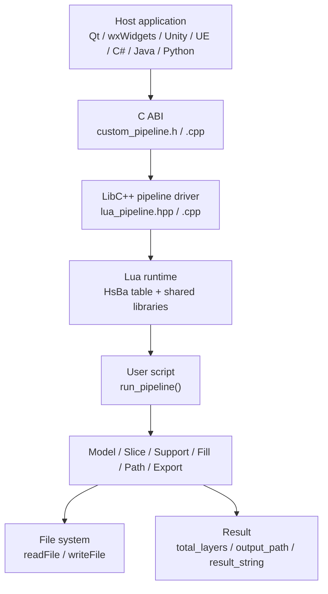
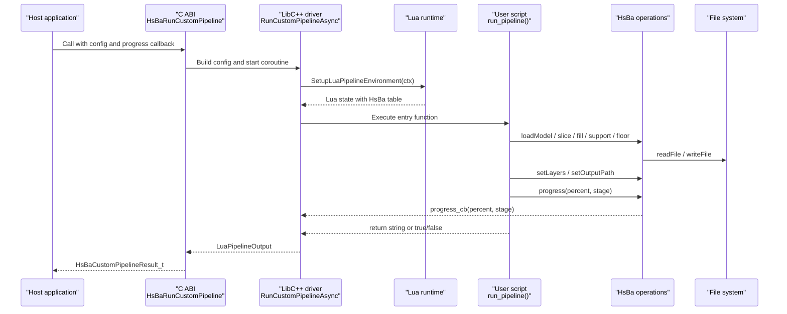
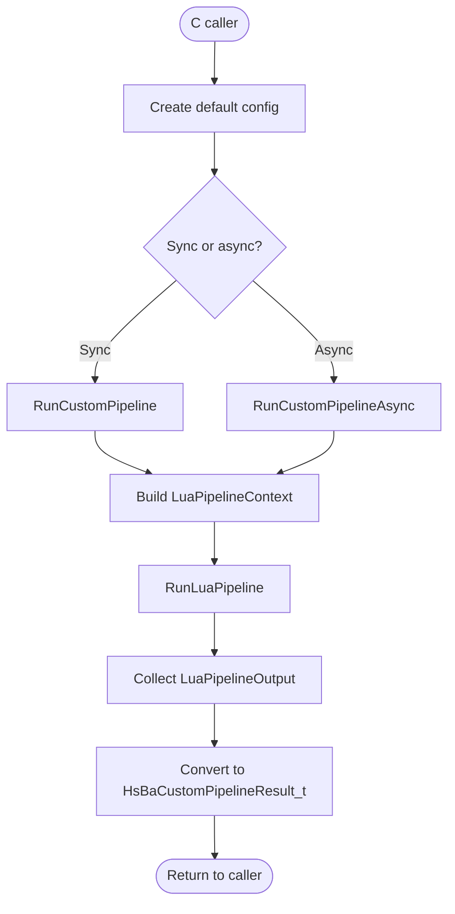
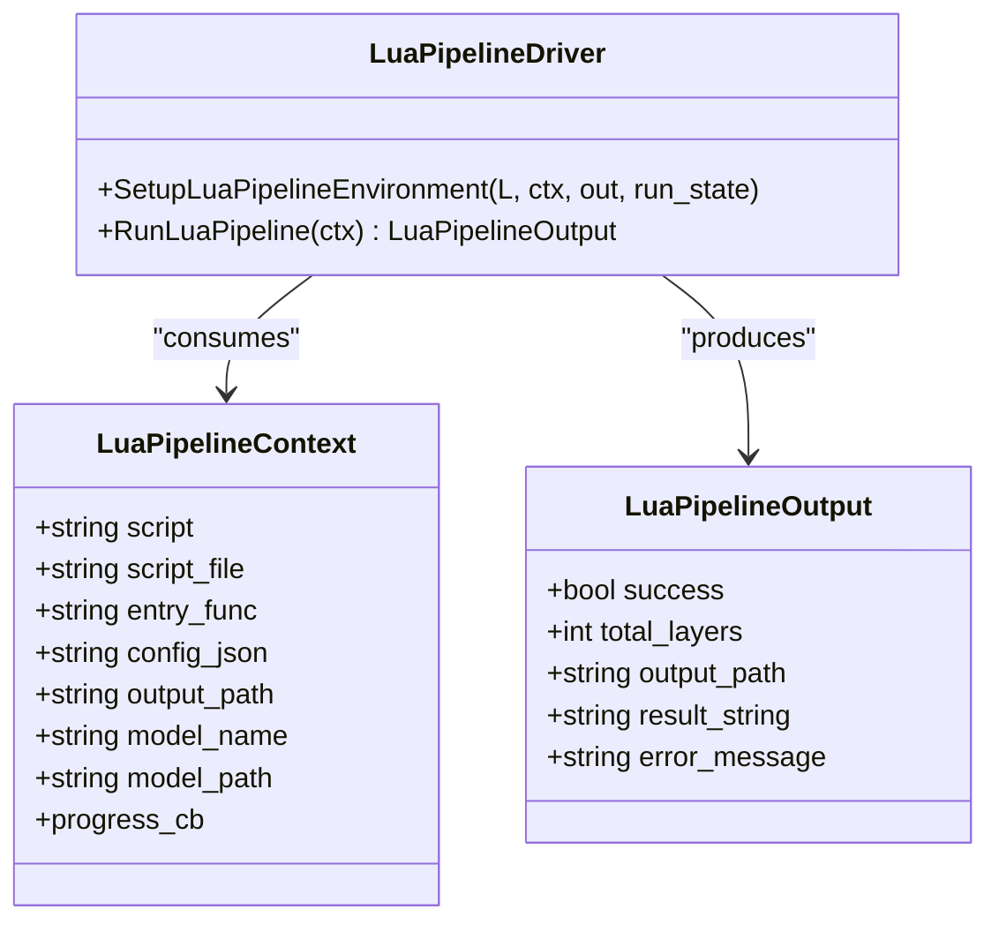
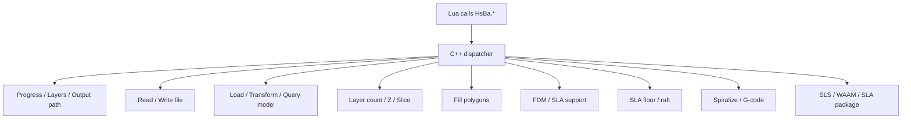
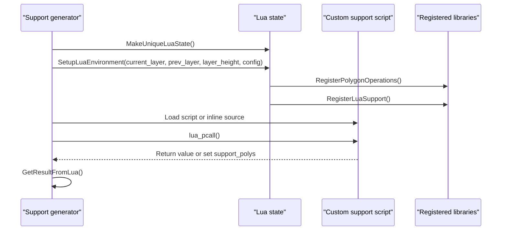
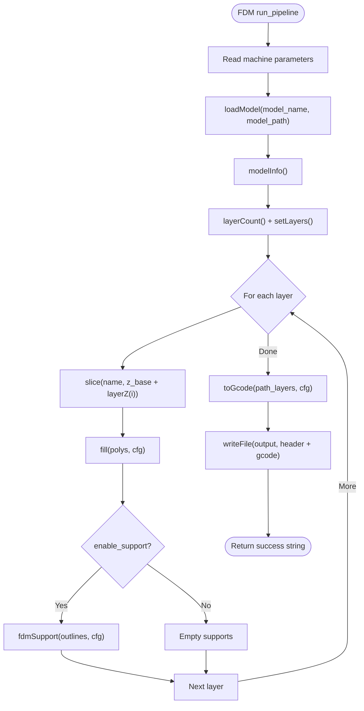
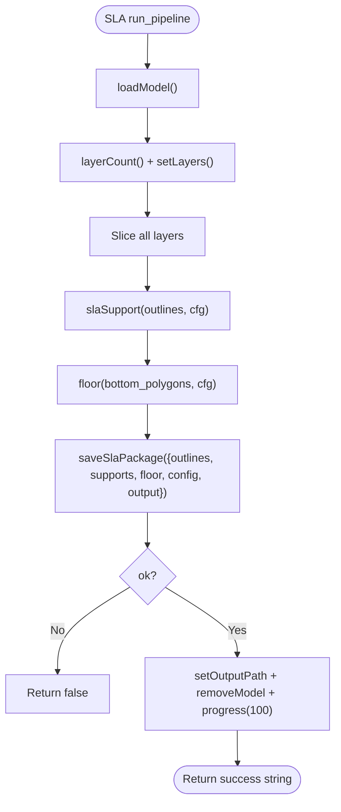
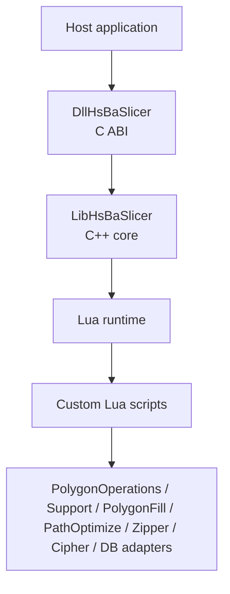
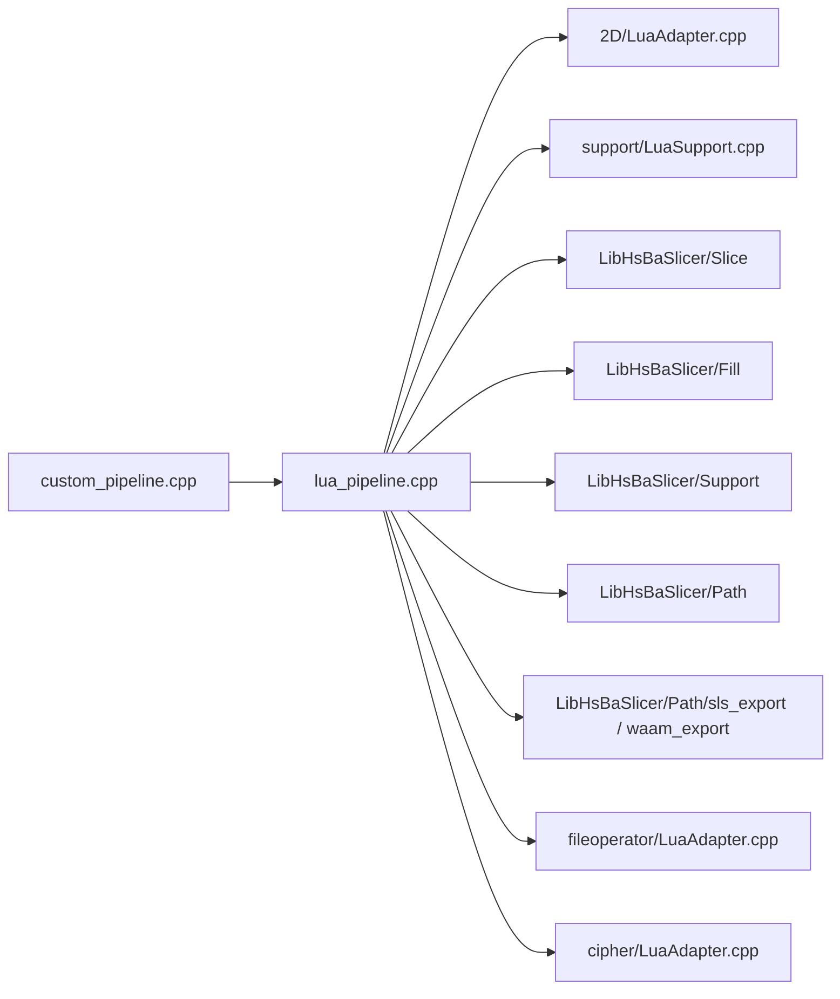

# Custom Pipeline Development / 自定义流水线开发

<cite>
**Referenced Files in This Document**   
- [lua_pipeline.hpp](file://LibHsBaSlicer/Extends/lua_pipeline.hpp)
- [lua_pipeline.cpp](file://LibHsBaSlicer/Extends/lua_pipeline.cpp)
- [custom_pipeline.h](file://DllHsBaSlicer/custom_pipeline.h)
- [custom_pipeline.cpp](file://DllHsBaSlicer/custom_pipeline.cpp)
- [LuaAdapter.cpp](file://2D/LuaAdapter.cpp)
- [LuaSupport.cpp](file://support/LuaSupport.cpp)
- [hsba_pipeline.d.lua](file://types/hsba_pipeline.d.lua)
- [lua_pipeline_api.md](file://docs/en/lua_pipeline_api.md)
- [my_fdm_pipeline.lua](file://samples/Custom/scripts/my_fdm_pipeline.lua)
- [my_sla_pipeline.lua](file://samples/Custom/scripts/my_sla_pipeline.lua)
- [main.cpp](file://samples/Custom/main.cpp)
- [README.md](file://docs/en/DllHsBaSlicer/README.md)
</cite>

## Table of Contents
1. [Introduction](#introduction)
2. [Project Structure](#project-structure)
3. [Core Components](#core-components)
4. [Architecture Overview](#architecture-overview)
5. [Detailed Component Analysis](#detailed-component-analysis)
6. [Dependency Analysis](#dependency-analysis)
7. [Performance Considerations](#performance-considerations)
8. [Troubleshooting Guide](#troubleshooting-guide)
9. [Conclusion](#conclusion)
10. [Appendices](#appendices)

## Introduction
This document explains how to develop custom pipelines using Lua scripting in HsBaSlicer. It covers the complete custom pipeline framework: script structure, event handling, progress reporting, result management, stage definition, algorithm implementation, and integration with existing HsBaSlicer components. It also documents the Lua API for model operations, geometry manipulation, file I/O, packaging, and callback mechanisms, and provides tutorials for FDM, SLA, SLS, SLM, LOM, TDP, and WAAM process-specific pipelines. Finally, it addresses plugin architecture, dynamic loading, deployment, parallel execution, memory management, debugging, testing, and advanced topics such as external library integration.

The Custom pipeline is distinct from built-in pipelines: its entire workflow — load, slice, support, fill, floor, path generation, and export — is defined by a Lua entry function, while C++ only provides the environment and the `HsBa` operation table. Built-in pipelines keep their stage order fixed in C++ and allow only per-stage Lua replacement (for example, custom support or fill).

**Section sources**
- [lua_pipeline.hpp:19-39](file://LibHsBaSlicer/Extends/lua_pipeline.hpp#L19-L39)
- [lua_pipeline_api.md:19-28](file://docs/en/lua_pipeline_api.md#L19-L28)
- [README.md:456-501](file://docs/en/DllHsBaSlicer/README.md#L456-L501)

## Project Structure
The Custom pipeline spans three layers:

| Layer | Responsibility | Key files |
|---|---|---|
| C ABI layer | Exposes synchronous and asynchronous C functions for host applications | [custom_pipeline.h](file://DllHsBaSlicer/custom_pipeline.h), [custom_pipeline.cpp](file://DllHsBaSlicer/custom_pipeline.cpp) |
| LibC++ layer | Builds the Lua state, registers the `HsBa` table, executes the script, and collects results | [lua_pipeline.hpp](file://LibHsBaSlicer/Extends/lua_pipeline.hpp), [lua_pipeline.cpp](file://LibHsBaSlicer/Extends/lua_pipeline.cpp) |
| Script layer | Defines the full workflow through a Lua entry function and uses shared libraries | [my_fdm_pipeline.lua](file://samples/Custom/scripts/my_fdm_pipeline.lua), [my_sla_pipeline.lua](file://samples/Custom/scripts/my_sla_pipeline.lua), [main.cpp](file://samples/Custom/main.cpp) |

**Diagram sources**
- [custom_pipeline.h:17-62](file://DllHsBaSlicer/custom_pipeline.h#L17-L62)
- [lua_pipeline.hpp:29-83](file://LibHsBaSlicer/Extends/lua_pipeline.hpp#L29-L83)
- [lua_pipeline.cpp:228-288](file://LibHsBaSlicer/Extends/lua_pipeline.cpp#L228-L288)

**Section sources**
- [custom_pipeline.h:17-62](file://DllHsBaSlicer/custom_pipeline.h#L17-L62)
- [lua_pipeline.hpp:19-83](file://LibHsBaSlicer/Extends/lua_pipeline.hpp#L19-L83)
- [main.cpp:3-33](file://samples/Custom/main.cpp#L3-L33)

## Core Components
The core components are:

1. **Custom pipeline configuration and result types**
   - Configuration fields include `pipeline_lua_script`, `pipeline_lua_source`, `entry_func`, `config_json`, `model_name`, `model_path`, `output_path`, and progress callback.
   - Result fields include `success`, `total_layers`, `output_path`, `result_string`, `error_message`, and `elapsed_seconds`.

2. **Lua pipeline context and output**
   - `LuaPipelineContext` carries inline source, script file, entry function name, JSON config, model metadata, default output path, and progress callback.
   - `LuaPipelineOutput` carries success status, total layers, output path, result string, and error message.

3. **`HsBa` operation table**
   - Progress reporting: `progress`, `setLayers`, `setOutputPath`.
   - File I/O: `readFile`, `writeFile`.
   - Model management: `loadModel`, `modelInfo`, `translateModel`, `rotateModel`, `scaleModel`, `removeModel`, `modelNames`.
   - Slicing: `layerCount`, `layerZ`, `slice`, `sliceUnsafe`, `toInt`, `toDouble`.
   - Process algorithms: `fill`, `fdmSupport`, `slaSupport`, `floor`.
   - Path and export: `spiralize`, `toGcode`, `saveSlsPackage`, `saveWaamPackage`, `saveSlaPackage`, `renderImage`.

4. **Shared Lua libraries**
   - `PolygonOperations`: boolean operations, offset, hulls, area, shape creation, text-to-polygon.
   - `PolygonFill`: fill algorithms.
   - `PathOptimize`: path ordering optimization.
   - `Support`: support generators and overhang detection.
   - `Cipher`, `Zipper`, `Bit7zZipper`, database adapters, `ParamStore`.

**Section sources**
- [custom_pipeline.cpp:23-44](file://DllHsBaSlicer/custom_pipeline.cpp#L23-L44)
- [lua_pipeline.hpp:29-51](file://LibHsBaSlicer/Extends/lua_pipeline.hpp#L29-L51)
- [lua_pipeline_api.md:48-133](file://docs/en/lua_pipeline_api.md#L48-L133)
- [hsba_pipeline.d.lua:190-463](file://types/hsba_pipeline.d.lua#L190-L463)

## Architecture Overview
The Custom pipeline follows a layered call flow:

**Diagram sources**
- [custom_pipeline.cpp:117-163](file://DllHsBaSlicer/custom_pipeline.cpp#L117-L163)
- [lua_pipeline.cpp:228-288](file://LibHsBaSlicer/Extends/lua_pipeline.cpp#L228-L288)
- [lua_pipeline.cpp:292-397](file://LibHsBaSlicer/Extends/lua_pipeline.cpp#L292-L397)
- [lua_pipeline.cpp:401-460](file://LibHsBaSlicer/Extends/lua_pipeline.cpp#L401-L460)

**Section sources**
- [custom_pipeline.cpp:117-213](file://DllHsBaSlicer/custom_pipeline.cpp#L117-L213)
- [lua_pipeline.hpp:69-83](file://LibHsBaSlicer/Extends/lua_pipeline.hpp#L69-L83)
- [lua_pipeline.cpp:228-800](file://LibHsBaSlicer/Extends/lua_pipeline.cpp#L228-L800)

## Detailed Component Analysis

### Custom Pipeline C ABI
The C ABI exposes:

- `HsBaCreateDefaultCustomConfig`: creates default configuration.
- `HsBaRunCustomPipeline`: synchronous execution.
- `HsBaRunCustomPipelineAsync`: asynchronous execution via C++20 coroutines.
- `HsBaFreeCustomPipelineResult`: frees allocated strings in the result.

The internal implementation builds an `InternalCustomConfig`, wraps progress callbacks, constructs a `LuaPipelineContext`, runs the pipeline, measures elapsed time, and converts the internal result into a C-compatible struct.

**Diagram sources**
- [custom_pipeline.h:21-62](file://DllHsBaSlicer/custom_pipeline.h#L21-L62)
- [custom_pipeline.cpp:86-115](file://DllHsBaSlicer/custom_pipeline.cpp#L86-L115)
- [custom_pipeline.cpp:171-213](file://DllHsBaSlicer/custom_pipeline.cpp#L171-L213)

**Section sources**
- [custom_pipeline.h:17-62](file://DllHsBaSlicer/custom_pipeline.h#L17-L62)
- [custom_pipeline.cpp:23-213](file://DllHsBaSlicer/custom_pipeline.cpp#L23-L213)

### Lua Pipeline Context and Execution
The LibC++ layer defines:

- `LuaPipelineContext`: script source, script file, entry function, JSON config, model metadata, output path, progress callback.
- `LuaPipelineOutput`: success, total layers, output path, result string, error message.
- `SetupLuaPipelineEnvironment`: opens standard libraries, installs common types, registers pooled 2D/3D/File functions, and creates the global `HsBa` table bound to the current run.
- `RunLuaPipeline`: creates a Lua state, sets up the environment, executes the script, and calls the entry function.

**Diagram sources**
- [lua_pipeline.hpp:29-83](file://LibHsBaSlicer/Extends/lua_pipeline.hpp#L29-L83)

**Section sources**
- [lua_pipeline.hpp:19-83](file://LibHsBaSlicer/Extends/lua_pipeline.hpp#L19-L83)
- [lua_pipeline.cpp:46-69](file://LibHsBaSlicer/Extends/lua_pipeline.cpp#L46-L69)

### HsBa Operation Table Implementation
The `HsBa` table is implemented in the LibC++ layer and maps Lua calls to slicing and geometry operations. Key implementations include:

- Progress and result reporting: `Lp_progress`, `Lp_setLayers`, `Lp_setOutputPath`.
- File I/O: `Lp_readFile`, `Lp_writeFile`.
- Model management: `Lp_loadModel`, `Lp_modelInfo`, `Lp_translateModel`, `Lp_rotateModel`, `Lp_scaleModel`, `Lp_removeModel`, `Lp_modelNames`.
- Slicing: `Lp_layerCount`, `Lp_layerZ`, `Lp_slice`, `Lp_sliceUnsafe`.
- Coordinate conversion: `Lp_toInt`, `Lp_toDouble`.
- Fill: `Lp_fill`.
- Support: `Lp_fdmSupport`, `Lp_slaSupport`.
- Floor: `Lp_floor`.
- Path and G-code: `Lp_spiralize`, `Lp_toGcode`.
- Packaging: `Lp_saveSlsPackage`, `Lp_saveWaamPackage`, `Lp_saveSlaPackage`.

**Diagram sources**
- [lua_pipeline.cpp:228-288](file://LibHsBaSlicer/Extends/lua_pipeline.cpp#L228-L288)
- [lua_pipeline.cpp:292-397](file://LibHsBaSlicer/Extends/lua_pipeline.cpp#L292-L397)
- [lua_pipeline.cpp:401-460](file://LibHsBaSlicer/Extends/lua_pipeline.cpp#L401-L460)
- [lua_pipeline.cpp:482-556](file://LibHsBaSlicer/Extends/lua_pipeline.cpp#L482-L556)
- [lua_pipeline.cpp:585-691](file://LibHsBaSlicer/Extends/lua_pipeline.cpp#L585-L691)
- [lua_pipeline.cpp:697-800](file://LibHsBaSlicer/Extends/lua_pipeline.cpp#L697-L800)

**Section sources**
- [lua_pipeline.cpp:228-800](file://LibHsBaSlicer/Extends/lua_pipeline.cpp#L228-L800)
- [hsba_pipeline.d.lua:290-463](file://types/hsba_pipeline.d.lua#L290-L463)

### Polygon Operations and Geometry Types
The 2D Lua adapter implements polygon operations and geometry conversions:

- Boolean operations: union, intersection, difference, xor.
- Offset and hull operations.
- Area calculation.
- Shape creation: rectangle, circle, ellipse, regular polygon.
- Text-to-polygon conversion.
- Conversion between floating-point and integer polygon representations.

Common geometry data types use Lua tables:

| Type | Representation | Notes |
|---|---|---|
| Point | `{ x = number, y = number }` | Millimeters, double precision |
| Polygon | Array of points | Closed contour |
| Polygons | Array of polygons | One layer; holes are separate polygons |
| Layers | Array of polygon sets | Per-layer data |

**Section sources**
- [LuaAdapter.cpp:22-329](file://2D/LuaAdapter.cpp#L22-L329)
- [LuaAdapter.cpp:332-493](file://2D/LuaAdapter.cpp#L332-L493)
- [lua_pipeline_api.md:32-45](file://docs/en/lua_pipeline_api.md#L32-L45)

### Custom Support Stage Integration
For built-in pipelines, the custom support stage is implemented separately from the fully Lua-driven Custom pipeline. The support stage:

- Creates a Lua state.
- Registers `PolygonOperations` and `Support`.
- Injects globals: `current_layer`, `prev_layer`, `layer_height`, `config`.
- Loads either inline source or a script file.
- Executes the chunk and optionally calls a named function.
- Reads the result from the return value or the `support_polys` global.

**Diagram sources**
- [LuaSupport.cpp:51-90](file://support/LuaSupport.cpp#L51-L90)
- [LuaSupport.cpp:113-178](file://support/LuaSupport.cpp#L113-L178)

**Section sources**
- [LuaSupport.cpp:1-180](file://support/LuaSupport.cpp#L1-L180)

### Step-by-Step Tutorial: Custom FDM Pipeline
The FDM tutorial demonstrates a fully Lua-defined workflow:

1. Define machine parameters via `pipeline_lua_source` so the script can read them through a local `param()` helper.
2. Load the model using `HsBa.loadModel`.
3. Compute layer count and report total layers via `HsBa.setLayers`.
4. Iterate layers: compute Z height, slice contours, generate fills with rotating angles, and optionally generate supports.
5. Assemble per-layer path data and generate G-code via `HsBa.toGcode`.
6. Write output via `HsBa.writeFile`, set output path, remove model, and report completion.

**Diagram sources**
- [my_fdm_pipeline.lua:24-30](file://samples/Custom/scripts/my_fdm_pipeline.lua#L24-L30)
- [my_fdm_pipeline.lua:52-171](file://samples/Custom/scripts/my_fdm_pipeline.lua#L52-L171)

**Section sources**
- [my_fdm_pipeline.lua:1-172](file://samples/Custom/scripts/my_fdm_pipeline.lua#L1-L172)
- [main.cpp:97-132](file://samples/Custom/main.cpp#L97-L132)

### Step-by-Step Tutorial: Custom SLA Pipeline
The SLA tutorial demonstrates:

1. Load model and compute layers.
2. Slice contours at each layer.
3. Generate SLA supports.
4. Generate floor/raft from the bottom layer.
5. Package outlines, supports, floor, and config into a zip via `HsBa.saveSlaPackage`.
6. Set output path, remove model, and return success.

**Diagram sources**
- [my_sla_pipeline.lua:27-104](file://samples/Custom/scripts/my_sla_pipeline.lua#L27-L104)

**Section sources**
- [my_sla_pipeline.lua:1-105](file://samples/Custom/scripts/my_sla_pipeline.lua#L1-L105)

### Step-by-Step Tutorial: SLS, SLM, LOM, TDP, and WAAM Pipelines
These processes follow similar patterns:

- **SLS**: Preprocess → Slice → Export via `saveSlsPackage` with a Lua export script.
- **SLM**: Metal powder-bed variant of SLS; metal-specific parameters are folded into the export config.
- **LOM**: Sheet-by-sheet bonding and cutting; export receives contour outlines and cut/bond parameters.
- **TDP**: Binder-jetting; export receives binder-jet outlines and head/curing parameters.
- **WAAM**: Wire arc additive manufacturing; output is robot code generated via `saveWaamPackage`, optionally with a custom Lua path script.

The sample main program shows how to configure each pipeline by changing only the script path and inline machine parameters.

**Section sources**
- [main.cpp:134-265](file://samples/Custom/main.cpp#L134-L265)
- [README.md:205-355](file://docs/en/DllHsBaSlicer/README.md#L205-L355)

### Plugin Architecture and Dynamic Loading
HsBaSlicer separates concerns across modules:

- `DllHsBaSlicer` is the upper-level C export shared library exposing a pure C ABI.
- `LibHsBaSlicer` contains the C++ static library implementing preprocessing, slicing, support, fill, path generation, and Lua pipeline drivers.
- Custom pipelines are loaded dynamically through Lua scripts rather than requiring a rebuild of the library.
- Additional Lua extension functions can be registered before running pipelines using the registration API.

**Diagram sources**
- [README.md:7-19](file://docs/en/DllHsBaSlicer/README.md#L7-L19)
- [README.md:612-647](file://docs/en/DllHsBaSlicer/README.md#L612-L647)

**Section sources**
- [README.md:7-54](file://docs/en/DllHsBaSlicer/README.md#L7-L54)
- [README.md:612-647](file://docs/en/DllHsBaSlicer/README.md#L612-L647)

## Dependency Analysis
The Custom pipeline has clear dependency boundaries:

- The C ABI depends on the LibC++ driver.
- The LibC++ driver depends on geometry, slicing, support, fill, path, and export modules.
- The Lua environment depends on registered shared libraries.
- User scripts depend only on the exposed `HsBa` table and shared libraries.

**Diagram sources**
- [custom_pipeline.cpp:14-16](file://DllHsBaSlicer/custom_pipeline.cpp#L14-L16)
- [lua_pipeline.cpp:17-39](file://LibHsBaSlicer/Extends/lua_pipeline.cpp#L17-L39)
- [LuaAdapter.cpp:487-493](file://2D/LuaAdapter.cpp#L487-L493)
- [LuaSupport.cpp:10-13](file://support/LuaSupport.cpp#L10-L13)

**Section sources**
- [custom_pipeline.cpp:14-16](file://DllHsBaSlicer/custom_pipeline.cpp#L14-L16)
- [lua_pipeline.cpp:17-39](file://LibHsBaSlicer/Extends/lua_pipeline.cpp#L17-L39)

## Performance Considerations
When developing custom pipelines:

1. **Minimize Lua-C++ boundary crossings**
   - Batch geometry operations where possible.
   - Avoid excessive per-point processing in Lua when C++ algorithms are available.

2. **Use integerized polygons for heavy 2D operations**
   - Boolean operations, offset, and fill run at integer precision internally.
   - Use `HsBa.toInt` and `HsBa.toDouble` appropriately.

3. **Report progress regularly**
   - Call `HsBa.progress` during long loops to keep UI responsive.
   - Use meaningful stage names for better diagnostics.

4. **Reuse models and clean up**
   - `loadModel` reuses existing same-name models.
   - Always call `removeModel` after use to free resources.

5. **Prefer built-in algorithms**
   - Use `HsBa.fill`, `HsBa.fdmSupport`, `HsBa.slaSupport`, `HsBa.floor`, and `HsBa.toGcode` instead of reimplementing complex geometry logic in Lua.

6. **Asynchronous execution**
   - Use `HsBaRunCustomPipelineAsync` for non-blocking execution.
   - Marshal callbacks back to the UI thread in host applications.

[No sources needed since this section provides general guidance]

## Troubleshooting Guide
Common issues and resolutions:

| Symptom | Cause | Resolution |
|---|---|---|
| Custom pipeline fails immediately | Missing `pipeline_lua_script` and `pipeline_lua_source` | Provide at least one script source. |
| `HsBa.loadModel` raises an error | Model not found or invalid path | Verify model path and ensure the model exists. |
| `HsBa.slice` raises an error | Model not loaded or invalid Z | Load model first and use valid Z values. |
| `HsBa.writeFile` raises a Lua error | Cannot open file for writing | Check permissions and path validity. |
| Export script returns wrong type | Export script returned unexpected value | Return `{ success = true/false, export_path = "..." }` for export stages. |
| Progress callback never fires | Script does not call `HsBa.progress` | Add progress calls inside loops. |
| Asynchronous result not received | Callback not provided or UI thread not updated | Provide `result_callback` and marshal to UI thread. |

**Section sources**
- [custom_pipeline.cpp:127-133](file://DllHsBaSlicer/custom_pipeline.cpp#L127-L133)
- [lua_pipeline.cpp:258-288](file://LibHsBaSlicer/Extends/lua_pipeline.cpp#L258-L288)
- [lua_pipeline.cpp:292-308](file://LibHsBaSlicer/Extends/lua_pipeline.cpp#L292-L308)
- [lua_pipeline_api.md:256-260](file://docs/en/lua_pipeline_api.md#L256-L260)

## Conclusion
The HsBaSlicer Custom pipeline provides a powerful, script-first approach to defining 3D printing workflows. By delegating the entire stage order to Lua while keeping robust C++ algorithms under the `HsBa` table, it enables flexible process customization without rebuilding the core library. For most users, the recommended path is:

- Use built-in pipelines when the stage order is fixed and only a single stage needs replacement.
- Use the Custom pipeline when the workflow, stage sequence, or process logic must be fully controlled by Lua.
- Extend shared libraries through the registration API when additional Lua functions are required.
- Deploy scripts as files or inline source, and communicate via C structs or Protobuf bytes for cross-language integration.

[No sources needed since this section summarizes without analyzing specific files]

## Appendices

### Lua API Quick Reference
The Lua API reference documents two environments:

- **Custom pipeline environment**: full `HsBa` operation table plus context globals.
- **Built-in stage hooks**: stage-specific globals and agreed entry functions.

Key categories:

| Category | Examples |
|---|---|
| Control & file I/O | `progress`, `setLayers`, `setOutputPath`, `readFile`, `writeFile` |
| Model operations | `loadModel`, `modelInfo`, `translateModel`, `rotateModel`, `scaleModel`, `removeModel`, `modelNames` |
| Slicing | `layerCount`, `layerZ`, `slice`, `sliceUnsafe`, `toInt`, `toDouble` |
| Fill & support | `fill`, `fdmSupport`, `slaSupport`, `floor` |
| Path & export | `spiralize`, `toGcode`, `saveSlsPackage`, `saveWaamPackage`, `saveSlaPackage`, `renderImage` |
| Shared libraries | `PolygonOperations`, `PolygonFill`, `PathOptimize`, `Support`, `Cipher`, `Zipper`, database adapters, `ParamStore` |

**Section sources**
- [lua_pipeline_api.md:19-28](file://docs/en/lua_pipeline_api.md#L19-L28)
- [lua_pipeline_api.md:48-133](file://docs/en/lua_pipeline_api.md#L48-L133)
- [lua_pipeline_api.md:136-213](file://docs/en/lua_pipeline_api.md#L136-L213)
- [lua_pipeline_api.md:215-280](file://docs/en/lua_pipeline_api.md#L215-L280)
- [hsba_pipeline.d.lua:20-187](file://types/hsba_pipeline.d.lua#L20-L187)

### Testing Strategies
Recommended testing approaches:

1. **Unit-style script tests**
   - Validate geometry operations using `PolygonOperations.area`, `union`, `difference`, and `offsetOperation`.
   - Compare expected polygon counts and areas.

2. **Pipeline smoke tests**
   - Run minimal FDM and SLA scripts from `samples/Custom/scripts`.
   - Verify output paths, layer counts, and success status.

3. **Progress and error tests**
   - Confirm progress callbacks fire at expected percentages.
   - Test missing models, invalid paths, and malformed configs.

4. **Export script validation**
   - Ensure export scripts return the correct table structure.
   - Verify generated zip contents and exported paths.

5. **Asynchronous tests**
   - Use `HsBaRunCustomPipelineAsync` and verify completion callbacks.
   - Ensure UI thread marshalling does not block worker threads.

[No sources needed since this section provides general guidance]

### Deployment Considerations
Deployment checklist:

- Initialize the library once at process startup.
- Choose between script files and inline Lua source based on deployment constraints.
- For cross-language communication, use Protobuf wire bytes through `pipeline_convert.h`.
- On iOS, note that the static library is used because arbitrary dylib loading is forbidden.
- Release all allocated result strings using the matching free functions.
- For Android/iOS, prefer SQLite backend for parameter storage unless MySQL/PostgreSQL are compiled in.

**Section sources**
- [README.md:21-31](file://docs/en/DllHsBaSlicer/README.md#L21-L31)
- [README.md:503-525](file://docs/en/DllHsBaSlicer/README.md#L503-L525)
- [README.md:696-703](file://docs/en/DllHsBaSlicer/README.md#L696-L703)