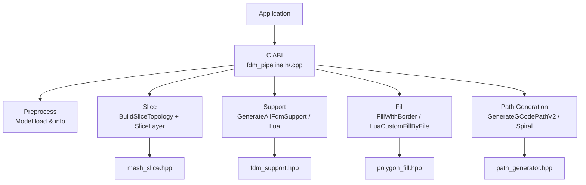
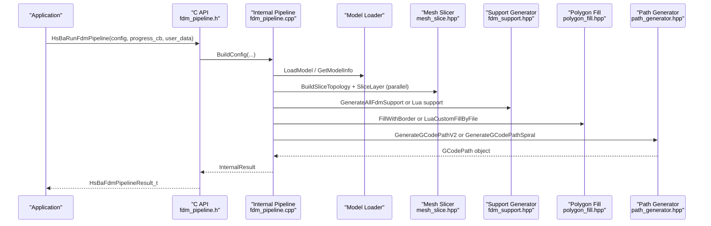
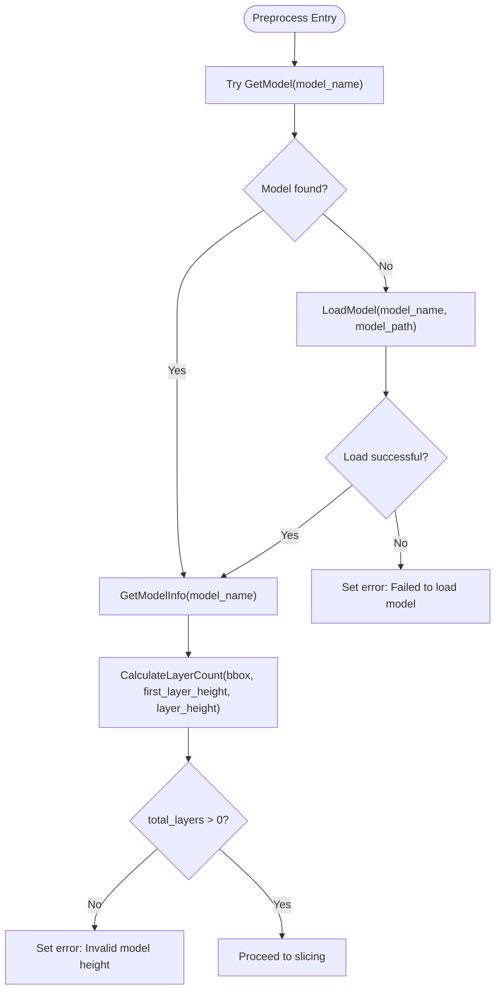
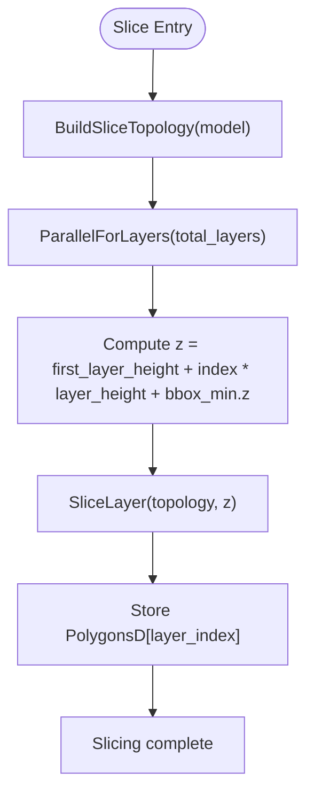
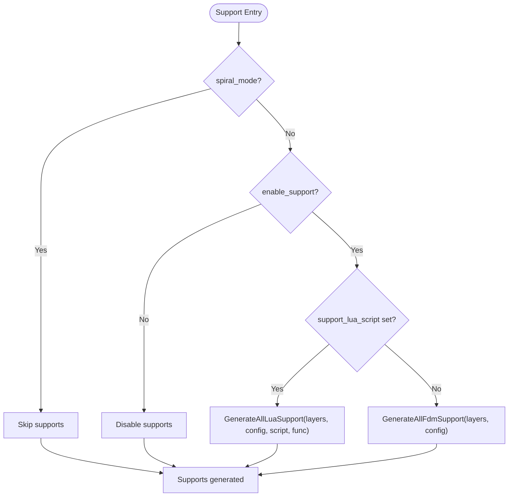
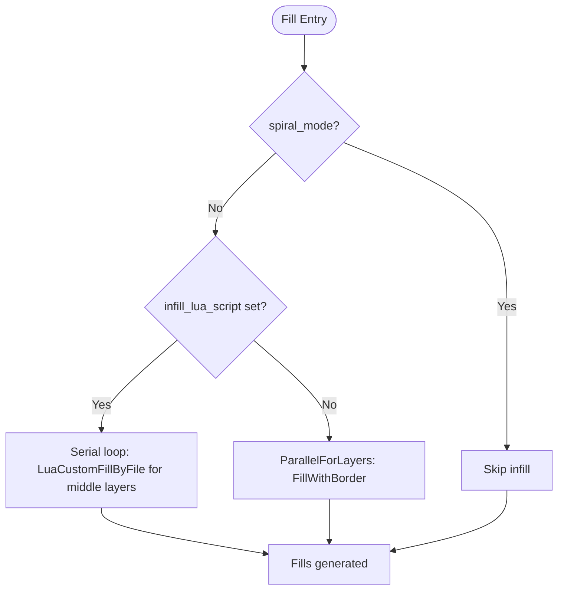
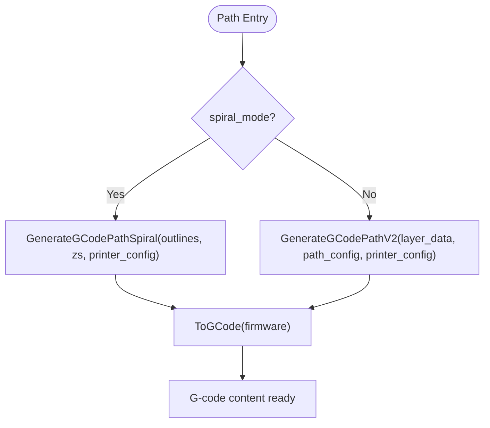
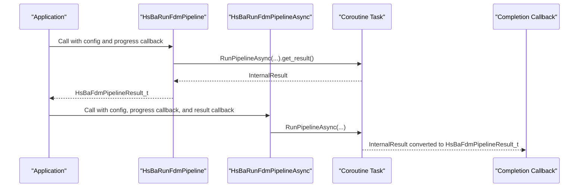
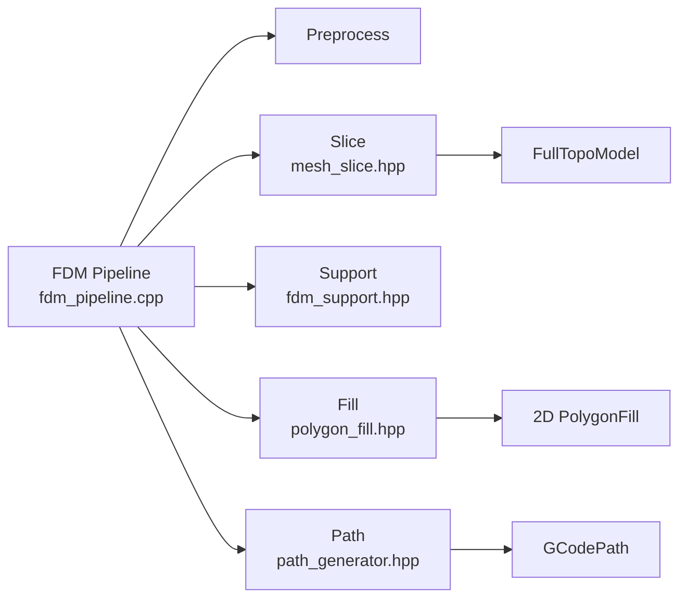

# FDM Pipeline / FDM流水线

<cite>
**Referenced Files in This Document**
- [fdm_pipeline.h](file://DllHsBaSlicer/fdm_pipeline.h)
- [fdm_pipeline.cpp](file://DllHsBaSlicer/fdm_pipeline.cpp)
- [pipeline_types.h](file://pipelinetypes/pipeline_types.h)
- [fdm_pipeline.proto](file://proto/fdm_pipeline.proto)
- [mesh_slice.hpp](file://LibHsBaSlicer/Slice/mesh_slice.hpp)
- [polygon_fill.hpp](file://LibHsBaSlicer/Fill/polygon_fill.hpp)
- [path_generator.hpp](file://LibHsBaSlicer/Path/path_generator.hpp)
- [fdm_support.hpp](file://LibHsBaSlicer/Support/fdm_support.hpp)
- [main.cpp](file://samples/FDM/main.cpp)
</cite>

## Table of Contents
1. [Introduction](#introduction)
2. [Project Structure](#project-structure)
3. [Core Components](#core-components)
4. [Architecture Overview](#architecture-overview)
5. [Detailed Component Analysis](#detailed-component-analysis)
6. [Dependency Analysis](#dependency-analysis)
7. [Performance Considerations](#performance-considerations)
8. [Troubleshooting Guide](#troubleshooting-guide)
9. [Conclusion](#conclusion)
10. [Appendices](#appendices)

## Introduction
This document explains the Fused Deposition Modeling (FDM) pipeline implementation in HsBaSlicer. It covers the complete workflow from model loading and validation through slicing, support generation, infill filling, and G-code path generation. It documents the C ABI configuration structure `HsBaFdmPipelineConfig_t`, both synchronous and asynchronous execution modes, progress callbacks, error handling, memory management, performance characteristics, and practical usage patterns.

The FDM pipeline is exposed as a stable C interface for integration into applications that cannot depend directly on C++ internals. Internally, it uses C++20 coroutines to run the five-stage pipeline: preprocess, slice, support, fill, and path generation.

## Project Structure
The FDM pipeline spans several modules:

- Public C ABI:
  - Configuration and result types are defined in the standalone header `pipeline_types.h`.
  - The C entry points are declared in `fdm_pipeline.h` and implemented in `fdm_pipeline.cpp`.
- Core processing libraries:
  - Slicing: `mesh_slice.hpp` provides topology building and per-layer slicing.
  - Support: `fdm_support.hpp` provides built-in and Lua-driven support generation.
  - Fill: `polygon_fill.hpp` provides line/zigzag fills with borders and Lua custom fills.
  - Path generation: `path_generator.hpp` generates G-code paths, including spiral/vase mode.
- Samples:
  - `samples/FDM/main.cpp` demonstrates default configuration, custom parameters, Lua customization, async execution, and spiral mode.
- Protocol buffer mapping:
  - `proto/fdm_pipeline.proto` mirrors the FDM configuration and result structures for serialization or cross-language use.

**Diagram sources**
- [fdm_pipeline.cpp:219-447](file://DllHsBaSlicer/fdm_pipeline.cpp#L219-L447)
- [mesh_slice.hpp:79-103](file://LibHsBaSlicer/Slice/mesh_slice.hpp#L79-L103)
- [fdm_support.hpp:19-67](file://LibHsBaSlicer/Support/fdm_support.hpp#L19-L67)
- [polygon_fill.hpp:17-53](file://LibHsBaSlicer/Fill/polygon_fill.hpp#L17-L53)
- [path_generator.hpp:20-80](file://LibHsBaSlicer/Path/path_generator.hpp#L20-L80)

**Section sources**
- [fdm_pipeline.h:17-61](file://DllHsBaSlicer/fdm_pipeline.h#L17-L61)
- [fdm_pipeline.cpp:219-447](file://DllHsBaSlicer/fdm_pipeline.cpp#L219-L447)
- [pipeline_types.h:23-140](file://pipelinetypes/pipeline_types.h#L23-L140)
- [mesh_slice.hpp:79-103](file://LibHsBaSlicer/Slice/mesh_slice.hpp#L79-L103)
- [fdm_support.hpp:19-67](file://LibHsBaSlicer/Support/fdm_support.hpp#L19-L67)
- [polygon_fill.hpp:17-53](file://LibHsBaSlicer/Fill/polygon_fill.hpp#L17-L53)
- [path_generator.hpp:20-80](file://LibHsBaSlicer/Path/path_generator.hpp#L20-L80)
- [main.cpp:50-318](file://samples/FDM/main.cpp#L50-L318)

## Core Components
The FDM pipeline exposes a small set of core components:

- Configuration structure:
  - `HsBaFdmPipelineConfig_t` defines all FDM settings: model source, slicing, fill, support, path, printer properties, firmware target, Lua scripts, and output path.
- Result structure:
  - `HsBaFdmPipelineResult_t` returns success flag, total layers, G-code content, error message, and elapsed time.
- Execution functions:
  - `HsBaRunFdmPipeline`: synchronous blocking call returning a result.
  - `HsBaRunFdmPipelineAsync`: non-blocking call invoking a completion callback with the result.
  - `HsBaCreateDefaultConfig`: initializes defaults for all fields.
  - `HsBaFreePipelineResult`: frees allocated strings in the result.

Key behaviors:
- Progress callbacks report percentage and stage description during each pipeline phase.
- Spiral/vase mode disables supports and infill and emits a continuous rising wall.
- Lua scripts can replace support and infill algorithms by specifying script paths and function names.

**Section sources**
- [pipeline_types.h:23-140](file://pipelinetypes/pipeline_types.h#L23-L140)
- [pipeline_types.h:742-783](file://pipelinetypes/pipeline_types.h#L742-L783)
- [fdm_pipeline.h:17-61](file://DllHsBaSlicer/fdm_pipeline.h#L17-L61)
- [fdm_pipeline.cpp:455-496](file://DllHsBaSlicer/fdm_pipeline.cpp#L455-L496)

## Architecture Overview
The FDM pipeline architecture maps application calls to internal stages:

**Diagram sources**
- [fdm_pipeline.cpp:219-447](file://DllHsBaSlicer/fdm_pipeline.cpp#L219-L447)
- [mesh_slice.hpp:79-103](file://LibHsBaSlicer/Slice/mesh_slice.hpp#L79-L103)
- [fdm_support.hpp:19-67](file://LibHsBaSlicer/Support/fdm_support.hpp#L19-L67)
- [polygon_fill.hpp:17-53](file://LibHsBaSlicer/Fill/polygon_fill.hpp#L17-L53)
- [path_generator.hpp:20-80](file://LibHsBaSlicer/Path/path_generator.hpp#L20-L80)

## Detailed Component Analysis

### Configuration Structure: HsBaFdmPipelineConfig_t
The configuration structure groups all FDM-related parameters:

- Model configuration:
  - `model_name`, `model_path`
- Slice configuration:
  - `layer_height`, `first_layer_height`
- Fill configuration:
  - `fill_spacing`, `fill_mode`, `fill_angle`, `wall_count`, `top_layer_count`, `bottom_layer_count`, `infill_density`
- Support configuration:
  - `enable_support`, `overhang_angle`, `support_gap`, `support_diameter`, `support_density`, `support_pattern`, `interface_layers`, `interface_density`
- Path configuration:
  - `line_width`, `print_speed`, `travel_speed`, `extrusion_multiplier`, `spiral_mode`
- G-code output configuration:
  - `gcode_firmware`, `nozzle_diameter`, `filament_diameter`, `nozzle_temp`, `bed_temp`, `retract_length`, `retract_speed`, `first_layer_speed`
- Lua customization:
  - `support_lua_script`, `support_lua_func`, `infill_lua_script`, `infill_lua_func`
- Output configuration:
  - `output_path`

Defaults are provided by `HsBaFdmConfigDefault`, which initializes all fields to sensible values such as layer height 0.2 mm, first layer height 0.25 mm, zigzag fill, three walls, top/bottom solid layers, support enabled, Marlin firmware, and standard nozzle/filament dimensions.

| Category | Key | Type | Default Value | Description |
|---|---|---|---:|---|
| Model | `model_name` | `const char*` | NULL | Logical model name used by the model registry |
| Model | `model_path` | `const char*` | NULL | File path to the model file |
| Slice | `layer_height` | `float` | 0.2 | Layer height in millimeters |
| Slice | `first_layer_height` | `float` | 0.25 | First layer height in millimeters |
| Fill | `fill_spacing` | `double` | 0.4 | Fill line spacing in millimeters |
| Fill | `fill_mode` | `HsBaFillMode_t` | HSBA_FILL_ZIGZAG | Fill pattern selection |
| Fill | `fill_angle` | `double` | 45.0 | Fill angle in degrees |
| Fill | `wall_count` | `int` | 3 | Number of perimeter walls |
| Fill | `top_layer_count` | `int` | 3 | Solid top layer count |
| Fill | `bottom_layer_count` | `int` | 3 | Solid bottom layer count |
| Fill | `infill_density` | `double` | 0.2 | Infill density between 0 and 1 |
| Support | `enable_support` | `int` | 1 | Enable or disable support generation |
| Support | `overhang_angle` | `float` | 45.0 | Overhang threshold in degrees |
| Support | `support_gap` | `float` | 0.5 | Gap between support and model in millimeters |
| Support | `support_diameter` | `float` | 2.0 | Support column diameter in millimeters |
| Support | `support_density` | `float` | 0.3 | Support fill density between 0 and 1 |
| Support | `support_pattern` | `HsBaSupportPattern_t` | HSBA_SUPPORT_PLANE | Support pattern type |
| Support | `interface_layers` | `int` | 2 | Number of interface layers |
| Support | `interface_density` | `float` | 0.5 | Interface layer density between 0 and 1 |
| Path | `line_width` | `float` | 0.4 | Line width in millimeters |
| Path | `print_speed` | `float` | 50.0 | Print speed in millimeters per second |
| Path | `travel_speed` | `float` | 100.0 | Travel speed in millimeters per second |
| Path | `extrusion_multiplier` | `float` | 1.0 | Extrusion multiplier |
| Path | `spiral_mode` | `int` | 0 | Enable vase/spiral mode |
| Firmware | `gcode_firmware` | `HsBaGCodeFirmware_t` | HSBA_GCODE_MARLIN | Target G-code firmware |
| Printer | `nozzle_diameter` | `float` | 0.4 | Nozzle diameter in millimeters |
| Printer | `filament_diameter` | `float` | 1.75 | Filament diameter in millimeters |
| Printer | `nozzle_temp` | `float` | 200.0 | Nozzle temperature in Celsius |
| Printer | `bed_temp` | `float` | 60.0 | Bed temperature in Celsius |
| Printer | `retract_length` | `float` | 1.0 | Retraction length in millimeters |
| Printer | `retract_speed` | `float` | 40.0 | Retraction speed in millimeters per second |
| Printer | `first_layer_speed` | `float` | 20.0 | First layer speed in millimeters per second |
| Lua | `support_lua_script` | `const char*` | NULL | Custom support script path |
| Lua | `support_lua_func` | `const char*` | NULL | Custom support function name |
| Lua | `infill_lua_script` | `const char*` | NULL | Custom infill script path |
| Lua | `infill_lua_func` | `const char*` | NULL | Custom infill function name |
| Output | `output_path` | `const char*` | NULL | Optional output file path |

**Section sources**
- [pipeline_types.h:23-140](file://pipelinetypes/pipeline_types.h#L23-L140)
- [pipeline_types.h:742-783](file://pipelinetypes/pipeline_types.h#L742-L783)

### Preprocess Stage: Model Loading and Validation
The preprocess stage loads the model and validates its geometry:

- It attempts to retrieve the model from a shared registry using `GetModel`.
- If not found, it loads the model from disk using `LoadModel`.
- It retrieves bounding box and volume information via `GetModelInfo`.
- It calculates the total number of layers based on model height, first layer height, and regular layer height.
- If the model height is invalid, the pipeline fails early with an error message.

**Diagram sources**
- [fdm_pipeline.cpp:231-257](file://DllHsBaSlicer/fdm_pipeline.cpp#L231-L257)
- [fdm_pipeline.cpp:110-132](file://DllHsBaSlicer/fdm_pipeline.cpp#L110-L132)

**Section sources**
- [fdm_pipeline.cpp:231-257](file://DllHsBaSlicer/fdm_pipeline.cpp#L231-L257)
- [fdm_pipeline.cpp:110-132](file://DllHsBaSlicer/fdm_pipeline.cpp#L110-L132)

### Slice Stage: Mesh Slicing into Layers
The slice stage builds a reusable slicing topology once and slices each layer independently:

- `BuildSliceTopology` extracts a triangle mesh topology from the model.
- `ParallelForLayers` slices each layer at its Z coordinate using `SliceLayer`.
- Each layer produces closed polygons suitable for downstream operations.
- Parallelization is safe because `SliceLayer` only reads the shared topology and writes to separate output slots.

**Diagram sources**
- [fdm_pipeline.cpp:259-279](file://DllHsBaSlicer/fdm_pipeline.cpp#L259-L279)
- [mesh_slice.hpp:79-103](file://LibHsBaSlicer/Slice/mesh_slice.hpp#L79-L103)

**Section sources**
- [fdm_pipeline.cpp:259-279](file://DllHsBaSlicer/fdm_pipeline.cpp#L259-L279)
- [mesh_slice.hpp:79-103](file://LibHsBaSlicer/Slice/mesh_slice.hpp#L79-L103)

### Support Generation: Structural Supports
Support generation can be disabled, built-in, or replaced by a Lua script:

- In spiral/vase mode, supports are skipped.
- If `enable_support` is true and no Lua script is specified, `GenerateAllFdmSupport` computes supports per layer.
- If a Lua script is specified, `GenerateAllLuaSupport` executes the script function to compute supports.
- Support configuration includes overhang angle, gap, diameter, density, pattern, and interface layers.

**Diagram sources**
- [fdm_pipeline.cpp:281-310](file://DllHsBaSlicer/fdm_pipeline.cpp#L281-L310)
- [fdm_support.hpp:19-67](file://LibHsBaSlicer/Support/fdm_support.hpp#L19-L67)

**Section sources**
- [fdm_pipeline.cpp:281-310](file://DllHsBaSlicer/fdm_pipeline.cpp#L281-L310)
- [fdm_support.hpp:19-67](file://LibHsBaSlicer/Support/fdm_support.hpp#L19-L67)

### Fill Algorithms: Infill Patterns
Infill generation supports built-in patterns and Lua customization:

- Top and bottom layers are filled solidly using the configured wall count and spacing.
- Middle layers use adjusted spacing derived from `infill_density`.
- Built-in fill uses `FillWithBorder`, supporting line, simple zigzag, and advanced zigzag modes.
- Lua custom fill uses `LuaCustomFillByFile` when a script is provided; this path runs serially due to interpreter state constraints.
- Spiral mode skips infill entirely.

**Diagram sources**
- [fdm_pipeline.cpp:312-383](file://DllHsBaSlicer/fdm_pipeline.cpp#L312-L383)
- [polygon_fill.hpp:17-53](file://LibHsBaSlicer/Fill/polygon_fill.hpp#L17-L53)

**Section sources**
- [fdm_pipeline.cpp:312-383](file://DllHsBaSlicer/fdm_pipeline.cpp#L312-L383)
- [polygon_fill.hpp:17-53](file://LibHsBaSlicer/Fill/polygon_fill.hpp#L17-L53)

### Path Generation: G-code Output
Path generation converts outlines, fills, and supports into G-code:

- In spiral/vase mode, `GenerateGCodePathSpiral` merges outer contours into a continuous helical wall.
- In normal mode, `GenerateGCodePathV2` generates multi-firmware G-code paths using per-layer data.
- The resulting `GCodePath` object is converted to a string via `ToGCode(firmware)`.

**Diagram sources**
- [fdm_pipeline.cpp:385-433](file://DllHsBaSlicer/fdm_pipeline.cpp#L385-L433)
- [path_generator.hpp:20-80](file://LibHsBaSlicer/Path/path_generator.hpp#L20-L80)

**Section sources**
- [fdm_pipeline.cpp:385-433](file://DllHsBaSlicer/fdm_pipeline.cpp#L385-L433)
- [path_generator.hpp:20-80](file://LibHsBaSlicer/Path/path_generator.hpp#L20-L80)

### Execution Modes: Synchronous and Asynchronous
The pipeline supports two execution modes:

- Synchronous:
  - `HsBaRunFdmPipeline` blocks until the coroutine completes and returns a result.
- Asynchronous:
  - `HsBaRunFdmPipelineAsync` starts the pipeline without blocking and invokes a completion callback with the result.
- Both modes accept optional progress callbacks and user data pointers.
- Results must be freed using `HsBaFreePipelineResult`.

**Diagram sources**
- [fdm_pipeline.cpp:460-486](file://DllHsBaSlicer/fdm_pipeline.cpp#L460-L486)
- [fdm_pipeline.h:23-51](file://DllHsBaSlicer/fdm_pipeline.h#L23-L51)

**Section sources**
- [fdm_pipeline.cpp:460-486](file://DllHsBaSlicer/fdm_pipeline.cpp#L460-L486)
- [fdm_pipeline.h:23-51](file://DllHsBaSlicer/fdm_pipeline.h#L23-L51)

### Practical Examples
The sample program demonstrates common usage patterns:

- Basic pipeline with default configuration.
- Customized print parameters including wall count, top/bottom layers, infill density, and support pattern.
- Lua-based custom support and infill scripts.
- Asynchronous execution with a completion callback.
- Spiral/vase mode enabling continuous wall generation.

These examples show how to configure the pipeline, handle results, write G-code files, and free memory correctly.

**Section sources**
- [main.cpp:50-318](file://samples/FDM/main.cpp#L50-L318)

## Dependency Analysis
The FDM pipeline depends on several internal modules:

- Preprocessing relies on model loading utilities.
- Slicing depends on topology extraction and per-layer slicing.
- Support generation uses either built-in algorithms or Lua scripts.
- Fill generation uses 2D polygon fill algorithms and optionally Lua scripts.
- Path generation uses G-code path builders and printer configuration.

**Diagram sources**
- [fdm_pipeline.cpp:17-26](file://DllHsBaSlicer/fdm_pipeline.cpp#L17-L26)
- [mesh_slice.hpp:79-103](file://LibHsBaSlicer/Slice/mesh_slice.hpp#L79-L103)
- [fdm_support.hpp:19-67](file://LibHsBaSlicer/Support/fdm_support.hpp#L19-L67)
- [polygon_fill.hpp:17-53](file://LibHsBaSlicer/Fill/polygon_fill.hpp#L17-L53)
- [path_generator.hpp:20-80](file://LibHsBaSlicer/Path/path_generator.hpp#L20-L80)

**Section sources**
- [fdm_pipeline.cpp:17-26](file://DllHsBaSlicer/fdm_pipeline.cpp#L17-L26)
- [mesh_slice.hpp:79-103](file://LibHsBaSlicer/Slice/mesh_slice.hpp#L79-L103)
- [fdm_support.hpp:19-67](file://LibHsBaSlicer/Support/fdm_support.hpp#L19-L67)
- [polygon_fill.hpp:17-53](file://LibHsBaSlicer/Fill/polygon_fill.hpp#L17-L53)
- [path_generator.hpp:20-80](file://LibHsBaSlicer/Path/path_generator.hpp#L20-L80)

## Performance Considerations
- Slicing parallelization:
  - The pipeline builds the slicing topology once and slices layers in parallel using `ParallelForLayers`.
  - This avoids repeated topology reconstruction and improves throughput for models with many layers.
- Fill parallelization:
  - Built-in fill uses `FillWithBorder` and can be executed in parallel across layers.
  - Lua custom fill runs serially because the Lua interpreter state is not thread-safe across layers.
- Spiral mode:
  - Disables supports and infill, reducing computation and producing a single continuous wall.
- Memory management:
  - Result strings are heap-allocated and must be freed by the caller using `HsBaFreePipelineResult`.
  - An RAII helper ensures temporary C strings are released even on exceptions or early returns.
- Progress reporting:
  - Progress callbacks are invoked at key stages to provide UI updates without blocking the pipeline.

[No sources needed since this section provides general guidance]

## Troubleshooting Guide
Common issues and resolutions:

- Model loading failure:
  - Ensure `model_path` points to a valid file and the model format is supported.
  - Check logs for the error message returned by the pipeline.
- Invalid model height:
  - A zero or negative model height causes early failure. Verify the model bounds and orientation.
- Excessive memory usage:
  - Large models with many layers increase memory consumption for layer polygons and G-code content.
  - Reduce layer count or enable spiral mode where appropriate.
- Lua script errors:
  - If custom support or infill scripts fail, verify script paths and function names.
  - Use logging inside Lua scripts to diagnose failures.
- G-code generation failure:
  - Spiral mode requires valid outer contours per layer.
  - Normal mode requires consistent outlines, fills, and supports.
- Memory leaks:
  - Always call `HsBaFreePipelineResult` after using the result.
  - Do not access result fields after freeing them.

**Section sources**
- [fdm_pipeline.cpp:231-257](file://DllHsBaSlicer/fdm_pipeline.cpp#L231-L257)
- [fdm_pipeline.cpp:437-446](file://DllHsBaSlicer/fdm_pipeline.cpp#L437-L446)
- [fdm_pipeline.cpp:488-496](file://DllHsBaSlicer/fdm_pipeline.cpp#L488-L496)

## Conclusion
The FDM pipeline provides a robust, extensible workflow for converting 3D models into printable G-code. It supports configurable slicing, support generation, infill patterns, and path generation, with both synchronous and asynchronous execution modes. The C ABI makes it easy to integrate into diverse applications while preserving performance through parallel slicing and efficient memory management. Users can extend behavior through Lua scripts for support and infill, and they can choose spiral mode for vase-style prints.

[No sources needed since this section summarizes without analyzing specific files]

## Appendices

### Protocol Buffer Mapping
The protocol buffer definition mirrors the FDM configuration and result structures for serialization or cross-language communication.

| Proto Field | Meaning |
|---|---|
| `fdm_pipe_config_model_name` | Model name |
| `fdm_pipe_config_model_path` | Model file path |
| `fdm_pipe_config_layer_height` | Layer height |
| `fdm_pipe_config_first_layer_height` | First layer height |
| `fdm_pipe_config_fill_space` | Fill spacing |
| `fdm_pipe_config_fill_type` | Fill mode |
| `fdm_pipe_config_fill_angle` | Fill angle |
| `fdm_pipe_config_wall_count` | Wall count |
| `fdm_pipe_config_top_layer_count` | Top layer count |
| `fdm_pipe_config_bottom_layer_count` | Bottom layer count |
| `fdm_pipe_config_support_enable` | Support enabled |
| `fdm_pipe_config_support_angle` | Overhang angle |
| `fdm_pipe_config_support_gap` | Support gap |
| `fdm_pipe_config_support_support_diameter` | Support diameter |
| `fdm_pipe_config_support_density` | Support density |
| `fdm_pipe_config_support_pattern` | Support pattern |
| `fdm_pipe_config_interface_layers` | Interface layers |
| `fdm_pipe_config_interface_density` | Interface density |
| `fdm_pipe_config_line_width` | Line width |
| `fdm_pipe_config_print_speed` | Print speed |
| `fdm_pipe_config_travel_speed` | Travel speed |
| `fdm_pipe_config_extrusion_multiplier` | Extrusion multiplier |
| `fdm_pipe_config_gcode_firmware` | Firmware target |
| `fdm_pipe_config_nozzle_diameter` | Nozzle diameter |
| `fdm_pipe_config_filament_diameter` | Filament diameter |
| `fdm_pipe_config_nozzle_temp` | Nozzle temperature |
| `fdm_pipe_config_bed_temp` | Bed temperature |
| `fdm_pipe_config_retract_length` | Retract length |
| `fdm_pipe_config_retract_speed` | Retract speed |
| `fdm_pipe_config_first_layer_speed` | First layer speed |
| `fdm_pipe_config_support_lua_script` | Support Lua script path |
| `fdm_pipe_config_support_lua_func` | Support Lua function name |
| `fdm_pipe_config_infill_lua_script` | Infill Lua script path |
| `fdm_pipe_config_infill_lua_func` | Infill Lua function name |
| `fdm_pipe_config_output_path` | Output path |
| `fdm_pipe_config_spiral_mode` | Spiral/vase mode |
| `fdm_pipe_result_success` | Success flag |
| `fdm_pipe_result_total_layers` | Total layers |
| `fdm_pipe_result_gcode_content` | G-code content |
| `fdm_pipe_result_error_message` | Error message |
| `fdm_pipe_result_elapsed_seconds` | Elapsed time |

**Section sources**
- [fdm_pipeline.proto:1-81](file://proto/fdm_pipeline.proto#L1-L81)