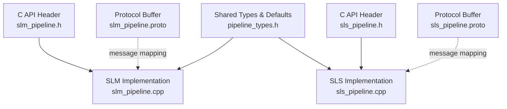
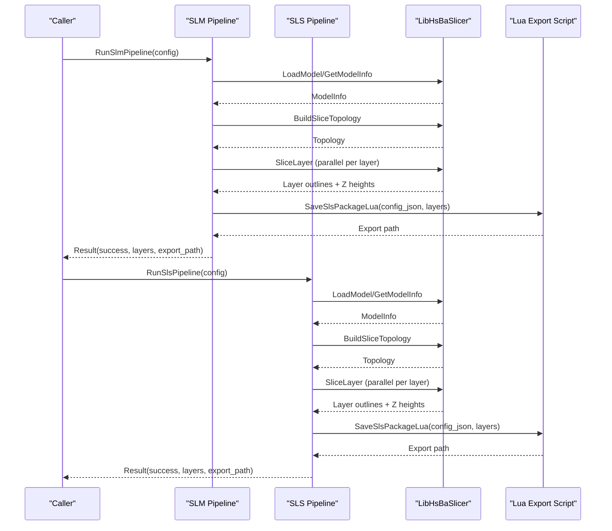
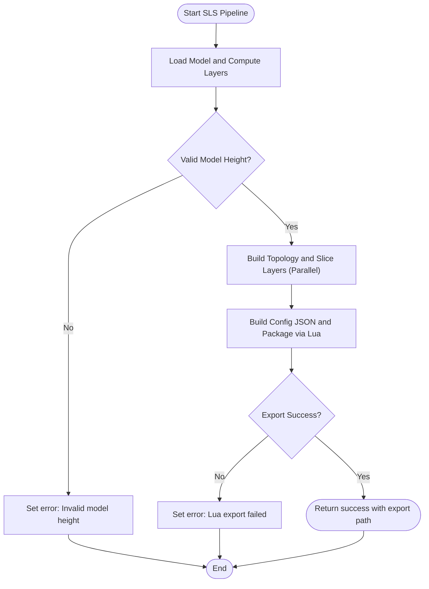
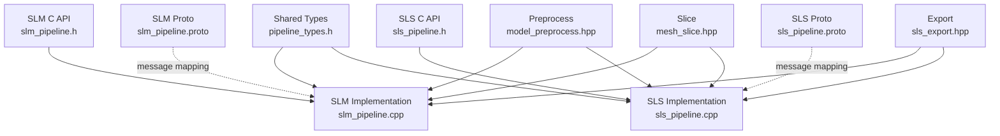

# Metal Processing Pipelines / 金属加工流水线

<cite>
**Referenced Files in This Document**   
- [slm_pipeline.h](file://DllHsBaSlicer/slm_pipeline.h)
- [slm_pipeline.cpp](file://DllHsBaSlicer/slm_pipeline.cpp)
- [sls_pipeline.h](file://DllHsBaSlicer/sls_pipeline.h)
- [sls_pipeline.cpp](file://DllHsBaSlicer/sls_pipeline.cpp)
- [pipeline_types.h](file://pipelinetypes/pipeline_types.h)
- [slm_pipeline.proto](file://proto/slm_pipeline.proto)
- [sls_pipeline.proto](file://proto/sls_pipeline.proto)
</cite>

## Table of Contents
1. [Introduction](#introduction)
2. [Project Structure](#project-structure)
3. [Core Components](#core-components)
4. [Architecture Overview](#architecture-overview)
5. [Detailed Component Analysis](#detailed-component-analysis)
6. [Dependency Analysis](#dependency-analysis)
7. [Performance Considerations](#performance-considerations)
8. [Troubleshooting Guide](#troubleshooting-guide)
9. [Conclusion](#conclusion)
10. [Appendices](#appendices)

## Introduction
This document explains the metal processing pipelines for Selective Laser Melting (SLM) and Selective Laser Sintering (SLS) in HsBaSlicer. Both are powder-bed fusion workflows that share a common pipeline shape: preprocess, slice, and export through a Lua script. The main differences are material semantics and energy-source metadata: SLM adds metal-specific material, light source, and shielding gas parameters; SLS focuses on generic sintering parameters.

The documentation covers:
- Powder bed fusion workflow structure
- Energy source configuration fields such as laser power, scan speed, hatch spacing, hatch rotation, and bed temperature
- Thermal management via bed temperature and process metadata
- Part orientation considerations at the slicing stage
- Differences between melting (SLM) and sintering (SLS), including use cases and optimization strategies
- Safety, quality control, and industry-relevant considerations for metal additive manufacturing

## Project Structure
The metal processing pipelines are exposed through C ABI headers and implemented in dedicated pipeline modules. Configuration types and defaults live in a shared type header, while protocol buffers define cross-language message structures.

**Diagram sources**
- [slm_pipeline.h:1-63](file://DllHsBaSlicer/slm_pipeline.h#L1-L63)
- [slm_pipeline.cpp:1-397](file://DllHsBaSlicer/slm_pipeline.cpp#L1-L397)
- [sls_pipeline.h:1-63](file://DllHsBaSlicer/sls_pipeline.h#L1-L63)
- [sls_pipeline.cpp:1-345](file://DllHsBaSlicer/sls_pipeline.cpp#L1-L345)
- [pipeline_types.h:247-401](file://pipelinetypes/pipeline_types.h#L247-L401)
- [slm_pipeline.proto:1-65](file://proto/slm_pipeline.proto#L1-L65)
- [sls_pipeline.proto:1-33](file://proto/sls_pipeline.proto#L1-L33)

**Section sources**
- [slm_pipeline.h:1-63](file://DllHsBaSlicer/slm_pipeline.h#L1-L63)
- [sls_pipeline.h:1-63](file://DllHsBaSlicer/sls_pipeline.h#L1-L63)
- [pipeline_types.h:247-401](file://pipelinetypes/pipeline_types.h#L247-L401)
- [slm_pipeline.proto:1-65](file://proto/slm_pipeline.proto#L1-L65)
- [sls_pipeline.proto:1-33](file://proto/sls_pipeline.proto#L1-L33)

## Core Components
The core components for metal processing pipelines are:
- C ABI entry points for creating default configurations and running synchronous or asynchronous pipelines
- Shared configuration structures for SLS and SLM
- Internal implementation structs that wrap model loading, slicing, and Lua-based export
- Protocol buffer messages for serialization across language boundaries

Key responsibilities:
- SLM: metal powder-bed melting with material, light source, and shielding gas metadata
- SLS: generic powder-bed sintering without metal-specific metadata
- Both: layer generation, parallel slicing, and Lua-driven packaging/export

**Section sources**
- [slm_pipeline.h:17-56](file://DllHsBaSlicer/slm_pipeline.h#L17-L56)
- [sls_pipeline.h:17-56](file://DllHsBaSlicer/sls_pipeline.h#L17-L56)
- [pipeline_types.h:247-401](file://pipelinetypes/pipeline_types.h#L247-L401)

## Architecture Overview
Both SLM and SLS follow the same three-stage architecture:
1. Preprocess: load model and compute bounding box to determine total layers
2. Slice: build topology once and slice each layer independently in parallel
3. Export: package layer outlines and configuration JSON into an output file using a Lua export script

**Diagram sources**
- [slm_pipeline.cpp:236-348](file://DllHsBaSlicer/slm_pipeline.cpp#L236-L348)
- [sls_pipeline.cpp:182-296](file://DllHsBaSlicer/sls_pipeline.cpp#L182-L296)

## Detailed Component Analysis

### SLM Pipeline Configuration and Workflow
The SLM pipeline is designed for metal powder-bed melting. It mirrors the SLS flow but includes metal-specific parameters passed to the Lua export script via a configuration JSON.

Configuration fields:
- Model name and path
- Layer height and first layer height
- Laser power (W)
- Scan speed (mm/s)
- Hatch spacing (mm)
- Hatch rotation (degrees)
- Bed temperature (°C)
- Material (iron, aluminum, titanium, unknown)
- Light source (laser, electron beam, unknown)
- Shielding gas (argon, helium, nitrogen, CO2, unknown)
- Export Lua script and function
- Output path

Defaults:
- Layer height: 0.06 mm
- First layer height: 0.08 mm
- Laser power: 200 W
- Scan speed: 1000 mm/s
- Hatch spacing: 0.1 mm
- Hatch rotation: 67 degrees
- Bed temperature: 100 °C
- Material: titanium
- Light source: laser
- Shielding gas: argon

Workflow highlights:
- Validates model loading and computes total layers from bounding box
- Builds slicing topology once and slices layers in parallel
- Constructs a JSON configuration containing process, slice, laser, bed temperature, material, light source, and protect gas
- Packages layer outlines and configuration JSON through a Lua export script

**Diagram sources**
- [slm_pipeline.cpp:96-118](file://DllHsBaSlicer/slm_pipeline.cpp#L96-L118)
- [slm_pipeline.cpp:173-196](file://DllHsBaSlicer/slm_pipeline.cpp#L173-L196)
- [slm_pipeline.cpp:236-348](file://DllHsBaSlicer/slm_pipeline.cpp#L236-L348)

**Section sources**
- [pipeline_types.h:312-401](file://pipelinetypes/pipeline_types.h#L312-L401)
- [pipeline_types.h:849-872](file://pipelinetypes/pipeline_types.h#L849-L872)
- [slm_pipeline.cpp:39-58](file://DllHsBaSlicer/slm_pipeline.cpp#L39-L58)
- [slm_pipeline.cpp:173-196](file://DllHsBaSlicer/slm_pipeline.cpp#L173-L196)
- [slm_pipeline.cpp:236-348](file://DllHsBaSlicer/slm_pipeline.cpp#L236-L348)
- [slm_pipeline.proto:9-55](file://proto/slm_pipeline.proto#L9-L55)

### SLS Pipeline Configuration and Workflow
The SLS pipeline is designed for generic powder-bed sintering. It does not include metal-specific metadata; instead, it focuses on laser and thermal settings appropriate for polymer or ceramic sintering.

Configuration fields:
- Model name and path
- Layer height and first layer height
- Laser power (W)
- Scan speed (mm/s)
- Hatch spacing (mm)
- Hatch rotation (degrees)
- Bed temperature (°C)
- Export Lua script and function
- Output path

Defaults:
- Layer height: 0.1 mm
- First layer height: 0.15 mm
- Laser power: 30 W
- Scan speed: 2000 mm/s
- Hatch spacing: 0.15 mm
- Hatch rotation: 90 degrees
- Bed temperature: 180 °C

Workflow highlights:
- Validates model loading and computes total layers from bounding box
- Builds slicing topology once and slices layers in parallel
- Constructs a JSON configuration containing process, slice, laser, and bed temperature
- Packages layer outlines and configuration JSON through a Lua export script

**Diagram sources**
- [sls_pipeline.cpp:93-115](file://DllHsBaSlicer/sls_pipeline.cpp#L93-L115)
- [sls_pipeline.cpp:125-145](file://DllHsBaSlicer/sls_pipeline.cpp#L125-L145)
- [sls_pipeline.cpp:182-296](file://DllHsBaSlicer/sls_pipeline.cpp#L182-L296)

**Section sources**
- [pipeline_types.h:247-311](file://pipelinetypes/pipeline_types.h#L247-L311)
- [pipeline_types.h:827-847](file://pipelinetypes/pipeline_types.h#L827-L847)
- [sls_pipeline.cpp:39-55](file://DllHsBaSlicer/sls_pipeline.cpp#L39-L55)
- [sls_pipeline.cpp:125-145](file://DllHsBaSlicer/sls_pipeline.cpp#L125-L145)
- [sls_pipeline.cpp:182-296](file://DllHsBaSlicer/sls_pipeline.cpp#L182-L296)
- [sls_pipeline.proto:5-23](file://proto/sls_pipeline.proto#L5-L23)

### Differences Between SLM and SLS
- Process semantics:
  - SLM: full melting of metal powder; requires metal material, energy source, and shielding gas metadata
  - SLS: sintering of non-metal powders; no metal-specific metadata
- Typical use cases:
  - SLM: high-strength metal parts, aerospace, medical implants, tooling
  - SLS: functional prototypes, end-use plastic parts, lattice structures
- Optimization strategies:
  - SLM: tune laser power and scan speed for melt pool stability; adjust hatch spacing for density; manage bed temperature to reduce residual stress; select appropriate shielding gas for metallurgical quality
  - SLS: optimize hatch rotation to avoid directional weaknesses; balance bed temperature for uniform sintering; adjust scan speed to control heat input

**Section sources**
- [pipeline_types.h:247-401](file://pipelinetypes/pipeline_types.h#L247-L401)
- [slm_pipeline.cpp:173-196](file://DllHsBaSlicer/slm_pipeline.cpp#L173-L196)
- [sls_pipeline.cpp:125-145](file://DllHsBaSlicer/sls_pipeline.cpp#L125-L145)

### Powder Bed Simulation, Thermal Modeling, and Orientation
- Powder bed simulation:
  - The current pipeline generates layer outlines and passes them to a Lua export script. Dedicated powder-layer simulation is not implemented here; it can be integrated by customizing the Lua export stage to consume additional thermal or density data.
- Thermal modeling:
  - Bed temperature is included in the configuration JSON for both SLM and SLS. For advanced thermal modeling, extend the Lua export to incorporate heat transfer calculations based on laser power, scan speed, hatch spacing, and material properties.
- Part orientation optimization:
  - Orientation affects layer count, overhangs, and thermal gradients. While orientation logic is not present in these files, you can integrate orientation evaluation before calling the pipeline by adjusting model placement and layer height to minimize support needs and thermal distortion.

[No sources needed since this section provides conceptual guidance]

### Examples of Metal-Specific Configurations and Thermal Management
- SLM example configuration elements:
  - Material: titanium
  - Light source: laser
  - Shielding gas: argon
  - Laser power: 200 W
  - Scan speed: 1000 mm/s
  - Hatch spacing: 0.1 mm
  - Hatch rotation: 67 degrees
  - Bed temperature: 100 °C
- SLS example configuration elements:
  - Laser power: 30 W
  - Scan speed: 2000 mm/s
  - Hatch spacing: 0.15 mm
  - Hatch rotation: 90 degrees
  - Bed temperature: 180 °C

These values correspond to the default initializers and internal configuration builders.

**Section sources**
- [pipeline_types.h:827-872](file://pipelinetypes/pipeline_types.h#L827-L872)
- [slm_pipeline.cpp:39-58](file://DllHsBaSlicer/slm_pipeline.cpp#L39-L58)
- [sls_pipeline.cpp:39-55](file://DllHsBaSlicer/sls_pipeline.cpp#L39-L55)

### Post-Processing Considerations
- Heat treatment and stress relief:
  - Use bed temperature and cooling rates to manage residual stresses; consider post-build annealing for metals
- Surface finishing:
  - Depowdering, shot peening, machining, and polishing may be required depending on application
- Quality verification:
  - Density testing, microstructure analysis, mechanical testing, and dimensional inspection are standard for metal AM parts

[No sources needed since this section provides general guidance]

### Safety Considerations, Quality Control, and Industry Requirements
- Safety:
  - Handle fine metal powders with proper ventilation and explosion protection
  - Manage inert gases (argon, helium) to prevent oxygen ingress and asphyxiation risks
- Quality control:
  - Monitor porosity, crack formation, and surface roughness
  - Implement in-process monitoring (e.g., melt pool imaging) and post-process NDT
- Industry requirements:
  - Aerospace and medical sectors often require traceability, certification, and strict process validation
  - Follow standards such as ISO/ASTM for additive manufacturing processes and materials

[No sources needed since this section provides general guidance]

## Dependency Analysis
The SLM and SLS pipelines depend on shared libraries for model preprocessing, slicing, and Lua-based export. They also expose C APIs for integration with host applications.

**Diagram sources**
- [slm_pipeline.h:1-63](file://DllHsBaSlicer/slm_pipeline.h#L1-L63)
- [slm_pipeline.cpp:1-397](file://DllHsBaSlicer/slm_pipeline.cpp#L1-L397)
- [sls_pipeline.h:1-63](file://DllHsBaSlicer/sls_pipeline.h#L1-L63)
- [sls_pipeline.cpp:1-345](file://DllHsBaSlicer/sls_pipeline.cpp#L1-L345)
- [pipeline_types.h:247-401](file://pipelinetypes/pipeline_types.h#L247-L401)
- [slm_pipeline.proto:1-65](file://proto/slm_pipeline.proto#L1-L65)
- [sls_pipeline.proto:1-33](file://proto/sls_pipeline.proto#L1-L33)

**Section sources**
- [slm_pipeline.cpp:17-23](file://DllHsBaSlicer/slm_pipeline.cpp#L17-L23)
- [sls_pipeline.cpp:17-23](file://DllHsBaSlicer/sls_pipeline.cpp#L17-L23)

## Performance Considerations
- Parallel slicing:
  - Both pipelines build the slicing topology once and slice layers in parallel, improving throughput for large models
- Memory management:
  - Results contain allocated strings that must be freed by the caller using the provided free functions
- Export performance:
  - Lua export scripts can become a bottleneck; ensure efficient packaging and minimal I/O overhead

**Section sources**
- [slm_pipeline.cpp:278-294](file://DllHsBaSlicer/slm_pipeline.cpp#L278-L294)
- [sls_pipeline.cpp:226-242](file://DllHsBaSlicer/sls_pipeline.cpp#L226-L242)
- [slm_pipeline.cpp:388-396](file://DllHsBaSlicer/slm_pipeline.cpp#L388-L396)
- [sls_pipeline.cpp:336-344](file://DllHsBaSlicer/sls_pipeline.cpp#L336-L344)

## Troubleshooting Guide
Common issues and resolutions:
- Model loading failure:
  - Ensure model path is valid and accessible
  - Check geometry integrity and bounding box validity
- Invalid model height:
  - Verify layer height and first layer height settings
- Missing Lua export script:
  - Provide a valid export_lua_script path; both SLM and SLS require a Lua export script
- Lua export failure:
  - Inspect the error message returned by the Lua export function; validate script syntax and expected inputs

**Section sources**
- [slm_pipeline.cpp:245-268](file://DllHsBaSlicer/slm_pipeline.cpp#L245-L268)
- [slm_pipeline.cpp:299-334](file://DllHsBaSlicer/slm_pipeline.cpp#L299-L334)
- [sls_pipeline.cpp:193-216](file://DllHsBaSlicer/sls_pipeline.cpp#L193-L216)
- [sls_pipeline.cpp:247-282](file://DllHsBaSlicer/sls_pipeline.cpp#L247-L282)

## Conclusion
The HsBaSlicer metal processing pipelines provide a robust foundation for SLM and SLS workflows. SLM extends the SLS flow with metal-specific metadata, enabling tailored thermal and environmental controls. Both pipelines leverage parallel slicing and Lua-driven export to accommodate diverse downstream requirements. Proper configuration of laser parameters, hatch strategies, and bed temperature is essential for achieving high-quality parts, while safety and quality control measures ensure compliance with industry standards.

[No sources needed since this section summarizes without analyzing specific files]

## Appendices

### API Reference Summary
- SLM:
  - Create default config: HsBaCreateDefaultSlmConfig
  - Run synchronous: HsBaRunSlmPipeline
  - Run asynchronous: HsBaRunSlmPipelineAsync
  - Free result: HsBaFreeSlmPipelineResult
- SLS:
  - Create default config: HsBaCreateDefaultSlsConfig
  - Run synchronous: HsBaRunSlsPipeline
  - Run asynchronous: HsBaRunSlsPipelineAsync
  - Free result: HsBaFreeSlsPipelineResult

**Section sources**
- [slm_pipeline.h:17-56](file://DllHsBaSlicer/slm_pipeline.h#L17-L56)
- [sls_pipeline.h:17-56](file://DllHsBaSlicer/sls_pipeline.h#L17-L56)