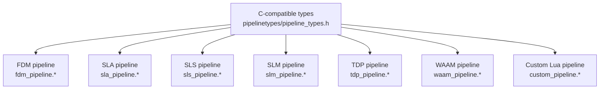
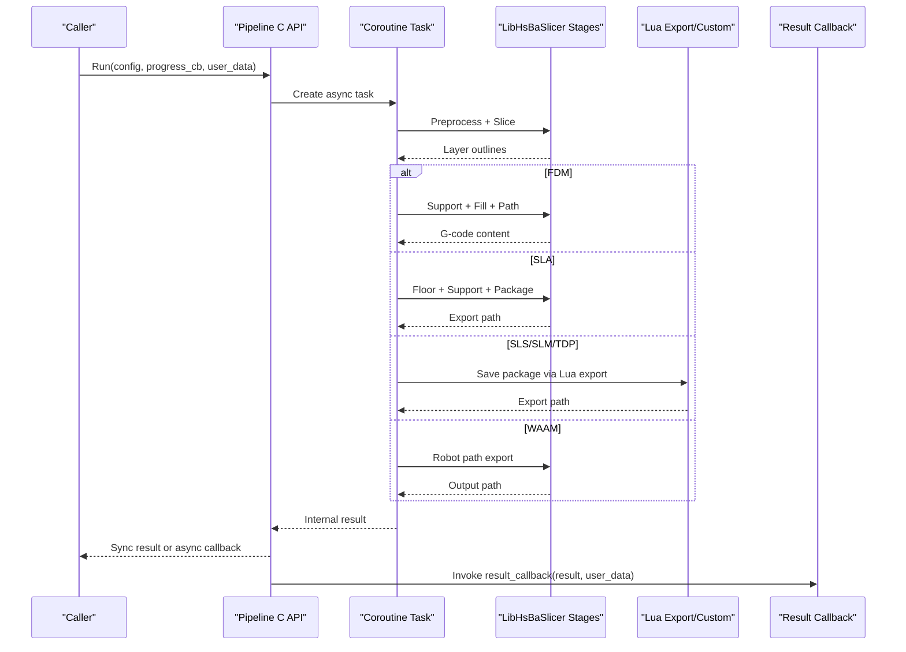
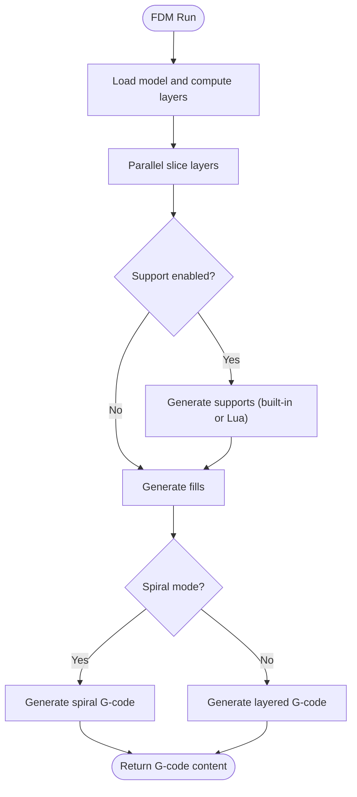
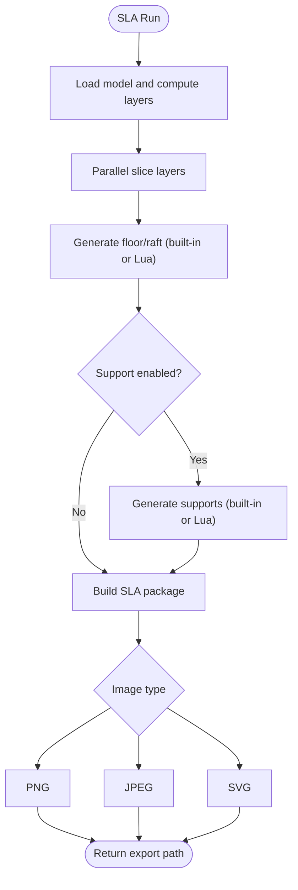
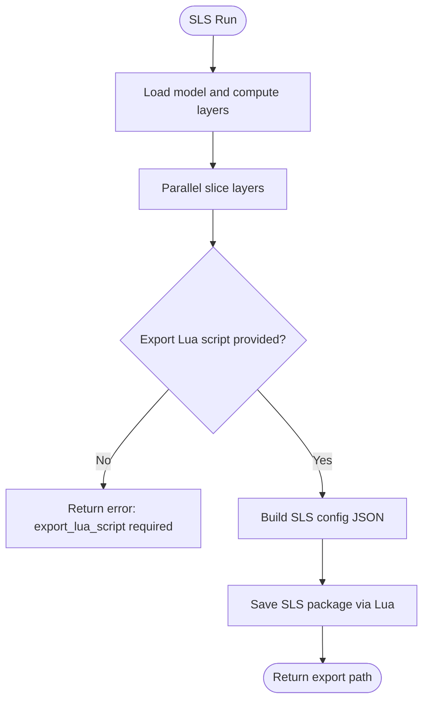
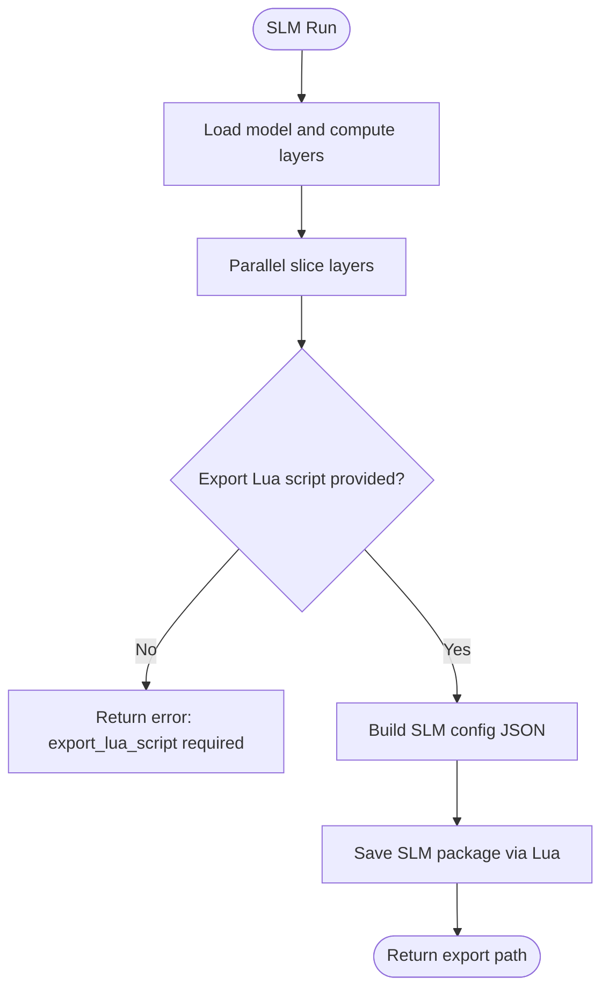
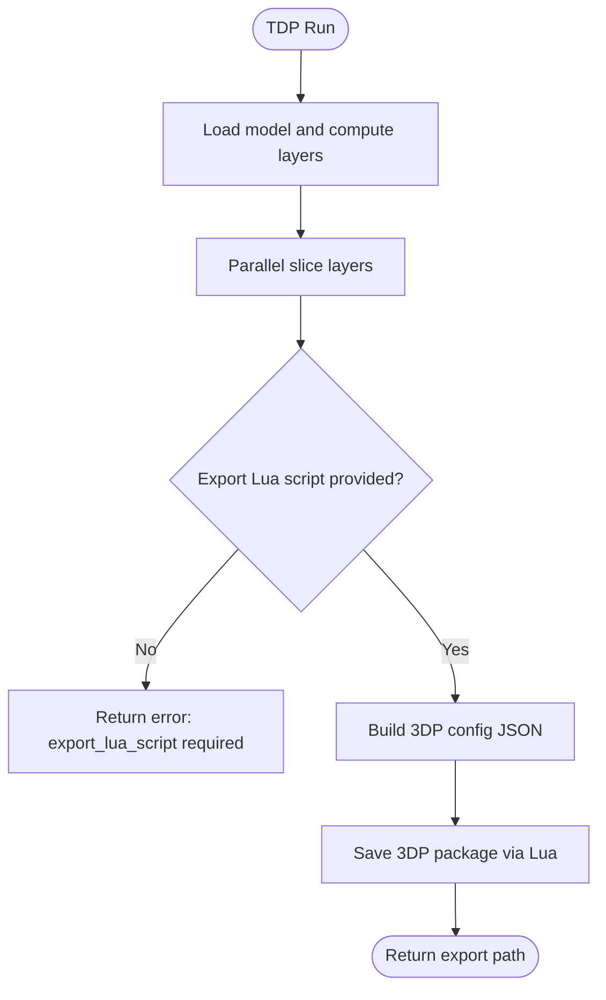
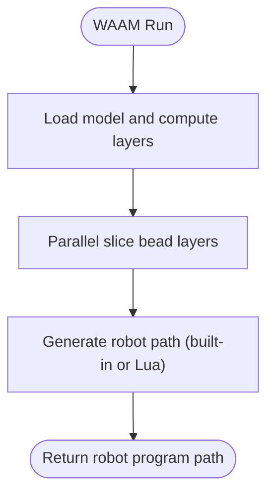
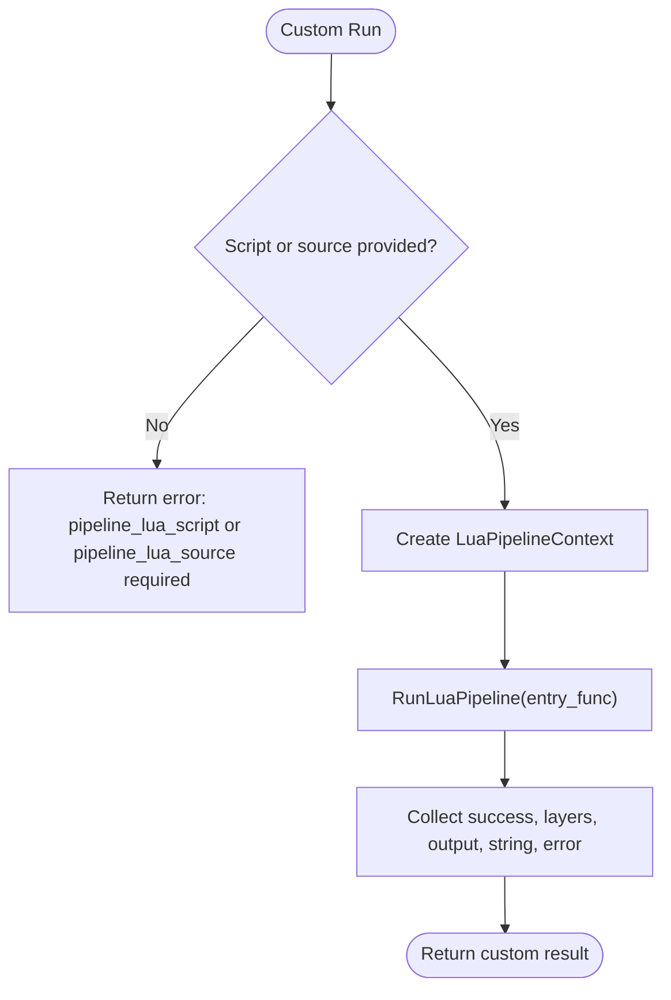

# Pipeline System / 流水线系统

<cite>
**Referenced Files in This Document**   
- [pipeline_types.h](file://pipelinetypes/pipeline_types.h)
- [fdm_pipeline.h](file://DllHsBaSlicer/fdm_pipeline.h)
- [fdm_pipeline.cpp](file://DllHsBaSlicer/fdm_pipeline.cpp)
- [sla_pipeline.h](file://DllHsBaSlicer/sla_pipeline.h)
- [sla_pipeline.cpp](file://DllHsBaSlicer/sla_pipeline.cpp)
- [slm_pipeline.h](file://DllHsBaSlicer/slm_pipeline.h)
- [slm_pipeline.cpp](file://DllHsBaSlicer/slm_pipeline.cpp)
- [sls_pipeline.h](file://DllHsBaSlicer/sls_pipeline.h)
- [sls_pipeline.cpp](file://DllHsBaSlicer/sls_pipeline.cpp)
- [tdp_pipeline.h](file://DllHsBaSlicer/tdp_pipeline.h)
- [tdp_pipeline.cpp](file://DllHsBaSlicer/tdp_pipeline.cpp)
- [waam_pipeline.h](file://DllHsBaSlicer/waam_pipeline.h)
- [waam_pipeline.cpp](file://DllHsBaSlicer/waam_pipeline.cpp)
- [custom_pipeline.h](file://DllHsBaSlicer/custom_pipeline.h)
- [custom_pipeline.cpp](file://DllHsBaSlicer/custom_pipeline.cpp)
</cite>

## Table of Contents
1. [Introduction](#introduction)
2. [Project Structure](#project-structure)
3. [Core Components](#core-components)
4. [Architecture Overview](#architecture-overview)
5. [Detailed Component Analysis](#detailed-component-analysis)
6. [Dependency Analysis](#dependency-analysis)
7. [Performance Considerations](#performance-considerations)
8. [Troubleshooting Guide](#troubleshooting-guide)
9. [Conclusion](#conclusion)
10. [Appendices](#appendices)

## Introduction
This document explains HsBaSlicer’s pipeline system architecture and how to use it for different additive manufacturing processes. The system exposes a consistent C ABI for synchronous and asynchronous execution, progress callbacks, error handling, and result management. It supports:

- FDM (Fused Deposition Modeling): preprocess, slice, support, fill, and G-code path generation.
- SLA (Stereolithography): preprocess, slice, floor/raft generation, support, and layer image export.
- Metal powder-bed fusion: SLS and SLM with Lua-driven export packaging.
- Thermal processing: TDP (3DP binder jetting) and WAAM (wire arc additive manufacturing).
- Custom Lua pipelines: fully scriptable workflows using the same building blocks.

The core configuration and result types are defined in a standalone header so downstream modules can use them without depending on the shared library.

## Project Structure
The pipeline system is organized by process type under `DllHsBaSlicer`, with shared C-compatible types under `pipelinetypes`. Each pipeline has:

- A public header declaring default config creation, synchronous run, asynchronous run, and result freeing.
- An implementation file containing internal configuration/result structs, coroutine-based pipeline execution, progress reporting, and C ABI wrappers.
- A C-compatible configuration struct and result struct defined in `pipelinetypes/pipeline_types.h`.

**Diagram sources**
- [pipeline_types.h:19-732](file://pipelinetypes/pipeline_types.h#L19-L732)
- [fdm_pipeline.h:17-61](file://DllHsBaSlicer/fdm_pipeline.h#L17-L61)
- [sla_pipeline.h:17-56](file://DllHsBaSlicer/sla_pipeline.h#L17-L56)
- [sls_pipeline.h:17-56](file://DllHsBaSlicer/sls_pipeline.h#L17-L56)
- [slm_pipeline.h:17-56](file://DllHsBaSlicer/slm_pipeline.h#L17-L56)
- [tdp_pipeline.h:17-56](file://DllHsBaSlicer/tdp_pipeline.h#L17-L56)
- [waam_pipeline.h:17-57](file://DllHsBaSlicer/waam_pipeline.h#L17-L57)
- [custom_pipeline.h:17-62](file://DllHsBaSlicer/custom_pipeline.h#L17-L62)

**Section sources**
- [pipeline_types.h:19-732](file://pipelinetypes/pipeline_types.h#L19-L732)
- [fdm_pipeline.h:17-61](file://DllHsBaSlicer/fdm_pipeline.h#L17-L61)
- [sla_pipeline.h:17-56](file://DllHsBaSlicer/sla_pipeline.h#L17-L56)
- [sls_pipeline.h:17-56](file://DllHsBaSlicer/sls_pipeline.h#L17-L56)
- [slm_pipeline.h:17-56](file://DllHsBaSlicer/slm_pipeline.h#L17-L56)
- [tdp_pipeline.h:17-56](file://DllHsBaSlicer/tdp_pipeline.h#L17-L56)
- [waam_pipeline.h:17-57](file://DllHsBaSlicer/waam_pipeline.h#L17-L57)
- [custom_pipeline.h:17-62](file://DllHsBaSlicer/custom_pipeline.h#L17-L62)

## Core Components
Each pipeline exposes a uniform API surface:

- Default configuration creator function.
- Synchronous run function returning a typed result.
- Asynchronous run function invoking a result callback.
- Result-freeing function to release allocated strings.

Common elements across all pipelines:

- Progress callback signature with percent, stage description, and user data.
- Result struct fields including success flag, total layers, output content or path, elapsed time, and error message.
- Coroutine-based internal execution that reports progress and handles errors via project runtime exceptions.

Key configuration categories:

- Model input: model name and path.
- Slice parameters: layer height and first layer height.
- Process-specific parameters: fill/support/path for FDM; exposure/lift/floor/support/image for SLA; laser/hatch/bed temperature for SLS/SLM; binder head/curing for TDP; wire/feed/current/voltage/gas/robot for WAAM.
- Lua customization: script paths and function names for support, infill, floor, export, or full custom workflow.
- Output configuration: file path and format options.

**Section sources**
- [pipeline_types.h:130-140](file://pipelinetypes/pipeline_types.h#L130-L140)
- [pipeline_types.h:234-245](file://pipelinetypes/pipeline_types.h#L234-L245)
- [pipeline_types.h:299-310](file://pipelinetypes/pipeline_types.h#L299-L310)
- [pipeline_types.h:390-401](file://pipelinetypes/pipeline_types.h#L390-L401)
- [pipeline_types.h:510-521](file://pipelinetypes/pipeline_types.h#L510-L521)
- [pipeline_types.h:614-625](file://pipelinetypes/pipeline_types.h#L614-L625)
- [pipeline_types.h:676-732](file://pipelinetypes/pipeline_types.h#L676-L732)

## Architecture Overview
All pipelines follow a common execution pattern:

1. Preprocess: load model from name/path and compute bounding box information.
2. Slice: build slicing topology once and generate per-layer outlines in parallel.
3. Process-specific stages:
   - FDM: support generation, infill generation, G-code path generation.
   - SLA: floor/raft generation, support generation, SLA package export.
   - SLS/SLM/TDP: Lua export packaging into zip/database with process-specific JSON.
   - WAAM: robot path export based on deposition contours.
4. Export/output: produce G-code, layer images, robot program, or Lua-generated artifacts.
5. Progress and error handling: report percentage and stage text; wrap geometry/runtime errors into structured results.

**Diagram sources**
- [fdm_pipeline.cpp:219-447](file://DllHsBaSlicer/fdm_pipeline.cpp#L219-L447)
- [sla_pipeline.cpp:298-483](file://DllHsBaSlicer/sla_pipeline.cpp#L298-L483)
- [sls_pipeline.cpp:181-296](file://DllHsBaSlicer/sls_pipeline.cpp#L181-L296)
- [slm_pipeline.cpp:235-348](file://DllHsBaSlicer/slm_pipeline.cpp#L235-L348)
- [tdp_pipeline.cpp:202-316](file://DllHsBaSlicer/tdp_pipeline.cpp#L202-L316)
- [waam_pipeline.cpp:173-284](file://DllHsBaSlicer/waam_pipeline.cpp#L173-L284)

## Detailed Component Analysis

### FDM Pipeline
FDM generates G-code through five stages: preprocess, slice, support, fill, and path generation. Spiral mode skips support and infill and produces a continuous rising outer wall.

Key behaviors:

- Model loading uses the LibHsBaSlicer model manager; invalid models return early with an error message.
- Slicing builds topology once and slices layers in parallel.
- Support generation can be built-in or Lua-driven; spiral mode disables support.
- Infill generation can be built-in or Lua-driven; middle layers adjust spacing based on density.
- Path generation produces either spiral G-code or standard layered G-code.

**Diagram sources**
- [fdm_pipeline.cpp:219-447](file://DllHsBaSlicer/fdm_pipeline.cpp#L219-L447)

Configuration highlights:

- Fill modes include line, simple zigzag, and advanced zigzag.
- Support patterns include plane, tree, and honeycomb.
- G-code firmware targets include Marlin, RepRap, and Klipper.
- Optional Lua scripts allow custom support and infill functions.

Result management:

- Success flag indicates whether G-code was generated.
- Total layers reflects computed layer count.
- G-code content and error message are UTF-8 strings owned by the caller after free.

Usage pattern:

- Call default config creator.
- Set model path, layer heights, fill/support/path parameters.
- Optionally set Lua script paths and function names.
- Run synchronously or asynchronously.
- Free result strings when done.

**Section sources**
- [pipeline_types.h:23-140](file://pipelinetypes/pipeline_types.h#L23-L140)
- [fdm_pipeline.h:17-61](file://DllHsBaSlicer/fdm_pipeline.h#L17-L61)
- [fdm_pipeline.cpp:142-197](file://DllHsBaSlicer/fdm_pipeline.cpp#L142-L197)
- [fdm_pipeline.cpp:219-447](file://DllHsBaSlicer/fdm_pipeline.cpp#L219-L447)

### SLA Pipeline
SLA generates layer images and optional floor/raft and support structures, then exports a package suitable for resin printers.

Key behaviors:

- Model loading and slicing are identical to other pipelines.
- Floor/raft generation can be built-in or Lua-driven.
- Support generation can be built-in or Lua-driven.
- Export creates a zip archive with layer images and metadata; image format can be PNG, JPEG, or SVG.

**Diagram sources**
- [sla_pipeline.cpp:298-483](file://DllHsBaSlicer/sla_pipeline.cpp#L298-L483)

Configuration highlights:

- Exposure settings include bottom and normal exposure times.
- Lift/retract settings control peel and retraction behavior.
- Floor raft offset, border width, fill spacing, angle, border count, and convex hull option.
- Support gap, diameter, density, and pattern.
- Image type, width, and height.

Result management:

- Success flag indicates whether the SLA package was exported.
- Total layers reflects computed layer count.
- Export path points to the generated zip file.

Usage pattern:

- Call default SLA config creator.
- Set model path, layer heights, exposure/lift parameters.
- Configure floor/raft and support options.
- Choose image format and dimensions.
- Optionally provide Lua scripts for floor, support, or export.
- Run synchronously or asynchronously.
- Free result strings when done.

**Section sources**
- [pipeline_types.h:146-245](file://pipelinetypes/pipeline_types.h#L146-L245)
- [sla_pipeline.h:17-56](file://DllHsBaSlicer/sla_pipeline.h#L17-L56)
- [sla_pipeline.cpp:244-282](file://DllHsBaSlicer/sla_pipeline.cpp#L244-L282)
- [sla_pipeline.cpp:298-483](file://DllHsBaSlicer/sla_pipeline.cpp#L298-L483)

### SLS Pipeline
SLS (Selective Laser Sintering) uses a powder bed and does not require floor/raft or support structures. Its output format is entirely determined by a Lua export script.

Key behaviors:

- Model loading and slicing are performed.
- Export requires a Lua script; the pipeline validates this requirement.
- Configuration JSON includes process, slice, laser, and bed temperature parameters.
- Packaging follows the SLS-style Lua export contract.

**Diagram sources**
- [sls_pipeline.cpp:181-296](file://DllHsBaSlicer/sls_pipeline.cpp#L181-L296)

Configuration highlights:

- Laser power, scan speed, hatch spacing, hatch rotation.
- Bed temperature.
- Required Lua export script and optional function name.

Result management:

- Success flag indicates whether the Lua export succeeded.
- Total layers reflects computed layer count.
- Export path points to the generated artifact.

Usage pattern:

- Call default SLS config creator.
- Set model path, layer heights, laser parameters.
- Provide export Lua script path and function name.
- Run synchronously or asynchronously.
- Free result strings when done.

**Section sources**
- [pipeline_types.h:248-310](file://pipelinetypes/pipeline_types.h#L248-L310)
- [sls_pipeline.h:17-56](file://DllHsBaSlicer/sls_pipeline.h#L17-L56)
- [sls_pipeline.cpp:147-165](file://DllHsBaSlicer/sls_pipeline.cpp#L147-L165)
- [sls_pipeline.cpp:181-296](file://DllHsBaSlicer/sls_pipeline.cpp#L181-L296)

### SLM Pipeline
SLM (Selective Laser Melting) mirrors the SLS flow but adds metal-specific parameters such as material, light source, and shielding gas. These are included in the configuration JSON passed to the Lua export script.

Key behaviors:

- Model loading and slicing are performed.
- Export requires a Lua script; the pipeline validates this requirement.
- Configuration JSON includes process, slice, laser, bed temperature, material, light source, and protect gas.
- Packaging follows the SLS-style Lua export contract.

**Diagram sources**
- [slm_pipeline.cpp:235-348](file://DllHsBaSlicer/slm_pipeline.cpp#L235-L348)

Configuration highlights:

- Laser power, scan speed, hatch spacing, hatch rotation.
- Bed temperature.
- Material enum: iron, aluminum, titanium.
- Light source enum: laser, electron-beam.
- Shielding gas enum: argon, helium, nitrogen, CO2.
- Required Lua export script and optional function name.

Result management:

- Success flag indicates whether the Lua export succeeded.
- Total layers reflects computed layer count.
- Export path points to the generated artifact.

Usage pattern:

- Call default SLM config creator.
- Set model path, layer heights, laser parameters.
- Select material, light source, and shielding gas.
- Provide export Lua script path and function name.
- Run synchronously or asynchronously.
- Free result strings when done.

**Section sources**
- [pipeline_types.h:312-401](file://pipelinetypes/pipeline_types.h#L312-L401)
- [slm_pipeline.h:17-56](file://DllHsBaSlicer/slm_pipeline.h#L17-L56)
- [slm_pipeline.cpp:198-219](file://DllHsBaSlicer/slm_pipeline.cpp#L198-L219)
- [slm_pipeline.cpp:235-348](file://DllHsBaSlicer/slm_pipeline.cpp#L235-L348)

### TDP Pipeline
TDP (3DP binder jetting) slices per layer and hands binder-jet outlines and head/curing parameters to a Lua export script.

Key behaviors:

- Model loading and slicing are performed.
- Export requires a Lua script; the pipeline validates this requirement.
- Configuration JSON includes process, slice, binder head count, drop spacing, saturation, curing time, bed temperature, binder mode, and spiral mode.
- Packaging follows the SLS-style Lua export contract.

**Diagram sources**
- [tdp_pipeline.cpp:202-316](file://DllHsBaSlicer/tdp_pipeline.cpp#L202-L316)

Configuration highlights:

- Layer heights, head count, drop spacing, binder saturation, ink curing time, bed temperature.
- Binder mode: full-color, single, sintering.
- Spiral mode for continuous contour deposition.
- Required Lua export script and optional function name.

Result management:

- Success flag indicates whether the Lua export succeeded.
- Total layers reflects computed layer count.
- Export path points to the generated artifact.

Usage pattern:

- Call default TDP config creator.
- Set model path, layer heights, binder parameters.
- Provide export Lua script path and function name.
- Run synchronously or asynchronously.
- Free result strings when done.

**Section sources**
- [pipeline_types.h:463-521](file://pipelinetypes/pipeline_types.h#L463-L521)
- [tdp_pipeline.h:17-56](file://DllHsBaSlicer/tdp_pipeline.h#L17-L56)
- [tdp_pipeline.cpp:166-186](file://DllHsBaSlicer/tdp_pipeline.cpp#L166-L186)
- [tdp_pipeline.cpp:202-316](file://DllHsBaSlicer/tdp_pipeline.cpp#L202-L316)

### WAAM Pipeline
WAAM (Wire Arc Additive Manufacturing) deposits metal bead-by-bead along per-layer contours and outputs a robot language program rather than a layer zip.

Key behaviors:

- Model loading and slicing are performed; open contours are acceptable for wire-feed processes.
- Robot path export uses built-in generators for ABB/KUKA/FANUC or an optional Lua path generator.
- Configuration includes welding parameters, protection method, shielding gas, interpass temperature, and robot controller type.

**Diagram sources**
- [waam_pipeline.cpp:173-284](file://DllHsBaSlicer/waam_pipeline.cpp#L173-L284)

Configuration highlights:

- Layer heights, bead width, travel speed, wire feed speed.
- Arc current, arc voltage, gas flow rate.
- Material: steel, aluminum, titanium, copper.
- Welding process: arc, laser.
- Protection: shield gas, vacuum.
- Shielding gas: argon, helium, nitrogen, CO2.
- Interpass temperature.
- Robot type: ABB, KUKA, FANUC, or custom Lua path generator.
- Spiral mode for continuous Z-rising bead.

Result management:

- Success flag indicates whether the robot path was generated.
- Total layers reflects computed layer count.
- Output path points to the generated robot program.

Usage pattern:

- Call default WAAM config creator.
- Set model path, layer heights, deposition parameters.
- Select material, welding process, protection, shielding gas, and robot type.
- Optionally provide Lua path generator script and function name.
- Run synchronously or asynchronously.
- Free result strings when done.

**Section sources**
- [pipeline_types.h:523-625](file://pipelinetypes/pipeline_types.h#L523-L625)
- [waam_pipeline.h:17-57](file://DllHsBaSlicer/waam_pipeline.h#L17-L57)
- [waam_pipeline.cpp:131-157](file://DllHsBaSlicer/waam_pipeline.cpp#L131-L157)
- [waam_pipeline.cpp:173-284](file://DllHsBaSlicer/waam_pipeline.cpp#L173-L284)

### Custom Lua Pipeline
The custom pipeline allows complete workflow customization through a Lua entry function. The C++ side provides model loading, slicing, support, fill, floor, G-code path output, and SLA/SLS packaging through the global `HsBa` table exposed to Lua.

Key behaviors:

- Requires either a Lua script file or inline Lua source.
- Entry function defaults to `run_pipeline`; configurable via `entry_func`.
- Passes `config_json`, `model_name`, `model_path`, and `output_path` into the Lua environment.
- Progress callbacks are driven by Lua calling `HsBa.progress()`.

**Diagram sources**
- [custom_pipeline.cpp:117-163](file://DllHsBaSlicer/custom_pipeline.cpp#L117-L163)

Configuration highlights:

- `pipeline_lua_script`: path to the pipeline Lua script.
- `pipeline_lua_source`: inline Lua source executed before the script file.
- `entry_func`: Lua entry function name.
- `config_json`: free-form JSON string passed to Lua as `pipeline_config`.
- `model_name`, `model_path`, `output_path`: optional model and output hints.

Result management:

- Success flag indicates whether the Lua pipeline completed successfully.
- Total layers reported by the Lua script.
- Output path and result string returned by the Lua script.
- Error message if the pipeline failed.

Usage pattern:

- Call default custom config creator.
- Provide Lua script path or inline source.
- Optionally set entry function, config JSON, model info, and output path.
- Run synchronously or asynchronously.
- Free result strings when done.

**Section sources**
- [pipeline_types.h:676-732](file://pipelinetypes/pipeline_types.h#L676-L732)
- [custom_pipeline.h:17-62](file://DllHsBaSlicer/custom_pipeline.h#L17-L62)
- [custom_pipeline.cpp:86-99](file://DllHsBaSlicer/custom_pipeline.cpp#L86-L99)
- [custom_pipeline.cpp:117-163](file://DllHsBaSlicer/custom_pipeline.cpp#L117-L163)

## Dependency Analysis
The pipeline implementations depend on:

- LibHsBaSlicer preprocessing, slicing, support, fill, floor, path generation, and export utilities.
- Coroutine utilities for async execution.
- Error utilities for translating geometry/runtime exceptions into structured error messages.
- Parallel helpers for layer-wise computation.

```mermaid
graph TB
FDMImpl["fdm_pipeline.cpp"] --> Preprocess["Model preprocess"]
FDMImpl --> Slice["Mesh slice"]
FDMImpl --> Support["FDM support"]
FDMImpl --> Fill["Polygon fill"]
FDMImpl --> Path["G-code path generator"]
SLAImpl["sla_pipeline.cpp"] --> Preprocess
SLAImpl --> Slice
SLAImpl --> Floor["SLA floor"]
SLAImpl --> Support
SLAImpl --> SLAPackage["SLA package export"]
SLSImpl["sls_pipeline.cpp"] --> Preprocess
SLSImpl --> Slice
SLSImpl --> SLSPackage["SLS package export"]
SLMImpl["slm_pipeline.cpp"] --> Preprocess
SLMImpl --> Slice
SLMImpl --> SLSPackage
TDPImpl["tdp_pipeline.cpp"] --> Preprocess
TDPImpl --> Slice
TDPImpl --> SLSPackage
WAAMImpl["waam_pipeline.cpp"] --> Slice
WAAMImpl --> WAAMPath["WAAM robot path export"]
CustomImpl["custom_pipeline.cpp"] --> LuaPipeline["Lua pipeline context"]
```

**Diagram sources**
- [fdm_pipeline.cpp:17-26](file://DllHsBaSlicer/fdm_pipeline.cpp#L17-L26)
- [sla_pipeline.cpp:19-26](file://DllHsBaSlicer/sla_pipeline.cpp#L19-L26)
- [sls_pipeline.cpp:17-23](file://DllHsBaSlicer/sls_pipeline.cpp#L17-L23)
- [slm_pipeline.cpp:17-23](file://DllHsBaSlicer/slm_pipeline.cpp#L17-L23)
- [tdp_pipeline.cpp:17-23](file://DllHsBaSlicer/tdp_pipeline.cpp#L17-L23)
- [waam_pipeline.cpp:16-21](file://DllHsBaSlicer/waam_pipeline.cpp#L16-L21)
- [custom_pipeline.cpp:14-16](file://DllHsBaSlicer/custom_pipeline.cpp#L14-L16)

**Section sources**
- [fdm_pipeline.cpp:17-26](file://DllHsBaSlicer/fdm_pipeline.cpp#L17-L26)
- [sla_pipeline.cpp:19-26](file://DllHsBaSlicer/sla_pipeline.cpp#L19-L26)
- [sls_pipeline.cpp:17-23](file://DllHsBaSlicer/sls_pipeline.cpp#L17-L23)
- [slm_pipeline.cpp:17-23](file://DllHsBaSlicer/slm_pipeline.cpp#L17-L23)
- [tdp_pipeline.cpp:17-23](file://DllHsBaSlicer/tdp_pipeline.cpp#L17-L23)
- [waam_pipeline.cpp:16-21](file://DllHsBaSlicer/waam_pipeline.cpp#L16-L21)
- [custom_pipeline.cpp:14-16](file://DllHsBaSlicer/custom_pipeline.cpp#L14-L16)

## Performance Considerations
- Parallel slicing: All pipelines build slicing topology once and slice layers in parallel, improving throughput for high-layer-count models.
- Serial Lua stages: When Lua is used for support or infill, the implementation keeps those stages serial to avoid interpreter state conflicts.
- Spiral mode optimization: FDM and WAAM spiral modes skip unnecessary per-layer operations and reduce path complexity.
- Memory ownership: Results allocate C strings that must be freed by the caller; misuse leads to leaks or double-free.
- Progress callbacks: Frequent progress updates should avoid heavy work in the callback to prevent UI or logging bottlenecks.

[No sources needed since this section provides general guidance]

## Troubleshooting Guide
Common issues and resolutions:

- Model loading failure: Ensure `model_path` is valid and accessible. The pipeline returns an error message indicating the failed path.
- Invalid model height: If the model bounding box yields zero or negative height, the pipeline returns an error and sets total layers to zero.
- Missing Lua export script: SLS, SLM, and TDP require `export_lua_script`; absence causes immediate failure with a descriptive error.
- Lua script read failure: For SLA support Lua scripts, reading failures are captured and returned as error messages.
- Export failure: SLA package export, SLS/SLM/TDP Lua packaging, and WAAM robot path export may fail due to invalid configuration or Lua errors; check `error_message`.
- Result memory leak: Always call the corresponding `HsBaFree*PipelineResult` function after using the result.

Error handling pattern:

- Exceptions from geometry libraries are caught and wrapped into structured error messages.
- Early returns preserve elapsed time and set success to false.
- Progress callbacks continue to reflect partial completion where applicable.

**Section sources**
- [fdm_pipeline.cpp:229-257](file://DllHsBaSlicer/fdm_pipeline.cpp#L229-L257)
- [fdm_pipeline.cpp:437-446](file://DllHsBaSlicer/fdm_pipeline.cpp#L437-L446)
- [sla_pipeline.cpp:310-336](file://DllHsBaSlicer/sla_pipeline.cpp#L310-L336)
- [sla_pipeline.cpp:400-415](file://DllHsBaSlicer/sla_pipeline.cpp#L400-L415)
- [sla_pipeline.cpp:473-482](file://DllHsBaSlicer/sla_pipeline.cpp#L473-L482)
- [sls_pipeline.cpp:244-252](file://DllHsBaSlicer/sls_pipeline.cpp#L244-L252)
- [slm_pipeline.cpp:299-304](file://DllHsBaSlicer/slm_pipeline.cpp#L299-L304)
- [tdp_pipeline.cpp:266-271](file://DllHsBaSlicer/tdp_pipeline.cpp#L266-L271)
- [custom_pipeline.cpp:127-133](file://DllHsBaSlicer/custom_pipeline.cpp#L127-L133)

## Conclusion
HsBaSlicer’s pipeline system provides a consistent, extensible framework for multiple additive manufacturing processes. The C ABI offers synchronous and asynchronous execution, progress callbacks, and robust error handling. Built-in algorithms cover FDM, SLA, SLS, SLM, TDP, and WAAM, while Lua scripting enables deep customization for support, infill, floor, export, and fully custom workflows. Users should configure process-specific parameters carefully, handle Lua requirements where applicable, and always free result memory.

[No sources needed since this section summarizes without analyzing specific files]

## Appendices

### Configuration Defaults Summary
Default values are provided by inline initializers in the types header. Key defaults include:

- FDM: layer height 0.2 mm, first layer height 0.25 mm, fill spacing 0.4 mm, fill mode zigzag, wall count 3, top/bottom layer count 3, infill density 0.2, support enabled, overhang angle 45 degrees, support gap 0.5 mm, support diameter 2.0 mm, support density 0.3, support pattern plane, interface layers 2, interface density 0.5, line width 0.4 mm, print speed 50 mm/s, travel speed 100 mm/s, extrusion multiplier 1.0, spiral mode off, firmware Marlin, nozzle diameter 0.4 mm, filament diameter 1.75 mm, nozzle temp 200°C, bed temp 60°C, retract length 1.0 mm, retract speed 40 mm/s, first layer speed 20 mm/s.
- SLA: layer height 0.05 mm, first layer height 0.1 mm, bottom exposure 60 s, normal exposure 2.5 s, bottom lift distance 5.0 mm, lift distance 3.0 mm, lift speed 60 mm/s, retract speed 150 mm/s, raft offset 2.0 mm, border width 1.0 mm, fill spacing 0.5 mm, fill angle 0 degrees, border count 2, convex hull off, support enabled, overhang angle 45 degrees, support gap 0.5 mm, support diameter 2.0 mm, support density 0.3, support pattern sacrificial, image type PNG, image width/height auto.
- SLS: layer height 0.1 mm, first layer height 0.15 mm, laser power 30 W, scan speed 2000 mm/s, hatch spacing 0.15 mm, hatch rotation 90 degrees, bed temperature 180°C.
- SLM: layer height 0.06 mm, first layer height 0.08 mm, laser power 200 W, scan speed 1000 mm/s, hatch spacing 0.1 mm, hatch rotation 67 degrees, bed temperature 100°C, material titanium, light source laser, protect gas argon.
- TDP: layer height 0.1 mm, first layer height 0.12 mm, head count 128, drop spacing 0.05 mm, binder saturation 0.6, ink curing time 1.0 s, bed temperature 40°C, binder mode single, spiral mode off.
- WAAM: layer height 0.8 mm, first layer height 1.0 mm, bead width 1.2 mm, travel speed 8 mm/s, wire feed speed 5 m/min, arc current 180 A, arc voltage 22 V, gas flow rate 15 L/min, material steel, welding process arc, protection shield gas, protect gas argon, interpass temperature 100°C, robot type ABB, spiral mode off.

**Section sources**
- [pipeline_types.h:742-783](file://pipelinetypes/pipeline_types.h#L742-L783)
- [pipeline_types.h:789-825](file://pipelinetypes/pipeline_types.h#L789-L825)
- [pipeline_types.h:831-847](file://pipelinetypes/pipeline_types.h#L831-L847)
- [pipeline_types.h:853-872](file://pipelinetypes/pipeline_types.h#L853-L872)
- [pipeline_types.h:903-921](file://pipelinetypes/pipeline_types.h#L903-L921)
- [pipeline_types.h:927-951](file://pipelinetypes/pipeline_types.h#L927-L951)