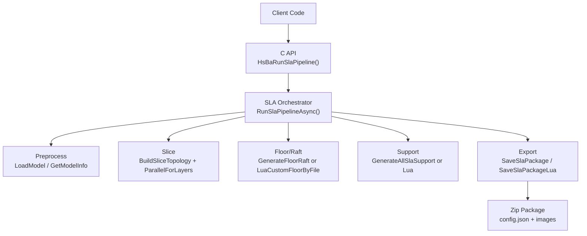
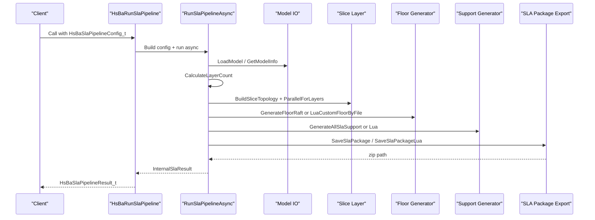
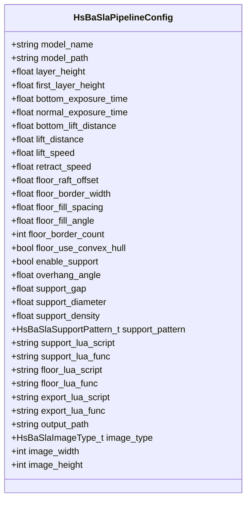
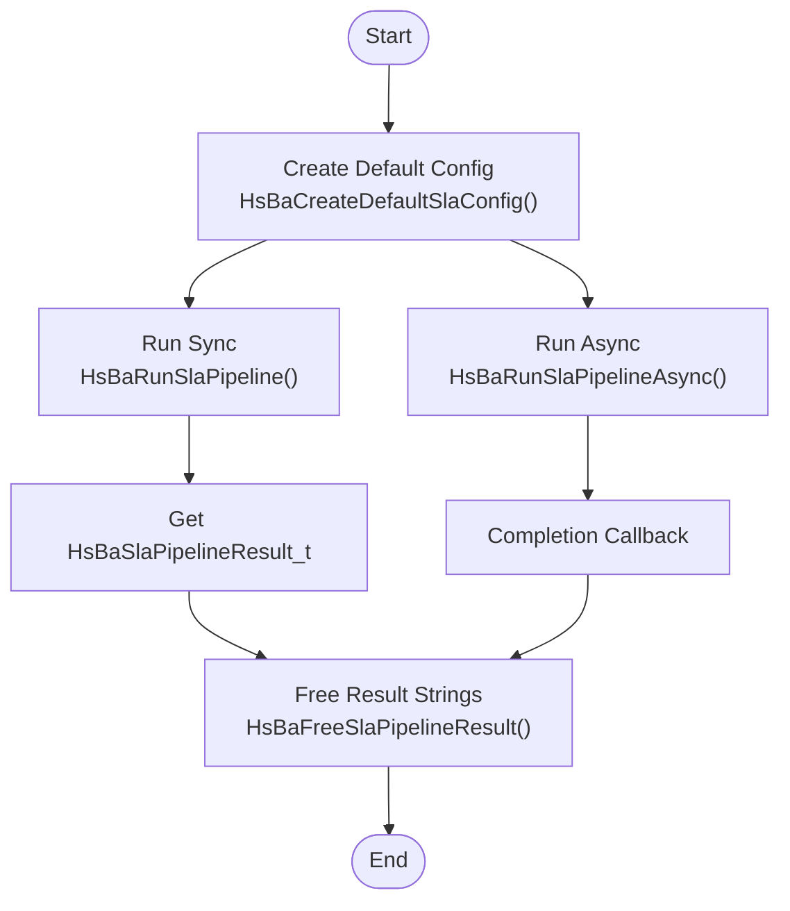
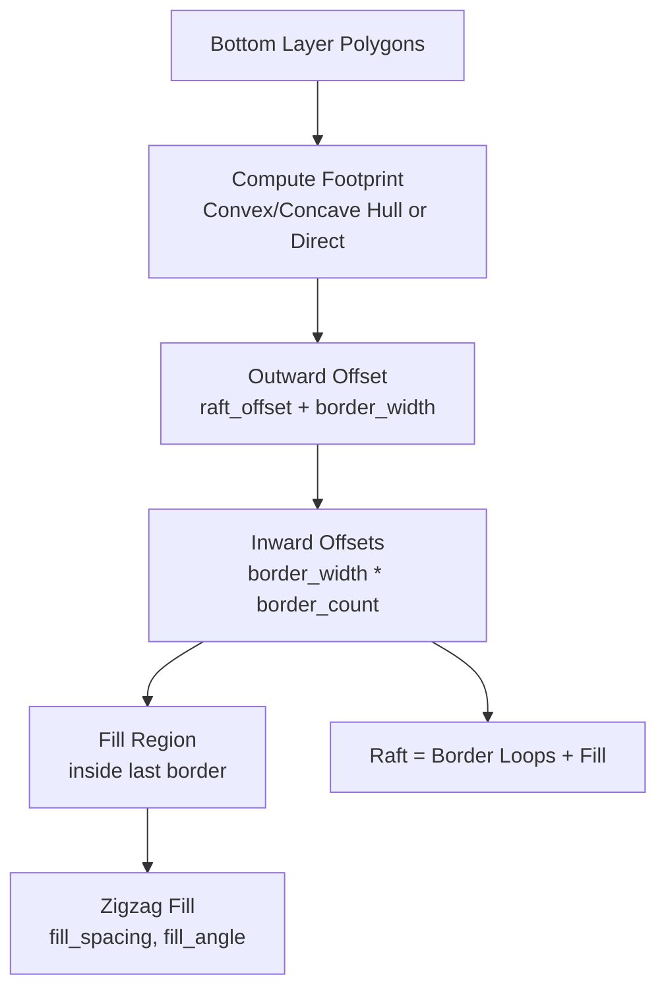
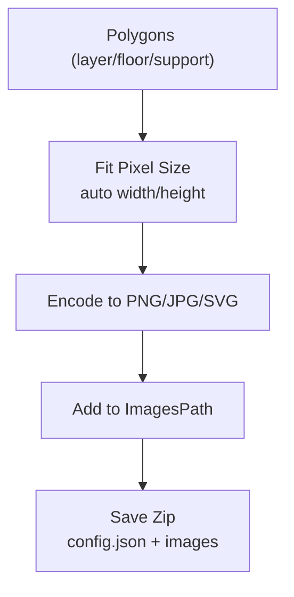
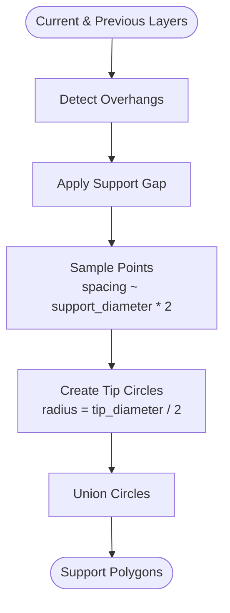
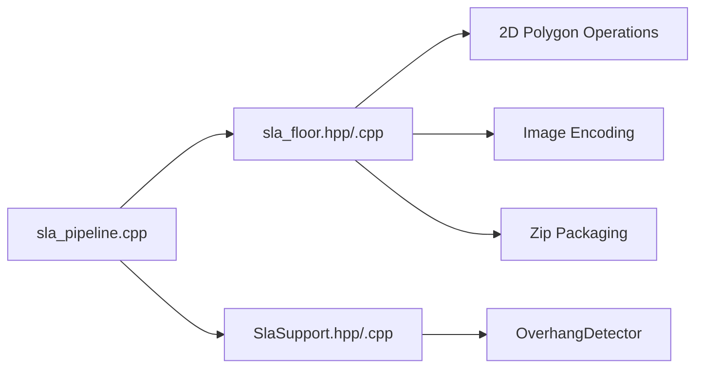

# SLA Pipeline / SLA流水线

<cite>
**Referenced Files in This Document**
- [pipeline_types.h](file://pipelinetypes/pipeline_types.h)
- [sla_pipeline.h](file://DllHsBaSlicer/sla_pipeline.h)
- [sla_pipeline.cpp](file://DllHsBaSlicer/sla_pipeline.cpp)
- [sla_floor.hpp](file://LibHsBaSlicer/Floor/sla_floor.hpp)
- [sla_floor.cpp](file://LibHsBaSlicer/Floor/sla_floor.cpp)
- [SlaSupport.hpp](file://support/SlaSupport.hpp)
- [SlaSupport.cpp](file://support/SlaSupport.cpp)
</cite>

## Table of Contents
1. [Introduction](#introduction)
2. [Project Structure](#project-structure)
3. [Core Components](#core-components)
4. [Architecture Overview](#architecture-overview)
5. [Detailed Component Analysis](#detailed-component-analysis)
6. [Dependency Analysis](#dependency-analysis)
7. [Performance Considerations](#performance-considerations)
8. [Troubleshooting Guide](#troubleshooting-guide)
9. [Conclusion](#conclusion)
10. [Appendices](#appendices)

## Introduction
This document explains the Stereolithography (SLA) pipeline for resin-based 3D printing in HsBaSlicer. It covers the specialized workflow: model preprocessing, layer-by-layer slicing, floor/raft generation for build plate adhesion, sacrificial support structure generation, and export to a layer image package suitable for vat photopolymerization printers. The documentation focuses on the `HsBaSlaPipelineConfig_t` configuration structure, exposure and lift parameters, floor settings, support options, image format selection, and Lua customization points. It also provides execution patterns, result interpretation, optimization techniques, and troubleshooting guidance for resin-related issues.

## Project Structure
The SLA pipeline is implemented across three main layers:
- C ABI and orchestration: `DllHsBaSlicer/sla_pipeline.{h,cpp}`
- Configuration types: `pipelinetypes/pipeline_types.h`
- Floor, image rendering, and package export: `LibHsBaSlicer/Floor/sla_floor.{hpp,cpp}`
- Support generation: `support/SlaSupport.{hpp,cpp}`

**Diagram sources**
- [sla_pipeline.cpp:299-483](file://DllHsBaSlicer/sla_pipeline.cpp#L299-L483)
- [sla_floor.hpp:157-195](file://LibHsBaSlicer/Floor/sla_floor.hpp#L157-L195)

**Section sources**
- [sla_pipeline.h:17-56](file://DllHsBaSlicer/sla_pipeline.h#L17-L56)
- [sla_pipeline.cpp:299-483](file://DllHsBaSlicer/sla_pipeline.cpp#L299-L483)

## Core Components
- SLA configuration type: `HsBaSlaPipelineConfig_t` defines model inputs, slice settings, exposure/lift parameters, floor/raft options, support options, Lua hooks, and output/image settings.
- SLA pipeline API: synchronous and asynchronous entry points, plus a result-freeing function.
- Floor system: generates raft contact area, border loops, internal fill, and supports custom Lua floor scripts.
- Image renderer: converts polygons to PNG/JPG/SVG with automatic pixel sizing and in-memory buffer rendering.
- Package exporter: writes `config.json`, per-layer images, optional floor/support images into a zip archive; supports Lua-customized export.
- Support generator: SLA sacrificial supports based on overhang detection and point sampling.

Key responsibilities:
- Orchestrate stages and progress reporting.
- Compute total layers from model bounding box and layer heights.
- Generate floor/raft geometry for build plate adhesion.
- Detect overhangs and generate thin sacrificial supports.
- Render layer images and package them for resin printers.

**Section sources**
- [pipeline_types.h:146-245](file://pipelinetypes/pipeline_types.h#L146-L245)
- [sla_pipeline.h:17-56](file://DllHsBaSlicer/sla_pipeline.h#L17-L56)
- [sla_floor.hpp:21-116](file://LibHsBaSlicer/Floor/sla_floor.hpp#L21-L116)
- [sla_floor.hpp:122-195](file://LibHsBaSlicer/Floor/sla_floor.hpp#L122-L195)
- [SlaSupport.hpp:13-42](file://support/SlaSupport.hpp#L13-L42)

## Architecture Overview
The SLA pipeline follows a staged flow:
1. Preprocess: load model and compute bounding box/volume.
2. Slice: build topology once, then slice each layer in parallel.
3. Floor/Raft: generate raft from bottom layer using built-in algorithm or Lua script.
4. Support: detect overhangs and generate sacrificial supports per layer, optionally via Lua.
5. Export: render layer/floor/support polygons to images and package into a zip with `config.json`.

**Diagram sources**
- [sla_pipeline.cpp:299-483](file://DllHsBaSlicer/sla_pipeline.cpp#L299-L483)
- [sla_floor.hpp:157-195](file://LibHsBaSlicer/Floor/sla_floor.hpp#L157-L195)

## Detailed Component Analysis

### SLA Configuration Structure: HsBaSlaPipelineConfig_t
This structure centralizes all SLA-specific settings:
- Model inputs: `model_name`, `model_path`
- Slice settings: `layer_height`, `first_layer_height`
- Exposure/lift: `bottom_exposure_time`, `normal_exposure_time`, `bottom_lift_distance`, `lift_distance`, `lift_speed`, `retract_speed`
- Floor/raft: `floor_raft_offset`, `floor_border_width`, `floor_fill_spacing`, `floor_fill_angle`, `floor_border_count`, `floor_use_convex_hull`
- Support: `enable_support`, `overhang_angle`, `support_gap`, `support_diameter`, `support_density`, `support_pattern`
- Lua hooks: `support_lua_script`, `support_lua_func`, `floor_lua_script`, `floor_lua_func`, `export_lua_script`, `export_lua_func`
- Output: `output_path`, `image_type`, `image_width`, `image_height`

Default values are provided by `HsBaSlaConfigDefault()` and include typical SLA defaults such as fine layer height, longer bottom exposure, moderate lift distances, and sacrificial support pattern.

**Diagram sources**
- [pipeline_types.h:146-245](file://pipelinetypes/pipeline_types.h#L146-L245)
- [pipeline_types.h:789-825](file://pipelinetypes/pipeline_types.h#L789-L825)

**Section sources**
- [pipeline_types.h:146-245](file://pipelinetypes/pipeline_types.h#L146-L245)
- [pipeline_types.h:789-825](file://pipelinetypes/pipeline_types.h#L789-L825)

### SLA Pipeline API and Execution Flow
Public API functions:
- `HsBaCreateDefaultSlaConfig()`: returns default configuration.
- `HsBaRunSlaPipeline()`: synchronous execution returning `HsBaSlaPipelineResult_t`.
- `HsBaRunSlaPipelineAsync()`: non-blocking execution with completion callback.
- `HsBaFreeSlaPipelineResult()`: frees allocated strings in result.

Internal orchestrator:
- Builds an internal configuration (`InternalSlaConfig`) from the C struct.
- Runs a coroutine-based pipeline that reports progress at key stages.
- Computes total layers from model bounding box and layer heights.
- Executes preprocess, slice, floor, support, and export stages.

**Diagram sources**
- [sla_pipeline.h:17-56](file://DllHsBaSlicer/sla_pipeline.h#L17-L56)
- [sla_pipeline.cpp:491-531](file://DllHsBaSlicer/sla_pipeline.cpp#L491-L531)

**Section sources**
- [sla_pipeline.h:17-56](file://DllHsBaSlicer/sla_pipeline.h#L17-L56)
- [sla_pipeline.cpp:491-531](file://DllHsBaSlicer/sla_pipeline.cpp#L491-L531)

### Floor and Raft Generation
The floor system computes the build plate contact area and raft geometry:
- Contact footprint: optional convex/concave hull simplification.
- Border loops: outward offset and inward carving to create multiple border rings.
- Internal fill: zigzag fill inside the last border loop.
- Customization: Lua scripts can replace the built-in algorithm.

**Diagram sources**
- [sla_floor.cpp:33-117](file://LibHsBaSlicer/Floor/sla_floor.cpp#L33-L117)

Key APIs:
- `GenerateFloorContact`, `GenerateFloorBorder`, `GenerateFloorFill`, `GenerateFloorRaft`
- `LuaCustomFloorByFile`, `LuaCustomFloorByString`

Configuration fields:
- `raft_offset`, `border_width`, `fill_spacing`, `fill_angle_deg`, `border_count`, `use_convex_hull`, `concave_hull_points`

**Section sources**
- [sla_floor.hpp:21-116](file://LibHsBaSlicer/Floor/sla_floor.hpp#L21-L116)
- [sla_floor.cpp:33-117](file://LibHsBaSlicer/Floor/sla_floor.cpp#L33-L117)

### Layer Image Rendering and Package Export
Rendering:
- Converts polygons to PNG/JPG/SVG with automatic pixel sizing based on bounding box and requested dimensions.
- Supports in-memory buffer rendering to avoid temporary files.

Package export:
- Writes `config.json` containing slice/exposure/lift/floor/support/image metadata and per-layer entries.
- Renders layer outlines, optional floor raft, and optional support polygons to images.
- Packages everything into a zip archive.
- Supports Lua-customized export logic.

**Diagram sources**
- [sla_floor.cpp:320-381](file://LibHsBaSlicer/Floor/sla_floor.cpp#L320-L381)
- [sla_floor.cpp:468-606](file://LibHsBaSlicer/Floor/sla_floor.cpp#L468-L606)

Data structures:
- `SlaPackage`: holds layer outlines, supports, floor polygons, config JSON, image dimensions, extension, and flags for including floor/support images.

**Section sources**
- [sla_floor.hpp:122-195](file://LibHsBaSlicer/Floor/sla_floor.hpp#L122-L195)
- [sla_floor.cpp:320-381](file://LibHsBaSlicer/Floor/sla_floor.cpp#L320-L381)
- [sla_floor.cpp:468-606](file://LibHsBaSlicer/Floor/sla_floor.cpp#L468-L606)

### Sacrificial Support Generation
SLA sacrificial supports are generated from overhang regions:
- Overhang detection uses current and previous layer contours with an angle threshold.
- Gaps are applied to separate supports from the model.
- Points are sampled within the gapped region at spacing derived from support diameter.
- Each point becomes a small circle (tip radius), which are unioned into final support polygons.

**Diagram sources**
- [SlaSupport.cpp:38-124](file://support/SlaSupport.cpp#L38-L124)

Configuration:
- Inherits base support configuration and adds SLA-specific fields like `tip_diameter`.

**Section sources**
- [SlaSupport.hpp:13-42](file://support/SlaSupport.hpp#L13-L42)
- [SlaSupport.cpp:38-124](file://support/SlaSupport.cpp#L38-L124)

### Lua Customization Hooks
The SLA pipeline exposes several Lua integration points:
- Floor generation: `floor_lua_script` and `floor_lua_func` allow replacing built-in raft generation.
- Support generation: `support_lua_script` and `support_lua_func` allow replacing built-in support generation.
- Export: `export_lua_script` and `export_lua_func` allow customizing how the SLA package is assembled.

Execution behavior:
- If Lua paths are provided, the pipeline loads and executes the specified functions with appropriate arguments (polygons, configuration tables).
- Errors in loading or executing Lua scripts are reported through the pipeline error message.

**Section sources**
- [sla_pipeline.cpp:373-419](file://DllHsBaSlicer/sla_pipeline.cpp#L373-L419)
- [sla_pipeline.cpp:450-458](file://DllHsBaSlicer/sla_pipeline.cpp#L450-L458)
- [sla_floor.hpp:80-116](file://LibHsBaSlicer/Floor/sla_floor.hpp#L80-L116)

## Dependency Analysis
The SLA pipeline depends on:
- Model I/O and topology building for slicing.
- 2D polygon operations (offset, difference, union, zigzag fill).
- Overhang detection for support generation.
- Image encoding and zip packaging for export.
- Optional Lua scripting for floor, support, and export customization.

**Diagram sources**
- [sla_pipeline.cpp:19-26](file://DllHsBaSlicer/sla_pipeline.cpp#L19-L26)
- [sla_floor.cpp:16-27](file://LibHsBaSlicer/Floor/sla_floor.cpp#L16-L27)
- [SlaSupport.cpp:7-11](file://support/SlaSupport.cpp#L7-L11)

**Section sources**
- [sla_pipeline.cpp:19-26](file://DllHsBaSlicer/sla_pipeline.cpp#L19-L26)
- [sla_floor.cpp:16-27](file://LibHsBaSlicer/Floor/sla_floor.cpp#L16-L27)
- [SlaSupport.cpp:7-11](file://support/SlaSupport.cpp#L7-L11)

## Performance Considerations
- Parallel slicing: layer slicing is performed in parallel after building topology once.
- Parallel image rendering: layer and support images are rendered concurrently using a thread pool.
- Environment control: `HSBA_PIPELINE_THREADS` controls worker count for export hot path.
- Auto pixel sizing: avoids excessive resolution while maintaining quality.
- In-memory buffers: reduce disk I/O during export.

Recommendations:
- Tune `layer_height` and `first_layer_height` for desired resolution vs. speed.
- Adjust `image_width`/`image_height` to balance file size and printer DPI requirements.
- Use `floor_use_convex_hull` judiciously; it may simplify geometry but can increase raft area.
- For large models, consider enabling support only where needed and adjusting `support_diameter` and `support_density`.

[No sources needed since this section provides general guidance]

## Troubleshooting Guide
Common issues and resolutions:
- Model loading failure: ensure `model_path` is valid and accessible.
- Invalid model height: check `layer_height` and `first_layer_height`; ensure model has positive Z extent.
- Lua script errors: verify script path and function name; inspect error messages returned by the pipeline.
- Export failures: confirm write permissions for `output_path`; check available disk space.
- Poor adhesion: increase `floor_raft_offset`, `floor_border_width`, or `floor_border_count`.
- Excessive support material: reduce `support_diameter`, `support_density`, or adjust `overhang_angle`.
- Resin delamination: tune `bottom_exposure_time` and `bottom_lift_distance`; ensure proper lift/retract speeds.

Error handling:
- The pipeline wraps exceptions into `RuntimeError` and propagates messages through `error_message` in results.
- Progress callbacks provide stage descriptions to help locate failing steps.

**Section sources**
- [sla_pipeline.cpp:310-336](file://DllHsBaSlicer/sla_pipeline.cpp#L310-L336)
- [sla_pipeline.cpp:473-477](file://DllHsBaSlicer/sla_pipeline.cpp#L473-L477)

## Conclusion
The HsBaSlicer SLA pipeline provides a robust, configurable workflow for resin-based 3D printing. It integrates precise slicing, customizable floor/raft generation, overhang-aware sacrificial supports, and efficient image-based export. Users can tailor exposure/lift parameters, raft geometry, support density, and output formats to match their resin materials and printers. Lua hooks offer flexibility for advanced workflows, while parallel processing ensures performance. Proper configuration and troubleshooting yield reliable prints with strong build plate adhesion and minimal support removal effort.

[No sources needed since this section summarizes without analyzing specific files]

## Appendices

### SLA-Specific Configuration Examples
- High-resolution print: set `layer_height` to a small value (e.g., 0.05 mm), increase `normal_exposure_time` slightly, and use PNG images with higher pixel dimensions.
- Fast prototype: increase `layer_height`, reduce `normal_exposure_time`, and choose JPG images for smaller file sizes.
- Strong adhesion: increase `floor_raft_offset` and `floor_border_count`; enable `floor_use_convex_hull` for complex footprints.
- Minimal supports: disable support or raise `overhang_angle` to reduce support generation.

**Section sources**
- [pipeline_types.h:170-218](file://pipelinetypes/pipeline_types.h#L170-L218)
- [pipeline_types.h:789-825](file://pipelinetypes/pipeline_types.h#L789-L825)

### Execution Patterns
- Synchronous: call `HsBaRunSlaPipeline()` and process `HsBaSlaPipelineResult_t`.
- Asynchronous: call `HsBaRunSlaPipelineAsync()` and handle completion via `HsBaSlaResultCallback`.
- Always free results using `HsBaFreeSlaPipelineResult()`.

**Section sources**
- [sla_pipeline.h:17-56](file://DllHsBaSlicer/sla_pipeline.h#L17-L56)
- [sla_pipeline.cpp:491-531](file://DllHsBaSlicer/sla_pipeline.cpp#L491-L531)

### Result Interpretation
- `success`: indicates overall pipeline success.
- `total_layers`: number of layers processed.
- `export_path`: path to the generated zip package containing `config.json` and images.
- `error_message`: contains error details if `success` is false.
- `elapsed_seconds`: total processing time.

**Section sources**
- [pipeline_types.h:220-245](file://pipelinetypes/pipeline_types.h#L220-L245)
- [sla_pipeline.cpp:284-296](file://DllHsBaSlicer/sla_pipeline.cpp#L284-L296)