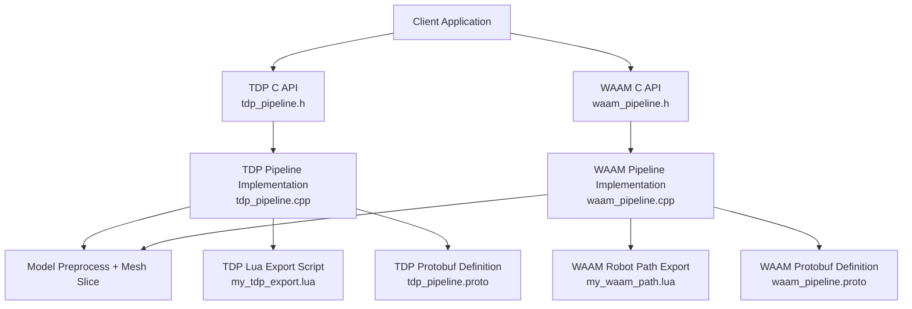
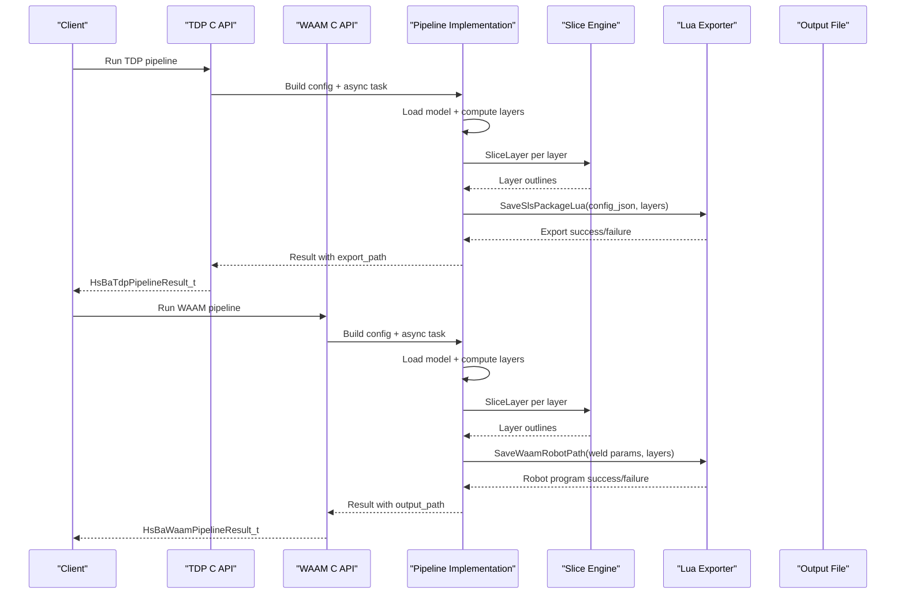
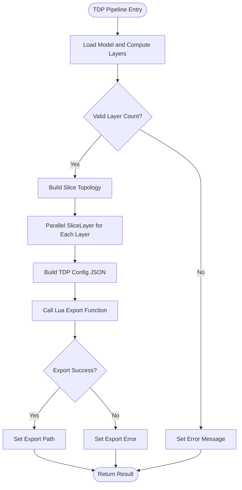
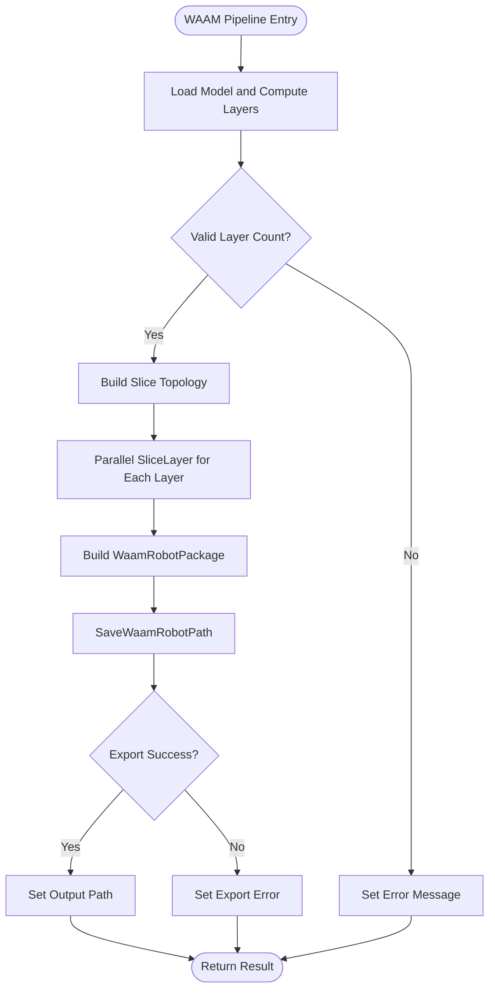
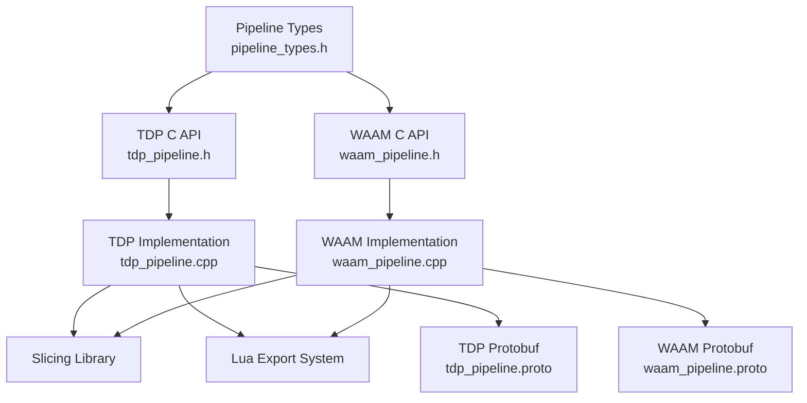

# Thermal Processing Pipelines / 热加工流水线

<cite>
**Referenced Files in This Document**
- [README.md](file://README.md)
- [pipeline_types.h](file://pipelinetypes/pipeline_types.h)
- [tdp_pipeline.h](file://DllHsBaSlicer/tdp_pipeline.h)
- [waam_pipeline.h](file://DllHsBaSlicer/waam_pipeline.h)
- [tdp_pipeline.cpp](file://DllHsBaSlicer/tdp_pipeline.cpp)
- [waam_pipeline.cpp](file://DllHsBaSlicer/waam_pipeline.cpp)
- [tdp_pipeline.proto](file://proto/tdp_pipeline.proto)
- [waam_pipeline.proto](file://proto/waam_pipeline.proto)
- [my_tdp_export.lua](file://samples/TDP/scripts/my_tdp_export.lua)
- [my_waam_path.lua](file://samples/WAAM/scripts/my_waam_path.lua)
</cite>

## Table of Contents
1. [Introduction](#introduction)
2. [Project Structure](#project-structure)
3. [Core Components](#core-components)
4. [Architecture Overview](#architecture-overview)
5. [Detailed Component Analysis](#detailed-component-analysis)
6. [Dependency Analysis](#dependency-analysis)
7. [Performance Considerations](#performance-considerations)
8. [Troubleshooting Guide](#troubleshooting-guide)
9. [Conclusion](#conclusion)
10. [Appendices](#appendices)

## Introduction
This document explains the thermal processing pipelines implemented in HsBaSlicer for binder jetting (TDP, also called 3DP) and wire arc additive manufacturing (WAAM). It focuses on how the slicer converts a CAD model into machine-ready outputs:
- TDP produces per-layer binder-jet outlines and passes binder, head, curing, and bed temperature parameters to a Lua export script that typically packages layer data into a zip archive.
- WAAM produces robot language programs (ABB/KUKA/FANUC or custom Lua-generated code) by converting sliced contours into deposition paths with welding parameters such as current, voltage, wire feed speed, travel speed, and shielding gas flow.

The documentation covers configuration structures, pipeline execution flows, process monitoring through progress callbacks, quality assurance via exported metadata, and industrial integration points. Where thermal modeling is not directly implemented in the C++ core, it is explained conceptually and mapped to the available configuration fields that influence thermal behavior.

## Project Structure
Thermal processing support is exposed through:
- A stable C ABI header for each pipeline type.
- C++ implementation files that run preprocessing, slicing, and export stages.
- Protobuf definitions for cross-language configuration and result messages.
- Sample Lua scripts demonstrating how TDP and WAAM export their outputs.

**Diagram sources**
- [tdp_pipeline.h:17-56](file://DllHsBaSlicer/tdp_pipeline.h#L17-L56)
- [waam_pipeline.h:17-57](file://DllHsBaSlicer/waam_pipeline.h#L17-L57)
- [tdp_pipeline.cpp:203-315](file://DllHsBaSlicer/tdp_pipeline.cpp#L203-L315)
- [waam_pipeline.cpp:174-283](file://DllHsBaSlicer/waam_pipeline.cpp#L174-L283)
- [tdp_pipeline.proto:15-46](file://proto/tdp_pipeline.proto#L15-L46)
- [waam_pipeline.proto:49-88](file://proto/waam_pipeline.proto#L49-L88)
- [my_tdp_export.lua:15-62](file://samples/TDP/scripts/my_tdp_export.lua#L15-L62)
- [my_waam_path.lua:17-45](file://samples/WAAM/scripts/my_waam_path.lua#L17-L45)

**Section sources**
- [README.md:21-39](file://README.md#L21-L39)
- [tdp_pipeline.h:17-56](file://DllHsBaSlicer/tdp_pipeline.h#L17-L56)
- [waam_pipeline.h:17-57](file://DllHsBaSlicer/waam_pipeline.h#L17-L57)

## Core Components
The thermal processing pipelines are defined by two primary configuration structures and their corresponding runtime APIs:

- HsBaTdpPipelineConfig_t: Binder jetting configuration including layer height, first layer height, print head nozzle count, binder drop spacing, binder saturation, ink curing time, powder bed temperature, binder mode, Lua export script path and function, output path, and spiral mode.
- HsBaWaamPipelineConfig_t: Wire arc additive manufacturing configuration including layer height, first layer height, deposited bead width, torch travel speed, wire feed speed, arc current, arc voltage, shielding gas flow rate, feedstock material, welding process type, protection method, shielding gas type, interpass temperature, target robot controller, optional Lua path generator script and function, output path, and spiral mode.

Both configurations expose defaults through dedicated initializer functions and are paired with progress/result callback types for synchronous and asynchronous execution.

Key responsibilities:
- TDP: Convert model slices into binder-jet outlines and pass binder-related thermal/process parameters to a Lua exporter.
- WAAM: Convert model slices into robot-deposition paths and pass welding and motion parameters to a robot program generator.

**Section sources**
- [pipeline_types.h:463-521](file://pipelinetypes/pipeline_types.h#L463-L521)
- [pipeline_types.h:523-625](file://pipelinetypes/pipeline_types.h#L523-L625)
- [pipeline_types.h:903-950](file://pipelinetypes/pipeline_types.h#L903-L950)
- [tdp_pipeline.h:17-56](file://DllHsBaSlicer/tdp_pipeline.h#L17-L56)
- [waam_pipeline.h:17-57](file://DllHsBaSlicer/waam_pipeline.h#L17-L57)

## Architecture Overview
The TDP and WAAM pipelines share a common three-stage architecture:
1. Preprocessing: Load or retrieve the model and compute bounding box information.
2. Slicing: Build slice topology once and compute per-layer polygon outlines in parallel.
3. Export: Generate machine-specific output using either a Lua export script (TDP) or a robot path generator (WAAM).

**Diagram sources**
- [tdp_pipeline.cpp:203-315](file://DllHsBaSlicer/tdp_pipeline.cpp#L203-L315)
- [waam_pipeline.cpp:174-283](file://DllHsBaSlicer/waam_pipeline.cpp#L174-L283)
- [my_tdp_export.lua:15-62](file://samples/TDP/scripts/my_tdp_export.lua#L15-L62)
- [my_waam_path.lua:17-45](file://samples/WAAM/scripts/my_waam_path.lua#L17-L45)

## Detailed Component Analysis

### TDP (Binder Jetting) Pipeline
The TDP pipeline implements binder jetting by slicing the model into per-layer outlines and packaging them with binder process metadata. The configuration structure includes:
- Model inputs: model_name, model_path.
- Slicing inputs: layer_height, first_layer_height.
- Binder jetting inputs: head_count, drop_spacing, binder_saturation, ink_curing_time, bed_temperature, binder_mode.
- Export controls: export_lua_script, export_lua_func, output_path.
- Path shape control: spiral_mode.

The C API exposes default configuration creation, synchronous execution, asynchronous execution, and result cleanup. Internally, the pipeline:
- Loads the model and computes total layers from bounding box geometry.
- Builds slice topology once and slices layers in parallel.
- Builds a JSON configuration containing version, process name, slice parameters, binder parameters, bed temperature, and spiral mode.
- Calls the Lua export function to package layer outlines and configuration into an output file.

**Diagram sources**
- [tdp_pipeline.cpp:95-117](file://DllHsBaSlicer/tdp_pipeline.cpp#L95-L117)
- [tdp_pipeline.cpp:142-164](file://DllHsBaSlicer/tdp_pipeline.cpp#L142-L164)
- [tdp_pipeline.cpp:203-315](file://DllHsBaSlicer/tdp_pipeline.cpp#L203-L315)

#### TDP Configuration Fields
| Field | Type | Meaning | Typical Default |
|---|---|---|---|
| model_name | const char* | Model identifier | NULL |
| model_path | const char* | Model file path | NULL |
| layer_height | float | Layer thickness in mm | 0.1 |
| first_layer_height | float | First layer thickness in mm | 0.12 |
| head_count | int | Number of binder jet nozzles | 128 |
| drop_spacing | float | Distance between binder drops in mm | 0.05 |
| binder_saturation | float | Binder saturation ratio [0,1] | 0.6 |
| ink_curing_time | float | Per-layer curing time in seconds | 1.0 |
| bed_temperature | float | Powder bed temperature in °C | 40.0 |
| binder_mode | enum | Full-color, single-channel, or sintering-assisted | HSBA_TDP_SINGLE |
| export_lua_script | const char* | Required Lua export script path | NULL |
| export_lua_func | const char* | Lua export function name | NULL |
| output_path | const char* | Output file path | NULL |
| spiral_mode | int | Continuous rising outer contour path | 0 |

**Section sources**
- [pipeline_types.h:463-521](file://pipelinetypes/pipeline_types.h#L463-L521)
- [pipeline_types.h:903-920](file://pipelinetypes/pipeline_types.h#L903-L920)
- [tdp_pipeline.h:17-56](file://DllHsBaSlicer/tdp_pipeline.h#L17-L56)
- [tdp_pipeline.cpp:142-164](file://DllHsBaSlicer/tdp_pipeline.cpp#L142-L164)
- [tdp_pipeline.cpp:203-315](file://DllHsBaSlicer/tdp_pipeline.cpp#L203-L315)
- [tdp_pipeline.proto:15-46](file://proto/tdp_pipeline.proto#L15-L46)
- [my_tdp_export.lua:15-62](file://samples/TDP/scripts/my_tdp_export.lua#L15-L62)

### WAAM (Wire Arc Additive Manufacturing) Pipeline
The WAAM pipeline converts sliced contours into robot-deposition paths. Its configuration structure includes:
- Model inputs: model_name, model_path.
- Slicing inputs: layer_height, first_layer_height.
- Deposition geometry: bead_width.
- Motion and welding parameters: travel_speed, wire_feed_speed, arc_current, arc_voltage, gas_flow_rate.
- Material and process: material, welding_process, protection, protect_gas.
- Thermal control: interpass_temperature.
- Robot integration: robot_type, path_lua_script, path_lua_func.
- Output and path shape: output_path, spiral_mode.

Internally, the pipeline:
- Loads the model and computes total layers.
- Builds slice topology and slices layers in parallel.
- Constructs a robot package with layer outlines, z-heights, bead width, robot type, and weld parameters.
- Generates a robot program via built-in generators or a custom Lua path script.

**Diagram sources**
- [waam_pipeline.cpp:99-121](file://DllHsBaSlicer/waam_pipeline.cpp#L99-L121)
- [waam_pipeline.cpp:174-283](file://DllHsBaSlicer/waam_pipeline.cpp#L174-L283)

#### WAAM Configuration Fields
| Field | Type | Meaning | Typical Default |
|---|---|---|---|
| model_name | const char* | Model identifier | NULL |
| model_path | const char* | Model file path | NULL |
| layer_height | float | Bead/layer height in mm | 0.8 |
| first_layer_height | float | First layer height in mm | 1.0 |
| bead_width | float | Deposited bead width in mm | 1.2 |
| travel_speed | float | Torch travel speed in mm/s | 8.0 |
| wire_feed_speed | float | Wire feed speed in m/min | 5.0 |
| arc_current | float | Welding current in A | 180.0 |
| arc_voltage | float | Arc voltage in V | 22.0 |
| gas_flow_rate | float | Shielding gas flow in L/min | 15.0 |
| material | enum | Feedstock wire material | HSBA_WAAM_MATERIAL_STEEL |
| welding_process | enum | Arc or laser welding | HSBA_WAAM_WELD_ARC |
| protection | enum | Shielding gas or vacuum | HSBA_WAAM_PROTECTION_SHIELD_GAS |
| protect_gas | enum | Argon, helium, nitrogen, CO2 | HSBA_METAL_GAS_ARGON |
| interpass_temperature | float | Interpass temperature in °C | 100.0 |
| robot_type | enum | ABB, KUKA, FANUC, or custom | HSBA_WAAM_ROBOT_ABB |
| path_lua_script | const char* | Optional custom robot-code generator | NULL |
| path_lua_func | const char* | Optional Lua function name | NULL |
| output_path | const char* | Output robot program path | NULL |
| spiral_mode | int | Continuous rising outer wall bead | 0 |

**Section sources**
- [pipeline_types.h:523-625](file://pipelinetypes/pipeline_types.h#L523-L625)
- [pipeline_types.h:927-950](file://pipelinetypes/pipeline_types.h#L927-L950)
- [waam_pipeline.h:17-57](file://DllHsBaSlicer/waam_pipeline.h#L17-L57)
- [waam_pipeline.cpp:174-283](file://DllHsBaSlicer/waam_pipeline.cpp#L174-L283)
- [waam_pipeline.proto:49-88](file://proto/waam_pipeline.proto#L49-L88)
- [my_waam_path.lua:17-45](file://samples/WAAM/scripts/my_waam_path.lua#L17-L45)

### Thermal Modeling, Heat Input Calculation, and Cooling Rate Control
Within the current C++ core, explicit thermal simulation is not implemented. However, the configuration fields provide strong control over thermal behavior:
- TDP: ink_curing_time and bed_temperature influence binder curing and powder bed thermal stability; binder_saturation affects local energy absorption during subsequent sintering.
- WAAM: arc_current, arc_voltage, wire_feed_speed, travel_speed, gas_flow_rate, and interpass_temperature collectively determine heat input, cooling rate, and interpass thermal history.

Conceptual relationships:
- Heat input can be estimated from welding power and deposition speed.
- Cooling rate depends on material properties, part geometry, interpass temperature, and shielding environment.
- Interpass temperature control helps manage microstructure and residual stress accumulation across layers.

These concepts map to the following configuration fields:
- TDP: ink_curing_time, bed_temperature, binder_saturation.
- WAAM: arc_current, arc_voltage, wire_feed_speed, travel_speed, gas_flow_rate, interpass_temperature.

[No sources needed since this section provides conceptual guidance based on existing fields]

### Heat Affected Zone Prediction, Residual Stress Analysis, and Distortion Compensation
The slicer does not include direct finite element analysis for heat affected zone prediction, residual stress, or distortion compensation. Instead, these analyses are best integrated at the application level:
- Use the generated layer outlines and process parameters to drive external thermal-mechanical simulations.
- For WAAM, use interpass_temperature and welding parameters as boundary conditions.
- For TDP, use bed_temperature and curing time as thermal boundary conditions.
- Apply distortion compensation by adjusting toolpaths or pre-deforming CAD models before slicing.

[No sources needed since this section provides general guidance]

### Process Monitoring Parameters
Both pipelines expose progress callbacks that report percentage and stage descriptions:
- TDP: Loading model, slicing, exporting via Lua, pipeline complete.
- WAAM: Loading model, slicing bead layers, generating robot path, pipeline complete.

Callbacks allow UI updates, logging, and early termination handling.

**Section sources**
- [tdp_pipeline.cpp:119-125](file://DllHsBaSlicer/tdp_pipeline.cpp#L119-L125)
- [waam_pipeline.cpp:123-129](file://DllHsBaSlicer/waam_pipeline.cpp#L123-L129)
- [tdp_pipeline.cpp:212-304](file://DllHsBaSlicer/tdp_pipeline.cpp#L212-L304)
- [waam_pipeline.cpp:181-272](file://DllHsBaSlicer/waam_pipeline.cpp#L181-L272)

### Quality Assurance Measures
Quality assurance is primarily achieved through exported metadata and traceable outputs:
- TDP: The Lua exporter archives a JSON configuration describing version, process, slice parameters, binder parameters, bed temperature, and spiral mode alongside per-layer outlines. An optional SQLite database records export history.
- WAAM: The robot program generator outputs a deterministic robot program derived from layer outlines and welding parameters. Custom Lua scripts can add headers, program names, and structured point lists.

**Section sources**
- [tdp_pipeline.cpp:142-164](file://DllHsBaSlicer/tdp_pipeline.cpp#L142-L164)
- [my_tdp_export.lua:15-62](file://samples/TDP/scripts/my_tdp_export.lua#L15-L62)
- [waam_pipeline.cpp:232-259](file://DllHsBaSlicer/waam_pipeline.cpp#L232-L259)
- [my_waam_path.lua:17-45](file://samples/WAAM/scripts/my_waam_path.lua#L17-L45)

## Dependency Analysis
The thermal pipelines depend on shared slicing infrastructure and Lua scripting:

**Diagram sources**
- [pipeline_types.h:463-625](file://pipelinetypes/pipeline_types.h#L463-L625)
- [tdp_pipeline.h:17-56](file://DllHsBaSlicer/tdp_pipeline.h#L17-L56)
- [waam_pipeline.h:17-57](file://DllHsBaSlicer/waam_pipeline.h#L17-L57)
- [tdp_pipeline.cpp:203-315](file://DllHsBaSlicer/tdp_pipeline.cpp#L203-L315)
- [waam_pipeline.cpp:174-283](file://DllHsBaSlicer/waam_pipeline.cpp#L174-L283)
- [tdp_pipeline.proto:15-46](file://proto/tdp_pipeline.proto#L15-L46)
- [waam_pipeline.proto:49-88](file://proto/waam_pipeline.proto#L49-L88)

**Section sources**
- [pipeline_types.h:463-625](file://pipelinetypes/pipeline_types.h#L463-L625)
- [tdp_pipeline.cpp:203-315](file://DllHsBaSlicer/tdp_pipeline.cpp#L203-L315)
- [waam_pipeline.cpp:174-283](file://DllHsBaSlicer/waam_pipeline.cpp#L174-L283)

## Performance Considerations
- Parallel slicing: Both pipelines build slice topology once and slice layers in parallel, reducing total slicing time for large models.
- Asynchronous execution: Async APIs return immediately and invoke completion callbacks when results are ready, enabling non-blocking UIs and batch processing.
- Memory management: Results contain UTF-8 strings allocated by the library; callers must free them using the provided free functions.
- Export efficiency: TDP uses a Lua-based packager to write layered data and configuration; WAAM writes robot programs deterministically from path data.

Recommendations:
- Use async APIs for long-running jobs.
- Provide meaningful progress callbacks for user feedback.
- Reuse model loading where possible to avoid repeated I/O.
- Keep Lua scripts minimal and focused on export logic.

**Section sources**
- [tdp_pipeline.cpp:245-260](file://DllHsBaSlicer/tdp_pipeline.cpp#L245-L260)
- [waam_pipeline.cpp:214-229](file://DllHsBaSlicer/waam_pipeline.cpp#L214-L229)
- [tdp_pipeline.cpp:324-364](file://DllHsBaSlicer/tdp_pipeline.cpp#L324-L364)
- [waam_pipeline.cpp:292-332](file://DllHsBaSlicer/waam_pipeline.cpp#L292-L332)

## Troubleshooting Guide
Common issues and resolutions:
- Missing TDP export script: The TDP pipeline requires export_lua_script to be set; otherwise, it returns an error indicating a required Lua export script.
- Invalid model height: If the model bounding box yields zero or negative height, the pipeline reports invalid model height.
- Lua export failure: Errors from Lua exporters are captured and returned in the result’s error_message field.
- WAAM export failure: Errors from robot path generation are captured and returned in the result’s error_message field.
- Resource cleanup: Always call the appropriate free function for pipeline results to release allocated strings.

Operational checks:
- Verify model_path and model_name are valid.
- Ensure export_lua_script (TDP) or path_lua_script (optional WAAM) exists and exports the expected function.
- Inspect elapsed_seconds and total_layers in results for sanity checks.
- Log progress callback stages to identify failing phases.

**Section sources**
- [tdp_pipeline.cpp:266-302](file://DllHsBaSlicer/tdp_pipeline.cpp#L266-L302)
- [waam_pipeline.cpp:256-270](file://DllHsBaSlicer/waam_pipeline.cpp#L256-L270)
- [tdp_pipeline.cpp:356-364](file://DllHsBaSlicer/tdp_pipeline.cpp#L356-L364)
- [waam_pipeline.cpp:324-332](file://DllHsBaSlicer/waam_pipeline.cpp#L324-L332)

## Conclusion
HsBaSlicer provides robust, modular thermal processing pipelines for binder jetting and wire arc additive manufacturing. The TDP pipeline packages binder-jet outlines and process metadata for downstream curing and sintering, while the WAAM pipeline generates robot programs with precise welding and motion parameters. Although explicit thermal simulation is outside the C++ core, the configuration fields enable strong control over thermal behavior and integrate naturally with external analysis tools. Progress callbacks, deterministic exports, and clear error reporting support reliable industrial workflows.

[No sources needed since this section summarizes without analyzing specific files]

## Appendices

### Industrial Applications and Scale-Up Considerations
- TDP applications: Large-format powder-bed parts, multi-material color printing, and post-processing workflows requiring controlled curing and sintering.
- WAAM applications: Large metal components, repair and cladding, hybrid manufacturing combining additive and subtractive processes.
- Scale-up considerations:
  - Increase layer counts carefully; monitor memory usage and export file sizes.
  - Tune interpass temperature and shielding gas for large builds to maintain consistent microstructure.
  - Integrate with robotic cells and CNC machines for hybrid production lines.
  - Use param store capabilities to persist and reuse validated process parameters.

[No sources needed since this section provides general guidance]

### Integration with Traditional Manufacturing Processes
- CAM integration: WAAM robot programs can be imported into standard robot controllers; TDP packages can be consumed by binder jetting printers or post-processors.
- Metrology and inspection: Use exported layer outlines and process metadata to plan inspection strategies and correlate defects with thermal history.
- Digital thread: Persist configuration and results in databases for traceability and continuous improvement.

[No sources needed since this section provides general guidance]