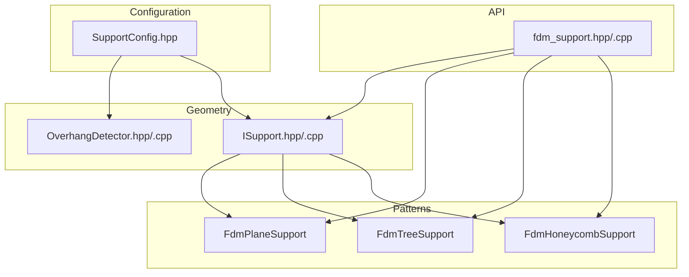
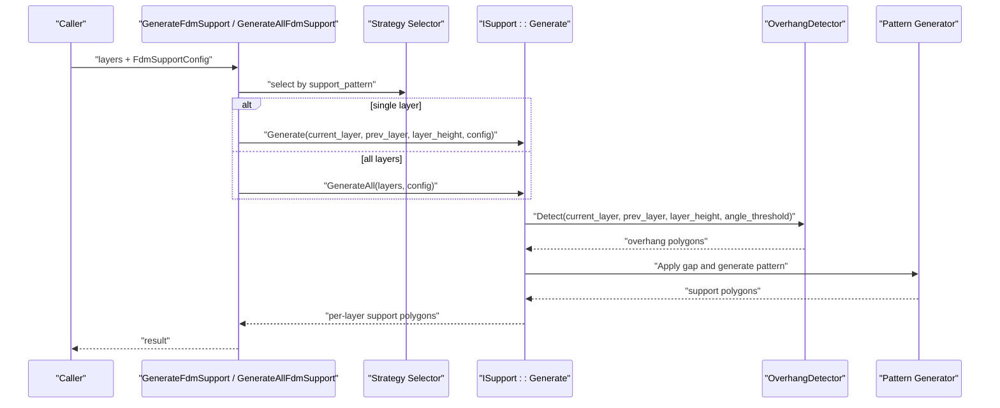
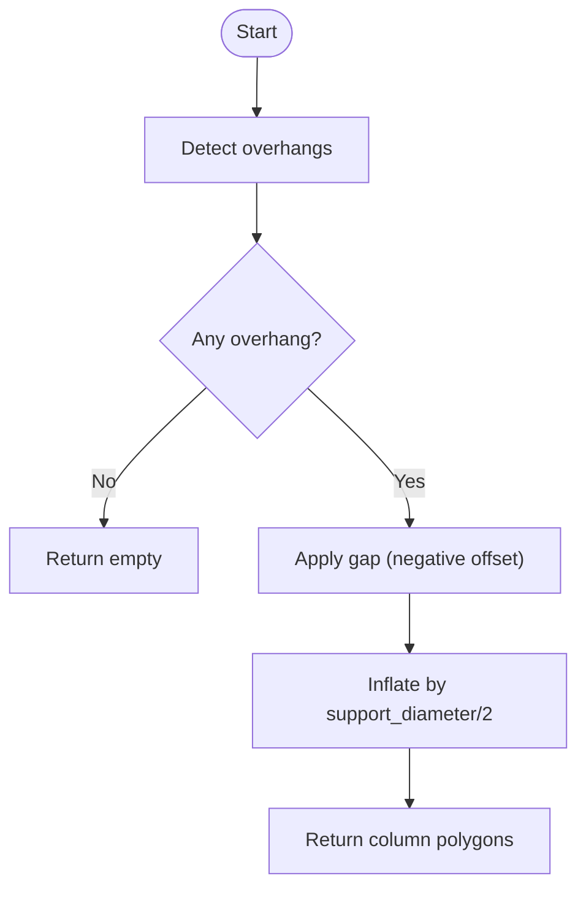
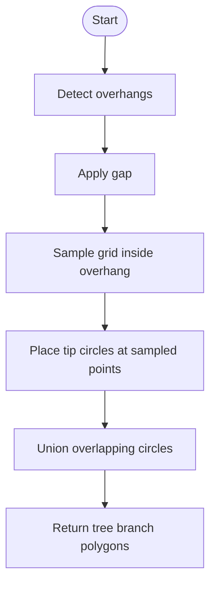
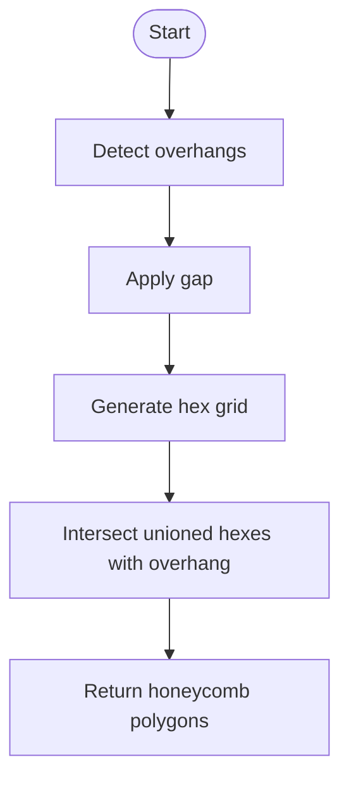
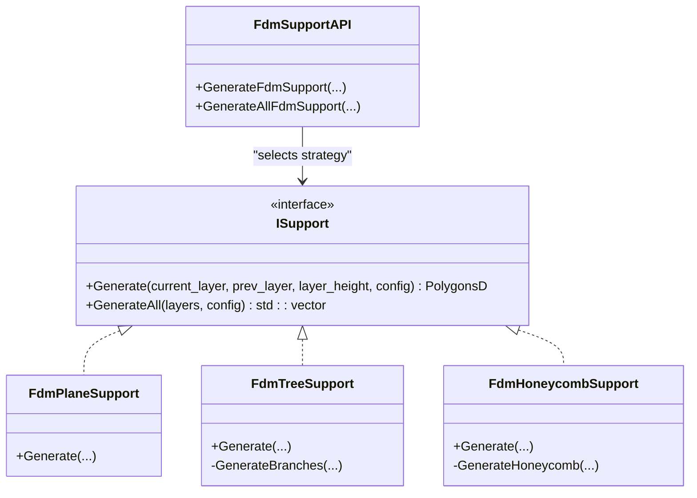
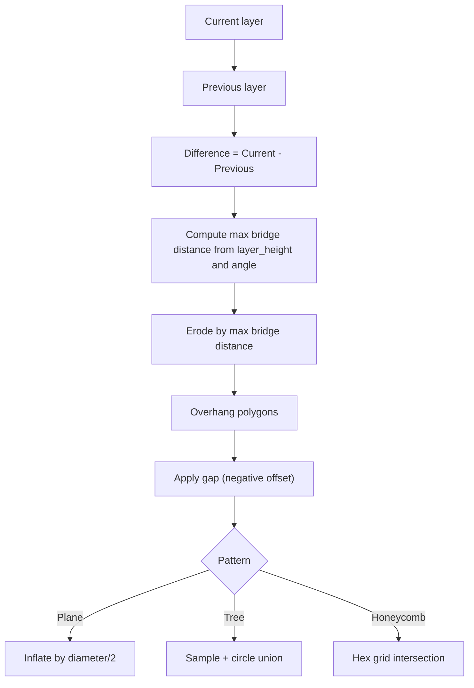
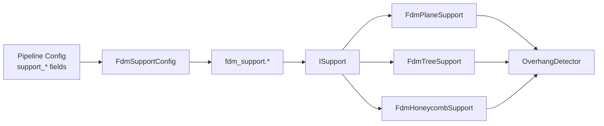

# FDM Support Patterns

<cite>
**Referenced Files in This Document**
- [FdmSupport.hpp](file://support/FdmSupport.hpp)
- [FdmSupport.cpp](file://support/FdmSupport.cpp)
- [ISupport.hpp](file://support/ISupport.hpp)
- [ISupport.cpp](file://support/ISupport.cpp)
- [OverhangDetector.hpp](file://support/OverhangDetector.hpp)
- [OverhangDetector.cpp](file://support/OverhangDetector.cpp)
- [SupportConfig.hpp](file://support/SupportConfig.hpp)
- [fdm_support.hpp](file://LibHsBaSlicer/Support/fdm_support.hpp)
- [fdm_support.cpp](file://LibHsBaSlicer/Support/fdm_support.cpp)
- [pipeline_types.h](file://pipelinetypes/pipeline_types.h)
- [fdm_pipeline.cpp](file://DllHsBaSlicer/fdm_pipeline.cpp)
- [lua_pipeline.cpp](file://LibHsBaSlicer/Extends/lua_pipeline.cpp)
- [fdm_support_lib_test.cpp](file://tests\Support\fdm_support_lib_test.cpp)
</cite>

## Table of Contents
1. [Introduction](#introduction)
2. [Project Structure](#project-structure)
3. [Core Components](#core-components)
4. [Architecture Overview](#architecture-overview)
5. [Detailed Component Analysis](#detailed-component-analysis)
6. [Dependency Analysis](#dependency-analysis)
7. [Performance Considerations](#performance-considerations)
8. [Troubleshooting Guide](#troubleshooting-guide)
9. [Conclusion](#conclusion)
10. [Appendices](#appendices)

## Introduction
This document explains Fused Deposition Modeling (FDM) support structure patterns in HsBaSlicer. It covers the supported pattern types (plane, tree, honeycomb), their use cases and parameterization, and how layer outlines are processed into support cross-sections. It also documents the public API functions GenerateFdmSupport and GenerateAllFdmSupport, configuration parameters such as density, angle thresholds, contact distance, and pattern selection, along with practical guidance for large models, memory management, and parallel processing.

## Project Structure
The FDM support system is implemented across a small set of focused modules:
- Configuration: shared structs for support generation settings
- Overhang detection: geometric analysis to identify unsupported regions between layers
- Support generators: strategy implementations for plane, tree, and honeycomb patterns
- Public API: thin wrappers that select strategies and iterate over layers

**Diagram sources**
- [SupportConfig.hpp:14-34](file://support/SupportConfig.hpp#L14-L34)
- [OverhangDetector.hpp:20-49](file://support/OverhangDetector.hpp#L20-L49)
- [ISupport.hpp:22-45](file://support/ISupport.hpp#L22-L45)
- [FdmSupport.hpp:19-63](file://support/FdmSupport.hpp#L19-L63)
- [fdm_support.hpp:19-37](file://LibHsBaSlicer/Support/fdm_support.hpp#L19-L37)

**Section sources**
- [SupportConfig.hpp:14-34](file://support/SupportConfig.hpp#L14-L34)
- [OverhangDetector.hpp:20-49](file://support/OverhangDetector.hpp#L20-L49)
- [ISupport.hpp:22-45](file://support/ISupport.hpp#L22-L45)
- [FdmSupport.hpp:19-63](file://support/FdmSupport.hpp#L19-L63)
- [fdm_support.hpp:19-37](file://LibHsBaSlicer/Support/fdm_support.hpp#L19-L37)

## Core Components
- SupportConfig and FdmSupportConfig define all tunable parameters for support generation, including overhang angle threshold, layer height, gap, diameter, density, pattern selection, tree-specific angles/radii, and honeycomb cell size.
- OverhangDetector computes unsupported areas by comparing adjacent layers using an angle-based bridge distance.
- ISupport defines a uniform interface for per-layer and all-layers generation.
- FdmPlaneSupport, FdmTreeSupport, and FdmHoneycombSupport implement concrete pattern algorithms.
- The LibHsBaSlicer wrapper exposes GenerateFdmSupport and GenerateAllFdmSupport, selecting the appropriate generator based on config.support_pattern.

Key responsibilities:
- Detect overhangs from current and previous layer outlines
- Apply model-support gap
- Generate pattern-specific cross-sections
- Iterate across layers and return per-layer results

**Section sources**
- [SupportConfig.hpp:14-34](file://support/SupportConfig.hpp#L14-L34)
- [OverhangDetector.cpp:23-75](file://support/OverhangDetector.cpp#L23-L75)
- [ISupport.cpp:9-21](file://support/ISupport.cpp#L9-L21)
- [FdmSupport.cpp:48-71](file://support/FdmSupport.cpp#L48-L71)
- [FdmSupport.cpp:77-149](file://support/FdmSupport.cpp#L77-L149)
- [FdmSupport.cpp:155-233](file://support/FdmSupport.cpp#L155-L233)
- [fdm_support.cpp:14-52](file://LibHsBaSlicer/Support/fdm_support.cpp#L14-L52)

## Architecture Overview
The FDM support pipeline processes each layer pair to produce support polygons:

**Diagram sources**
- [fdm_support.cpp:14-52](file://LibHsBaSlicer/Support/fdm_support.cpp#L14-L52)
- [ISupport.cpp:9-21](file://support/ISupport.cpp#L9-L21)
- [OverhangDetector.cpp:37-75](file://support/OverhangDetector.cpp#L37-L75)
- [FdmSupport.cpp:48-71](file://support/FdmSupport.cpp#L48-L71)
- [FdmSupport.cpp:77-149](file://support/FdmSupport.cpp#L77-L149)
- [FdmSupport.cpp:155-233](file://support/FdmSupport.cpp#L155-L233)

## Detailed Component Analysis

### Configuration Parameters
- Overhang angle threshold: controls which slopes require support via bridge distance calculation.
- Layer height: used together with angle threshold to compute maximum bridge distance.
- Support gap: separation between model and support; applied as negative offset before pattern generation.
- Support diameter: base dimension for column/tree branch radius and sampling spacing.
- Support density: general fill density parameter (exposed in config).
- Support pattern: selects algorithm (0=Plane, 1=Tree, 2=Honeycomb).
- Tree branch angle and max branch radius: tree-specific parameters exposed in config.
- Honeycomb cell size: hexagonal cell width for honeycomb pattern.
- Interface layers and interface density: FDM-specific parameters for interface layers between model and support.

Practical notes:
- Larger gaps reduce contact area and may improve removal but can weaken support anchoring.
- Smaller honeycomb cells increase rigidity and material usage.
- Tree supports benefit from tuning branch angle and diameter to balance coverage and print time.

**Section sources**
- [SupportConfig.hpp:14-34](file://support/SupportConfig.hpp#L14-L34)
- [OverhangDetector.cpp:23-35](file://support/OverhangDetector.cpp#L23-L35)
- [FdmSupport.cpp:57-71](file://support/FdmSupport.cpp#L57-L71)
- [FdmSupport.cpp:139-149](file://support/FdmSupport.cpp#L139-L149)
- [FdmSupport.cpp:223-233](file://support/FdmSupport.cpp#L223-L233)

### Plane Support
- Purpose: simple columnar supports under overhangs.
- Algorithm: detect overhangs, apply gap, inflate by half diameter to form circular columns.
- Use cases: quick, reliable supports for moderate overhangs; good baseline when unsure.
- Key parameters: support_gap, support_diameter, overhang_angle_threshold.

**Diagram sources**
- [FdmSupport.cpp:48-71](file://support/FdmSupport.cpp#L48-L71)
- [OverhangDetector.cpp:37-75](file://support/OverhangDetector.cpp#L37-L75)

**Section sources**
- [FdmSupport.cpp:48-71](file://support/FdmSupport.cpp#L48-L71)

### Tree Support
- Purpose: branching structures that grow upward and merge, reducing material while supporting complex geometries.
- Algorithm: sample points within overhang region at spacing proportional to diameter, place circles at tips, union overlapping circles.
- Use cases: organic shapes, wide cantilevers, or when minimizing material is important.
- Key parameters: support_diameter, support_gap, overhang_angle_threshold, tree_branch_angle, tree_max_branch_radius.

**Diagram sources**
- [FdmSupport.cpp:77-149](file://support/FdmSupport.cpp#L77-L149)

**Section sources**
- [FdmSupport.cpp:77-149](file://support/FdmSupport.cpp#L77-L149)

### Honeycomb Support
- Purpose: lightweight yet rigid lattice filling of overhang regions.
- Algorithm: generate flat-top hexagons across bounding box, intersect unioned hexagons with overhang region.
- Use cases: dense overhangs needing stiffness without excessive mass; good for bridging large unsupported spans.
- Key parameters: honeycomb_cell_size, support_gap, overhang_angle_threshold.

**Diagram sources**
- [FdmSupport.cpp:155-233](file://support/FdmSupport.cpp#L155-L233)

**Section sources**
- [FdmSupport.cpp:155-233](file://support/FdmSupport.cpp#L155-L233)

### API Functions: GenerateFdmSupport and GenerateAllFdmSupport
- GenerateFdmSupport:
  - Selects strategy based on config.support_pattern (0=Plane, 1=Tree, 2=Honeycomb).
  - Calls the selected generator’s Generate method with current and previous layer outlines.
- GenerateAllFdmSupport:
  - Selects strategy similarly.
  - Delegates to the generator’s GenerateAll, which iterates over layers and returns one result per layer.

**Diagram sources**
- [ISupport.hpp:22-45](file://support/ISupport.hpp#L22-L45)
- [FdmSupport.hpp:19-63](file://support/FdmSupport.hpp#L19-L63)
- [fdm_support.cpp:14-52](file://LibHsBaSlicer/Support/fdm_support.cpp#L14-L52)

**Section sources**
- [fdm_support.cpp:14-52](file://LibHsBaSlicer/Support/fdm_support.cpp#L14-L52)
- [ISupport.cpp:9-21](file://support/ISupport.cpp#L9-L21)

### Processing Layer Outlines to Support Cross-Sections
- Overhang detection uses the difference between current and previous layers, filtered by a bridge distance derived from layer height and angle threshold.
- After detecting overhangs, each pattern applies a gap (negative offset) and then constructs its specific geometry:
  - Plane: inflate by half diameter to create columns.
  - Tree: sample points and union circles.
  - Honeycomb: generate hex grid and intersect with overhang.

**Diagram sources**
- [OverhangDetector.cpp:37-75](file://support/OverhangDetector.cpp#L37-L75)
- [FdmSupport.cpp:48-71](file://support/FdmSupport.cpp#L48-L71)
- [FdmSupport.cpp:77-149](file://support/FdmSupport.cpp#L77-L149)
- [FdmSupport.cpp:155-233](file://support/FdmSupport.cpp#L155-L233)

**Section sources**
- [OverhangDetector.cpp:37-75](file://support/OverhangDetector.cpp#L37-L75)
- [FdmSupport.cpp:48-71](file://support/FdmSupport.cpp#L48-L71)
- [FdmSupport.cpp:77-149](file://support/FdmSupport.cpp#L77-L149)
- [FdmSupport.cpp:155-233](file://support/FdmSupport.cpp#L155-L233)

## Dependency Analysis
- Configuration flows from pipeline configuration into FdmSupportConfig and then into the support generators.
- The LibHsBaSlicer API depends on the strategy classes through the ISupport interface.
- All pattern generators depend on OverhangDetector for geometry input.

**Diagram sources**
- [pipeline_types.h:73-83](file://pipelinetypes/pipeline_types.h#L73-L83)
- [fdm_pipeline.cpp:159-165](file://DllHsBaSlicer/fdm_pipeline.cpp#L159-L165)
- [fdm_support.cpp:14-52](file://LibHsBaSlicer/Support/fdm_support.cpp#L14-L52)
- [ISupport.hpp:22-45](file://support/ISupport.hpp#L22-L45)
- [OverhangDetector.hpp:20-49](file://support/OverhangDetector.hpp#L20-L49)

**Section sources**
- [pipeline_types.h:73-83](file://pipelinetypes/pipeline_types.h#L73-L83)
- [fdm_pipeline.cpp:159-165](file://DllHsBaSlicer/fdm_pipeline.cpp#L159-L165)
- [fdm_support.cpp:14-52](file://LibHsBaSlicer/Support/fdm_support.cpp#L14-L52)
- [ISupport.hpp:22-45](file://support/ISupport.hpp#L22-L45)
- [OverhangDetector.hpp:20-49](file://support/OverhangDetector.hpp#L20-L49)

## Performance Considerations
- Large models:
  - Honeycomb generates many hex cells; consider increasing cell size to reduce polygon count.
  - Tree sampling spacing scales with diameter; larger diameters reduce sample density.
  - Plane inflation creates fewer primitives but may cover more area; tune diameter and gap carefully.
- Geometry operations:
  - Offset and union operations dominate runtime; minimize unnecessary iterations by early exits when overhang is empty.
- Memory:
  - Reuse intermediate polygon buffers where possible; avoid repeated allocations in tight loops.
  - Prefer pre-reserving vectors for results to reduce reallocations.
- Parallelism:
  - The default GenerateAll implementation iterates sequentially; for very large models, consider parallelizing per-layer work at the caller level or extending GenerateAll to process chunks concurrently.
  - Ensure thread safety if multiple threads call into geometry libraries; Clipper2 operations should be invoked safely.

[No sources needed since this section provides general guidance]

## Troubleshooting Guide
- No support generated:
  - Check overhang_angle_threshold; too high values may filter out overhangs.
  - Verify layer_height matches slicer settings; incorrect values affect bridge distance.
  - Ensure prev_layer is provided correctly; first layer has no predecessor and is treated as full overhang.
- Excessive material or slow generation:
  - Reduce support_density or increase honeycomb_cell_size.
  - Increase support_diameter for tree sampling spacing to reduce point density.
- Poor adhesion or weak supports:
  - Reduce support_gap to increase contact area.
  - For honeycomb, decrease cell size for more connectivity.
- Unexpected gaps or holes:
  - Inspect gap application; ensure it does not erase small overhang features.
  - Validate integerization and offset operations for precision issues.

**Section sources**
- [OverhangDetector.cpp:37-75](file://support/OverhangDetector.cpp#L37-L75)
- [FdmSupport.cpp:48-71](file://support/FdmSupport.cpp#L48-L71)
- [FdmSupport.cpp:77-149](file://support/FdmSupport.cpp#L77-L149)
- [FdmSupport.cpp:155-233](file://support/FdmSupport.cpp#L155-L233)

## Conclusion
HsBaSlicer’s FDM support system offers three robust patterns—plane, tree, and honeycomb—selected via a simple configuration. The architecture cleanly separates overhang detection, strategy selection, and pattern generation, enabling predictable behavior and easy extension. By tuning parameters like angle threshold, gap, diameter, density, and cell size, users can optimize support quality and performance for diverse model geometries. For large models, careful parameter choices and potential parallelization strategies help maintain responsiveness and reasonable memory usage.

[No sources needed since this section summarizes without analyzing specific files]

## Appendices

### Practical Configuration Examples
- Simple overhangs with minimal material:
  - Pattern: Plane
  - Diameter: moderate
  - Gap: small-to-moderate
  - Angle threshold: around 45 degrees
- Complex cantilevers requiring less material:
  - Pattern: Tree
  - Diameter: tuned to balance coverage and speed
  - Branch angle: adjust for desired spread
  - Gap: small for better anchoring
- Wide unsupported spans needing stiffness:
  - Pattern: Honeycomb
  - Cell size: smaller for rigidity, larger for speed
  - Gap: moderate to avoid excessive contact

[No sources needed since this section provides general guidance]

### Integration Points and Usage
- Pipeline configuration maps user settings into FdmSupportConfig and passes them to support generation.
- Lua integration exposes support generation functions that internally call the same APIs.

**Section sources**
- [fdm_pipeline.cpp:159-165](file://DllHsBaSlicer/fdm_pipeline.cpp#L159-L165)
- [lua_pipeline.cpp:484-489](file://LibHsBaSlicer/Extends/lua_pipeline.cpp#L484-L489)

### Tests and Validation
- Unit tests verify:
  - Single-layer generation for plane, tree, and honeycomb patterns.
  - All-layers generation returning correct counts and non-empty results for expected overhangs.

**Section sources**
- [fdm_support_lib_test.cpp:24-71](file://tests\Support\fdm_support_lib_test.cpp#L24-L71)