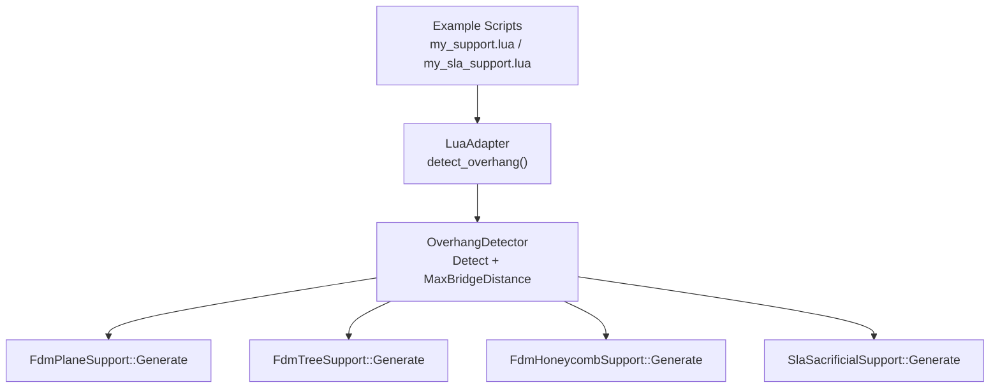
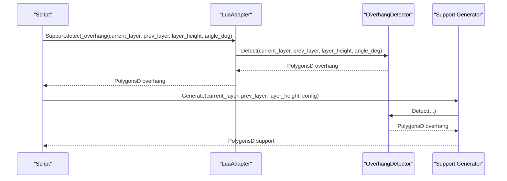
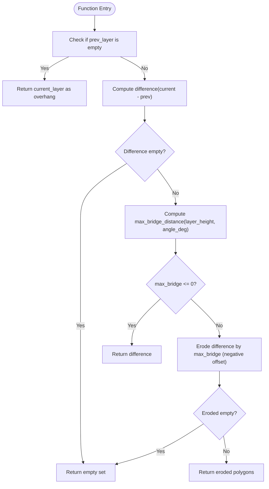
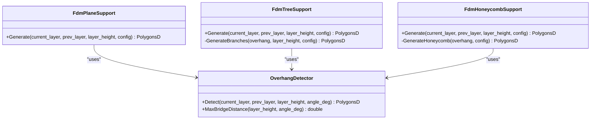
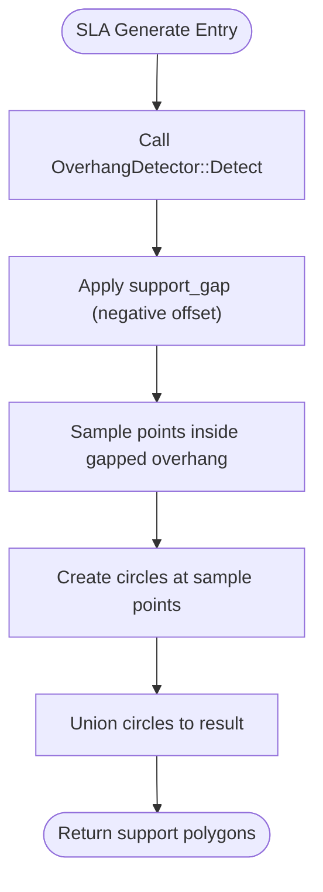
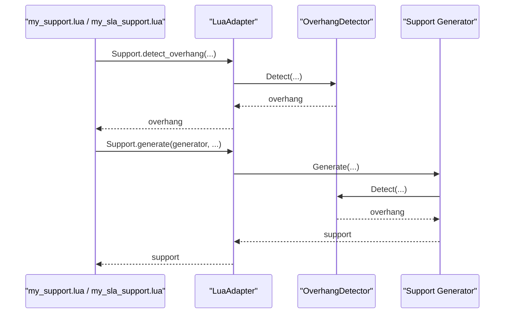
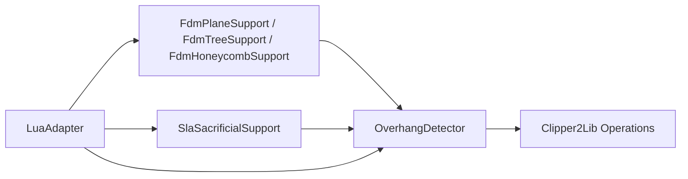

# Overhang Detection System

<cite>
**Referenced Files in This Document**
- [OverhangDetector.hpp](file://support/OverhangDetector.hpp)
- [OverhangDetector.cpp](file://support/OverhangDetector.cpp)
- [SupportConfig.hpp](file://support/SupportConfig.hpp)
- [FdmSupport.hpp](file://support/FdmSupport.hpp)
- [FdmSupport.cpp](file://support/FdmSupport.cpp)
- [SlaSupport.hpp](file://support/SlaSupport.hpp)
- [SlaSupport.cpp](file://support/SlaSupport.cpp)
- [LuaAdapter.cpp](file://support/LuaAdapter.cpp)
- [my_support.lua](file://samples/FDM/scripts/my_support.lua)
- [my_sla_support.lua](file://samples/SLA/scripts/my_sla_support.lua)
- [support_test.cpp](file://tests\Support\support_test.cpp)
</cite>

## Table of Contents
1. [Introduction](#introduction)
2. [Project Structure](#project-structure)
3. [Core Components](#core-components)
4. [Architecture Overview](#architecture-overview)
5. [Detailed Component Analysis](#detailed-component-analysis)
6. [Dependency Analysis](#dependency-analysis)
7. [Performance Considerations](#performance-considerations)
8. [Troubleshooting Guide](#troubleshooting-guide)
9. [Conclusion](#conclusion)
10. [Appendices](#appendices)

## Introduction
This document explains the overhang detection system that automatically identifies surfaces requiring support structures during slicing. It focuses on the OverhangDetector class, its angle threshold calculations, geometric algorithms for detecting unsupported regions between adjacent layers, and how detected overhangs drive support structure generation across FDM and SLA workflows. It also provides guidance for customizing parameters, handling edge cases, integrating into custom slicing pipelines, and optimizing performance for large models or real-time scenarios.

## Project Structure
The overhang detection and support generation logic is implemented under the support module and exposed to scripting via a Lua adapter. The key files are:
- Overhang detection core: OverhangDetector.hpp/.cpp
- Shared configuration: SupportConfig.hpp
- FDM support generators: FdmSupport.hpp/.cpp
- SLA support generator: SlaSupport.hpp/.cpp
- Lua bindings: LuaAdapter.cpp
- Example scripts: samples/FDM/scripts/my_support.lua, samples/SLA/scripts/my_sla_support.lua
- Unit tests: tests/Support/support_test.cpp

**Diagram sources**
- [OverhangDetector.hpp:20-50](file://support/OverhangDetector.hpp#L20-L50)
- [OverhangDetector.cpp:23-75](file://support/OverhangDetector.cpp#L23-L75)
- [FdmSupport.cpp:48-72](file://support/FdmSupport.cpp#L48-L72)
- [FdmSupport.cpp:131-150](file://support/FdmSupport.cpp#L131-L150)
- [FdmSupport.cpp:215-233](file://support/FdmSupport.cpp#L215-L233)
- [SlaSupport.cpp:74-109](file://support/SlaSupport.cpp#L74-L109)
- [LuaAdapter.cpp:181-192](file://support/LuaAdapter.cpp#L181-L192)

**Section sources**
- [OverhangDetector.hpp:1-53](file://support/OverhangDetector.hpp#L1-L53)
- [OverhangDetector.cpp:1-77](file://support/OverhangDetector.cpp#L1-L77)
- [SupportConfig.hpp:1-47](file://support/SupportConfig.hpp#L1-L47)
- [FdmSupport.hpp:1-67](file://support/FdmSupport.hpp#L1-L67)
- [FdmSupport.cpp:1-236](file://support/FdmSupport.cpp#L1-L236)
- [SlaSupport.hpp:1-46](file://support/SlaSupport.hpp#L1-L46)
- [SlaSupport.cpp:1-120](file://support/SlaSupport.cpp#L1-L120)
- [LuaAdapter.cpp:1-255](file://support/LuaAdapter.cpp#L1-L255)
- [my_support.lua:32-82](file://samples/FDM/scripts/my_support.lua#L32-L82)
- [my_sla_support.lua:34-75](file://samples/SLA/scripts/my_sla_support.lua#L34-L75)
- [support_test.cpp:36-91](file://tests\Support\support_test.cpp#L36-L91)

## Core Components
- OverhangDetector: Provides static methods to compute maximum bridge distance from layer height and angle threshold, and to detect overhang polygons between two adjacent layers using polygon difference and erosion.
- SupportConfig: Defines shared parameters such as overhang_angle_threshold, layer_height, support_gap, support_diameter, support_density, and pattern-specific options.
- FDM support generators (plane, tree, honeycomb): Use OverhangDetector to find overhang regions, apply gap, then generate support cross-sections based on strategy.
- SLA sacrificial support generator: Uses OverhangDetector to find overhang regions, applies gap, samples points at spacing, and unions circles to form support columns.
- LuaAdapter: Exposes detect_overhang and default_config to Lua scripts, enabling scripting-based customization.

Key responsibilities:
- Angle threshold to bridge distance conversion
- Polygon difference to isolate unsupported areas
- Erosion to filter small overhangs that can be bridged
- Integration with support generators to produce final support geometry

**Section sources**
- [OverhangDetector.hpp:20-50](file://support/OverhangDetector.hpp#L20-L50)
- [OverhangDetector.cpp:23-75](file://support/OverhangDetector.cpp#L23-L75)
- [SupportConfig.hpp:14-25](file://support/SupportConfig.hpp#L14-L25)
- [FdmSupport.cpp:48-72](file://support/FdmSupport.cpp#L48-L72)
- [FdmSupport.cpp:131-150](file://support/FdmSupport.cpp#L131-L150)
- [FdmSupport.cpp:215-233](file://support/FdmSupport.cpp#L215-L233)
- [SlaSupport.cpp:74-109](file://support/SlaSupport.cpp#L74-L109)
- [LuaAdapter.cpp:181-192](file://support/LuaAdapter.cpp#L181-L192)

## Architecture Overview
The overhang detection pipeline operates per slice layer pair:
1. Input: current_layer and prev_layer contours (PolygonsD).
2. Compute unsupported region by subtracting prev_layer from current_layer.
3. Convert angle threshold to max bridge distance.
4. Erode unsupported region by max bridge distance; remaining polygons are overhangs needing support.
5. Support generators consume overhang polygons to create support cross-sections.

**Diagram sources**
- [LuaAdapter.cpp:181-192](file://support/LuaAdapter.cpp#L181-L192)
- [OverhangDetector.cpp:37-75](file://support/OverhangDetector.cpp#L37-L75)
- [FdmSupport.cpp:48-72](file://support/FdmSupport.cpp#L48-L72)
- [SlaSupport.cpp:74-109](file://support/SlaSupport.cpp#L74-L109)

## Detailed Component Analysis

### OverhangDetector Class
Responsibilities:
- MaxBridgeDistance: Converts layer height and angle threshold into a horizontal bridge distance.
- Detect: Computes overhang polygons between adjacent layers.

Algorithm details:
- If no previous layer exists, the entire current layer is considered overhang.
- Compute difference between current and previous layers to get unsupported regions.
- If difference is empty, return no overhang.
- Compute max_bridge_distance; if zero or less, return difference directly.
- Erode the difference by max_bridge_distance using negative offset; this filters out small overhangs that can be bridged.
- Return eroded polygons as overhang regions.

Angle threshold behavior:
- Angles >= 90 degrees imply vertical walls; no overhang (bridge distance = 0).
- Angles <= 0 degrees treat everything as overhang (bridge distance very large).

Complexity considerations:
- Difference and offset operations depend on polygon complexity; typical O(n log n) due to Clipper2Lib operations.
- Integerization/unintegerization adds constant overhead but improves robustness for offsets.

**Diagram sources**
- [OverhangDetector.cpp:23-75](file://support/OverhangDetector.cpp#L23-L75)

**Section sources**
- [OverhangDetector.hpp:20-50](file://support/OverhangDetector.hpp#L20-L50)
- [OverhangDetector.cpp:23-75](file://support/OverhangDetector.cpp#L23-L75)

### FDM Support Generators
All FDM generators follow a common pattern:
- Call OverhangDetector to obtain overhang polygons.
- Apply support_gap by shrinking overhang polygons.
- Generate support cross-sections according to strategy:
  - Plane: Inflate gapped overhang by support_diameter/2 to form column cross-sections.
  - Tree: Sample circular branch tips within gapped overhang at spacing proportional to support_diameter; union circles.
  - Honeycomb: Fill gapped overhang with hexagonal cells of configurable size; intersect with overhang.

**Diagram sources**
- [FdmSupport.hpp:13-63](file://support/FdmSupport.hpp#L13-L63)
- [FdmSupport.cpp:48-72](file://support/FdmSupport.cpp#L48-L72)
- [FdmSupport.cpp:77-150](file://support/FdmSupport.cpp#L77-L150)
- [FdmSupport.cpp:155-233](file://support/FdmSupport.cpp#L155-L233)
- [OverhangDetector.hpp:20-50](file://support/OverhangDetector.hpp#L20-L50)

**Section sources**
- [FdmSupport.hpp:13-63](file://support/FdmSupport.hpp#L13-L63)
- [FdmSupport.cpp:48-72](file://support/FdmSupport.cpp#L48-L72)
- [FdmSupport.cpp:77-150](file://support/FdmSupport.cpp#L77-L150)
- [FdmSupport.cpp:155-233](file://support/FdmSupport.cpp#L155-L233)

### SLA Sacrificial Support Generator
Responsibilities:
- Obtain overhang polygons via OverhangDetector.
- Apply support_gap by shrinking overhang polygons.
- Sample support points inside gapped overhang at spacing derived from support_diameter.
- Create circles at sample points with tip_radius from sla_config.tip_diameter.
- Union all circles to produce support cross-sections.

**Diagram sources**
- [SlaSupport.cpp:38-109](file://support/SlaSupport.cpp#L38-L109)
- [OverhangDetector.cpp:37-75](file://support/OverhangDetector.cpp#L37-L75)

**Section sources**
- [SlaSupport.hpp:13-42](file://support/SlaSupport.hpp#L13-L42)
- [SlaSupport.cpp:38-109](file://support/SlaSupport.cpp#L38-L109)

### Lua Integration
The Lua adapter exposes:
- Support.detect_overhang(current_layer, prev_layer, layer_height, angle_deg)
- Support.default_config() returning default SupportConfig fields
- Support.generate(support_obj, current_layer, prev_layer, layer_height, config_table)

Example scripts demonstrate:
- Using built-in overhang detection
- Selecting support generator by pattern
- Applying optional post-processing (e.g., offsetting support polygons)

**Diagram sources**
- [LuaAdapter.cpp:181-192](file://support/LuaAdapter.cpp#L181-L192)
- [LuaAdapter.cpp:153-179](file://support/LuaAdapter.cpp#L153-L179)
- [my_support.lua:32-82](file://samples/FDM/scripts/my_support.lua#L32-L82)
- [my_sla_support.lua:34-75](file://samples/SLA/scripts/my_sla_support.lua#L34-L75)

**Section sources**
- [LuaAdapter.cpp:42-89](file://support/LuaAdapter.cpp#L42-L89)
- [LuaAdapter.cpp:153-192](file://support/LuaAdapter.cpp#L153-L192)
- [my_support.lua:32-82](file://samples/FDM/scripts/my_support.lua#L32-L82)
- [my_sla_support.lua:34-75](file://samples/SLA/scripts/my_sla_support.lua#L34-L75)

## Dependency Analysis
The overhang detection system has clear dependencies:
- OverhangDetector depends on polygon math utilities (difference, offset, integerization).
- FDM and SLA generators depend on OverhangDetector for overhang identification.
- LuaAdapter bridges scripting interfaces to C++ implementations.

**Diagram sources**
- [OverhangDetector.cpp:16-21](file://support/OverhangDetector.cpp#L16-L21)
- [FdmSupport.cpp:48-72](file://support/FdmSupport.cpp#L48-L72)
- [SlaSupport.cpp:74-109](file://support/SlaSupport.cpp#L74-L109)
- [LuaAdapter.cpp:181-192](file://support/LuaAdapter.cpp#L181-L192)

**Section sources**
- [OverhangDetector.cpp:16-21](file://support/OverhangDetector.cpp#L16-L21)
- [FdmSupport.cpp:48-72](file://support/FdmSupport.cpp#L48-L72)
- [SlaSupport.cpp:74-109](file://support/SlaSupport.cpp#L74-L109)
- [LuaAdapter.cpp:181-192](file://support/LuaAdapter.cpp#L181-L192)

## Performance Considerations
Optimization techniques for large models and real-time processing:
- Prefer integer arithmetic for geometric operations: The implementation converts polygons to integer coordinates before offset/difference operations to improve stability and speed.
- Early exits: When prev_layer is empty or difference is empty, return immediately to avoid unnecessary computation.
- Avoid excessive erosion: For high angle thresholds close to 90 degrees, bridge distance approaches zero; skip erosion when not needed.
- Bounding box sampling: For tree and honeycomb strategies, compute bounding boxes and limit grid sampling to reduce point-in-polygon checks.
- Batch operations: Where possible, batch multiple polygon operations to minimize repeated conversions and allocations.
- Parallelization: Slice-layer processing can be parallelized across independent layers if dependencies allow.

[No sources needed since this section provides general guidance]

## Troubleshooting Guide
Common issues and resolutions:
- No supports generated:
  - Verify overhang_angle_threshold is appropriate; too high may filter out small overhangs.
  - Ensure layer_height matches actual slicer settings.
  - Confirm prev_layer is provided; first layer without support should return current layer as overhang.
- Excessive supports:
  - Increase overhang_angle_threshold to reduce sensitivity.
  - Adjust support_gap to shrink overhang regions before generating supports.
- Instability or artifacts:
  - Check polygon orientation and winding; ensure consistent fill rules.
  - Validate integerization scale and rounding behavior.
- Script integration errors:
  - Ensure Support.detect_overhang arguments match expected types and units.
  - Validate config table fields exist and have valid ranges.

Validation references:
- Tests confirm behavior for no previous layer, identical layers, and angle filtering.

**Section sources**
- [support_test.cpp:36-91](file://tests\Support\support_test.cpp#L36-L91)
- [OverhangDetector.cpp:37-75](file://support/OverhangDetector.cpp#L37-L75)

## Conclusion
The overhang detection system provides a robust, geometry-driven method to identify unsupported regions between adjacent slices. By converting angle thresholds to bridge distances and applying polygon difference and erosion, it isolates overhangs that require support. FDM and SLA generators build upon these overhang regions to produce tailored support structures. The Lua adapter enables flexible scripting workflows, while unit tests validate core behaviors. With careful parameter tuning and performance optimizations, the system scales to large models and integrates smoothly into custom slicing pipelines.

[No sources needed since this section summarizes without analyzing specific files]

## Appendices

### Customizing Overhang Detection Parameters
- Adjust overhang_angle_threshold to control sensitivity.
- Tune layer_height to match printer settings.
- Modify support_gap and support_diameter to influence support placement and density.
- Use Support.default_config() in Lua to initialize defaults and override fields.

**Section sources**
- [SupportConfig.hpp:14-25](file://support/SupportConfig.hpp#L14-L25)
- [LuaAdapter.cpp:194-220](file://support/LuaAdapter.cpp#L194-L220)
- [my_support.lua:66-70](file://samples/FDM/scripts/my_support.lua#L66-L70)
- [my_sla_support.lua:52-57](file://samples/SLA/scripts/my_sla_support.lua#L52-L57)

### Handling Edge Cases in Complex Geometries
- First layer: Entire current layer treated as overhang when prev_layer is empty.
- Identical layers: No overhang detected; returns empty set.
- Small overhangs filtered by angle threshold: Erosion removes regions smaller than bridge distance.

**Section sources**
- [OverhangDetector.cpp:37-75](file://support/OverhangDetector.cpp#L37-L75)
- [support_test.cpp:41-76](file://tests\Support\support_test.cpp#L41-L76)

### Integrating Into Custom Slicing Workflows
- Use Support.detect_overhang in Lua scripts to obtain overhang polygons.
- Choose a support generator (plane, tree, honeycomb, SLA) based on application needs.
- Post-process support polygons (e.g., offset) to refine contact areas.

**Section sources**
- [LuaAdapter.cpp:181-192](file://support/LuaAdapter.cpp#L181-L192)
- [my_support.lua:38-77](file://samples/FDM/scripts/my_support.lua#L38-L77)
- [my_sla_support.lua:40-72](file://samples/SLA/scripts/my_sla_support.lua#L40-L72)