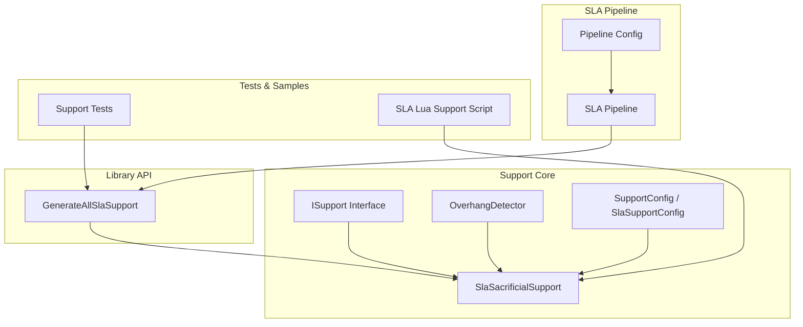
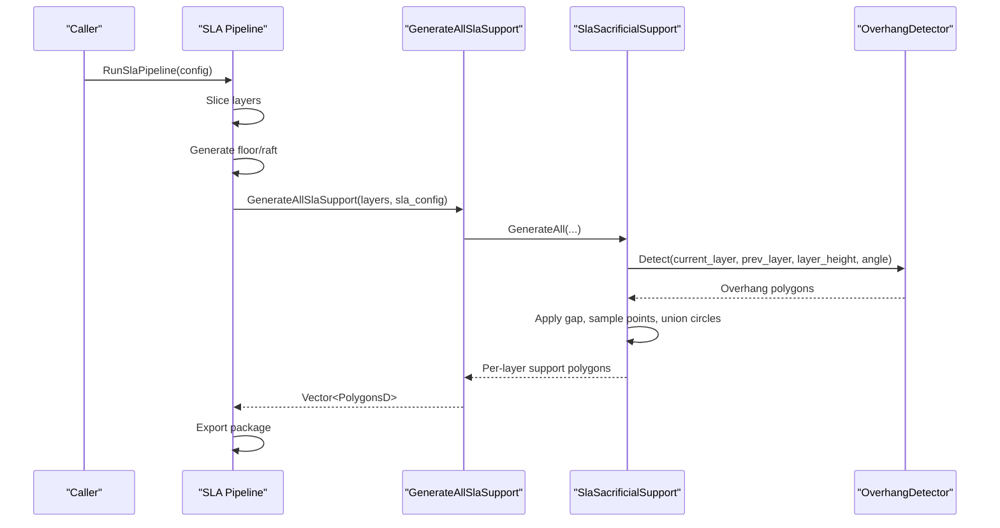
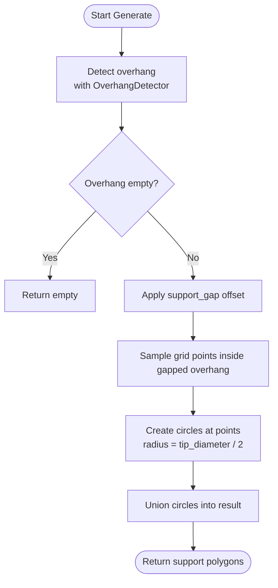
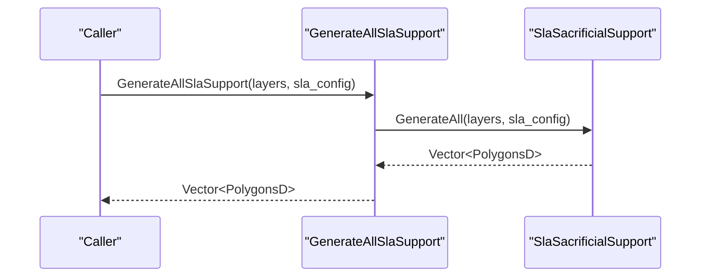
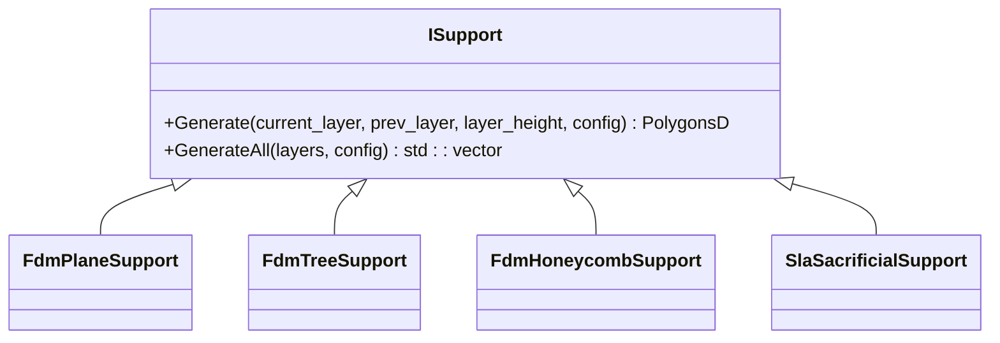
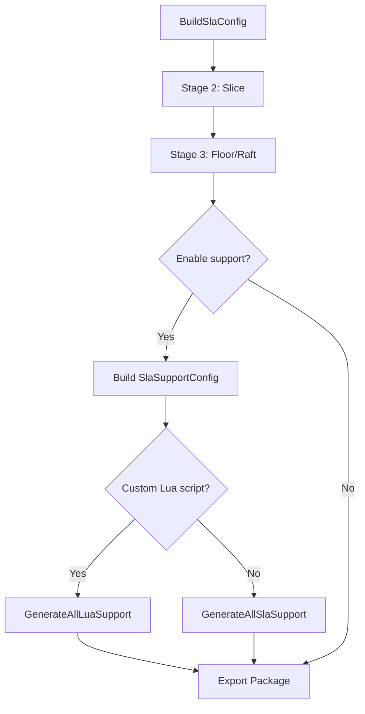
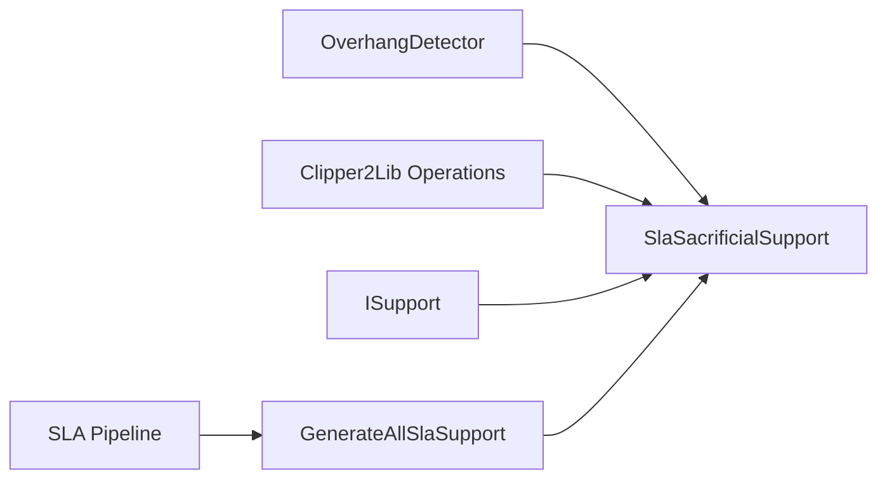

# SLA Sacrificial Supports

<cite>
**Referenced Files in This Document**
- [SlaSupport.hpp](file://support/SlaSupport.hpp)
- [SlaSupport.cpp](file://support/SlaSupport.cpp)
- [SupportConfig.hpp](file://support/SupportConfig.hpp)
- [ISupport.hpp](file://support/ISupport.hpp)
- [OverhangDetector.hpp](file://support/OverhangDetector.hpp)
- [fdm_support.hpp](file://LibHsBaSlicer/Support/fdm_support.hpp)
- [fdm_support.cpp](file://LibHsBaSlicer/Support/fdm_support.cpp)
- [sla_pipeline.cpp](file://DllHsBaSlicer/sla_pipeline.cpp)
- [pipeline_types.h](file://pipelinetypes/pipeline_types.h)
- [sla_pipeline.proto](file://proto/sla_pipeline.proto)
- [my_sla_support.lua](file://samples/SLA/scripts/my_sla_support.lua)
- [support_test.cpp](file://tests\Support\support_test.cpp)
</cite>

## Table of Contents
1. [Introduction](#introduction)
2. [Project Structure](#project-structure)
3. [Core Components](#core-components)
4. [Architecture Overview](#architecture-overview)
5. [Detailed Component Analysis](#detailed-component-analysis)
6. [Dependency Analysis](#dependency-analysis)
7. [Performance Considerations](#performance-considerations)
8. [Troubleshooting Guide](#troubleshooting-guide)
9. [Conclusion](#conclusion)
10. [Appendices](#appendices)

## Introduction
This document explains how HsBaSlicer generates sacrificial supports for Stereolithography (SLA) resin printing. It focuses on the unique requirements of resin printing that favor thin-column sacrificial supports over traditional FDM-style supports, and documents the implementation and configuration of the SLA support generator.

Key topics include:
- Why SLA uses thin-column sacrificial supports instead of bulk FDM supports
- The GenerateAllSlaSupport API and its role in the SLA pipeline
- SlaSupportConfig parameters: tip diameter, spacing, gap, and related fields
- How SLA supports differ from FDM supports in geometry, material usage, and post-processing
- Practical guidance for balancing strength and ease of removal, and surface quality implications

## Project Structure
The SLA support feature spans several modules:
- Support generation core: SLA sacrificial support algorithm and shared interfaces
- Library API: public function to generate SLA supports across all layers
- SLA pipeline: wiring of slice, floor, support, and export stages
- Configuration: shared and SLA-specific support settings
- Tests and samples: validation and example scripts

**Diagram sources**
- [ISupport.hpp:16-45](file://support/ISupport.hpp#L16-L45)
- [OverhangDetector.hpp:14-50](file://support/OverhangDetector.hpp#L14-L50)
- [SlaSupport.hpp:13-42](file://support/SlaSupport.hpp#L13-L42)
- [SupportConfig.hpp:14-43](file://support/SupportConfig.hpp#L14-L43)
- [fdm_support.hpp:39-50](file://LibHsBaSlicer/Support/fdm_support.hpp#L39-L50)
- [fdm_support.cpp:54-59](file://LibHsBaSlicer/Support/fdm_support.cpp#L54-L59)
- [sla_pipeline.cpp:367-400](file://DllHsBaSlicer/sla_pipeline.cpp#L367-L400)
- [support_test.cpp:73-84](file://tests\Support\support_test.cpp#L73-L84)
- [my_sla_support.lua:1-29](file://samples/SLA/scripts/my_sla_support.lua#L1-L29)

**Section sources**
- [SlaSupport.hpp:13-42](file://support/SlaSupport.hpp#L13-L42)
- [SupportConfig.hpp:14-43](file://support/SupportConfig.hpp#L14-L43)
- [fdm_support.hpp:39-50](file://LibHsBaSlicer/Support/fdm_support.hpp#L39-L50)
- [fdm_support.cpp:54-59](file://LibHsBaSlicer/Support/fdm_support.cpp#L54-L59)
- [sla_pipeline.cpp:367-400](file://DllHsBaSlicer/sla_pipeline.cpp#L367-L400)

## Core Components
- ISupport interface defines a common per-layer support generation contract used by FDM, SLA, and Lua-based generators.
- OverhangDetector computes regions needing support based on layer height and angle threshold.
- SlaSacrificialSupport implements thin-column sacrificial support generation for SLA.
- SupportConfig is the base configuration; SlaSupportConfig extends it with SLA-specific fields.
- GenerateAllSlaSupport exposes the SLA support generator through the library API.
- SLA pipeline wires slicing, floor generation, support generation, and export.

**Section sources**
- [ISupport.hpp:16-45](file://support/ISupport.hpp#L16-L45)
- [OverhangDetector.hpp:14-50](file://support/OverhangDetector.hpp#L14-L50)
- [SlaSupport.hpp:13-42](file://support/SlaSupport.hpp#L13-L42)
- [SupportConfig.hpp:14-43](file://support/SupportConfig.hpp#L14-L43)
- [fdm_support.hpp:39-50](file://LibHsBaSlicer/Support/fdm_support.hpp#L39-L50)
- [fdm_support.cpp:54-59](file://LibHsBaSlicer/Support/fdm_support.cpp#L54-L59)
- [sla_pipeline.cpp:367-400](file://DllHsBaSlicer/sla_pipeline.cpp#L367-L400)

## Architecture Overview
The SLA pipeline runs five stages: preprocess, slice, floor, support, export. During the support stage, the pipeline builds an SLA-specific support configuration and calls GenerateAllSlaSupport, which delegates to SlaSacrificialSupport.

**Diagram sources**
- [sla_pipeline.cpp:367-400](file://DllHsBaSlicer/sla_pipeline.cpp#L367-L400)
- [fdm_support.cpp:54-59](file://LibHsBaSlicer/Support/fdm_support.cpp#L54-L59)
- [SlaSupport.cpp:74-108](file://support/SlaSupport.cpp#L74-L108)
- [OverhangDetector.hpp:31-41](file://support/OverhangDetector.hpp#L31-L41)

## Detailed Component Analysis

### SLA Sacrificial Support Generator
SlaSacrificialSupport generates thin circular columns at sampled locations within overhang regions. At each layer, it:
- Detects overhang between current and previous layers using OverhangDetector
- Applies a user-configured gap to shrink the overhang region
- Samples grid points inside the gapped overhang region
- Creates small circles at each point using tip_diameter
- Unions the circles into final support cross-sections

**Diagram sources**
- [SlaSupport.cpp:74-108](file://support/SlaSupport.cpp#L74-L108)
- [OverhangDetector.hpp:31-41](file://support/OverhangDetector.hpp#L31-L41)

**Section sources**
- [SlaSupport.hpp:13-42](file://support/SlaSupport.hpp#L13-L42)
- [SlaSupport.cpp:38-108](file://support/SlaSupport.cpp#L38-L108)
- [OverhangDetector.hpp:14-50](file://support/OverhangDetector.hpp#L14-L50)

### SlaSupportConfig Parameters
SlaSupportConfig extends the general SupportConfig with SLA-specific fields:
- tip_diameter: Diameter of the support column tip (smaller for easier removal)
- raft_thickness: Raft layer thickness parameter (available for future raft integration)
- Inherited fields:
  - overhang_angle_threshold: Angle above which areas are considered unsupported
  - layer_height: Layer thickness used by overhang detection
  - support_gap: Offset applied to overhang to create clearance between model and support
  - support_diameter: Used here as the spacing between support points (spacing = 2 × support_diameter)
  - support_density: General density field (not directly used by SLA sacrificial generator)
  - support_pattern: Pattern selector (SLA default is sacrificial)

Important notes:
- Spacing between support points is computed as twice the support_diameter value.
- Tip radius is half of tip_diameter.
- The generator unions circles at sampled points; there is no explicit “base diameter” parameter in this implementation.

**Section sources**
- [SupportConfig.hpp:14-43](file://support/SupportConfig.hpp#L14-L43)
- [SlaSupport.cpp:93-96](file://support/SlaSupport.cpp#L93-L96)

### GenerateAllSlaSupport API
GenerateAllSlaSupport is the public entry point for generating SLA sacrificial supports across all layers:
- Accepts a vector of layer outlines (bottom to top)
- Accepts SlaSupportConfig
- Returns a vector of PolygonsD, one element per layer

In the SLA pipeline:
- The pipeline constructs SlaSupportConfig from the higher-level pipeline config
- If a custom Lua script is provided, it uses GenerateAllLuaSupport instead
- Otherwise, it calls GenerateAllSlaSupport

**Diagram sources**
- [fdm_support.hpp:39-50](file://LibHsBaSlicer/Support/fdm_support.hpp#L39-L50)
- [fdm_support.cpp:54-59](file://LibHsBaSlicer/Support/fdm_support.cpp#L54-L59)

**Section sources**
- [fdm_support.hpp:39-50](file://LibHsBaSlicer/Support/fdm_support.hpp#L39-L50)
- [fdm_support.cpp:54-59](file://LibHsBaSlicer/Support/fdm_support.cpp#L54-L59)
- [sla_pipeline.cpp:367-400](file://DllHsBaSlicer/sla_pipeline.cpp#L367-L400)

### SLA vs FDM Supports
FDM supports in HsBaSlicer include plane, tree, and honeycomb patterns. They typically produce larger contact areas and denser structures suited for filament extrusion. SLA sacrificial supports differ significantly:
- Geometry: Thin circular columns spaced by a grid derived from support_diameter
- Material usage: Sparse columns reduce resin consumption compared to solid or dense FDM supports
- Post-processing: Small tips facilitate easier removal and less surface damage
- Surface quality: Smaller contact area reduces marks on the model surface

**Diagram sources**
- [ISupport.hpp:16-45](file://support/ISupport.hpp#L16-L45)
- [FdmSupport.hpp:13-63](file://support/FdmSupport.hpp#L13-L63)
- [SlaSupport.hpp:13-42](file://support/SlaSupport.hpp#L13-L42)

**Section sources**
- [FdmSupport.hpp:13-63](file://support/FdmSupport.hpp#L13-L63)
- [SlaSupport.hpp:13-42](file://support/SlaSupport.hpp#L13-L42)

### SLA Pipeline Integration
The SLA pipeline constructs SlaSupportConfig from the high-level configuration and invokes the support generator during Stage 4. It also supports custom Lua scripts for floor, support, and export.

**Diagram sources**
- [sla_pipeline.cpp:227-265](file://DllHsBaSlicer/sla_pipeline.cpp#L227-L265)
- [sla_pipeline.cpp:367-400](file://DllHsBaSlicer/sla_pipeline.cpp#L367-L400)

**Section sources**
- [sla_pipeline.cpp:227-265](file://DllHsBaSlicer/sla_pipeline.cpp#L227-L265)
- [sla_pipeline.cpp:367-400](file://DllHsBaSlicer/sla_pipeline.cpp#L367-L400)

## Dependency Analysis
The SLA support system depends on:
- OverhangDetector for identifying unsupported regions
- Clipper2Lib polygon operations for offsetting, unioning, and point-in-polygon checks
- ISupport interface for consistent per-layer generation
- Library API for exposing GenerateAllSlaSupport
- SLA pipeline for orchestrating the full workflow

**Diagram sources**
- [SlaSupport.cpp:7-11](file://support/SlaSupport.cpp#L7-L11)
- [SlaSupport.cpp:17-36](file://support/SlaSupport.cpp#L17-L36)
- [fdm_support.cpp:54-59](file://LibHsBaSlicer/Support/fdm_support.cpp#L54-L59)
- [sla_pipeline.cpp:367-400](file://DllHsBaSlicer/sla_pipeline.cpp#L367-L400)

**Section sources**
- [SlaSupport.cpp:7-11](file://support/SlaSupport.cpp#L7-L11)
- [SlaSupport.cpp:17-36](file://support/SlaSupport.cpp#L17-L36)
- [fdm_support.cpp:54-59](file://LibHsBaSlicer/Support/fdm_support.cpp#L54-L59)
- [sla_pipeline.cpp:367-400](file://DllHsBaSlicer/sla_pipeline.cpp#L367-L400)

## Performance Considerations
- Grid sampling complexity: The number of sampled points scales with the bounding box area divided by spacing squared. Larger models or smaller spacing increase computation time.
- Polygon operations: Offsetting and unioning many circles can be expensive; consider adjusting support_diameter to balance coverage and performance.
- Parallel slicing: The SLA pipeline slices layers in parallel, but support generation currently iterates per layer via the default GenerateAll implementation.

[No sources needed since this section provides general guidance]

## Troubleshooting Guide
Common issues and remedies:
- No supports generated:
  - Check overhang_angle_threshold and layer_height; if too strict, no overhang may be detected.
  - Ensure enable_support is true in the pipeline configuration.
- Supports too sparse:
  - Reduce support_diameter to decrease spacing between points.
- Supports too dense:
  - Increase support_diameter to widen spacing.
- Excessive surface marks:
  - Reduce tip_diameter for smaller contact points.
- Supports not clearing the model:
  - Increase support_gap to widen clearance between model and supports.

Validation references:
- Test cases confirm that overhang detection and SLA support generation behave as expected.
- Example configurations demonstrate typical values for gap, tip diameter, and support diameter.

**Section sources**
- [support_test.cpp:199-222](file://tests\Support\support_test.cpp#L199-L222)
- [support_test.cpp:73-84](file://tests\Support\support_test.cpp#L73-L84)

## Conclusion
HsBaSlicer’s SLA sacrificial support generator produces thin, easily removable columns tailored for resin printing. By leveraging OverhangDetector and configurable parameters like tip_diameter and support_diameter, it balances structural integrity with post-processing convenience. Compared to FDM supports, SLA supports use less material and leave smaller contact marks, improving surface quality. The GenerateAllSlaSupport API integrates cleanly into the SLA pipeline, enabling both built-in and custom Lua-driven workflows.

[No sources needed since this section summarizes without analyzing specific files]

## Appendices

### Optimal SLA Support Configurations
Guidance based on repository defaults and behavior:
- Fine resolution prints (e.g., 0.05 mm layer height):
  - Use smaller tip_diameter (e.g., 0.2–0.3 mm) for minimal surface marks
  - Keep support_gap around 0.5 mm to ensure clearance
  - Adjust support_diameter to control spacing; smaller values increase density
- Large overhangs or delicate features:
  - Slightly increase tip_diameter for stronger columns
  - Reduce support_diameter to add more support points
- Orientation considerations:
  - Orient models to minimize large unsupported horizontal surfaces
  - Use overhang_angle_threshold appropriate to your printer’s capabilities

These recommendations align with the generator’s logic:
- Spacing is proportional to support_diameter
- Tip size controls contact area and removal difficulty
- Gap controls clearance between model and supports

**Section sources**
- [SlaSupport.cpp:93-96](file://support/SlaSupport.cpp#L93-L96)
- [SupportConfig.hpp:14-43](file://support/SupportConfig.hpp#L14-L43)

### SLA Support Patterns and Protocol Fields
The protocol defines SLA support patterns including sacrificial and cone types. The pipeline supports selecting patterns via configuration.

**Section sources**
- [sla_pipeline.proto:5-9](file://proto/sla_pipeline.proto#L5-L9)
- [pipeline_types.h:198-203](file://pipelinetypes/pipeline_types.h#L198-L203)

### Custom SLA Support via Lua
Users can provide a Lua script to replace the built-in support algorithm. The script receives current_layer, prev_layer, layer_height, and config, and returns polygons.

**Section sources**
- [my_sla_support.lua:1-29](file://samples/SLA/scripts/my_sla_support.lua#L1-L29)
- [lua_support.hpp:21-39](file://support/LuaSupport.hpp#L21-L39)