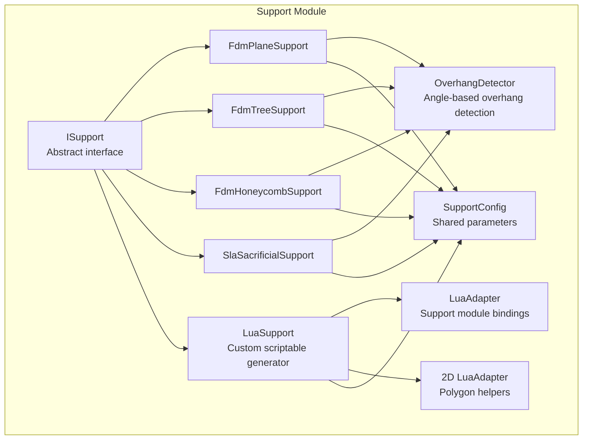
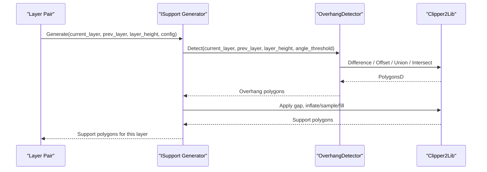
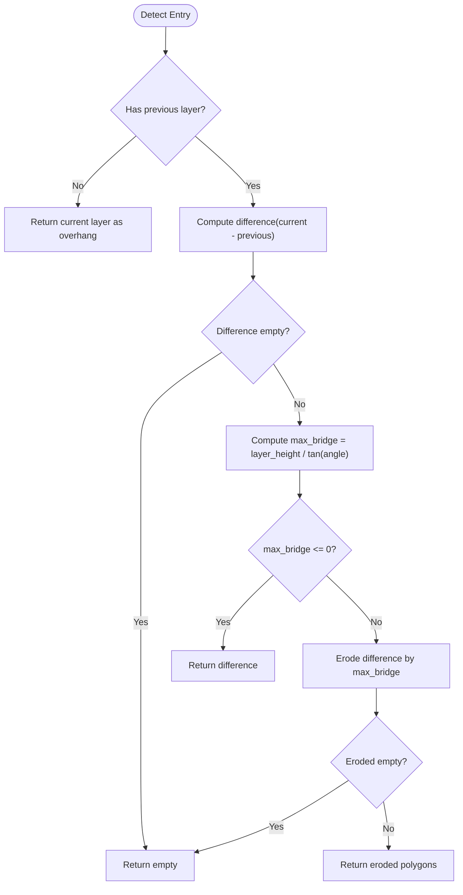
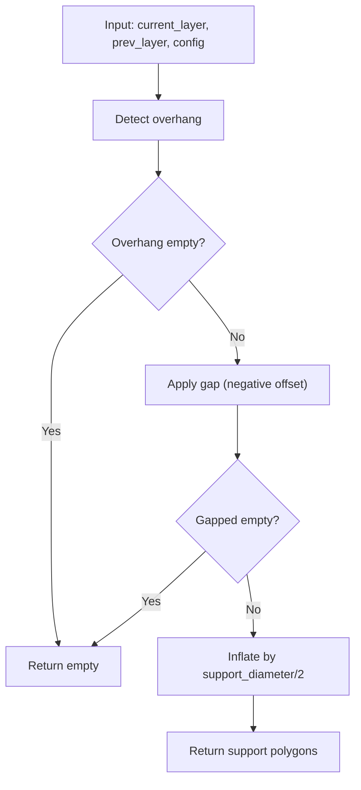
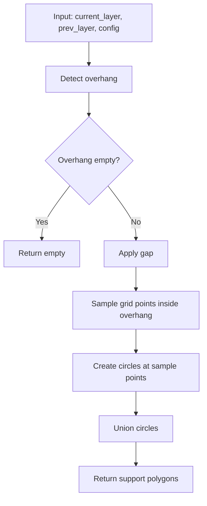
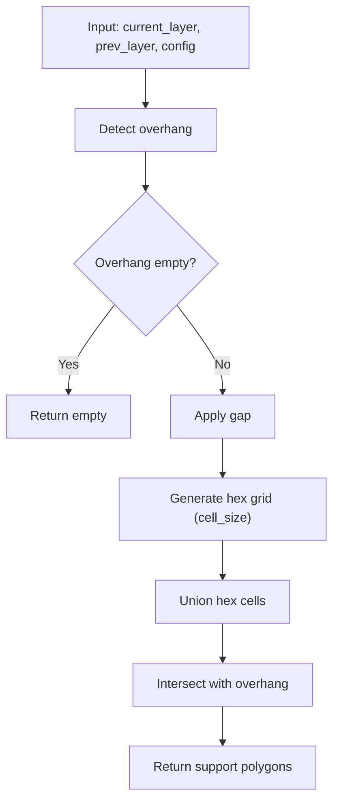
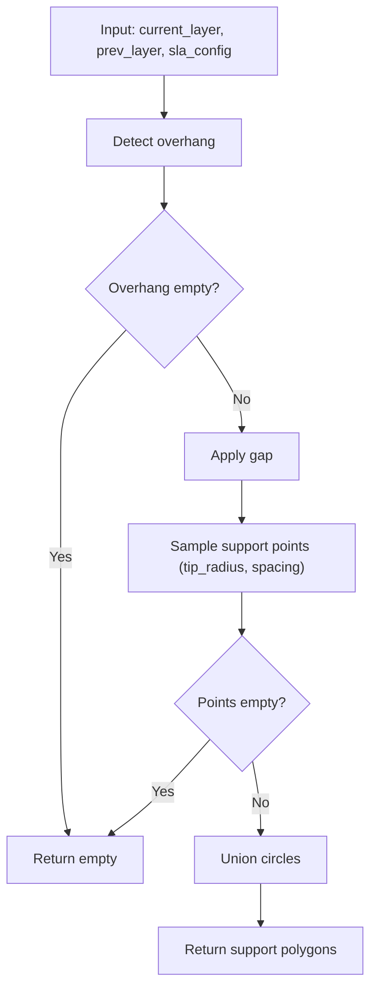
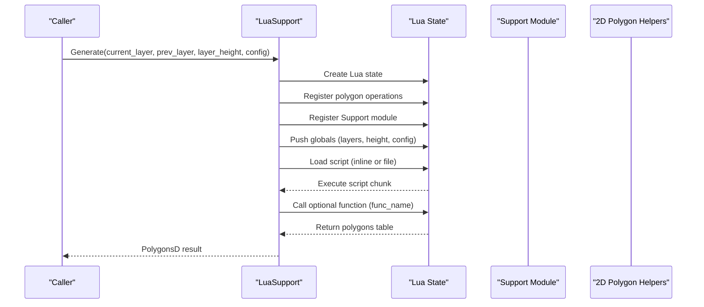
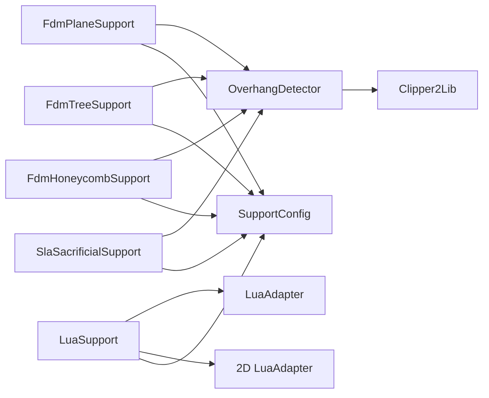

# Support Structure Algorithms

<cite>
**Referenced Files in This Document**
- [ISupport.hpp](file://support/ISupport.hpp)
- [ISupport.cpp](file://support/ISupport.cpp)
- [SupportConfig.hpp](file://support/SupportConfig.hpp)
- [OverhangDetector.hpp](file://support/OverhangDetector.hpp)
- [OverhangDetector.cpp](file://support/OverhangDetector.cpp)
- [FdmSupport.hpp](file://support/FdmSupport.hpp)
- [FdmSupport.cpp](file://support/FdmSupport.cpp)
- [SlaSupport.hpp](file://support/SlaSupport.hpp)
- [SlaSupport.cpp](file://support/SlaSupport.cpp)
- [LuaSupport.hpp](file://support/LuaSupport.hpp)
- [LuaSupport.cpp](file://support/LuaSupport.cpp)
- [LuaAdapter.hpp](file://support/LuaAdapter.hpp)
- [2D LuaAdapter.hpp](file://2D/LuaAdapter.hpp)
</cite>

## Table of Contents
1. [Introduction](#introduction)
2. [Project Structure](#project-structure)
3. [Core Components](#core-components)
4. [Architecture Overview](#architecture-overview)
5. [Detailed Component Analysis](#detailed-component-analysis)
6. [Dependency Analysis](#dependency-analysis)
7. [Performance Considerations](#performance-considerations)
8. [Troubleshooting Guide](#troubleshooting-guide)
9. [Conclusion](#conclusion)

## Introduction
This document explains HsBaSlicer’s support structure generation algorithms with a focus on:
- FDM support patterns: plane, tree, and honeycomb structures, including use cases and parameter configuration.
- SLA sacrificial supports for resin printing.
- Overhang detection that automatically identifies surfaces requiring support.
- The OverhangDetector class, angle threshold calculations, and how support density influences behavior.
- Custom support algorithm development via Lua scripting, integration points, and practical examples.
- Performance considerations for large models and memory optimization strategies.

## Project Structure
The support system is organized under the support module with clear separation between:
- Abstract interface and shared configuration
- Overhang detection logic
- Concrete support generators (FDM and SLA)
- Lua-based custom support generator and adapters

**Diagram sources**
- [ISupport.hpp:16-45](file://support/ISupport.hpp#L16-L45)
- [SupportConfig.hpp:14-43](file://support/SupportConfig.hpp#L14-L43)
- [OverhangDetector.hpp:14-50](file://support/OverhangDetector.hpp#L14-L50)
- [FdmSupport.hpp:13-63](file://support/FdmSupport.hpp#L13-L63)
- [SlaSupport.hpp:13-42](file://support/SlaSupport.hpp#L13-L42)
- [LuaSupport.hpp:21-81](file://support/LuaSupport.hpp#L21-L81)
- [LuaAdapter.hpp:13-30](file://support/LuaAdapter.hpp#L13-L30)
- [2D LuaAdapter.hpp:16-81](file://2D/LuaAdapter.hpp#L16-L81)

**Section sources**
- [ISupport.hpp:16-45](file://support/ISupport.hpp#L16-L45)
- [SupportConfig.hpp:14-43](file://support/SupportConfig.hpp#L14-L43)
- [OverhangDetector.hpp:14-50](file://support/OverhangDetector.hpp#L14-L50)
- [FdmSupport.hpp:13-63](file://support/FdmSupport.hpp#L13-L63)
- [SlaSupport.hpp:13-42](file://support/SlaSupport.hpp#L13-L42)
- [LuaSupport.hpp:21-81](file://support/LuaSupport.hpp#L21-L81)
- [LuaAdapter.hpp:13-30](file://support/LuaAdapter.hpp#L13-L30)
- [2D LuaAdapter.hpp:16-81](file://2D/LuaAdapter.hpp#L16-L81)

## Core Components
- ISupport: Abstract interface defining per-layer support generation and a default batch generator.
- SupportConfig: Shared configuration fields controlling overhang thresholds, layer height, gaps, diameters, densities, and pattern-specific options.
- OverhangDetector: Detects unsupported regions between adjacent layers using an angle threshold and bridge distance calculation.
- FdmPlaneSupport, FdmTreeSupport, FdmHoneycombSupport: FDM-specific support generators implementing different structural patterns.
- SlaSacrificialSupport: SLA sacrificial support generator producing thin columns optimized for easy removal.
- LuaSupport: Script-driven support generator allowing full customization through Lua scripts.

Key responsibilities:
- Overhang detection drives all generators to identify where supports are needed.
- Generators convert detected overhangs into layer-wise support polygons based on their strategy.
- LuaSupport integrates with the same pipeline while enabling user-defined logic.

**Section sources**
- [ISupport.hpp:16-45](file://support/ISupport.hpp#L16-L45)
- [ISupport.cpp:9-21](file://support/ISupport.cpp#L9-L21)
- [SupportConfig.hpp:14-43](file://support/SupportConfig.hpp#L14-L43)
- [OverhangDetector.hpp:14-50](file://support/OverhangDetector.hpp#L14-L50)
- [FdmSupport.hpp:13-63](file://support/FdmSupport.hpp#L13-L63)
- [SlaSupport.hpp:13-42](file://support/SlaSupport.hpp#L13-L42)
- [LuaSupport.hpp:21-81](file://support/LuaSupport.hpp#L21-L81)

## Architecture Overview
The support pipeline processes each layer pair (current and previous) to detect overhangs and generate support cross-sections. All concrete generators follow the same contract defined by ISupport.

**Diagram sources**
- [ISupport.hpp:27-44](file://support/ISupport.hpp#L27-L44)
- [OverhangDetector.cpp:23-74](file://support/OverhangDetector.cpp#L23-L74)
- [FdmSupport.cpp:48-72](file://support/FdmSupport.cpp#L48-L72)
- [FdmSupport.cpp:131-149](file://support/FdmSupport.cpp#L131-L149)
- [FdmSupport.cpp:215-233](file://support/FdmSupport.cpp#L215-L233)
- [SlaSupport.cpp:74-118](file://support/SlaSupport.cpp#L74-L118)

## Detailed Component Analysis

### Overhang Detection
OverhangDetector computes unsupported regions between adjacent layers:
- If there is no previous layer, the entire current layer is considered overhang.
- It computes the difference between current and previous layers.
- It calculates a maximum bridge distance from the angle threshold and layer height.
- It erodes the difference by the bridge distance to filter out small overhangs that can be bridged.
- It returns the remaining unsupported polygons.

**Diagram sources**
- [OverhangDetector.cpp:23-74](file://support/OverhangDetector.cpp#L23-L74)

Key behaviors:
- MaxBridgeDistance handles edge angles: vertical walls (>=90°) require no support; flat or negative angles (<=0°) treat everything as overhang.
- Erosion uses integerization and negative offset with round joins to smooth corners.

Practical implications:
- Lowering the angle threshold increases sensitivity to overhangs, generating more supports.
- Increasing layer height increases bridge tolerance, reducing supports for shallow overhangs.

**Section sources**
- [OverhangDetector.hpp:14-50](file://support/OverhangDetector.hpp#L14-L50)
- [OverhangDetector.cpp:23-74](file://support/OverhangDetector.cpp#L23-L74)

### FDM Plane Support
FdmPlaneSupport generates simple column supports from overhang regions:
- Detects overhangs using OverhangDetector.
- Applies a gap to separate supports from the model.
- Inflates the gapped region by half the support diameter to create cylindrical columns.

Use cases:
- Fast, robust supports for general FDM prints.
- Good balance of strength and print time.

Parameters:
- overhang_angle_threshold: Controls which surfaces need support.
- support_gap: Separation between model and support.
- support_diameter: Column thickness.

**Diagram sources**
- [FdmSupport.cpp:48-72](file://support/FdmSupport.cpp#L48-L72)

**Section sources**
- [FdmSupport.hpp:13-24](file://support/FdmSupport.hpp#L13-L24)
- [FdmSupport.cpp:48-72](file://support/FdmSupport.cpp#L48-L72)

### FDM Tree Support
FdmTreeSupport generates branching supports:
- Detects overhangs and applies gap.
- Samples branch tips within the overhang region at regular spacing.
- Creates circular branch tips and unions them to form discrete support points.
- Expansion across layers is handled by the higher-level iteration; at each layer, it produces circles representing branch cross-sections.

Use cases:
- Lightweight supports with reduced contact area.
- Easier removal and less surface marking.

Parameters:
- overhang_angle_threshold: Determines where branches start.
- support_gap: Gap between model and branch tips.
- support_diameter: Tip radius and spacing control.

**Diagram sources**
- [FdmSupport.cpp:77-149](file://support/FdmSupport.cpp#L77-L149)

**Section sources**
- [FdmSupport.hpp:26-44](file://support/FdmSupport.hpp#L26-L44)
- [FdmSupport.cpp:77-149](file://support/FdmSupport.cpp#L77-L149)

### FDM Honeycomb Support
FdmHoneycombSupport fills overhang regions with a hexagonal honeycomb pattern:
- Detects overhangs and applies gap.
- Generates a grid of flat-top hexagons sized by honeycomb_cell_size.
- Unions the hex cells and intersects them with the overhang region.

Use cases:
- Lightweight yet rigid internal support structures.
- Reduced material usage while maintaining stability.

Parameters:
- overhang_angle_threshold: Where honeycomb starts.
- support_gap: Model-support separation.
- honeycomb_cell_size: Hexagon size controlling density and strength.

**Diagram sources**
- [FdmSupport.cpp:155-233](file://support/FdmSupport.cpp#L155-L233)

**Section sources**
- [FdmSupport.hpp:46-63](file://support/FdmSupport.hpp#L46-L63)
- [FdmSupport.cpp:155-233](file://support/FdmSupport.cpp#L155-L233)

### SLA Sacrificial Support
SlaSacrificialSupport generates thin sacrificial supports for resin printing:
- Detects overhangs and applies gap.
- Samples support points within the overhang region using tip_radius and spacing derived from support_diameter.
- Unions the resulting circles to produce support cross-sections.

Use cases:
- Resin printing where minimal contact area reduces post-processing effort.
- Small tip diameters ease removal; larger base improves adhesion.

Parameters:
- overhang_angle_threshold: Overhang sensitivity.
- support_gap: Gap between model and support.
- tip_diameter: Small tip size for easy removal.
- support_diameter: Spacing between support points.

**Diagram sources**
- [SlaSupport.cpp:38-118](file://support/SlaSupport.cpp#L38-L118)

**Section sources**
- [SlaSupport.hpp:13-42](file://support/SlaSupport.hpp#L13-L42)
- [SlaSupport.cpp:38-118](file://support/SlaSupport.cpp#L38-L118)

### Lua-Based Custom Support
LuaSupport allows users to replace built-in algorithms with custom logic:
- Exposes current_layer, prev_layer, layer_height, and config tables to Lua.
- Registers polygon helper functions and a Support module for creating built-in generators or calling detect_overhang.
- Supports inline scripts or external script files and optional function names.

Use cases:
- Experimentation with novel support strategies.
- Domain-specific optimizations or integrations.

Integration points:
- SetupLuaEnvironment initializes Lua state, registers helpers, and pushes data.
- GetResultFromLua extracts returned polygons from Lua.

**Diagram sources**
- [LuaSupport.cpp:18-89](file://support/LuaSupport.cpp#L18-L89)
- [LuaSupport.cpp:112-172](file://support/LuaSupport.cpp#L112-L172)
- [LuaAdapter.hpp:13-30](file://support/LuaAdapter.hpp#L13-L30)
- [2D LuaAdapter.hpp:76-81](file://2D/LuaAdapter.hpp#L76-L81)

Practical example outline:
- Write a Lua script that reads current_layer and prev_layer, calls Support.detect_overhang with a chosen angle, then returns a table of polygons representing your custom support shapes.
- Use Support.new_plane/new_tree/new_honeycomb/new_sla to compose built-in strategies if desired.

**Section sources**
- [LuaSupport.hpp:21-81](file://support/LuaSupport.hpp#L21-L81)
- [LuaSupport.cpp:18-89](file://support/LuaSupport.cpp#L18-L89)
- [LuaSupport.cpp:112-172](file://support/LuaSupport.cpp#L112-L172)
- [LuaAdapter.hpp:13-30](file://support/LuaAdapter.hpp#L13-L30)
- [2D LuaAdapter.hpp:76-81](file://2D/LuaAdapter.hpp#L76-L81)

### Configuration Reference
Shared configuration fields used across generators:
- overhang_angle_threshold: Degrees; lower values increase support coverage.
- layer_height: Millimeters; affects bridge tolerance.
- support_gap: Millimeters; separation between model and support.
- support_diameter: Millimeters; controls column/branch/sampling sizes.
- support_density: Fill density [0,1]; informational for higher-level pipelines.
- support_pattern: Enum-like field indicating preferred strategy (0=Plane, 1=Tree, 2=Honeycomb).
- tree_branch_angle: Degrees; informs tree branch geometry.
- tree_max_branch_radius: Millimeters; limits tree branch growth.
- honeycomb_cell_size: Millimeters; hex cell size for honeycomb.

SLA-specific additions:
- tip_diameter: Millimeters; small tips for easy removal.
- raft_thickness: Millimeters; raft layer thickness.

FDM-specific additions:
- interface_layers: Number of interface layers between model and support.
- interface_density: Interface fill density [0,1].

**Section sources**
- [SupportConfig.hpp:14-43](file://support/SupportConfig.hpp#L14-L43)

## Dependency Analysis
The support system exhibits clear separation of concerns:
- OverhangDetector depends on geometric primitives and Clipper2Lib operations.
- Generators depend on OverhangDetector and clipper operations for gap application and shape construction.
- LuaSupport depends on Lua runtime and adapters for polygon manipulation and support module exposure.

**Diagram sources**
- [OverhangDetector.cpp:1-77](file://support/OverhangDetector.cpp#L1-L77)
- [FdmSupport.cpp:1-236](file://support/FdmSupport.cpp#L1-L236)
- [SlaSupport.cpp:1-120](file://support/SlaSupport.cpp#L1-L120)
- [LuaSupport.cpp:1-175](file://support/LuaSupport.cpp#L1-L175)
- [LuaAdapter.hpp:13-30](file://support/LuaAdapter.hpp#L13-L30)
- [2D LuaAdapter.hpp:16-81](file://2D/LuaAdapter.hpp#L16-L81)
- [SupportConfig.hpp:14-43](file://support/SupportConfig.hpp#L14-L43)

**Section sources**
- [OverhangDetector.cpp:1-77](file://support/OverhangDetector.cpp#L1-L77)
- [FdmSupport.cpp:1-236](file://support/FdmSupport.cpp#L1-L236)
- [SlaSupport.cpp:1-120](file://support/SlaSupport.cpp#L1-L120)
- [LuaSupport.cpp:1-175](file://support/LuaSupport.cpp#L1-L175)
- [LuaAdapter.hpp:13-30](file://support/LuaAdapter.hpp#L13-L30)
- [2D LuaAdapter.hpp:16-81](file://2D/LuaAdapter.hpp#L16-L81)
- [SupportConfig.hpp:14-43](file://support/SupportConfig.hpp#L14-L43)

## Performance Considerations
- Overhang detection complexity:
  - Difference and offset operations scale with polygon complexity; minimizing vertex count helps.
  - Integerization and back-conversion add overhead but improve numerical stability.
- Generator strategies:
  - Plane support inflates polygons; efficient for moderate overhang areas.
  - Tree support samples a grid; spacing directly impacts number of circles and union cost.
  - Honeycomb support generates a hex grid; cell_size controls the number of hexagons and intersection cost.
  - SLA support samples points; spacing and tip_radius determine circle count and union cost.
- Memory optimization:
  - Reuse intermediate polygon buffers where possible.
  - Avoid unnecessary conversions between double and integer representations.
  - Limit script execution scope in LuaSupport to reduce allocation overhead.
- Large models:
  - Prefer coarser sampling (larger spacing or cell_size) to reduce polygon counts.
  - Tune overhang_angle_threshold to avoid excessive support generation.
  - Batch processing via ISupport::GenerateAll iterates layers efficiently.

[No sources needed since this section provides general guidance]

## Troubleshooting Guide
Common issues and resolutions:
- No supports generated:
  - Verify overhang_angle_threshold is not too high; lower it to increase sensitivity.
  - Ensure layer_height is set correctly; incorrect values affect bridge tolerance.
- Excessive supports:
  - Increase overhang_angle_threshold or adjust layer_height to widen acceptable bridges.
  - For tree/honeycomb/SLA, increase spacing or cell_size to reduce density.
- Supports intersecting model:
  - Increase support_gap to ensure clearance.
- Lua script errors:
  - Check script load and runtime error messages thrown by LuaSupport.
  - Validate that the script returns a table of polygons or defines the expected function name.

Operational notes:
- LuaSupport throws RuntimeError on Lua state creation, script loading, execution, or function call failures.
- Always validate input polygons and configuration before invoking generators.

**Section sources**
- [LuaSupport.cpp:112-172](file://support/LuaSupport.cpp#L112-L172)
- [OverhangDetector.cpp:23-74](file://support/OverhangDetector.cpp#L23-L74)
- [FdmSupport.cpp:48-72](file://support/FdmSupport.cpp#L48-L72)
- [FdmSupport.cpp:131-149](file://support/FdmSupport.cpp#L131-L149)
- [FdmSupport.cpp:215-233](file://support/FdmSupport.cpp#L215-L233)
- [SlaSupport.cpp:74-118](file://support/SlaSupport.cpp#L74-L118)

## Conclusion
HsBaSlicer’s support system provides a flexible, extensible framework for generating supports across FDM and SLA workflows:
- OverhangDetector offers precise, angle-based detection with tunable bridge tolerance.
- FDM generators cover common needs: plane columns, tree branches, and honeycomb infill.
- SLA sacrificial supports optimize for resin printing with small tips and controlled spacing.
- LuaSupport enables deep customization, integrating seamlessly with the same pipeline.
By tuning configuration parameters and selecting appropriate strategies, users can balance print quality, material usage, and performance for a wide range of models.

[No sources needed since this section summarizes without analyzing specific files]