# Type Safety

<cite>
**Referenced Files in This Document**   
- [concepts.hpp](file://base/concepts.hpp)
- [template_helper.hpp](file://base/template_helper.hpp)
- [struct_concepts.hpp](file://utils/struct_concepts.hpp)
- [static_reflect.hpp](file://base/static_reflect.hpp)
- [InplaceVector.hpp](file://base/InplaceVector.hpp)
- [coroutine.hpp](file://base/coroutine.hpp)
- [delegate.hpp](file://base/delegate.hpp)
- [AreaGraph.hpp](file://utils/AreaGraph.hpp)
- [struct_xml.hpp](file://utils/struct_xml.hpp)
</cite>

## Table of Contents
1. [Introduction](#introduction)
2. [Project Structure](#project-structure)
3. [Core Components](#core-components)
4. [Architecture Overview](#architecture-overview)
5. [Detailed Component Analysis](#detailed-component-analysis)
6. [Dependency Analysis](#dependency-analysis)
7. [Performance Considerations](#performance-considerations)
8. [Troubleshooting Guide](#troubleshooting-guide)
9. [Conclusion](#conclusion)
10. [Appendices](#appendices)

## Introduction
This document explains how HsBaSlicer uses C++20 concepts, template metaprogramming, and compile-time checks to enforce type safety across its core libraries. It focuses on:

- Concept definitions for streams, strings, allocators, hashing, arithmetic operations, pointers, optional-like types, enumerations, and aggregates.
- Template helper utilities such as fixed-size compile-time strings, named pointers, enum reflection helpers, invocation wrappers, and non-copyable array construction.
- Static reflection integration through a `Reflectable` concept and a compile-time reflector.
- SFINAE-style constraints using `requires`, `if constexpr`, and standard library concepts.
- Compile-time validation with `static_assert`, `constexpr` functions, and NTTP-friendly numeric wrapper types.
- Migration guidance from traditional templates to modern C++20 patterns.

The goal is to help developers understand the existing type-safety mechanisms and extend them safely when adding new algorithms, data formats, or pipeline components.

## Project Structure
The type-safety surface area relevant to this document is concentrated in the base and utils layers:

- `base/concepts.hpp`: Core C++20 concepts used throughout the codebase.
- `base/template_helper.hpp`: Template utilities, compile-time string handling, enum helpers, named pointer wrappers, and NTTP numeric wrappers.
- `utils/struct_concepts.hpp`: Concepts for aggregate and reflectable structures.
- `base/static_reflect.hpp`: Static reflection primitives and a reflector API constrained by concepts.
- `base/InplaceVector.hpp`: A fixed-capacity vector that demonstrates compile-time capacity checks and constexpr behavior.
- `base/coroutine.hpp` and `base/delegate.hpp`: Examples of `requires` clauses constraining coroutines and event systems.
- `utils/AreaGraph.hpp` and `utils/struct_xml.hpp`: Real usage of concepts and `if constexpr` dispatching.

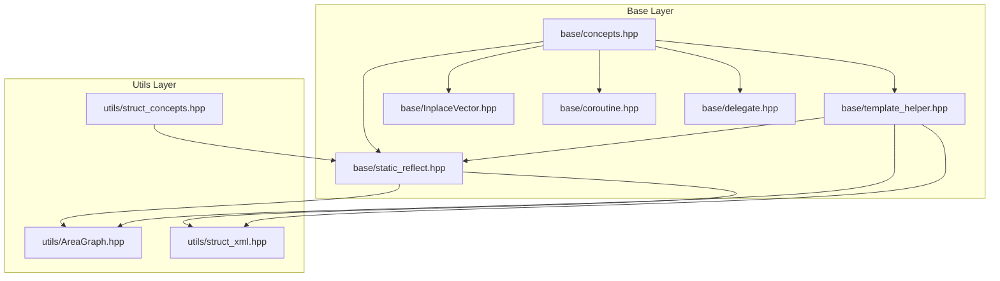

**Diagram sources**
- [concepts.hpp:1-269](file://base/concepts.hpp#L1-L269)
- [template_helper.hpp:1-780](file://base/template_helper.hpp#L1-L780)
- [static_reflect.hpp:1-188](file://base/static_reflect.hpp#L1-L188)
- [InplaceVector.hpp:1-223](file://base/InplaceVector.hpp#L1-L223)
- [coroutine.hpp:72-82](file://base/coroutine.hpp#L72-L82)
- [delegate.hpp:174-174](file://base/delegate.hpp#L174-L174)
- [struct_concepts.hpp:1-53](file://utils/struct_concepts.hpp#L1-L53)
- [AreaGraph.hpp:105-152](file://utils/AreaGraph.hpp#L105-L152)
- [struct_xml.hpp:197-232](file://utils/struct_xml.hpp#L197-L232)

**Section sources**
- [concepts.hpp:1-269](file://base/concepts.hpp#L1-L269)
- [template_helper.hpp:1-780](file://base/template_helper.hpp#L1-L780)
- [struct_concepts.hpp:1-53](file://utils/struct_concepts.hpp#L1-L53)
- [static_reflect.hpp:1-188](file://base/static_reflect.hpp#L1-L188)
- [InplaceVector.hpp:1-223](file://base/InplaceVector.hpp#L1-L223)
- [coroutine.hpp:72-82](file://base/coroutine.hpp#L72-L82)
- [delegate.hpp:174-174](file://base/delegate.hpp#L174-L174)
- [AreaGraph.hpp:105-152](file://utils/AreaGraph.hpp#L105-L152)
- [struct_xml.hpp:197-232](file://utils/struct_xml.hpp#L197-L232)

## Core Components
HsBaSlicer’s type safety relies on three main pillars:

1. **Concepts**: Named compile-time predicates that describe required interfaces or properties.
2. **Template Helpers**: Generic utilities that use concepts and standard-library facilities to provide safe, reusable building blocks.
3. **Static Reflection Integration**: A small reflection system constrained by concepts, enabling compile-time introspection and dispatch.

Key responsibilities:

- `base/concepts.hpp` defines reusable concepts for streams, strings, allocators, hashing, arithmetic, references, pointers, and optionals.
- `base/template_helper.hpp` provides compile-time string handling, named pointer wrappers, enum conversion helpers, invocation utilities, and NTTP-compatible numeric wrappers.
- `utils/struct_concepts.hpp` adds aggregate and reflectable type concepts for serialization and reflection workflows.
- `base/static_reflect.hpp` exposes a `Reflectable` concept and a `Reflector` class that access fields and methods at compile time.

These components are combined with `requires`, `if constexpr`, `static_assert`, and `constexpr` to produce robust APIs with clear error messages and efficient generated code.

**Section sources**
- [concepts.hpp:1-269](file://base/concepts.hpp#L1-L269)
- [template_helper.hpp:1-780](file://base/template_helper.hpp#L1-L780)
- [struct_concepts.hpp:1-53](file://utils/struct_concepts.hpp#L1-L53)
- [static_reflect.hpp:1-188](file://base/static_reflect.hpp#L1-L188)

## Architecture Overview
At a high level, the type-safety architecture separates concerns into:

- **Concept layer**: Pure predicates describing what a type must support.
- **Helper layer**: Algorithms and wrappers that depend on those predicates.
- **Reflection layer**: Compile-time metadata access constrained by concepts.
- **Usage layer**: Components like graphs, XML/YAML/JSON converters, pipelines, and models that consume these abstractions.

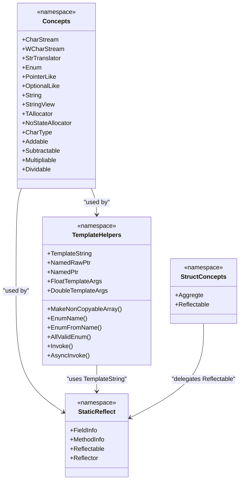

**Diagram sources**
- [concepts.hpp:1-269](file://base/concepts.hpp#L1-L269)
- [template_helper.hpp:1-780](file://base/template_helper.hpp#L1-L780)
- [static_reflect.hpp:1-188](file://base/static_reflect.hpp#L1-L188)
- [struct_concepts.hpp:1-53](file://utils/struct_concepts.hpp#L1-L53)

## Detailed Component Analysis

### Concept Definitions in `base/concepts.hpp`
The core concepts define behavioral contracts rather than inheritance hierarchies. They cover:

- **Streams**: `CharStream` and `WCharStream` require stream insertion and extraction operators.
- **Translators**: `StrTranslator` requires `put_value` and `get_value` compatible with string-based configuration systems.
- **Enumerations**: `Enum` wraps `std::is_enum_v`.
- **Pointers and iterators**: `CStylePointer`, `PointerOrIt`, and `PointerLike` express pointer-like behavior including dereference, member access, and boolean conversion.
- **Optional-like types**: `OptionalLike` requires `has_value`, `operator*`, and `value`.
- **Strings and views**: `StdString`, `CStyleString`, `String`, and `StringView` unify standard and C-style character sequences.
- **Allocators**: `TAllocator` and `NoStateAllocator` constrain allocator semantics and stateless allocator traits.
- **Character types**: `CharType` restricts to supported character encodings.
- **Arithmetic operations**: `Addable`, `Subtractable`, `Multipliable`, and `Dividable` ensure consistent operator return types.
- **Hashing and equality**: `StdHash`, `Hash`, `EqualAndStdHash`, and `EqualAndHash` combine equality comparability with hashability.

These concepts improve error messages because constraint failures are reported at the point where a template is instantiated with an incompatible type.

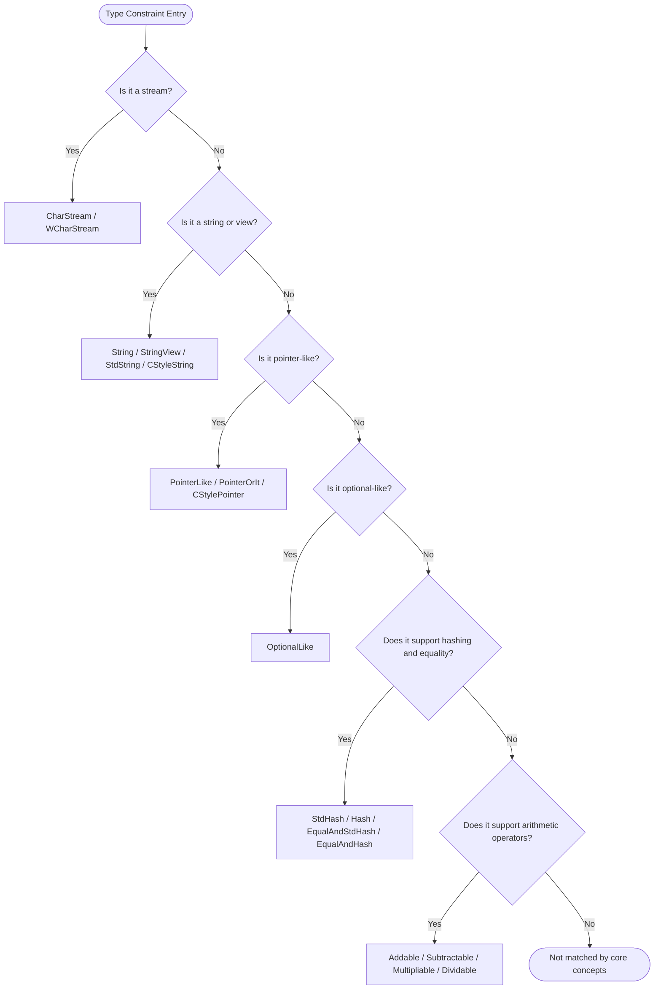

**Diagram sources**
- [concepts.hpp:22-37](file://base/concepts.hpp#L22-L37)
- [concepts.hpp:174-198](file://base/concepts.hpp#L174-L198)
- [concepts.hpp:78-95](file://base/concepts.hpp#L78-L95)
- [concepts.hpp:142-167](file://base/concepts.hpp#L142-L167)
- [concepts.hpp:236-266](file://base/concepts.hpp#L236-L266)

**Section sources**
- [concepts.hpp:22-37](file://base/concepts.hpp#L22-L37)
- [concepts.hpp:45-49](file://base/concepts.hpp#L45-L49)
- [concepts.hpp:56-63](file://base/concepts.hpp#L56-L63)
- [concepts.hpp:69-95](file://base/concepts.hpp#L69-L95)
- [concepts.hpp:102-128](file://base/concepts.hpp#L102-L128)
- [concepts.hpp:142-167](file://base/concepts.hpp#L142-L167)
- [concepts.hpp:174-230](file://base/concepts.hpp#L174-L230)
- [concepts.hpp:236-266](file://base/concepts.hpp#L236-L266)

### Template Helper Utilities in `base/template_helper.hpp`
This file provides practical, type-safe building blocks:

- **Compile-time strings**: `TemplateString<T, N>` supports construction from C-style arrays, `std::array`, `std::string_view`, ranges, and user-defined literals. It integrates with `std::formatter` and supports transformations via ranges.
- **Invocation helpers**: `Invoke` and `AsyncInvoke` wrap callable invocation with `requires std::invocable`.
- **Enum utilities**: `EnumName`, `EnumFromName`, `MakeEnumValidTable`, and `AllValidEnum` use the `Enum` concept and `magic_enum` to convert between enums and names at compile time.
- **Named pointers**: `NamedRawPtr` and `NamedPtr` attach a compile-time name to raw or smart pointers, improving debugging and diagnostics.
- **NTTP numeric wrappers**: `FloatTemplateArgs` and `DoubleTemplateArgs` allow floating-point values as non-type template parameters when compilers do not natively support FP NTTP.
- **Non-copyable arrays**: `MakeNonCopyableArray` constructs arrays of move-only types using index sequences and `requires`.

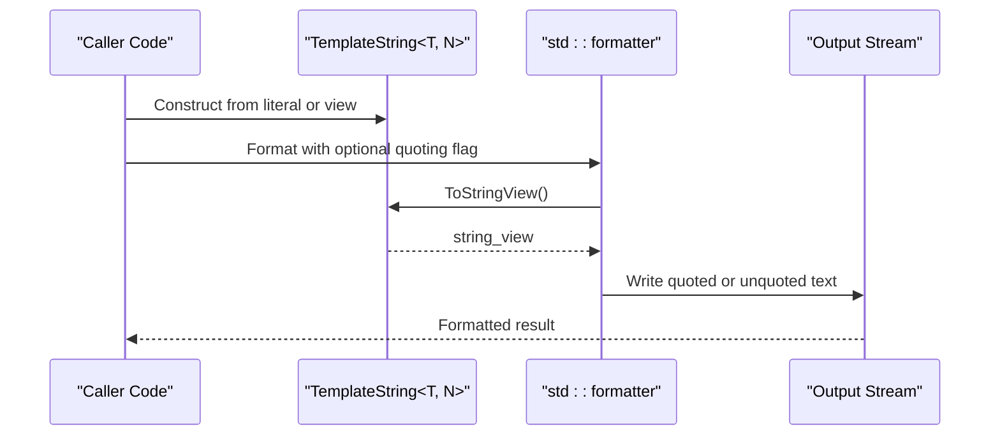

**Diagram sources**
- [template_helper.hpp:50-305](file://base/template_helper.hpp#L50-L305)
- [template_helper.hpp:743-778](file://base/template_helper.hpp#L743-L778)

**Section sources**
- [template_helper.hpp:50-305](file://base/template_helper.hpp#L50-L305)
- [template_helper.hpp:327-360](file://base/template_helper.hpp#L327-L360)
- [template_helper.hpp:380-416](file://base/template_helper.hpp#L380-L416)
- [template_helper.hpp:443-555](file://base/template_helper.hpp#L443-L555)
- [template_helper.hpp:564-666](file://base/template_helper.hpp#L564-L666)
- [template_helper.hpp:668-687](file://base/template_helper.hpp#L668-L687)
- [template_helper.hpp:718-723](file://base/template_helper.hpp#L718-L723)
- [template_helper.hpp:725-736](file://base/template_helper.hpp#L725-L736)
- [template_helper.hpp:743-778](file://base/template_helper.hpp#L743-L778)

### Aggregate and Reflectable Concepts in `utils/struct_concepts.hpp`
This header introduces two important concepts:

- `Aggregte`: Identifies aggregate types suitable for initialization and introspection without user-declared constructors or complex class invariants.
- `Reflectable`: Delegates to `StaticReflect::Reflectable<T>`, marking types that expose field and method lists for static reflection.

These concepts are used by serialization utilities to decide how to process structured data.

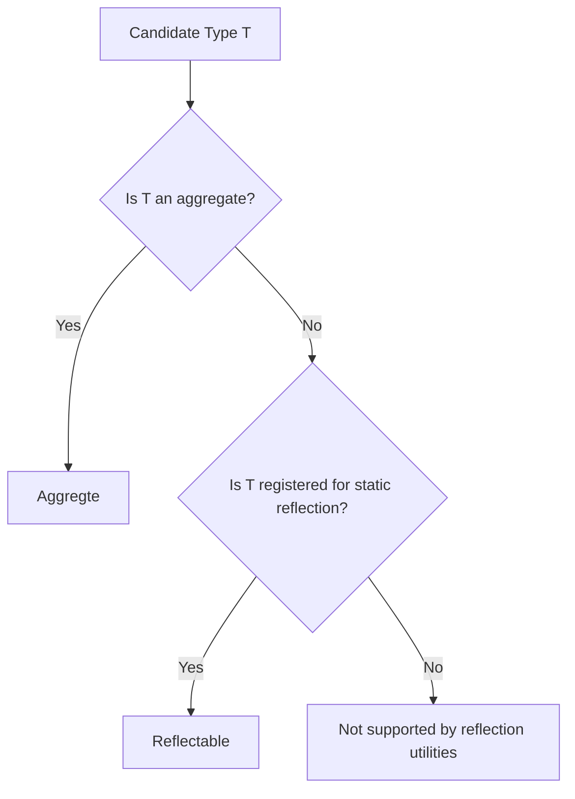

**Diagram sources**
- [struct_concepts.hpp:36-37](file://utils/struct_concepts.hpp#L36-L37)
- [struct_concepts.hpp:49-50](file://utils/struct_concepts.hpp#L49-L50)
- [static_reflect.hpp:101-107](file://base/static_reflect.hpp#L101-L107)

**Section sources**
- [struct_concepts.hpp:1-53](file://utils/struct_concepts.hpp#L1-L53)
- [static_reflect.hpp:101-107](file://base/static_reflect.hpp#L101-L107)

### Static Reflection in `base/static_reflect.hpp`
The static reflection system provides:

- `FieldInfo` and `MethodInfo`: Compile-time descriptors for fields and methods, parameterized by class type, member type, compile-time name, and member pointer.
- `Reflectable` concept: Requires `FieldList`, `MethodList`, and `ClassName` members.
- `Reflector<T>`: Provides compile-time accessors for field and method counts, names, field access, and method invocation by compile-time name.

This design enables type-safe introspection without runtime type information.

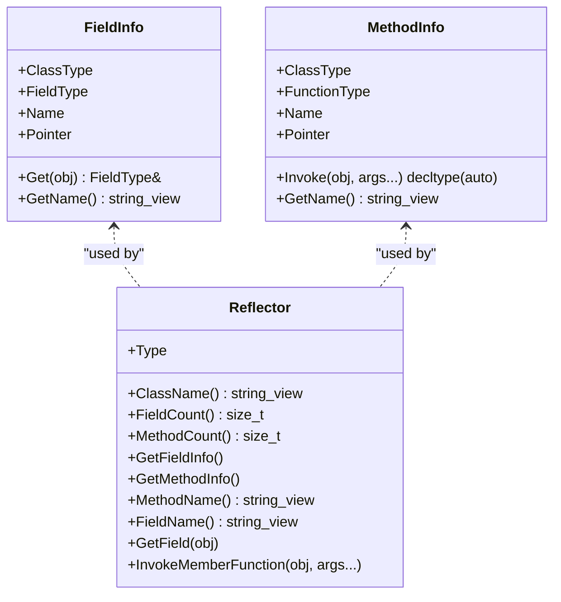

**Diagram sources**
- [static_reflect.hpp:35-57](file://base/static_reflect.hpp#L35-L57)
- [static_reflect.hpp:66-96](file://base/static_reflect.hpp#L66-L96)
- [static_reflect.hpp:101-183](file://base/static_reflect.hpp#L101-L183)

**Section sources**
- [static_reflect.hpp:35-57](file://base/static_reflect.hpp#L35-L57)
- [static_reflect.hpp:66-96](file://base/static_reflect.hpp#L66-L96)
- [static_reflect.hpp:101-183](file://base/static_reflect.hpp#L101-L183)

### Compile-Time Constraints in Coroutines and Delegates
Coroutines and delegates demonstrate how `requires` clauses constrain generic APIs:

- `base/coroutine.hpp` uses `requires` to constrain task return types and executor-derived awaiter types.
- `base/delegate.hpp` uses `requires(sizeof...(Args) > 0)` to prevent empty parameter packs for event types.

These constraints shift errors from runtime misuse to compile-time failures with clearer diagnostics.

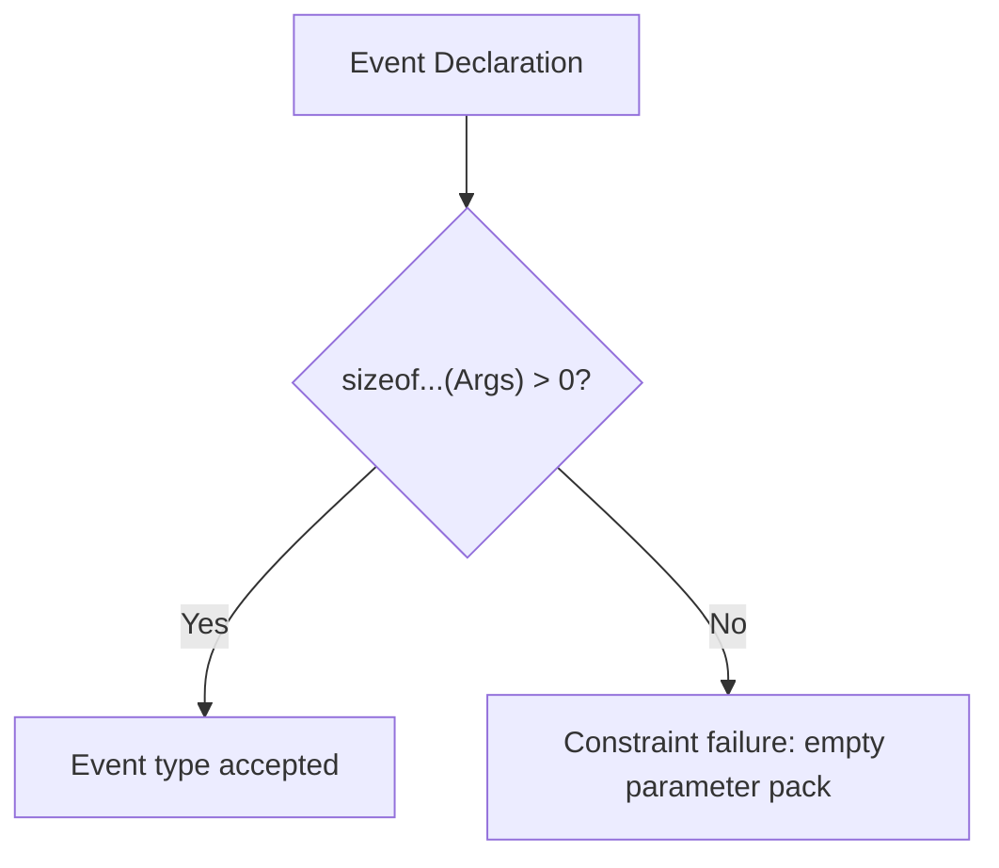

**Diagram sources**
- [delegate.hpp:174-174](file://base/delegate.hpp#L174-L174)

**Section sources**
- [coroutine.hpp:72-82](file://base/coroutine.hpp#L72-L82)
- [coroutine.hpp:206-206](file://base/coroutine.hpp#L206-L206)
- [coroutine.hpp:265-265](file://base/coroutine.hpp#L265-L265)
- [coroutine.hpp:437-437](file://base/coroutine.hpp#L437-L437)
- [coroutine.hpp:625-625](file://base/coroutine.hpp#L625-L625)
- [coroutine.hpp:808-808](file://base/coroutine.hpp#L808-L808)
- [delegate.hpp:174-174](file://base/delegate.hpp#L174-L174)

### Usage Patterns in Graph and Serialization Code
Real-world usage shows how concepts guide algorithm selection:

- `utils/AreaGraph.hpp` uses concepts for vertex IDs and optional description types, with `requires(!std::is_same_v<AD, void>)` to enable optional features.
- `utils/struct_xml.hpp` uses `if constexpr` branches based on `OptionalLike`, `Reflectable`, `Aggregte`, `std::string`, arithmetic types, and enumerations to serialize different value kinds.

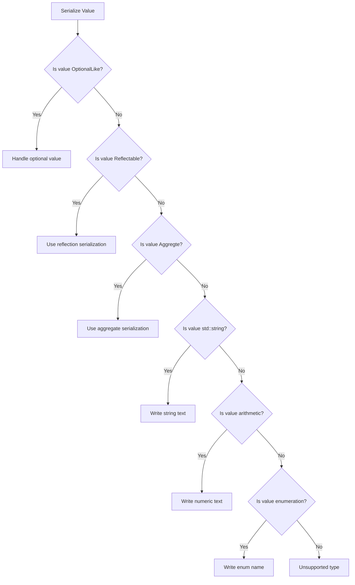

**Diagram sources**
- [AreaGraph.hpp:105-152](file://utils/AreaGraph.hpp#L105-L152)
- [struct_xml.hpp:197-232](file://utils/struct_xml.hpp#L197-L232)

**Section sources**
- [AreaGraph.hpp:105-152](file://utils/AreaGraph.hpp#L105-L152)
- [struct_xml.hpp:197-232](file://utils/struct_xml.hpp#L197-L232)

### Fixed-Capacity Vector and Compile-Time Validation
`base/InplaceVector.hpp` demonstrates compile-time guarantees:

- Capacity `N` must be positive, enforced by `static_assert`.
- The implementation prefers the standard library’s `std::inplace_vector` when available and constexpr-capable; otherwise, it provides a custom implementation.
- Methods like `at`, `emplace_back`, and `clear` include bounds checking and resource management.

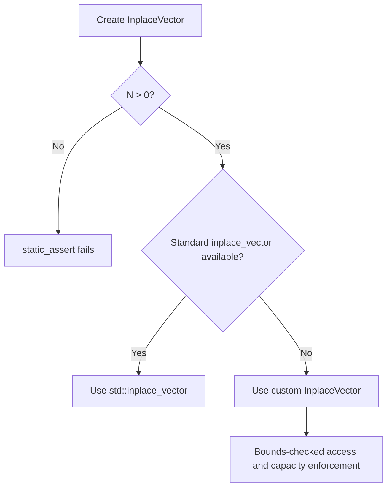

**Diagram sources**
- [InplaceVector.hpp:32-42](file://base/InplaceVector.hpp#L32-L42)
- [InplaceVector.hpp:207-207](file://base/InplaceVector.hpp#L207-L207)

**Section sources**
- [InplaceVector.hpp:32-42](file://base/InplaceVector.hpp#L32-L42)
- [InplaceVector.hpp:207-207](file://base/InplaceVector.hpp#L207-L207)

## Dependency Analysis
The type-safety dependencies form a layered structure:

- `base/concepts.hpp` is foundational and consumed by most other headers.
- `base/template_helper.hpp` depends on `concepts.hpp` and provides higher-level utilities.
- `base/static_reflect.hpp` depends on both `concepts.hpp` and `template_helper.hpp`.
- `utils/struct_concepts.hpp` depends on `base/static_reflect.hpp`.
- Higher-level modules like `utils/AreaGraph.hpp` and `utils/struct_xml.hpp` depend on concepts and reflection utilities.

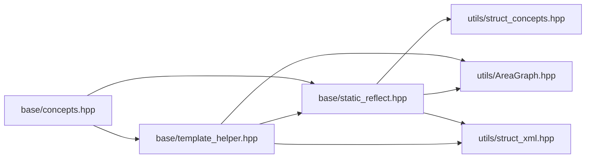

**Diagram sources**
- [concepts.hpp:1-269](file://base/concepts.hpp#L1-L269)
- [template_helper.hpp:1-780](file://base/template_helper.hpp#L1-L780)
- [static_reflect.hpp:1-188](file://base/static_reflect.hpp#L1-L188)
- [struct_concepts.hpp:1-53](file://utils/struct_concepts.hpp#L1-L53)
- [AreaGraph.hpp:105-152](file://utils/AreaGraph.hpp#L105-L152)
- [struct_xml.hpp:197-232](file://utils/struct_xml.hpp#L197-L232)

**Section sources**
- [concepts.hpp:1-269](file://base/concepts.hpp#L1-L269)
- [template_helper.hpp:1-780](file://base/template_helper.hpp#L1-L780)
- [static_reflect.hpp:1-188](file://base/static_reflect.hpp#L1-L188)
- [struct_concepts.hpp:1-53](file://utils/struct_concepts.hpp#L1-L53)
- [AreaGraph.hpp:105-152](file://utils/AreaGraph.hpp#L105-L152)
- [struct_xml.hpp:197-232](file://utils/struct_xml.hpp#L197-L232)

## Performance Considerations
Using C++20 concepts and compile-time computation improves performance in several ways:

- **Better code generation**: Concepts constrain template instantiation, reducing ambiguity and allowing the compiler to generate specialized code paths.
- **Compile-time validation**: `static_assert` and `requires` fail early, avoiding runtime overhead for invalid configurations.
- **Zero-cost abstractions**: Compile-time strings, named pointers, and reflection metadata are designed to minimize runtime cost while preserving safety.
- **Constexpr computation**: Enum tables, format parsing, and utility functions can run at compile time, reducing runtime work.
- **Allocator and container choices**: `NoStateAllocator` and `InplaceVector` encourage predictable memory layouts and avoid unnecessary dynamic allocation.

[No sources needed since this section provides general guidance]

## Troubleshooting Guide
Common issues and how the type-safety system helps diagnose them:

- **Concept mismatch**: When a template expects `CharStream<T>` but receives a type without stream operators, the compiler reports a constraint failure at the call site. Prefer adding stream operators or choosing a concept that matches the actual interface.
- **Invalid enum values**: `AllValidEnum` and `MakeEnumValidTable` rely on `magic_enum`. If an enum name contains reserved suffixes or falls outside the expected range, the function returns default behavior. Validate enum naming conventions and ranges.
- **Out-of-range access**: `InplaceVector::at` throws `std::out_of_range`; `InplaceVector::emplace_back` throws `std::length_error` when capacity is exceeded. Ensure indices and sizes are validated before calling.
- **Missing reflection metadata**: Types used with `Reflector` must satisfy `Reflectable`, exposing `FieldList`, `MethodList`, and `ClassName`. Add these members or register the type appropriately.
- **Empty delegate parameter packs**: `Event<Args...>` requires at least one argument. Remove empty parameter packs or adjust the event signature.

**Section sources**
- [InplaceVector.hpp:142-146](file://base/InplaceVector.hpp#L142-L146)
- [InplaceVector.hpp:163-171](file://base/InplaceVector.hpp#L163-L171)
- [InplaceVector.hpp:207-207](file://base/InplaceVector.hpp#L207-L207)
- [static_reflect.hpp:123-180](file://base/static_reflect.hpp#L123-L180)
- [template_helper.hpp:443-555](file://base/template_helper.hpp#L443-L555)
- [delegate.hpp:174-174](file://base/delegate.hpp#L174-L174)

## Conclusion
HsBaSlicer’s type safety is built around C++20 concepts, template helpers, and static reflection. The approach emphasizes:

- Clear, named constraints instead of ad hoc SFINAE.
- Compile-time validation with `static_assert` and `requires`.
- Constexpr and NTTP-friendly utilities for safer, faster code.
- Practical helpers like compile-time strings, named pointers, and enum reflection.
- Real-world usage in graphs and serialization to demonstrate robust API design.

When extending the codebase, prefer defining new concepts for domain-specific requirements, using `requires` to constrain templates, and leveraging existing helpers to keep APIs consistent and maintainable.

[No sources needed since this section summarizes without analyzing specific files]

## Appendices

### Migration from Traditional Templates to C++20 Concepts
Recommended migration steps:

1. **Identify SFINAE patterns**: Look for `enable_if`, `decltype`, and nested `::type` expressions.
2. **Extract predicates**: Convert conditions into named concepts in `base/concepts.hpp` or a dedicated module.
3. **Apply constraints**: Replace `enable_if` with `requires` clauses on functions and classes.
4. **Improve diagnostics**: Use concept names in error messages by ensuring constraints are explicit.
5. **Validate with tests**: Add static tests to verify that valid types compile and invalid types fail with meaningful messages.
6. **Preserve compatibility**: Keep fallback implementations where necessary, but prefer concept-constrained APIs as the primary interface.

Example migration pattern:

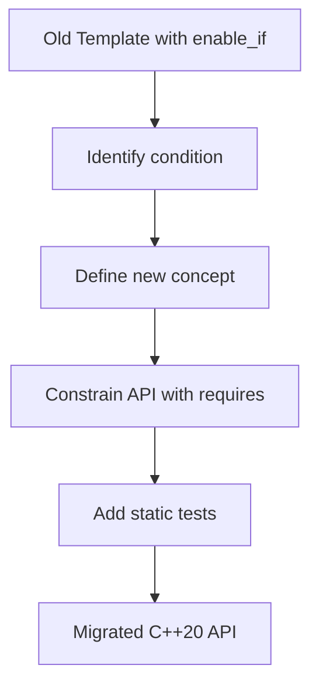

[No sources needed since this diagram shows conceptual workflow, not actual code structure]