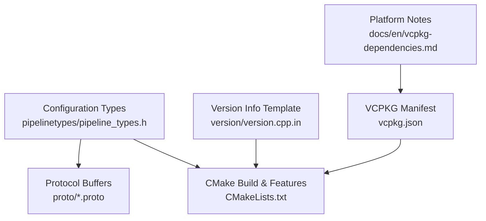
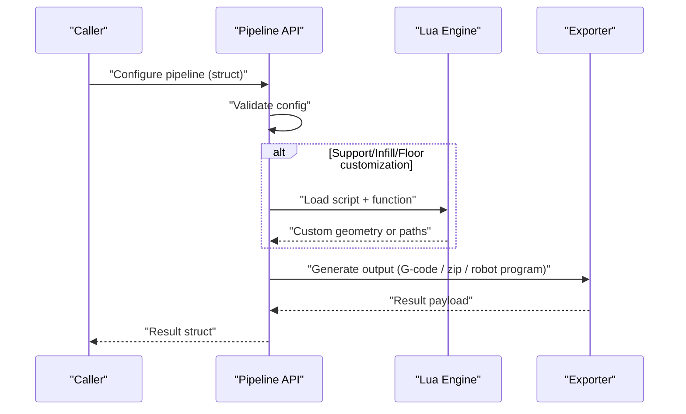
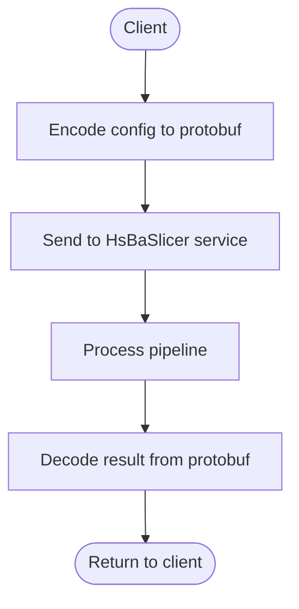
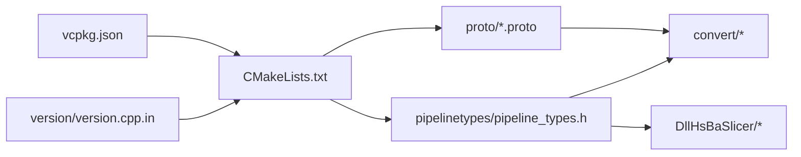

# Appendix

<cite>
**Referenced Files in This Document**   
- [pipeline_types.h](file://pipelinetypes/pipeline_types.h)
- [fdm_pipeline.proto](file://proto/fdm_pipeline.proto)
- [sla_pipeline.proto](file://proto/sla_pipeline.proto)
- [sls_pipeline.proto](file://proto/sls_pipeline.proto)
- [slm_pipeline.proto](file://proto/slm_pipeline.proto)
- [lom_pipeline.proto](file://proto/lom_pipeline.proto)
- [tdp_pipeline.proto](file://proto/tdp_pipeline.proto)
- [waam_pipeline.proto](file://proto/waam_pipeline.proto)
- [custom_pipeline.proto](file://proto/custom_pipeline.proto)
- [slice_config.proto](file://proto/slice_config.proto)
- [vcpkg.json](file://vcpkg.json)
- [CMakeLists.txt](file://CMakeLists.txt)
- [version.cpp.in](file://version/version.cpp.in)
- [vcpkg-dependencies.md](file://docs/en/vcpkg-dependencies.md)
</cite>

## Table of Contents
1. [Introduction](#introduction)
2. [Project Structure](#project-structure)
3. [Core Components](#core-components)
4. [Architecture Overview](#architecture-overview)
5. [Detailed Component Analysis](#detailed-component-analysis)
6. [Dependency Analysis](#dependency-analysis)
7. [Performance Considerations](#performance-considerations)
8. [Troubleshooting Guide](#troubleshooting-guide)
9. [Conclusion](#conclusion)
10. [Appendices](#appendices)

## Introduction
This appendix consolidates reference material for HsBaSlicer: configuration parameters, protocol buffer schemas, dependency and build configuration, versioning behavior, glossary, and external references. It is intended as a single lookup for developers integrating or extending the slicer pipelines, packaging the library, or writing cross-language clients through the generated Protocol Buffers.

## Project Structure
The appendix focuses on:
- Pipeline configuration types exposed by the C ABI.
- Protocol Buffer definitions used for cross-language communication.
- Dependency declarations and CMake feature flags.
- Version information generation.

**Diagram sources**
- [pipeline_types.h:1-1049](file://pipelinetypes/pipeline_types.h#L1-L1049)
- [fdm_pipeline.proto:1-81](file://proto/fdm_pipeline.proto#L1-L81)
- [CMakeLists.txt:1-695](file://CMakeLists.txt#L1-L695)
- [version.cpp.in:1-30](file://version/version.cpp.in#L1-L30)
- [vcpkg.json:1-113](file://vcpkg.json#L1-L113)
- [vcpkg-dependencies.md:1-80](file://docs/en/vcpkg-dependencies.md#L1-L80)

**Section sources**
- [pipeline_types.h:1-1049](file://pipelinetypes/pipeline_types.h#L1-L1049)
- [CMakeLists.txt:1-695](file://CMakeLists.txt#L1-L695)
- [vcpkg.json:1-113](file://vcpkg.json#L1-L113)
- [version.cpp.in:1-30](file://version/version.cpp.in#L1-L30)
- [vcpkg-dependencies.md:1-80](file://docs/en/vcpkg-dependencies.md#L1-L80)

## Core Components
HsBaSlicer exposes multiple process-specific pipeline configurations and results as C-compatible structs and enums. Each pipeline has:
- A configuration struct with defaults provided by an inline initializer.
- A result struct containing success, layer count, output path/content, error message, and elapsed time.
- Optional Lua hooks for custom support, infill, floor, export, or full custom pipelines.

Key pipeline families:
- FDM (Fused Deposition Modeling)
- SLA (Stereolithography)
- SLS (Selective Laser Sintering)
- SLM (Selective Laser Melting)
- LOM (Laminated Object Manufacturing)
- 3DP / TDP (Binder Jetting)
- WAAM (Wire Arc Additive Manufacturing)
- File Transfer
- Custom Lua-driven pipeline

**Section sources**
- [pipeline_types.h:1-1049](file://pipelinetypes/pipeline_types.h#L1-L1049)

## Architecture Overview
At runtime, a caller constructs a pipeline configuration, invokes the corresponding pipeline function, and receives a result. Many pipelines accept optional Lua scripts to customize support generation, infill patterns, floor creation, or export logic.

[No sources needed since this diagram shows conceptual workflow, not actual code structure]

## Detailed Component Analysis

### Configuration Parameters Reference
All default values are defined in the inline initializers within the pipeline type header. The following tables summarize each pipeline’s key fields, units, valid ranges where documented, and defaults.

#### FDM (Fused Deposition Modeling)
- Model: model_name, model_path
- Slice: layer_height (mm), first_layer_height (mm)
- Fill: fill_spacing (mm), fill_mode (enum), fill_angle (degrees), wall_count, top_layer_count, bottom_layer_count, infill_density [0,1]
- Support: enable_support (bool), overhang_angle (degrees), support_gap (mm), support_diameter (mm), support_density [0,1], support_pattern (enum), interface_layers, interface_density [0,1]
- Path: line_width (mm), print_speed (mm/s), travel_speed (mm/s), extrusion_multiplier, spiral_mode (bool)
- GCode: gcode_firmware (enum), nozzle_diameter (mm), filament_diameter (mm), nozzle_temp (°C), bed_temp (°C), retract_length (mm), retract_speed (mm/s), first_layer_speed (mm/s)
- Lua: support_lua_script/path, support_lua_func, infill_lua_script/path, infill_lua_func
- Output: output_path

Defaults (from initializer):
- layer_height=0.2, first_layer_height=0.25
- fill_spacing=0.4, fill_mode=HSBA_FILL_ZIGZAG, fill_angle=45.0
- wall_count=3, top_layer_count=3, bottom_layer_count=3, infill_density=0.2
- enable_support=1, overhang_angle=45.0, support_gap=0.5, support_diameter=2.0, support_density=0.3, support_pattern=HSBA_SUPPORT_PLANE, interface_layers=2, interface_density=0.5
- line_width=0.4, print_speed=50.0, travel_speed=100.0, extrusion_multiplier=1.0, spiral_mode=0
- gcode_firmware=HSBA_GCODE_MARLIN, nozzle_diameter=0.4, filament_diameter=1.75, nozzle_temp=200.0, bed_temp=60.0, retract_length=1.0, retract_speed=40.0, first_layer_speed=20.0

**Section sources**
- [pipeline_types.h:23-113](file://pipelinetypes/pipeline_types.h#L23-L113)
- [pipeline_types.h:742-783](file://pipelinetypes/pipeline_types.h#L742-L783)

#### SLA (Stereolithography)
- Model: model_name, model_path
- Slice: layer_height (mm), first_layer_height (mm)
- Exposure: bottom_exposure_time (s), normal_exposure_time (s), bottom_lift_distance (mm), lift_distance (mm), lift_speed (mm/s), retract_speed (mm/s)
- Floor/Raft: floor_raft_offset (mm), floor_border_width (mm), floor_fill_spacing (mm), floor_fill_angle (degrees), floor_border_count, floor_use_convex_hull (bool)
- Support: enable_support (bool), overhang_angle (degrees), support_gap (mm), support_diameter (mm), support_density [0,1], support_pattern (enum)
- Lua: support_lua_script/path, support_lua_func, floor_lua_script/path, floor_lua_func, export_lua_script/path, export_lua_func
- Output: output_path, image_type (PNG/JPG/SVG), image_width (px), image_height (px)

Defaults:
- layer_height=0.05, first_layer_height=0.1
- bottom_exposure_time=60.0, normal_exposure_time=2.5, bottom_lift_distance=5.0, lift_distance=3.0, lift_speed=60.0, retract_speed=150.0
- floor_raft_offset=2.0, floor_border_width=1.0, floor_fill_spacing=0.5, floor_fill_angle=0.0, floor_border_count=2, floor_use_convex_hull=0
- enable_support=1, overhang_angle=45.0, support_gap=0.5, support_diameter=2.0, support_density=0.3, support_pattern=HSBA_SLA_SUPPORT_SACRIFICIAL
- image_type=HSBA_SLA_IMAGE_PNG, image_width=0, image_height=0

**Section sources**
- [pipeline_types.h:146-218](file://pipelinetypes/pipeline_types.h#L146-L218)
- [pipeline_types.h:789-825](file://pipelinetypes/pipeline_types.h#L789-L825)

#### SLS (Selective Laser Sintering)
- Model: model_name, model_path
- Slice: layer_height (mm), first_layer_height (mm)
- Laser: laser_power (W), scan_speed (mm/s), hatch_spacing (mm), hatch_rotation (degrees), bed_temperature (°C)
- Lua: export_lua_script/path, export_lua_func
- Output: output_path

Defaults:
- layer_height=0.1, first_layer_height=0.15
- laser_power=30.0, scan_speed=2000.0, hatch_spacing=0.15, hatch_rotation=90.0, bed_temperature=180.0

**Section sources**
- [pipeline_types.h:251-283](file://pipelinetypes/pipeline_types.h#L251-L283)
- [pipeline_types.h:831-847](file://pipelinetypes/pipeline_types.h#L831-L847)

#### SLM (Selective Laser Melting)
- Model: model_name, model_path
- Slice: layer_height (mm), first_layer_height (mm)
- Energy: laser_power (W), scan_speed (mm/s), hatch_spacing (mm), hatch_rotation (degrees), bed_temperature (°C)
- Material: material (enum), light_source (enum), protect_gas (enum)
- Lua: export_lua_script/path, export_lua_func
- Output: output_path

Defaults:
- layer_height=0.06, first_layer_height=0.08
- laser_power=200.0, scan_speed=1000.0, hatch_spacing=0.1, hatch_rotation=67.0, bed_temperature=100.0
- material=HSBA_SLM_MATERIAL_TITANIUM, light_source=HSBA_SLM_LIGHT_LASER, protect_gas=HSBA_METAL_GAS_ARGON

**Section sources**
- [pipeline_types.h:320-376](file://pipelinetypes/pipeline_types.h#L320-L376)
- [pipeline_types.h:853-872](file://pipelinetypes/pipeline_types.h#L853-L872)

#### LOM (Laminated Object Manufacturing)
- Model: model_name, model_path
- Slice: layer_height (mm), first_layer_height (mm)
- Cutting: cut_speed (mm/s), cut_margin (mm), cut_power [0,1]
- Bonding: bond_temperature (°C), bond_pressure (MPa), bond_time (s)
- Edge: seal_contour (bool), cut_mode (enum)
- Lua: export_lua_script/path, export_lua_func
- Output: output_path

Defaults:
- layer_height=0.2, first_layer_height=0.2
- cut_speed=300.0, cut_margin=0.5, cut_power=0.8
- bond_temperature=150.0, bond_pressure=1.0, bond_time=5.0
- seal_contour=1, cut_mode=HSBA_LOM_CUT_CONTOUR

**Section sources**
- [pipeline_types.h:407-436](file://pipelinetypes/pipeline_types.h#L407-L436)
- [pipeline_types.h:878-897](file://pipelinetypes/pipeline_types.h#L878-L897)

#### 3DP / TDP (Binder Jetting)
- Model: model_name, model_path
- Slice: layer_height (mm), first_layer_height (mm)
- Head: head_count
- Binder: drop_spacing (mm), binder_saturation [0,1], ink_curing_time (s), bed_temperature (°C)
- Mode: binder_mode (enum)
- Lua: export_lua_script/path, export_lua_func
- Output: output_path, spiral_mode (bool)

Defaults:
- layer_height=0.1, first_layer_height=0.12
- head_count=128, drop_spacing=0.05, binder_saturation=0.6, ink_curing_time=1.0, bed_temperature=40.0
- binder_mode=HSBA_TDP_SINGLE, spiral_mode=0

**Section sources**
- [pipeline_types.h:467-496](file://pipelinetypes/pipeline_types.h#L467-L496)
- [pipeline_types.h:903-921](file://pipelinetypes/pipeline_types.h#L903-L921)

#### WAAM (Wire Arc Additive Manufacturing)
- Model: model_name, model_path
- Slice: layer_height (mm), first_layer_height (mm)
- Bead: bead_width (mm), travel_speed (mm/s)
- Welding: wire_feed_speed (m/min), arc_current (A), arc_voltage (V), gas_flow_rate (L/min)
- Material: material (enum), welding_process (enum), protection (enum), protect_gas (enum)
- Thermal: interpass_temperature (°C)
- Robot: robot_type (enum)
- Lua: path_lua_script/path, path_lua_func
- Output: output_path, spiral_mode (bool)

Defaults:
- layer_height=0.8, first_layer_height=1.0
- bead_width=1.2, travel_speed=8.0
- wire_feed_speed=5.0, arc_current=180.0, arc_voltage=22.0, gas_flow_rate=15.0
- material=HSBA_WAAM_MATERIAL_STEEL, welding_process=HSBA_WAAM_WELD_ARC, protection=HSBA_WAAM_PROTECTION_SHIELD_GAS, protect_gas=HSBA_METAL_GAS_ARGON
- interpass_temperature=100.0, robot_type=HSBA_WAAM_ROBOT_ABB, spiral_mode=0

**Section sources**
- [pipeline_types.h:530-600](file://pipelinetypes/pipeline_types.h#L530-L600)
- [pipeline_types.h:927-951](file://pipelinetypes/pipeline_types.h#L927-L951)

#### File Transfer
- Connection: host, port, pool_size [1,16]
- Files: file_paths[], file_count
- Result: files_transferred, total_files

Defaults:
- pool_size=4

**Section sources**
- [pipeline_types.h:631-647](file://pipelinetypes/pipeline_types.h#L631-L647)
- [pipeline_types.h:957-966](file://pipelinetypes/pipeline_types.h#L957-L966)

#### Custom Lua Pipeline
- Definition: pipeline_lua_script/path, pipeline_lua_source, entry_func, config_json
- Model: model_name, model_path
- Output: output_path
- Result: total_layers, output_path, result_string

Defaults:
- All string fields NULL; entry_func defaults to "run_pipeline" when NULL.

**Section sources**
- [pipeline_types.h:680-704](file://pipelinetypes/pipeline_types.h#L680-L704)
- [pipeline_types.h:972-983](file://pipelinetypes/pipeline_types.h#L972-L983)

### Protocol Buffer Schemas
Each pipeline has a matching proto definition under `proto/`. Messages include:
- Config messages mirroring the C structs.
- Result messages with success flag, layer count, output path/content, error message, and elapsed seconds.
- Enums for firmware, materials, processes, gases, and other domain options.

Cross-language consumers should use these messages for serialization. Generated outputs can be installed via CMake if enabled.

**Diagram sources**
- [fdm_pipeline.proto:1-81](file://proto/fdm_pipeline.proto#L1-L81)
- [sla_pipeline.proto:1-67](file://proto/sla_pipeline.proto#L1-L67)
- [sls_pipeline.proto:1-33](file://proto/sls_pipeline.proto#L1-L33)
- [slm_pipeline.proto:1-65](file://proto/slm_pipeline.proto#L1-L65)
- [lom_pipeline.proto:1-46](file://proto/lom_pipeline.proto#L1-L46)
- [tdp_pipeline.proto:1-47](file://proto/tdp_pipeline.proto#L1-L47)
- [waam_pipeline.proto:1-89](file://proto/waam_pipeline.proto#L1-L89)
- [custom_pipeline.proto:1-31](file://proto/custom_pipeline.proto#L1-L31)

#### FDM Proto Summary
- Enums: msg_fdm_filltype, msg_fdm_support_pattern, msg_fdm_gcode_firmware
- Message: msg_fdm_pipeline_config (model, slice, fill, support, path, firmware, temperatures, retraction, Lua hooks, output, spiral_mode)
- Result: msg_fdm_pipe_result

**Section sources**
- [fdm_pipeline.proto:1-81](file://proto/fdm_pipeline.proto#L1-L81)

#### SLA Proto Summary
- Enums: sla_support_pattern, sla_image_type
- Message: sla_pipe_config (model, slice, exposure, floor/raft, support, Lua hooks, output, image format/size)
- Result: sla_pipe_result

**Section sources**
- [sla_pipeline.proto:1-67](file://proto/sla_pipeline.proto#L1-L67)

#### SLS Proto Summary
- Message: sls_pipe_config (model, slice, laser, Lua export, output)
- Result: sls_pipe_result

**Section sources**
- [sls_pipeline.proto:1-33](file://proto/sls_pipeline.proto#L1-L33)

#### SLM Proto Summary
- Enums: slm_material, slm_light, slm_protect_gas
- Message: slm_pipe_config (model, slice, energy, material/light/gas, Lua export, output)
- Result: slm_pipe_result

**Section sources**
- [slm_pipeline.proto:1-65](file://proto/slm_pipeline.proto#L1-L65)

#### LOM Proto Summary
- Enum: lom_cut_mode
- Message: lom_pipe_config (model, slice, cutting, bonding, edge sealing, cut mode, Lua export, output)
- Result: lom_pipe_result

**Section sources**
- [lom_pipeline.proto:1-46](file://proto/lom_pipeline.proto#L1-L46)

#### 3DP/TDP Proto Summary
- Enum: tdp_binder_mode
- Message: tdp_pipe_config (model, slice, head/binder, curing, bed temp, binder mode, Lua export, output, spiral_mode)
- Result: tdp_pipe_result

**Section sources**
- [tdp_pipeline.proto:1-47](file://proto/tdp_pipeline.proto#L1-L47)

#### WAAM Proto Summary
- Enums: waam_material, waam_weld_process, waam_protection, waam_protect_gas, waam_robot_type
- Message: waam_pipe_config (model, slice, bead, welding params, material/process/protection/gas, interpass temp, robot type, Lua path generator, output, spiral_mode)
- Result: waam_pipe_result

**Section sources**
- [waam_pipeline.proto:1-89](file://proto/waam_pipeline.proto#L1-L89)

#### Custom Pipeline Proto Summary
- Message: custom_pipe_config (Lua script/source, entry function, JSON config, model info, output path)
- Result: custom_pipe_result (success, layers, output path, result string, error, elapsed)

**Section sources**
- [custom_pipeline.proto:1-31](file://proto/custom_pipeline.proto#L1-L31)

#### Slice Config Proto Summary
- Enum: msg_slice_type (same/diff/curved/ring/none/unknown)
- Message: msg_slice_config (type, slice_height, diff_string, ring_radius, ring_center, ring_normal, curved_path)

**Section sources**
- [slice_config.proto:1-27](file://proto/slice_config.proto#L1-L27)

### Version History and Migration
- Project version is set at configure time and embedded into a generated version module.
- License selection depends on whether copyleft kernels (CGAL/OpenCascade) are linked:
  - With copyleft: GPL-3.0-or-later
  - Without copyleft: MIT
- The template sets version string and build metadata; license is decided dynamically by the generator script based on dependencies.

Migration guidance:
- To produce an MIT-licensed build, disable the vcpkg default features that install copyleft kernels before configuring.
- If upgrading major versions, ensure downstream protobuf consumers regenerate bindings against the current proto definitions.

**Section sources**
- [CMakeLists.txt:44-44](file://CMakeLists.txt#L44-L44)
- [version.cpp.in:1-30](file://version/version.cpp.in#L1-L30)
- [vcpkg-dependencies.md:1-22](file://docs/en/vcpkg-dependencies.md#L1-L22)

### Dependency Reference and Compatibility Matrix
Core dependencies are declared in vcpkg.json and resolved by CMake. Key groups:
- Geometry and mesh: Eigen3, libigl, CGAL (optional via copyleft), OpenCASCADE (optional via copyleft)
- Image and rasterization: OpenCV (desktop/mobile), libpng, libjpeg-turbo
- Serialization and config: protobuf, rapidjson, yaml-cpp, tinyxml2
- Compression: miniz, bit7z (optional)
- Database: sqlpp11 (SQLite3, MySQL, PostgreSQL depending on platform)
- Utilities: Boost components, OpenSSL, magic_enum, lua, freetype, fontconfig

Platform compatibility highlights:
- Android excludes several Boost components, fontconfig, bit7z, opencascade, sqlpp11 MySQL/PostgreSQL, and vcpkg-pkgconfig-get-modules.
- iOS excludes bit7z, opencv, opencascade, and sqlpp11 MySQL/PostgreSQL.
- Desktop builds typically include all packages.

Build flags and options:
- HSBA_COPL: Enable/disable copyleft kernels (AUTO/ON/OFF). When ON, USE_CGAL and USE_OCCT macros are defined.
- HSBA_SLICER_MODULE: Build C++20 module wrapper (if supported).
- HSBA_PROTOBUF_OUT: Generate and install protobuf outputs for multiple languages.
- BUILD_SHARED_LIBS: Static vs dynamic linking, influenced by VCPKG_TARGET_TRIPLET.
- HSBA_USE_DLL_LOADER: Dynamic loader availability varies by platform.
- HSBA_ENABLE_THREAD_POOL_COROUTINE: Enables coroutine support in thread pool.

Compatibility matrix (selected):
| Component | Windows | Linux | macOS | Android | iOS |
|-----------|---------|-------|-------|---------|-----|
| boost-log | ✓ | ✓ | ✓ | ✗ | ✗ |
| boost-locale | ✓ | ✓ | ✓ | ✗ | ✗ |
| boost-dll | ✓ | ✓ | ✓ | ✗ | ✗ |
| boost-nowide | ✓ | ✓ | ✓ | ✗ | ✗ |
| opencv | ✓ | ✓ | ✓ | ✓ | ✗ |
| opencascade | ✓ | ✓ | ✓ | ✗ | ✗ |
| sqlpp11 (MySQL/PG) | ✓ | ✓ | ✓ | ✗ | ✗ |
| openvdb | ✓ | ✓ | ✓ | ✗ | ✗ |

**Section sources**
- [vcpkg.json:1-113](file://vcpkg.json#L1-L113)
- [CMakeLists.txt:170-204](file://CMakeLists.txt#L170-L204)
- [CMakeLists.txt:228-240](file://CMakeLists.txt#L228-L240)
- [CMakeLists.txt:258-262](file://CMakeLists.txt#L258-L262)
- [CMakeLists.txt:350-352](file://CMakeLists.txt#L350-L352)
- [CMakeLists.txt:367-390](file://CMakeLists.txt#L367-L390)
- [vcpkg-dependencies.md:23-65](file://docs/en/vcpkg-dependencies.md#L23-L65)

### Build Configuration Flags
Important CMake options:
- HSBA_COPL: Controls CGAL/OpenCascade linkage and project license.
- HSBA_SLICER_MODULE: Builds ModuleHsBaSlicer if toolchain supports C++20 modules.
- HSBA_PROTOBUF_OUT: Installs generated protobuf outputs for multiple languages.
- BUILD_SHARED_LIBS: Controls static vs shared libraries.
- HSBA_USE_DLL_LOADER: Enables dynamic loader on desktop platforms.
- HSBA_ENABLE_THREAD_POOL_COROUTINE: Enables coroutines in thread pool.
- HSBA_SLICER_BUILD_SAMPLES: Includes sample projects.
- HSBA_SLICER_USE_TESTS: Enables tests (disabled on mobile/game consoles).
- HSBA_SLICER_RUN_TESTS_AFTER_BUILD: Runs tests post-build unless cross-compiling.

**Section sources**
- [CMakeLists.txt:116-127](file://CMakeLists.txt#L116-L127)
- [CMakeLists.txt:228-240](file://CMakeLists.txt#L228-L240)
- [CMakeLists.txt:258-262](file://CMakeLists.txt#L258-L262)
- [CMakeLists.txt:350-352](file://CMakeLists.txt#L350-L352)
- [CMakeLists.txt:367-390](file://CMakeLists.txt#L367-L390)
- [CMakeLists.txt:442-454](file://CMakeLists.txt#L442-L454)
- [CMakeLists.txt:467-490](file://CMakeLists.txt#L467-L490)
- [CMakeLists.txt:667-680](file://CMakeLists.txt#L667-L680)

### Glossary
- FDM: Fused Deposition Modeling
- SLA: Stereolithography
- SLS: Selective Laser Sintering
- SLM: Selective Laser Melting
- LOM: Laminated Object Manufacturing
- 3DP/TDP: Three-Dimensional Printing / Binder Jetting
- WAAM: Wire Arc Additive Manufacturing
- CAD: Computer-Aided Design
- CAM: Computer-Aided Manufacturing
- G-code: Machine control instructions for CNC/3D printers
- Lua: Lightweight scripting language used for customization
- Protobuf: Protocol Buffers serialization format
- VCPKG: Microsoft package manager for C++ dependencies
- CGAL: Computational Geometry Algorithms Library
- OpenCASCADE: Open-source CAD kernel
- libigl: Lightweight C++ library for geometry processing
- OpenVDB: Sparse volumetric data format and tools
- SQLPP11: Type-safe SQL database access library

[No sources needed since this section provides general terminology]

### External References
- Official documentation for Protocol Buffers: https://protobuf.dev/
- VCPKG documentation: https://vcpkg.io/
- CMake documentation: https://cmake.org/documentation/
- CGAL documentation: https://doc.cgal.org/
- OpenCASCADE documentation: https://www.opencascade.com/doc/
- libigl documentation: https://libigl.github.io/
- OpenVDB documentation: https://academy.autodesk.com/openvdb/
- Lua manual: https://www.lua.org/manual/

[No sources needed since this section lists external resources]

## Dependency Analysis
The repository composes multiple subsystems:
- pipelinetypes defines stable C ABI types consumed by convert and DllHsBaSlicer.
- proto defines cross-language contracts.
- CMake orchestrates dependency discovery and feature toggles.
- version.cpp.in embeds build-time metadata.

**Diagram sources**
- [pipeline_types.h:1-1049](file://pipelinetypes/pipeline_types.h#L1-L1049)
- [CMakeLists.txt:1-695](file://CMakeLists.txt#L1-L695)
- [version.cpp.in:1-30](file://version/version.cpp.in#L1-L30)
- [vcpkg.json:1-113](file://vcpkg.json#L1-L113)

**Section sources**
- [pipeline_types.h:1-1049](file://pipelinetypes/pipeline_types.h#L1-L1049)
- [CMakeLists.txt:1-695](file://CMakeLists.txt#L1-L695)
- [vcpkg.json:1-113](file://vcpkg.json#L1-L113)
- [version.cpp.in:1-30](file://version/version.cpp.in#L1-L30)

## Performance Considerations
- Debug builds disable boolean operations to avoid high memory usage and slow performance.
- Copyleft kernels (CGAL/OpenCASCADE) increase complexity; consider disabling them for mobile or constrained environments.
- Thread pool coroutine support can improve throughput when enabled.
- Large models and dense fills/support structures increase memory and CPU usage; tune infill density, support density, and layer height accordingly.

**Section sources**
- [CMakeLists.txt:294-298](file://CMakeLists.txt#L294-L298)
- [CMakeLists.txt:258-262](file://CMakeLists.txt#L258-L262)

## Troubleshooting Guide
Common issues and resolutions:
- Missing compiler features: Ensure C++ concepts, ranges, source_location, and template-template parameter matching are available; otherwise the build fails early.
- Copyleft license mismatch: Disable default vcpkg features or set HSBA_COPL=OFF to produce an MIT build.
- Mobile builds failing due to unsupported packages: Use reduced dependency sets as documented; exclude bit7z, opencv, opencascade, and sqlpp11 MySQL/PostgreSQL on iOS/Android.
- Protobuf outputs not installed: Enable HSBA_PROTOBUF_OUT and verify installation directories.

**Section sources**
- [CMakeLists.txt:48-86](file://CMakeLists.txt#L48-L86)
- [vcpkg-dependencies.md:1-22](file://docs/en/vcpkg-dependencies.md#L1-L22)
- [vcpkg-dependencies.md:23-65](file://docs/en/vcpkg-dependencies.md#L23-L65)
- [CMakeLists.txt:350-352](file://CMakeLists.txt#L350-L352)

## Conclusion
This appendix consolidates HsBaSlicer’s configuration surface, protobuf contracts, dependency and build configuration, and versioning behavior. Use the configuration tables and proto summaries to integrate safely across languages and platforms, and consult the dependency matrix and CMake flags to tailor builds for your target environment.

[No sources needed since this section summarizes without analyzing specific files]

## Appendices

### A. Complete Configuration Tables

#### FDM
- Fields: model_name, model_path, layer_height, first_layer_height, fill_spacing, fill_mode, fill_angle, wall_count, top_layer_count, bottom_layer_count, infill_density, enable_support, overhang_angle, support_gap, support_diameter, support_density, support_pattern, interface_layers, interface_density, line_width, print_speed, travel_speed, extrusion_multiplier, spiral_mode, gcode_firmware, nozzle_diameter, filament_diameter, nozzle_temp, bed_temp, retract_length, retract_speed, first_layer_speed, support_lua_script, support_lua_func, infill_lua_script, infill_lua_func, output_path
- Defaults: See FDM section above.

**Section sources**
- [pipeline_types.h:23-113](file://pipelinetypes/pipeline_types.h#L23-L113)
- [pipeline_types.h:742-783](file://pipelinetypes/pipeline_types.h#L742-L783)

#### SLA
- Fields: model_name, model_path, layer_height, first_layer_height, bottom_exposure_time, normal_exposure_time, bottom_lift_distance, lift_distance, lift_speed, retract_speed, floor_raft_offset, floor_border_width, floor_fill_spacing, floor_fill_angle, floor_border_count, floor_use_convex_hull, enable_support, overhang_angle, support_gap, support_diameter, support_density, support_pattern, support_lua_script, support_lua_func, floor_lua_script, floor_lua_func, export_lua_script, export_lua_func, output_path, image_type, image_width, image_height
- Defaults: See SLA section above.

**Section sources**
- [pipeline_types.h:146-218](file://pipelinetypes/pipeline_types.h#L146-L218)
- [pipeline_types.h:789-825](file://pipelinetypes/pipeline_types.h#L789-L825)

#### SLS
- Fields: model_name, model_path, layer_height, first_layer_height, laser_power, scan_speed, hatch_spacing, hatch_rotation, bed_temperature, export_lua_script, export_lua_func, output_path
- Defaults: See SLS section above.

**Section sources**
- [pipeline_types.h:251-283](file://pipelinetypes/pipeline_types.h#L251-L283)
- [pipeline_types.h:831-847](file://pipelinetypes/pipeline_types.h#L831-L847)

#### SLM
- Fields: model_name, model_path, layer_height, first_layer_height, laser_power, scan_speed, hatch_spacing, hatch_rotation, bed_temperature, material, light_source, protect_gas, export_lua_script, export_lua_func, output_path
- Defaults: See SLM section above.

**Section sources**
- [pipeline_types.h:320-376](file://pipelinetypes/pipeline_types.h#L320-L376)
- [pipeline_types.h:853-872](file://pipelinetypes/pipeline_types.h#L853-L872)

#### LOM
- Fields: model_name, model_path, layer_height, first_layer_height, cut_speed, cut_margin, cut_power, bond_temperature, bond_pressure, bond_time, seal_contour, cut_mode, export_lua_script, export_lua_func, output_path
- Defaults: See LOM section above.

**Section sources**
- [pipeline_types.h:407-436](file://pipelinetypes/pipeline_types.h#L407-L436)
- [pipeline_types.h:878-897](file://pipelinetypes/pipeline_types.h#L878-L897)

#### 3DP/TDP
- Fields: model_name, model_path, layer_height, first_layer_height, head_count, drop_spacing, binder_saturation, ink_curing_time, bed_temperature, binder_mode, export_lua_script, export_lua_func, output_path, spiral_mode
- Defaults: See 3DP/TDP section above.

**Section sources**
- [pipeline_types.h:467-496](file://pipelinetypes/pipeline_types.h#L467-L496)
- [pipeline_types.h:903-921](file://pipelinetypes/pipeline_types.h#L903-L921)

#### WAAM
- Fields: model_name, model_path, layer_height, first_layer_height, bead_width, travel_speed, wire_feed_speed, arc_current, arc_voltage, gas_flow_rate, material, welding_process, protection, protect_gas, interpass_temperature, robot_type, path_lua_script, path_lua_func, output_path, spiral_mode
- Defaults: See WAAM section above.

**Section sources**
- [pipeline_types.h:530-600](file://pipelinetypes/pipeline_types.h#L530-L600)
- [pipeline_types.h:927-951](file://pipelinetypes/pipeline_types.h#L927-L951)

#### File Transfer
- Fields: host, port, pool_size, file_paths[], file_count
- Defaults: pool_size=4

**Section sources**
- [pipeline_types.h:631-647](file://pipelinetypes/pipeline_types.h#L631-L647)
- [pipeline_types.h:957-966](file://pipelinetypes/pipeline_types.h#L957-L966)

#### Custom Lua Pipeline
- Fields: pipeline_lua_script, pipeline_lua_source, entry_func, config_json, model_name, model_path, output_path
- Defaults: All strings NULL; entry_func defaults to "run_pipeline" when NULL.

**Section sources**
- [pipeline_types.h:680-704](file://pipelinetypes/pipeline_types.h#L680-L704)
- [pipeline_types.h:972-983](file://pipelinetypes/pipeline_types.h#L972-L983)

### B. Versioning and Licensing
- Version string is configured during CMake configure and embedded into the generated version module.
- License is determined by copyleft kernel linkage:
  - With CGAL/OpenCASCADE: GPL-3.0-or-later
  - Without: MIT

**Section sources**
- [CMakeLists.txt:44-44](file://CMakeLists.txt#L44-L44)
- [version.cpp.in:1-30](file://version/version.cpp.in#L1-L30)
- [vcpkg-dependencies.md:1-22](file://docs/en/vcpkg-dependencies.md#L1-L22)

### C. Protocol Buffer Schema Index
- fdm_pipeline.proto: FDM config/result and enums
- sla_pipeline.proto: SLA config/result and enums
- sls_pipeline.proto: SLS config/result
- slm_pipeline.proto: SLM config/result and enums
- lom_pipeline.proto: LOM config/result and enum
- tdp_pipeline.proto: 3DP/TDP config/result and enum
- waam_pipeline.proto: WAAM config/result and enums
- custom_pipeline.proto: Custom Lua pipeline config/result
- slice_config.proto: Generic slice configuration

**Section sources**
- [fdm_pipeline.proto:1-81](file://proto/fdm_pipeline.proto#L1-L81)
- [sla_pipeline.proto:1-67](file://proto/sla_pipeline.proto#L1-L67)
- [sls_pipeline.proto:1-33](file://proto/sls_pipeline.proto#L1-L33)
- [slm_pipeline.proto:1-65](file://proto/slm_pipeline.proto#L1-L65)
- [lom_pipeline.proto:1-46](file://proto/lom_pipeline.proto#L1-L46)
- [tdp_pipeline.proto:1-47](file://proto/tdp_pipeline.proto#L1-L47)
- [waam_pipeline.proto:1-89](file://proto/waam_pipeline.proto#L1-L89)
- [custom_pipeline.proto:1-31](file://proto/custom_pipeline.proto#L1-L31)
- [slice_config.proto:1-27](file://proto/slice_config.proto#L1-L27)