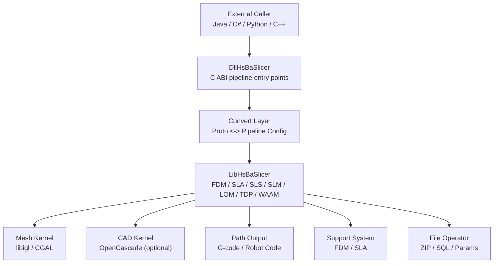
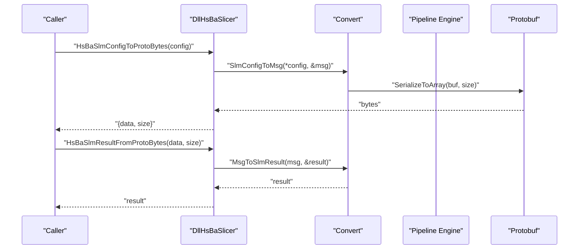
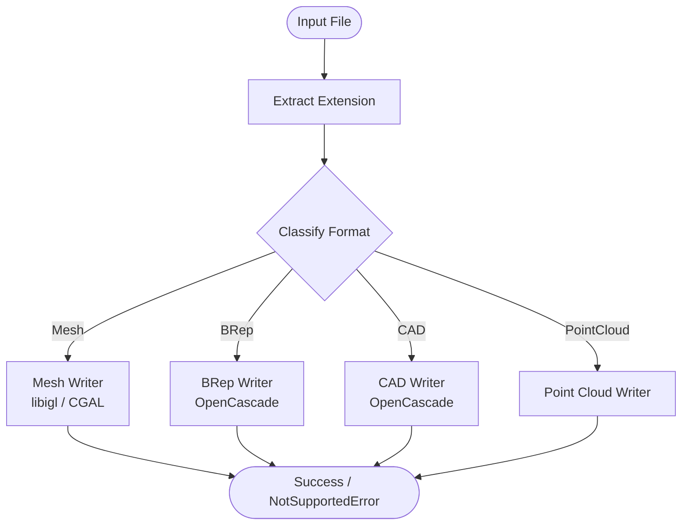
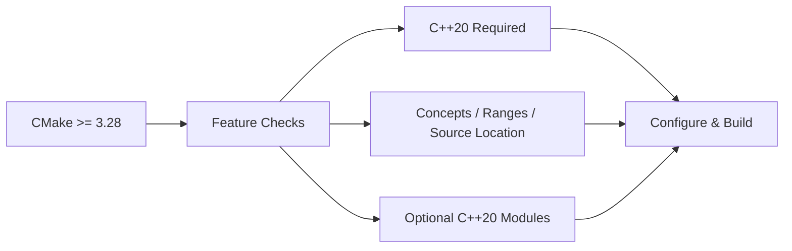
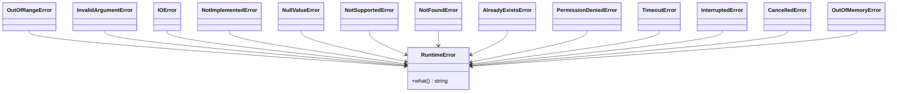
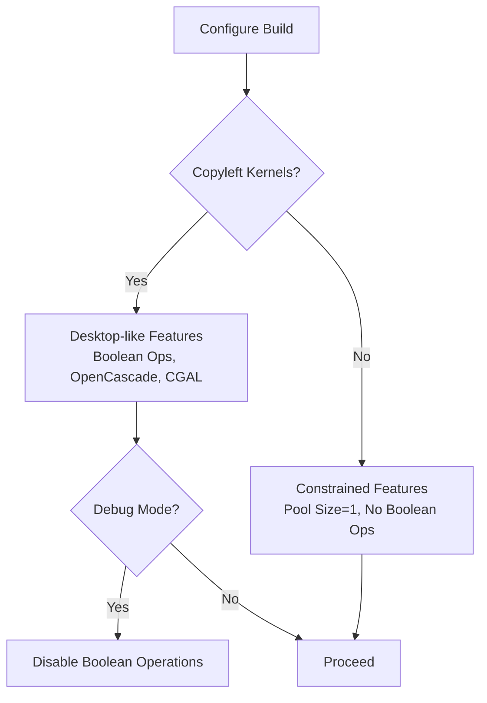
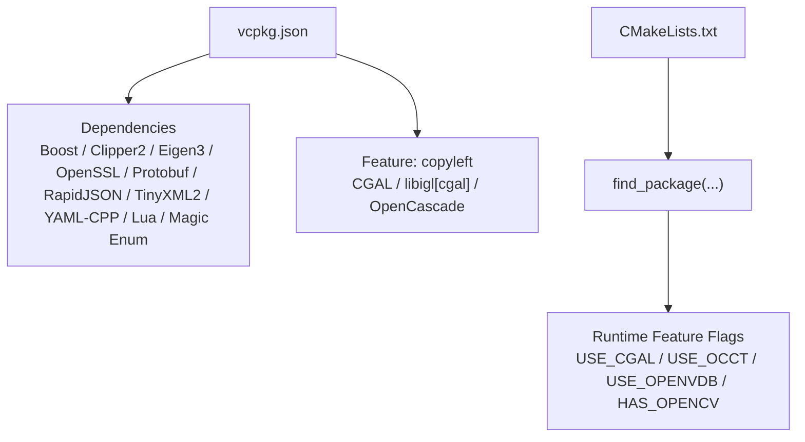

# Appendix

<cite>
**Referenced Files in This Document**   
- [README.md](file://README.md)
- [LICENSE.txt](file://LICENSE.txt)
- [vcpkg.json](file://vcpkg.json)
- [CMakeLists.txt](file://CMakeLists.txt)
- [CMakePresets.json](file://CMakePresets.json)
- [feature_check.cmake](file://static_check/feature_check.cmake)
- [ModelFormat.hpp](file://base/ModelFormat.hpp)
- [ModelFormat.cpp](file://base/ModelFormat.cpp)
- [pipeline_types.h](file://pipelinetypes/pipeline_types.h)
- [error.hpp](file://base/error.hpp)
- [version.hpp](file://version/version.hpp)
- [pipeline_convert.cpp](file://DllHsBaSlicer/pipeline_convert.cpp)
- [Msg2PipelineConfig.cpp](file://convert/Msg2PipelineConfig.cpp)
- [PipelineConfig2Msg.cpp](file://convert/PipelineConfig2Msg.cpp)
- [gcodepath.cpp](file://paths/gcodepath.cpp)
- [OcctModel.cpp](file://cadmodel/OcctModel.cpp)
- [CgalModel.cpp](file://meshmodel/CgalModel.cpp)
- [IglModel.cpp](file://meshmodel/IglModel.cpp)
- [param_store_test.cpp](file://tests/ParamStore/param_store_test.cpp)
- [graph_test.cpp](file://tests/Graph/graph_test.cpp)
</cite>

## Table of Contents
1. [Introduction](#introduction)
2. [Project Structure](#project-structure)
3. [Core Components](#core-components)
4. [Architecture Overview](#architecture-overview)
5. [Detailed Component Analysis](#detailed-component-analysis)
6. [Dependency Analysis](#dependency-analysis)
7. [Performance Considerations](#performance-considerations)
8. [Troubleshooting Guide](#troubleshooting-guide)
9. [Conclusion](#conclusion)
10. [Appendices](#appendices)

## Introduction
This appendix consolidates reference material for HsBaSlicer: technical specifications, supported file formats, version and license information, platform requirements, configuration references, known limitations, glossary, change history guidance, and legal attribution. It is intended as a cross-cutting reference for developers integrating the C++ library, the C ABI dynamic library, or the Lua scripting system.

## Project Structure
HsBaSlicer is a modular C++ framework exposing:
- A C ABI dynamic library (`DllHsBaSlicer`) for external language integration.
- A C++ static/shared library (`LibHsBaSlicer`) encapsulating full slicing pipelines.
- Domain modules for mesh processing, CAD modeling, support generation, path output, parameter storage, and Protobuf-based serialization.
- Platform presets for Windows, Linux, macOS, Android, and iOS.

**Diagram sources**
- [CMakeLists.txt:434-439](file://CMakeLists.txt#L434-L439)
- [pipeline_types.h:1-12](file://pipelinetypes/pipeline_types.h#L1-L12)
- [pipeline_convert.cpp:510-557](file://DllHsBaSlicer/pipeline_convert.cpp#L510-L557)

**Section sources**
- [README.md:25-39](file://README.md#L25-L39)
- [CMakeLists.txt:434-439](file://CMakeLists.txt#L434-L439)

## Core Components
- Model format abstraction: unified enum and helpers to classify mesh, BRep, CSG, and point cloud formats.
- Pipeline type definitions: C-compatible structs and enums for FDM, SLA, SLS, SLM, LOM, TDP, WAAM, file transfer, and custom Lua pipelines.
- Error taxonomy: structured exception types derived from `std::runtime_error`.
- Version metadata: build-time product name, license, version string, platform, and third-party dependency inventory.

Key responsibilities:
- Format classification drives loader selection and conversion behavior.
- Pipeline configs carry all process parameters; results expose success flags, layer counts, outputs, errors, and elapsed time.
- Errors are typed to distinguish IO, unsupported operations, invalid arguments, memory issues, timeouts, etc.
- Version info enables runtime license and dependency auditing.

**Section sources**
- [ModelFormat.hpp:19-88](file://base/ModelFormat.hpp#L19-L88)
- [pipeline_types.h:23-127](file://pipelinetypes/pipeline_types.h#L23-L127)
- [error.hpp:17-144](file://base/error.hpp#L17-L144)
- [version.hpp:15-43](file://version/version.hpp#L15-L43)

## Architecture Overview
The runtime architecture centers on protocol buffers bridging external callers and internal C++ pipeline implementations. The C ABI serializes pipeline configurations into protobuf messages, which are then converted into strongly-typed C++ config structures before execution. Results are serialized back to protobuf for transport across process/language boundaries.

**Diagram sources**
- [pipeline_convert.cpp:510-557](file://DllHsBaSlicer/pipeline_convert.cpp#L510-L557)
- [Msg2PipelineConfig.cpp:46-67](file://convert/Msg2PipelineConfig.cpp#L46-L67)
- [PipelineConfig2Msg.cpp:488-515](file://convert/PipelineConfig2Msg.cpp#L488-L515)

## Detailed Component Analysis

### Supported File Formats and Conversion Capabilities
Supported model formats include mesh, BRep, CAD assembly/part, and point cloud variants. Classification is performed by extension matching and helper predicates.

| Category | Formats | Notes |
|---|---|---|
| Mesh | PLY (ASCII/Binary), OBJ, STL (ASCII/Binary), OFF | Common triangle-mesh interchange formats. |
| BRep / Geometry | STEP, IGES, VRML, BREP | BRep-oriented or geometry exchange formats. |
| CAD Part / Assembly | SLDPRT, CATPART | SolidWorks and CATIA part formats. |
| Point Cloud | XYZ, VDB | Textual point lists and volumetric data. |

Conversion behavior:
- Mesh writers delegate to libigl or CGAL depending on backend availability.
- BRep writers use OpenCascade when available; otherwise mesh fallback may be used where applicable.
- Unknown or unsupported formats raise explicit not-supported exceptions.

**Diagram sources**
- [ModelFormat.cpp:14-85](file://base/ModelFormat.cpp#L14-L85)
- [IglModel.cpp:87-99](file://meshmodel/IglModel.cpp#L87-L99)
- [CgalModel.cpp:150-157](file://meshmodel/CgalModel.cpp#L150-L157)
- [OcctModel.cpp:239-270](file://cadmodel/OcctModel.cpp#L239-L270)

**Section sources**
- [ModelFormat.hpp:19-88](file://base/ModelFormat.hpp#L19-L88)
- [ModelFormat.cpp:89-176](file://base/ModelFormat.cpp#L89-L176)
- [IglModel.cpp:87-99](file://meshmodel/IglModel.cpp#L87-L99)
- [CgalModel.cpp:150-157](file://meshmodel/CgalModel.cpp#L150-L157)
- [OcctModel.cpp:239-270](file://cadmodel/OcctModel.cpp#L239-L270)

### Platform Requirements Matrix
Minimum toolchain and environment requirements are enforced at configure time.

| Requirement | Minimum / Notes |
|---|---|
| CMake | >= 3.28 (top-level); README also documents >= 3.12 usage paths. |
| C++ Standard | C++20 required; optional C++ coroutines and explicit-this features detected. |
| C Standard | C11 baseline; C23 constexpr-style detection when available. |
| Compiler Features | Concepts, ranges, source_location, template-template matching required. |
| Dependency Manager | vcpkg recommended; triplet controls feature enablement. |
| Windows | Visual Studio 2022+ with Desktop development tools; PowerShell 7 recommended. |
| Linux/macOS | pkg-config, Ninja, standard dev packages; coverage preset available on Linux. |
| Android | Requires Android SDK/NDK; ARM64 preset defined. |
| iOS | Xcode preset defined; CI validated; local macOS builds less extensively tested. |

Feature gating highlights:
- Copyleft kernels (CGAL, OpenCascade) are optional and controlled by `HSBA_COPL` and vcpkg feature `copyleft`.
- Dynamic library loader disabled on non-desktop platforms.
- Bit7z compression disabled on non-desktop platforms.
- OpenCV excluded on iOS and game consoles.
- OpenVDB and SQL backends conditionally enabled based on platform.

**Diagram sources**
- [CMakeLists.txt:4-38](file://CMakeLists.txt#L4-L38)
- [feature_check.cmake:96-112](file://static_check/feature_check.cmake#L96-L112)

**Section sources**
- [README.md:41-98](file://README.md#L41-L98)
- [CMakeLists.txt:4-38](file://CMakeLists.txt#L4-L38)
- [CMakeLists.txt:116-127](file://CMakeLists.txt#L116-L127)
- [CMakeLists.txt:228-256](file://CMakeLists.txt#L228-L256)
- [CMakeLists.txt:276-336](file://CMakeLists.txt#L276-L336)
- [CMakePresets.json:115-208](file://CMakePresets.json#L115-L208)

### Configuration Parameters Reference
The C ABI exposes rich configuration structures per technology. Representative defaults and fields are defined inline.

| Technology | Key Parameters | Default Values |
|---|---|---|
| FDM | `layer_height`, `first_layer_height`, `fill_spacing`, `fill_mode`, `fill_angle`, `wall_count`, `top_layer_count`, `bottom_layer_count`, `infill_density`, `enable_support`, `overhang_angle`, `support_gap`, `support_diameter`, `support_density`, `support_pattern`, `interface_layers`, `interface_density`, `line_width`, `print_speed`, `travel_speed`, `extrusion_multiplier`, `spiral_mode`, `gcode_firmware`, `nozzle_diameter`, `filament_diameter`, `nozzle_temp`, `bed_temp`, `retract_length`, `retract_speed`, `first_layer_speed`, Lua hooks, `output_path` | See `HsBaFdmConfigDefault()` |
| SLA | `layer_height`, `first_layer_height`, `bottom_exposure_time`, `normal_exposure_time`, `bottom_lift_distance`, `lift_distance`, `lift_speed`, `retract_speed`, raft/floor params, support params, Lua hooks, image format/size, `output_path` | See `HsBaSlaConfigDefault()` |
| SLS | `layer_height`, `first_layer_height`, `laser_power`, `scan_speed`, `hatch_spacing`, `hatch_rotation`, `bed_temperature`, export Lua script/function, `output_path` | Export Lua script required |
| SLM | Mirrors SLS plus metal-specific fields: `material`, `light_source`, `protect_gas` | Export Lua script required |
| LOM | `layer_height`, `first_layer_height`, `cut_speed`, `cut_margin`, `cut_power`, `bond_temperature`, `bond_pressure`, `bond_time`, `seal_contour`, `cut_mode`, export Lua script/function, `output_path` | Export Lua script required |
| TDP | `layer_height`, `first_layer_height`, `head_count`, `drop_spacing`, `binder_saturation`, `ink_curing_time`, `bed_temperature`, `binder_mode`, spiral mode, export Lua script/function, `output_path` | Export Lua script required |
| WAAM | `layer_height`, `first_layer_height`, `bead_width`, `travel_speed`, `wire_feed_speed`, `arc_current`, `arc_voltage`, `gas_flow_rate`, `material`, `welding_process`, `protection`, `protect_gas`, `interpass_temperature`, `robot_type`, optional path Lua script/function, `output_path`, `spiral_mode` | Robot program output |
| File Transfer | `host`, `port`, `pool_size`, `file_paths`, `file_count` | Pool size default 4 |

Firmware targets for G-code:
- Marlin
- RepRap / RRF
- Klipper

Lua customization:
- FDM supports separate Lua scripts/functions for support and infill generation.
- SLA supports Lua for support, floor, and export stages.
- SLS/SLM/LOM/TDP require an export Lua script/function.
- Custom pipelines allow full orchestration via Lua entry function.

**Section sources**
- [pipeline_types.h:23-127](file://pipelinetypes/pipeline_types.h#L23-L127)
- [pipeline_types.h:146-245](file://pipelinetypes/pipeline_types.h#L146-L245)
- [pipeline_types.h:247-310](file://pipelinetypes/pipeline_types.h#L247-L310)
- [pipeline_types.h:312-401](file://pipelinetypes/pipeline_types.h#L312-L401)
- [pipeline_types.h:403-461](file://pipelinetypes/pipeline_types.h#L403-L461)
- [pipeline_types.h:463-521](file://pipelinetypes/pipeline_types.h#L463-L521)
- [pipeline_types.h:523-625](file://pipelinetypes/pipeline_types.h#L523-L625)
- [pipeline_types.h:627-732](file://pipelinetypes/pipeline_types.h#L627-L732)
- [pipeline_types.h:734-783](file://pipelinetypes/pipeline_types.h#L734-L783)
- [gcodepath.cpp:92-117](file://paths/gcodepath.cpp#L92-L117)

### API Constants and Error Codes
API constants are primarily represented as C-compatible enums within pipeline types:
- Fill modes: line, simple zigzag, advanced zigzag.
- Support patterns: plane, tree, honeycomb.
- Firmware targets: Marlin, RepRap, Klipper.
- Image types: PNG, JPEG, SVG.
- Material/process enums for SLM, WAAM, TDP, LOM.

Error handling:
- C ABI functions return integer status codes (e.g., 0 for failure, 1 for success) and populate result structures with error strings.
- C++ internals throw typed exceptions such as `NotSupportedError`, `IOError`, `InvalidArgumentError`, `OutOfRangeError`, `OutOfMemoryError`, `TimeoutError`, etc.

**Diagram sources**
- [error.hpp:17-144](file://base/error.hpp#L17-L144)

**Section sources**
- [pipeline_types.h:23-51](file://pipelinetypes/pipeline_types.h#L23-L51)
- [pipeline_types.h:146-163](file://pipelinetypes/pipeline_types.h#L146-L163)
- [pipeline_types.h:320-351](file://pipelinetypes/pipeline_types.h#L320-L351)
- [pipeline_types.h:407-414](file://pipelinetypes/pipeline_types.h#L407-L414)
- [pipeline_types.h:467-475](file://pipelinetypes/pipeline_types.h#L467-L475)
- [pipeline_types.h:530-571](file://pipelinetypes/pipeline_types.h#L530-L571)
- [error.hpp:17-144](file://base/error.hpp#L17-L144)
- [pipeline_convert.cpp:510-557](file://DllHsBaSlicer/pipeline_convert.cpp#L510-L557)

### Known Limitations, Constraints, and Edge Cases
- Debug builds disable boolean operations due to performance and memory concerns.
- Model object pool size differs between copyleft-enabled desktop builds and constrained environments.
- Dynamic library loader is disabled on non-desktop platforms.
- Bit7z compression is disabled on non-desktop platforms.
- OpenCV is excluded on iOS and game consoles.
- OpenCascade and CGAL are only linked when copyleft kernels are enabled; otherwise those features are unavailable.
- Some formats fall back to mesh representation when BRep shape is null during export.
- Unsupported formats raise explicit not-supported exceptions.
- Parameter store load failures return structured error messages rather than swallowing them.
- Graph area routing tests demonstrate gate restrictions and same-gate-in/out constraints that can affect path planning logic.

**Diagram sources**
- [CMakeLists.txt:294-306](file://CMakeLists.txt#L294-L306)
- [CMakeLists.txt:228-256](file://CMakeLists.txt#L228-L256)
- [CMakeLists.txt:276-336](file://CMakeLists.txt#L276-L336)
- [OcctModel.cpp:239-270](file://cadmodel/OcctModel.cpp#L239-L270)
- [param_store_test.cpp:369-402](file://tests/ParamStore/param_store_test.cpp#L369-L402)
- [graph_test.cpp:610-672](file://tests/Graph/graph_test.cpp#L610-L672)

**Section sources**
- [CMakeLists.txt:294-306](file://CMakeLists.txt#L294-L306)
- [CMakeLists.txt:228-256](file://CMakeLists.txt#L228-L256)
- [CMakeLists.txt:276-336](file://CMakeLists.txt#L276-L336)
- [OcctModel.cpp:239-270](file://cadmodel/OcctModel.cpp#L239-L270)
- [param_store_test.cpp:369-402](file://tests/ParamStore/param_store_test.cpp#L369-L402)
- [graph_test.cpp:610-672](file://tests/Graph/graph_test.cpp#L610-L672)

## Dependency Analysis
Dependencies are declared in vcpkg manifests and resolved through CMake. Licensing of dependencies influences project licensing.

**Diagram sources**
- [vcpkg.json:1-113](file://vcpkg.json#L1-L113)
- [CMakeLists.txt:206-348](file://CMakeLists.txt#L206-L348)

**Section sources**
- [vcpkg.json:1-113](file://vcpkg.json#L1-L113)
- [CMakeLists.txt:206-348](file://CMakeLists.txt#L206-L348)

## Performance Considerations
- Boolean operations are disabled in Debug builds to avoid high memory usage and slow performance.
- Model object pool size increases when copyleft kernels are present, allowing multiple models to be held concurrently.
- Coverage instrumentation is available via a dedicated CMake preset targeting core and other module thresholds.
- Thread pool coroutine support is configurable and can improve concurrency where enabled.

Recommendations:
- Use Release builds for production slicing workloads.
- Avoid enabling copyleft kernels on constrained platforms unless necessary.
- Tune thread pool and coroutine options according to target hardware.
- Monitor memory usage when performing boolean operations or large mesh transformations.

**Section sources**
- [CMakeLists.txt:294-306](file://CMakeLists.txt#L294-L306)
- [CMakeLists.txt:258-262](file://CMakeLists.txt#L258-L262)
- [CMakePresets.json:86-112](file://CMakePresets.json#L86-L112)

## Troubleshooting Guide
Common issues and resolutions:
- Build fails due to missing compiler features: ensure C++20 concepts, ranges, source_location, and template-template matching are supported.
- Missing dynamic loader on mobile: dynamic loading is intentionally disabled on non-desktop platforms.
- Compression failures: bit7z is disabled on non-desktop platforms; rely on built-in compression if available.
- OpenCV not found on iOS: OpenCV is excluded on iOS; remove OpenCV-dependent code paths.
- CAD kernel not available: OpenCascade requires copyleft feature; disable CAD features or enable copyleft kernels.
- Parameter store load errors: check returned error message and ensure correct pipeline kind and identifier.
- Path planning anomalies: verify gate directionality and same-gate-in/out constraints in graph areas.

Operational checks:
- Validate protobuf serialization/deserialization round-trips for pipeline configs and results.
- Confirm firmware-specific G-code headers match target printer controller expectations.

**Section sources**
- [CMakeLists.txt:4-38](file://CMakeLists.txt#L4-L38)
- [CMakeLists.txt:228-256](file://CMakeLists.txt#L228-L256)
- [CMakeLists.txt:276-336](file://CMakeLists.txt#L276-L336)
- [param_store_test.cpp:369-402](file://tests/ParamStore/param_store_test.cpp#L369-L402)
- [graph_test.cpp:610-672](file://tests/Graph/graph_test.cpp#L610-L672)
- [pipeline_convert.cpp:510-557](file://DllHsBaSlicer/pipeline_convert.cpp#L510-L557)
- [gcodepath.cpp:92-117](file://paths/gcodepath.cpp#L92-L117)

## Conclusion
This appendix provides a consolidated reference for HsBaSlicer’s supported formats, platform matrix, configuration surface, error taxonomy, dependency and licensing model, and operational constraints. Use it alongside the main documentation and API headers to integrate safely and efficiently across platforms and technologies.

## Appendices

### Technical Specifications Summary
- C++20 minimum; optional C++20 modules.
- C ABI for cross-language integration; C++ API for direct library use.
- Protobuf-based serialization for pipeline configs/results.
- Modular kernels: mesh (libigl/CGAL), CAD (OpenCascade), point cloud (OpenVDB).
- Comprehensive pipeline families: FDM, SLA, SLS, SLM, LOM, TDP, WAAM, file transfer, custom Lua.

**Section sources**
- [CMakeLists.txt:4-38](file://CMakeLists.txt#L4-L38)
- [pipeline_types.h:1-12](file://pipelinetypes/pipeline_types.h#L1-L12)
- [pipeline_convert.cpp:510-557](file://DllHsBaSlicer/pipeline_convert.cpp#L510-L557)

### Glossary
- **Slicing**: Converting a 3D model into layered toolpaths or images for additive manufacturing.
- **FDM**: Fused Deposition Modeling; extrudes thermoplastic filament layer by layer.
- **SLA**: Stereolithography; uses UV light to cure liquid resin layer by layer.
- **SLS**: Selective Laser Sintering; sinters powder using a laser.
- **SLM**: Selective Laser Melting; melts metal powder using a laser or electron beam.
- **LOM**: Laminated Object Manufacturing; bonds and cuts sheet material layers.
- **TDP**: Binder Jetting; deposits binder onto powder bed to form parts.
- **WAAM**: Wire Arc Additive Manufacturing; deposits wire using welding processes.
- **Infill**: Internal pattern filling a solid shell to reduce material usage.
- **Support**: Temporary structures holding overhangs during printing.
- **Raft/Floor**: Base structure improving adhesion and stability.
- **BRep**: Boundary Representation; precise geometric model of surfaces and edges.
- **Mesh**: Polygonal surface approximation composed of vertices and faces.
- **Boolean Operations**: Union, intersection, difference between solid shapes.
- **G-code**: Standardized machine control instructions for CNC and 3D printers.
- **Robot Program**: Machine-specific motion commands for robotic arms.
- **Protobuf**: Protocol Buffers; efficient binary serialization format.
- **Lua Scripting**: Embedded scripting language for customizing pipeline stages.

[No sources needed since this section defines general terminology without analyzing specific files]

### Change History and Migration Guidance
- Version metadata is exposed via `GetVersionInfo()` and includes product name, license, version string, build type, platform, and third-party libraries.
- License determination is conditional: MIT when no copyleft kernels are linked; GPL-3.0-or-later when CGAL or OpenCascade are included.
- Migration notes:
  - Disabling default vcpkg features prevents installation/linking of copyleft kernels and switches effective license to MIT.
  - When moving from Debug to Release, expect boolean operations to become available and performance to improve.
  - On mobile platforms, avoid relying on dynamic loading, bit7z, OpenCV, and CAD kernels.

For detailed terms, see the license document.

**Section sources**
- [version.hpp:15-43](file://version/version.hpp#L15-L43)
- [LICENSE.txt:1-23](file://LICENSE.txt#L1-L23)
- [README.md:196-210](file://README.md#L196-L210)
- [docs/en/vcpkg-dependencies.md:1-21](file://docs/en/vcpkg-dependencies.md#L1-L21)

### Legal Information and Third-Party Attribution
- Conditional dual license:
  - MIT when no copyleft components are linked.
  - GPL-3.0-or-later when CGAL or OpenCascade are linked.
- Effective license is determined at configure time and queryable at runtime.
- Third-party libraries include Boost, Clipper2, Eigen3, OpenSSL, Protobuf, RapidJSON, TinyXML2, YAML-CPP, Lua, Magic Enum, and optional CGAL/libigl/OpenCascade/OpenVDB/OpenCV/bit7z/sqlpp11.

**Section sources**
- [LICENSE.txt:1-23](file://LICENSE.txt#L1-L23)
- [README.md:196-210](file://README.md#L196-L210)
- [vcpkg.json:1-113](file://vcpkg.json#L1-L113)