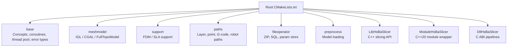
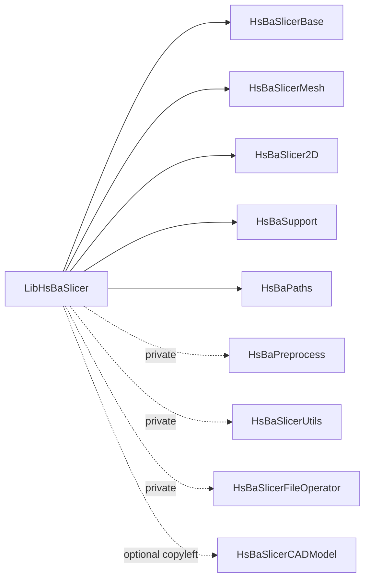
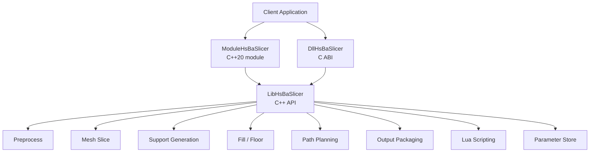
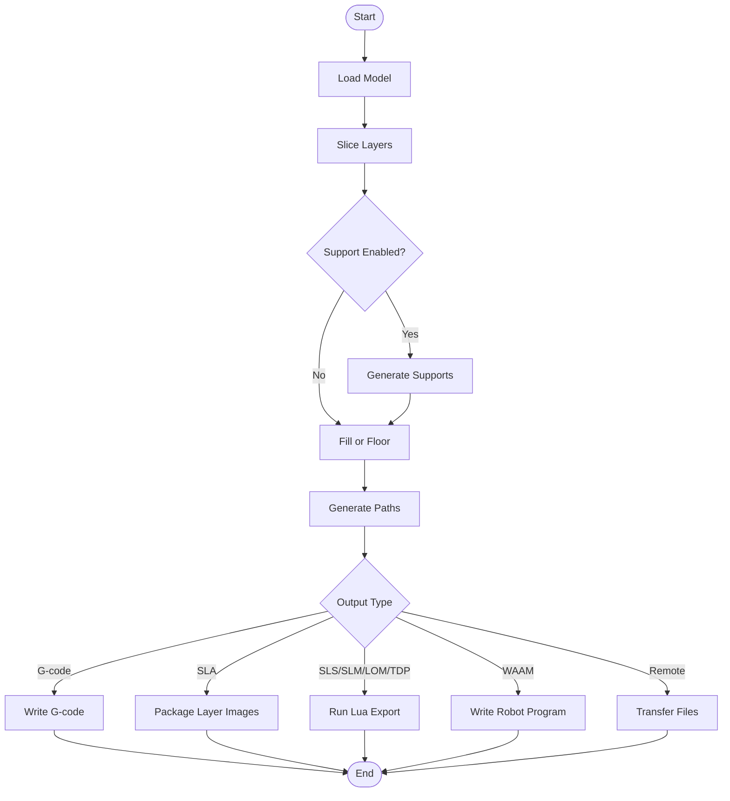
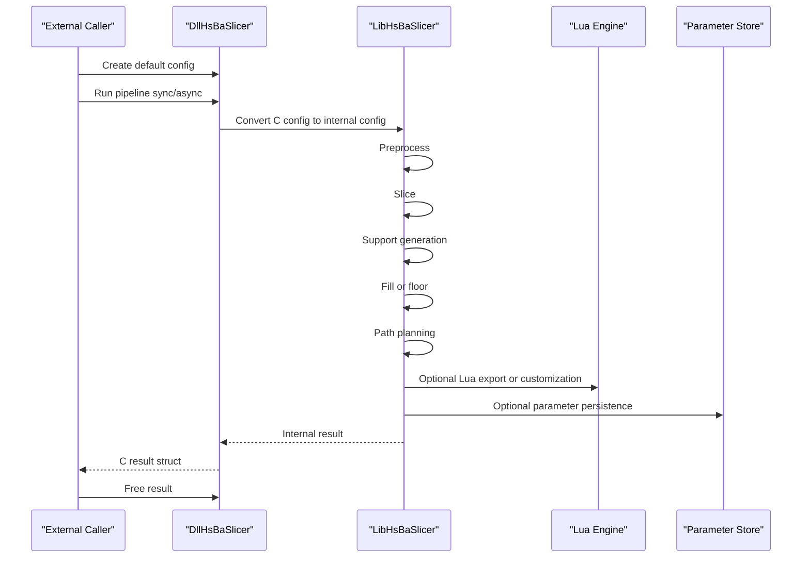
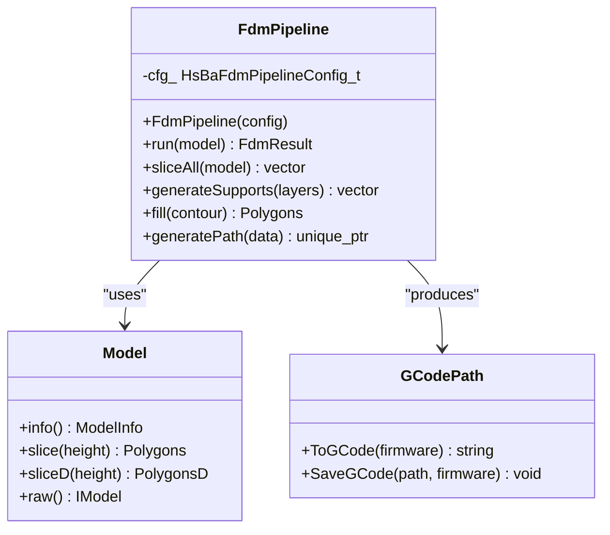
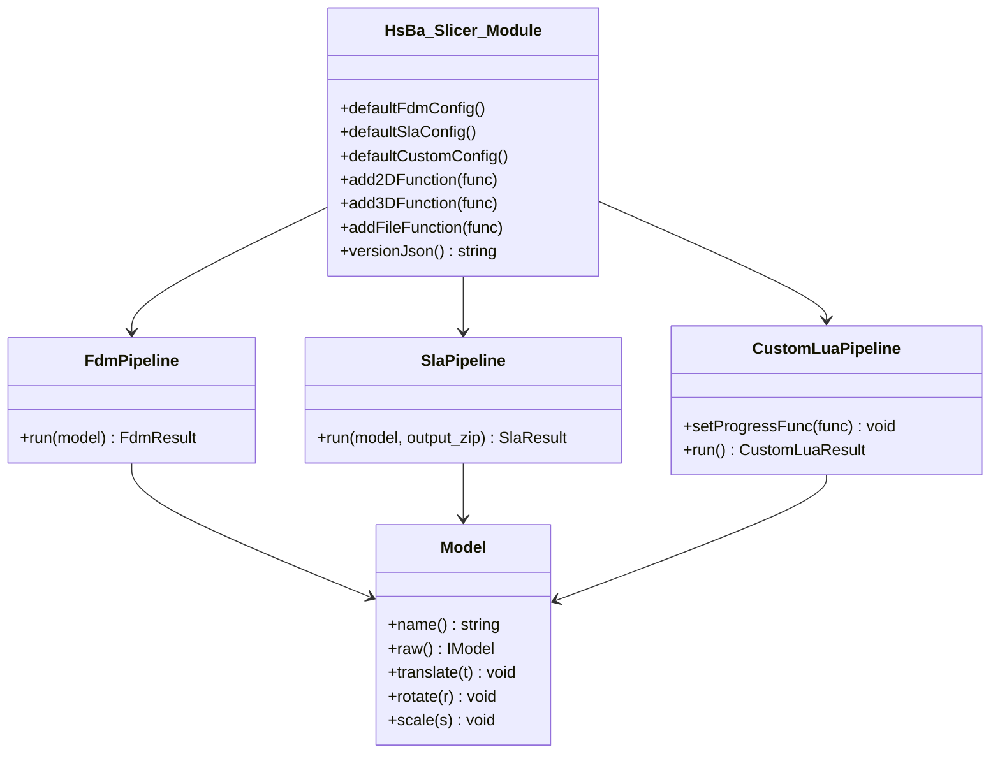
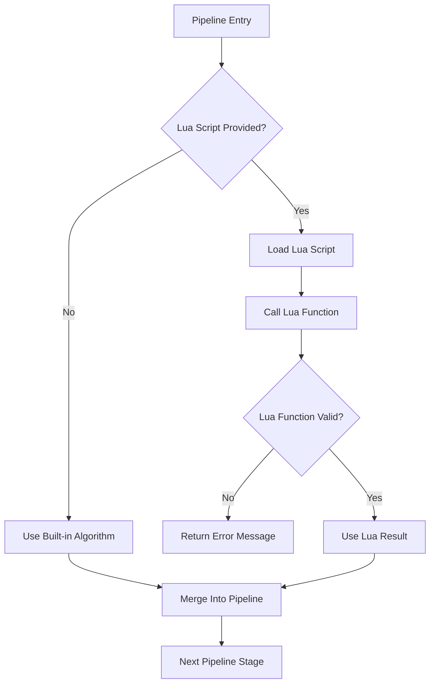
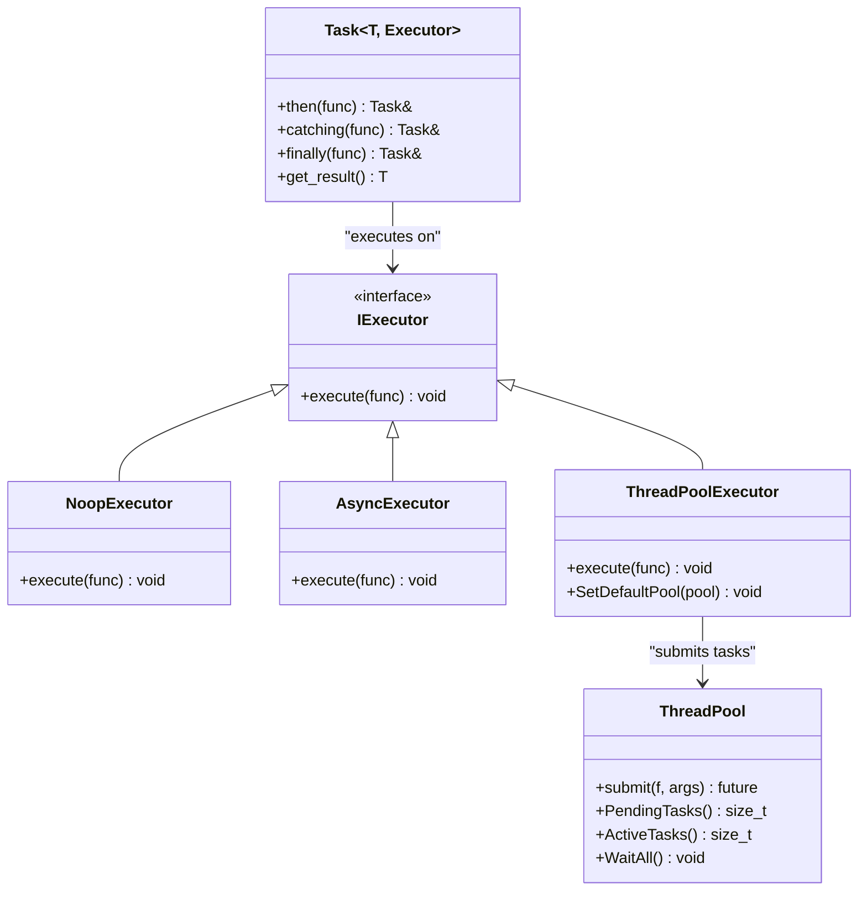
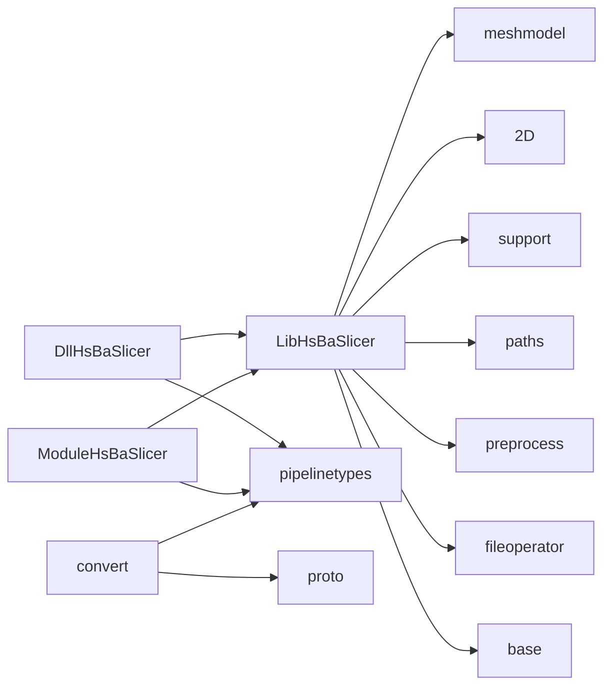

# Architecture Overview

<cite>
**Referenced Files in This Document**   
- [CMakeLists.txt](file://CMakeLists.txt)
- [README.md](file://README.md)
- [vcpkg.json](file://vcpkg.json)
- [pipeline_types.h](file://pipelinetypes/pipeline_types.h)
- [fdm_pipeline.h](file://DllHsBaSlicer/fdm_pipeline.h)
- [sla_pipeline.h](file://DllHsBaSlicer/sla_pipeline.h)
- [custom_pipeline.h](file://DllHsBaSlicer/custom_pipeline.h)
- [LibHsBaSlicer CMakeLists.txt](file://LibHsBaSlicer/CMakeLists.txt)
- [hsba_slicer.cppm](file://ModuleHsBaSlicer/hsba_slicer.cppm)
- [base_interface.hpp](file://base/base_interface.hpp)
- [concepts.hpp](file://base/concepts.hpp)
- [coroutine.hpp](file://base/coroutine.hpp)
- [thread_pool.hpp](file://base/thread_pool.hpp)
- [error.hpp](file://base/error.hpp)
</cite>

## Table of Contents
1. [Introduction](#introduction)
2. [Project Structure](#project-structure)
3. [Core Components](#core-components)
4. [Architecture Overview](#architecture-overview)
5. [Detailed Component Analysis](#detailed-component-analysis)
6. [Dependency Analysis](#dependency-analysis)
7. [Performance Considerations](#performance-considerations)
8. [Troubleshooting Guide](#troubleshooting-guide)
9. [Conclusion](#conclusion)

## Introduction
HsBaSlicer is a modular, cross-platform C++ framework for 3D-printing slicing pipelines. It exposes three integration layers:

| Layer | Target | Purpose |
|---|---|---|
| `DllHsBaSlicer` | External languages and host applications | Stable C ABI for FDM, SLA, SLS, SLM, LOM, TDP, WAAM, file transfer, and fully Lua-driven custom pipelines |
| `LibHsBaSlicer` | C++ consumers | High-level C++ API wrapping preprocessing, mesh slicing, support generation, polygon filling, path planning, floor generation, export, parameter storage, and Lua extensions |
| `ModuleHsBaSlicer` | Modern C++20 consumers | C++20 module wrapper exposing RAII model handles, typed pipeline classes, and type-safe configuration helpers over the same core logic |

The system follows a **pipeline pattern**: data flows through sequential stages such as preprocessing, slicing, support generation, fill or floor generation, path planning, and output packaging. The same stage graph is reused by built-in process implementations and by user-defined Lua scripts.

**Section sources**
- [README.md:21-38](file://README.md#L21-L38)
- [CMakeLists.txt:434-439](file://CMakeLists.txt#L434-L439)

## Project Structure
At build time, the root CMake project configures platform-specific features, detects required C++20 capabilities, resolves dependencies through vcpkg, and adds subdirectories for infrastructure, core processing, and integration layers.

**Diagram sources**
- [CMakeLists.txt:410-439](file://CMakeLists.txt#L410-L439)

Key structural properties:

- **Infrastructure modules** (`base`, `utils`, `logger`, `cipher`) provide reusable primitives: concepts, coroutines, thread pools, memory utilities, logging, encryption, and serialization.
- **Core processing modules** (`meshmodel`, `support`, `paths`, `2D`, `preprocess`) implement geometry, topology, slicing, support detection, and path output.
- **Process-specific implementations** live under `DllHsBaSlicer` (e.g., `fdm_pipeline`, `sla_pipeline`, `sls_pipeline`, `waam_pipeline`) and compose `LibHsBaSlicer` functionality into complete workflows.
- **Integration layers** are layered outward: `LibHsBaSlicer` depends on core modules; `ModuleHsBaSlicer` wraps `LibHsBaSlicer`; `DllHsBaSlicer` exposes C ABI functions that may call both `LibHsBaSlicer` and Lua scripting.

**Section sources**
- [CMakeLists.txt:410-439](file://CMakeLists.txt#L410-L439)
- [README.md:29-38](file://README.md#L29-L38)

## Core Components
The architecture is organized around three main components:

### C ABI Interface: `DllHsBaSlicer`
`DllHsBaSlicer` provides stable C-compatible entry points for each supported manufacturing process. Each pipeline header declares:

- A default configuration factory.
- A synchronous run function.
- An asynchronous run function using progress and result callbacks.
- A result-free function to release heap-allocated strings.

Examples include:

| Pipeline | C ABI Header | Main Stages |
|---|---|---|
| FDM | `fdm_pipeline.h` | Preprocess → Slice → Support → Fill → Path Generation |
| SLA | `sla_pipeline.h` | Preprocess → Slice → Floor → Support → Export zip |
| Custom Lua | `custom_pipeline.h` | Fully Lua-driven workflow via global `HsBa` table |

The shared C ABI types are defined in `pipelinetypes/pipeline_types.h`. These structs are intentionally free of DLL export macros so downstream conversion and protocol code can reference them without linking the shared library.

**Section sources**
- [fdm_pipeline.h:1-68](file://DllHsBaSlicer/fdm_pipeline.h#L1-L68)
- [sla_pipeline.h:1-63](file://DllHsBaSlicer/sla_pipeline.h#L1-L63)
- [custom_pipeline.h:1-69](file://DllHsBaSlicer/custom_pipeline.h#L1-L69)
- [pipeline_types.h:1-12](file://pipelinetypes/pipeline_types.h#L1-L12)

### C++ Library API: `LibHsBaSlicer`
`LibHsBaSlicer` is the primary C++ integration surface. Its CMake target links public core libraries such as base, mesh, 2D polygons, support, and paths, while privately depending on preprocessing, utils, version info, and file operator functionality.

Public responsibilities include:

- Model preprocessing and registration.
- Mesh slicing.
- FDM and SLA support generation.
- Polygon filling.
- Spiral path and path optimization.
- G-code, SLS, and WAAM export.
- SLA floor/raft generation.
- Remote file transfer.
- Parameter store persistence.
- Lua extension registration.

**Diagram sources**
- [LibHsBaSlicer CMakeLists.txt:86-105](file://LibHsBaSlicer/CMakeLists.txt#L86-L105)

**Section sources**
- [LibHsBaSlicer CMakeLists.txt:1-115](file://LibHsBaSlicer/CMakeLists.txt#L1-L115)

### C++20 Module Wrapper: `ModuleHsBaSlicer`
`ModuleHsBaSlicer` exports a single C++20 module named `hsba.slicer`. It wraps `LibHsBaSlicer` with modern C++ idioms:

- RAII `Model` handle managing model lifecycle.
- Typed pipeline classes: `FdmPipeline`, `SlaPipeline`, `SlsPipeline`, `SlmPipeline`, `LomPipeline`, `TdpPipeline`, `WaamPipeline`.
- `FileTransferPipeline` and `ParamStorePipeline`.
- `CustomLuaPipeline` for fully script-driven workflows.
- Re-exported configuration and result types from `pipelinetypes/pipeline_types.h`.
- Utility conversions between integer and double precision polygons.

This layer is intended for consumers who prefer strong typing, exceptions, move semantics, and module imports rather than raw C ABI calls.

**Section sources**
- [hsba_slicer.cppm:1-65](file://ModuleHsBaSlicer/hsba_slicer.cppm#L1-L65)
- [hsba_slicer.cppm:129-146](file://ModuleHsBaSlicer/hsba_slicer.cppm#L129-L146)
- [hsba_slicer.cppm:152-191](file://ModuleHsBaSlicer/hsba_slicer.cppm#L152-L191)
- [hsba_slicer.cppm:197-378](file://ModuleHsBaSlicer/hsba_slicer.cppm#L197-L378)
- [hsba_slicer.cppm:447-540](file://ModuleHsBaSlicer/hsba_slicer.cppm#L447-L540)

## Architecture Overview
The high-level architecture separates concerns across three integration layers and several internal subsystems.

**Diagram sources**
- [CMakeLists.txt:434-439](file://CMakeLists.txt#L434-L439)
- [fdm_pipeline.h:23-35](file://DllHsBaSlicer/fdm_pipeline.h#L23-L35)
- [sla_pipeline.h:23-34](file://DllHsBaSlicer/sla_pipeline.h#L23-L34)
- [custom_pipeline.h:23-40](file://DllHsBaSlicer/custom_pipeline.h#L23-L40)
- [hsba_slicer.cppm:204-225](file://ModuleHsBaSlicer/hsba_slicer.cppm#L204-L225)

### Pipeline Pattern
The pipeline pattern is central to HsBaSlicer. Data moves through ordered stages, where each stage consumes one representation and produces the next.

| Stage | Input | Output | Notes |
|---|---|---|---|
| Preprocessing | CAD/mesh/point-cloud file | In-memory model | Supports multiple backends including IGL, CGAL, OpenCascade, and OpenVDB when enabled |
| Slicing | 3D model | Layer polygons | Integer and double precision representations are used at different stages |
| Support Generation | Layer contours | Support polygons | FDM and SLA have distinct algorithms and Lua hooks |
| Fill / Floor | Contours or bottom layer | Infill or raft polygons | Can use built-in algorithms or Lua scripts |
| Path Planning | Layer outlines, fills, supports | Printer or robot paths | Includes G-code, spiral paths, SLS/WAAM exports |
| Output | Processed layers or paths | G-code, ZIP package, robot program, remote files | May be driven by built-in exporters or Lua scripts |

**Diagram sources**
- [fdm_pipeline.h:23-35](file://DllHsBaSlicer/fdm_pipeline.h#L23-L35)
- [sla_pipeline.h:23-34](file://DllHsBaSlicer/sla_pipeline.h#L23-L34)
- [custom_pipeline.h:23-40](file://DllHsBaSlicer/custom_pipeline.h#L23-L40)
- [hsba_slicer.cppm:704-751](file://ModuleHsBaSlicer/hsba_slicer.cppm#L704-L751)

## Detailed Component Analysis

### C ABI Integration Layer
The C ABI layer is designed for interop with external languages and host applications. Each pipeline header defines a consistent contract:

| Contract Element | Meaning |
|---|---|
| Default config factory | Returns a zero-initialized or defaulted configuration struct |
| Sync run function | Blocks until the pipeline completes |
| Async run function | Uses C++20 coroutines internally and returns results via callback |
| Progress callback | Reports percentage and current stage description |
| Result callback | Receives success flag, layer count, output path or content, error message, and elapsed time |
| Free function | Releases heap-allocated strings owned by the result struct |

**Diagram sources**
- [fdm_pipeline.h:17-61](file://DllHsBaSlicer/fdm_pipeline.h#L17-L61)
- [sla_pipeline.h:17-56](file://DllHsBaSlicer/sla_pipeline.h#L17-L56)
- [custom_pipeline.h:17-62](file://DllHsBaSlicer/custom_pipeline.h#L17-L62)
- [pipeline_types.h:130-140](file://pipelinetypes/pipeline_types.h#L130-L140)

**Section sources**
- [fdm_pipeline.h:1-68](file://DllHsBaSlicer/fdm_pipeline.h#L1-L68)
- [sla_pipeline.h:1-63](file://DllHsBaSlicer/sla_pipeline.h#L1-L63)
- [custom_pipeline.h:1-69](file://DllHsBaSlicer/custom_pipeline.h#L1-L69)
- [pipeline_types.h:115-140](file://pipelinetypes/pipeline_types.h#L115-L140)

### C++ Library Layer
`LibHsBaSlicer` composes lower-level modules into higher-level operations. For example, the module’s FDM pipeline implementation demonstrates the full slice-support-fill-path sequence:

1. Compute layer count from model bounding box and layer height.
2. Slice all layers.
3. Convert integer polygons to double precision for support generation.
4. Generate supports using either built-in FDM logic or a Lua script.
5. Fill contours using built-in fill modes or a Lua script.
6. Assemble layer path data.
7. Generate G-code path and optionally save it.

**Diagram sources**
- [hsba_slicer.cppm:197-225](file://ModuleHsBaSlicer/hsba_slicer.cppm#L197-L225)
- [hsba_slicer.cppm:621-751](file://ModuleHsBaSlicer/hsba_slicer.cppm#L621-L751)

**Section sources**
- [hsba_slicer.cppm:621-751](file://ModuleHsBaSlicer/hsba_slicer.cppm#L621-L751)
- [LibHsBaSlicer CMakeLists.txt:86-105](file://LibHsBaSlicer/CMakeLists.txt#L86-L105)

### C++20 Module Layer
The module layer improves ergonomics by replacing raw C structs and callbacks with RAII objects and typed APIs. Key design choices include:

- Re-exporting C ABI config/result types so consumers can still work with the stable C layout.
- Providing `default*Config()` helpers that delegate to the C ABI defaults.
- Wrapping model load/remove in an RAII `Model` class.
- Exposing per-process pipeline classes with clear `run` methods.
- Supporting Lua-based customization through dedicated pipeline classes and utility functions.

**Diagram sources**
- [hsba_slicer.cppm:67-146](file://ModuleHsBaSlicer/hsba_slicer.cppm#L67-L146)
- [hsba_slicer.cppm:152-191](file://ModuleHsBaSlicer/hsba_slicer.cppm#L152-L191)
- [hsba_slicer.cppm:197-479](file://ModuleHsBaSlicer/hsba_slicer.cppm#L197-L479)

**Section sources**
- [hsba_slicer.cppm:1-65](file://ModuleHsBaSlicer/hsba_slicer.cppm#L1-L65)
- [hsba_slicer.cppm:129-146](file://ModuleHsBaSlicer/hsba_slicer.cppm#L129-L146)
- [hsba_slicer.cppm:152-191](file://ModuleHsBaSlicer/hsba_slicer.cppm#L152-L191)
- [hsba_slicer.cppm:197-479](file://ModuleHsBaSlicer/hsba_slicer.cppm#L197-L479)

### Plugin Architecture and Lua Scripting
Lua scripting is a first-class extension mechanism. There are two related but distinct extension points:

1. **Per-stage Lua customization**: FDM infill, FDM support, SLA floor, SLA support, and various export stages accept Lua script paths and function names.
2. **Fully Lua-driven custom pipeline**: The entire workflow is defined by a Lua entry function, which receives a global `HsBa` table containing model loading, slicing, support, fill, floor, path output, and packaging building blocks.

**Diagram sources**
- [pipeline_types.h:104-108](file://pipelinetypes/pipeline_types.h#L104-L108)
- [pipeline_types.h:204-210](file://pipelinetypes/pipeline_types.h#L204-L210)
- [pipeline_types.h:680-704](file://pipelinetypes/pipeline_types.h#L680-L704)
- [custom_pipeline.h:23-40](file://DllHsBaSlicer/custom_pipeline.h#L23-L40)

**Section sources**
- [pipeline_types.h:104-108](file://pipelinetypes/pipeline_types.h#L104-L108)
- [pipeline_types.h:204-210](file://pipelinetypes/pipeline_types.h#L204-L210)
- [pipeline_types.h:680-704](file://pipelinetypes/pipeline_types.h#L680-L704)
- [custom_pipeline.h:1-69](file://DllHsBaSlicer/custom_pipeline.h#L1-L69)

### Cross-Cutting Concerns

#### Error Handling
Internal C++ code uses a hierarchy of exceptions derived from `std::runtime_error`:

| Exception | Typical Use |
|---|---|
| `RuntimeError` | General runtime failures |
| `InvalidArgumentError` | Invalid parameters such as zero thread count |
| `IOError` | File or I/O failures |
| `NotImplementedError` | Missing feature or backend |
| `NotFoundError` | Missing key, model, or resource |
| `OutOfMemoryError` | Memory allocation failure |
| `TimeoutError` | Timed operations exceeding limits |

The C ABI layer avoids propagating C++ exceptions across the boundary by returning structured results with success flags and UTF-8 error messages.

**Section sources**
- [error.hpp:17-144](file://base/error.hpp#L17-L144)
- [pipeline_types.h:120-127](file://pipelinetypes/pipeline_types.h#L120-L127)
- [pipeline_types.h:225-232](file://pipelinetypes/pipeline_types.h#L225-L232)

#### Progress Reporting
Each pipeline exposes a progress callback taking a percentage, stage description, and user data. The C++20 module layer maps this to typed callbacks or function objects where appropriate.

**Section sources**
- [pipeline_types.h:130-140](file://pipelinetypes/pipeline_types.h#L130-L140)
- [pipeline_types.h:235-245](file://pipelinetypes/pipeline_types.h#L235-L245)
- [pipeline_types.h:721-732](file://pipelinetypes/pipeline_types.h#L721-L732)

#### Memory Management
- C ABI results own heap-allocated strings and must be freed through provided free functions.
- The module layer uses RAII for models and standard containers for intermediate data.
- Configuration structs are passed by value or pointer, with default initializers available in `pipeline_types.h`.

**Section sources**
- [fdm_pipeline.h:53-61](file://DllHsBaSlicer/fdm_pipeline.h#L53-L61)
- [sla_pipeline.h:49-56](file://DllHsBaSlicer/sla_pipeline.h#L49-L56)
- [custom_pipeline.h:57-62](file://DllHsBaSlicer/custom_pipeline.h#L57-L62)
- [pipeline_types.h:738-783](file://pipelinetypes/pipeline_types.h#L738-L783)

#### Threading and Coroutines
The infrastructure layer provides:

- A coroutine abstraction with executors, task awaiters, completion callbacks, and optional custom allocators.
- A thread pool with task submission, pending/active task tracking, and wait-all synchronization.
- Optional integration between coroutines and the thread pool through `ThreadPoolExecutor`.

**Diagram sources**
- [coroutine.hpp:47-73](file://base/coroutine.hpp#L47-L73)
- [coroutine.hpp:205-382](file://base/coroutine.hpp#L205-L382)
- [thread_pool.hpp:29-162](file://base/thread_pool.hpp#L29-L162)
- [thread_pool.hpp:168-207](file://base/thread_pool.hpp#L168-L207)

**Section sources**
- [coroutine.hpp:41-73](file://base/coroutine.hpp#L41-L73)
- [coroutine.hpp:205-382](file://base/coroutine.hpp#L205-L382)
- [thread_pool.hpp:29-162](file://base/thread_pool.hpp#L29-L162)
- [thread_pool.hpp:168-207](file://base/thread_pool.hpp#L168-L207)

## Dependency Analysis
The dependency graph reflects a layered design where integration layers depend on core modules, and core modules depend on infrastructure.

**Diagram sources**
- [CMakeLists.txt:410-439](file://CMakeLists.txt#L410-L439)
- [LibHsBaSlicer CMakeLists.txt:86-105](file://LibHsBaSlicer/CMakeLists.txt#L86-L105)
- [fdm_pipeline.h:9-10](file://DllHsBaSlicer/fdm_pipeline.h#L9-L10)
- [hsba_slicer.cppm:37-62](file://ModuleHsBaSlicer/hsba_slicer.cppm#L37-L62)

### Technology Stack
The project uses modern C++20 and a broad set of third-party libraries selected through vcpkg.

| Category | Technology | Role |
|---|---|---|
| Language | C++20 | Concepts, ranges, coroutines, modules, source location |
| Build | CMake 3.28+ | Multi-target build, install/export, presets |
| Dependencies | vcpkg | Dependency resolution and triplet configuration |
| Geometry | Eigen3, libigl, Clipper2 | Vector math, mesh processing, 2D polygon operations |
| Mesh/CAD | CGAL, OpenCascade | Optional copyleft kernels for boolean operations and B-Rep |
| Point Cloud | OpenVDB | Volumetric and point cloud data |
| Serialization | Protobuf, RapidJSON, tinyxml2, yaml-cpp | Protocol buffers, JSON, XML, YAML |
| Scripting | Lua | Customizable pipelines and algorithm plugins |
| Compression | miniz, bit7z | ZIP/unzip support |
| Logging | Boost.Log | Desktop logging (disabled on mobile/console) |
| Database | sqlpp11 with SQLite3/MySQL/PostgreSQL | Parameter store persistence |
| Crypto | OpenSSL | Encryption and hashing |
| Image | OpenCV | Optional image processing for SLA rendering |

**Section sources**
- [CMakeLists.txt:17-38](file://CMakeLists.txt#L17-L38)
- [CMakeLists.txt:116-127](file://CMakeLists.txt#L116-L127)
- [CMakeLists.txt:206-349](file://CMakeLists.txt#L206-L349)
- [vcpkg.json:1-113](file://vcpkg.json#L1-L113)

### Platform-Specific Considerations
The build system distinguishes desktop, mobile, game console, and unknown platforms.

| Platform | Behavior |
|---|---|
| Windows/Linux/macOS | Desktop build; dynamic loader and most optional features enabled |
| Android/iOS | Mobile build; tests disabled; some heavy dependencies disabled |
| Game consoles | Console build; logger disabled; copyleft kernels disabled |
| Non-desktop | Dynamic library loader disabled; bit7z disabled |
| Copyleft-enabled builds | License switches to GPL-3.0-or-later when CGAL/OpenCascade are linked |

**Section sources**
- [CMakeLists.txt:129-157](file://CMakeLists.txt#L129-L157)
- [CMakeLists.txt:228-240](file://CMakeLists.txt#L228-L240)
- [CMakeLists.txt:276-327](file://CMakeLists.txt#L276-L327)
- [CMakeLists.txt:392-407](file://CMakeLists.txt#L392-L407)

## Performance Considerations
- **Threading**: The thread pool allows concurrent task execution. Consumers should avoid submitting excessively large numbers of small tasks without batching.
- **Coroutines**: Coroutine-based pipelines reduce blocking overhead and enable async callbacks without manual thread management.
- **Geometry Precision**: Integer polygons are used for performance-sensitive 2D operations, while double precision is used where numerical stability matters, such as support generation and rendering.
- **Optional Kernels**: CGAL and OpenCascade improve geometric capability but increase build complexity and licensing constraints. They are disabled on mobile and game consoles.
- **Debug Builds**: Boolean operations are disabled in Debug mode due to potential slowness and high memory usage.

[No sources needed since this section provides general guidance]

## Troubleshooting Guide
Common architectural issues and their likely causes:

| Symptom | Likely Cause | Resolution |
|---|---|---|
| C ABI caller crashes after pipeline | Not calling the result free function | Call the corresponding `HsBaFree*PipelineResult` function |
| Lua customization fails | Invalid script path or missing function name | Verify `pipeline_lua_script`, `entry_func`, or stage-specific Lua fields |
| Coroutines do not resume | Missing executor or stopped thread pool | Ensure a valid executor or default thread pool is configured |
| Heavy geometry operations fail in Debug | Boolean operations disabled in Debug builds | Switch to Release or disable boolean-dependent features |
| Mobile build cannot load dynamic plugins | Dynamic loader disabled on non-desktop platforms | Avoid runtime plugin loading or build for desktop |
| Missing copyleft features | CGAL/OpenCascade not installed or feature disabled | Enable `copyleft` feature or switch to MIT-only build |

**Section sources**
- [fdm_pipeline.h:53-61](file://DllHsBaSlicer/fdm_pipeline.h#L53-L61)
- [custom_pipeline.h:23-40](file://DllHsBaSlicer/custom_pipeline.h#L23-L40)
- [thread_pool.hpp:37-45](file://base/thread_pool.hpp#L37-L45)
- [CMakeLists.txt:294-298](file://CMakeLists.txt#L294-L298)
- [CMakeLists.txt:228-240](file://CMakeLists.txt#L228-L240)

## Conclusion
HsBaSlicer’s architecture is a layered, pipeline-oriented system. The C ABI layer provides stable interop, the C++ library layer composes core geometry and process logic, and the C++20 module layer offers a modern, type-safe interface. The same pipeline stages—preprocessing, slicing, support generation, fill/floor generation, path planning, and output—are reused across built-in processes and Lua-driven custom workflows. Cross-cutting concerns such as error handling, progress reporting, memory ownership, threading, and coroutines are implemented consistently across layers, while platform-specific configuration enables deployment across desktop, mobile, embedded, and game console targets.

[No sources needed since this section summarizes without analyzing specific files]