# Architecture Overview

<cite>
**Referenced Files in This Document**
- [CMakeLists.txt](file://CMakeLists.txt)
- [README.md](file://README.md)
- [vcpkg.json](file://vcpkg.json)
- [pipeline_types.h](file://pipelinetypes/pipeline_types.h)
- [fdm_pipeline.h](file://DllHsBaSlicer/fdm_pipeline.h)
- [sla_pipeline.h](file://DllHsBaSlicer/sla_pipeline.h)
- [sls_pipeline.h](file://DllHsBaSlicer/sls_pipeline.h)
- [lom_pipeline.h](file://DllHsBaSlicer/lom_pipeline.h)
- [tdp_pipeline.h](file://DllHsBaSlicer/tdp_pipeline.h)
- [waam_pipeline.h](file://DllHsBaSlicer/waam_pipeline.h)
- [export.h](file://LibHsBaSlicer/export.h)
- [model_preprocess.hpp](file://LibHsBaSlicer/Preprocess/model_preprocess.hpp)
- [mesh_slice.hpp](file://LibHsBaSlicer/Slice/mesh_slice.hpp)
- [polygon_fill.hpp](file://LibHsBaSlicer/Fill/polygon_fill.hpp)
- [path_generator.hpp](file://LibHsBaSlicer/Path/path_generator.hpp)
- [sla_floor.hpp](file://LibHsBaSlicer/Floor/sla_floor.hpp)
- [fdm_support.hpp](file://LibHsBaSlicer/Support/fdm_support.hpp)
- [thread_pool.hpp](file://base/thread_pool.hpp)
- [memory_pool.hpp](file://base/memory_pool.hpp)
- [lua_pipeline.cpp](file://LibHsBaSlicer/Extends/lua_pipeline.cpp)
- [hsba_slicer.cppm](file://ModuleHsBaSlicer/hsba_slicer.cppm)
</cite>

## Table of Contents
1. [Introduction](#introduction)
2. [Project Structure](#project-structure)
3. [Core Components](#core-components)
4. [Architecture Overview](#architecture-overview)
5. [Detailed Component Analysis](#detailed-component-analysis)
6. [Dependency Analysis](#dependency-analysis)
7. [Performance Considerations](#performance-considerations)
8. [Troubleshooting Guide](#troubleshooting-guide)
9. [Conclusion](#conclusion)

## Introduction
HsBaSlicer is a modular, cross-platform C++ framework for 3D-printing slicers. It exposes layered slicing capabilities through a static C++ library and a shared dynamic library with a stable C ABI. The system supports multiple manufacturing technologies: FDM, SLA, SLS, LOM, TDP (3DP), and WAAM. Its design separates foundational utilities, mesh processing, algorithmic slicing logic, technology-specific pipeline orchestration, and Lua-driven extension points.

The repository provides:
- A Foundation Layer (`base/`) with types, concurrency, memory management, and utility primitives.
- A Processing Layer (`LibHsBaSlicer/`) exposing reusable slicing APIs for preprocessing, slicing, support generation, polygon filling, path generation, and SLA floor/export.
- An Algorithm Layer (`2D/`, `meshmodel/`, `support/`) implementing geometry, hull, fill, and support algorithms.
- An Interface Layer (`DllHsBaSlicer/`) exporting per-technology C ABI pipelines.
- An Extension Layer (Lua scripts) enabling custom support, fill, floor, export, and fully custom pipelines.

**Section sources**
- [README.md:21-39](file://README.md#L21-L39)

## Project Structure
The top-level build configuration defines compiler requirements, optional copyleft kernel integration, dependency discovery, target installation layout, and sample/test inclusion. It also documents the installed header layout and CMake package export structure.

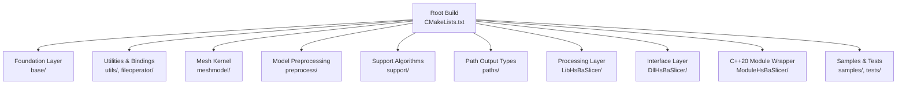

**Diagram sources**
- [CMakeLists.txt:410-454](file://CMakeLists.txt#L410-L454)
- [README.md:126-172](file://README.md#L126-L172)

**Section sources**
- [CMakeLists.txt:410-454](file://CMakeLists.txt#L410-L454)
- [README.md:100-172](file://README.md#L100-L172)

## Core Components
The core components are organized by responsibility:

| Layer | Responsibility | Key Headers / Files |
|---|---|---|
| Foundation Layer | Types, concepts, coroutines, thread pool, memory pools, error handling, units, reflection helpers | `base/thread_pool.hpp`, `base/memory_pool.hpp` |
| Processing Layer | Public C++ slicing API: model loading, slicing, support, fill, path generation, SLA floor/export | `LibHsBaSlicer/Preprocess/model_preprocess.hpp`, `LibHsBaSlicer/Slice/mesh_slice.hpp`, `LibHsBaSlicer/Support/fdm_support.hpp`, `LibHsBaSlicer/Fill/polygon_fill.hpp`, `LibHsBaSlicer/Path/path_generator.hpp`, `LibHsBaSlicer/Floor/sla_floor.hpp` |
| Algorithm Layer | 2D polygons, hulls, image-to-polygons, fill engine; mesh models; support algorithms | `2D/FloatPolygons.hpp`, `2D/PolygonFill.hpp`, `meshmodel/FullTopoModel.hpp`, `support/SupportConfig.hpp` |
| Interface Layer | Per-technology C ABI pipelines: FDM, SLA, SLS, LOM, TDP, WAAM, plus custom Lua pipeline | `DllHsBaSlicer/*_pipeline.h`, `pipelinetypes/pipeline_types.h` |
| Extension Layer | Lua bindings and scripting hooks for support, fill, floor, export, and full custom pipelines | `LibHsBaSlicer/Extends/lua_pipeline.cpp`, `types/hsba_pipeline.d.lua` |

**Section sources**
- [export.h:1-22](file://LibHsBaSlicer/export.h#L1-L22)
- [model_preprocess.hpp:22-120](file://LibHsBaSlicer/Preprocess/model_preprocess.hpp#L22-L120)
- [mesh_slice.hpp:22-103](file://LibHsBaSlicer/Slice/mesh_slice.hpp#L22-L103)
- [fdm_support.hpp:19-67](file://LibHsBaSlicer/Support/fdm_support.hpp#L19-L67)
- [polygon_fill.hpp:17-53](file://LibHsBaSlicer/Fill/polygon_fill.hpp#L17-L53)
- [path_generator.hpp:20-91](file://LibHsBaSlicer/Path/path_generator.hpp#L20-L91)
- [sla_floor.hpp:21-195](file://LibHsBaSlicer/Floor/sla_floor.hpp#L21-L195)

## Architecture Overview
HsBaSlicer uses a layered architecture where each layer has a clear contract and limited coupling to lower layers.

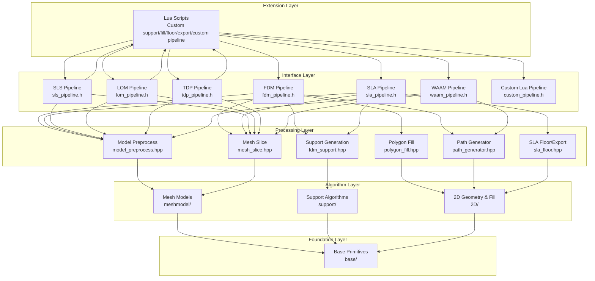

**Diagram sources**
- [fdm_pipeline.h:23-35](file://DllHsBaSlicer/fdm_pipeline.h#L23-L35)
- [sla_pipeline.h:23-34](file://DllHsBaSlicer/sla_pipeline.h#L23-L34)
- [sls_pipeline.h:23-34](file://DllHsBaSlicer/sls_pipeline.h#L23-L34)
- [lom_pipeline.h:23-36](file://DllHsBaSlicer/lom_pipeline.h#L23-L36)
- [tdp_pipeline.h:23-36](file://DllHsBaSlicer/tdp_pipeline.h#L23-L36)
- [waam_pipeline.h:23-37](file://DllHsBaSlicer/waam_pipeline.h#L23-L37)
- [model_preprocess.hpp:32-120](file://LibHsBaSlicer/Preprocess/model_preprocess.hpp#L32-L120)
- [mesh_slice.hpp:22-103](file://LibHsBaSlicer/Slice/mesh_slice.hpp#L22-L103)
- [fdm_support.hpp:19-67](file://LibHsBaSlicer/Support/fdm_support.hpp#L19-L67)
- [polygon_fill.hpp:17-53](file://LibHsBaSlicer/Fill/polygon_fill.hpp#L17-L53)
- [path_generator.hpp:20-91](file://LibHsBaSlicer/Path/path_generator.hpp#L20-L91)
- [sla_floor.hpp:21-195](file://LibHsBaSlicer/Floor/sla_floor.hpp#L21-L195)

### System Context Data Flow
The typical data flow from model input to exported output is:

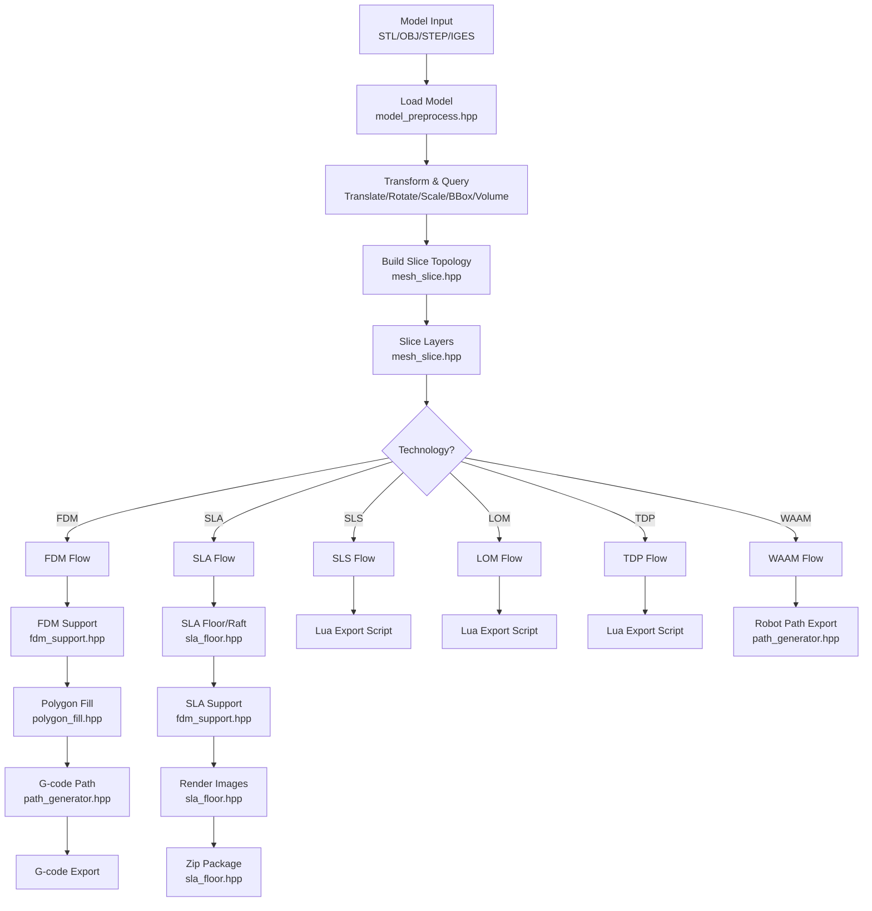

**Diagram sources**
- [model_preprocess.hpp:32-120](file://LibHsBaSlicer/Preprocess/model_preprocess.hpp#L32-L120)
- [mesh_slice.hpp:22-103](file://LibHsBaSlicer/Slice/mesh_slice.hpp#L22-L103)
- [fdm_support.hpp:19-67](file://LibHsBaSlicer/Support/fdm_support.hpp#L19-L67)
- [polygon_fill.hpp:17-53](file://LibHsBaSlicer/Fill/polygon_fill.hpp#L17-L53)
- [path_generator.hpp:20-91](file://LibHsBaSlicer/Path/path_generator.hpp#L20-L91)
- [sla_floor.hpp:21-195](file://LibHsBaSlicer/Floor/sla_floor.hpp#L21-L195)

## Detailed Component Analysis

### Technology Pipelines and Configuration Contracts
Each technology pipeline exposes:
- A default configuration constructor.
- A synchronous run function.
- An asynchronous run function.
- A result-free function.

The configuration and result structures are defined centrally in a C-compatible header so that downstream modules can use them without depending on the shared library.

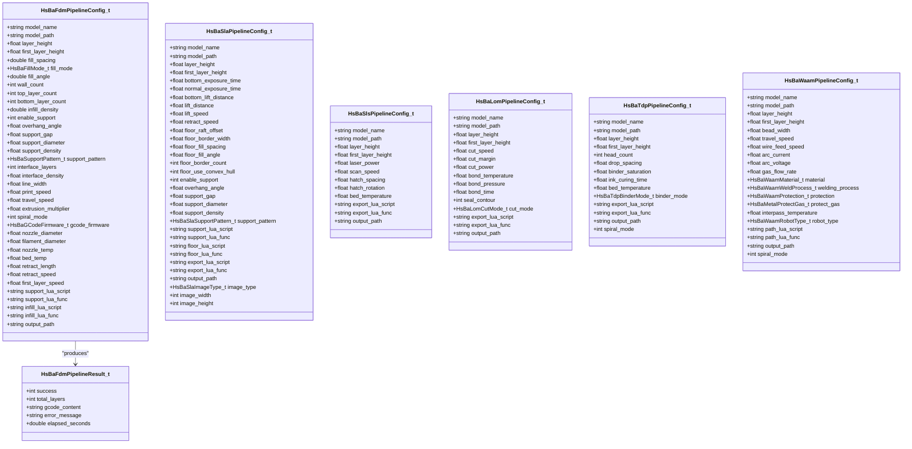

**Diagram sources**
- [pipeline_types.h:23-127](file://pipelinetypes/pipeline_types.h#L23-L127)
- [pipeline_types.h:146-232](file://pipelinetypes/pipeline_types.h#L146-L232)
- [pipeline_types.h:251-297](file://pipelinetypes/pipeline_types.h#L251-L297)
- [pipeline_types.h:417-448](file://pipelinetypes/pipeline_types.h#L417-L448)
- [pipeline_types.h:477-508](file://pipelinetypes/pipeline_types.h#L477-L508)
- [pipeline_types.h:573-612](file://pipelinetypes/pipeline_types.h#L573-L612)

#### FDM Pipeline
The FDM pipeline orchestrates preprocessing, slicing, support generation, polygon filling, and G-code path generation. It supports firmware-targeted G-code output and optional spiral vase mode.

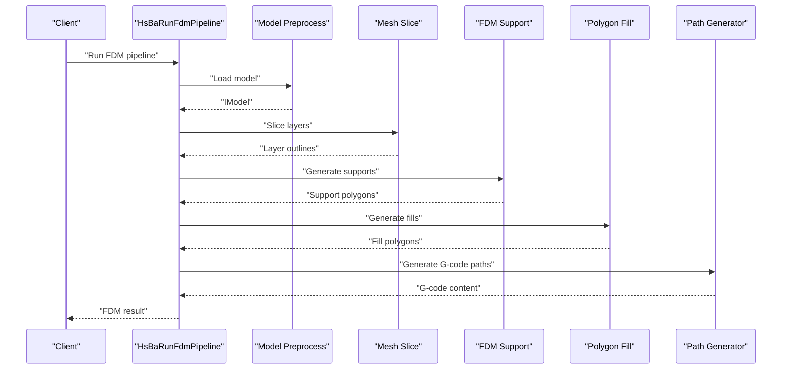

**Diagram sources**
- [fdm_pipeline.h:23-35](file://DllHsBaSlicer/fdm_pipeline.h#L23-L35)
- [model_preprocess.hpp:32-120](file://LibHsBaSlicer/Preprocess/model_preprocess.hpp#L32-L120)
- [mesh_slice.hpp:22-103](file://LibHsBaSlicer/Slice/mesh_slice.hpp#L22-L103)
- [fdm_support.hpp:19-67](file://LibHsBaSlicer/Support/fdm_support.hpp#L19-L67)
- [polygon_fill.hpp:17-53](file://LibHsBaSlicer/Fill/polygon_fill.hpp#L17-L53)
- [path_generator.hpp:20-91](file://LibHsBaSlicer/Path/path_generator.hpp#L20-L91)

#### SLA Pipeline
The SLA pipeline produces layer images, optional raft/floor, optional sacrificial or cone supports, and exports a zip package.

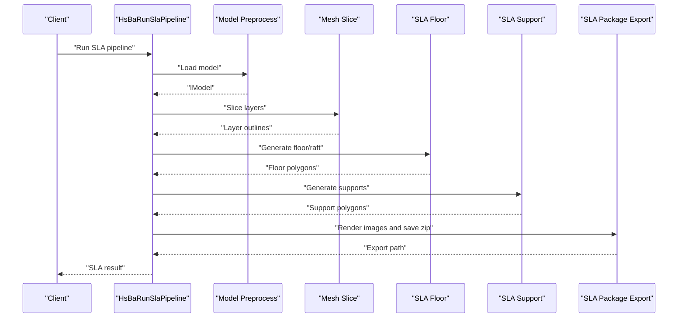

**Diagram sources**
- [sla_pipeline.h:23-34](file://DllHsBaSlicer/sla_pipeline.h#L23-L34)
- [sla_floor.hpp:21-195](file://LibHsBaSlicer/Floor/sla_floor.hpp#L21-L195)
- [fdm_support.hpp:39-67](file://LibHsBaSlicer/Support/fdm_support.hpp#L39-L67)

#### SLS, LOM, TDP Pipelines
These powder-bed or sheet-based processes slice the model and delegate final export to Lua scripts. They do not require traditional raft/support outputs because the process medium provides support or bonding behavior.

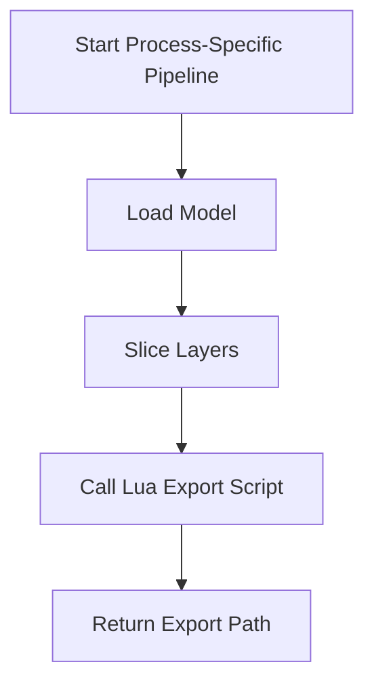

**Diagram sources**
- [sls_pipeline.h:23-34](file://DllHsBaSlicer/sls_pipeline.h#L23-L34)
- [lom_pipeline.h:23-36](file://DllHsBaSlicer/lom_pipeline.h#L23-L36)
- [tdp_pipeline.h:23-36](file://DllHsBaSlicer/tdp_pipeline.h#L23-L36)
- [pipeline_types.h:251-297](file://pipelinetypes/pipeline_types.h#L251-L297)
- [pipeline_types.h:417-448](file://pipelinetypes/pipeline_types.h#L417-L448)
- [pipeline_types.h:477-508](file://pipelinetypes/pipeline_types.h#L477-L508)

#### WAAM Pipeline
WAAM generates robot language programs rather than layer zips. It maps sliced contours to deposition paths and optionally supports continuous spiral deposition.

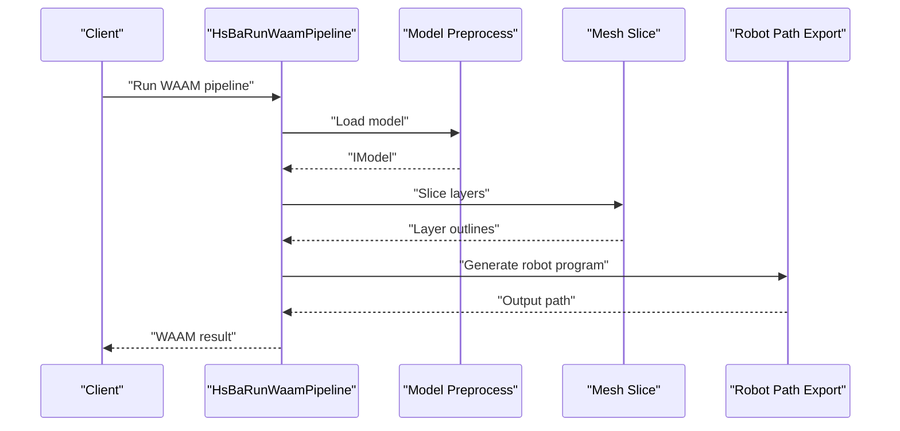

**Diagram sources**
- [waam_pipeline.h:23-37](file://DllHsBaSlicer/waam_pipeline.h#L23-L37)
- [path_generator.hpp:64-80](file://LibHsBaSlicer/Path/path_generator.hpp#L64-L80)

### Multi-Technology Support Architecture
The multi-technology support architecture is driven by:
- Centralized C-compatible configuration and result types.
- Per-technology pipeline headers defining default config, sync run, async run, and result free functions.
- Shared processing-layer APIs reused across technologies.
- Lua extension points for custom support, fill, floor, export, and fully custom pipelines.

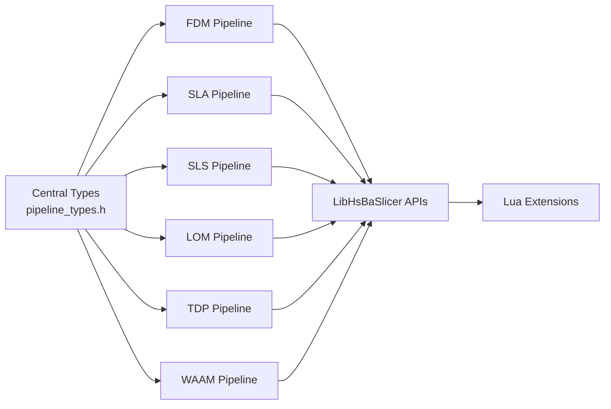

**Diagram sources**
- [pipeline_types.h:23-127](file://pipelinetypes/pipeline_types.h#L23-L127)
- [pipeline_types.h:146-232](file://pipelinetypes/pipeline_types.h#L146-L232)
- [pipeline_types.h:251-297](file://pipelinetypes/pipeline_types.h#L251-L297)
- [pipeline_types.h:417-448](file://pipelinetypes/pipeline_types.h#L417-L448)
- [pipeline_types.h:477-508](file://pipelinetypes/pipeline_types.h#L477-L508)
- [pipeline_types.h:573-612](file://pipelinetypes/pipeline_types.h#L573-L612)

### Lua Scripting Integration
Lua scripting is integrated at multiple levels:
- Custom support generation via `GenerateAllLuaSupport`.
- Custom fill patterns via `LuaCustomFillByFile`.
- Custom SLA floor generation via `LuaCustomFloorByFile` / `LuaCustomFloorByString`.
- Custom export for SLS, LOM, TDP, and fully custom pipelines.
- Runtime exposure of slicing, support, fill, floor, path, and export helpers through the Lua pipeline binding.

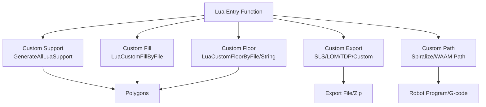

**Diagram sources**
- [fdm_support.hpp:52-67](file://LibHsBaSlicer/Support/fdm_support.hpp#L52-L67)
- [polygon_fill.hpp:39-53](file://LibHsBaSlicer/Fill/polygon_fill.hpp#L39-L53)
- [sla_floor.hpp:80-116](file://LibHsBaSlicer/Floor/sla_floor.hpp#L80-L116)
- [lua_pipeline.cpp:537-577](file://LibHsBaSlicer/Extends/lua_pipeline.cpp#L537-L577)
- [hsba_slicer.cppm:731-750](file://ModuleHsBaSlicer/hsba_slicer.cppm#L731-L750)

### Cross-Cutting Concerns

#### Parallel Processing
The foundation layer provides a thread pool with coroutine executor support. This enables concurrent task execution for slicing, support generation, fill computation, and image rendering.

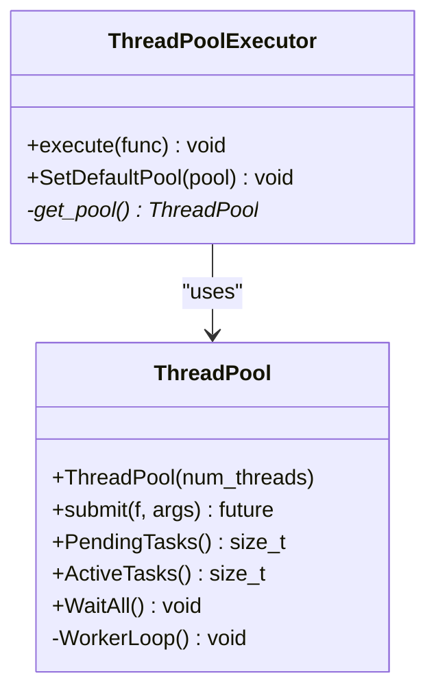

**Diagram sources**
- [thread_pool.hpp:29-162](file://base/thread_pool.hpp#L29-L162)
- [thread_pool.hpp:164-209](file://base/thread_pool.hpp#L164-L209)

#### Memory Management
The foundation layer includes fixed-size memory pool allocators for predictable allocation behavior and reduced heap fragmentation during intensive geometric computations.

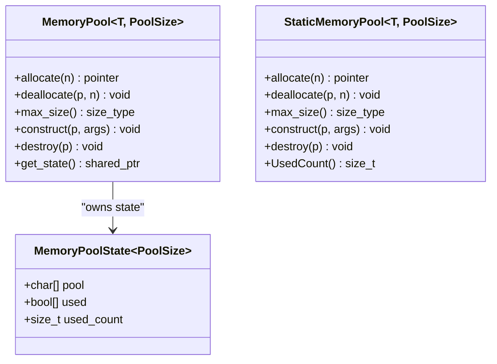

**Diagram sources**
- [memory_pool.hpp:28-208](file://base/memory_pool.hpp#L28-L208)
- [memory_pool.hpp:215-372](file://base/memory_pool.hpp#L215-L372)

## Dependency Analysis
The project’s third-party dependencies are declared in the vcpkg manifest and discovered by the root CMake configuration. Copyleft kernels CGAL and OpenCascade are conditionally enabled, affecting both linking and license terms.

```mermaid
graph TB
Project["HsBaSlicer Project"] --> Boost["Boost<br/>log, locale, dll, property-tree, etc."]
Project --> Clipper2["Clipper2"]
Project --> Eigen3["Eigen3"]
Project --> RapidJSON["RapidJSON"]
Project --> Protobuf["Protobuf"]
Project --> OpenSSL["OpenSSL"]
Project --> TinyXML2["tinyxml2"]
Project --> YAML["yaml-cpp"]
Project --> MagicEnum["magic_enum"]
Project --> Lua["Lua"]
Project --> Miniz["miniz"]
Project --> Bit7z["bit7z"]
Project --> OpenCV["OpenCV"]
Project --> Sqlpp11["sqlpp11"]
Project --> IGL["libigl"]
Project --> CGAL["CGAL (optional copyleft)"]
Project --> OCCT["OpenCASCADE (optional copyleft)"]
Project --> OpenVDB["OpenVDB"]
```

**Diagram sources**
- [vcpkg.json:10-87](file://vcpkg.json#L10-L87)
- [vcpkg.json:89-110](file://vcpkg.json#L89-L110)
- [CMakeLists.txt:210-349](file://CMakeLists.txt#L210-L349)
- [CMakeLists.txt:284-318](file://CMakeLists.txt#L284-L318)

### Version Compatibility Considerations
- CMake minimum version: 3.28.
- C++ standard: C++20 required; C standard varies by compiler capability, up to C23 when supported.
- Optional features guarded by compile-time checks: concepts, ranges, source_location, non-type template parameters, template-template matching, coroutines, explicit this, C23 constexpr.
- Copyleft kernel feature controlled by `HSBA_COPL` and vcpkg manifest feature `copyleft`.
- Platform-specific toggles for desktop/mobile/game console, DLL loader availability, bit7z usage, and test execution.

**Section sources**
- [CMakeLists.txt:4-38](file://CMakeLists.txt#L4-L38)
- [CMakeLists.txt:48-104](file://CMakeLists.txt#L48-L104)
- [CMakeLists.txt:170-204](file://CMakeLists.txt#L170-L204)
- [CMakeLists.txt:228-262](file://CMakeLists.txt#L228-L262)
- [CMakeLists.txt:284-318](file://CMakeLists.txt#L284-L318)

## Performance Considerations
- Use prebuilt slicing topology for multi-layer workflows to avoid rebuilding topology per layer.
- Prefer closed-contour slicing for material-fed processes; unsafe slicing may be considered only where open contours are meaningful.
- Enable parallel task submission through the thread pool for independent layer operations where safe.
- Tune memory pool sizes and model pool capacity based on available copyleft kernel support.
- Avoid boolean operations in Debug builds due to performance and memory constraints.

[No sources needed since this section provides general guidance]

## Troubleshooting Guide
Common issues and their architectural context:

| Issue | Likely Cause | Recommended Action |
|---|---|---|
| Missing copyleft kernels | CGAL or OpenCascade not found or `copyleft` feature disabled | Enable vcpkg `copyleft` feature or install CGAL/OpenCascade; verify `HSBA_COPL` detection |
| Boolean operations slow or high memory | Debug build disables or limits boolean operations | Use Release build or reduce model complexity; consider disabling boolean operations |
| Lua script errors | Invalid script path, missing function name, or incompatible Lua API | Validate script path, function name, and Lua table shapes against documented fields |
| Thread pool exceptions | Submitting tasks after pool shutdown or invalid thread count | Ensure pool lifecycle matches pipeline lifetime; validate thread count |
| Memory allocation failures | Fixed memory pool exhausted | Increase pool size or reduce per-operation allocations |

**Section sources**
- [CMakeLists.txt:284-318](file://CMakeLists.txt#L284-L318)
- [thread_pool.hpp:37-90](file://base/thread_pool.hpp#L37-L90)
- [memory_pool.hpp:111-141](file://base/memory_pool.hpp#L111-L141)
- [memory_pool.hpp:266-296](file://base/memory_pool.hpp#L266-L296)

## Conclusion
HsBaSlicer’s architecture cleanly separates concerns across foundation, processing, algorithm, interface, and extension layers. The central type definitions and per-technology pipeline contracts provide a stable surface for external integrations. Lua scripting offers flexible customization for support, fill, floor, export, and fully custom pipelines. The dependency graph reflects a pragmatic balance between modern C++ tooling, established geometry libraries, and platform-specific considerations. For production use, prefer Release builds, leverage prebuilt slicing topology, and configure copyleft kernels according to licensing requirements.

[No sources needed since this section summarizes without analyzing specific files]