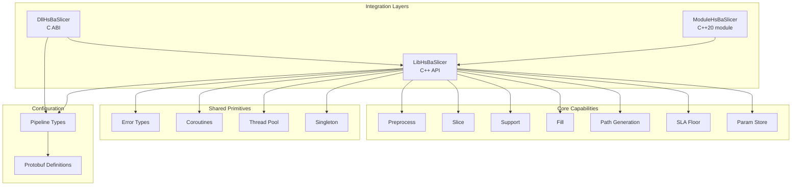
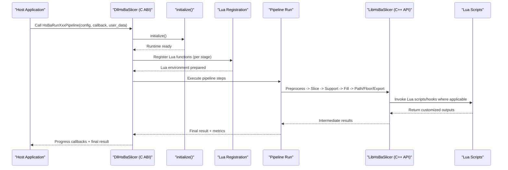
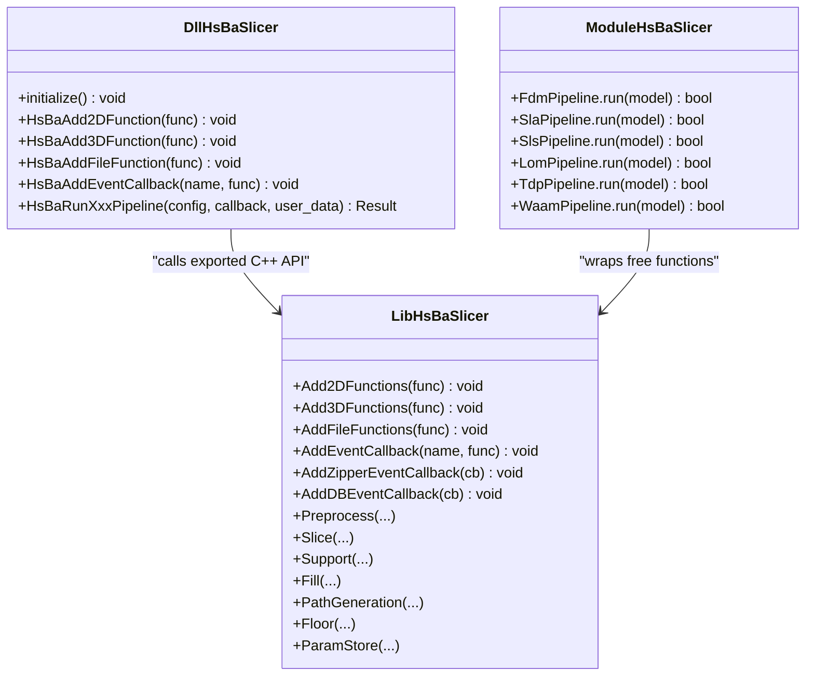
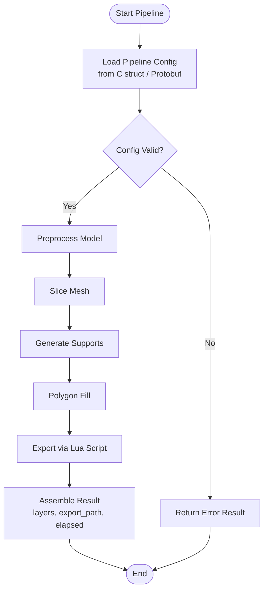
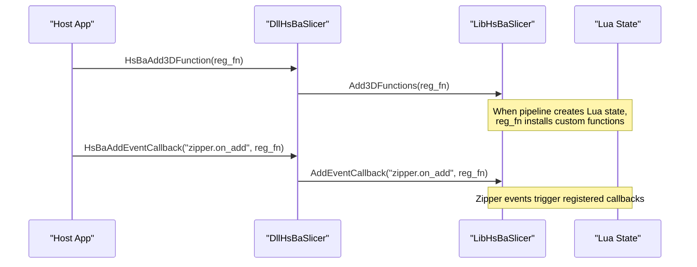
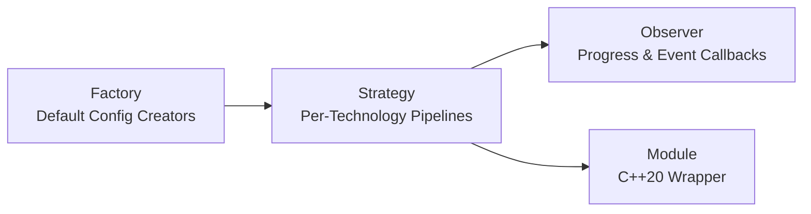
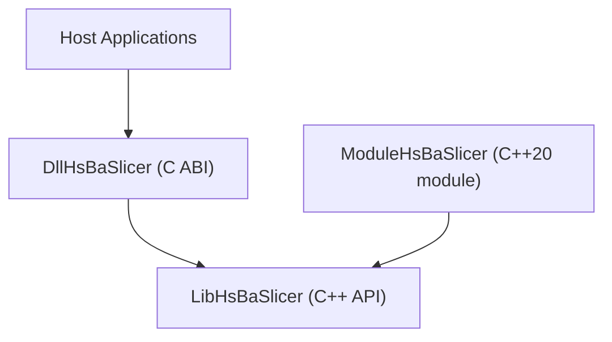
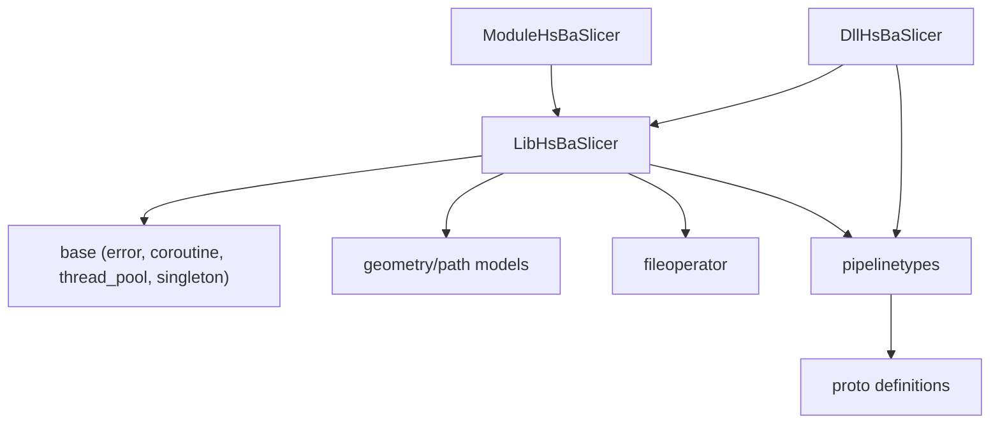

# Architecture Overview

<cite>
**Referenced Files in This Document**
- [README.md](file://README.md)
- [CMakeLists.txt](file://CMakeLists.txt)
- [initialize.h](file://DllHsBaSlicer/initialize.h)
- [lua_register.h](file://DllHsBaSlicer/lua_register.h)
- [pipeline_types.h](file://pipelinetypes/pipeline_types.h)
- [lom_pipeline.proto](file://proto/lom_pipeline.proto)
- [tdp_pipeline.proto](file://proto/tdp_pipeline.proto)
- [custom_pipeline.proto](file://proto/custom_pipeline.proto)
- [error.hpp](file://base/error.hpp)
- [coroutine.hpp](file://base/coroutine.hpp)
- [thread_pool.hpp](file://base/thread_pool.hpp)
- [singleton.hpp](file://base/singleton.hpp)
- [LuaAddFunction.hpp](file://LibHsBaSlicer/Extends/LuaAddFunction.hpp)
- [EventSourceFunction.hpp](file://LibHsBaSlicer/Extends/EventSourceFunction.hpp)
- [hsba_slicer.cppm](file://ModuleHsBaSlicer/hsba_slicer.cppm)
- [CMakeLists.txt](file://ModuleHsBaSlicer/CMakeLists.txt)
- [game_engine_integration.md](file://docs/en/DllHsBaSlicer/game_engine_integration.md)
- [qt_wxwidgets_integration.md](file://docs/en/DllHsBaSlicer/qt_wxwidgets_integration.md)
- [lua_pipeline_api.md](file://docs/en/lua_pipeline_api.md)
</cite>

## Table of Contents
1. [Introduction](#introduction)
2. [Project Structure](#project-structure)
3. [Core Components](#core-components)
4. [Architecture Overview](#architecture-overview)
5. [Detailed Component Analysis](#detailed-component-analysis)
6. [Dependency Analysis](#dependency-analysis)
7. [Performance Considerations](#performance-considerations)
8. [Troubleshooting Guide](#troubleshooting-guide)
9. [Conclusion](#conclusion)
10. [Appendices](#appendices)

## Introduction
HsBaSlicer is a high-performance, modular C++ framework for 3D-printing slicers. It provides a layered architecture that separates core slicing algorithms from I/O and scripting concerns, supports multiple 3D printing technologies through pipeline orchestration, and exposes extensibility via Lua scripts and custom implementations. The system offers three integration layers:
- DllHsBaSlicer: a C ABI dynamic/static library for cross-language host applications.
- LibHsBaSlicer: the C++ API encapsulating preprocessing, slicing, support generation, infill, path generation, and export.
- ModuleHsBaSlicer: a C++20 module wrapper exposing a class-based API over LibHsBaSlicer.

The repository also includes shared primitives (errors, coroutines, thread pool, singleton), protocol buffers for pipeline configuration, and platform-specific build/install/export logic.

**Section sources**
- [README.md:21-39](file://README.md#L21-L39)

## Project Structure
At a high level, the project is organized into feature modules and integration layers:
- base: foundational types, error classes, coroutines, thread pool, singleton utilities.
- fileoperator, meshmodel, cadmodel, paths, support, preprocess: domain capabilities used by the slicer.
- pipelinetypes and proto: shared pipeline configuration types and Protobuf definitions.
- LibHsBaSlicer: C++ API layer with slice, preprocess, support, fill, path, floor, param store, and Lua extensions.
- DllHsBaSlicer: C ABI entry points and per-technology pipelines (FDM, SLA, SLS, LOM, TDP, WAAM, etc.).
- ModuleHsBaSlicer: C++20 module wrapper around LibHsBaSlicer.
- samples and docs: usage examples and integration guides.

**Diagram sources**
- [CMakeLists.txt:410-439](file://CMakeLists.txt#L410-L439)
- [README.md:29-39](file://README.md#L29-L39)

**Section sources**
- [README.md:29-39](file://README.md#L29-L39)
- [CMakeLists.txt:410-439](file://CMakeLists.txt#L410-L439)

## Core Components
This section summarizes the primary architectural components and their responsibilities:
- DllHsBaSlicer: Exposes stable C ABI functions to initialize the runtime and run technology-specific pipelines synchronously or asynchronously. It coordinates Lua registration and progress callbacks.
- LibHsBaSlicer: Provides C++ APIs for model preprocessing, mesh slicing, support generation, polygon filling, path generation, SLA floor creation, parameter persistence, and Lua-driven customization hooks.
- ModuleHsBaSlicer: A thin C++20 module wrapper that exposes class-based interfaces (e.g., FdmPipeline, SlaPipeline, SlsPipeline, LomPipeline, TdpPipeline, WaamPipeline) backed by LibHsBaSlicer.
- Shared primitives: Error hierarchy, coroutine Task/Executor abstractions, ThreadPool, Singleton utility.
- Configuration: Pipeline types (C-compatible structs) and Protobuf messages define configuration and results for each technology.

Key responsibilities:
- Separation of concerns: Algorithms live in LibHsBaSlicer; ABI and orchestration live in DllHsBaSlicer; modern C++ consumers can use ModuleHsBaSlicer.
- Extensibility: Lua scripts and external function registration enable customization per stage (slice/support/fill/output).
- Cross-platform deployment: Build options control copyleft kernels, logging, bit7z, OpenCV, and platform-specific artifacts.

**Section sources**
- [README.md:104-124](file://README.md#L104-L124)
- [CMakeLists.txt:456-506](file://CMakeLists.txt#L456-L506)

## Architecture Overview
The system follows a layered architecture:
- Host application layer: Qt/wxWidgets/Unity/Unreal Engine/C#/Java/Python/Swift call into DllHsBaSlicer via a pure C ABI.
- C ABI orchestration layer (DllHsBaSlicer): Initializes the runtime, registers Lua functions, constructs pipeline configurations, runs pipelines synchronously/asynchronously, and reports progress/results.
- C++ API layer (LibHsBaSlicer): Implements preprocessing, slicing, support, fill, path generation, floor generation, parameter storage, and Lua extension mechanisms.
- Core libraries: Base utilities (errors, coroutines, thread pool, singleton), geometry/path models, and file operations.
- Configuration layer: Pipeline types and Protobuf definitions provide structured configuration and result contracts across languages.

**Diagram sources**
- [initialize.h:14-19](file://DllHsBaSlicer/initialize.h#L14-L19)
- [lua_register.h:21-31](file://DllHsBaSlicer/lua_register.h#L21-L31)
- [lua_pipeline_api.md:1-18](file://docs/en/lua_pipeline_api.md#L1-L18)

**Section sources**
- [initialize.h:14-19](file://DllHsBaSlicer/initialize.h#L14-L19)
- [lua_register.h:21-31](file://DllHsBaSlicer/lua_register.h#L21-L31)
- [lua_pipeline_api.md:1-18](file://docs/en/lua_pipeline_api.md#L1-L18)

## Detailed Component Analysis

### Layered Architecture and Responsibilities
- DllHsBaSlicer:
  - Entry point: initialize() sets up Lua registrations and one-time runtime setup.
  - Per-technology pipelines: Provide synchronous and asynchronous run functions returning structured results and supporting progress callbacks.
  - Lua extension registration: HsBaAdd2DFunction/HsBaAdd3DFunction/HsBaAddFileFunction/HsBaAddEventCallback allow host apps to inject custom behavior.
- LibHsBaSlicer:
  - Free-function API for preprocessing, slicing, support, fill, path generation, floor generation, and parameter store operations.
  - Lua extension registration: Add2DFunctions/Add3DFunctions/AddFileFunctions/AddEventCallback register functions at runtime.
  - Event source callbacks: AddZipperEventCallback/AddDBEventCallback expose Zipper and database events to C++ clients.
- ModuleHsBaSlicer:
  - Class-based wrappers (e.g., FdmPipeline, SlaPipeline, SlsPipeline, LomPipeline, TdpPipeline, WaamPipeline) that forward to LibHsBaSlicer.
  - Thin static wrapper built against LibHsBaSlicer, exporting a C++20 module interface.

**Diagram sources**
- [initialize.h:14-19](file://DllHsBaSlicer/initialize.h#L14-L19)
- [lua_register.h:21-31](file://DllHsBaSlicer/lua_register.h#L21-L31)
- [LuaAddFunction.hpp:24-74](file://LibHsBaSlicer/Extends/LuaAddFunction.hpp#L24-L74)
- [EventSourceFunction.hpp:18-41](file://LibHsBaSlicer/Extends/EventSourceFunction.hpp#L18-L41)
- [hsba_slicer.cppm:290-333](file://ModuleHsBaSlicer/hsba_slicer.cppm#L290-L333)

**Section sources**
- [initialize.h:14-19](file://DllHsBaSlicer/initialize.h#L14-L19)
- [lua_register.h:21-31](file://DllHsBaSlicer/lua_register.h#L21-L31)
- [LuaAddFunction.hpp:24-74](file://LibHsBaSlicer/Extends/LuaAddFunction.hpp#L24-L74)
- [EventSourceFunction.hpp:18-41](file://LibHsBaSlicer/Extends/EventSourceFunction.hpp#L18-L41)
- [hsba_slicer.cppm:290-333](file://ModuleHsBaSlicer/hsba_slicer.cppm#L290-L333)

### Pipeline Orchestration System
The pipeline orchestrator coordinates workflow execution across different 3D printing technologies:
- Technology-specific pipelines: FDM, SLA, SLS, LOM, TDP, WAAM, plus custom pipelines.
- Configuration: Structured via pipeline_types.h and Protobuf messages (e.g., lom_pipeline.proto, tdp_pipeline.proto).
- Execution modes: Synchronous and asynchronous calls with progress callbacks and result structures.
- Lua-driven export stages: Many pipelines invoke Lua scripts for export or post-processing.

**Diagram sources**
- [pipeline_types.h:448-505](file://pipelinetypes/pipeline_types.h#L448-L505)
- [lom_pipeline.proto:1-45](file://proto/lom_pipeline.proto#L1-L45)
- [tdp_pipeline.proto:1-35](file://proto/tdp_pipeline.proto#L1-L35)
- [custom_pipeline.proto:23-30](file://proto/custom_pipeline.proto#L23-L30)

**Section sources**
- [pipeline_types.h:448-505](file://pipelinetypes/pipeline_types.h#L448-L505)
- [lom_pipeline.proto:1-45](file://proto/lom_pipeline.proto#L1-L45)
- [tdp_pipeline.proto:1-35](file://proto/tdp_pipeline.proto#L1-L35)
- [custom_pipeline.proto:23-30](file://proto/custom_pipeline.proto#L23-L30)

### Plugin Architecture (Lua Scripts and Custom Implementations)
HsBaSlicer enables extensibility through Lua scripts and custom implementations:
- Two Lua runtime environments:
  - Custom-pipeline environment (the HsBa operation table).
  - Shared libraries available in every environment.
- Built-in pipeline stage hooks:
  - Slice, Support, Fill, SLS Output, SLA Output stages expose specific Lua APIs.
- External function registration:
  - Via DllHsBaSlicer: HsBaAdd2DFunction/HsBaAdd3DFunction/HsBaAddFileFunction/HsBaAddEventCallback.
  - Via LibHsBaSlicer: Add2DFunctions/Add3DFunctions/AddFileFunctions/AddEventCallback.
- Integration patterns:
  - Game engines (Unity/UE) and desktop frameworks (Qt/wxWidgets) register functions during initialization.

**Diagram sources**
- [lua_register.h:21-31](file://DllHsBaSlicer/lua_register.h#L21-L31)
- [LuaAddFunction.hpp:24-74](file://LibHsBaSlicer/Extends/LuaAddFunction.hpp#L24-L74)
- [game_engine_integration.md:375-411](file://docs/en/DllHsBaSlicer/game_engine_integration.md#L375-L411)
- [qt_wxwidgets_integration.md:293-339](file://docs/en/DllHsBaSlicer/qt_wxwidgets_integration.md#L293-L339)
- [lua_pipeline_api.md:1-18](file://docs/en/lua_pipeline_api.md#L1-L18)

**Section sources**
- [lua_register.h:21-31](file://DllHsBaSlicer/lua_register.h#L21-L31)
- [LuaAddFunction.hpp:24-74](file://LibHsBaSlicer/Extends/LuaAddFunction.hpp#L24-L74)
- [game_engine_integration.md:375-411](file://docs/en/DllHsBaSlicer/game_engine_integration.md#L375-L411)
- [qt_wxwidgets_integration.md:293-339](file://docs/en/DllHsBaSlicer/qt_wxwidgets_integration.md#L293-L339)
- [lua_pipeline_api.md:1-18](file://docs/en/lua_pipeline_api.md#L1-L18)

### Component Interaction Patterns
- Factory pattern:
  - Pipeline configuration constructors (e.g., default config creators) act as factories for technology-specific pipelines.
- Strategy pattern:
  - Different pipeline strategies per technology (FDM/SLA/SLS/LOM/TDP/WAAM) share common orchestration but vary in algorithmic steps and Lua export hooks.
- Observer pattern:
  - Event callbacks (Zipper/DB) and progress callbacks implement observer semantics for asynchronous notifications.
- Module pattern:
  - ModuleHsBaSlicer encapsulates LibHsBaSlicer behind a C++20 module interface, providing cohesive class-based APIs.

**Diagram sources**
- [pipeline_types.h:448-505](file://pipelinetypes/pipeline_types.h#L448-L505)
- [EventSourceFunction.hpp:18-41](file://LibHsBaSlicer/Extends/EventSourceFunction.hpp#L18-L41)
- [hsba_slicer.cppm:290-333](file://ModuleHsBaSlicer/hsba_slicer.cppm#L290-L333)

**Section sources**
- [pipeline_types.h:448-505](file://pipelinetypes/pipeline_types.h#L448-L505)
- [EventSourceFunction.hpp:18-41](file://LibHsBaSlicer/Extends/EventSourceFunction.hpp#L18-L41)
- [hsba_slicer.cppm:290-333](file://ModuleHsBaSlicer/hsba_slicer.cppm#L290-L333)

### Relationship Between DllHsBaSlicer, LibHsBaSlicer, and ModuleHsBaSlicer
- DllHsBaSlicer:
  - Pure C ABI boundary for host applications.
  - Calls only LibHsBaSlicer exported functions; never touches lower-level modules directly.
- LibHsBaSlicer:
  - C++ API layer implementing core slicing capabilities.
  - Exposes Lua extension and event callback registration APIs.
- ModuleHsBaSlicer:
  - Static C++20 module wrapper around LibHsBaSlicer.
  - Provides class-based APIs (e.g., FdmPipeline, SlaPipeline, SlsPipeline, LomPipeline, TdpPipeline, WaamPipeline).

**Diagram sources**
- [README.md:104-124](file://README.md#L104-L124)
- [CMakeLists.txt:481-498](file://CMakeLists.txt#L481-L498)
- [hsba_slicer.cppm:290-333](file://ModuleHsBaSlicer/hsba_slicer.cppm#L290-L333)

**Section sources**
- [README.md:104-124](file://README.md#L104-L124)
- [CMakeLists.txt:481-498](file://CMakeLists.txt#L481-L498)
- [hsba_slicer.cppm:290-333](file://ModuleHsBaSlicer/hsba_slicer.cppm#L290-L333)

## Dependency Analysis
High-level dependencies:
- DllHsBaSlicer depends on LibHsBaSlicer and shared pipeline types.
- LibHsBaSlicer depends on base utilities (errors, coroutines, thread pool, singleton), geometry/path models, and file operators.
- ModuleHsBaSlicer depends on LibHsBaSlicer and pipeline types.
- Configuration uses pipeline_types.h and Protobuf definitions.

**Diagram sources**
- [CMakeLists.txt:410-439](file://CMakeLists.txt#L410-L439)
- [CMakeLists.txt:456-506](file://CMakeLists.txt#L456-L506)

**Section sources**
- [CMakeLists.txt:410-439](file://CMakeLists.txt#L410-L439)
- [CMakeLists.txt:456-506](file://CMakeLists.txt#L456-L506)

## Performance Considerations
- Coroutines and executors:
  - Task/Executor abstractions enable asynchronous pipeline steps with customizable execution backends.
  - ThreadPoolExecutor integrates with ThreadPool for concurrent task execution.
- Thread pool:
  - Manages worker threads, tracks active/pending tasks, and supports waiting for completion.
- Resource management:
  - Singleton utilities ensure single instance access for shared resources.
  - Error hierarchy provides typed exceptions for robust error handling.

Recommendations:
- Use asynchronous pipeline calls for long-running jobs to keep UI responsive.
- Configure ThreadPool size based on hardware concurrency and workload characteristics.
- Leverage coroutine-based executors to offload heavy computations without blocking the main thread.

**Section sources**
- [coroutine.hpp:41-122](file://base/coroutine.hpp#L41-L122)
- [thread_pool.hpp:29-162](file://base/thread_pool.hpp#L29-L162)
- [singleton.hpp:21-60](file://base/singleton.hpp#L21-L60)

## Troubleshooting Guide
Common issues and resolutions:
- Initialization failures:
  - Ensure initialize() is called before running any pipeline.
  - Verify Lua registration functions are valid for the process lifetime.
- Lua script errors:
  - Check script paths and function names; validate Lua environment injection.
  - Use provided Lua APIs and verify availability per pipeline stage.
- Event callback not firing:
  - Confirm event names match expected strings (e.g., "zipper.on_add").
  - Ensure callbacks are registered before pipeline execution.
- Resource leaks:
  - Properly release pipeline results using provided free functions.
  - Manage Lua states and external registrations carefully.

Error handling:
- Use the error hierarchy (RuntimeError, IOError, TimeoutError, etc.) for consistent exception handling.
- For async pipelines, inspect result.success and error_message fields.

**Section sources**
- [initialize.h:14-19](file://DllHsBaSlicer/initialize.h#L14-L19)
- [lua_register.h:21-31](file://DllHsBaSlicer/lua_register.h#L21-L31)
- [error.hpp:17-144](file://base/error.hpp#L17-L144)

## Conclusion
HsBaSlicer’s architecture cleanly separates core slicing algorithms from I/O and scripting concerns, enabling flexible orchestration across multiple 3D printing technologies. The plugin architecture via Lua scripts and external function registration allows deep customization without modifying core code. The three-layer integration model (DllHsBaSlicer, LibHsBaSlicer, ModuleHsBaSlicer) supports diverse host environments while maintaining clear ABI boundaries. Robust error handling, progress reporting, and resource management ensure reliable operation across platforms.

[No sources needed since this section summarizes without analyzing specific files]

## Appendices

### Deployment Strategies and Integration Patterns
- Desktop platforms (Windows/Linux/macOS):
  - All library targets participate in installation.
  - Dynamic/shared libraries supported; static linking also possible.
- Mobile and consoles:
  - Android/iOS: CADModel excluded due to missing OpenCascade support.
  - Game consoles: Copyleft kernels disabled; logger may be replaced or omitted.
- Installation and export:
  - CMake install exports targets under HsBaSlicer:: namespace.
  - Public headers installed under include/HsBaSlicer/.
  - Protobuf multi-language outputs optionally installed.

**Section sources**
- [README.md:187-191](file://README.md#L187-L191)
- [README.md:100-124](file://README.md#L100-L124)
- [CMakeLists.txt:456-506](file://CMakeLists.txt#L456-L506)