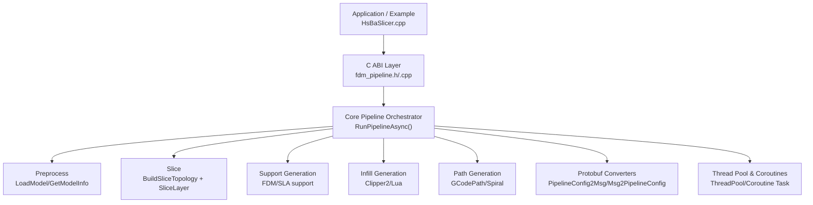
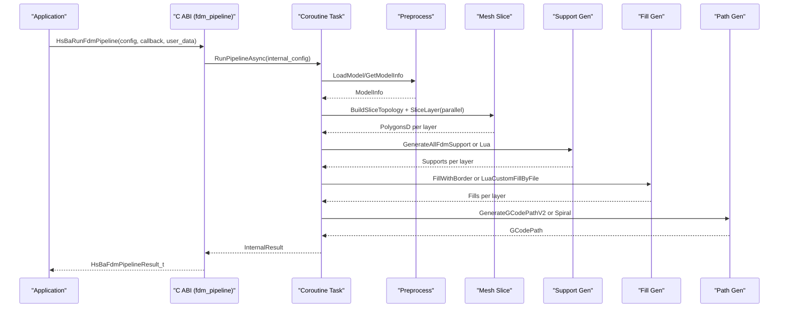
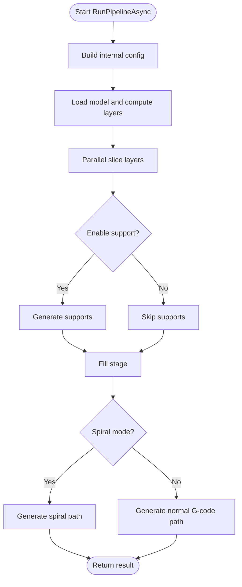
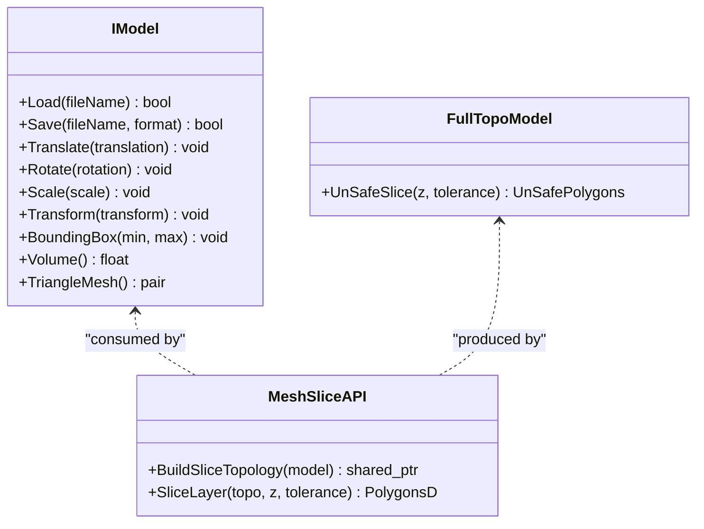
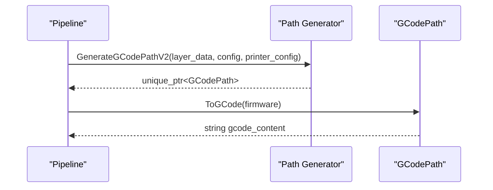
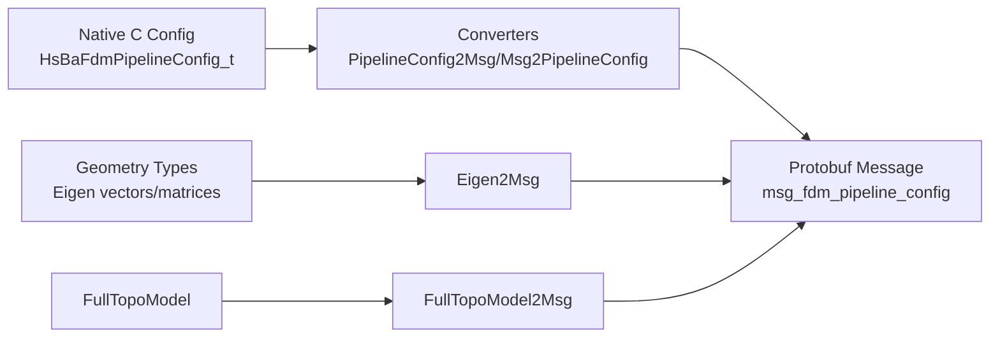
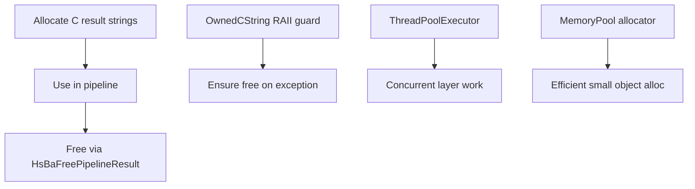
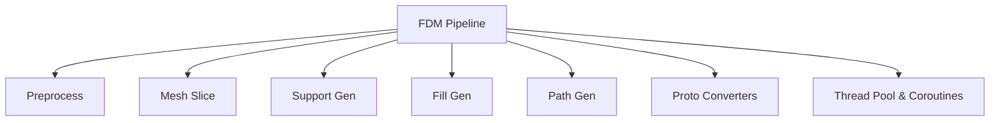

# Component Interaction and Data Flow

<cite>
**Referenced Files in This Document**
- [HsBaSlicer.cpp](file://HsBaSlicer/HsBaSlicer.cpp)
- [fdm_pipeline.h](file://DllHsBaSlicer/fdm_pipeline.h)
- [fdm_pipeline.cpp](file://DllHsBaSlicer/fdm_pipeline.cpp)
- [mesh_slice.hpp](file://LibHsBaSlicer/Slice/mesh_slice.hpp)
- [path_generator.hpp](file://LibHsBaSlicer/Path/path_generator.hpp)
- [model_preprocess.hpp](file://LibHsBaSlicer/Preprocess/model_preprocess.hpp)
- [IModel.hpp](file://base/IModel.hpp)
- [pipeline_parallel.hpp](file://DllHsBaSlicer/pipeline_parallel.hpp)
- [thread_pool.hpp](file://base/thread_pool.hpp)
- [memory_pool.hpp](file://base/memory_pool.hpp)
- [coroutine.md](file://docs/en/base/coroutine.md)
- [pipeline_types.h](file://pipelinetypes/pipeline_types.h)
- [fdm_pipeline.proto](file://proto/fdm_pipeline.proto)
- [pipeline_convert.cpp](file://DllHsBaSlicer/pipeline_convert.cpp)
- [PipelineConfig2Msg.hpp](file://convert/PipelineConfig2Msg.hpp)
- [Msg2PipelineConfig.hpp](file://convert/Msg2PipelineConfig.hpp)
- [Eigen2Msg.hpp](file://convert/Eigen2Msg.hpp)
- [FullTopoModel2Msg.hpp](file://convert/FullTopoModel2Msg.hpp)
</cite>

## Table of Contents
1. [Introduction](#introduction)
2. [Project Structure](#project-structure)
3. [Core Components](#core-components)
4. [Architecture Overview](#architecture-overview)
5. [Detailed Component Analysis](#detailed-component-analysis)
6. [Dependency Analysis](#dependency-analysis)
7. [Performance Considerations](#performance-considerations)
8. [Troubleshooting Guide](#troubleshooting-guide)
9. [Conclusion](#conclusion)

## Introduction
This document explains how HsBaSlicer components interact, how data flows from input models to printable paths, and how protobuf serialization is used for cross-component communication. It focuses on the FDM slicing pipeline as a representative example, while also covering general patterns used across other pipelines (SLA, SLS, LOM, 3DP, WAAM, file transfer).

The key ideas are:
- A C ABI layer exposes pipeline entry points that wrap C++ coroutine-based pipelines.
- The core pipeline orchestrates model loading, slicing, support generation, infill, and path generation.
- Geometry data flows through mesh slicing into per-layer polygons, then into G-code or robot paths.
- Protobuf messages define stable interfaces between native C/C++ code and external languages or services.
- Memory management uses RAII, explicit free functions for C results, and thread-safe pools where appropriate.

## Project Structure
At a high level, the system is organized into:
- Entry point and examples: demonstrate calling the C ABI pipelines.
- DllHsBaSlicer: C ABI wrappers and pipeline orchestration.
- LibHsBaSlicer: Core C++ APIs for preprocessing, slicing, support, fill, and path generation.
- base: foundational types, coroutines, thread pool, memory pools.
- proto and convert: protobuf definitions and converters between native structs and messages.
- pipelinetypes: C-compatible pipeline configuration and result types.

**Diagram sources**
- [HsBaSlicer.cpp:49-106](file://HsBaSlicer/HsBaSlicer.cpp#L49-L106)
- [fdm_pipeline.h:23-35](file://DllHsBaSlicer/fdm_pipeline.h#L23-L35)
- [fdm_pipeline.cpp:214-434](file://DllHsBaSlicer/fdm_pipeline.cpp#L214-L434)
- [mesh_slice.hpp:80-103](file://LibHsBaSlicer/Slice/mesh_slice.hpp#L80-L103)
- [path_generator.hpp:50-80](file://LibHsBaSlicer/Path/path_generator.hpp#L50-L80)
- [pipeline_convert.cpp:27-52](file://DllHsBaSlicer/pipeline_convert.cpp#L27-L52)
- [thread_pool.hpp:164-197](file://base/thread_pool.hpp#L164-L197)

**Section sources**
- [HsBaSlicer.cpp:49-106](file://HsBaSlicer/HsBaSlicer.cpp#L49-L106)
- [fdm_pipeline.h:1-68](file://DllHsBaSlicer/fdm_pipeline.h#L1-L68)

## Core Components
- C ABI pipeline interface:
  - Provides default config creation, synchronous and asynchronous run methods, and result freeing.
  - Internally builds an internal configuration and runs a coroutine-based pipeline.
- Core pipeline orchestrator:
  - Loads model via preprocess API, computes layers, slices geometry, generates supports and infill, and produces G-code paths.
  - Uses parallel execution for independent layers and progress callbacks.
- Preprocessing:
  - Model loading, transformation, and querying bounding box/volume.
- Slicing:
  - Builds reusable topology once and slices each layer independently.
- Path generation:
  - Produces G-code paths with firmware-specific output; supports spiral/vase mode.

**Section sources**
- [fdm_pipeline.h:17-61](file://DllHsBaSlicer/fdm_pipeline.h#L17-L61)
- [fdm_pipeline.cpp:137-206](file://DllHsBaSlicer/fdm_pipeline.cpp#L137-L206)
- [model_preprocess.hpp:22-82](file://LibHsBaSlicer/Preprocess/model_preprocess.hpp#L22-L82)
- [mesh_slice.hpp:22-103](file://LibHsBaSlicer/Slice/mesh_slice.hpp#L22-L103)
- [path_generator.hpp:20-80](file://LibHsBaSlicer/Path/path_generator.hpp#L20-L80)

## Architecture Overview
The FDM pipeline demonstrates the canonical flow:
- Application calls C ABI function.
- C ABI constructs internal config and invokes coroutine task.
- Task performs stages: preprocess -> slice -> support -> fill -> path generation.
- Results are converted to C struct and returned to caller.

**Diagram sources**
- [HsBaSlicer.cpp:49-106](file://HsBaSlicer/HsBaSlicer.cpp#L49-L106)
- [fdm_pipeline.cpp:214-434](file://DllHsBaSlicer/fdm_pipeline.cpp#L214-L434)
- [mesh_slice.hpp:80-103](file://LibHsBaSlicer/Slice/mesh_slice.hpp#L80-L103)
- [path_generator.hpp:50-80](file://LibHsBaSlicer/Path/path_generator.hpp#L50-L80)

## Detailed Component Analysis

### FDM Pipeline Orchestration
The FDM pipeline orchestrates multiple stages using coroutines and parallel layer processing. It converts C configs to internal structures, reports progress, and returns C results with safe memory handling.

Key behaviors:
- Config building maps C fields to internal types and printer/path configurations.
- ParallelForLayers distributes work across threads while serializing progress updates.
- Spiral mode bypasses support/infill and merges outer contours into a continuous helix.
- Result conversion uses RAII guards to ensure malloc-allocated strings are freed safely.

**Diagram sources**
- [fdm_pipeline.cpp:137-206](file://DllHsBaSlicer/fdm_pipeline.cpp#L137-L206)
- [fdm_pipeline.cpp:214-434](file://DllHsBaSlicer/fdm_pipeline.cpp#L214-L434)
- [pipeline_parallel.hpp:41-76](file://DllHsBaSlicer/pipeline_parallel.hpp#L41-L76)

**Section sources**
- [fdm_pipeline.cpp:137-206](file://DllHsBaSlicer/fdm_pipeline.cpp#L137-L206)
- [fdm_pipeline.cpp:214-434](file://DllHsBaSlicer/fdm_pipeline.cpp#L214-L434)
- [pipeline_parallel.hpp:41-76](file://DllHsBaSlicer/pipeline_parallel.hpp#L41-L76)

### Mesh Slicing and Topology Reuse
Slicing separates topology construction from per-layer slicing:
- BuildSliceTopology extracts a reusable topology from the model.
- SliceLayer consumes the shared topology to produce cleaned PolygonsD per layer.
- This avoids rebuilding full topology per layer, improving performance for multi-layer pipelines.

**Diagram sources**
- [IModel.hpp:110-139](file://base/IModel.hpp#L110-L139)
- [mesh_slice.hpp:80-103](file://LibHsBaSlicer/Slice/mesh_slice.hpp#L80-L103)

**Section sources**
- [mesh_slice.hpp:22-103](file://LibHsBaSlicer/Slice/mesh_slice.hpp#L22-L103)
- [IModel.hpp:110-139](file://base/IModel.hpp#L110-L139)

### Path Generation and Output Formats
Path generation transforms per-layer polygons into printable paths:
- GenerateGCodePathV2 takes outlines, fills, supports, and Z heights to produce GCodePath.
- GenerateGCodePathSpiral merges outer walls into a continuous helical path for vase mode.
- Firmware-specific output is supported via GCodePrinterConfig and firmware enums.

**Diagram sources**
- [path_generator.hpp:50-80](file://LibHsBaSlicer/Path/path_generator.hpp#L50-L80)
- [fdm_pipeline.cpp:374-420](file://DllHsBaSlicer/fdm_pipeline.cpp#L374-L420)

**Section sources**
- [path_generator.hpp:20-80](file://LibHsBaSlicer/Path/path_generator.hpp#L20-L80)
- [fdm_pipeline.cpp:374-420](file://DllHsBaSlicer/fdm_pipeline.cpp#L374-L420)

### Protobuf Serialization and Cross-Component Communication
Protobuf defines stable message schemas for pipeline configurations and results. Converters map native C structs to/from protobuf messages:
- MsgToFdmConfig/FdmConfigToMsg translate between HsBaFdmPipelineConfig_t and msg_fdm_pipeline_config.
- Eigen2Msg and FullTopoModel2Msg serialize geometric and topological data.
- pipeline_convert provides C ABI helpers to parse/serialize bytes for cross-language boundaries.

**Diagram sources**
- [fdm_pipeline.proto:26-72](file://proto/fdm_pipeline.proto#L26-L72)
- [PipelineConfig2Msg.hpp:24-76](file://convert/PipelineConfig2Msg.hpp#L24-L76)
- [Msg2PipelineConfig.hpp:24-35](file://convert/Msg2PipelineConfig.hpp#L24-L35)
- [Eigen2Msg.hpp:19-48](file://convert/Eigen2Msg.hpp#L19-L48)
- [FullTopoModel2Msg.hpp:15-16](file://convert/FullTopoModel2Msg.hpp#L15-L16)
- [pipeline_convert.cpp:27-52](file://DllHsBaSlicer/pipeline_convert.cpp#L27-L52)

**Section sources**
- [fdm_pipeline.proto:26-81](file://proto/fdm_pipeline.proto#L26-L81)
- [PipelineConfig2Msg.hpp:24-76](file://convert/PipelineConfig2Msg.hpp#L24-L76)
- [Msg2PipelineConfig.hpp:24-35](file://convert/Msg2PipelineConfig.hpp#L24-L35)
- [Eigen2Msg.hpp:19-48](file://convert/Eigen2Msg.hpp#L19-L48)
- [FullTopoModel2Msg.hpp:15-16](file://convert/FullTopoModel2Msg.hpp#L15-L16)
- [pipeline_convert.cpp:27-52](file://DllHsBaSlicer/pipeline_convert.cpp#L27-L52)

### Memory Management Strategies
Memory management spans several layers:
- C ABI results use explicit free functions to release allocated strings.
- Internal RAII guards ensure temporary allocations are freed even on exceptions.
- Thread pool and coroutine tasks manage concurrent execution safely.
- Memory pools provide efficient allocation for frequent small objects.

**Diagram sources**
- [fdm_pipeline.cpp:73-107](file://DllHsBaSlicer/fdm_pipeline.cpp#L73-L107)
- [fdm_pipeline.cpp:473-479](file://DllHsBaSlicer/fdm_pipeline.cpp#L473-L479)
- [thread_pool.hpp:164-197](file://base/thread_pool.hpp#L164-L197)
- [memory_pool.hpp:43-114](file://base/memory_pool.hpp#L43-L114)

**Section sources**
- [fdm_pipeline.cpp:73-107](file://DllHsBaSlicer/fdm_pipeline.cpp#L73-L107)
- [fdm_pipeline.cpp:473-479](file://DllHsBaSlicer/fdm_pipeline.cpp#L473-L479)
- [thread_pool.hpp:164-197](file://base/thread_pool.hpp#L164-L197)
- [memory_pool.hpp:43-114](file://base/memory_pool.hpp#L43-L114)

## Dependency Analysis
The FDM pipeline depends on:
- Preprocessing for model loading and info retrieval.
- Slicing for geometry extraction into polygons.
- Support and fill modules for generating additional geometry.
- Path generation for producing final outputs.
- Protobuf converters for cross-language configuration/result exchange.
- Threading and coroutine infrastructure for performance and async behavior.

**Diagram sources**
- [fdm_pipeline.cpp:17-26](file://DllHsBaSlicer/fdm_pipeline.cpp#L17-L26)
- [pipeline_parallel.hpp:41-76](file://DllHsBaSlicer/pipeline_parallel.hpp#L41-L76)
- [thread_pool.hpp:164-197](file://base/thread_pool.hpp#L164-L197)

**Section sources**
- [fdm_pipeline.cpp:17-26](file://DllHsBaSlicer/fdm_pipeline.cpp#L17-L26)
- [pipeline_parallel.hpp:41-76](file://DllHsBaSlicer/pipeline_parallel.hpp#L41-L76)

## Performance Considerations
- Parallel layer processing:
  - ParallelForLayers distributes independent layer work across threads while serializing progress updates.
  - Environment variable HSBA_PIPELINE_THREADS allows controlling worker count for benchmarking.
- Coroutine-based tasks:
  - C++20 coroutines enable non-blocking execution and chained callbacks.
- Memory efficiency:
  - Memory pools reduce fragmentation and allocation overhead for frequently created objects.
- Geometry reuse:
  - Building slicing topology once avoids repeated O(total_faces) operations per layer.

[No sources needed since this section provides general guidance]

## Troubleshooting Guide
Common issues and resolutions:
- Model loading failures:
  - Ensure model name/path are valid and supported formats are available.
- Invalid model height:
  - Check layer height and first layer height settings; ensure model has positive height.
- Path generation errors:
  - Validate per-layer polygon data and printer configuration; verify firmware compatibility.
- Memory leaks in C results:
  - Always call HsBaFreePipelineResult after using pipeline results.
- Progress callback not invoked:
  - Verify callback pointer and user data are correctly passed; check environment variables affecting threading.

**Section sources**
- [fdm_pipeline.cpp:224-248](file://DllHsBaSlicer/fdm_pipeline.cpp#L224-L248)
- [fdm_pipeline.cpp:424-433](file://DllHsBaSlicer/fdm_pipeline.cpp#L424-L433)
- [fdm_pipeline.cpp:473-479](file://DllHsBaSlicer/fdm_pipeline.cpp#L473-L479)

## Conclusion
HsBaSlicer’s component architecture cleanly separates concerns:
- C ABI provides stable entry points for applications and external languages.
- Core pipelines orchestrate preprocessing, slicing, support, infill, and path generation.
- Protobuf enables robust cross-component and cross-language communication.
- Memory management and concurrency primitives ensure safety and performance.

This design supports research and production-level slicing workflows across multiple manufacturing technologies.

[No sources needed since this section summarizes without analyzing specific files]