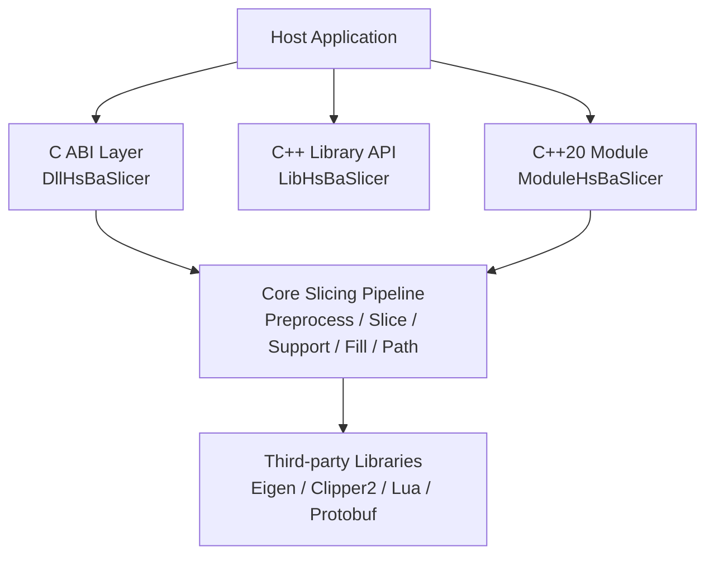
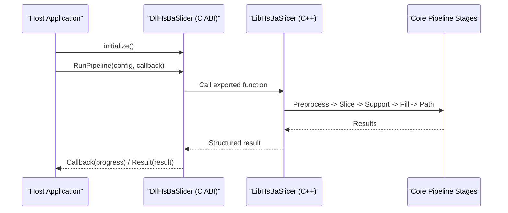
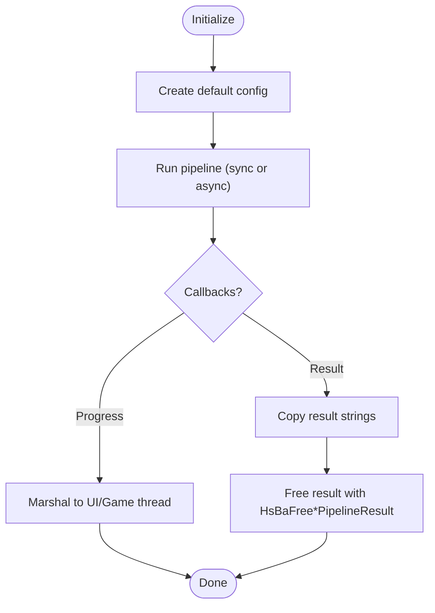
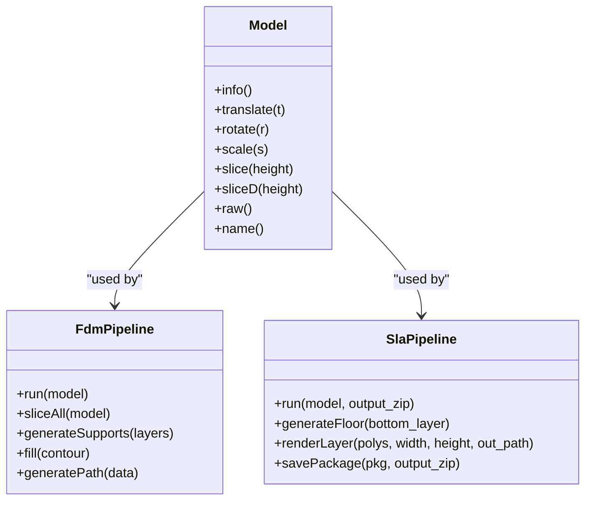
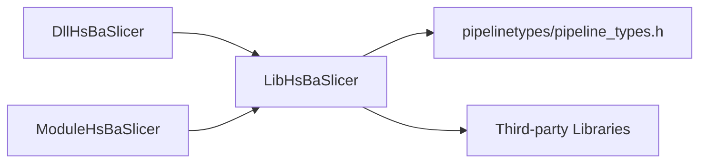

# Integration Patterns and Deployment

<cite>
**Referenced Files in This Document**
- [README.md](file://README.md)
- [CMakeLists.txt](file://CMakeLists.txt)
- [docs/en/DllHsBaSlicer/README.md](file://docs/en/DllHsBaSlicer/README.md)
- [docs/en/LibHsBaSlicer/README.md](file://docs/en/LibHsBaSlicer/README.md)
- [DllHsBaSlicer/dllexport.h](file://DllHsBaSlicer/dllexport.h)
- [LibHsBaSlicer/export.h](file://LibHsBaSlicer/export.h)
- [ModuleHsBaSlicer/CMakeLists.txt](file://ModuleHsBaSlicer/CMakeLists.txt)
- [ModuleHsBaSlicer/hsba_slicer.cppm](file://ModuleHsBaSlicer/hsba_slicer.cppm)
- [docs/en/DllHsBaSlicer/qt_wxwidgets_integration.md](file://docs/en/DllHsBaSlicer/qt_wxwidgets_integration.md)
- [docs/en/DllHsBaSlicer/game_engine_integration.md](file://docs/en/DllHsBaSlicer/game_engine_integration.md)
- [android/README.md](file://android/README.md)
- [ios/HsBaSlicerExample/ViewController.swift](file://ios/HsBaSlicerExample/ViewController.swift)
</cite>

## Table of Contents
1. [Introduction](#introduction)
2. [Project Structure](#project-structure)
3. [Core Components](#core-components)
4. [Architecture Overview](#architecture-overview)
5. [Detailed Component Analysis](#detailed-component-analysis)
6. [Dependency Analysis](#dependency-analysis)
7. [Performance Considerations](#performance-considerations)
8. [Troubleshooting Guide](#troubleshooting-guide)
9. [Conclusion](#conclusion)
10. [Appendices](#appendices)

## Introduction
This document explains how to integrate HsBaSlicer into host applications across platforms, focusing on three integration tiers:
- C ABI interface for external languages (Java, C#, Python, Swift, etc.)
- C++ library API for direct C++ integration
- C++20 modules for modern C++ applications

It also documents platform-specific integration patterns for Windows, Linux, macOS, Android, iOS, and game consoles; memory management guidelines; static versus dynamic linking strategies; deployment approaches for mobile apps, desktop applications, and embedded systems; and common integration challenges with practical solutions.

## Project Structure
HsBaSlicer exposes multiple build targets that map directly to the three-tier integration model:
- DllHsBaSlicer: shared library exposing a pure C ABI for cross-language use
- LibHsBaSlicer: core C++ slicing pipeline library
- ModuleHsBaSlicer: C++20 module wrapper around LibHsBaSlicer

The repository provides installable headers, CMake config files, and platform-specific samples for Android and iOS. Desktop platforms support all targets; mobile and console builds exclude certain optional components such as CAD modeling when dependencies are unavailable.

**Diagram sources**
- [README.md:100-124](file://README.md#L100-L124)
- [docs/en/DllHsBaSlicer/README.md:1-31](file://docs/en/DllHsBaSlicer/README.md#L1-L31)
- [docs/en/LibHsBaSlicer/README.md:1-31](file://docs/en/LibHsBaSlicer/README.md#L1-L31)
- [ModuleHsBaSlicer/CMakeLists.txt:1-29](file://ModuleHsBaSlicer/CMakeLists.txt#L1-L29)

**Section sources**
- [README.md:100-124](file://README.md#L100-L124)
- [README.md:187-191](file://README.md#L187-L191)

## Core Components
The three integration tiers provide different trade-offs between language compatibility, performance, and developer ergonomics.

### C ABI Interface (DllHsBaSlicer)
- Purpose: Provide a stable, language-neutral boundary for external languages and engines.
- Export macro: HSBA_SLICER_API controls symbol visibility on Windows and is empty elsewhere.
- Build artifacts:
  - Windows: DLL + import library
  - Linux: shared object
  - macOS: dynamic library
  - Android: shared object via JNI
  - iOS: static archive (iOS forbids loading arbitrary dylibs)
- APIs include initialization, model preprocessing, full pipelines (FDM, SLA, SLS, SLM, LOM, TDP, WAAM), file transfer, parameter store, custom Lua pipeline, version info, Lua extension registration, and event source registration.

**Section sources**
- [docs/en/DllHsBaSlicer/README.md:1-31](file://docs/en/DllHsBaSlicer/README.md#L1-L31)
- [DllHsBaSlicer/dllexport.h:1-23](file://DllHsBaSlicer/dllexport.h#L1-L23)
- [docs/en/DllHsBaSlicer/README.md:56-703](file://docs/en/DllHsBaSlicer/README.md#L56-L703)

### C++ Library API (LibHsBaSlicer)
- Purpose: Direct C++ access to the complete slicing workflow.
- Submodules: Preprocess, Slice, Support, Fill, Path, Floor, Transfer, ParamStore, Extends.
- Typical usage includes including headers from LibHsBaSlicer, configuring pipeline parameters, running stages, and handling results.
- Provides advanced model preprocessing (CGAL/OCCT), G-code multi-firmware output, path optimization, and Lua extension registration.

**Section sources**
- [docs/en/LibHsBaSlicer/README.md:1-31](file://docs/en/LibHsBaSlicer/README.md#L1-L31)
- [docs/en/LibHsBaSlicer/README.md:33-55](file://docs/en/LibHsBaSlicer/README.md#L33-L55)
- [docs/en/LibHsBaSlicer/README.md:336-433](file://docs/en/LibHsBaSlicer/README.md#L336-L433)
- [LibHsBaSlicer/export.h:1-22](file://LibHsBaSlicer/export.h#L1-L22)

### C++20 Modules (ModuleHsBaSlicer)
- Purpose: Modern C++ class-based API wrapping LibHsBaSlicer free functions.
- Single-file module interface avoids MSVC implicit-import issues and re-exports configuration/result types.
- Consumers import hsba.slicer and use RAII Model, FdmPipeline, SlaPipeline, SlsPipeline, SlmPipeline, LomPipeline, TdpPipeline, WaamPipeline, FileTransferPipeline, ParamStorePipeline, CustomLuaPipeline, plus utility functions.
- Built as a static library to avoid DLL link issues and ensure consistent compile flags across consumers.

**Section sources**
- [ModuleHsBaSlicer/CMakeLists.txt:1-46](file://ModuleHsBaSlicer/CMakeLists.txt#L1-L46)
- [ModuleHsBaSlicer/hsba_slicer.cppm:1-128](file://ModuleHsBaSlicer/hsba_slicer.cppm#L1-L128)
- [ModuleHsBaSlicer/hsba_slicer.cppm:148-540](file://ModuleHsBaSlicer/hsba_slicer.cppm#L148-L540)
- [docs/en/LibHsBaSlicer/README.md:440-465](file://docs/en/LibHsBaSlicer/README.md#L440-L465)

## Architecture Overview
The recommended architecture separates concerns by layer:
- Host application integrates via one of the three tiers
- DllHsBaSlicer calls only exported LibHsBaSlicer interfaces, keeping the ABI boundary clean
- LibHsBaSlicer implements the slicing pipeline and extensions
- ModuleHsBaSlicer provides a modern C++ facade over LibHsBaSlicer

**Diagram sources**
- [docs/en/DllHsBaSlicer/README.md:7-19](file://docs/en/DllHsBaSlicer/README.md#L7-L19)
- [docs/en/LibHsBaSlicer/README.md:18-31](file://docs/en/LibHsBaSlicer/README.md#L18-L31)

## Detailed Component Analysis

### Three-Tier API Approach

#### C ABI Interface
- Initialization must be called once after process startup.
- Pipelines expose synchronous and asynchronous variants.
- Progress and result callbacks fire on internal worker threads; hosts must marshal back to UI/game thread before updating widgets.
- Memory ownership rules:
  - Default configs are value-type structs; caller owns string fields passed in.
  - Result strings allocated by the library must be freed with matching free functions.
  - Model handles must be released via release handle function.
  - Proto deserialization allocates string fields; use matching free functions.

**Diagram sources**
- [docs/en/DllHsBaSlicer/README.md:684-703](file://docs/en/DllHsBaSlicer/README.md#L684-L703)
- [docs/en/DllHsBaSlicer/qt_wxwidgets_integration.md:7-13](file://docs/en/DllHsBaSlicer/qt_wxwidgets_integration.md#L7-L13)

**Section sources**
- [docs/en/DllHsBaSlicer/README.md:56-703](file://docs/en/DllHsBaSlicer/README.md#L56-L703)
- [docs/en/DllHsBaSlicer/qt_wxwidgets_integration.md:7-13](file://docs/en/DllHsBaSlicer/qt_wxwidgets_integration.md#L7-L13)

#### C++ Library API
- Include headers from LibHsBaSlicer and link against the library.
- Use namespace HsBa::Slicer for all APIs.
- Typical workflow: preprocess, slice, support, fill, path generation, SLA floor/render/package, SLS export, file transfer, parameter store.
- Advanced features include CGAL/OCCT operations and multi-firmware G-code output.

**Section sources**
- [docs/en/LibHsBaSlicer/README.md:33-55](file://docs/en/LibHsBaSlicer/README.md#L33-L55)
- [docs/en/LibHsBaSlicer/README.md:326-433](file://docs/en/LibHsBaSlicer/README.md#L326-L433)

#### C++20 Modules
- Import hsba.slicer and use class-based API.
- RAII Model wraps lifecycle; pipeline classes encapsulate stage orchestration.
- Re-exported types from pipelinetypes/pipeline_types.h avoid duplication.
- On MSVC, includes must precede import to avoid redefinition errors.

**Diagram sources**
- [ModuleHsBaSlicer/hsba_slicer.cppm:148-258](file://ModuleHsBaSlicer/hsba_slicer.cppm#L148-L258)
- [ModuleHsBaSlicer/hsba_slicer.cppm:563-751](file://ModuleHsBaSlicer/hsba_slicer.cppm#L563-L751)

**Section sources**
- [ModuleHsBaSlicer/hsba_slicer.cppm:1-128](file://ModuleHsBaSlicer/hsba_slicer.cppm#L1-L128)
- [ModuleHsBaSlicer/hsba_slicer.cppm:148-540](file://ModuleHsBaSlicer/hsba_slicer.cppm#L148-L540)
- [docs/en/LibHsBaSlicer/README.md:440-465](file://docs/en/LibHsBaSlicer/README.md#L440-L465)

### Platform-Specific Integration Patterns

#### Windows
- Link against DllHsBaSlicer.dll and its import library.
- Ensure runtime DLL placement next to executable or configure delay loading.
- For Qt/wxWidgets, run pipelines off the UI thread and marshal callbacks back to the UI thread.

**Section sources**
- [docs/en/DllHsBaSlicer/qt_wxwidgets_integration.md:18-45](file://docs/en/DllHsBaSlicer/qt_wxwidgets_integration.md#L18-L45)
- [docs/en/DllHsBaSlicer/game_engine_integration.md:236-269](file://docs/en/DllHsBaSlicer/game_engine_integration.md#L236-L269)

#### Linux
- Link against libDllHsBaSlicer.so.
- Follow the same threading and marshalling rules as Windows.

**Section sources**
- [docs/en/DllHsBaSlicer/game_engine_integration.md:236-269](file://docs/en/DllHsBaSlicer/game_engine_integration.md#L236-L269)

#### macOS
- Link against libDllHsBaSlicer.dylib.
- Follow the same threading and marshalling rules as Windows/Linux.

**Section sources**
- [docs/en/DllHsBaSlicer/game_engine_integration.md:236-269](file://docs/en/DllHsBaSlicer/game_engine_integration.md#L236-L269)

#### Android
- Package libDllHsBaSlicer.so per ABI under jniLibs.
- Use JNI to call C ABI functions.
- Dynamic library loader may be disabled due to NDK restrictions.

**Section sources**
- [android/README.md:1-22](file://android/README.md#L1-L22)
- [CMakeLists.txt:228-240](file://CMakeLists.txt#L228-L240)

#### iOS
- Use static archive libDllHsBaSlicer.a; iOS forbids loading arbitrary dylibs.
- In Unity, set DllImport("__Internal").
- Example Swift app runs pipeline examples on background queue and updates UI on main queue.

**Section sources**
- [docs/en/DllHsBaSlicer/game_engine_integration.md:7-18](file://docs/en/DllHsBaSlicer/game_engine_integration.md#L7-L18)
- [ios/HsBaSlicerExample/ViewController.swift:43-55](file://ios/HsBaSlicerExample/ViewController.swift#L43-L55)

#### Game Consoles
- Detected via VCPKG_TARGET_TRIPLET (xbox, switch, playstation, stadia).
- Optional features like logger and CAD modeling are conditionally excluded.
- Tests disabled on consoles due to output limitations.

**Section sources**
- [CMakeLists.txt:132-147](file://CMakeLists.txt#L132-L147)
- [CMakeLists.txt:415-429](file://CMakeLists.txt#L415-L429)
- [CMakeLists.txt:395-407](file://CMakeLists.txt#L395-L407)

### Static vs Dynamic Linking Approaches

#### Dynamic Linking (Desktop, Android)
- Use DllHsBaSlicer shared library.
- Pros: Smaller host binary, plugin-like behavior.
- Cons: Runtime dependency management, platform-specific naming and placement.

**Section sources**
- [README.md:106-124](file://README.md#L106-L124)
- [docs/en/DllHsBaSlicer/README.md:21-31](file://docs/en/DllHsBaSlicer/README.md#L21-L31)

#### Static Linking (iOS, Embedded)
- Use LibHsBaSlicer static library or ModuleHsBaSlicer static module.
- Pros: No runtime loading constraints, simpler packaging on constrained platforms.
- Cons: Larger host binary, potential symbol conflicts if not careful.

**Section sources**
- [ModuleHsBaSlicer/CMakeLists.txt:10-14](file://ModuleHsBaSlicer/CMakeLists.txt#L10-L14)
- [docs/en/DllHsBaSlicer/game_engine_integration.md:7-18](file://docs/en/DllHsBaSlicer/game_engine_integration.md#L7-L18)

### Deployment Strategies

#### Mobile Apps (Android/iOS)
- Android: Build native libs and copy .so into jniLibs per ABI; optionally add Gradle wrapper and signing configs.
- iOS: Bundle static archive; use __Internal for P/Invoke; run long tasks off main thread.

**Section sources**
- [android/README.md:1-22](file://android/README.md#L1-L22)
- [docs/en/DllHsBaSlicer/game_engine_integration.md:7-18](file://docs/en/DllHsBaSlicer/game_engine_integration.md#L7-L18)
- [ios/HsBaSlicerExample/ViewController.swift:43-55](file://ios/HsBaSlicerExample/ViewController.swift#L43-L55)

#### Desktop Applications (Windows/Linux/macOS)
- Install via cmake --install and use find_package(HsBaSlicer CONFIG REQUIRED).
- Link against HsBaSlicer::DllHsBaSlicer or HsBaSlicer::LibHsBaSlicer depending on integration tier.
- Ensure runtime libraries are discoverable at launch.

**Section sources**
- [README.md:100-124](file://README.md#L100-L124)
- [docs/en/DllHsBaSlicer/qt_wxwidgets_integration.md:18-45](file://docs/en/DllHsBaSlicer/qt_wxwidgets_integration.md#L18-L45)

#### Embedded Systems
- Prefer static linking to avoid runtime loading constraints.
- Disable optional heavy features (logger, bit7z, CAD modeling) based on platform detection.
- Use ModuleHsBaSlicer for modern C++ applications where compiler supports C++20 modules.

**Section sources**
- [CMakeLists.txt:228-251](file://CMakeLists.txt#L228-L251)
- [CMakeLists.txt:415-429](file://CMakeLists.txt#L415-L429)
- [ModuleHsBaSlicer/CMakeLists.txt:10-14](file://ModuleHsBaSlicer/CMakeLists.txt#L10-L14)

## Dependency Analysis
Integration points and coupling:
- DllHsBaSlicer depends only on LibHsBaSlicer exported interfaces, preserving ABI stability.
- ModuleHsBaSlicer depends on LibHsBaSlicer and re-exports types from pipelinetypes/pipeline_types.h.
- LibHsBaSlicer depends on third-party libraries (Eigen, Clipper2, Lua, Protobuf).

**Diagram sources**
- [docs/en/DllHsBaSlicer/README.md:7-19](file://docs/en/DllHsBaSlicer/README.md#L7-L19)
- [ModuleHsBaSlicer/CMakeLists.txt:22-29](file://ModuleHsBaSlicer/CMakeLists.txt#L22-L29)

**Section sources**
- [docs/en/DllHsBaSlicer/README.md:7-19](file://docs/en/DllHsBaSlicer/README.md#L7-L19)
- [ModuleHsBaSlicer/CMakeLists.txt:22-29](file://ModuleHsBaSlicer/CMakeLists.txt#L22-L29)

## Performance Considerations
- Avoid running synchronous pipeline APIs on UI/game threads; use worker threads and marshal callbacks back to the host’s UI/game thread.
- Keep delegate/function references alive when crossing language boundaries to prevent garbage collection from invalidating native callbacks.
- Minimize string copying across boundaries; reuse buffers where possible and respect ownership rules.
- Prefer static linking on constrained platforms to reduce runtime overhead and simplify packaging.

[No sources needed since this section provides general guidance]

## Troubleshooting Guide
Common issues and resolutions:
- Missing DLL at runtime (Windows): Place DLL next to executable or configure post-build copy and runtime dependencies.
- UI freezes: Sync API blocking UI thread; move to worker thread and marshal progress/results.
- Crash updating widgets inside callbacks: Callbacks run on library threads; marshal to UI/game thread using signals/slots or CallAfter.
- Non-ASCII paths fail: Pass UTF-8 encoded paths consistently across boundaries.
- Garbled result strings or crash: Free results too early; copy data first, then call HsBaFree*PipelineResult.
- iOS link failure: Use static archive and DllImport("__Internal"); dylibs cannot be loaded.
- Struct misalignment: Ensure P/Invoke struct field order and types match pipeline_types.h exactly.

**Section sources**
- [docs/en/DllHsBaSlicer/qt_wxwidgets_integration.md:340-349](file://docs/en/DllHsBaSlicer/qt_wxwidgets_integration.md#L340-L349)
- [docs/en/DllHsBaSlicer/game_engine_integration.md:453-462](file://docs/en/DllHsBaSlicer/game_engine_integration.md#L453-L462)

## Conclusion
HsBaSlicer offers flexible integration options tailored to different host environments:
- Use DllHsBaSlicer for cross-language scenarios requiring a stable C ABI.
- Use LibHsBaSlicer for direct C++ integration with full control over the pipeline.
- Use ModuleHsBaSlicer for modern C++ applications leveraging C++20 modules.

Platform-specific considerations include dynamic versus static linking, threading discipline, string encoding, and resource packaging. Following the documented memory management rules and deployment strategies ensures robust integration across mobile, desktop, and embedded targets.

[No sources needed since this section summarizes without analyzing specific files]

## Appendices

### Memory Management Guidelines
- Default configs are value-type structs; caller owns string fields passed in.
- Result strings allocated by the library must be freed with matching free functions.
- Version strings must be freed with HsBaFreeVersionString.
- Model handles must be released via HsBaReleaseModelHandle.
- Proto deserialization allocates string fields; use matching free functions.

**Section sources**
- [docs/en/DllHsBaSlicer/README.md:696-703](file://docs/en/DllHsBaSlicer/README.md#L696-L703)

### Threading and Callback Model
- Progress and result callbacks fire on internal worker threads.
- Hosts must marshal back to UI/game thread before updating widgets.
- Config pointers passed to async functions are read-only during the call and may be freed after return.

**Section sources**
- [docs/en/DllHsBaSlicer/README.md:684-695](file://docs/en/DllHsBaSlicer/README.md#L684-L695)