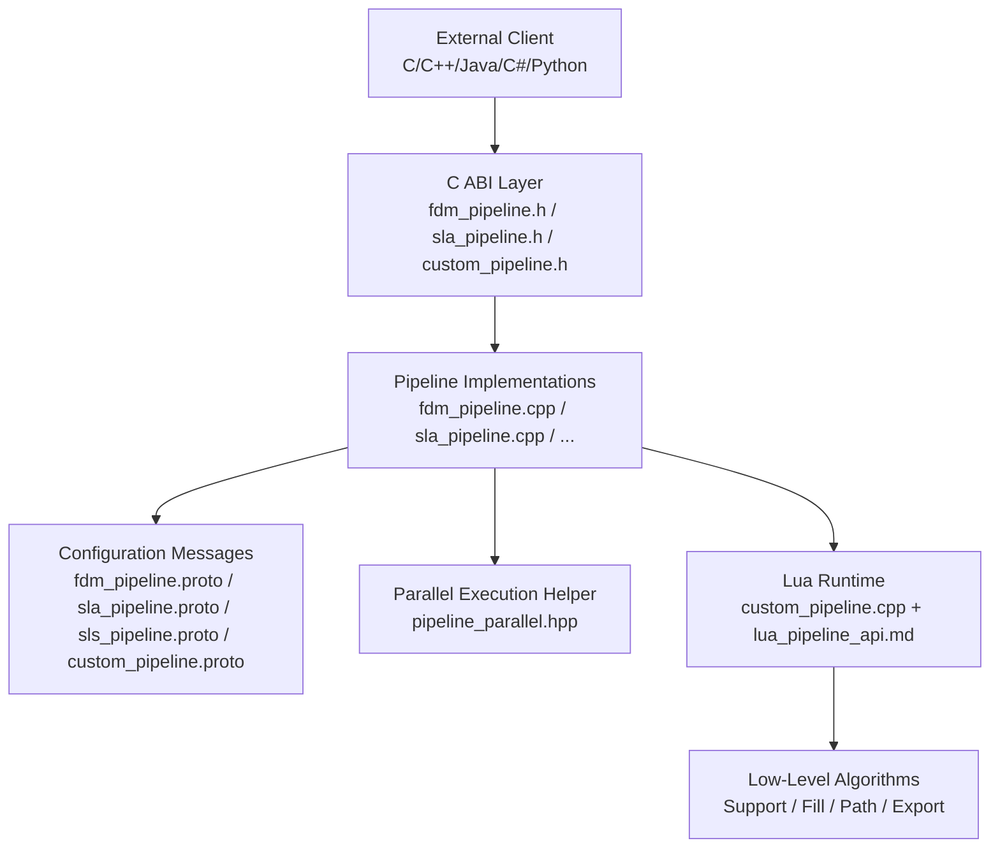
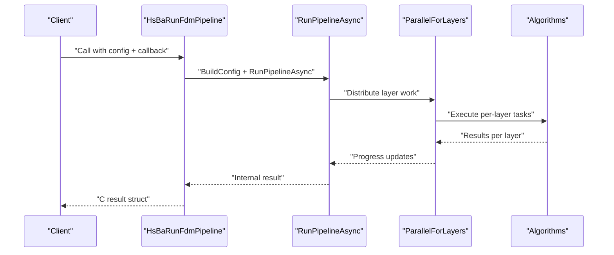
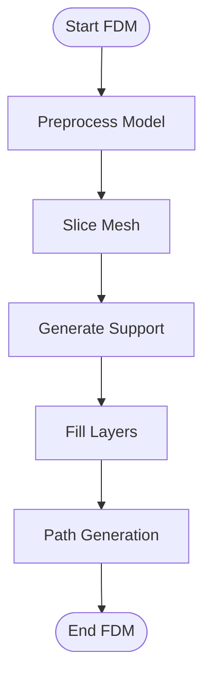
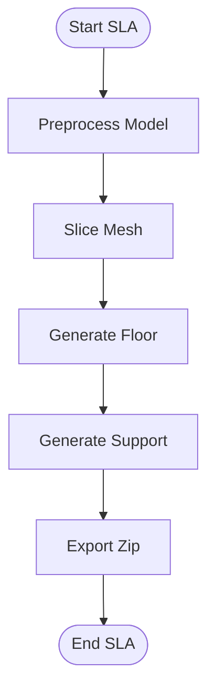
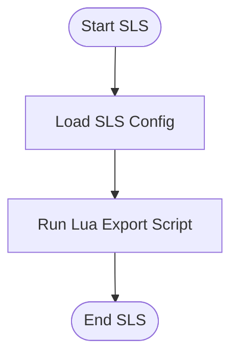
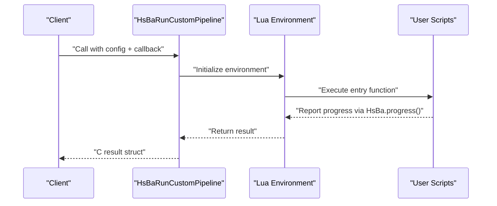
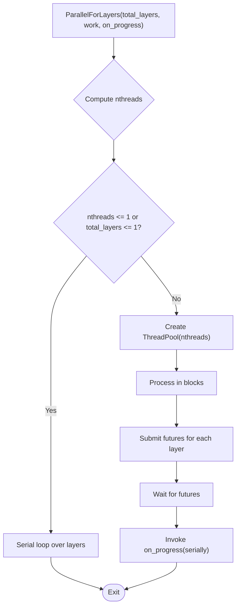
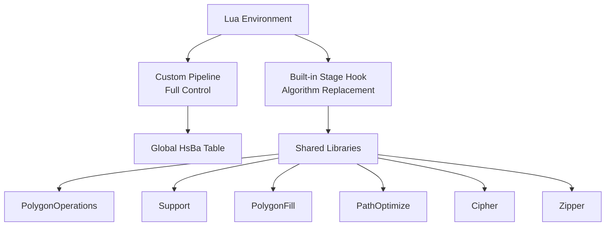
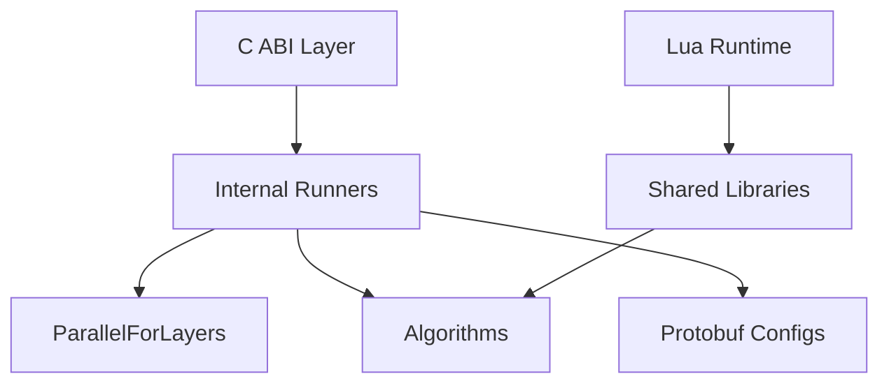

# Pipeline Orchestration System

<cite>
**Referenced Files in This Document**
- [README.md](file://README.md)
- [pipeline_types.h](file://pipelinetypes/pipeline_types.h)
- [fdm_pipeline.h](file://DllHsBaSlicer/fdm_pipeline.h)
- [fdm_pipeline.cpp](file://DllHsBaSlicer/fdm_pipeline.cpp)
- [sla_pipeline.h](file://DllHsBaSlicer/sla_pipeline.h)
- [custom_pipeline.h](file://DllHsBaSlicer/custom_pipeline.h)
- [custom_pipeline.cpp](file://DllHsBaSlicer/custom_pipeline.cpp)
- [pipeline_parallel.hpp](file://DllHsBaSlicer/pipeline_parallel.hpp)
- [lua_pipeline_api.md](file://docs/en/lua_pipeline_api.md)
- [dll_readme.md](file://docs/en/DllHsBaSlicer/README.md)
- [fdm_pipeline.proto](file://proto/fdm_pipeline.proto)
- [sla_pipeline.proto](file://proto/sla_pipeline.proto)
- [sls_pipeline.proto](file://proto/sls_pipeline.proto)
- [custom_pipeline.proto](file://proto/custom_pipeline.proto)
</cite>

## Table of Contents
1. [Introduction](#introduction)
2. [Project Structure](#project-structure)
3. [Core Components](#core-components)
4. [Architecture Overview](#architecture-overview)
5. [Detailed Component Analysis](#detailed-component-analysis)
6. [Dependency Analysis](#dependency-analysis)
7. [Performance Considerations](#performance-considerations)
8. [Troubleshooting Guide](#troubleshooting-guide)
9. [Conclusion](#conclusion)
10. [Appendices](#appendices)

## Introduction
This document explains HsBaSlicer’s pipeline orchestration system for 3D printing technologies. It focuses on:
- The stage-based processing model where each technology follows a defined sequence of operations.
- The parallel execution framework that coordinates multiple pipeline stages concurrently.
- The configuration system enabling dynamic pipeline assembly based on target technology (FDM, SLA, SLS, etc.).
- Error handling and recovery mechanisms within the pipeline.
- Examples of custom pipeline development and integration with existing pipelines.
- The relationship between high-level pipeline APIs and low-level algorithm implementations.

The system exposes both C ABI entry points for external languages and Lua-driven customization, while keeping core slicing algorithms in C++.

**Section sources**
- [README.md:21-39](file://README.md#L21-L39)

## Project Structure
At a high level, the pipeline orchestration spans several layers:
- Public C ABI layer: technology-specific headers and implementations under DllHsBaSlicer.
- Configuration definitions: Protobuf messages describing per-technology parameters.
- Parallel execution helper: header-only utilities for layer-wise parallelism.
- Custom pipeline runtime: Lua-driven full workflow control.
- Documentation and samples: usage examples and API references.

**Diagram sources**
- [fdm_pipeline.h:17-61](file://DllHsBaSlicer/fdm_pipeline.h#L17-L61)
- [sla_pipeline.h:17-56](file://DllHsBaSlicer/sla_pipeline.h#L17-L56)
- [custom_pipeline.h:17-62](file://DllHsBaSlicer/custom_pipeline.h#L17-L62)
- [fdm_pipeline.cpp:440-459](file://DllHsBaSlicer/fdm_pipeline.cpp#L440-L459)
- [pipeline_parallel.hpp:22-42](file://DllHsBaSlicer/pipeline_parallel.hpp#L22-L42)
- [lua_pipeline_api.md:19-28](file://docs/en/lua_pipeline_api.md#L19-L28)

**Section sources**
- [README.md:104-124](file://README.md#L104-L124)
- [dll_readme.md:737-747](file://docs/en/DllHsBaSlicer/README.md#L737-L747)

## Core Components
Key components of the orchestration system:
- Technology-specific C ABI interfaces:
  - FDM: synchronous and asynchronous run functions, default config creation, result freeing.
  - SLA: synchronous and asynchronous run functions, default config creation, result freeing.
  - Custom: fully Lua-driven pipeline entry points and lifecycle management.
- Configuration messages:
  - FDM, SLA, SLS, and custom pipeline configurations expressed as Protobuf messages.
- Parallel execution helper:
  - Header-only utility distributing independent layer work across a thread pool with progress callbacks.
- Lua runtime and API:
  - Two environments: custom pipeline (full control) and built-in stage hooks (algorithm replacement).
  - Shared libraries exposed to Lua: polygon operations, support generators, fill algorithms, path optimization, cipher, zipper, and file I/O helpers.

**Section sources**
- [fdm_pipeline.h:17-61](file://DllHsBaSlicer/fdm_pipeline.h#L17-L61)
- [sla_pipeline.h:17-56](file://DllHsBaSlicer/sla_pipeline.h#L17-L56)
- [custom_pipeline.h:17-62](file://DllHsBaSlicer/custom_pipeline.h#L17-L62)
- [pipeline_types.h:393-448](file://pipelinetypes/pipeline_types.h#L393-L448)
- [pipeline_parallel.hpp:22-42](file://DllHsBaSlicer/pipeline_parallel.hpp#L22-L42)
- [lua_pipeline_api.md:19-28](file://docs/en/lua_pipeline_api.md#L19-L28)

## Architecture Overview
The orchestration architecture separates concerns into clear layers:
- External clients call C ABI functions.
- C ABI functions convert configs, invoke internal async runners, and return results.
- Internal runners execute staged workflows using coroutines and parallel helpers.
- Lua runtime can fully define or replace stages via scripts.

**Diagram sources**
- [fdm_pipeline.cpp:445-451](file://DllHsBaSlicer/fdm_pipeline.cpp#L445-L451)
- [pipeline_parallel.hpp:41-117](file://DllHsBaSlicer/pipeline_parallel.hpp#L41-L117)

## Detailed Component Analysis

### FDM Pipeline
- Stage sequence: Preprocess → Slice → Support → Fill → Path Generation.
- C ABI provides:
  - Default config creation.
  - Synchronous run blocking until completion.
  - Asynchronous run returning results via callback.
  - Result memory management.

**Diagram sources**
- [fdm_pipeline.h:23-35](file://DllHsBaSlicer/fdm_pipeline.h#L23-L35)

**Section sources**
- [fdm_pipeline.h:17-61](file://DllHsBaSlicer/fdm_pipeline.h#L17-L61)
- [fdm_pipeline.cpp:440-459](file://DllHsBaSlicer/fdm_pipeline.cpp#L440-L459)
- [fdm_pipeline.proto:26-72](file://proto/fdm_pipeline.proto#L26-L72)

### SLA Pipeline
- Stage sequence: Preprocess → Slice → Floor → Support → Export (zip).
- C ABI provides:
  - Default config creation.
  - Synchronous and asynchronous runs.
  - Result memory management.

**Diagram sources**
- [sla_pipeline.h:23-34](file://DllHsBaSlicer/sla_pipeline.h#L23-L34)

**Section sources**
- [sla_pipeline.h:17-56](file://DllHsBaSlicer/sla_pipeline.h#L17-L56)
- [sla_pipeline.proto:18-58](file://proto/sla_pipeline.proto#L18-L58)

### SLS Pipeline
- Configuration includes laser power, scan speed, hatch spacing, bed temperature, and Lua export script/function.
- Result structure reports success, total layers, export path, error message, and elapsed time.

**Diagram sources**
- [sls_pipeline.proto:5-23](file://proto/sls_pipeline.proto#L5-L23)

**Section sources**
- [sls_pipeline.proto:5-32](file://proto/sls_pipeline.proto#L5-L32)

### Custom Pipeline
- Fully Lua-driven workflow where the script defines stage order and content.
- C ABI exposes:
  - Default config creation.
  - Synchronous and asynchronous runs.
  - Progress callbacks driven by Lua’s `HsBa.progress()`.
  - Result memory management.

**Diagram sources**
- [custom_pipeline.h:23-55](file://DllHsBaSlicer/custom_pipeline.h#L23-L55)
- [custom_pipeline.cpp:116-125](file://DllHsBaSlicer/custom_pipeline.cpp#L116-L125)

**Section sources**
- [custom_pipeline.h:17-62](file://DllHsBaSlicer/custom_pipeline.h#L17-L62)
- [custom_pipeline.cpp:21-42](file://DllHsBaSlicer/custom_pipeline.cpp#L21-L42)
- [custom_pipeline.proto:9-18](file://proto/custom_pipeline.proto#L9-L18)

### Parallel Execution Framework
- Header-only utility for distributing independent layer work across a thread pool.
- Ensures progress callbacks are invoked serially on the calling thread.
- Falls back to serial execution when only one thread or layer is available.
- Supports runtime override via environment variable for performance validation.

**Diagram sources**
- [pipeline_parallel.hpp:41-117](file://DllHsBaSlicer/pipeline_parallel.hpp#L41-L117)

**Section sources**
- [pipeline_parallel.hpp:22-42](file://DllHsBaSlicer/pipeline_parallel.hpp#L22-L42)
- [pipeline_parallel.hpp:49-72](file://DllHsBaSlicer/pipeline_parallel.hpp#L49-L72)
- [pipeline_parallel.hpp:88-117](file://DllHsBaSlicer/pipeline_parallel.hpp#L88-L117)

### Lua Pipeline API and Environments
- Two environments:
  - Custom pipeline: script controls full stage order; uses global `HsBa` operation table.
  - Built-in stage hook: replaces specific algorithms (support/fill/floor/export); stage order remains fixed.
- Shared libraries include polygon operations, support generators, fill algorithms, path optimization, cipher, zipper, and file I/O helpers.

**Diagram sources**
- [lua_pipeline_api.md:19-28](file://docs/en/lua_pipeline_api.md#L19-L28)
- [lua_pipeline_api.md:136-181](file://docs/en/lua_pipeline_api.md#L136-L181)

**Section sources**
- [lua_pipeline_api.md:19-28](file://docs/en/lua_pipeline_api.md#L19-L28)
- [lua_pipeline_api.md:67-87](file://docs/en/lua_pipeline_api.md#L67-L87)
- [lua_pipeline_api.md:136-181](file://docs/en/lua_pipeline_api.md#L136-L181)

## Dependency Analysis
High-level dependencies among orchestration components:
- C ABI depends on internal runners and configuration builders.
- Internal runners depend on parallel execution helpers and low-level algorithms.
- Lua runtime depends on shared libraries and common type registries.
- Protobuf messages define configuration contracts consumed by runners.

**Diagram sources**
- [fdm_pipeline.cpp:445-459](file://DllHsBaSlicer/fdm_pipeline.cpp#L445-L459)
- [pipeline_parallel.hpp:41-117](file://DllHsBaSlicer/pipeline_parallel.hpp#L41-L117)
- [lua_pipeline_api.md:136-181](file://docs/en/lua_pipeline_api.md#L136-L181)

**Section sources**
- [fdm_pipeline.cpp:445-459](file://DllHsBaSlicer/fdm_pipeline.cpp#L445-L459)
- [pipeline_parallel.hpp:41-117](file://DllHsBaSlicer/pipeline_parallel.hpp#L41-L117)
- [lua_pipeline_api.md:136-181](file://docs/en/lua_pipeline_api.md#L136-L181)

## Performance Considerations
- Parallelization strategy:
  - Independent layer work is distributed across a thread pool.
  - Progress callbacks are serialized to avoid contention.
  - Serial fallback ensures deterministic behavior on constrained platforms.
- Tuning knobs:
  - Environment variable `HSBA_PIPELINE_THREADS` allows overriding worker count for benchmarking.
  - Block size calculation balances throughput and progress update frequency.
- Recommendations:
  - Use release builds for hot paths.
  - Validate parallel vs serial results using the provided environment override.
  - Avoid heavy synchronization inside per-layer work to maximize concurrency.

[No sources needed since this section provides general guidance]

## Troubleshooting Guide
Common issues and resolutions:
- Pipeline errors:
  - Errors thrown during pipeline execution are captured and returned in result structures with descriptive messages.
  - Ensure proper initialization of configuration fields before running pipelines.
- Memory management:
  - Always free pipeline results using provided free functions to prevent leaks.
- Lua scripting issues:
  - Verify script paths and function names match configuration.
  - Use `HsBa.progress()` to report progress and diagnose stage timing.
- Parallel execution anomalies:
  - If results differ between parallel and serial runs, check for non-deterministic algorithms or shared state misuse.
  - Temporarily set `HSBA_PIPELINE_THREADS=1` to isolate concurrency-related issues.

**Section sources**
- [fdm_pipeline.cpp:425-433](file://DllHsBaSlicer/fdm_pipeline.cpp#L425-L433)
- [custom_pipeline.cpp:116-125](file://DllHsBaSlicer/custom_pipeline.cpp#L116-L125)
- [pipeline_parallel.hpp:49-72](file://DllHsBaSlicer/pipeline_parallel.hpp#L49-L72)

## Conclusion
HsBaSlicer’s pipeline orchestration system provides a robust, modular framework for 3D printing technologies. It combines:
- Clear stage-based workflows per technology.
- High-performance parallel execution for independent layer work.
- Flexible configuration via Protobuf messages.
- Extensibility through Lua-driven customization and built-in stage hooks.
- Comprehensive error handling and memory management.

This design enables both production-grade slicing pipelines and research-oriented experimentation.

[No sources needed since this section summarizes without analyzing specific files]

## Appendices

### Example: Custom Pipeline Development
Steps to develop a custom pipeline:
- Create a Lua script defining the full workflow (load → slice → support → fill → path → write).
- Configure `custom_pipe_config` with script path or inline source.
- Call `HsBaRunCustomPipeline` or its async variant.
- Use `HsBa.progress()` to report progress and `HsBa.setLayers()` / `HsBa.setOutputPath()` to report metadata.

**Section sources**
- [custom_pipeline.proto:9-18](file://proto/custom_pipeline.proto#L9-L18)
- [lua_pipeline_api.md:67-87](file://docs/en/lua_pipeline_api.md#L67-L87)

### Example: Integration with Existing Pipelines
To integrate custom algorithms into existing pipelines:
- Replace support, fill, floor, or export stages via Lua scripts.
- Use shared libraries (`Support`, `PolygonFill`, `PathOptimize`) for common operations.
- Maintain fixed stage order while swapping algorithm implementations.

**Section sources**
- [lua_pipeline_api.md:19-28](file://docs/en/lua_pipeline_api.md#L19-L28)
- [lua_pipeline_api.md:136-181](file://docs/en/lua_pipeline_api.md#L136-L181)