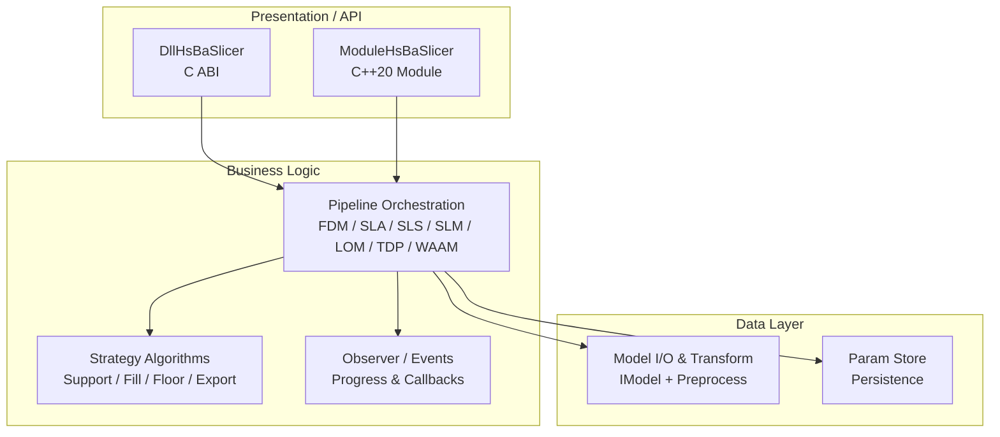
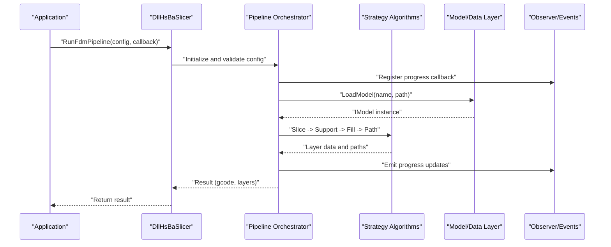
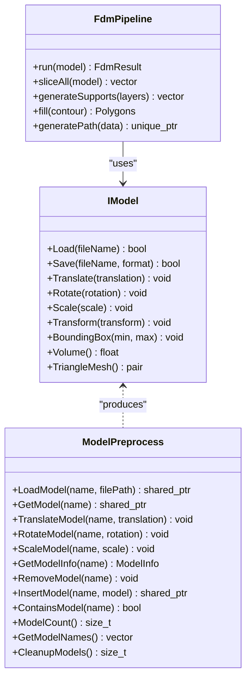
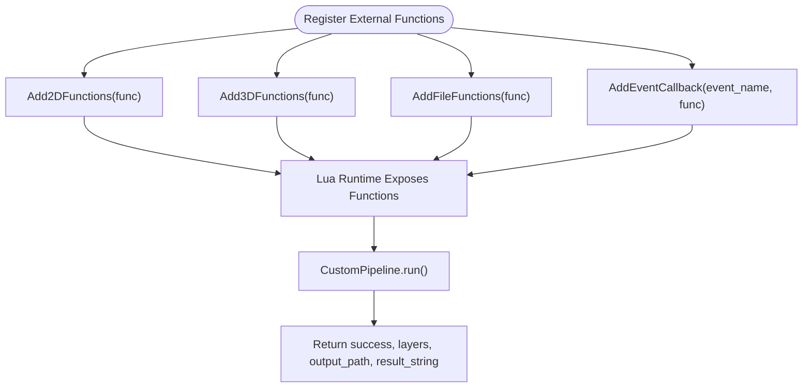
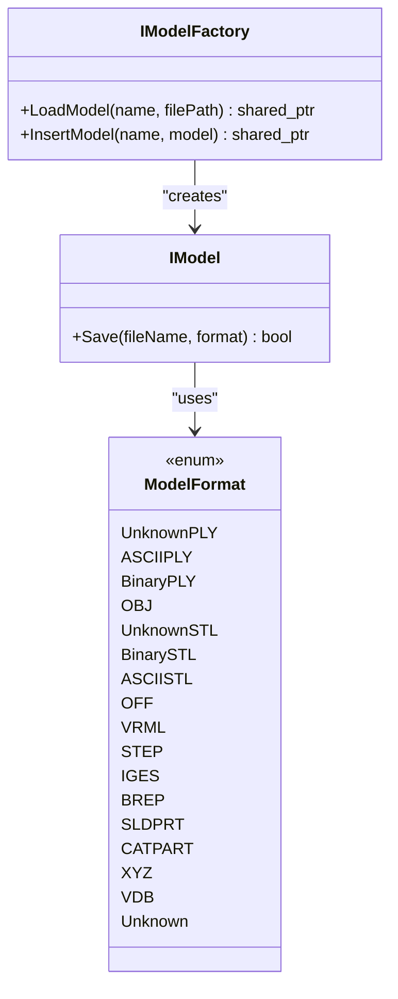
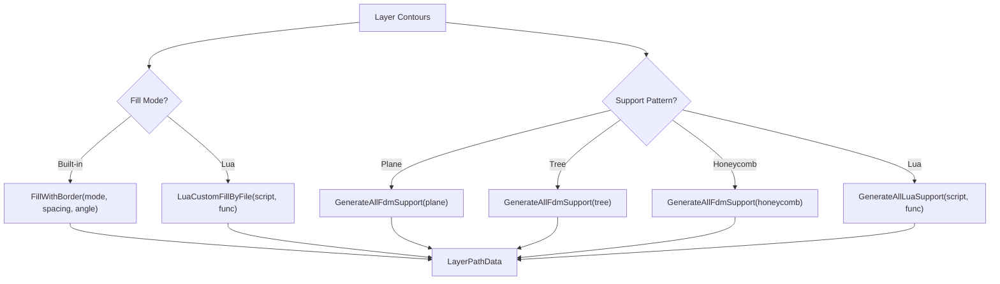
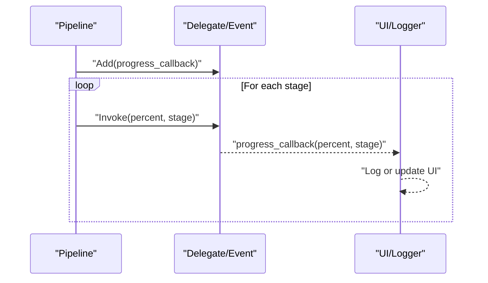
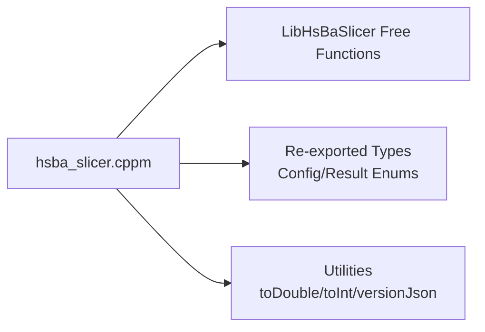
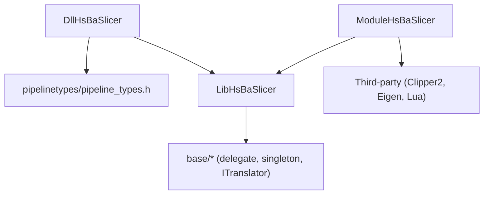

# System Architecture Patterns

<cite>
**Referenced Files in This Document**
- [README.md](file://README.md)
- [initialize.h](file://DllHsBaSlicer/initialize.h)
- [custom_pipeline.h](file://DllHsBaSlicer/custom_pipeline.h)
- [fdm_pipeline.h](file://DllHsBaSlicer/fdm_pipeline.h)
- [lua_register.h](file://DllHsBaSlicer/lua_register.h)
- [LuaAddFunction.hpp](file://LibHsBaSlicer/Extends/LuaAddFunction.hpp)
- [delegate.hpp](file://base/delegate.hpp)
- [singleton.hpp](file://base/singleton.hpp)
- [base_interface.hpp](file://base/base_interface.hpp)
- [IModel.hpp](file://base/IModel.hpp)
- [model_preprocess.hpp](file://LibHsBaSlicer/Preprocess/model_preprocess.hpp)
- [hsba_slicer.cppm](file://ModuleHsBaSlicer/hsba_slicer.cppm)
- [main.cpp](file://samples/Custom/main.cpp)
- [my_infill.lua](file://samples/FDM/scripts/my_infill.lua)
- [my_support.lua](file://samples/FDM/scripts/my_support.lua)
</cite>

## Table of Contents
1. [Introduction](#introduction)
2. [Project Structure](#project-structure)
3. [Core Components](#core-components)
4. [Architecture Overview](#architecture-overview)
5. [Detailed Component Analysis](#detailed-component-analysis)
6. [Dependency Analysis](#dependency-analysis)
7. [Performance Considerations](#performance-considerations)
8. [Troubleshooting Guide](#troubleshooting-guide)
9. [Conclusion](#conclusion)

## Introduction
This document explains HsBaSlicer’s architectural patterns and system design with a focus on layered separation, plugin extensibility via Lua, factory-style model creation and conversion, strategy-based algorithm selection across 3D printing technologies, observer-driven progress/event handling, and C++20 module usage for improved build performance. It provides concrete code-level references to demonstrate how these patterns are implemented and extended.

## Project Structure
HsBaSlicer is organized into clear layers:
- Presentation/API layer: C ABI entry points and C++ module interface exposing pipelines and utilities.
- Business logic layer: Pipeline orchestration (FDM, SLA, SLS, SLM, LOM, TDP, WAAM), support/fill strategies, path generation, and file transfer.
- Data layer: Model loading, transformation, mesh/CAD backends, and parameter persistence.

**Diagram sources**
- [fdm_pipeline.h:1-68](file://DllHsBaSlicer/fdm_pipeline.h#L1-L68)
- [custom_pipeline.h:1-69](file://DllHsBaSlicer/custom_pipeline.h#L1-L69)
- [hsba_slicer.cppm:1-80](file://ModuleHsBaSlicer/hsba_slicer.cppm#L1-L80)
- [model_preprocess.hpp:1-192](file://LibHsBaSlicer/Preprocess/model_preprocess.hpp#L1-L192)

**Section sources**
- [README.md:21-39](file://README.md#L21-L39)

## Core Components
- C ABI pipeline interfaces: FDM, SLA, SLS, SLM, LOM, TDP, WAAM, File Transfer, and fully Lua-driven Custom pipeline.
- C++20 module wrapper providing class-based APIs over free functions.
- Plugin registration for external Lua functions and event callbacks.
- Observer framework for progress and events.
- Model abstraction and preprocessing utilities.

Key responsibilities:
- DllHsBaSlicer exposes stable C ABI for cross-language integration.
- LibHsBaSlicer contains core slicing algorithms and utilities.
- ModuleHsBaSlicer provides modern C++20 module interface.
- base provides foundational primitives (interfaces, singletons, delegates).

**Section sources**
- [fdm_pipeline.h:1-68](file://DllHsBaSlicer/fdm_pipeline.h#L1-L68)
- [custom_pipeline.h:1-69](file://DllHsBaSlicer/custom_pipeline.h#L1-L69)
- [lua_register.h:1-38](file://DllHsBaSlicer/lua_register.h#L1-L38)
- [LuaAddFunction.hpp:1-78](file://LibHsBaSlicer/Extends/LuaAddFunction.hpp#L1-L78)
- [delegate.hpp:1-247](file://base/delegate.hpp#L1-L247)
- [singleton.hpp:1-63](file://base/singleton.hpp#L1-L63)
- [IModel.hpp:1-151](file://base/IModel.hpp#L1-L151)
- [model_preprocess.hpp:1-192](file://LibHsBaSlicer/Preprocess/model_preprocess.hpp#L1-L192)
- [hsba_slicer.cppm:1-80](file://ModuleHsBaSlicer/hsba_slicer.cppm#L1-L80)

## Architecture Overview
The system follows a layered architecture:
- Presentation/API: C ABI (DllHsBaSlicer) and C++20 module (ModuleHsBaSlicer) expose pipeline entry points and configuration/result types.
- Business Logic: Pipeline orchestrators implement stage sequences; strategies select algorithms per technology; observers handle progress/events.
- Data: Model abstraction (IModel) and preprocess utilities manage loading, transforms, and optional boolean/thick-solid operations.

**Diagram sources**
- [fdm_pipeline.h:1-68](file://DllHsBaSlicer/fdm_pipeline.h#L1-L68)
- [hsba_slicer.cppm:617-751](file://ModuleHsBaSlicer/hsba_slicer.cppm#L617-L751)
- [model_preprocess.hpp:32-88](file://LibHsBaSlicer/Preprocess/model_preprocess.hpp#L32-L88)
- [delegate.hpp:169-243](file://base/delegate.hpp#L169-L243)

## Detailed Component Analysis

### Layered Architecture
- Presentation/API:
  - C ABI functions for each pipeline provide default configs, synchronous/asynchronous run methods, and result freeing.
  - C++20 module re-exports types and wraps free functions with RAII classes (e.g., Model, FdmPipeline, SlaPipeline).
- Business Logic:
  - Pipeline classes orchestrate stages and apply strategy selection based on configuration (e.g., fill mode, support pattern, export script).
  - Strategy selection allows pluggable algorithms (built-in or Lua-driven).
- Data:
  - IModel abstracts different backends (mesh/CAD/point cloud).
  - Preprocess utilities load models into a pool, apply transforms, and perform advanced operations when available.

**Diagram sources**
- [IModel.hpp:110-139](file://base/IModel.hpp#L110-L139)
- [model_preprocess.hpp:32-120](file://LibHsBaSlicer/Preprocess/model_preprocess.hpp#L32-L120)
- [hsba_slicer.cppm:197-225](file://ModuleHsBaSlicer/hsba_slicer.cppm#L197-L225)

**Section sources**
- [fdm_pipeline.h:1-68](file://DllHsBaSlicer/fdm_pipeline.h#L1-L68)
- [hsba_slicer.cppm:197-225](file://ModuleHsBaSlicer/hsba_slicer.cppm#L197-L225)
- [model_preprocess.hpp:32-120](file://LibHsBaSlicer/Preprocess/model_preprocess.hpp#L32-L120)

### Plugin Architecture (Lua Scripts and Custom Implementations)
- External Lua function registration:
  - C ABI: HsBaAdd2DFunction, HsBaAdd3DFunction, HsBaAddFileFunction, HsBaAddEventCallback.
  - Lib-side: Add2DFunctions, Add3DFunctions, AddFileFunctions, AddEventCallback with Get* accessors.
- Fully Lua-driven custom pipeline:
  - Config includes script path, inline source, entry function, JSON config, model info, output path.
  - Runs synchronously or asynchronously with progress callbacks.

**Diagram sources**
- [lua_register.h:21-31](file://DllHsBaSlicer/lua_register.h#L21-L31)
- [LuaAddFunction.hpp:24-74](file://LibHsBaSlicer/Extends/LuaAddFunction.hpp#L24-L74)
- [custom_pipeline.h:17-62](file://DllHsBaSlicer/custom_pipeline.h#L17-L62)

**Section sources**
- [lua_register.h:1-38](file://DllHsBaSlicer/lua_register.h#L1-L38)
- [LuaAddFunction.hpp:1-78](file://LibHsBaSlicer/Extends/LuaAddFunction.hpp#L1-L78)
- [custom_pipeline.h:1-69](file://DllHsBaSlicer/custom_pipeline.h#L1-L69)

### Factory Pattern for Model Creation and Format Conversion
- Model creation:
  - LoadModel returns a shared pointer to IModel, abstracting backend-specific loaders.
  - InsertModel allows injecting pre-constructed models into the pool.
- Format conversion:
  - IModel defines Save with ModelFormat enum, enabling multiple formats (STL, OBJ, STEP, etc.).
  - Converters exist between Eigen, protobuf messages, and pipeline configs.

**Diagram sources**
- [model_preprocess.hpp:32-97](file://LibHsBaSlicer/Preprocess/model_preprocess.hpp#L32-L97)
- [IModel.hpp:65-139](file://base/IModel.hpp#L65-L139)

**Section sources**
- [model_preprocess.hpp:32-97](file://LibHsBaSlicer/Preprocess/model_preprocess.hpp#L32-L97)
- [IModel.hpp:65-139](file://base/IModel.hpp#L65-L139)

### Strategy Pattern for Pluggable Algorithms Across Technologies
- Fill strategies:
  - Built-in modes (Line, SimpleZigzag, Zigzag) selected by configuration.
  - Lua-driven custom fill via LuaCustomFillByFile.
- Support strategies:
  - FDM support generators (plane, tree, honeycomb) selected by pattern.
  - Lua-driven custom support via GenerateAllLuaSupport.
- Floor/export strategies:
  - SLA floor generation can be built-in or Lua-driven.
  - Export packaging can be built-in or Lua-driven.

**Diagram sources**
- [hsba_slicer.cppm:663-702](file://ModuleHsBaSlicer/hsba_slicer.cppm#L663-L702)
- [my_infill.lua:20-88](file://samples/FDM/scripts/my_infill.lua#L20-L88)
- [my_support.lua:32-79](file://samples/FDM/scripts/my_support.lua#L32-L79)

**Section sources**
- [hsba_slicer.cppm:663-702](file://ModuleHsBaSlicer/hsba_slicer.cppm#L663-L702)
- [my_infill.lua:1-89](file://samples/FDM/scripts/my_infill.lua#L1-L89)
- [my_support.lua:1-83](file://samples/FDM/scripts/my_support.lua#L1-L83)

### Observer Pattern for Progress Callbacks and Event Handling
- Delegate/Event infrastructure:
  - Delegate holds multiple callbacks with thread-safe add/invoke.
  - Event and EventSource provide typed event sources with += operator.
- Pipeline progress:
  - C ABI callbacks (HsBaProgressCallback, HsBaCustomProgressCallback) invoked during pipeline execution.
  - Samples show progress logging and asynchronous completion callbacks.

**Diagram sources**
- [delegate.hpp:27-167](file://base/delegate.hpp#L27-L167)
- [fdm_pipeline.h:23-51](file://DllHsBaSlicer/fdm_pipeline.h#L23-L51)
- [custom_pipeline.h:23-55](file://DllHsBaSlicer/custom_pipeline.h#L23-L55)
- [main.cpp:69-94](file://samples/Custom/main.cpp#L69-L94)

**Section sources**
- [delegate.hpp:1-247](file://base/delegate.hpp#L1-L247)
- [fdm_pipeline.h:23-51](file://DllHsBaSlicer/fdm_pipeline.h#L23-L51)
- [custom_pipeline.h:23-55](file://DllHsBaSlicer/custom_pipeline.h#L23-L55)
- [main.cpp:69-94](file://samples/Custom/main.cpp#L69-L94)

### Module Pattern Using C++20 Modules
- hsba_slicer.cppm exports a single module interface that wraps LibHsBaSlicer free functions with RAII classes and utility functions.
- Improves build performance by reducing header dependencies and enabling incremental compilation.

**Diagram sources**
- [hsba_slicer.cppm:1-80](file://ModuleHsBaSlicer/hsba_slicer.cppm#L1-L80)
- [hsba_slicer.cppm:549-561](file://ModuleHsBaSlicer/hsba_slicer.cppm#L549-L561)

**Section sources**
- [hsba_slicer.cppm:1-80](file://ModuleHsBaSlicer/hsba_slicer.cppm#L1-L80)
- [hsba_slicer.cppm:549-561](file://ModuleHsBaSlicer/hsba_slicer.cppm#L549-L561)

## Dependency Analysis
- DllHsBaSlicer depends on pipelinetypes and LibHsBaSlicer for core functionality.
- ModuleHsBaSlicer depends on LibHsBaSlicer and third-party libraries (Clipper2, Eigen, Lua).
- Base utilities (delegate, singleton, ITranslator) are reused across modules.

**Diagram sources**
- [fdm_pipeline.h:1-10](file://DllHsBaSlicer/fdm_pipeline.h#L1-L10)
- [hsba_slicer.cppm:26-62](file://ModuleHsBaSlicer/hsba_slicer.cppm#L26-L62)
- [delegate.hpp:1-20](file://base/delegate.hpp#L1-L20)

**Section sources**
- [fdm_pipeline.h:1-10](file://DllHsBaSlicer/fdm_pipeline.h#L1-L10)
- [hsba_slicer.cppm:26-62](file://ModuleHsBaSlicer/hsba_slicer.cppm#L26-L62)
- [delegate.hpp:1-20](file://base/delegate.hpp#L1-L20)

## Performance Considerations
- Use C++20 modules to reduce compile-time overhead and improve incremental builds.
- Prefer built-in strategies for performance-critical paths; Lua strategies offer flexibility at minor overhead.
- Reuse model instances via the model pool to avoid repeated loading.
- Batch operations where possible (e.g., sliceAll) to minimize per-layer overhead.

## Troubleshooting Guide
- Initialization:
  - Ensure initialize() is called once at load time to register Lua functions and pipelines.
- Memory management:
  - Always call HsBaFreePipelineResult/HsBaFreeCustomPipelineResult after use.
- Lua scripts:
  - Validate script syntax and ensure required functions (e.g., generate_fill, generate_support) are defined.
- Progress callbacks:
  - Verify callback signatures match expected types; check for null pointers in user_data.

**Section sources**
- [initialize.h:14-19](file://DllHsBaSlicer/initialize.h#L14-L19)
- [fdm_pipeline.h:53-61](file://DllHsBaSlicer/fdm_pipeline.h#L53-L61)
- [custom_pipeline.h:57-62](file://DllHsBaSlicer/custom_pipeline.h#L57-L62)

## Conclusion
HsBaSlicer employs a robust layered architecture with clear separation between presentation, business logic, and data layers. Its plugin architecture enables extensibility through Lua scripts and custom implementations. Factory patterns streamline model creation and format conversion, while strategy patterns allow pluggable algorithms across different 3D printing technologies. Observer patterns facilitate progress callbacks and event handling, and C++20 modules enhance build performance. These patterns collectively provide a flexible, high-performance framework for 3D-printing slicers.