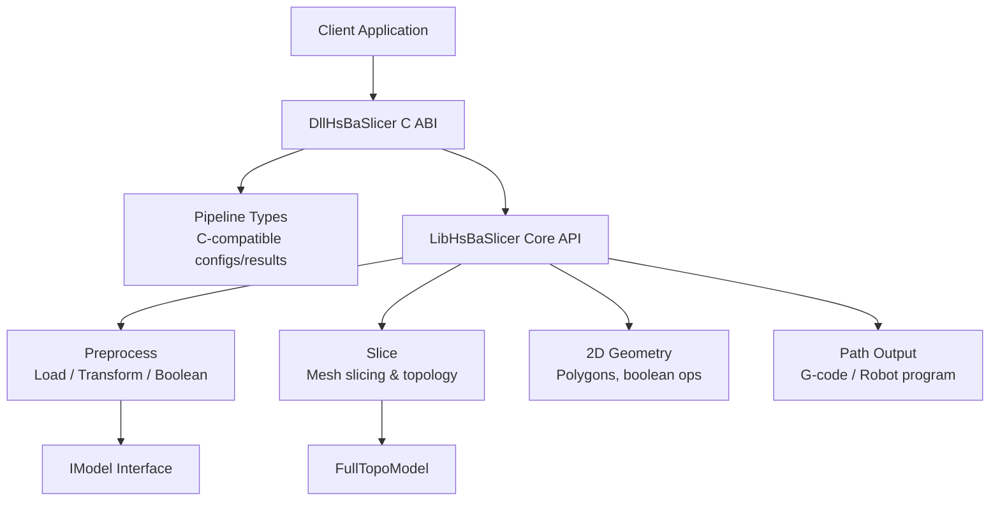
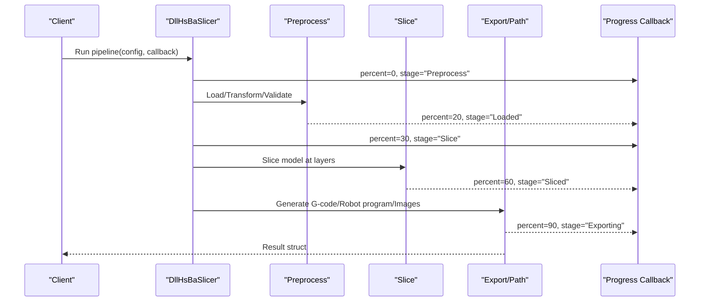
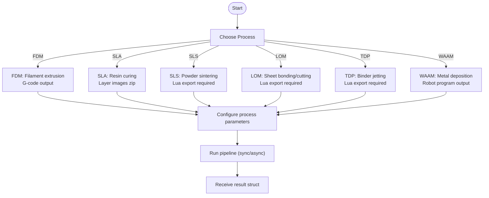
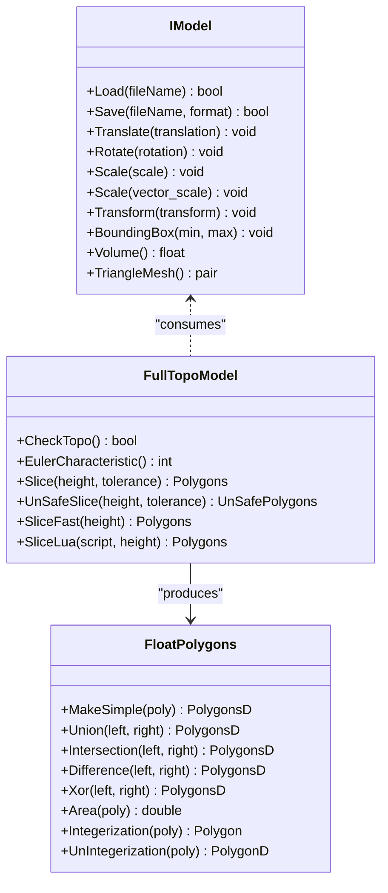
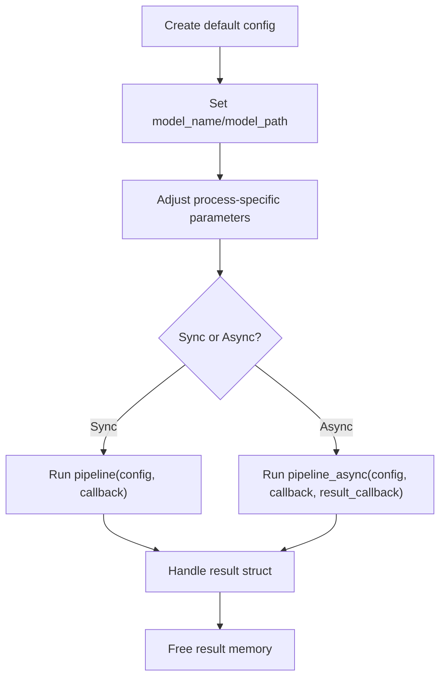
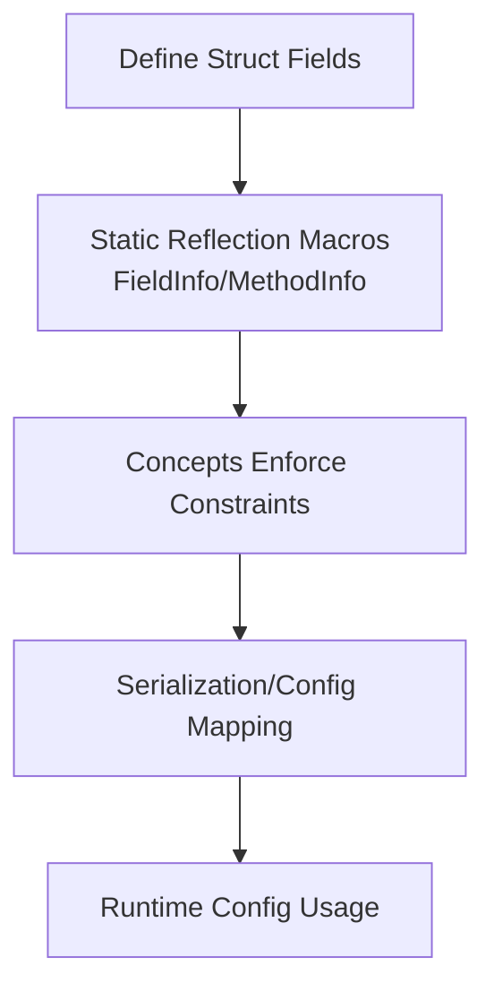
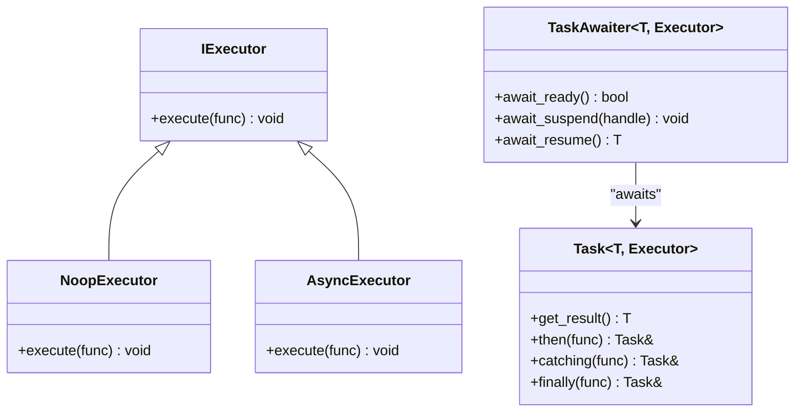
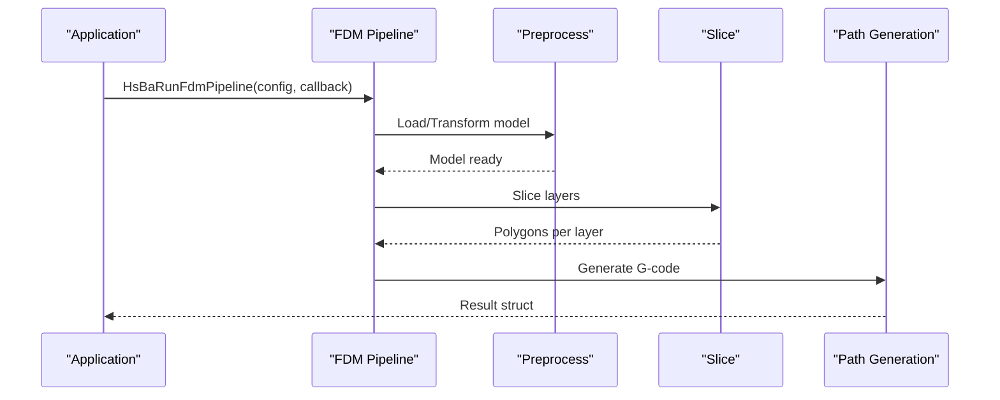
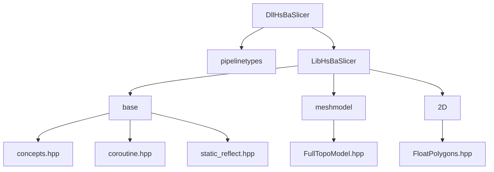

# Core Concepts

<cite>
**Referenced Files in This Document**
- [README.md](file://README.md)
- [pipeline_types.h](file://pipelinetypes/pipeline_types.h)
- [fdm_pipeline.h](file://DllHsBaSlicer/fdm_pipeline.h)
- [sla_pipeline.h](file://DllHsBaSlicer/sla_pipeline.h)
- [sls_pipeline.h](file://DllHsBaSlicer/sls_pipeline.h)
- [lom_pipeline.h](file://DllHsBaSlicer/lom_pipeline.h)
- [tdp_pipeline.h](file://DllHsBaSlicer/tdp_pipeline.h)
- [waam_pipeline.h](file://DllHsBaSlicer/waam_pipeline.h)
- [concepts.hpp](file://base/concepts.hpp)
- [coroutine.hpp](file://base/coroutine.hpp)
- [static_reflect.hpp](file://base/static_reflect.hpp)
- [IModel.hpp](file://base/IModel.hpp)
- [model_preprocess.hpp](file://LibHsBaSlicer/Preprocess/model_preprocess.hpp)
- [mesh_slice.hpp](file://LibHsBaSlicer/Slice/mesh_slice.hpp)
- [FullTopoModel.hpp](file://meshmodel/FullTopoModel.hpp)
- [FloatPolygons.hpp](file://2D/FloatPolygons.hpp)
</cite>

## Table of Contents
1. [Introduction](#introduction)
2. [Project Structure](#project-structure)
3. [Core Components](#core-components)
4. [Architecture Overview](#architecture-overview)
5. [Detailed Component Analysis](#detailed-component-analysis)
6. [Dependency Analysis](#dependency-analysis)
7. [Performance Considerations](#performance-considerations)
8. [Troubleshooting Guide](#troubleshooting-guide)
9. [Conclusion](#conclusion)

## Introduction
This document explains the core concepts behind HsBaSlicer’s slicing workflow. It covers:
- Fundamental 3D printing processes supported by the framework: FDM, SLA, SLS, LOM, TDP, and WAAM.
- Mesh processing concepts such as topology, geometry operations, and validation.
- Pipeline architecture principles including stage composition, parameter passing, and event handling.
- Configuration system design using structured parameters and reflection.
- C++20 concepts usage for type safety, coroutine-based async operations, and template metaprogramming patterns.
- Practical examples showing how these concepts work together during slicing.

The goal is to make these ideas accessible while remaining grounded in the actual codebase.

## Project Structure
HsBaSlicer exposes a modular architecture:
- `base` provides foundational types, C++20 concepts, coroutines, and static reflection utilities.
- `LibHsBaSlicer` contains core C++ APIs for preprocessing, slicing, support, fill, path generation, and floor generation.
- `DllHsBaSlicer` exports C ABI functions for each process pipeline (FDM, SLA, SLS, LOM, TDP, WAAM).
- `pipelinetypes` defines C-compatible configuration and result structs used across the C ABI.
- `meshmodel`, `2D`, and other modules provide mesh representation, polygon math, and geometric primitives.

**Diagram sources**
- [fdm_pipeline.h:23-35](file://DllHsBaSlicer/fdm_pipeline.h#L23-L35)
- [sla_pipeline.h:23-34](file://DllHsBaSlicer/sla_pipeline.h#L23-L34)
- [sls_pipeline.h:23-34](file://DllHsBaSlicer/sls_pipeline.h#L23-L34)
- [lom_pipeline.h:23-36](file://DllHsBaSlicer/lom_pipeline.h#L23-L36)
- [tdp_pipeline.h:23-36](file://DllHsBaSlicer/tdp_pipeline.h#L23-L36)
- [waam_pipeline.h:23-37](file://DllHsBaSlicer/waam_pipeline.h#L23-L37)
- [model_preprocess.hpp:32-40](file://LibHsBaSlicer/Preprocess/model_preprocess.hpp#L32-L40)
- [mesh_slice.hpp:22-33](file://LibHsBaSlicer/Slice/mesh_slice.hpp#L22-L33)
- [FullTopoModel.hpp:43-53](file://meshmodel/FullTopoModel.hpp#L43-L53)
- [FloatPolygons.hpp:18-25](file://2D/FloatPolygons.hpp#L18-L25)

**Section sources**
- [README.md:21-39](file://README.md#L21-L39)

## Core Components
HsBaSlicer organizes its capabilities around reusable components:
- Model abstraction: `IModel` represents any 3D model with load/save, transforms, bounding box, volume, and triangle mesh access.
- Preprocessing: Load models into a pool, apply transforms, query info, and perform advanced boolean/thick-solid operations when available.
- Slicing: Planar slicing along Z producing closed or open polygons; optional Lua-driven slicing; reusable topology building for multi-layer efficiency.
- 2D geometry: Double-precision polygon types and boolean operations (union, intersection, difference, XOR), area calculation, shape generators, and integer/double conversion.
- Process pipelines: Each additive manufacturing process has a dedicated C ABI entry point with sync/async execution and progress/result callbacks.

Key responsibilities:
- `IModel`: Uniform interface for different model backends.
- `model_preprocess`: Model lifecycle management and geometry operations.
- `mesh_slice`: Safe/unsafe slicing, Lua integration, and topology reuse.
- `FloatPolygons`: Polygon math and conversions.
- Process headers: Stable C ABI for external integrators.

**Section sources**
- [IModel.hpp:110-139](file://base/IModel.hpp#L110-L139)
- [model_preprocess.hpp:32-40](file://LibHsBaSlicer/Preprocess/model_preprocess.hpp#L32-L40)
- [mesh_slice.hpp:22-33](file://LibHsBaSlicer/Slice/mesh_slice.hpp#L22-L33)
- [FloatPolygons.hpp:18-25](file://2D/FloatPolygons.hpp#L18-L25)

## Architecture Overview
The slicing architecture follows a layered pipeline:
- Clients call process-specific C ABI functions from `DllHsBaSlicer`.
- The ABI layer maps C configs to internal structures and invokes `LibHsBaSlicer` stages.
- Stages include preprocess, slice, support, fill, floor, and export/path generation.
- Progress events are emitted via callbacks; results are returned through typed result structs.

**Diagram sources**
- [fdm_pipeline.h:23-35](file://DllHsBaSlicer/fdm_pipeline.h#L23-L35)
- [sla_pipeline.h:23-34](file://DllHsBaSlicer/sla_pipeline.h#L23-L34)
- [sls_pipeline.h:23-34](file://DllHsBaSlicer/sls_pipeline.h#L23-L34)
- [lom_pipeline.h:23-36](file://DllHsBaSlicer/lom_pipeline.h#L23-L36)
- [tdp_pipeline.h:23-36](file://DllHsBaSlicer/tdp_pipeline.h#L23-L36)
- [waam_pipeline.h:23-37](file://DllHsBaSlicer/waam_pipeline.h#L23-L37)

## Detailed Component Analysis

### 3D Printing Process Concepts
HsBaSlicer supports multiple additive manufacturing processes, each with tailored configuration and output:

- FDM (Fused Deposition Modeling): Extrudes thermoplastic filament layer-by-layer. Outputs G-code targeting firmware like Marlin, RepRap, or Klipper. Supports configurable fill modes, support patterns, wall counts, top/bottom layers, infill density, extrusion settings, and spiral vase mode.

- SLA (Stereolithography): Uses UV light to cure resin layer-by-layer. Outputs layer images (PNG/JPEG/SVG) packaged into a zip. Configurable exposure times, lift/retract speeds, raft/floor parameters, support patterns, and image resolution.

- SLS (Selective Laser Sintering): Powder bed process where a laser sinters powder. No floor/raft/support needed; output format is determined by a required Lua export script. Configurable laser power, scan speed, hatch spacing/rotation, and bed temperature.

- LOM (Laminated Object Manufacturing): Sheets are bonded and cut per layer. Configurable cut speed/power/margin, bonding temperature/pressure/time, seal contour, and cut mode. Requires a Lua export script.

- TDP (Tape Deposition Process / Binder Jetting): Powder bed + liquid binder. Configurable head count, drop spacing, binder saturation, curing time, bed temperature, and binder mode. Optional spiral outer contour mode. Requires a Lua export script.

- WAAM (Wire Arc Additive Manufacturing): Deposits metal bead-by-bead using welding processes. Outputs robot language programs (ABB/KUKA/FANUC) rather than layer zips. Configurable wire feed speed, arc current/voltage, shielding gas flow, material/process/protection/gas, interpass temperature, robot controller type, and optional custom path generator. Spiral outer-wall deposition mode is supported.

**Diagram sources**
- [pipeline_types.h:56-113](file://pipelinetypes/pipeline_types.h#L56-L113)
- [pipeline_types.h:170-218](file://pipelinetypes/pipeline_types.h#L170-L218)
- [pipeline_types.h:259-283](file://pipelinetypes/pipeline_types.h#L259-L283)
- [pipeline_types.h:419-436](file://pipelinetypes/pipeline_types.h#L419-L436)
- [pipeline_types.h:480-496](file://pipelinetypes/pipeline_types.h#L480-L496)
- [pipeline_types.h:578-600](file://pipelinetypes/pipeline_types.h#L578-L600)

**Section sources**
- [pipeline_types.h:56-113](file://pipelinetypes/pipeline_types.h#L56-L113)
- [pipeline_types.h:170-218](file://pipelinetypes/pipeline_types.h#L170-L218)
- [pipeline_types.h:259-283](file://pipelinetypes/pipeline_types.h#L259-L283)
- [pipeline_types.h:419-436](file://pipelinetypes/pipeline_types.h#L419-L436)
- [pipeline_types.h:480-496](file://pipelinetypes/pipeline_types.h#L480-L496)
- [pipeline_types.h:578-600](file://pipelinetypes/pipeline_types.h#L578-L600)

### Mesh Processing Concepts
HsBaSlicer separates mesh representation, topology reconstruction, and planar slicing:

- IModel: Abstract interface for loading, saving, transforming, querying bounding boxes/volume, and accessing triangle meshes.
- FullTopoModel: Reconstructs full topology (vertices, edges, faces) for slicing; supports safe/unsafe slicing, fast slicing, Euler characteristic checks, and Lua-driven slicing.
- mesh_slice: Provides safe/unsafe slicing, Lua slicing, normalization of unsafe polygons, reusable topology building (`BuildSliceTopology`), and single-layer slicing from prebuilt topology (`SliceLayer`).
- FloatPolygons: Defines double-precision polygon types and operations (simplify, union, intersection, difference, XOR, area, shape generators, integer/double conversion).

**Diagram sources**
- [IModel.hpp:110-139](file://base/IModel.hpp#L110-L139)
- [FullTopoModel.hpp:43-53](file://meshmodel/FullTopoModel.hpp#L43-L53)
- [FloatPolygons.hpp:18-25](file://2D/FloatPolygons.hpp#L18-L25)

Validation and topology:
- `FullTopoModel::CheckTopo` validates topological completeness; incomplete models may affect algorithms.
- `EulerCharacteristic` helps detect holes or non-manifold conditions.
- `NormalizeUnSafePolygons` filters open polylines and non-simple polygons, converting integer coordinates to double precision.

Complexity considerations:
- Rebuilding topology per layer is O(total_faces); use `BuildSliceTopology` once and `SliceLayer` per layer for multi-layer efficiency.

**Section sources**
- [IModel.hpp:110-139](file://base/IModel.hpp#L110-L139)
- [FullTopoModel.hpp:80-127](file://meshmodel/FullTopoModel.hpp#L80-L127)
- [mesh_slice.hpp:67-103](file://LibHsBaSlicer/Slice/mesh_slice.hpp#L67-L103)
- [FloatPolygons.hpp:27-121](file://2D/FloatPolygons.hpp#L27-L121)

### Pipeline Architecture Principles
Stage composition:
- FDM: Preprocess -> Slice -> Support -> Fill -> Path Generation.
- SLA: Preprocess -> Slice -> Floor -> Support -> Export (zip).
- SLS/LOM/TDP: Preprocess -> Slice -> Export (Lua-driven).
- WAAM: Preprocess -> Slice -> Robot path export.

Parameter passing:
- Each process uses a C-compatible config struct defined in `pipelinetypes/pipeline_types.h`.
- Default initializers set sensible defaults; clients modify fields before calling run functions.
- Results are returned via typed result structs containing success flags, layer counts, output paths/content, error messages, and elapsed time.

Event handling:
- Progress callbacks report percentage and stage descriptions.
- Async variants accept result callbacks to receive completion asynchronously.

**Diagram sources**
- [fdm_pipeline.h:23-35](file://DllHsBaSlicer/fdm_pipeline.h#L23-L35)
- [sla_pipeline.h:23-34](file://DllHsBaSlicer/sla_pipeline.h#L23-L34)
- [sls_pipeline.h:23-34](file://DllHsBaSlicer/sls_pipeline.h#L23-L34)
- [lom_pipeline.h:23-36](file://DllHsBaSlicer/lom_pipeline.h#L23-L36)
- [tdp_pipeline.h:23-36](file://DllHsBaSlicer/tdp_pipeline.h#L23-L36)
- [waam_pipeline.h:23-37](file://DllHsBaSlicer/waam_pipeline.h#L23-L37)

**Section sources**
- [fdm_pipeline.h:23-35](file://DllHsBaSlicer/fdm_pipeline.h#L23-L35)
- [sla_pipeline.h:23-34](file://DllHsBaSlicer/sla_pipeline.h#L23-L34)
- [sls_pipeline.h:23-34](file://DllHsBaSlicer/sls_pipeline.h#L23-L34)
- [lom_pipeline.h:23-36](file://DllHsBaSlicer/lom_pipeline.h#L23-L36)
- [tdp_pipeline.h:23-36](file://DllHsBaSlicer/tdp_pipeline.h#L23-L36)
- [waam_pipeline.h:23-37](file://DllHsBaSlicer/waam_pipeline.h#L23-L37)

### Configuration System Design
Structured parameters:
- Each process has a dedicated config struct (e.g., `HsBaFdmPipelineConfig_t`, `HsBaSlaPipelineConfig_t`, etc.) with clearly documented fields and defaults.
- Default initializers provide consistent baseline values; clients override only what they need.

Reflection and introspection:
- Static reflection utilities enable compile-time introspection of classes, fields, and methods without runtime type information.
- Concepts enforce constraints on types used throughout the system (streams, strings, allocators, arithmetic operations).

**Diagram sources**
- [static_reflect.hpp:23-57](file://base/static_reflect.hpp#L23-L57)
- [concepts.hpp:17-26](file://base/concepts.hpp#L17-L26)

Practical example:
- For FDM, set `layer_height`, `fill_spacing`, `wall_count`, `support_pattern`, `line_width`, `print_speed`, and `output_path`; then call `HsBaRunFdmPipeline`.
- For SLA, set `layer_height`, `bottom_exposure_time`, `floor_raft_offset`, `image_type`, and `output_path`; then call `HsBaRunSlaPipeline`.
- For SLS/LOM/TDP, ensure `export_lua_script` is provided; configure process-specific parameters; then call respective run functions.
- For WAAM, set `material`, `welding_process`, `robot_type`, and optionally `path_lua_script`; then call `HsBaRunWaamPipeline`.

**Section sources**
- [pipeline_types.h:56-113](file://pipelinetypes/pipeline_types.h#L56-L113)
- [pipeline_types.h:170-218](file://pipelinetypes/pipeline_types.h#L170-L218)
- [pipeline_types.h:259-283](file://pipelinetypes/pipeline_types.h#L259-L283)
- [pipeline_types.h:419-436](file://pipelinetypes/pipeline_types.h#L419-L436)
- [pipeline_types.h:480-496](file://pipelinetypes/pipeline_types.h#L480-L496)
- [pipeline_types.h:578-600](file://pipelinetypes/pipeline_types.h#L578-L600)
- [static_reflect.hpp:23-57](file://base/static_reflect.hpp#L23-L57)
- [concepts.hpp:17-26](file://base/concepts.hpp#L17-L26)

### C++20 Concepts, Coroutines, and Template Metaprogramming
Type safety with concepts:
- Concepts define requirements for streams, strings, allocators, arithmetic operations, and pointer-like types.
- They improve compile-time diagnostics and reduce boilerplate.

Coroutine-based async operations:
- `Task<T, Executor>` encapsulates asynchronous computations with executors (`NoopExecutor`, `AsyncExecutor`) and awaiters.
- Supports chaining (`then`, `catching`, `finally`), completion callbacks, and exception propagation.
- Custom allocator tasks allow fine-grained memory control.

Template metaprogramming patterns:
- Static reflection utilities provide field/method introspection via templates and tuples.
- Concept-based constraints guide generic programming across the codebase.

**Diagram sources**
- [coroutine.hpp:47-70](file://base/coroutine.hpp#L47-L70)
- [coroutine.hpp:71-122](file://base/coroutine.hpp#L71-L122)
- [coroutine.hpp:205-382](file://base/coroutine.hpp#L205-L382)

Practical example:
- Use `Task<void, AsyncExecutor>` to run long-running slicing steps off the UI thread.
- Chain `.then(...)` to continue processing after slicing completes.
- Use `.catching(...)` to handle exceptions gracefully.
- Use `.finally(...)` to release resources or update progress.

**Section sources**
- [coroutine.hpp:47-70](file://base/coroutine.hpp#L47-L70)
- [coroutine.hpp:71-122](file://base/coroutine.hpp#L71-L122)
- [coroutine.hpp:205-382](file://base/coroutine.hpp#L205-L382)
- [concepts.hpp:17-26](file://base/concepts.hpp#L17-L26)
- [static_reflect.hpp:23-57](file://base/static_reflect.hpp#L23-L57)

### Practical Slicing Workflow Example
End-to-end FDM workflow:
1. Create default FDM config and set model name/path.
2. Adjust layer height, fill spacing, wall count, support pattern, line width, print speed, and output path.
3. Call `HsBaRunFdmPipeline` synchronously or `HsBaRunFdmPipelineAsync` asynchronously.
4. Receive result struct with G-code content or exported file path.
5. Free result memory using `HsBaFreePipelineResult`.

**Diagram sources**
- [fdm_pipeline.h:23-35](file://DllHsBaSlicer/fdm_pipeline.h#L23-L35)
- [model_preprocess.hpp:32-40](file://LibHsBaSlicer/Preprocess/model_preprocess.hpp#L32-L40)
- [mesh_slice.hpp:22-33](file://LibHsBaSlicer/Slice/mesh_slice.hpp#L22-L33)

**Section sources**
- [fdm_pipeline.h:23-35](file://DllHsBaSlicer/fdm_pipeline.h#L23-L35)
- [model_preprocess.hpp:32-40](file://LibHsBaSlicer/Preprocess/model_preprocess.hpp#L32-L40)
- [mesh_slice.hpp:22-33](file://LibHsBaSlicer/Slice/mesh_slice.hpp#L22-L33)

## Dependency Analysis
High-level dependencies:
- `DllHsBaSlicer` depends on `pipelinetypes` for C-compatible configs/results.
- `LibHsBaSlicer` depends on `base` (IModel, concepts, coroutines), `meshmodel` (FullTopoModel), and `2D` (FloatPolygons).
- Process pipelines compose preprocessing, slicing, support, fill, floor, and export/path stages.

**Diagram sources**
- [fdm_pipeline.h:9-10](file://DllHsBaSlicer/fdm_pipeline.h#L9-L10)
- [pipeline_types.h:5-12](file://pipelinetypes/pipeline_types.h#L5-L12)
- [model_preprocess.hpp:14-18](file://LibHsBaSlicer/Preprocess/model_preprocess.hpp#L14-L18)
- [mesh_slice.hpp:9-16](file://LibHsBaSlicer/Slice/mesh_slice.hpp#L9-L16)
- [FloatPolygons.hpp:9-12](file://2D/FloatPolygons.hpp#L9-L12)

**Section sources**
- [fdm_pipeline.h:9-10](file://DllHsBaSlicer/fdm_pipeline.h#L9-L10)
- [pipeline_types.h:5-12](file://pipelinetypes/pipeline_types.h#L5-L12)
- [model_preprocess.hpp:14-18](file://LibHsBaSlicer/Preprocess/model_preprocess.hpp#L14-L18)
- [mesh_slice.hpp:9-16](file://LibHsBaSlicer/Slice/mesh_slice.hpp#L9-L16)
- [FloatPolygons.hpp:9-12](file://2D/FloatPolygons.hpp#L9-L12)

## Performance Considerations
- Reuse topology: Build `FullTopoModel` once with `BuildSliceTopology` and slice repeatedly with `SliceLayer` to avoid O(total_faces) rebuilds per layer.
- Prefer safe slicing for surface-forming processes (SLA) and unsafe slicing only when necessary for material-fed processes.
- Use double-precision polygons (`PolygonD`, `PolygonsD`) for accurate geometry operations; convert to integer only when required by downstream tools.
- Offload heavy work to coroutines with `AsyncExecutor` to keep UI responsive.
- Minimize allocations by reusing buffers and leveraging concept-constrained generics.

[No sources needed since this section provides general guidance]

## Troubleshooting Guide
Common issues and resolutions:
- Invalid model format or duplicate model names: Ensure unique model names and supported formats when loading models.
- Open contours or non-simple polygons: Use `NormalizeUnSafePolygons` to filter and clean slices; prefer safe slicing when closed contours are required.
- Missing Lua export scripts: SLS/LOM/TDP require `export_lua_script`; ensure it is provided and points to a valid script.
- Memory leaks: Always free result structs using the corresponding `HsBaFree*PipelineResult` function.
- Asynchronous errors: Use `.catching(...)` on coroutine tasks to handle exceptions and log meaningful messages.

**Section sources**
- [model_preprocess.hpp:32-40](file://LibHsBaSlicer/Preprocess/model_preprocess.hpp#L32-L40)
- [mesh_slice.hpp:67-77](file://LibHsBaSlicer/Slice/mesh_slice.hpp#L67-L77)
- [fdm_pipeline.h:53-61](file://DllHsBaSlicer/fdm_pipeline.h#L53-L61)
- [coroutine.hpp:338-353](file://base/coroutine.hpp#L338-L353)

## Conclusion
HsBaSlicer combines robust 3D printing process support, rigorous mesh processing, and a flexible pipeline architecture. By leveraging C++20 concepts, coroutines, and static reflection, it delivers type safety, performance, and extensibility. The structured configuration system and clear separation of concerns make it suitable for both research and production slicing workflows.

[No sources needed since this section summarizes without analyzing specific files]