# Core Concepts

<cite>
**Referenced Files in This Document**
- [README.md](file://README.md)
- [IModel.hpp](file://base/IModel.hpp)
- [OcctModel.hpp](file://cadmodel/OcctModel.hpp)
- [UserCustomPointCloudModel.hpp](file://pointcloud/UserCustomPointCloudModel.hpp)
- [FullTopoModel.hpp](file://meshmodel/FullTopoModel.hpp)
- [ModelLoader.hpp](file://preprocess/ModelLoader.hpp)
- [mesh_slice.hpp](file://LibHsBaSlicer/Slice/mesh_slice.hpp)
- [fdm_support.hpp](file://LibHsBaSlicer/Support/fdm_support.hpp)
- [polygon_fill.hpp](file://LibHsBaSlicer/Fill/polygon_fill.hpp)
- [path_generator.hpp](file://LibHsBaSlicer/Path/path_generator.hpp)
- [layerspath.hpp](file://paths/layerspath.hpp)
- [pipeline_types.h](file://pipelinetypes/pipeline_types.h)
- [fdm_pipeline.h](file://DllHsBaSlicer/fdm_pipeline.h)
- [sla_pipeline.h](file://DllHsBaSlicer/sla_pipeline.h)
- [sls_pipeline.h](file://DllHsBaSlicer/sls_pipeline.h)
- [slm_pipeline.h](file://DllHsBaSlicer/slm_pipeline.h)
- [tdp_pipeline.h](file://DllHsBaSlicer/tdp_pipeline.h)
- [waam_pipeline.h](file://DllHsBaSlicer/waam_pipeline.h)
</cite>

## Table of Contents
1. [Introduction](#introduction)
2. [Project Structure](#project-structure)
3. [Core Components](#core-components)
4. [Architecture Overview](#architecture-overview)
5. [Detailed Component Analysis](#detailed-component-analysis)
6. [Dependency Analysis](#dependency-analysis)
7. [Performance Considerations](#performance-considerations)
8. [Troubleshooting Guide](#troubleshooting-guide)
9. [Conclusion](#conclusion)

## Introduction
This document explains HsBaSlicer’s core concepts and fundamental principles for building slicing pipelines across multiple additive manufacturing processes. It covers:

- Additive manufacturing fundamentals and process-specific requirements.
- The model abstraction layer built on the IModel interface.
- Mesh topology, including vertices, edges, faces, and topological manifold reconstruction.
- Coordinate systems and transformations from world to machine coordinates.
- Layer-based processing where 3D geometry becomes 2D cross-sections.
- A configurable pipeline architecture with stages for preprocessing, slicing, support generation, path planning, and output generation.
- Data flow between stages and how configuration parameters affect behavior.
- Practical examples showing how models flow through FDM, SLA, SLS, SLM, TDP, and WAAM pipelines.

## Project Structure
HsBaSlicer is a modular C++ framework exposing both a C++ library API and a C ABI for external integration. The relevant layers for this document are:

- base: IModel interface and shared primitives.
- preprocess: ModelLoader dispatches file formats to mesh or CAD kernels.
- meshmodel: FullTopoModel provides topology-reconstructed meshes for slicing.
- cadmodel: OcctModel implements BRep CAD operations.
- pointcloud: UserCustomPointCloudModel supports plugin-backed point clouds.
- LibHsBaSlicer: Core slicing, support, fill, and path generation APIs.
- paths: Layered path outputs and G-code/robot outputs.
- DllHsBaSlicer: Per-process pipeline entry points (FDM, SLA, SLS, SLM, TDP, WAAM).
- pipelinetypes: Process-specific configuration and result types.

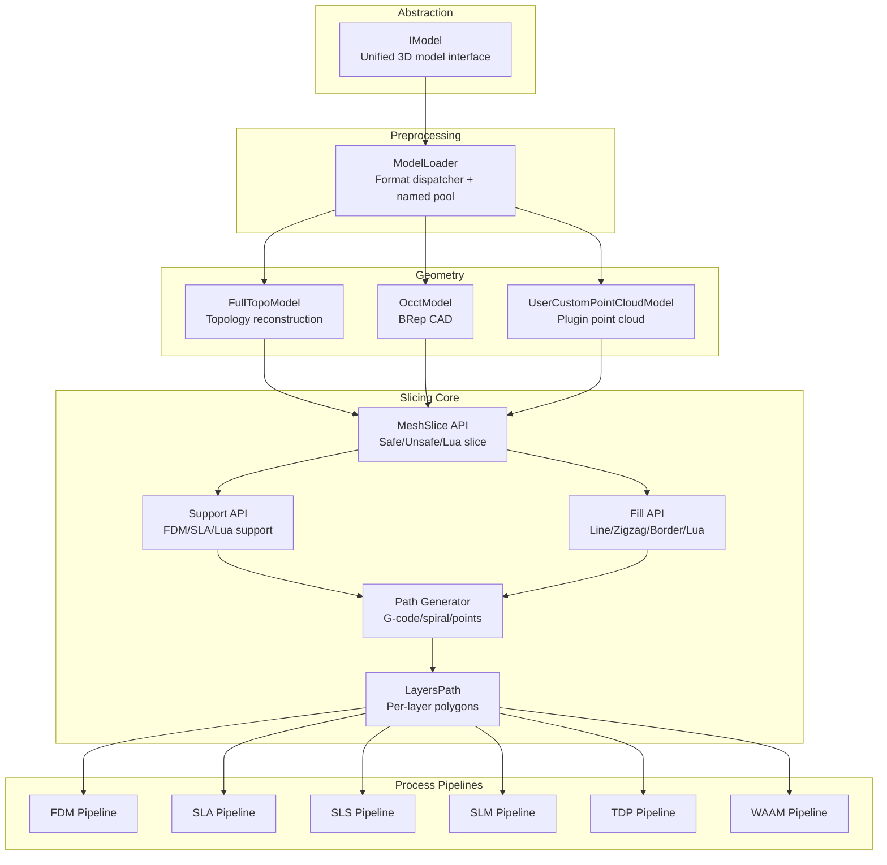

**Diagram sources**
- [IModel.hpp:110-139](file://base/IModel.hpp#L110-L139)
- [ModelLoader.hpp:23-59](file://preprocess/ModelLoader.hpp#L23-L59)
- [FullTopoModel.hpp:43-127](file://meshmodel/FullTopoModel.hpp#L43-L127)
- [OcctModel.hpp:22-81](file://cadmodel/OcctModel.hpp#L22-L81)
- [UserCustomPointCloudModel.hpp:90-171](file://pointcloud/UserCustomPointCloudModel.hpp#L90-L171)
- [mesh_slice.hpp:22-103](file://LibHsBaSlicer/Slice/mesh_slice.hpp#L22-L103)
- [fdm_support.hpp:19-67](file://LibHsBaSlicer/Support/fdm_support.hpp#L19-L67)
- [polygon_fill.hpp:17-53](file://LibHsBaSlicer/Fill/polygon_fill.hpp#L17-L53)
- [path_generator.hpp:21-91](file://LibHsBaSlicer/Path/path_generator.hpp#L21-L91)
- [layerspath.hpp:17-60](file://paths/layerspath.hpp#L17-L60)

**Section sources**
- [README.md:21-39](file://README.md#L21-L39)

## Core Components
This section introduces the foundational components that enable unified model handling, topology-aware slicing, and process-specific pipelines.

### Additive Manufacturing Fundamentals
HsBaSlicer supports multiple additive manufacturing processes by configuring common slicing stages differently:

| Process | Abbreviation | Core Requirements | Typical Output |
|---|---:|---|---|
| Fused Deposition Modeling | FDM | Layer height, wall count, infill density, support pattern, line width, print speed, extrusion settings, firmware target | G-code per firmware |
| Stereolithography | SLA | Exposure time, lift distance/speed, floor/raft, support pattern, image format and resolution | Layer images plus optional zip/database |
| Selective Laser Sintering | SLS | Laser power, scan speed, hatch spacing/rotation, bed temperature; no floor/support needed due to powder bed | Lua-driven export (zip + database) |
| Selective Laser Melting | SLM | Material, energy source, shielding gas, laser/scanning parameters; mirrors SLS flow | Lua-driven export (zip + database) |
| Three-Dimensional Printing (Binder Jetting) | TDP | Binder mode, drop spacing, saturation, curing time, head count, bed temperature | Lua-driven export (zip + database) |
| Wire Arc Additive Manufacturing | WAAM | Bead width, travel/feed speeds, arc current/voltage, protection method, robot controller type | Robot program (ABB/KUKA/FANUC) |

These requirements are represented by process-specific configuration structures such as HsBaFdmPipelineConfig_t, HsBaSlaPipelineConfig_t, HsBaSlsPipelineConfig_t, HsBaSlmPipelineConfig_t, HsBaTdpPipelineConfig_t, and HsBaWaamPipelineConfig_t.

**Section sources**
- [pipeline_types.h:23-113](file://pipelinetypes/pipeline_types.h#L23-L113)
- [pipeline_types.h:146-218](file://pipelinetypes/pipeline_types.h#L146-L218)
- [pipeline_types.h:249-283](file://pipelinetypes/pipeline_types.h#L249-L283)
- [pipeline_types.h:312-376](file://pipelinetypes/pipeline_types.h#L312-L376)
- [pipeline_types.h:403-436](file://pipelinetypes/pipeline_types.h#L403-L436)
- [pipeline_types.h:463-496](file://pipelinetypes/pipeline_types.h#L463-L496)
- [pipeline_types.h:523-600](file://pipelinetypes/pipeline_types.h#L523-L600)

### Model Abstraction Layer: IModel
The IModel interface provides unified access to different model formats:

- Triangle meshes via implementations such as IglModel/CgalModel (accessed through ModelLoader).
- CAD models via OcctModel supporting STEP, IGES, VRML, and BREP.
- Point clouds via UserCustomPointCloudModel backed by user plugins.

Key capabilities include loading/saving, geometric transforms, bounding box queries, volume computation, and triangle mesh extraction.

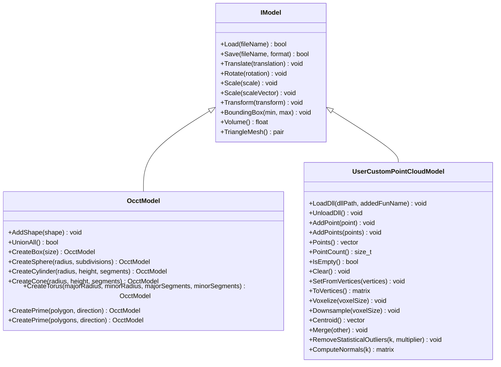

**Diagram sources**
- [IModel.hpp:110-139](file://base/IModel.hpp#L110-L139)
- [OcctModel.hpp:22-81](file://cadmodel/OcctModel.hpp#L22-L81)
- [UserCustomPointCloudModel.hpp:90-171](file://pointcloud/UserCustomPointCloudModel.hpp#L90-L171)

**Section sources**
- [IModel.hpp:65-139](file://base/IModel.hpp#L65-L139)
- [OcctModel.hpp:22-81](file://cadmodel/OcctModel.hpp#L22-L81)
- [UserCustomPointCloudModel.hpp:90-171](file://pointcloud/UserCustomPointCloudModel.hpp#L90-L171)

### Mesh Topology and Manifold Reconstruction
FullTopoModel reconstructs full topology from a triangle mesh, enabling robust slicing and analysis:

- Vertices store positions and adjacency lists for faces and edges.
- Edges connect two vertices and track adjacent faces.
- Faces store triangle indices, edge indices, and normals.
- Topological checks include Euler characteristic and completeness validation.
- Slicing supports safe closed contours, unsafe open contours, fast topology reuse, and Lua-driven custom slicing.

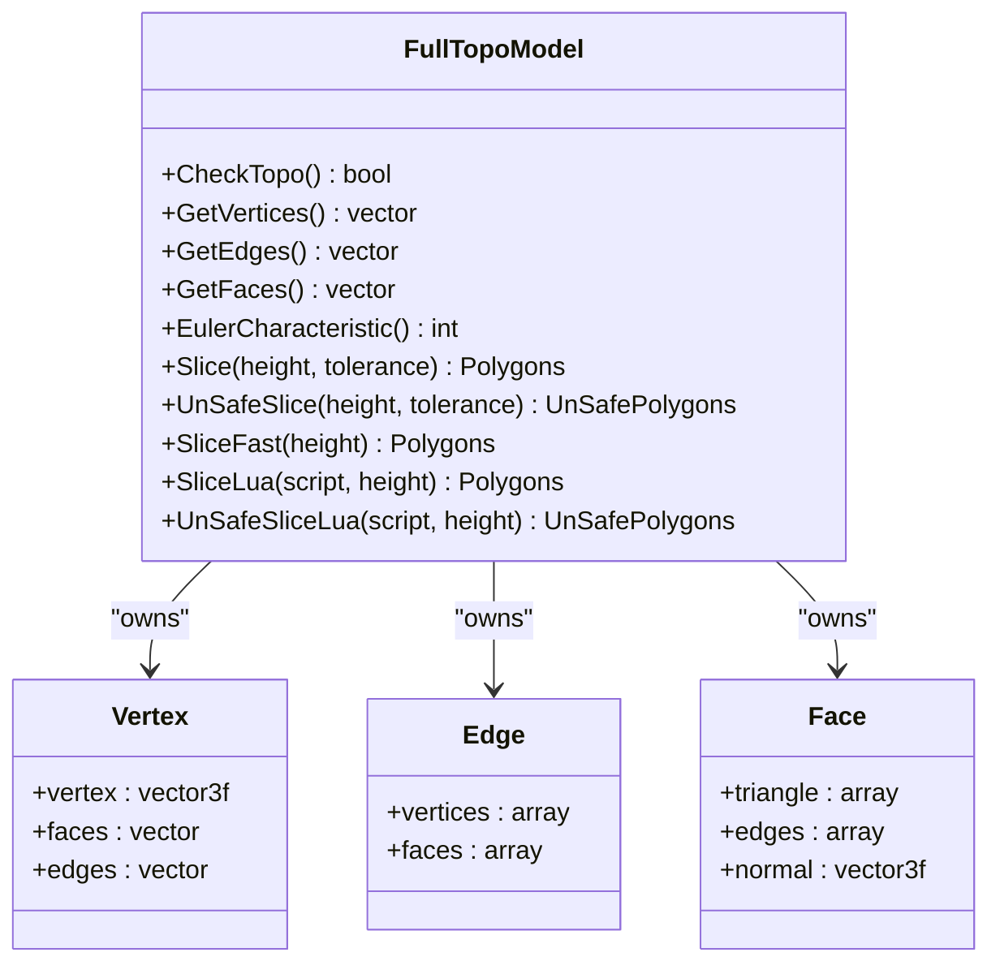

**Diagram sources**
- [FullTopoModel.hpp:43-127](file://meshmodel/FullTopoModel.hpp#L43-L127)

**Section sources**
- [FullTopoModel.hpp:43-127](file://meshmodel/FullTopoModel.hpp#L43-L127)

### Coordinate Systems and Transformations
Coordinate transformation flows from world coordinates to machine coordinates through consistent transform methods on IModel:

- Translation moves the model origin.
- Rotation applies a quaternion orientation.
- Scaling adjusts dimensions uniformly or per-axis.
- Transform accepts rigid isometries, homogeneous matrices, or affine transforms.

For machine-specific coordinate systems, downstream stages interpret these transforms when generating G-code or robot programs. For example, FDM path generation uses units and printer configuration, while WAAM path generation targets specific robot controllers.

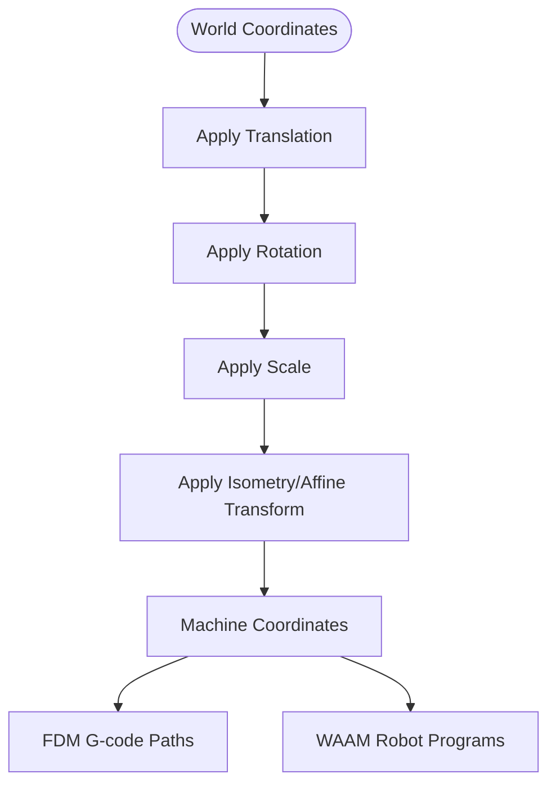

**Diagram sources**
- [IModel.hpp:120-130](file://base/IModel.hpp#L120-L130)
- [path_generator.hpp:21-91](file://LibHsBaSlicer/Path/path_generator.hpp#L21-L91)
- [pipeline_types.h:523-600](file://pipelinetypes/pipeline_types.h#L523-L600)

**Section sources**
- [IModel.hpp:120-130](file://base/IModel.hpp#L120-L130)

### Layer-Based Processing Paradigm
HsBaSlicer converts 3D geometry into 2D cross-sections using a layered approach:

- Safe slicing returns only closed contours suitable for material deposition.
- Unsafe slicing includes open contours for specialized workflows.
- Normalization cleans unsafe polygons into double-precision polygons.
- Reusable topology avoids rebuilding topology per layer for multi-layer pipelines.

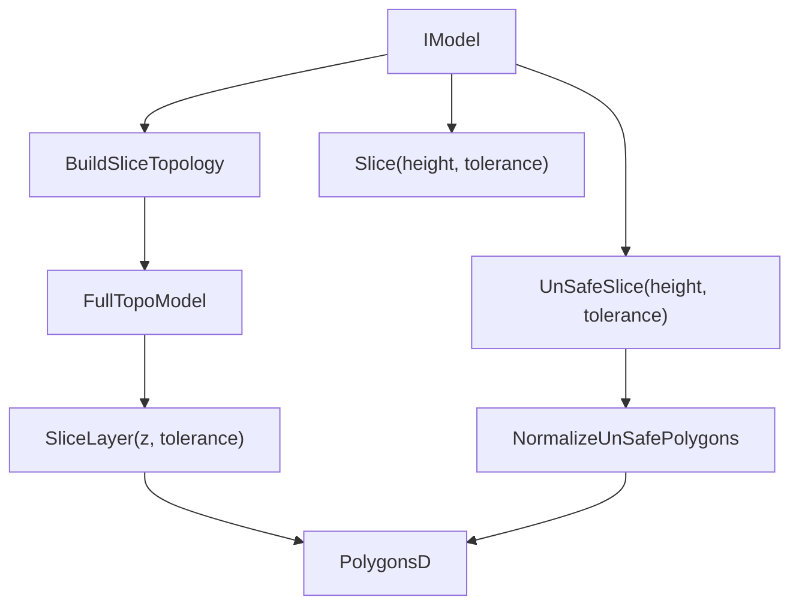

**Diagram sources**
- [mesh_slice.hpp:22-103](file://LibHsBaSlicer/Slice/mesh_slice.hpp#L22-L103)
- [FullTopoModel.hpp:100-127](file://meshmodel/FullTopoModel.hpp#L100-L127)

**Section sources**
- [mesh_slice.hpp:22-103](file://LibHsBaSlicer/Slice/mesh_slice.hpp#L22-L103)

### Pipeline Architecture Pattern
The pipeline architecture follows a staged pattern:

1. Preprocessing: Load and normalize models via ModelLoader.
2. Slicing: Convert 3D geometry to 2D polygons per layer.
3. Support Generation: Compute support structures based on overhangs and process requirements.
4. Path Planning: Generate toolpaths (outlines, fills, supports) and convert to machine instructions.
5. Output Generation: Produce G-code, layer images, robot programs, or Lua-driven exports.

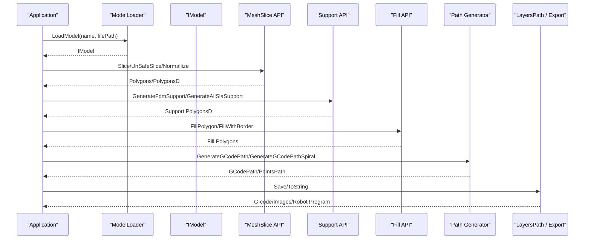

**Diagram sources**
- [ModelLoader.hpp:47-59](file://preprocess/ModelLoader.hpp#L47-L59)
- [mesh_slice.hpp:22-103](file://LibHsBaSlicer/Slice/mesh_slice.hpp#L22-L103)
- [fdm_support.hpp:19-67](file://LibHsBaSlicer/Support/fdm_support.hpp#L19-L67)
- [polygon_fill.hpp:17-53](file://LibHsBaSlicer/Fill/polygon_fill.hpp#L17-L53)
- [path_generator.hpp:21-91](file://LibHsBaSlicer/Path/path_generator.hpp#L21-L91)
- [layerspath.hpp:17-60](file://paths/layerspath.hpp#L17-L60)

**Section sources**
- [ModelLoader.hpp:47-59](file://preprocess/ModelLoader.hpp#L47-L59)
- [mesh_slice.hpp:22-103](file://LibHsBaSlicer/Slice/mesh_slice.hpp#L22-L103)
- [fdm_support.hpp:19-67](file://LibHsBaSlicer/Support/fdm_support.hpp#L19-L67)
- [polygon_fill.hpp:17-53](file://LibHsBaSlicer/Fill/polygon_fill.hpp#L17-L53)
- [path_generator.hpp:21-91](file://LibHsBaSlicer/Path/path_generator.hpp#L21-L91)
- [layerspath.hpp:17-60](file://paths/layerspath.hpp#L17-L60)

## Detailed Component Analysis

### FDM Pipeline
FDM adds walls, infill, and supports before generating G-code. Configuration controls layer height, fill mode, support pattern, line width, print speed, spiral mode, and firmware target.

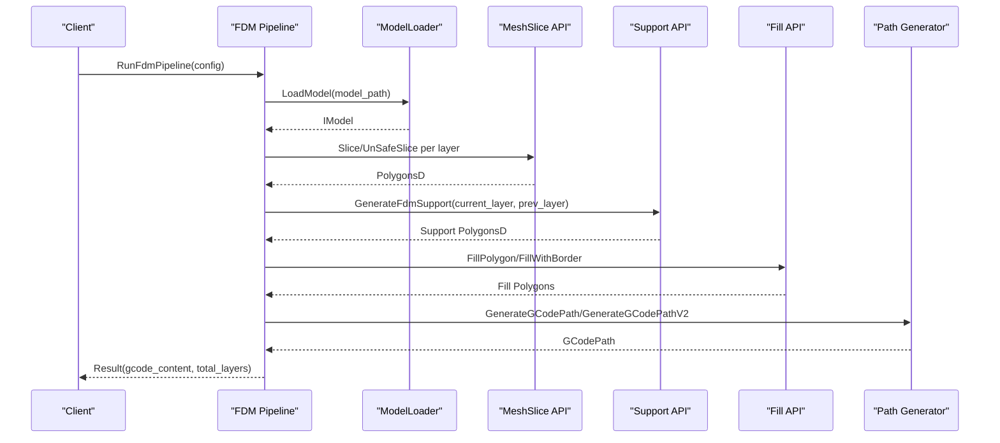

**Diagram sources**
- [fdm_pipeline.h:17-61](file://DllHsBaSlicer/fdm_pipeline.h#L17-L61)
- [ModelLoader.hpp:47-59](file://preprocess/ModelLoader.hpp#L47-L59)
- [mesh_slice.hpp:22-103](file://LibHsBaSlicer/Slice/mesh_slice.hpp#L22-L103)
- [fdm_support.hpp:19-67](file://LibHsBaSlicer/Support/fdm_support.hpp#L19-L67)
- [polygon_fill.hpp:17-53](file://LibHsBaSlicer/Fill/polygon_fill.hpp#L17-L53)
- [path_generator.hpp:21-91](file://LibHsBaSlicer/Path/path_generator.hpp#L21-L91)

**Section sources**
- [fdm_pipeline.h:17-61](file://DllHsBaSlicer/fdm_pipeline.h#L17-L61)
- [pipeline_types.h:23-113](file://pipelinetypes/pipeline_types.h#L23-L113)

### SLA Pipeline
SLA generates layer images and optionally a raft/floor plus sacrificial supports. Configuration includes exposure times, lift distances, floor parameters, support patterns, and image format/resolution.

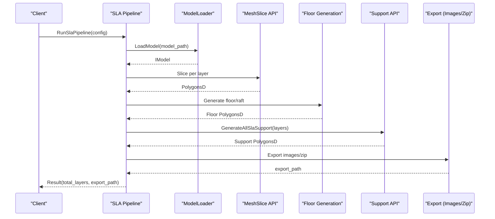

**Diagram sources**
- [sla_pipeline.h:17-56](file://DllHsBaSlicer/sla_pipeline.h#L17-L56)
- [ModelLoader.hpp:47-59](file://preprocess/ModelLoader.hpp#L47-L59)
- [mesh_slice.hpp:22-103](file://LibHsBaSlicer/Slice/mesh_slice.hpp#L22-L103)
- [fdm_support.hpp:39-50](file://LibHsBaSlicer/Support/fdm_support.hpp#L39-L50)

**Section sources**
- [sla_pipeline.h:17-56](file://DllHsBaSlicer/sla_pipeline.h#L17-L56)
- [pipeline_types.h:146-218](file://pipelinetypes/pipeline_types.h#L146-L218)

### SLS and SLM Pipelines
SLS and SLM share a similar flow: preprocess, slice, and Lua-driven export. SLS focuses on polymer sintering; SLM adds metal-specific parameters like material, light source, and shielding gas.

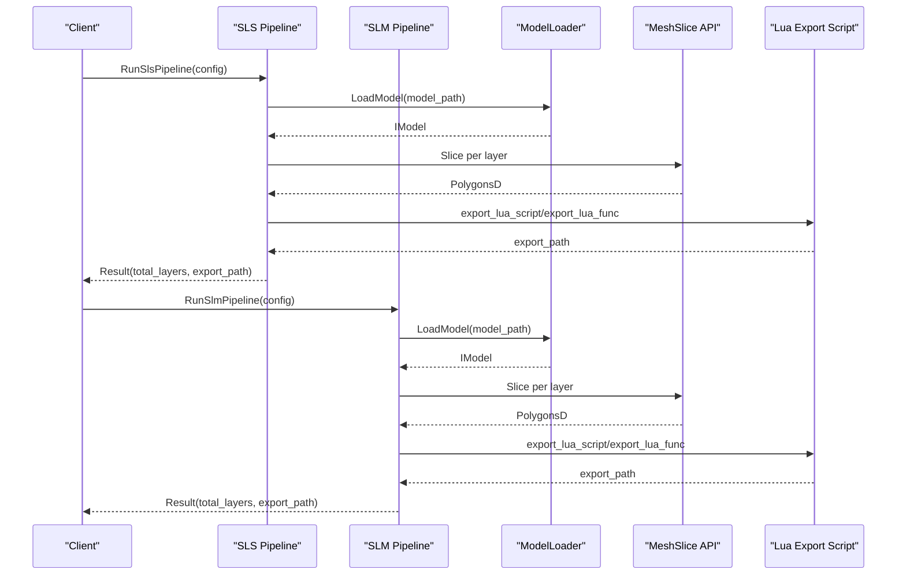

**Diagram sources**
- [sls_pipeline.h:17-56](file://DllHsBaSlicer/sls_pipeline.h#L17-L56)
- [slm_pipeline.h:17-56](file://DllHsBaSlicer/slm_pipeline.h#L17-L56)
- [ModelLoader.hpp:47-59](file://preprocess/ModelLoader.hpp#L47-L59)
- [mesh_slice.hpp:22-103](file://LibHsBaSlicer/Slice/mesh_slice.hpp#L22-L103)

**Section sources**
- [sls_pipeline.h:17-56](file://DllHsBaSlicer/sls_pipeline.h#L17-L56)
- [slm_pipeline.h:17-56](file://DllHsBaSlicer/slm_pipeline.h#L17-L56)
- [pipeline_types.h:249-283](file://pipelinetypes/pipeline_types.h#L249-L283)
- [pipeline_types.h:312-376](file://pipelinetypes/pipeline_types.h#L312-L376)

### TDP Pipeline
TDP (binder jetting) slices per layer and passes binder-jet outlines and head/curing parameters to a Lua export script. Configuration includes binder mode, drop spacing, saturation, curing time, and head count.

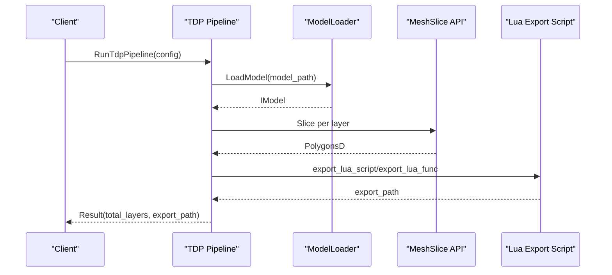

**Diagram sources**
- [tdp_pipeline.h:17-56](file://DllHsBaSlicer/tdp_pipeline.h#L17-L56)
- [ModelLoader.hpp:47-59](file://preprocess/ModelLoader.hpp#L47-L59)
- [mesh_slice.hpp:22-103](file://LibHsBaSlicer/Slice/mesh_slice.hpp#L22-L103)

**Section sources**
- [tdp_pipeline.h:17-56](file://DllHsBaSlicer/tdp_pipeline.h#L17-L56)
- [pipeline_types.h:463-496](file://pipelinetypes/pipeline_types.h#L463-L496)

### WAAM Pipeline
WAAM deposits metal bead-by-bead along per-layer contours and outputs a robot language program rather than a layer zip. Configuration includes wire material, welding process, protection method, shielding gas, interpass temperature, and robot controller type. Spiral mode can deposit outer walls as a continuous rising bead.

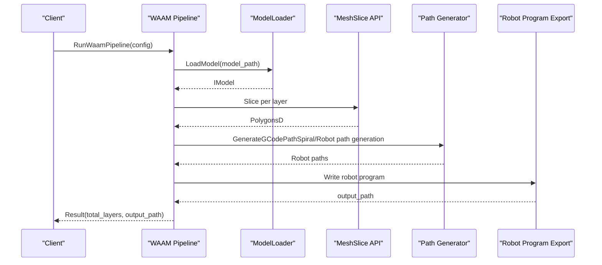

**Diagram sources**
- [waam_pipeline.h:17-57](file://DllHsBaSlicer/waam_pipeline.h#L17-L57)
- [ModelLoader.hpp:47-59](file://preprocess/ModelLoader.hpp#L47-L59)
- [mesh_slice.hpp:22-103](file://LibHsBaSlicer/Slice/mesh_slice.hpp#L22-L103)
- [path_generator.hpp:64-80](file://LibHsBaSlicer/Path/path_generator.hpp#L64-L80)

**Section sources**
- [waam_pipeline.h:17-57](file://DllHsBaSlicer/waam_pipeline.h#L17-L57)
- [pipeline_types.h:523-600](file://pipelinetypes/pipeline_types.h#L523-L600)

## Dependency Analysis
The following diagram shows key dependencies among core modules used in this document:

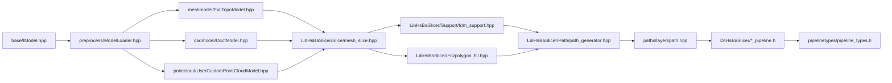

**Diagram sources**
- [IModel.hpp:110-139](file://base/IModel.hpp#L110-L139)
- [ModelLoader.hpp:23-59](file://preprocess/ModelLoader.hpp#L23-L59)
- [FullTopoModel.hpp:43-127](file://meshmodel/FullTopoModel.hpp#L43-L127)
- [OcctModel.hpp:22-81](file://cadmodel/OcctModel.hpp#L22-L81)
- [UserCustomPointCloudModel.hpp:90-171](file://pointcloud/UserCustomPointCloudModel.hpp#L90-L171)
- [mesh_slice.hpp:22-103](file://LibHsBaSlicer/Slice/mesh_slice.hpp#L22-L103)
- [fdm_support.hpp:19-67](file://LibHsBaSlicer/Support/fdm_support.hpp#L19-L67)
- [polygon_fill.hpp:17-53](file://LibHsBaSlicer/Fill/polygon_fill.hpp#L17-L53)
- [path_generator.hpp:21-91](file://LibHsBaSlicer/Path/path_generator.hpp#L21-L91)
- [layerspath.hpp:17-60](file://paths/layerspath.hpp#L17-L60)
- [fdm_pipeline.h:17-61](file://DllHsBaSlicer/fdm_pipeline.h#L17-L61)
- [sla_pipeline.h:17-56](file://DllHsBaSlicer/sla_pipeline.h#L17-L56)
- [sls_pipeline.h:17-56](file://DllHsBaSlicer/sls_pipeline.h#L17-L56)
- [slm_pipeline.h:17-56](file://DllHsBaSlicer/slm_pipeline.h#L17-L56)
- [tdp_pipeline.h:17-56](file://DllHsBaSlicer/tdp_pipeline.h#L17-L56)
- [waam_pipeline.h:17-57](file://DllHsBaSlicer/waam_pipeline.h#L17-L57)
- [pipeline_types.h:23-113](file://pipelinetypes/pipeline_types.h#L23-L113)

**Section sources**
- [IModel.hpp:110-139](file://base/IModel.hpp#L110-L139)
- [ModelLoader.hpp:23-59](file://preprocess/ModelLoader.hpp#L23-L59)
- [FullTopoModel.hpp:43-127](file://meshmodel/FullTopoModel.hpp#L43-L127)
- [OcctModel.hpp:22-81](file://cadmodel/OcctModel.hpp#L22-L81)
- [UserCustomPointCloudModel.hpp:90-171](file://pointcloud/UserCustomPointCloudModel.hpp#L90-L171)
- [mesh_slice.hpp:22-103](file://LibHsBaSlicer/Slice/mesh_slice.hpp#L22-L103)
- [fdm_support.hpp:19-67](file://LibHsBaSlicer/Support/fdm_support.hpp#L19-L67)
- [polygon_fill.hpp:17-53](file://LibHsBaSlicer/Fill/polygon_fill.hpp#L17-L53)
- [path_generator.hpp:21-91](file://LibHsBaSlicer/Path/path_generator.hpp#L21-L91)
- [layerspath.hpp:17-60](file://paths/layerspath.hpp#L17-L60)
- [pipeline_types.h:23-113](file://pipelinetypes/pipeline_types.h#L23-L113)

## Performance Considerations
- Use BuildSliceTopology once and SliceLayer repeatedly to avoid rebuilding topology per layer.
- Prefer safe slicing when closed contours are required to reduce downstream errors.
- Tune fill spacing, wall count, and infill density to balance print time and mechanical strength.
- Adjust support gap, diameter, and density to minimize material usage while maintaining stability.
- Choose appropriate layer height and first layer height for surface quality versus build speed.
- For WAAM, consider spiral mode to reduce travel and improve continuity for prismatic parts.

[No sources needed since this section provides general guidance]

## Troubleshooting Guide
Common issues and remedies:

- Unsupported model format: Ensure the file extension matches supported mesh or CAD formats handled by ModelLoader.
- Non-manifold geometry: Check topology completeness using FullTopoModel.CheckTopo and EulerCharacteristic; repair or simplify the model if necessary.
- Open contours in slicing: Use NormalizeUnSafePolygons after UnSafeSlice to filter invalid polylines.
- Incorrect coordinate system: Verify transforms applied via IModel.Translate/Rotate/Scale/Transform match machine coordinate expectations.
- Missing Lua export scripts: For SLS/SLM/TDP, ensure export_lua_script and export_lua_func are provided.
- WAAM robot mismatch: Confirm robot_type matches the target controller (ABB/KUKA/FANUC) or provide a custom path Lua script.

**Section sources**
- [ModelLoader.hpp:47-59](file://preprocess/ModelLoader.hpp#L47-L59)
- [FullTopoModel.hpp:80-98](file://meshmodel/FullTopoModel.hpp#L80-L98)
- [mesh_slice.hpp:67-103](file://LibHsBaSlicer/Slice/mesh_slice.hpp#L67-L103)
- [IModel.hpp:120-130](file://base/IModel.hpp#L120-L130)
- [sls_pipeline.h:24-34](file://DllHsBaSlicer/sls_pipeline.h#L24-L34)
- [slm_pipeline.h:24-36](file://DllHsBaSlicer/slm_pipeline.h#L24-L36)
- [tdp_pipeline.h:24-36](file://DllHsBaSlicer/tdp_pipeline.h#L24-L36)
- [waam_pipeline.h:24-37](file://DllHsBaSlicer/waam_pipeline.h#L24-L37)

## Conclusion
HsBaSlicer provides a flexible, layered architecture for additive manufacturing slicing. The IModel abstraction unifies mesh, CAD, and point cloud inputs. FullTopoModel enables robust topology-aware slicing, while the pipeline stages—preprocessing, slicing, support generation, path planning, and output generation—are configurable per process. FDM, SLA, SLS, SLM, TDP, and WAAM pipelines demonstrate how shared core logic adapts to distinct manufacturing requirements through process-specific configurations and optional Lua scripting.

[No sources needed since this section summarizes without analyzing specific files]