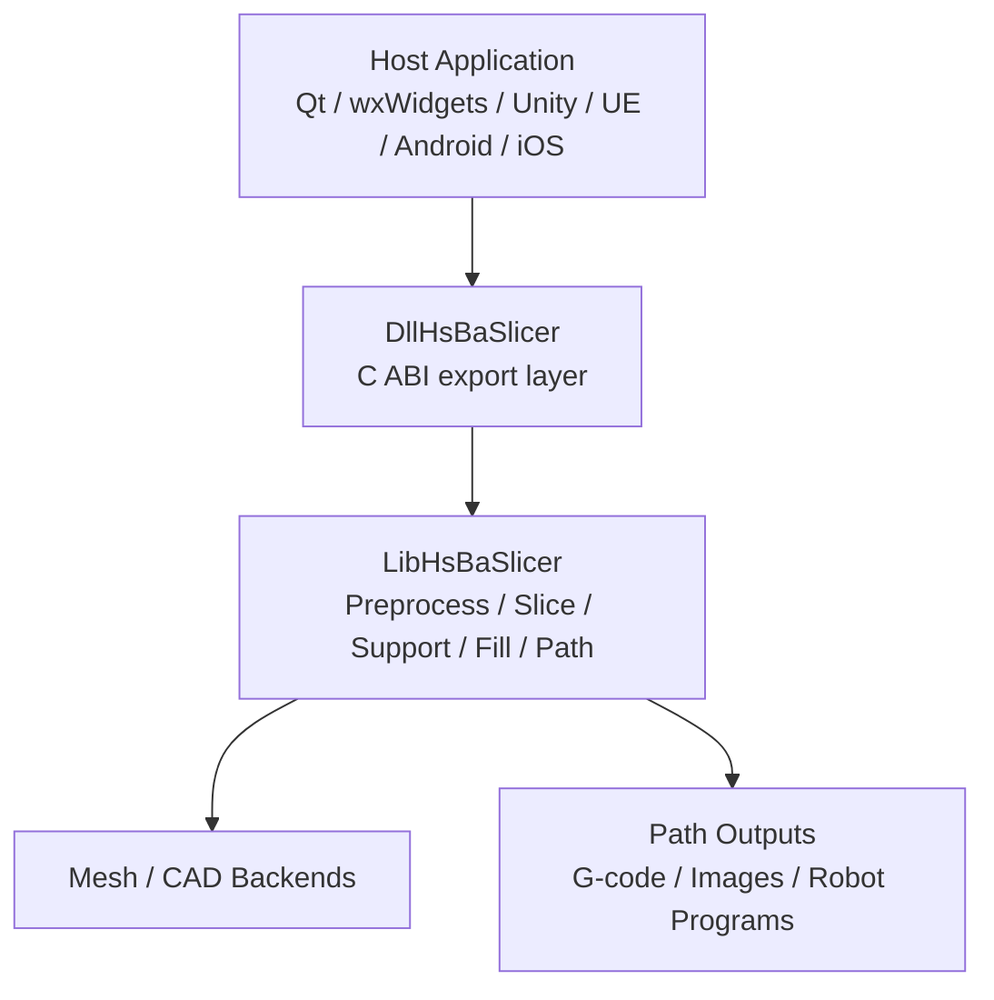
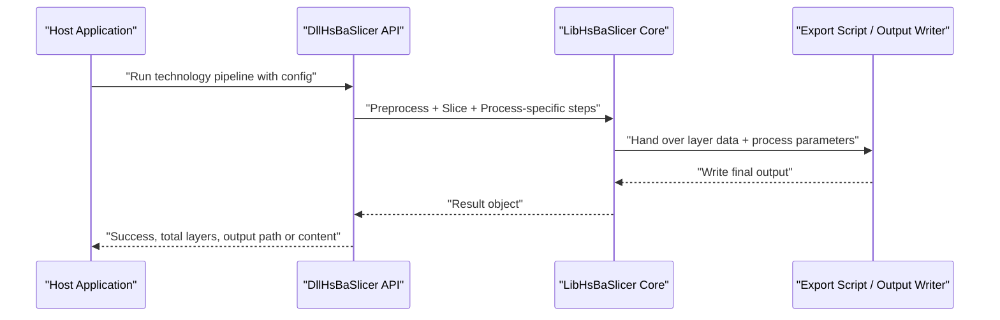
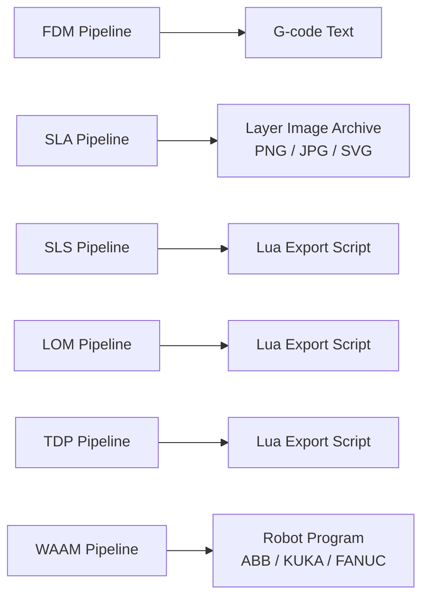

# 3D Printing Technologies Overview

<cite>
**Referenced Files in This Document**   
- [README.md](file://README.md)
- [DllHsBaSlicer README](file://docs/en/DllHsBaSlicer/README.md)
- [FDM pipeline proto](file://proto/fdm_pipeline.proto)
- [SLA pipeline proto](file://proto/sla_pipeline.proto)
- [SLS pipeline proto](file://proto/sls_pipeline.proto)
- [LOM pipeline proto](file://proto/lom_pipeline.proto)
- [TDP pipeline proto](file://proto/tdp_pipeline.proto)
- [WAAM pipeline proto](file://proto/waam_pipeline.proto)
- [Pipeline types header](file://pipelinetypes/pipeline_types.h)
</cite>

## Table of Contents
1. [Introduction](#introduction)
2. [Project Structure](#project-structure)
3. [Core Components](#core-components)
4. [Architecture Overview](#architecture-overview)
5. [Detailed Component Analysis](#detailed-component-analysis)
6. [Dependency Analysis](#dependency-analysis)
7. [Performance Considerations](#performance-considerations)
8. [Troubleshooting Guide](#troubleshooting-guide)
9. [Conclusion](#conclusion)
10. [Appendices](#appendices)

## Introduction
This document explains the 3D printing technologies supported by HsBaSlicer and how the slicer framework models them. It covers Fused Deposition Modeling (FDM), Stereolithography (SLA), Selective Laser Sintering (SLS), Laminated Object Manufacturing (LOM), Thermal Deposition Processing (TDP, binder jetting), and Wire Arc Additive Manufacturing (WAAM). For each technology, it describes:
- How the process works at a high level
- Typical use cases, advantages, and limitations
- Relevant slicing parameters exposed by HsBaSlicer
- Output format differences
- Guidance for choosing a technology based on application requirements

HsBaSlicer is a modular, cross-platform C++ slicing framework that exposes both a C++ core library and a C ABI shared library for integration with host applications such as Qt, wxWidgets, Unity, Unreal Engine, Java, Python, and Swift. The DllHsBaSlicer layer wraps the LibHsBaSlicer core and provides synchronous and asynchronous APIs for each supported technology.

**Section sources**
- [README.md:21-39](file://README.md#L21-L39)
- [DllHsBaSlicer README:1-19](file://docs/en/DllHsBaSlicer/README.md#L1-L19)

## Project Structure
At a high level, HsBaSlicer organizes its capabilities into modules:
- Base utilities, logging, configuration, serialization, and Lua binding helpers
- File handling, compression, SQL adapters, and parameter storage
- Mesh and CAD model backends
- 2D polygon operations, slicing, support generation, fill patterns, and path output
- Technology-specific pipelines (FDM, SLA, SLS, SLM, LOM, TDP, WAAM)
- Samples and documentation

**Diagram sources**
- [DllHsBaSlicer README:9-19](file://docs/en/DllHsBaSlicer/README.md#L9-L19)

**Section sources**
- [README.md:25-39](file://README.md#L25-L39)
- [DllHsBaSlicer README:21-54](file://docs/en/DllHsBaSlicer/README.md#L21-L54)

## Core Components
HsBaSlicer implements one full pipeline per supported technology. Each pipeline generally follows these stages:
- Preprocess: load and prepare the model
- Slice: compute layers or sheet contours
- Process-specific steps: support, floor/raft, infill, bonding/cutting, deposition planning
- Export: generate machine-readable output

The primary outputs differ by technology:
- FDM: standard G-code text for desktop printers
- SLA: layer images (PNG/JPG/SVG) packaged into an archive
- SLS: custom export driven by a Lua script
- LOM: sheet outlines and cut/bond parameters passed to a Lua export script
- TDP: binder-jet outlines and curing/head parameters passed to a Lua export script
- WAAM: robot program code (ABB/KUKA/FANUC) rather than layer images

**Section sources**
- [DllHsBaSlicer README:147-187](file://docs/en/DllHsBaSlicer/README.md#L147-L187)
- [DllHsBaSlicer README:188-222](file://docs/en/DllHsBaSlicer/README.md#L188-L222)
- [DllHsBaSlicer README:224-285](file://docs/en/DllHsBaSlicer/README.md#L224-L285)
- [DllHsBaSlicer README:287-355](file://docs/en/DllHsBaSlicer/README.md#L287-L355)

## Architecture Overview
The architecture separates concerns between the host application, the C ABI export layer, and the C++ slicing core. Each technology has its own configuration structure and result structure, often defined in protobuf messages and mirrored in C-compatible structs.

**Diagram sources**
- [DllHsBaSlicer README:56-54](file://docs/en/DllHsBaSlicer/README.md#L56-L54)
- [DllHsBaSlicer README:147-187](file://docs/en/DllHsBaSlicer/README.md#L147-L187)
- [DllHsBaSlicer README:188-222](file://docs/en/DllHsBaSlicer/README.md#L188-L222)
- [DllHsBaSlicer README:224-355](file://docs/en/DllHsBaSlicer/README.md#L224-L355)

## Detailed Component Analysis

### FDM (Fused Deposition Modeling)
FDM extrudes thermoplastic filament through a heated nozzle, depositing material layer by layer. HsBaSlicer’s FDM pipeline performs preprocessing, slicing, support generation, infill, and path generation, then outputs standard G-code compatible with Marlin, RepRap/RRF, or Klipper firmware.

Key characteristics:
- Layer resolution is controlled by layer height and first-layer height
- Infill pattern, wall count, top/bottom layers, line width, print speed, travel speed, and extrusion multiplier affect quality and speed
- Support generation can be enabled with configurable angle, gap, diameter, density, and pattern
- Printer hardware parameters include nozzle diameter, filament diameter, nozzle temperature, bed temperature, retraction length/speed, and first-layer speed
- Spiral mode can turn the outer wall into a continuous rising path, skipping per-layer infill/support

Typical use cases:
- Prototyping plastic parts
- Low-cost functional prototypes
- Educational and hobbyist applications

Advantages:
- Mature ecosystem and wide material availability
- Relatively low equipment cost
- Standardized G-code output

Limitations:
- Visible layer lines and stair-stepping on curved surfaces
- Limited resolution compared to resin-based processes
- Supports may require post-processing

Technical specifications from HsBaSlicer:
- Layer height and first-layer height
- Fill space, fill type, fill angle
- Wall count, top/bottom layer counts
- Support enable, support angle, support gap, support diameter, support density, support pattern, interface layers, interface density
- Line width, print speed, travel speed, extrusion multiplier
- G-code firmware selection
- Nozzle diameter, filament diameter, nozzle temperature, bed temperature
- Retraction length and speed
- First-layer speed
- Spiral mode

Output format:
- G-code text content suitable for desktop FDM printers

**Section sources**
- [DllHsBaSlicer README:147-187](file://docs/en/DllHsBaSlicer/README.md#L147-L187)
- [FDM pipeline proto:5-72](file://proto/fdm_pipeline.proto#L5-L72)

### SLA (Stereolithography)
SLA uses a light source to cure liquid photopolymer resin layer by layer. HsBaSlicer’s SLA pipeline preprocesses the model, slices it, generates floor/raft and supports, and exports layer images as PNG, JPG, or SVG.

Key characteristics:
- Layer height and first-layer height control vertical resolution
- Exposure parameters include bottom exposure time and normal exposure time
- Lift/retract parameters include bottom lift distance, lift distance, lift speed, and retract speed
- Floor/raft settings include offset, border width, fill spacing, fill angle, border count, and convex hull usage
- Support generation includes overhang angle, gap, diameter, density, and pattern
- Export can be customized via Lua scripts for support, floor, and export stages
- Output image dimensions can be configured

Typical use cases:
- High-detail prototypes and miniatures
- Dental and jewelry applications
- Applications requiring smooth surface finish

Advantages:
- High resolution and fine detail
- Smooth surface finish
- Good dimensional accuracy

Limitations:
- Resin materials can be expensive and require careful handling
- Post-curing and cleaning are usually required
- Build volume is often smaller than FDM systems

Technical specifications from HsBaSlicer:
- Layer height and first-layer height
- Bottom exposure time and normal exposure time
- Bottom lift distance, lift distance, lift speed, retract speed
- Floor raft offset, border width, fill spacing, fill angle, border count, convex hull
- Support enable, overhang angle, support gap, support diameter, support density, support pattern
- Lua scripts/functions for support, floor, and export
- Output path and image type (PNG/JPG/SVG)
- Output image width and height

Output format:
- Layer image archive containing PNG, JPG, or SVG files

**Section sources**
- [DllHsBaSlicer README:188-203](file://docs/en/DllHsBaSlicer/README.md#L188-L203)
- [SLA pipeline proto:5-58](file://proto/sla_pipeline.proto#L5-L58)

### SLS (Selective Laser Sintering)
SLS uses a laser to sinter powder particles together layer by layer. HsBaSlicer’s SLS pipeline performs preprocessing, slicing, and delegates the final output entirely to a Lua export script. There is no built-in standard output format; the export script determines what is written.

Key characteristics:
- Layer height and first-layer height define slice thickness
- Laser power, scan speed, hatch spacing, and hatch rotation control energy input and part density
- Powder bed temperature is included in the configuration
- A Lua export script must be provided

Typical use cases:
- Functional nylon parts
- End-use components with good mechanical properties
- Applications where supports are not needed because unsintered powder acts as support

Advantages:
- No support structures required
- Strong, isotropic parts
- Efficient material usage

Limitations:
- Requires specialized powder-handling equipment
- Surface finish may require post-processing
- Material options are more limited than FDM

Technical specifications from HsBaSlicer:
- Layer height and first-layer height
- Laser power
- Scan speed
- Hatch spacing
- Hatch rotation
- Powder bed temperature
- Required Lua export script and function name
- Output path

Output format:
- Custom format determined by the Lua export script

**Section sources**
- [DllHsBaSlicer README:205-222](file://docs/en/DllHsBaSlicer/README.md#L205-L222)
- [SLS pipeline proto:5-23](file://proto/sls_pipeline.proto#L5-L23)

### LOM (Laminated Object Manufacturing)
LOM builds parts by bonding sheets of material and cutting their contours. HsBaSlicer’s LOM pipeline slices per sheet thickness and hands each layer’s contour outlines plus cut and bond parameters to a Lua export script.

Key characteristics:
- Sheet thickness is controlled by layer height and first-layer height
- Cutting parameters include cut speed, cut power, and contour margin
- Bonding parameters include bond temperature, bond pressure, and bond time
- Edge sealing can be enabled
- Cut mode can be contour or halftone
- A Lua export script is required

Typical use cases:
- Large-scale wooden or paper prototypes
- Architectural models
- Low-cost large-format prototyping

Advantages:
- Fast for large flat parts
- Simple material handling compared to powders or resins
- Good for large build volumes

Limitations:
- Lower resolution due to thicker sheets
- Anisotropic strength along the sheet planes
- Limited material choices

Technical specifications from HsBaSlicer:
- Layer height and first-layer height
- Cut speed, cut power, cut margin
- Bond temperature, bond pressure, bond time
- Seal contour flag
- Cut mode (contour or halftone)
- Required Lua export script and function name
- Output path

Output format:
- Custom format determined by the Lua export script

**Section sources**
- [DllHsBaSlicer README:257-285](file://docs/en/DllHsBaSlicer/README.md#L257-L285)
- [LOM pipeline proto:5-36](file://proto/lom_pipeline.proto#L5-L36)

### TDP (Thermal Deposition Processing / Binder Jetting)
TDP in HsBaSlicer represents binder jetting: a print head deposits binder onto a powder bed layer by layer. The pipeline slices per layer and hands each layer’s binder-jet outlines plus head and curing parameters to a Lua export script.

Key characteristics:
- Layer height and first-layer height define slice thickness
- Head count, drop spacing, binder saturation, ink curing time, and bed temperature are configurable
- Binder mode supports full-color, single-channel, or sintering-assisted modes
- Spiral mode can expose a continuous spiralized deposition path
- A Lua export script is required

Typical use cases:
- Full-color sandstone-like prototypes
- Architectural and geological models
- Rapid casting patterns

Advantages:
- Full-color capability
- No supports required
- Good for complex geometries in powder beds

Limitations:
- Parts are usually fragile before post-processing
- Requires powder handling and curing/sintering steps
- Resolution depends on binder drop size and layer thickness

Technical specifications from HsBaSlicer:
- Layer height and first-layer height
- Head count
- Drop spacing
- Binder saturation
- Ink curing time
- Bed temperature
- Binder mode (full-color, single, sintering)
- Spiral mode
- Required Lua export script and function name
- Output path

Output format:
- Custom format determined by the Lua export script

**Section sources**
- [DllHsBaSlicer README:287-318](file://docs/en/DllHsBaSlicer/README.md#L287-L318)
- [TDP pipeline proto:5-37](file://proto/tdp_pipeline.proto#L5-L37)

### WAAM (Wire Arc Additive Manufacturing)
WAAM deposits metal using an arc or laser welding process while moving a robotic torch. Unlike bed-based technologies, WAAM output is a robot program for ABB, KUKA, or FANUC controllers. If the robot type is unknown, a Lua path generator script is required.

Key characteristics:
- Bead/layer height and first-layer height define vertical deposition
- Bead width, travel speed, wire feed speed, arc current, arc voltage, and gas flow rate control deposition
- Material, welding process, protection method, shielding gas, and interpass temperature are configurable
- Robot type selects the generated robot language
- Optional Lua path script allows custom code generation
- Spiral mode can deposit the outer wall as one continuous rising bead

Typical use cases:
- Large metal components
- Repair and additive manufacturing of heavy industrial parts
- Metal fabrication workflows integrating robotics

Advantages:
- High deposition rates
- Suitable for large parts
- Directly produces metal parts without intermediate molds

Limitations:
- Lower surface resolution than powder-bed metal processes
- Requires robotic integration and welding expertise
- Post-machining is often necessary

Technical specifications from HsBaSlicer:
- Layer height and first-layer height
- Bead width
- Travel speed
- Wire feed speed
- Arc current and arc voltage
- Gas flow rate
- Material (steel, aluminum, titanium, copper, unknown)
- Welding process (arc, laser, unknown)
- Protection (shield-gas, vacuum, unknown)
- Shielding gas (argon, helium, nitrogen, CO2, unknown)
- Interpass temperature
- Robot type (ABB, KUKA, FANUC, unknown)
- Optional Lua path script and function name
- Spiral mode
- Output path for the robot program

Output format:
- Robot program file for ABB, KUKA, or FANUC

**Section sources**
- [DllHsBaSlicer README:320-355](file://docs/en/DllHsBaSlicer/README.md#L320-L355)
- [WAAM pipeline proto:5-79](file://proto/waam_pipeline.proto#L5-L79)

## Dependency Analysis
Each technology shares common slicing infrastructure but diverges in process-specific parameters and output formats. The following diagram shows how HsBaSlicer maps technologies to their configuration and output semantics.

**Diagram sources**
- [DllHsBaSlicer README:147-187](file://docs/en/DllHsBaSlicer/README.md#L147-L187)
- [DllHsBaSlicer README:188-222](file://docs/en/DllHsBaSlicer/README.md#L188-L222)
- [DllHsBaSlicer README:224-355](file://docs/en/DllHsBaSlicer/README.md#L224-L355)

**Section sources**
- [FDM pipeline proto:26-72](file://proto/fdm_pipeline.proto#L26-L72)
- [SLA pipeline proto:18-58](file://proto/sla_pipeline.proto#L18-L58)
- [SLS pipeline proto:5-23](file://proto/sls_pipeline.proto#L5-L23)
- [LOM pipeline proto:13-36](file://proto/lom_pipeline.proto#L13-L36)
- [TDP pipeline proto:15-37](file://proto/tdp_pipeline.proto#L15-L37)
- [WAAM pipeline proto:49-79](file://proto/waam_pipeline.proto#L49-L79)

## Performance Considerations
Performance varies significantly across technologies:

- FDM:
  - Print speed, travel speed, line width, and extrusion multiplier directly affect throughput
  - Smaller layer heights improve surface quality but increase print time
  - Support generation and infill density add computational and physical printing costs

- SLA:
  - Exposure time and lift/retract speeds dominate cycle time
  - Smaller layer heights improve detail but increase layer count and exposure cycles
  - Image resolution affects file size and processing time

- SLS:
  - Laser power, scan speed, and hatch spacing influence sintering quality and scan time
  - Powder bed temperature affects thermal stability and warpage

- LOM:
  - Sheet thickness controls build speed and resolution trade-off
  - Cut speed and cut power affect cutting time and edge quality

- TDP:
  - Head count, drop spacing, binder saturation, and curing time affect deposition rate and part strength
  - Spiral mode can reduce toolpath complexity for outer walls

- WAAM:
  - Travel speed, wire feed speed, arc current, and arc voltage determine deposition rate and bead quality
  - Robot program generation adds computational overhead but enables direct machine execution

[No sources needed since this section provides general guidance]

## Troubleshooting Guide
Common issues and their relationship to HsBaSlicer configuration:

- Missing or invalid export script:
  - SLS, LOM, and TDP require a Lua export script path; if missing, the pipeline cannot produce output.
  - WAAM requires either a supported robot type or a Lua path generator script when the robot type is unknown.

- Incorrect layer height or first-layer height:
  - Can cause poor adhesion, excessive print time, or insufficient detail depending on the technology.

- Unsupported or mismatched output expectations:
  - FDM expects G-code; SLA expects layer images; WAAM expects robot programs. Using the wrong consumer for the output will fail.

- Hardware parameter mismatches:
  - FDM nozzle diameter, filament diameter, temperatures, and retraction settings must match the printer.
  - WAAM welding parameters must match the material and robot setup.

- Spiral mode misuse:
  - Enabling spiral mode changes the outer-wall strategy and may skip infill/support in FDM or change deposition behavior in WAAM/TDP.

**Section sources**
- [DllHsBaSlicer README:205-222](file://docs/en/DllHsBaSlicer/README.md#L205-L222)
- [DllHsBaSlicer README:257-285](file://docs/en/DllHsBaSlicer/README.md#L257-L285)
- [DllHsBaSlicer README:287-355](file://docs/en/DllHsBaSlicer/README.md#L287-L355)

## Conclusion
HsBaSlicer provides a unified slicing framework that adapts to multiple additive manufacturing technologies. While the core slicing logic is shared, each technology introduces distinct parameters and output formats:
- FDM targets desktop printers with standardized G-code
- SLA targets resin printers with layer images
- SLS, LOM, and TDP delegate final output to Lua scripts tailored to their processes
- WAAM targets robotic metal deposition with robot program output

Choosing the right technology depends on material needs, resolution requirements, part size, production volume, and downstream workflow constraints. HsBaSlicer’s structured configuration and export mechanisms make it easier to switch between technologies while keeping slicing logic consistent.

[No sources needed since this section summarizes without analyzing specific files]

## Appendices

### Why Different Technologies Require Different Slicing Parameters and Output Formats
- FDM requires extrusion-related parameters because it physically deposits molten filament
- SLA requires exposure and lift/retract parameters because it cures resin with light
- SLS requires laser and powder-bed parameters because it sinters powder
- LOM requires sheet-cutting and bonding parameters because it cuts and bonds layers
- TDP requires binder-jetting parameters because it deposits binder onto powder
- WAAM requires welding and robot parameters because it moves a torch along a programmed path

These differences are reflected in the technology-specific protobuf messages and C ABI configurations.

**Section sources**
- [FDM pipeline proto:26-72](file://proto/fdm_pipeline.proto#L26-L72)
- [SLA pipeline proto:18-58](file://proto/sla_pipeline.proto#L18-L58)
- [SLS pipeline proto:5-23](file://proto/sls_pipeline.proto#L5-L23)
- [LOM pipeline proto:13-36](file://proto/lom_pipeline.proto#L13-L36)
- [TDP pipeline proto:15-37](file://proto/tdp_pipeline.proto#L15-L37)
- [WAAM pipeline proto:49-79](file://proto/waam_pipeline.proto#L49-L79)