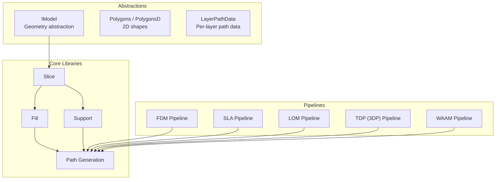
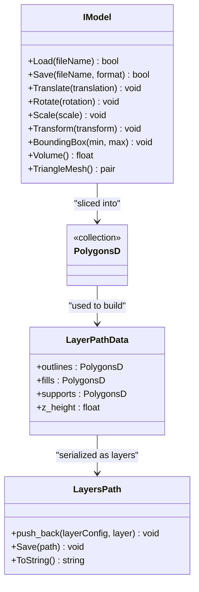
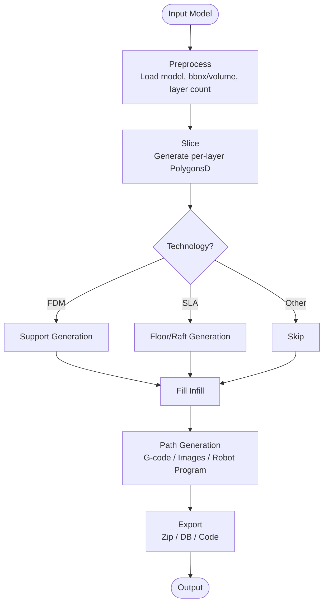
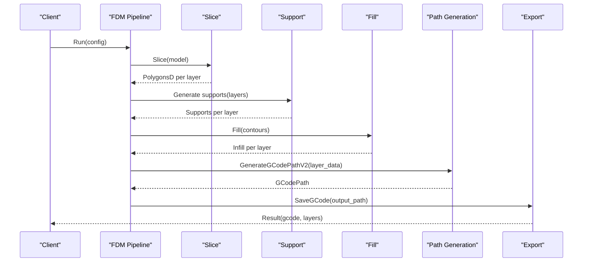
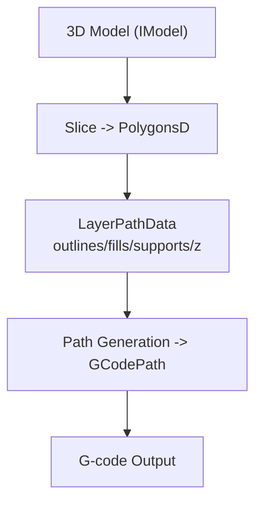
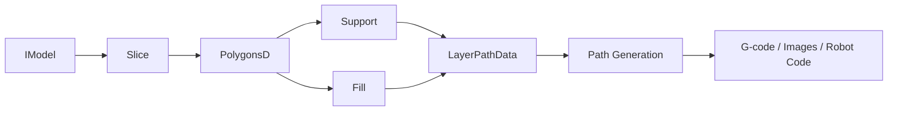
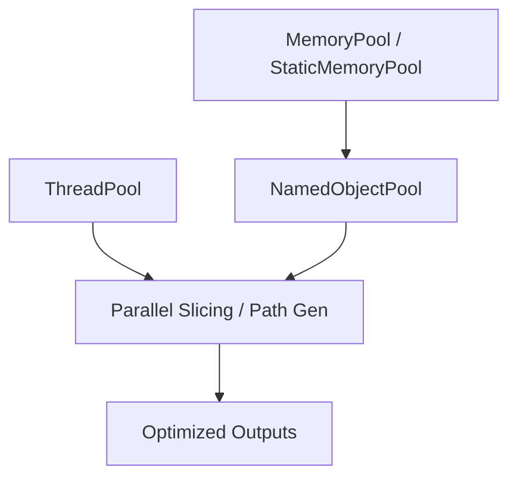

# Core Concepts

<cite>
**Referenced Files in This Document**
- [README.md](file://README.md)
- [hsba_slicer.cppm](file://ModuleHsBaSlicer/hsba_slicer.cppm)
- [fdm_pipeline.h](file://DllHsBaSlicer/fdm_pipeline.h)
- [sla_pipeline.h](file://DllHsBaSlicer/sla_pipeline.h)
- [lom_pipeline.h](file://DllHsBaSlicer/lom_pipeline.h)
- [tdp_pipeline.h](file://DllHsBaSlicer/tdp_pipeline.h)
- [waam_pipeline.h](file://DllHsBaSlicer/waam_pipeline.h)
- [IModel.hpp](file://base/IModel.hpp)
- [FloatPolygons.hpp](file://2D/FloatPolygons.hpp)
- [layerspath.hpp](file://paths/layerspath.hpp)
- [path_generator.hpp](file://LibHsBaSlicer/Path/path_generator.hpp)
- [memory_pool.hpp](file://base/memory_pool.hpp)
- [object_pool.hpp](file://base/object_pool.hpp)
- [thread_pool.hpp](file://base/thread_pool.hpp)
</cite>

## Table of Contents
1. [Introduction](#introduction)
2. [Project Structure](#project-structure)
3. [Core Components](#core-components)
4. [Architecture Overview](#architecture-overview)
5. [Detailed Component Analysis](#detailed-component-analysis)
6. [Dependency Analysis](#dependency-analysis)
7. [Performance Considerations](#performance-considerations)
8. [Troubleshooting Guide](#troubleshooting-guide)
9. [Conclusion](#conclusion)

## Introduction
This document explains the core concepts and architecture of HsBaSlicer, a high-performance, modular C++ framework for 3D-printing slicers. It covers:
- Fundamental slicing technologies: FDM, SLA, SLS, LOM, TDP (3DP), and WAAM.
- The layer-based processing model and how 3D models are converted to printer instructions.
- The pipeline architecture pattern used across the framework.
- Modular design philosophy and component relationships.
- Key data structures: Model, Polygons, LayerData, PathData.
- Memory management patterns and performance considerations at the architectural level.

HsBaSlicer provides both a C ABI via DllHsBaSlicer and a C++ module API via ModuleHsBaSlicer, enabling integration with external languages and applications.

**Section sources**
- [README.md:21-39](file://README.md#L21-L39)

## Project Structure
At a high level, the repository is organized into modules that separate concerns:
- base: foundational types, memory pools, thread pool, utilities.
- 2D: polygon math, boolean operations, text/image-to-polygons.
- meshmodel/cadmodel/pointcloud: geometry backends.
- LibHsBaSlicer: core slicing algorithms (slice, support, fill, path generation).
- paths: output path representations (G-code, layers, points, robot).
- DllHsBaSlicer: C ABI pipelines for each technology.
- ModuleHsBaSlicer: C++20 module interface wrapping LibHsBaSlicer.

**Diagram sources**
- [IModel.hpp:110-139](file://base/IModel.hpp#L110-L139)
- [FloatPolygons.hpp:18-25](file://2D/FloatPolygons.hpp#L18-L25)
- [path_generator.hpp:36-42](file://LibHsBaSlicer/Path/path_generator.hpp#L36-L42)
- [hsba_slicer.cppm:204-225](file://ModuleHsBaSlicer/hsba_slicer.cppm#L204-L225)

**Section sources**
- [README.md:29-39](file://README.md#L29-L39)

## Core Components
This section introduces the fundamental building blocks used throughout the slicing process.

- IModel: Abstract interface representing a 3D model with transformations, bounding box, volume, and triangle mesh access. Implementations include mesh/CAD/point-cloud backends.
- Polygons and PolygonsD: 2D polygon primitives and collections; double-precision variants are used for geometric operations and path generation.
- LayerPathData: Aggregates outlines, fills, supports, and Z height for a single layer; input to path generators.
- LayersPath: A path container holding per-layer polygons plus optional config strings; can be serialized natively or post-processed by Lua scripts.

**Diagram sources**
- [IModel.hpp:110-139](file://base/IModel.hpp#L110-L139)
- [FloatPolygons.hpp:18-25](file://2D/FloatPolygons.hpp#L18-L25)
- [path_generator.hpp:36-42](file://LibHsBaSlicer/Path/path_generator.hpp#L36-L42)
- [layerspath.hpp:25-60](file://paths/layerspath.hpp#L25-L60)

**Section sources**
- [IModel.hpp:110-139](file://base/IModel.hpp#L110-L139)
- [FloatPolygons.hpp:18-25](file://2D/FloatPolygons.hpp#L18-L25)
- [path_generator.hpp:36-42](file://LibHsBaSlicer/Path/path_generator.hpp#L36-L42)
- [layerspath.hpp:25-60](file://paths/layerspath.hpp#L25-L60)

## Architecture Overview
HsBaSlicer uses a pipeline architecture pattern where each technology (FDM, SLA, LOM, TDP, WAAM) is implemented as a sequence of stages:
- Preprocess: Load and validate model, compute bounding box/volume, calculate total layers.
- Slice: Convert 3D model to per-layer 2D polygons.
- Support/Floor: Generate supports (FDM/SLA) or floor/raft (SLA).
- Fill: Compute infill patterns for layer contours.
- Path Generation: Convert layer data into machine instructions (G-code, images, robot programs).
- Export: Package outputs (zip archives, database entries, robot code).

**Diagram sources**
- [fdm_pipeline.h:23-35](file://DllHsBaSlicer/fdm_pipeline.h#L23-L35)
- [sla_pipeline.h:23-34](file://DllHsBaSlicer/sla_pipeline.h#L23-L34)
- [lom_pipeline.h:23-36](file://DllHsBaSlicer/lom_pipeline.h#L23-L36)
- [tdp_pipeline.h:23-36](file://DllHsBaSlicer/tdp_pipeline.h#L23-L36)
- [waam_pipeline.h:23-37](file://DllHsBaSlicer/waam_pipeline.h#L23-L37)

**Section sources**
- [fdm_pipeline.h:23-35](file://DllHsBaSlicer/fdm_pipeline.h#L23-L35)
- [sla_pipeline.h:23-34](file://DllHsBaSlicer/sla_pipeline.h#L23-L34)
- [lom_pipeline.h:23-36](file://DllHsBaSlicer/lom_pipeline.h#L23-L36)
- [tdp_pipeline.h:23-36](file://DllHsBaSlicer/tdp_pipeline.h#L23-L36)
- [waam_pipeline.h:23-37](file://DllHsBaSlicer/waam_pipeline.h#L23-L37)

## Detailed Component Analysis

### Technology-Specific Pipelines
- FDM (Fused Deposition Modeling):
  - Stages: Preprocess -> Slice -> Support -> Fill -> Path Generation.
  - Output: G-code program for extrusion printers.
  - Configurable via HsBaFdmPipelineConfig_t; supports custom Lua scripts for support and fill.

- SLA (Stereolithography):
  - Stages: Preprocess -> Slice -> Floor -> Support -> Export (zip).
  - Output: Layer images and packaging for resin printers.
  - Supports custom Lua scripts for floor and export.

- LOM (Laminated Object Manufacturing):
  - Stages: Preprocess -> Slice -> Export (Lua script: zip + database).
  - Output: Sheet-bonding parameters and contour outlines.

- TDP (3DP Binder Jetting):
  - Stages: Preprocess -> Slice -> Export (Lua script: zip + database).
  - Output: Binder-jet outlines and head/curing parameters.

- WAAM (Wire Arc Additive Manufacturing):
  - Stages: Preprocess -> Slice -> Robot path export.
  - Output: Robot language program (ABB/KUKA/FANUC) rather than layer zip.

**Diagram sources**
- [hsba_slicer.cppm:704-750](file://ModuleHsBaSlicer/hsba_slicer.cppm#L704-L750)
- [path_generator.hpp:60-62](file://LibHsBaSlicer/Path/path_generator.hpp#L60-L62)

**Section sources**
- [fdm_pipeline.h:23-35](file://DllHsBaSlicer/fdm_pipeline.h#L23-L35)
- [sla_pipeline.h:23-34](file://DllHsBaSlicer/sla_pipeline.h#L23-L34)
- [lom_pipeline.h:23-36](file://DllHsBaSlicer/lom_pipeline.h#L23-L36)
- [tdp_pipeline.h:23-36](file://DllHsBaSlicer/tdp_pipeline.h#L23-L36)
- [waam_pipeline.h:23-37](file://DllHsBaSlicer/waam_pipeline.h#L23-L37)
- [hsba_slicer.cppm:704-750](file://ModuleHsBaSlicer/hsba_slicer.cppm#L704-L750)

### Data Flow from Input Model to Output G-code
The slicing process transforms a 3D model into printer instructions through well-defined stages:
1. Model loading and validation.
2. Per-layer polygon extraction.
3. Support and infill generation.
4. Path conversion to G-code or other formats.
5. Packaging/export.

**Diagram sources**
- [IModel.hpp:110-139](file://base/IModel.hpp#L110-L139)
- [path_generator.hpp:36-42](file://LibHsBaSlicer/Path/path_generator.hpp#L36-L42)
- [hsba_slicer.cppm:704-750](file://ModuleHsBaSlicer/hsba_slicer.cppm#L704-L750)

**Section sources**
- [IModel.hpp:110-139](file://base/IModel.hpp#L110-L139)
- [path_generator.hpp:36-42](file://LibHsBaSlicer/Path/path_generator.hpp#L36-L42)
- [hsba_slicer.cppm:704-750](file://ModuleHsBaSlicer/hsba_slicer.cppm#L704-L750)

## Dependency Analysis
Key dependencies between components:
- IModel is consumed by slice algorithms to produce PolygonsD.
- PolygonsD feed into support and fill algorithms.
- LayerPathData aggregates outputs from slice/support/fill for path generation.
- Paths (GCodePath, LayersPath) serialize final outputs.

**Diagram sources**
- [IModel.hpp:110-139](file://base/IModel.hpp#L110-L139)
- [FloatPolygons.hpp:18-25](file://2D/FloatPolygons.hpp#L18-L25)
- [path_generator.hpp:36-42](file://LibHsBaSlicer/Path/path_generator.hpp#L36-L42)

**Section sources**
- [IModel.hpp:110-139](file://base/IModel.hpp#L110-L139)
- [FloatPolygons.hpp:18-25](file://2D/FloatPolygons.hpp#L18-L25)
- [path_generator.hpp:36-42](file://LibHsBaSlicer/Path/path_generator.hpp#L36-L42)

## Performance Considerations
- Memory Management:
  - MemoryPool and StaticMemoryPool provide fixed-size allocators to reduce heap fragmentation and improve allocation speed.
  - NamedObjectPool manages shared objects with reference counting and cleanup of inactive entries.
- Concurrency:
  - ThreadPool enables concurrent task execution, improving throughput for parallelizable stages like slicing or path optimization.
- Data Structures:
  - Double-precision PolygonsD ensures accuracy in geometric operations.
  - LayerPathData minimizes data duplication by aggregating per-layer information.

**Diagram sources**
- [memory_pool.hpp:43-208](file://base/memory_pool.hpp#L43-L208)
- [object_pool.hpp:22-92](file://base/object_pool.hpp#L22-L92)
- [thread_pool.hpp:29-90](file://base/thread_pool.hpp#L29-L90)

**Section sources**
- [memory_pool.hpp:43-208](file://base/memory_pool.hpp#L43-L208)
- [object_pool.hpp:22-92](file://base/object_pool.hpp#L22-L92)
- [thread_pool.hpp:29-90](file://base/thread_pool.hpp#L29-L90)

## Troubleshooting Guide
Common issues and resolutions:
- Model Loading Failures:
  - Ensure file path and format are supported by IModel implementations.
  - Check bounding box and volume calculations for validity.
- Invalid Layer Count:
  - Verify layer height and first layer height settings.
  - Confirm model height is positive and consistent with configuration.
- Path Generation Errors:
  - Validate LayerPathData structure (non-empty outlines/fills/supports).
  - Check printer configuration parameters (nozzle diameter, line width, speeds).

**Section sources**
- [hsba_slicer.cppm:704-750](file://ModuleHsBaSlicer/hsba_slicer.cppm#L704-L750)
- [path_generator.hpp:60-62](file://LibHsBaSlicer/Path/path_generator.hpp#L60-L62)

## Conclusion
HsBaSlicer’s architecture centers on a modular, pipeline-driven approach that transforms 3D models into printer-specific instructions. By leveraging robust abstractions (IModel, PolygonsD, LayerPathData) and efficient memory/concurrency primitives, it supports a wide range of additive manufacturing technologies while maintaining performance and extensibility.