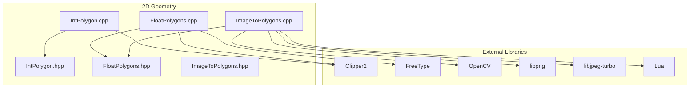
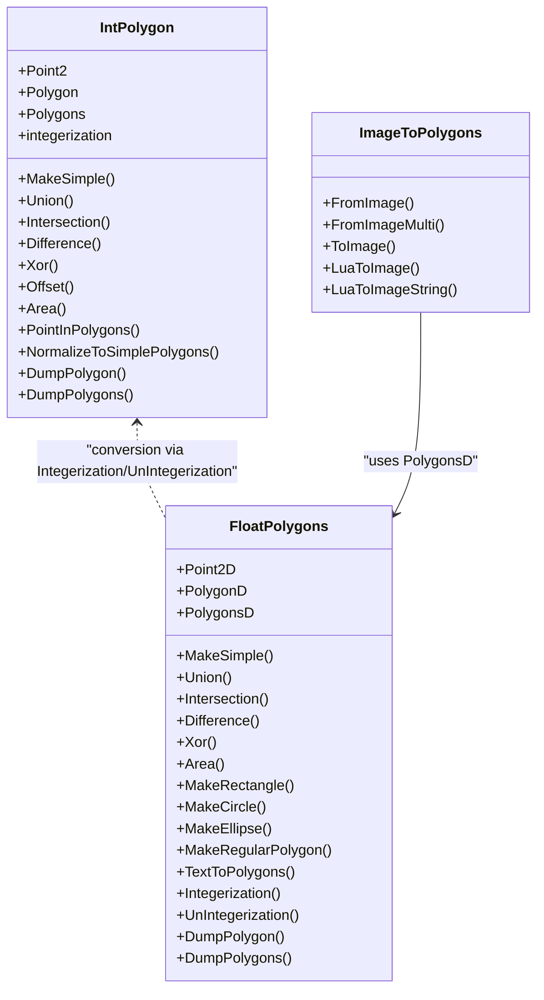
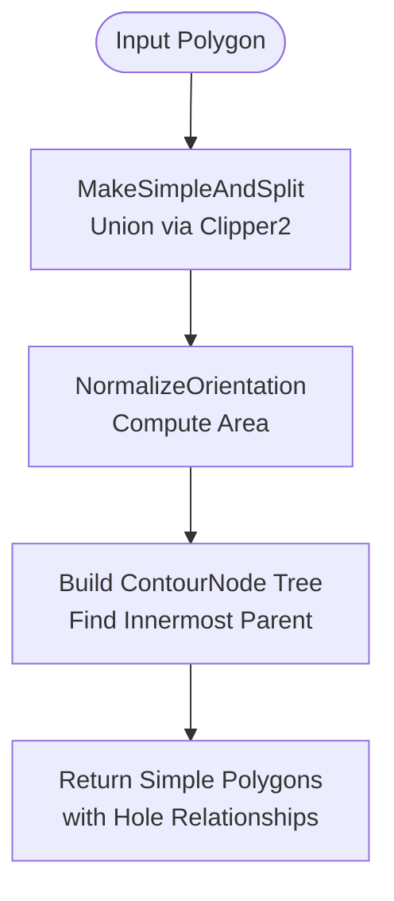
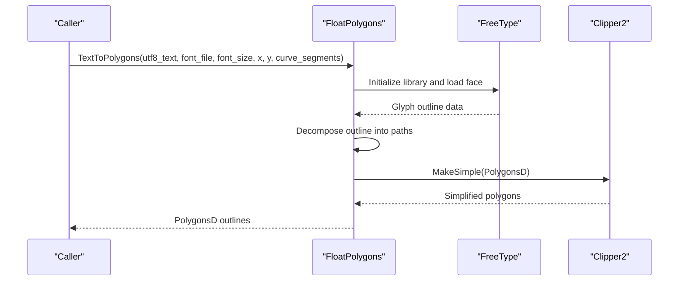
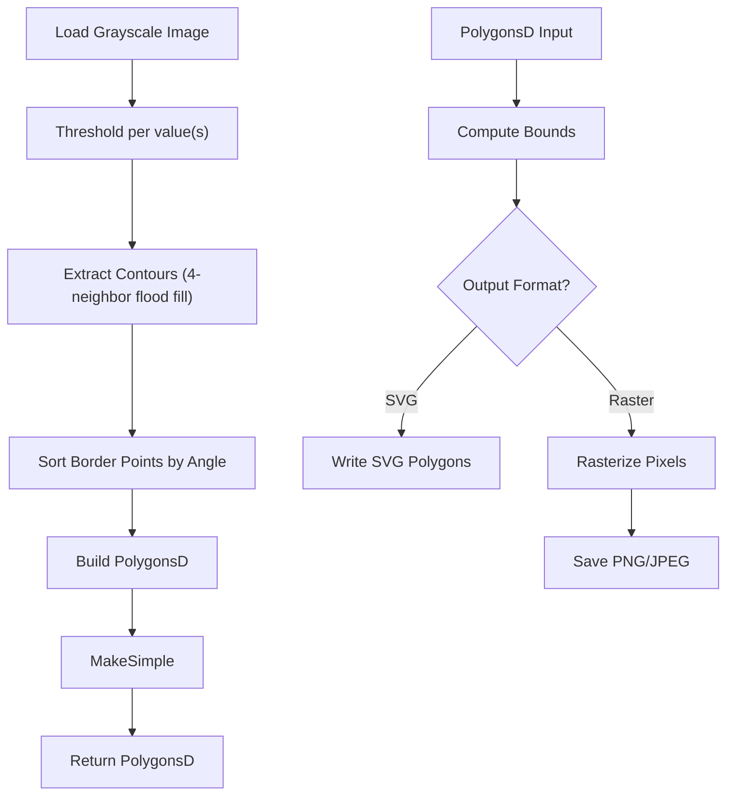
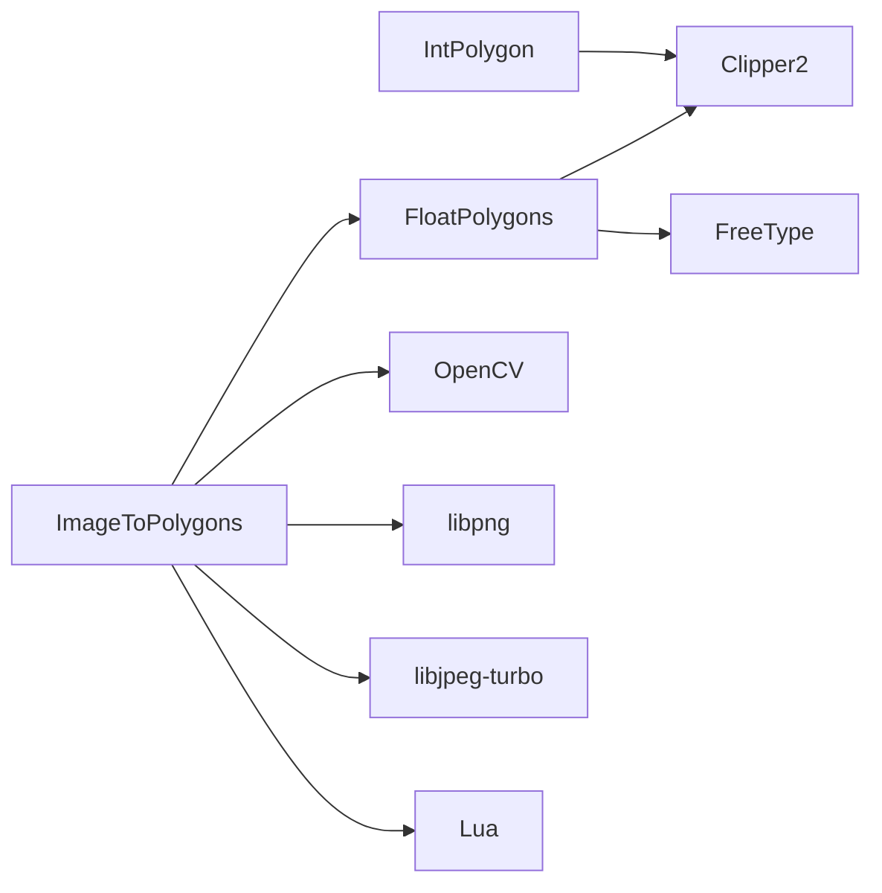

# 2D Geometry Models

<cite>
**Referenced Files in This Document**   
- [IntPolygon.hpp](file://2D/IntPolygon.hpp)
- [IntPolygon.cpp](file://2D/IntPolygon.cpp)
- [FloatPolygons.hpp](file://2D/FloatPolygons.hpp)
- [FloatPolygons.cpp](file://2D/FloatPolygons.cpp)
- [ImageToPolygons.hpp](file://2D/ImageToPolygons.hpp)
- [ImageToPolygons.cpp](file://2D/ImageToPolygons.cpp)
- [lua_pipeline_api.md](file://docs/en/lua_pipeline_api.md)
</cite>

## Table of Contents
1. [Introduction](#introduction)
2. [Project Structure](#project-structure)
3. [Core Components](#core-components)
4. [Architecture Overview](#architecture-overview)
5. [Detailed Component Analysis](#detailed-component-analysis)
6. [Dependency Analysis](#dependency-analysis)
7. [Performance Considerations](#performance-considerations)
8. [Troubleshooting Guide](#troubleshooting-guide)
9. [Conclusion](#conclusion)

## Introduction
This document explains the 2D geometry models used by HsBaSlicer for representing and manipulating planar contours. It focuses on:
- The integer-coordinate model based on `Clipper2Lib::Path64` and related types.
- The double-precision model based on `Clipper2Lib::PathD` and related types.
- Geometric operations such as union, intersection, difference, XOR, offset, area, point-in-polygon, simplification, and normalization.
- Integration with Clipper2 for robust boolean and offset operations.
- Performance considerations when working with large polygons and memory management strategies.

The goal is to make these concepts accessible while preserving precise technical details for implementation and extension.

## Project Structure
The 2D geometry functionality lives under the `2D/` directory:
- `IntPolygon.*`: Integer-coordinate polygon types, boolean operations, offset, area, point-in-polygon, simplification, normalization, hashing, and optional SVG dump helpers.
- `FloatPolygons.*`: Double-precision polygon types, boolean operations, area, shape generators (rectangle, circle, ellipse, regular polygon), text-to-polygons via FreeType, integerization conversion, hashing, and optional SVG dump helpers.
- `ImageToPolygons.*`: Raster image to polygon conversion, polygon rasterization to images, and Lua-driven image generation.

**Diagram sources**
- [IntPolygon.hpp:9-10](file://2D/IntPolygon.hpp#L9-L10)
- [IntPolygon.cpp:15](file://2D/IntPolygon.cpp#L15)
- [FloatPolygons.hpp:9-12](file://2D/FloatPolygons.hpp#L9-L12)
- [FloatPolygons.cpp:17-21](file://2D/FloatPolygons.cpp#L17-L21)
- [ImageToPolygons.cpp:16-26](file://2D/ImageToPolygons.cpp#L16-L26)

**Section sources**
- [IntPolygon.hpp:1-241](file://2D/IntPolygon.hpp#L1-L241)
- [FloatPolygons.hpp:1-271](file://2D/FloatPolygons.hpp#L1-L271)
- [ImageToPolygons.hpp:1-83](file://2D/ImageToPolygons.hpp#L1-L83)

## Core Components
This section summarizes the two primary polygon models and their responsibilities.

### Integer-coordinate Polygon Model (`IntPolygon`)
- Types:
  - `Point2` = `Clipper2Lib::Point64`
  - `Polygon` = `Clipper2Lib::Path64`
  - `Polygons` = `Clipper2Lib::Paths64`
- Scaling:
  - `integerization = 1e6` converts between floating-point and integer coordinates.
- Operations:
  - Simplify: `MakeSimple`, `MakeSimpleAndSplit`, `NormalizeToSimplePolygons`.
  - Boolean: `Union`, `Intersection`, `Difference`, `Xor` for both single polygons and sets.
  - Offset: `Offset` for single polygon or set of polygons.
  - Area: `Area` for single polygon or set.
  - Point-in-polygon: `PointInPolygons` supporting even-odd and non-zero winding rules.
  - Hashing: `std::hash` specializations for `Polygon` and `Polygons`.
  - Debugging: Optional SVG dump functions guarded by `HSBA_POLYGON_DUMP`.

**Section sources**
- [IntPolygon.hpp:16-26](file://2D/IntPolygon.hpp#L16-L26)
- [IntPolygon.hpp:28-210](file://2D/IntPolygon.hpp#L28-L210)
- [IntPolygon.cpp:19-130](file://2D/IntPolygon.cpp#L19-L130)
- [IntPolygon.cpp:419-439](file://2D/IntPolygon.cpp#L419-L439)

### Double-precision Polygon Model (`FloatPolygons`)
- Types:
  - `Point2D` = `Clipper2Lib::PointD`
  - `PolygonD` = `Clipper2Lib::PathD`
  - `PolygonsD` = `Clipper2Lib::PathsD`
- Operations:
  - Simplify: `MakeSimple`.
  - Boolean: `Union`, `Intersection`, `Difference`, `Xor` for both single polygons and sets.
  - Area: `Area` for single polygon or set.
  - Shape generators: `MakeRectangle`, `MakeCircle`, `MakeEllipse`, `MakeRegularPolygon`.
  - Text-to-polygons: `TextToPolygons` using FreeType when available.
  - Conversion: `Integerization` and `UnIntegerization` between `PolygonD`/`PolygonsD` and `Polygon`/`Polygons`.
  - Hashing: `std::hash` specializations for `PolygonD` and `PolygonsD`.
  - Debugging: Optional SVG dump functions guarded by `HSBA_POLYGON_DUMP`.

**Section sources**
- [FloatPolygons.hpp:18-25](file://2D/FloatPolygons.hpp#L18-L25)
- [FloatPolygons.hpp:27-239](file://2D/FloatPolygons.hpp#L27-L239)
- [FloatPolygons.cpp:25-75](file://2D/FloatPolygons.cpp#L25-L75)
- [FloatPolygons.cpp:176-213](file://2D/FloatPolygons.cpp#L176-L213)
- [FloatPolygons.cpp:314-344](file://2D/FloatPolygons.cpp#L314-L344)
- [FloatPolygons.cpp:346-407](file://2D/FloatPolygons.cpp#L346-L407)
- [FloatPolygons.cpp:411-431](file://2D/FloatPolygons.cpp#L411-L431)

## Architecture Overview
The 2D geometry layer provides a clean abstraction over Clipper2 for boolean and offset operations, while offering higher-level utilities for simplification, normalization, and visualization. The double-precision layer adds shape construction and text rendering, plus conversion utilities to the integer layer.

**Diagram sources**
- [IntPolygon.hpp:16-210](file://2D/IntPolygon.hpp#L16-L210)
- [FloatPolygons.hpp:18-239](file://2D/FloatPolygons.hpp#L18-L239)
- [ImageToPolygons.hpp:22-79](file://2D/ImageToPolygons.hpp#L22-L79)

## Detailed Component Analysis

### Integer-coordinate Polygon Model
The integer model wraps Clipper2’s 64-bit integer types to provide numerically stable boolean and offset operations. Key behaviors:
- Simplification removes collinear points and can split self-intersecting polygons into simple components.
- Boolean operations support both single polygons and sets of polygons.
- Offset supports configurable join and end types.
- Point-in-polygon respects even-odd and non-zero winding rules; it normalizes winding for non-even-odd cases before testing.
- Normalization reconstructs proper outer/hole relationships from simplified components.

**Diagram sources**
- [IntPolygon.cpp:265-278](file://2D/IntPolygon.cpp#L265-L278)
- [IntPolygon.cpp:315-327](file://2D/IntPolygon.cpp#L315-L327)
- [IntPolygon.cpp:329-404](file://2D/IntPolygon.cpp#L329-L404)

**Section sources**
- [IntPolygon.cpp:19-77](file://2D/IntPolygon.cpp#L19-L77)
- [IntPolygon.cpp:79-130](file://2D/IntPolygon.cpp#L79-L130)
- [IntPolygon.cpp:265-416](file://2D/IntPolygon.cpp#L265-L416)

### Double-precision Polygon Model
The double model exposes high-precision geometry operations and utilities:
- Boolean operations are thin wrappers around Clipper2’s double-precision API.
- Area computation uses Clipper2’s area functions.
- Shape generators create rectangles, circles, ellipses, and regular polygons.
- Text-to-polygons uses FreeType to convert UTF-8 text into vector outlines.
- Conversion functions map between double and integer coordinate spaces using `integerization`.

**Diagram sources**
- [FloatPolygons.cpp:346-407](file://2D/FloatPolygons.cpp#L346-L407)
- [FloatPolygons.cpp:25-32](file://2D/FloatPolygons.cpp#L25-L32)

**Section sources**
- [FloatPolygons.cpp:25-75](file://2D/FloatPolygons.cpp#L25-L75)
- [FloatPolygons.cpp:176-213](file://2D/FloatPolygons.cpp#L176-L213)
- [FloatPolygons.cpp:314-344](file://2D/FloatPolygons.cpp#L314-L344)
- [FloatPolygons.cpp:346-407](file://2D/FloatPolygons.cpp#L346-L407)

### Image-to-Polygon and Polygon-to-Image Pipeline
The image pipeline bridges raster images and vector polygons:
- `FromImage` and `FromImageMulti` threshold grayscale images and extract contours.
- `ToImage` rasterizes polygons to images or writes SVG files.
- Lua integration allows custom image generation scripts that receive polygon data and return grayscale images.

**Diagram sources**
- [ImageToPolygons.cpp:87-174](file://2D/ImageToPolygons.cpp#L87-L174)
- [ImageToPolygons.cpp:290-393](file://2D/ImageToPolygons.cpp#L290-L393)

**Section sources**
- [ImageToPolygons.hpp:22-79](file://2D/ImageToPolygons.hpp#L22-L79)
- [ImageToPolygons.cpp:87-174](file://2D/ImageToPolygons.cpp#L87-L174)
- [ImageToPolygons.cpp:290-393](file://2D/ImageToPolygons.cpp#L290-L393)
- [ImageToPolygons.cpp:417-546](file://2D/ImageToPolygons.cpp#L417-L546)

## Dependency Analysis
The 2D geometry modules depend on external libraries for core geometric operations and optional features:
- Clipper2: Boolean operations, offset, area, simplification.
- FreeType: Text-to-polygons (optional).
- OpenCV: Image IO and rasterization (optional).
- libpng/libjpeg-turbo: Image saving (fallback if OpenCV not available).
- Lua: Scripted image generation.

**Diagram sources**
- [IntPolygon.cpp:15](file://2D/IntPolygon.cpp#L15)
- [FloatPolygons.cpp:17-21](file://2D/FloatPolygons.cpp#L17-L21)
- [ImageToPolygons.cpp:16-26](file://2D/ImageToPolygons.cpp#L16-L26)

**Section sources**
- [IntPolygon.cpp:1-16](file://2D/IntPolygon.cpp#L1-L16)
- [FloatPolygons.cpp:1-21](file://2D/FloatPolygons.cpp#L1-L21)
- [ImageToPolygons.cpp:1-26](file://2D/ImageToPolygons.cpp#L1-L26)

## Performance Considerations
When working with large polygons:
- Prefer integer coordinates for boolean and offset operations to avoid floating-point precision issues and improve stability. Use `Integerization` to convert from double to integer before heavy operations, then `UnIntegerization` to get results back in double space if needed.
- Simplify polygons aggressively using `MakeSimple` to reduce vertex count before boolean operations.
- Avoid unnecessary conversions between `PolygonsD` and `Polygons`; batch operations where possible.
- For image-based workflows, use multi-threshold extraction only when necessary; each threshold creates a separate binary image and contour extraction pass.
- When rasterizing polygons to images, prefer OpenCV path if available for faster fill operations; otherwise, manual rasterization is slower but functional.
- Memory usage grows with the number of vertices and intermediate structures (e.g., flood-fill queues, border lists). Reuse buffers and clear temporary containers promptly.
- SVG dumps are useful for debugging but should be disabled in production builds unless explicitly enabled via `HSBA_POLYGON_DUMP`.

[No sources needed since this section provides general guidance]

## Troubleshooting Guide
Common issues and resolutions:
- Text-to-polygons fails without FreeType: Ensure `HSBA_HAVE_FREETYPE` is defined and FreeType is linked. Otherwise, `TextToPolygons` throws an error indicating missing support.
- Image loading fails: If OpenCV is unavailable, `LoadImageGray` returns false; ensure OpenCV is configured or handle fallback behavior.
- Lua script errors: Verify function names exist and return expected tables; check error messages thrown during script loading and execution.
- Boolean operation instability: Use integer coordinates via `Integerization` and simplify inputs with `MakeSimple` before operations.
- Point-in-polygon unexpected results: Confirm winding order and fill rule; `PointInPolygons` handles even-odd and non-zero winding, but holes must have correct orientation.

**Section sources**
- [FloatPolygons.cpp:346-352](file://2D/FloatPolygons.cpp#L346-L352)
- [ImageToPolygons.cpp:34-64](file://2D/ImageToPolygons.cpp#L34-L64)
- [ImageToPolygons.cpp:417-546](file://2D/ImageToPolygons.cpp#L417-L546)
- [IntPolygon.cpp:79-121](file://2D/IntPolygon.cpp#L79-L121)

## Conclusion
HsBaSlicer’s 2D geometry models provide robust, efficient tools for planar contour manipulation:
- The integer model ensures numerical stability for boolean and offset operations through Clipper2.
- The double model offers high-precision geometry, shape construction, and text rendering.
- The image pipeline integrates raster and vector domains, supporting flexible workflows.
By following best practices for simplification, coordinate scaling, and library selection, developers can achieve reliable performance and accuracy across a wide range of slicing and path-generation tasks.

[No sources needed since this section summarizes without analyzing specific files]