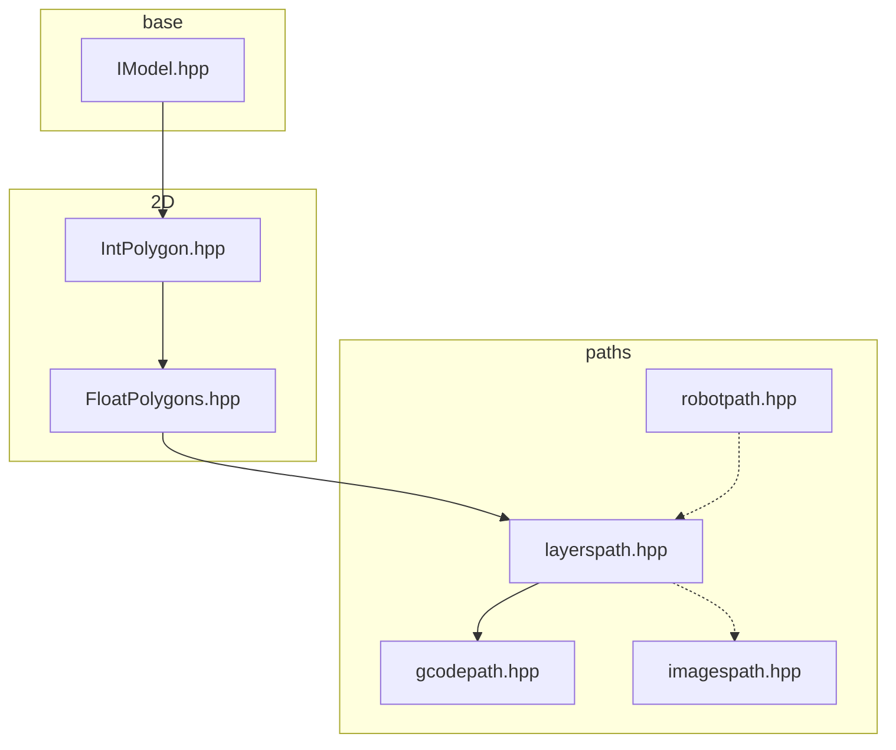
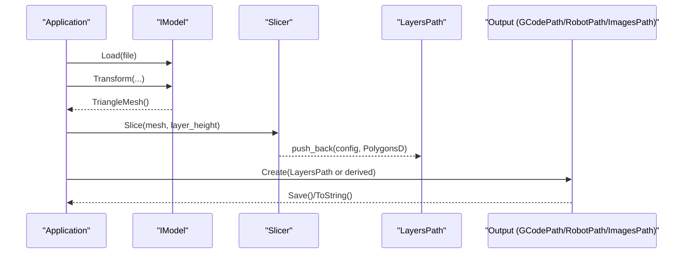
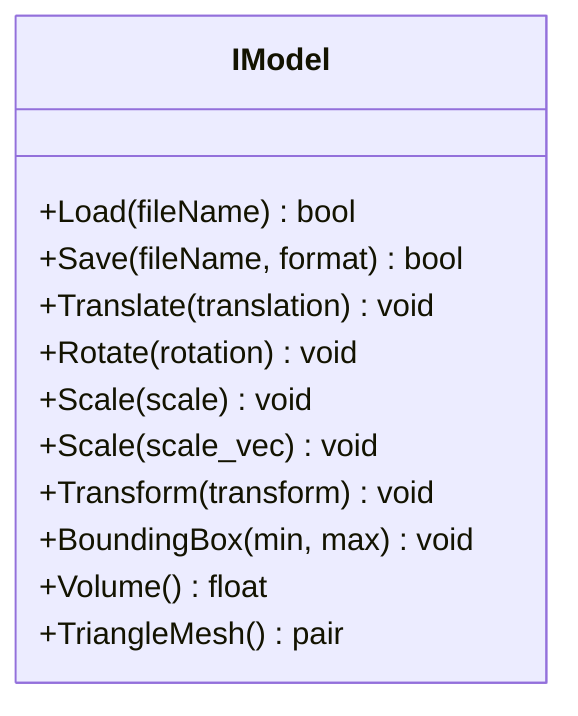
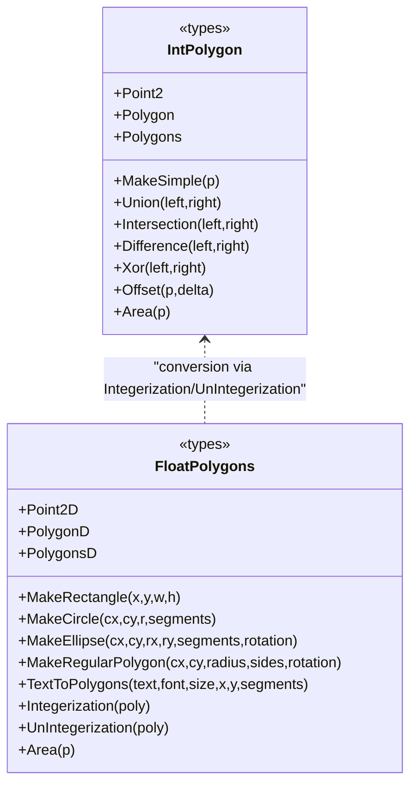
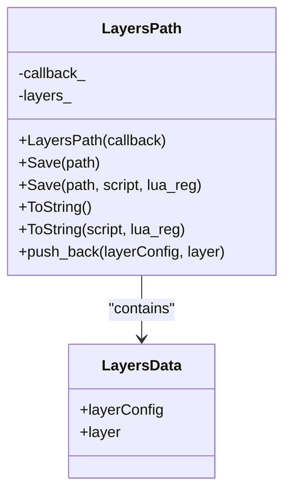
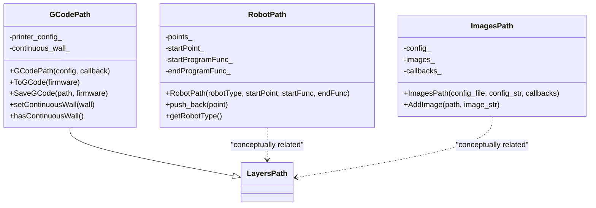
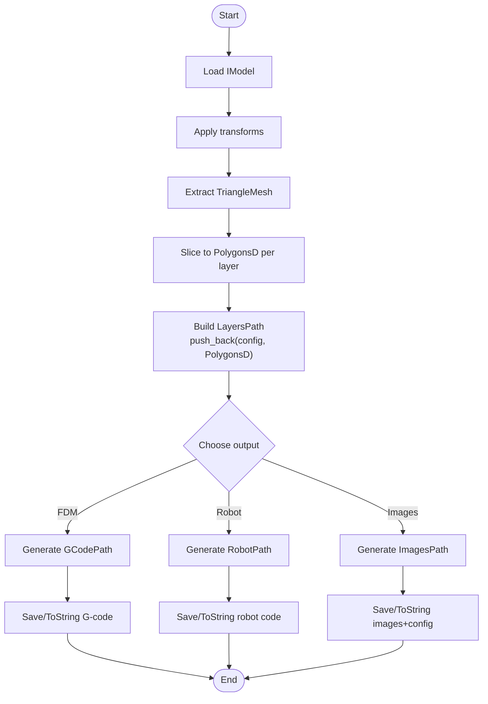
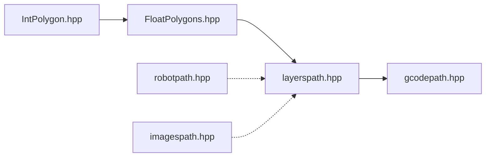

# Key Data Models

<cite>
**Referenced Files in This Document**
- [IModel.hpp](file://base/IModel.hpp)
- [IntPolygon.hpp](file://2D/IntPolygon.hpp)
- [FloatPolygons.hpp](file://2D/FloatPolygons.hpp)
- [layerspath.hpp](file://paths/layerspath.hpp)
- [gcodepath.hpp](file://paths/gcodepath.hpp)
- [robotpath.hpp](file://paths/robotpath.hpp)
- [imagespath.hpp](file://paths/imagespath.hpp)
</cite>

## Table of Contents
1. [Introduction](#introduction)
2. [Project Structure](#project-structure)
3. [Core Components](#core-components)
4. [Architecture Overview](#architecture-overview)
5. [Detailed Component Analysis](#detailed-component-analysis)
6. [Dependency Analysis](#dependency-analysis)
7. [Performance Considerations](#performance-considerations)
8. [Troubleshooting Guide](#troubleshooting-guide)
9. [Conclusion](#conclusion)

## Introduction
This document explains the key data models used throughout HsBaSlicer, focusing on:
- The 3D model abstraction and its role in the pipeline
- 2D polygon representations for contours (integer and double precision)
- Layered data structures that carry per-layer geometry and configuration
- Path output models for G-code, industrial robot programs, and image sequences
It also describes how these models transform through the processing pipeline and provides practical examples for creating, manipulating, and converting between them.

## Project Structure
The relevant data models are organized into three main areas:
- base: 3D model interface and format enumeration
- 2D: 2D polygon types and geometric operations
- paths: path output models for different targets (G-code, robots, images)

**Diagram sources**
- [IModel.hpp:110-139](file://base/IModel.hpp#L110-L139)
- [IntPolygon.hpp:14-27](file://2D/IntPolygon.hpp#L14-L27)
- [FloatPolygons.hpp:16-25](file://2D/FloatPolygons.hpp#L16-L25)
- [layerspath.hpp:25-60](file://paths/layerspath.hpp#L25-L60)
- [gcodepath.hpp:66-107](file://paths/gcodepath.hpp#L66-L107)
- [robotpath.hpp:61-104](file://paths/robotpath.hpp#L61-L104)
- [imagespath.hpp:23-60](file://paths/imagespath.hpp#L23-L60)

**Section sources**
- [IModel.hpp:110-139](file://base/IModel.hpp#L110-L139)
- [IntPolygon.hpp:14-27](file://2D/IntPolygon.hpp#L14-L27)
- [FloatPolygons.hpp:16-25](file://2D/FloatPolygons.hpp#L16-L25)
- [layerspath.hpp:25-60](file://paths/layerspath.hpp#L25-L60)
- [gcodepath.hpp:66-107](file://paths/gcodepath.hpp#L66-L107)
- [robotpath.hpp:61-104](file://paths/robotpath.hpp#L61-L104)
- [imagespath.hpp:23-60](file://paths/imagespath.hpp#L23-L60)

## Core Components
- 3D Model Abstraction: IModel defines a uniform interface for loading/saving, transforming, querying bounding boxes/volume, and extracting triangle meshes. It is the entry point for CAD/mesh models entering the slicing pipeline.
- 2D Contour Models:
  - Integer-based polygons (Point2, Polygon, Polygons) provide robust boolean/offset/area operations via Clipper2.
  - Double-precision polygons (Point2D, PolygonD, PolygonsD) offer high-accuracy geometry and shape generators, plus conversion to/from integer coordinates.
- Layered Output Model: LayersPath stores an ordered sequence of layers, each pairing a free-form configuration string with a set of double-precision polygons. It supports native or Lua-post-processed serialization.
- Path Output Models:
  - GCodePath extends LayersPath to generate multi-firmware G-code and optionally continuous spiral walls.
  - RobotPath produces brand-specific robot program code from a sequence of motion points.
  - ImagesPath packages a config file and named image payloads for image-oriented outputs.

**Section sources**
- [IModel.hpp:110-139](file://base/IModel.hpp#L110-L139)
- [IntPolygon.hpp:14-27](file://2D/IntPolygon.hpp#L14-L27)
- [FloatPolygons.hpp:16-25](file://2D/FloatPolygons.hpp#L16-L25)
- [layerspath.hpp:25-60](file://paths/layerspath.hpp#L25-L60)
- [gcodepath.hpp:66-107](file://paths/gcodepath.hpp#L66-L107)
- [robotpath.hpp:61-104](file://paths/robotpath.hpp#L61-L104)
- [imagespath.hpp:23-60](file://paths/imagespath.hpp#L23-L60)

## Architecture Overview
The data flow typically proceeds as follows:
- A 3D model (IModel) is loaded and transformed.
- Slicing produces 2D contours represented as PolygonsD.
- Contours are grouped into LayersPath, where each layer carries configuration and polygons.
- LayersPath is converted to target outputs:
  - GCodePath for FDM printers
  - RobotPath for industrial robots
  - ImagesPath for image-based processes

[No sources needed since this diagram shows conceptual workflow, not actual code structure]

## Detailed Component Analysis

### 3D Model Base: IModel
IModel defines the contract for all 3D model implementations:
- Loading and saving across multiple formats (PLY, STL, OBJ, STEP, IGES, BREP, XYZ, VDB)
- Geometric transformations (translate, rotate, scale, transform)
- Querying bounding box and volume
- Extracting triangle mesh data for downstream processing

**Diagram sources**
- [IModel.hpp:110-139](file://base/IModel.hpp#L110-L139)

**Section sources**
- [IModel.hpp:65-109](file://base/IModel.hpp#L65-L109)
- [IModel.hpp:110-139](file://base/IModel.hpp#L110-L139)

### 2D Contour Models: IntPolygon and FloatPolygons
Two parallel polygon hierarchies support different needs:
- Integer-based (Clipper2 Paths64):
  - Point2, Polygon, Polygons
  - Boolean ops: Union, Intersection, Difference, Xor
  - Offset (inflate/deflate), simplification, area calculation
  - Hash specializations for use in associative containers
- Double-precision (Clipper2 PathsD):
  - Point2D, PolygonD, PolygonsD
  - Boolean ops, area calculation
  - Shape generators: rectangle, circle, ellipse, regular polygon
  - Text-to-polygons
  - Conversion utilities: Integerization/UnIntegerization

**Diagram sources**
- [IntPolygon.hpp:14-27](file://2D/IntPolygon.hpp#L14-L27)
- [IntPolygon.hpp:28-192](file://2D/IntPolygon.hpp#L28-L192)
- [FloatPolygons.hpp:16-25](file://2D/FloatPolygons.hpp#L16-L25)
- [FloatPolygons.hpp:137-221](file://2D/FloatPolygons.hpp#L137-L221)

**Section sources**
- [IntPolygon.hpp:14-27](file://2D/IntPolygon.hpp#L14-L27)
- [IntPolygon.hpp:28-192](file://2D/IntPolygon.hpp#L28-L192)
- [FloatPolygons.hpp:16-25](file://2D/FloatPolygons.hpp#L16-L25)
- [FloatPolygons.hpp:137-221](file://2D/FloatPolygons.hpp#L137-L221)

### Layered Data: LayersPath
LayersPath encapsulates per-layer information:
- Ordered list of layers, each containing:
  - layerConfig: free-form configuration string
  - layer: PolygonsD representing outlines/fills/supports for that layer
- Serialization:
  - Native save and string conversion
  - Optional Lua post-processing script and registration callback
- Progress/status callbacks during output

**Diagram sources**
- [layerspath.hpp:25-60](file://paths/layerspath.hpp#L25-L60)

**Section sources**
- [layerspath.hpp:25-60](file://paths/layerspath.hpp#L25-L60)

### Path Outputs: GCodePath, RobotPath, ImagesPath
- GCodePath (extends LayersPath):
  - Generates G-code for Marlin, RepRap, Klipper
  - Supports continuous spiral wall (helical deposition)
  - Printer configuration includes nozzle, filament, speeds, temperatures, retraction, extrusion mode
- RobotPath:
  - Produces brand-specific robot code (ABB, KUKA, FANUC)
  - Accumulates RLPoint moves with positions, velocities, and command kinds
- ImagesPath:
  - Packages a config file and named image payloads
  - Supports native and Lua-assisted serialization

**Diagram sources**
- [gcodepath.hpp:66-107](file://paths/gcodepath.hpp#L66-L107)
- [robotpath.hpp:61-104](file://paths/robotpath.hpp#L61-L104)
- [imagespath.hpp:23-60](file://paths/imagespath.hpp#L23-L60)
- [layerspath.hpp:25-60](file://paths/layerspath.hpp#L25-L60)

**Section sources**
- [gcodepath.hpp:24-49](file://paths/gcodepath.hpp#L24-L49)
- [gcodepath.hpp:51-60](file://paths/gcodepath.hpp#L51-L60)
- [gcodepath.hpp:66-107](file://paths/gcodepath.hpp#L66-L107)
- [robotpath.hpp:15-52](file://paths/robotpath.hpp#L15-L52)
- [robotpath.hpp:61-104](file://paths/robotpath.hpp#L61-L104)
- [imagespath.hpp:23-60](file://paths/imagespath.hpp#L23-L60)

### Processing Pipeline Flow
The transformation from 3D model to layered 2D contours and then to target outputs can be visualized as:

[No sources needed since this diagram shows conceptual workflow, not actual code structure]

## Dependency Analysis
Key dependencies among data models:
- LayersPath depends on PolygonsD for per-layer geometry
- GCodePath inherits from LayersPath and adds printer configuration and spiral wall support
- RobotPath and ImagesPath are independent IPath implementations conceptually aligned with LayersPath’s layer-centric approach
- FloatPolygons depends on IntPolygon for coordinate conversion utilities

**Diagram sources**
- [IntPolygon.hpp:14-27](file://2D/IntPolygon.hpp#L14-L27)
- [FloatPolygons.hpp:16-25](file://2D/FloatPolygons.hpp#L16-L25)
- [layerspath.hpp:25-60](file://paths/layerspath.hpp#L25-L60)
- [gcodepath.hpp:66-107](file://paths/gcodepath.hpp#L66-L107)
- [robotpath.hpp:61-104](file://paths/robotpath.hpp#L61-L104)
- [imagespath.hpp:23-60](file://paths/imagespath.hpp#L23-L60)

**Section sources**
- [IntPolygon.hpp:14-27](file://2D/IntPolygon.hpp#L14-L27)
- [FloatPolygons.hpp:16-25](file://2D/FloatPolygons.hpp#L16-L25)
- [layerspath.hpp:25-60](file://paths/layerspath.hpp#L25-L60)
- [gcodepath.hpp:66-107](file://paths/gcodepath.hpp#L66-L107)
- [robotpath.hpp:61-104](file://paths/robotpath.hpp#L61-L104)
- [imagespath.hpp:23-60](file://paths/imagespath.hpp#L23-L60)

## Performance Considerations
- Prefer integer-based polygons for robust boolean operations; convert to double only when necessary for precision-sensitive steps.
- Use simplification functions to reduce vertex count before expensive operations like offset or union.
- Batch layer construction by pushing multiple layers at once to minimize overhead.
- For G-code generation, precompute extrusion parameters and reuse them across layers to avoid repeated calculations.
- When generating robot code, group moves by type (MoveJ/MoveL/MoveC) to reduce branching during emission.

[No sources needed since this section provides general guidance]

## Troubleshooting Guide
Common issues and resolutions:
- Unexpected polygon orientation or self-intersections:
  - Apply MakeSimple and NormalizeToSimplePolygons to ensure valid input for boolean operations.
- Precision loss during conversions:
  - Use UnIntegerization carefully; validate results with Area checks.
- Missing or incorrect layer configuration:
  - Ensure layerConfig strings are consistent and parsable by downstream scripts.
- G-code anomalies:
  - Verify printer configuration values (nozzle diameter, line width, layer height) match physical settings.
  - Check continuous wall data for monotonic Z progression if using vase/spiral mode.
- Robot code errors:
  - Validate RLPoint velocity and move types against target robot constraints.
- Image payload mismatches:
  - Confirm image names and paths align with the config file expectations.

**Section sources**
- [IntPolygon.hpp:28-192](file://2D/IntPolygon.hpp#L28-L192)
- [FloatPolygons.hpp:137-221](file://2D/FloatPolygons.hpp#L137-L221)
- [gcodepath.hpp:32-49](file://paths/gcodepath.hpp#L32-L49)
- [gcodepath.hpp:87-96](file://paths/gcodepath.hpp#L87-L96)
- [robotpath.hpp:44-52](file://paths/robotpath.hpp#L44-L52)
- [imagespath.hpp:49-60](file://paths/imagespath.hpp#L49-L60)

## Conclusion
HsBaSlicer’s data model stack cleanly separates concerns:
- IModel abstracts 3D geometry and transformations
- 2D polygon types provide robust geometric operations and shape generation
- LayersPath organizes per-layer geometry and configuration
- Path outputs translate layered data into target formats (G-code, robot programs, images)
By leveraging these models and their conversion utilities, users can build flexible, efficient pipelines tailored to various manufacturing technologies.

[No sources needed since this section summarizes without analyzing specific files]