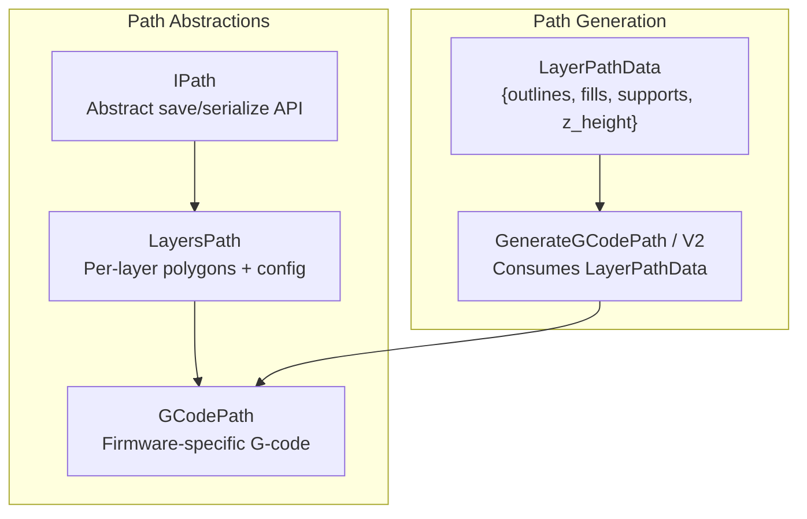
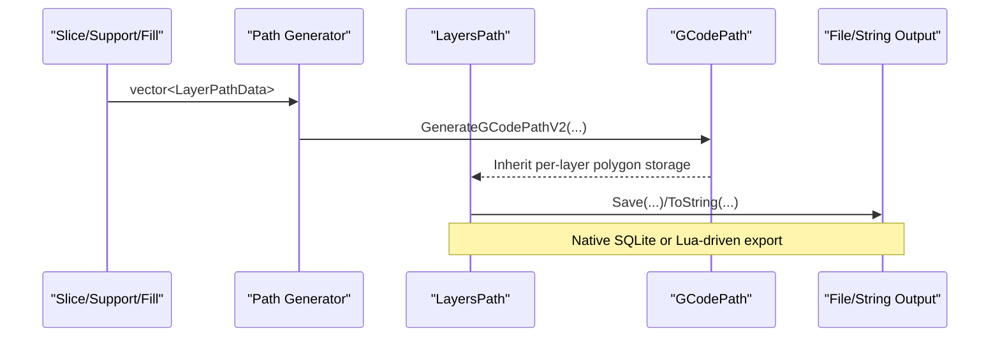
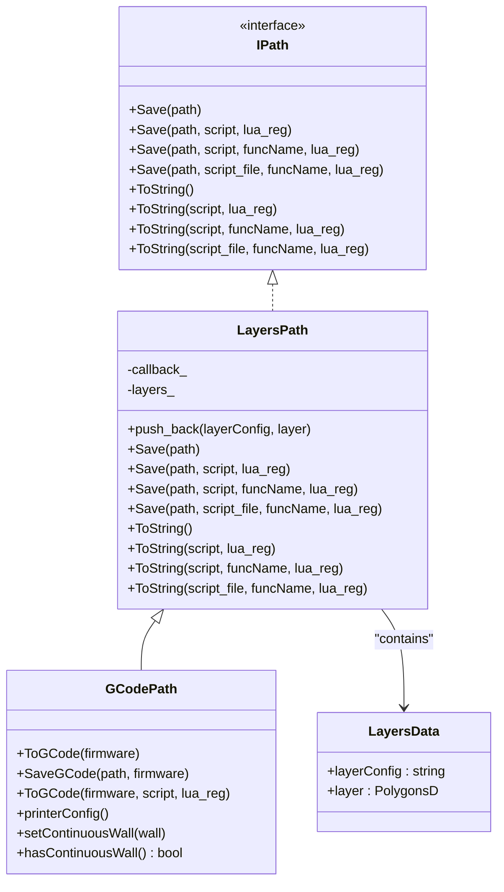
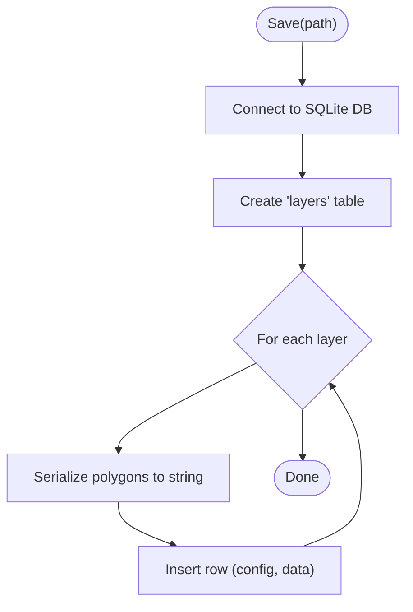
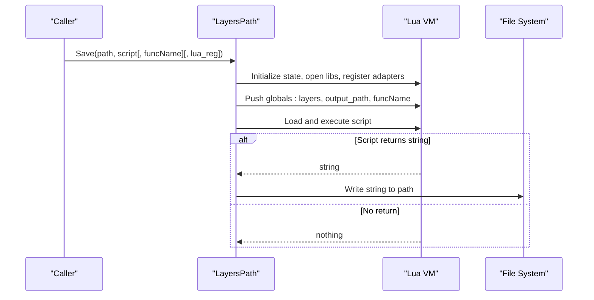
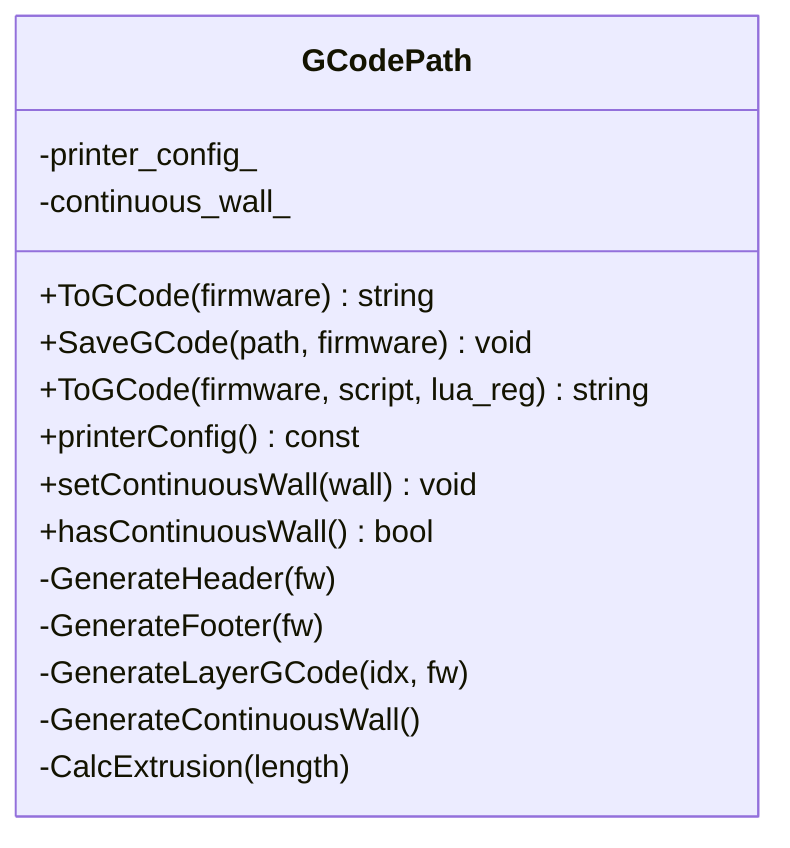
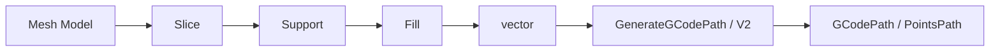
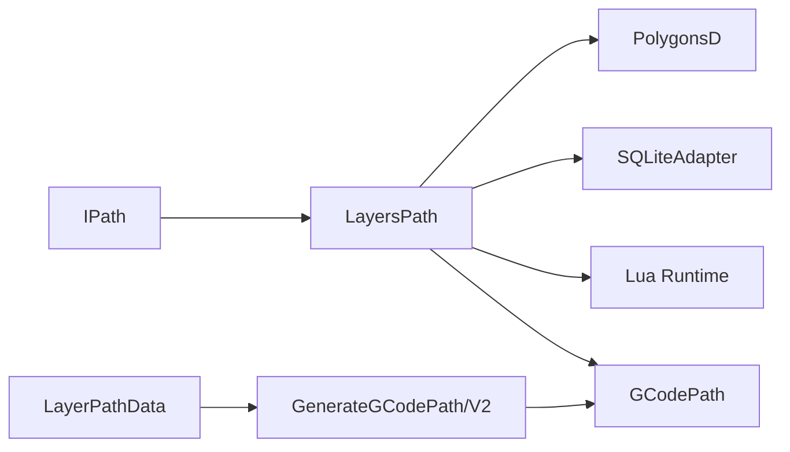

# Layer Data Structures

<cite>
**Referenced Files in This Document**
- [layerspath.hpp](file://paths/layerspath.hpp)
- [layerspath.cpp](file://paths/layerspath.cpp)
- [IPath.hpp](file://paths/IPath.hpp)
- [gcodepath.hpp](file://paths/gcodepath.hpp)
- [path_generator.hpp](file://LibHsBaSlicer/Path/path_generator.hpp)
- [path_generator.cpp](file://LibHsBaSlicer/Path/path_generator.cpp)
- [layers_path_test.cpp](file://tests/PathsOut/layers_path_test.cpp)
</cite>

## Table of Contents
1. [Introduction](#introduction)
2. [Project Structure](#project-structure)
3. [Core Components](#core-components)
4. [Architecture Overview](#architecture-overview)
5. [Detailed Component Analysis](#detailed-component-analysis)
6. [Dependency Analysis](#dependency-analysis)
7. [Performance Considerations](#performance-considerations)
8. [Troubleshooting Guide](#troubleshooting-guide)
9. [Conclusion](#conclusion)

## Introduction
This document explains the layer data structures used by HsBaSlicer, focusing on the LayersPath class and its role in organizing per-layer information such as outlines, fill patterns, and support structures. It also documents how layer data integrates with the slicing pipeline and provides guidance for accessing and manipulating layer-specific information, including iteration examples and extraction of geometric features.

## Project Structure
The layer data model is centered around:
- The IPath interface that defines a uniform Save/ToString API across path types.
- The LayersPath implementation that stores ordered layers, each pairing a configuration string with a set of double-precision polygons.
- The GCodePath specialization that extends LayersPath to generate firmware-specific G-code.
- The path generator API that consumes per-layer path data (outlines, fills, supports) to produce PointsPath or GCodePath outputs.

**Diagram sources**
- [IPath.hpp:20-57](file://paths/IPath.hpp#L20-L57)
- [layerspath.hpp:17-60](file://paths/layerspath.hpp#L17-L60)
- [gcodepath.hpp:66-107](file://paths/gcodepath.hpp#L66-L107)
- [path_generator.hpp:20-42](file://LibHsBaSlicer/Path/path_generator.hpp#L20-L42)
- [path_generator.hpp:50-62](file://LibHsBaSlicer/Path/path_generator.hpp#L50-L62)

**Section sources**
- [IPath.hpp:20-57](file://paths/IPath.hpp#L20-L57)
- [layerspath.hpp:17-60](file://paths/layerspath.hpp#L17-L60)
- [gcodepath.hpp:66-107](file://paths/gcodepath.hpp#L66-L107)
- [path_generator.hpp:20-42](file://LibHsBaSlicer/Path/path_generator.hpp#L20-L42)

## Core Components
- IPath: Abstract interface defining Save and ToString overloads, including Lua-based post-processing variants.
- LayersPath: Concrete implementation storing an ordered vector of per-layer entries, each containing a configuration string and a PolygonsD collection. Provides native SQLite persistence and Lua-driven serialization.
- GCodePath: Extends LayersPath to add firmware-specific G-code generation and optional continuous wall support.
- LayerPathData: Input structure consumed by path generators, grouping outlines, fills, supports, and Z height per layer.

Key responsibilities:
- Organize per-layer geometry and metadata.
- Provide flexible output via native formats or Lua scripts.
- Integrate with higher-level path generation to produce final toolpaths.

**Section sources**
- [IPath.hpp:20-57](file://paths/IPath.hpp#L20-L57)
- [layerspath.hpp:17-60](file://paths/layerspath.hpp#L17-L60)
- [gcodepath.hpp:66-107](file://paths/gcodepath.hpp#L66-L107)
- [path_generator.hpp:33-42](file://LibHsBaSlicer/Path/path_generator.hpp#L33-L42)

## Architecture Overview
The layer data flows from slice/support/fill stages into path generation, then through LayersPath/GCodePath for output.

**Diagram sources**
- [path_generator.hpp:50-62](file://LibHsBaSlicer/Path/path_generator.hpp#L50-L62)
- [layerspath.hpp:25-60](file://paths/layerspath.hpp#L25-L60)
- [gcodepath.hpp:66-107](file://paths/gcodepath.hpp#L66-L107)

## Detailed Component Analysis

### LayersPath Class
LayersPath implements IPath and encapsulates:
- An ordered list of LayersData entries.
- Each LayersData contains:
  - layerConfig: free-form configuration string for the layer.
  - layer: PolygonsD representing one or more closed polygons for that layer.

Public API highlights:
- push_back(layerConfig, layer): append a new layer entry.
- Save(path): native SQLite persistence with a layers table.
- Save(path, script[, funcName][, lua_reg]): Lua-driven file output.
- ToString(...): serialize to string, optionally post-processed by Lua.

Internal data:
- layers_: std::vector<LayersData>.
- callback_: status callback invoked during database operations.

**Diagram sources**
- [IPath.hpp:20-57](file://paths/IPath.hpp#L20-L57)
- [layerspath.hpp:25-60](file://paths/layerspath.hpp#L25-L60)
- [gcodepath.hpp:66-107](file://paths/gcodepath.hpp#L66-L107)

#### Accessing and Manipulating Layer-Specific Information
- Append a layer: use push_back with a configuration string and a PolygonsD instance.
- Iterate layers: traverse the internal layers_ vector conceptually; tests demonstrate building and querying layers via public APIs.
- Extract geometric features:
  - For each layer’s PolygonsD, iterate polygons and their points to compute areas, bounds, or other metrics.
  - Use ToString or Lua scripts to transform or filter layers before output.

Example usage patterns (conceptual):
- Build a LayersPath, push multiple layers, then call Save or ToString.
- Use Lua scripts to read global layers array and write custom formats.

**Section sources**
- [layerspath.hpp:25-60](file://paths/layerspath.hpp#L25-L60)
- [layerspath.cpp:25-58](file://paths/layerspath.cpp#L25-L58)
- [layers_path_test.cpp:16-54](file://tests/PathsOut/layers_path_test.cpp#L16-L54)

#### Native Persistence (SQLite)
- Save(path) creates a SQLite database with a layers table containing:
  - id: auto-increment primary key.
  - layer_config: text field for the layer configuration.
  - layer_data: blob/text field for serialized polygon data.
- A progress/status callback can be attached to monitor SQL operations.

**Diagram sources**
- [layerspath.cpp:30-58](file://paths/layerspath.cpp#L30-L58)

**Section sources**
- [layerspath.cpp:30-58](file://paths/layerspath.cpp#L30-L58)

#### Lua-Driven Serialization
- Save/ToString overloads accept:
  - Inline Lua script string.
  - Optional function name to invoke.
  - Optional registration callback to expose additional Lua functions.
- Global variables provided to Lua:
  - layers: array of layer objects with fields config and data (polygons).
  - output_path: target file path when saving.
  - funcName: function name when specified.
- If Lua returns a string, it is written to the output path (for Save) or returned (for ToString). Otherwise, a global result variable may be used.

**Diagram sources**
- [layerspath.cpp:61-159](file://paths/layerspath.cpp#L61-L159)
- [layerspath.cpp:161-255](file://paths/layerspath.cpp#L161-L255)

**Section sources**
- [layerspath.cpp:61-159](file://paths/layerspath.cpp#L61-L159)
- [layerspath.cpp:161-255](file://paths/layerspath.cpp#L161-L255)
- [layerspath.cpp:295-378](file://paths/layerspath.cpp#L295-L378)
- [layerspath.cpp:380-475](file://paths/layerspath.cpp#L380-L475)

### GCodePath Specialization
GCodePath extends LayersPath to:
- Generate firmware-specific G-code strings and files.
- Support a continuous 3D wall (spiral/vase mode) emitted before per-layer content.
- Expose printer configuration and helper methods for header/footer generation.

**Diagram sources**
- [gcodepath.hpp:66-107](file://paths/gcodepath.hpp#L66-L107)

**Section sources**
- [gcodepath.hpp:66-107](file://paths/gcodepath.hpp#L66-L107)

### Integration with Slicing Pipeline
The slicing pipeline produces per-layer path data (outlines, fills, supports) which is fed into path generators to create PointsPath or GCodePath outputs.

**Diagram sources**
- [path_generator.hpp:50-62](file://LibHsBaSlicer/Path/path_generator.hpp#L50-L62)
- [path_generator.cpp:14-41](file://LibHsBaSlicer/Path/path_generator.cpp#L14-L41)

**Section sources**
- [path_generator.hpp:50-62](file://LibHsBaSlicer/Path/path_generator.hpp#L50-L62)
- [path_generator.cpp:14-41](file://LibHsBaSlicer/Path/path_generator.cpp#L14-L41)

## Dependency Analysis
- LayersPath depends on:
  - IPath interface for unified API.
  - PolygonsD (from FloatPolygons) for geometry representation.
  - SQLiteAdapter for native persistence.
  - Lua runtime for scripting integration.
- GCodePath depends on LayersPath and adds firmware-specific logic.
- Path generator functions depend on LayerPathData and produce PointsPath/GCodePath.

**Diagram sources**
- [layerspath.hpp:25-60](file://paths/layerspath.hpp#L25-L60)
- [layerspath.cpp:30-58](file://paths/layerspath.cpp#L30-L58)
- [path_generator.hpp:50-62](file://LibHsBaSlicer/Path/path_generator.hpp#L50-L62)

**Section sources**
- [layerspath.hpp:25-60](file://paths/layerspath.hpp#L25-L60)
- [layerspath.cpp:30-58](file://paths/layerspath.cpp#L30-L58)
- [path_generator.hpp:50-62](file://LibHsBaSlicer/Path/path_generator.hpp#L50-L62)

## Performance Considerations
- Native SQLite persistence writes all layers in a single loop; consider batching large models to avoid excessive memory pressure.
- Lua-based serialization incurs VM setup overhead; reuse scripts where possible and prefer inline scripts for small transformations.
- When extracting geometric features, iterate only necessary polygons to minimize CPU time.
- Spiral/vase mode in GCodePath avoids per-layer travel moves, improving print speed for suitable geometries.

[No sources needed since this section provides general guidance]

## Troubleshooting Guide
Common issues and resolutions:
- Lua initialization failures: ensure Lua libraries are available and registered correctly.
- Script load/runtime errors: validate Lua syntax and handle exceptions; tests show explicit error propagation.
- Missing script files: both Save and ToString throw when script files cannot be opened.
- Database connection errors: Save(path) throws if SQLite cannot connect or create the database.

Operational tips:
- Use the provided callbacks to log SQL statements and diagnose performance bottlenecks.
- Validate layers data before saving; empty or malformed polygons can lead to unexpected outputs.

**Section sources**
- [layerspath.cpp:61-159](file://paths/layerspath.cpp#L61-L159)
- [layerspath.cpp:257-269](file://paths/layerspath.cpp#L257-L269)
- [layerspath.cpp:462-475](file://paths/layerspath.cpp#L462-L475)
- [layers_path_test.cpp:144-163](file://tests/PathsOut/layers_path_test.cpp#L144-L163)
- [layers_path_test.cpp:180-226](file://tests/PathsOut/layers_path_test.cpp#L180-L226)

## Conclusion
LayersPath provides a robust foundation for organizing per-layer geometry and metadata within HsBaSlicer. Its design supports both native persistence and flexible Lua-driven post-processing, enabling diverse output formats. Integrated with the slicing pipeline through LayerPathData and path generators, LayersPath and its specialization GCodePath bridge geometric layer data to practical manufacturing outputs. By leveraging the documented APIs and patterns, users can efficiently iterate, extract, and transform layer-specific features to meet varied production requirements.