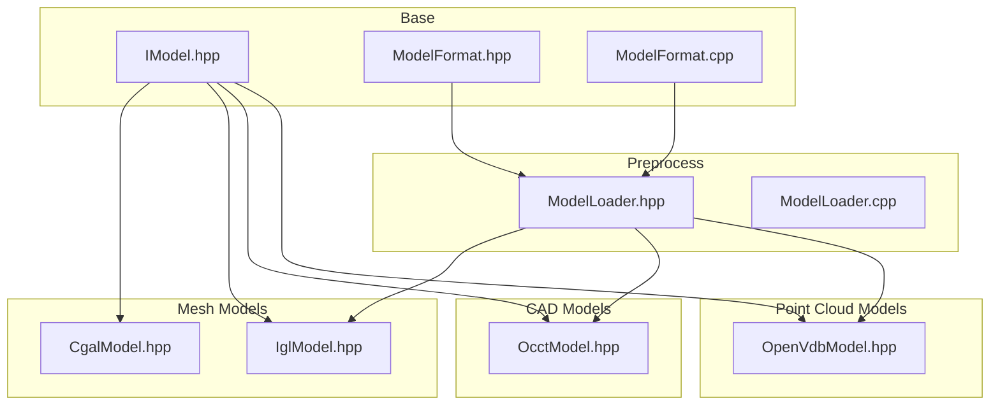
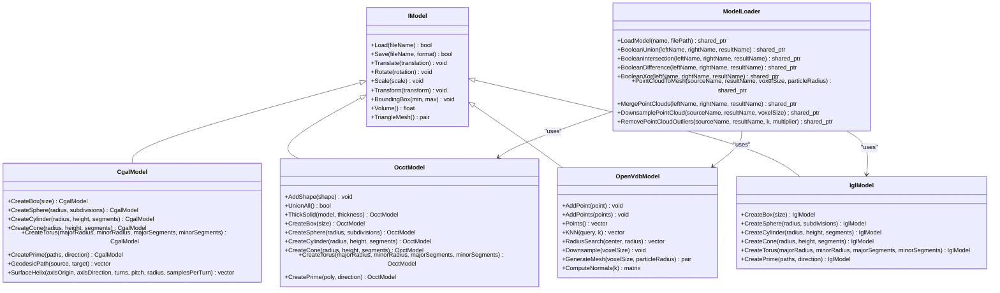
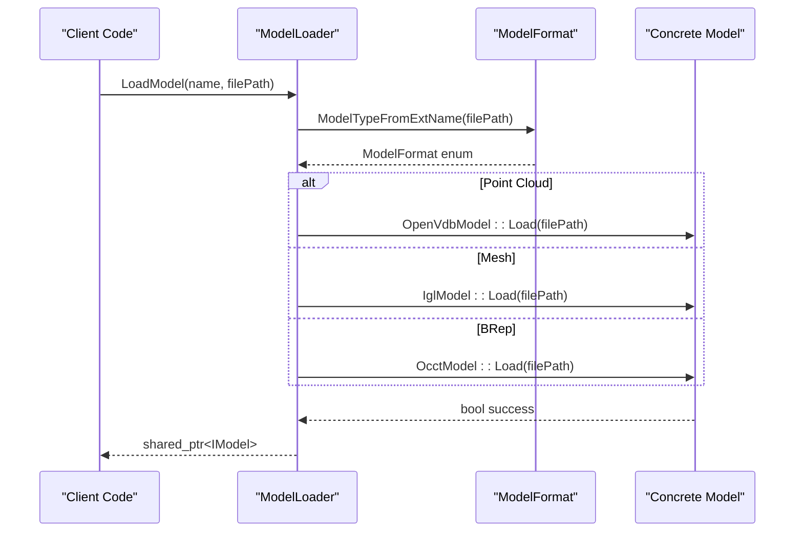
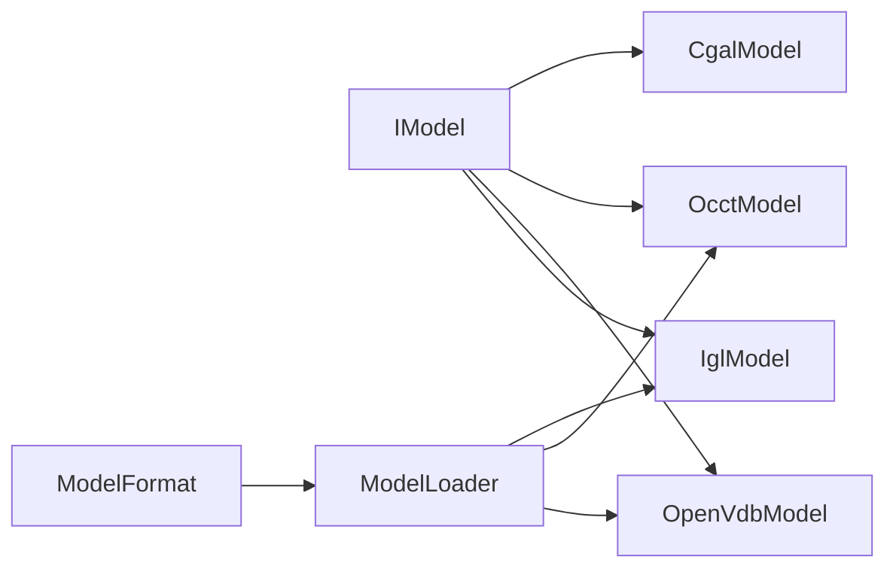

# Model Hierarchy

<cite>
**Referenced Files in This Document**   
- [IModel.hpp](file://base/IModel.hpp)
- [ModelFormat.hpp](file://base/ModelFormat.hpp)
- [ModelFormat.cpp](file://base/ModelFormat.cpp)
- [CgalModel.hpp](file://meshmodel/CgalModel.hpp)
- [IglModel.hpp](file://meshmodel/IglModel.hpp)
- [OcctModel.hpp](file://cadmodel/OcctModel.hpp)
- [OpenVdbModel.hpp](file://pointcloud/OpenVdbModel.hpp)
- [ModelLoader.hpp](file://preprocess/ModelLoader.hpp)
- [ModelLoader.cpp](file://preprocess/ModelLoader.cpp)
</cite>

## Table of Contents
1. [Introduction](#introduction)
2. [Project Structure](#project-structure)
3. [Core Components](#core-components)
4. [Architecture Overview](#architecture-overview)
5. [Detailed Component Analysis](#detailed-component-analysis)
6. [Dependency Analysis](#dependency-analysis)
7. [Performance Considerations](#performance-considerations)
8. [Troubleshooting Guide](#troubleshooting-guide)
9. [Conclusion](#conclusion)

## Introduction
This document explains the model hierarchy in HsBaSlicer, focusing on the abstract IModel interface and its concrete implementations for different geometry representations: CGAL-based meshes, OpenCASCADE CAD models, and OpenVDB point clouds. It also documents the common interface methods for geometry queries, transformations, and conversions; the factory patterns used for model creation and format conversion; and practical examples of working with each model type, including their capabilities and limitations.

## Project Structure
The model system is organized around a small set of core files:
- base: defines the IModel interface and model format utilities
- meshmodel: contains triangle-mesh-backed models (CGAL and libigl)
- cadmodel: contains OpenCASCADE BRep-backed models
- pointcloud: contains OpenVDB point cloud models
- preprocess: provides a unified loader and named model pool that dispatches to the correct implementation based on file extension

**Diagram sources**
- [IModel.hpp:110-139](file://base/IModel.hpp#L110-L139)
- [ModelFormat.hpp:19-93](file://base/ModelFormat.hpp#L19-L93)
- [ModelFormat.cpp:12-87](file://base/ModelFormat.cpp#L12-L87)
- [CgalModel.hpp:34-155](file://meshmodel/CgalModel.hpp#L34-L155)
- [IglModel.hpp:26-41](file://meshmodel/IglModel.hpp#L26-L41)
- [OcctModel.hpp:30-124](file://cadmodel/OcctModel.hpp#L30-L124)
- [OpenVdbModel.hpp:28-116](file://pointcloud/OpenVdbModel.hpp#L28-L116)
- [ModelLoader.hpp:30-202](file://preprocess/ModelLoader.hpp#L30-L202)
- [ModelLoader.cpp:45-84](file://preprocess/ModelLoader.cpp#L45-L84)

**Section sources**
- [IModel.hpp:110-139](file://base/IModel.hpp#L110-L139)
- [ModelFormat.hpp:19-93](file://base/ModelFormat.hpp#L19-L93)
- [ModelFormat.cpp:12-87](file://base/ModelFormat.cpp#L12-L87)
- [ModelLoader.hpp:30-202](file://preprocess/ModelLoader.hpp#L30-L202)
- [ModelLoader.cpp:45-84](file://preprocess/ModelLoader.cpp#L45-L84)

## Core Components
- IModel: Abstract interface defining load/save, transforms, bounding box, volume, and triangle mesh extraction.
- CgalModel: CGAL-backed polyhedral mesh model implementing IModel with advanced surface geodesic/helix operations and boolean operations via Nef structures.
- OcctModel: OpenCASCADE BRep model implementing IModel with STEP/IGES/VRML/BREP support, boolean operations, thick-solid shell generation, and primitive factories.
- OpenVdbModel: OpenVDB-backed point cloud model implementing IModel with voxelization, KNN/radius search, downsampling, statistical outlier removal, normals estimation, and level-set mesh reconstruction.
- IglModel: libigl-backed triangle mesh model implementing IModel, commonly used as an intermediate representation for boolean operations and mesh processing.
- ModelLoader: Unified loader and named model pool that selects the appropriate model type based on file extension and exposes higher-level operations such as boolean operations and point cloud processing.

**Section sources**
- [IModel.hpp:110-139](file://base/IModel.hpp#L110-L139)
- [CgalModel.hpp:34-155](file://meshmodel/CgalModel.hpp#L34-L155)
- [OcctModel.hpp:30-124](file://cadmodel/OcctModel.hpp#L30-L124)
- [OpenVdbModel.hpp:28-116](file://pointcloud/OpenVdbModel.hpp#L28-L116)
- [IglModel.hpp:26-41](file://meshmodel/IglModel.hpp#L26-L41)
- [ModelLoader.hpp:30-202](file://preprocess/ModelLoader.hpp#L30-L202)

## Architecture Overview
The architecture uses a clear separation between the abstract interface and concrete implementations, with a dispatcher/loader that chooses the right kernel based on file extensions.

**Diagram sources**
- [IModel.hpp:110-139](file://base/IModel.hpp#L110-L139)
- [CgalModel.hpp:89-149](file://meshmodel/CgalModel.hpp#L89-L149)
- [OcctModel.hpp:95-109](file://cadmodel/OcctModel.hpp#L95-L109)
- [OpenVdbModel.hpp:60-111](file://pointcloud/OpenVdbModel.hpp#L60-L111)
- [IglModel.hpp:26-41](file://meshmodel/IglModel.hpp#L26-L41)
- [ModelLoader.hpp:94-197](file://preprocess/ModelLoader.hpp#L94-L197)

## Detailed Component Analysis

### Abstract Interface: IModel
IModel defines the common contract for all model types:
- Loading and saving: Load(fileName), Save(fileName, format)
- Transformations: Translate, Rotate, Scale (uniform and per-axis), Transform (Isometry3f, Matrix4f, Affine)
- Geometry queries: BoundingBox(min, max), Volume(), TriangleMesh() returning vertices and faces in libigl style

These methods ensure uniform access across CGAL, OpenCASCADE, and OpenVDB models.

**Section sources**
- [IModel.hpp:110-139](file://base/IModel.hpp#L110-L139)

### CGAL Models: CgalModel
CgalModel wraps a CGAL Polyhedron_3 and implements IModel. It provides:
- File I/O for mesh formats
- All transform methods
- Bounding box and signed volume
- Triangle mesh export
- Boolean operations via friend functions Union/Intersection/Difference/Xor
- Primitive factories: CreateBox, CreateSphere, CreateCylinder, CreateCone, CreateTorus
- Extrusion factory: CreatePrime from closed 2D polygons
- Surface geodesic and helix operations: GeodesicPath, GeodesicDistance, ProjectPointOnSurface, SurfaceSpiral, SurfaceHelix

Capabilities:
- High-quality geometric primitives and extrusions
- Advanced surface analysis and path generation
- Robust boolean operations through Nef structures

Limitations:
- Primarily focused on mesh geometry; not suited for native CAD topology or parametric features
- Some advanced operations may be computationally intensive

**Section sources**
- [CgalModel.hpp:34-155](file://meshmodel/CgalModel.hpp#L34-L155)

### OpenCASCADE CAD Models: OcctModel
OcctModel wraps a TopoDS_Shape and implements IModel. It provides:
- File I/O for STEP, IGES, VRML, BREP
- All transform methods
- Tessellation to TriangleMesh
- Signed volume
- Compound shape management: AddShape, UnionAll
- Boolean operations via friend functions Union/Intersection/Difference/Xor
- Thick-solid shell generation: ThickSolid
- Primitive factories: CreateBox, CreateSphere, CreateCylinder, CreateCone, CreateTorus
- Extrusion factory: CreatePrime from 2D polygons

Capabilities:
- Native CAD topology and robust boolean operations
- Support for industry-standard CAD formats
- Shell/thickness operations for manufacturing workflows

Limitations:
- Requires OCCT build configuration
- Converting arbitrary meshes back to BRep is not directly supported in current flow

**Section sources**
- [OcctModel.hpp:30-124](file://cadmodel/OcctModel.hpp#L30-L124)

### OpenVDB Point Cloud Models: OpenVdbModel
OpenVdbModel wraps an OpenVDB grid and implements IModel. It provides:
- File I/O for point cloud formats
- All transform methods
- Bounding box and volume (computed over points)
- Triangle mesh export via GenerateMesh using level-set reconstruction
- Point cloud operations: AddPoint/AddPoints, Points, PointCount, IsEmpty, Clear
- SetFromVertices/ToVertices for Eigen matrices
- Spatial queries: NearestNeighbor, KNN, RadiusSearch
- Filtering: Filter by predicate, RemoveStatisticalOutliers
- Downsampling: Downsample, VoxelCenters
- Centroid computation and normal estimation: Centroid, ComputeNormals
- Merging: Merge

Capabilities:
- Efficient large-scale point cloud storage and processing
- Reconstruction of triangle meshes from point clouds
- Rich spatial querying and filtering tools

Limitations:
- Not a true mesh or CAD model; mesh output depends on reconstruction parameters
- Volume/bounding box are derived from point distribution rather than solid topology

**Section sources**
- [OpenVdbModel.hpp:28-116](file://pointcloud/OpenVdbModel.hpp#L28-L116)

### libigl Mesh Models: IglModel
IglModel stores vertices, faces, and optional normals as Eigen matrices and implements IModel. It provides:
- File I/O for OBJ, PLY, OFF, STL
- All transform methods
- Bounding box and volume
- Normal computation
- Boolean operations via CGAL integration when available
- Primitive factories: CreateBox, CreateSphere, CreateCylinder, CreateCone, CreateTorus
- Extrusion factory: CreatePrime

Capabilities:
- Lightweight mesh representation suitable for slicing and path generation
- Convenient boolean operations when CGAL is enabled

Limitations:
- Lacks native CAD topology
- Boolean operations depend on CGAL availability and mesh quality

**Section sources**
- [IglModel.hpp:26-41](file://meshmodel/IglModel.hpp#L26-L41)

### Factory Patterns and Creation
Factory-style static methods are provided by model classes to create primitives and extrusions:
- CgalModel::CreateBox/CreateSphere/CreateCylinder/CreateCone/CreateTorus/CreatePrime
- OcctModel::CreateBox/CreateSphere/CreateCylinder/CreateCone/CreateTorus/CreatePrime
- IglModel::CreateBox/CreateSphere/CreateCylinder/CreateCone/CreateTorus/CreatePrime

These factories encapsulate geometry construction details and return fully constructed models ready for transformation and further processing.

**Section sources**
- [CgalModel.hpp:89-103](file://meshmodel/CgalModel.hpp#L89-L103)
- [OcctModel.hpp:95-109](file://cadmodel/OcctModel.hpp#L95-L109)
- [IglModel.hpp:26-41](file://meshmodel/IglModel.hpp#L26-L41)

### Format Conversion and Loader Dispatch
ModelLoader acts as a unified entry point:
- LoadModel selects the appropriate model type based on file extension:
  - Mesh formats (STL, OBJ, PLY, OFF) -> IglModel
  - BRep formats (STEP, IGES, VRML, BREP) -> OcctModel (requires USE_OCCT)
  - Point cloud formats (XYZ, VDB) -> OpenVdbModel (requires USE_OPENVDB)
- Named model pool manages loaded models and supports retrieval, insertion, removal, and cleanup
- Higher-level operations:
  - Boolean operations: Union/Intersection/Difference/Xor, preferring OcctModel when both inputs are BRep, otherwise falling back to IglModel
  - Point cloud operations: PointCloudToMesh, MergePointClouds, DownsamplePointCloud, RemovePointCloudOutliers, PointCloudCentroid, PointCloudNormals, PointCloudCount

**Diagram sources**
- [ModelLoader.cpp:45-84](file://preprocess/ModelLoader.cpp#L45-L84)
- [ModelFormat.cpp:95-99](file://base/ModelFormat.cpp#L95-L99)

**Section sources**
- [ModelLoader.hpp:30-202](file://preprocess/ModelLoader.hpp#L30-L202)
- [ModelLoader.cpp:45-84](file://preprocess/ModelLoader.cpp#L45-L84)
- [ModelFormat.cpp:95-99](file://base/ModelFormat.cpp#L95-L99)

### Working Examples and Usage Guidance

#### Example: Loading and Transforming a Mesh Model
- Use ModelLoader.LoadModel to load a mesh file (e.g., STL/OBJ/PLY/OFF). The loader returns a shared pointer to IModel backed by IglModel.
- Apply transformations via IModel methods: Translate, Rotate, Scale, Transform.
- Query geometry: BoundingBox, Volume, TriangleMesh.

Guidance:
- Prefer IglModel for lightweight mesh workflows and slicing pipelines.
- If you need boolean operations without OCCT, CGAL-enabled IglModel can be used.

#### Example: Working with CAD Models
- Load STEP/IGES/VRML/BREP files via ModelLoader.LoadModel; the loader returns an OcctModel.
- Use OcctModel-specific operations: AddShape, UnionAll, ThickSolid, and boolean operations.
- For manufacturing tasks requiring shells or precise CAD topology, use OcctModel.

Guidance:
- Ensure OCCT is enabled at build time for BRep support.
- Avoid expecting direct conversion from arbitrary meshes to BRep; use existing CAD models for boolean operations.

#### Example: Processing Point Clouds
- Load XYZ/VDB files via ModelLoader.LoadModel; the loader returns an OpenVdbModel.
- Perform spatial queries: KNN, RadiusSearch, Filter.
- Clean data: RemoveStatisticalOutliers, Downsample.
- Reconstruct mesh: GenerateMesh with appropriate voxel size and particle radius.

Guidance:
- Tune reconstruction parameters carefully; poor settings can yield empty or noisy meshes.
- Use PointCloudToMesh to convert to a mesh model for downstream slicing.

**Section sources**
- [ModelLoader.cpp:45-84](file://preprocess/ModelLoader.cpp#L45-L84)
- [OpenVdbModel.hpp:60-111](file://pointcloud/OpenVdbModel.hpp#L60-L111)
- [OcctModel.hpp:95-109](file://cadmodel/OcctModel.hpp#L95-L109)

## Dependency Analysis
The model hierarchy exhibits low coupling through the IModel interface and explicit dependencies on third-party libraries only within concrete implementations:
- IModel has no external geometry dependencies beyond Eigen vectors/matrices.
- CgalModel depends on CGAL kernels and polyhedra.
- OcctModel depends on OpenCASCADE TopoDS shapes.
- OpenVdbModel depends on OpenVDB grids.
- IglModel depends on libigl for mesh I/O and processing.
- ModelLoader depends on ModelFormat utilities and conditionally includes kernels based on compile-time flags.

**Diagram sources**
- [IModel.hpp:110-139](file://base/IModel.hpp#L110-L139)
- [CgalModel.hpp:34-155](file://meshmodel/CgalModel.hpp#L34-L155)
- [OcctModel.hpp:30-124](file://cadmodel/OcctModel.hpp#L30-L124)
- [OpenVdbModel.hpp:28-116](file://pointcloud/OpenVdbModel.hpp#L28-L116)
- [IglModel.hpp:26-41](file://meshmodel/IglModel.hpp#L26-L41)
- [ModelFormat.hpp:19-93](file://base/ModelFormat.hpp#L19-L93)
- [ModelLoader.hpp:30-202](file://preprocess/ModelLoader.hpp#L30-L202)

**Section sources**
- [IModel.hpp:110-139](file://base/IModel.hpp#L110-L139)
- [ModelFormat.hpp:19-93](file://base/ModelFormat.hpp#L19-L93)
- [ModelLoader.hpp:30-202](file://preprocess/ModelLoader.hpp#L30-L202)

## Performance Considerations
- Mesh vs CAD vs Point Cloud:
  - IglModel is efficient for slicing and path generation but lacks CAD topology.
  - OcctModel provides robust boolean operations and shell generation but requires OCCT and may be heavier.
  - OpenVdbModel excels at large-scale point cloud processing and spatial queries; mesh reconstruction cost depends on voxel size and particle radius.
- Boolean operations:
  - Prefer OcctModel for BRep inputs to avoid tessellation overhead.
  - Fallback to IglModel when CGAL is available; mesh quality affects performance and accuracy.
- Point cloud reconstruction:
  - Choose voxel size and particle radius to balance detail and computational cost.
  - Pre-filter outliers and downsample to reduce reconstruction time.

[No sources needed since this section provides general guidance]

## Troubleshooting Guide
Common issues and resolutions:
- Unsupported platform features:
  - BRep loading fails if OCCT is not enabled; ensure USE_OCCT is defined during build.
  - Point cloud operations fail if OpenVDB is not enabled; ensure USE_OPENVDB is defined.
- Invalid arguments:
  - Duplicate model names in the pool throw invalid argument errors; choose unique names.
  - Null model insertion is rejected; verify model pointers before insertion.
- Type mismatches:
  - ThickSolid requires OcctModel; passing other types raises runtime errors.
  - Point cloud operations require OpenVdbModel; passing other types raises runtime errors.
- Conversion limitations:
  - Direct conversion from mesh to OcctModel is not supported; use existing CAD models for boolean operations.

**Section sources**
- [ModelLoader.cpp:45-84](file://preprocess/ModelLoader.cpp#L45-L84)
- [ModelLoader.cpp:172-213](file://preprocess/ModelLoader.cpp#L172-L213)
- [ModelLoader.cpp:343-451](file://preprocess/ModelLoader.cpp#L343-L451)

## Conclusion
HsBaSlicer’s model hierarchy centers on a clean IModel interface with specialized implementations for meshes (CGAL/libigl), CAD (OpenCASCADE), and point clouds (OpenVDB). The ModelLoader provides a unified, extensible entry point that selects the appropriate kernel based on file extension and offers higher-level operations like boolean modeling and point cloud processing. By understanding the capabilities and limitations of each model type and leveraging the factory methods and loader dispatch, users can efficiently work across different geometry representations and pipeline stages.