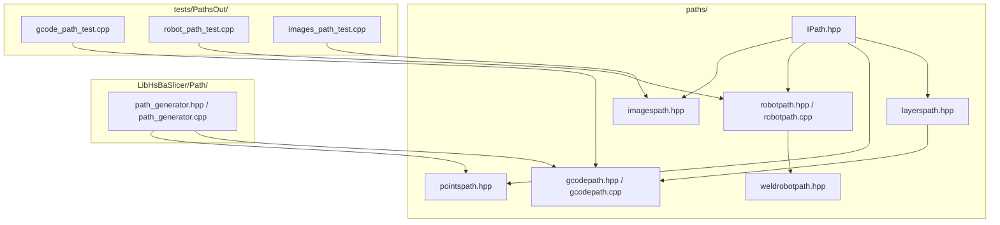
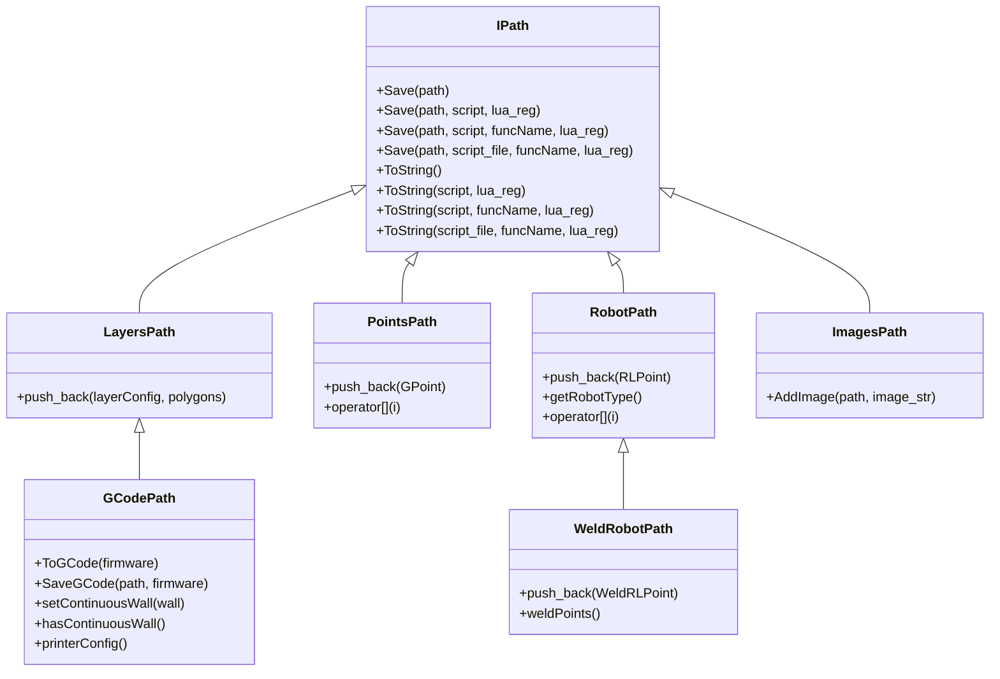
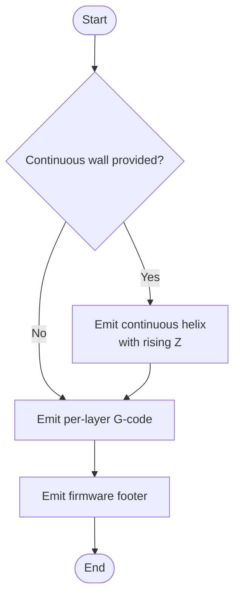
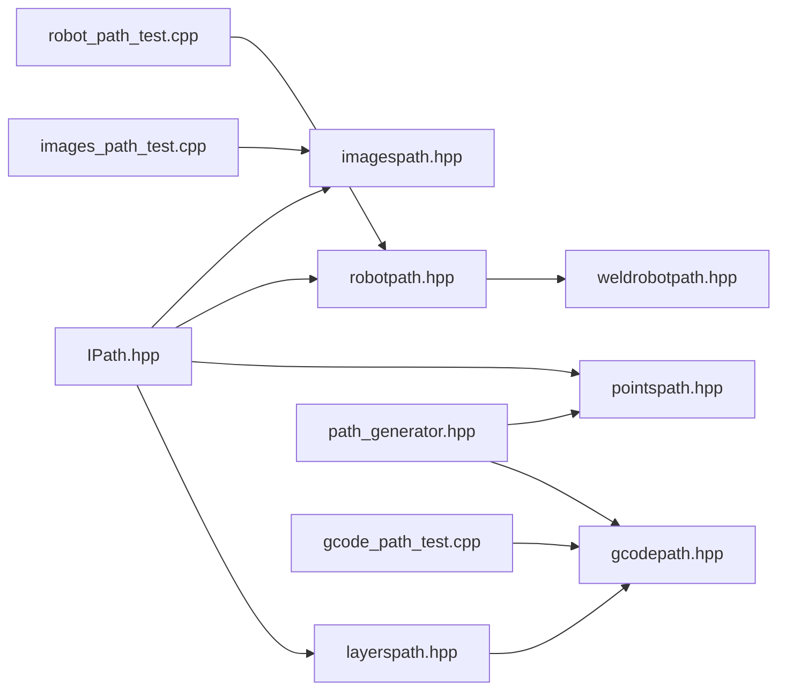

# Path Output Models

<cite>
**Referenced Files in This Document**
- [IPath.hpp](file://paths/IPath.hpp)
- [layerspath.hpp](file://paths/layerspath.hpp)
- [gcodepath.hpp](file://paths/gcodepath.hpp)
- [gcodepath.cpp](file://paths/gcodepath.cpp)
- [pointspath.hpp](file://paths/pointspath.hpp)
- [robotpath.hpp](file://paths/robotpath.hpp)
- [robotpath.cpp](file://paths/robotpath.cpp)
- [imagespath.hpp](file://paths/imagespath.hpp)
- [weldrobotpath.hpp](file://paths/weldrobotpath.hpp)
- [path_generator.hpp](file://LibHsBaSlicer/Path/path_generator.hpp)
- [path_generator.cpp](file://LibHsBaSlicer/Path/path_generator.cpp)
- [gcode_path_test.cpp](file://tests/PathsOut/gcode_path_test.cpp)
- [robot_path_test.cpp](file://tests/PathsOut/robot_path_test.cpp)
- [images_path_test.cpp](file://tests/PathsOut/images_path_test.cpp)
</cite>

## Table of Contents
1. [Introduction](#introduction)
2. [Project Structure](#project-structure)
3. [Core Components](#core-components)
4. [Architecture Overview](#architecture-overview)
5. [Detailed Component Analysis](#detailed-component-analysis)
6. [Dependency Analysis](#dependency-analysis)
7. [Performance Considerations](#performance-considerations)
8. [Troubleshooting Guide](#troubleshooting-guide)
9. [Conclusion](#conclusion)

## Introduction
This document explains the path output models in HsBaSlicer. It covers the abstract IPath interface, its concrete implementations for different output formats (G-code, robot programs, image sequences, and welding paths), the common serialization API with Lua post-processing, and the high-level path generation API used to produce G-code from layer polygons. The goal is to help users generate correct outputs for FDM printers, industrial robots, and image-based workflows while customizing parameters and extending behavior through Lua scripts.

## Project Structure
The path output system is organized around a small set of core headers under paths/, plus a higher-level generator API under LibHsBaSlicer/Path/. Tests under tests/PathsOut demonstrate usage patterns and expected behaviors.

**Diagram sources**
- [IPath.hpp:1-68](file://paths/IPath.hpp#L1-L68)
- [layerspath.hpp:1-64](file://paths/layerspath.hpp#L1-L64)
- [gcodepath.hpp:1-112](file://paths/gcodepath.hpp#L1-L112)
- [gcodepath.cpp:1-200](file://paths/gcodepath.cpp#L1-L200)
- [pointspath.hpp:1-99](file://paths/pointspath.hpp#L1-L99)
- [robotpath.hpp:1-108](file://paths/robotpath.hpp#L1-L108)
- [robotpath.cpp:1-200](file://paths/robotpath.cpp#L1-L200)
- [imagespath.hpp:1-64](file://paths/imagespath.hpp#L1-L64)
- [weldrobotpath.hpp:1-100](file://paths/weldrobotpath.hpp#L1-L100)
- [path_generator.hpp:1-96](file://LibHsBaSlicer/Path/path_generator.hpp#L1-L96)
- [path_generator.cpp:1-139](file://LibHsBaSlicer/Path/path_generator.cpp#L1-L139)
- [gcode_path_test.cpp:1-200](file://tests/PathsOut/gcode_path_test.cpp#L1-L200)
- [robot_path_test.cpp:1-200](file://tests/PathsOut/robot_path_test.cpp#L1-L200)
- [images_path_test.cpp:1-200](file://tests/PathsOut/images_path_test.cpp#L1-L200)

**Section sources**
- [IPath.hpp:1-68](file://paths/IPath.hpp#L1-L68)
- [layerspath.hpp:1-64](file://paths/layerspath.hpp#L1-L64)
- [gcodepath.hpp:1-112](file://paths/gcodepath.hpp#L1-L112)
- [gcodepath.cpp:1-200](file://paths/gcodepath.cpp#L1-L200)
- [pointspath.hpp:1-99](file://paths/pointspath.hpp#L1-L99)
- [robotpath.hpp:1-108](file://paths/robotpath.hpp#L1-L108)
- [robotpath.cpp:1-200](file://paths/robotpath.cpp#L1-L200)
- [imagespath.hpp:1-64](file://paths/imagespath.hpp#L1-L64)
- [weldrobotpath.hpp:1-100](file://paths/weldrobotpath.hpp#L1-L100)
- [path_generator.hpp:1-96](file://LibHsBaSlicer/Path/path_generator.hpp#L1-L96)
- [path_generator.cpp:1-139](file://LibHsBaSlicer/Path/path_generator.cpp#L1-L139)

## Core Components
- IPath: Abstract base defining Save/ToString families with optional Lua post-processing and script-file support. Also defines OutPoints3, a shared 3D point type.
- LayersPath: Holds per-layer polygon groups with free-form config strings; supports callbacks and Lua post-processing.
- PointsPath: Sequence of GPoint commands (G0/G1/G2/G3 and settings) with units and extrusion amounts.
- GCodePath: Extends LayersPath to emit multi-firmware G-code (Marlin, RepRap/RRF, Klipper), including continuous spiral walls.
- RobotPath: Emits brand-specific robot language programs (ABB/KUKA/FANUC) from RLPoint moves.
- WeldRobotPath: Extends RobotPath with weld parameters and arc start/end handling.
- ImagesPath: Packages a config sidecar plus named image payloads; saves via native or Lua-driven pipelines.
- Path Generator API: High-level functions to convert PolygonsD into PointsPath or GCodePath, including vase/spiral mode.

Key data types:
- OutPoints3: X/Y/Z float point used across path types.
- GPoint: G-code motion command with target, center, velocity, and extrusion.
- RLPoint: Robot move with end/middle positions, velocity, and command kind.
- WeldRLPoint/WeldParam: Welding parameters attached to a robot point.

**Section sources**
- [IPath.hpp:1-68](file://paths/IPath.hpp#L1-L68)
- [layerspath.hpp:1-64](file://paths/layerspath.hpp#L1-L64)
- [pointspath.hpp:1-99](file://paths/pointspath.hpp#L1-L99)
- [gcodepath.hpp:1-112](file://paths/gcodepath.hpp#L1-L112)
- [robotpath.hpp:1-108](file://paths/robotpath.hpp#L1-L108)
- [weldrobotpath.hpp:1-100](file://paths/weldrobotpath.hpp#L1-L100)
- [imagespath.hpp:1-64](file://paths/imagespath.hpp#L1-L64)
- [path_generator.hpp:1-96](file://LibHsBaSlicer/Path/path_generator.hpp#L1-L96)

## Architecture Overview
The path model follows a layered design:
- IPath defines a uniform Save/ToString contract with Lua extension points.
- Layered geometry outputs are built on LayersPath (per-layer polygons).
- G-code output extends LayersPath to add firmware-specific headers/footers and extrusion logic.
- Robot outputs extend IPath directly with brand generators.
- Welding extends robot outputs with process parameters.
- Image outputs package binary assets with a config file.
- A top-level generator API converts polygon layers into PointsPath or GCodePath.

**Diagram sources**
- [IPath.hpp:1-68](file://paths/IPath.hpp#L1-L68)
- [layerspath.hpp:1-64](file://paths/layerspath.hpp#L1-L64)
- [pointspath.hpp:1-99](file://paths/pointspath.hpp#L1-L99)
- [gcodepath.hpp:1-112](file://paths/gcodepath.hpp#L1-L112)
- [robotpath.hpp:1-108](file://paths/robotpath.hpp#L1-L108)
- [weldrobotpath.hpp:1-100](file://paths/weldrobotpath.hpp#L1-L100)
- [imagespath.hpp:1-64](file://paths/imagespath.hpp#L1-L64)

## Detailed Component Analysis

### IPath: Common Interface and Serialization Contract
- Purpose: Provide a unified API for saving or serializing path products to files or strings.
- Lua integration: All Save/ToString overloads accept an inline script, a script file, a function name, and a registration callback to inject additional Lua globals.
- Data model: OutPoints3 represents planar X/Y plus build height Z.

Usage patterns:
- Native save/serialize without Lua.
- Inline Lua post-processing to transform or wrap output.
- Script file execution with a named entry function.
- Custom Lua registration to expose project-specific helpers.

**Section sources**
- [IPath.hpp:1-68](file://paths/IPath.hpp#L1-L68)

### LayersPath: Per-Layer Polygon Storage
- Stores ordered layers, each pairing a free-form config string with double-precision polygons.
- Supports progress/status callbacks during output.
- Serves as the foundation for G-code generation that needs layer-wise Z heights and polygon sets.

Typical workflow:
- Push layers with config like "Z:<height>" and associated polygons.
- Serialize natively or via Lua to produce intermediate representations.

**Section sources**
- [layerspath.hpp:1-64](file://paths/layerspath.hpp#L1-L64)

### PointsPath: G-Code Point Sequences
- Represents a sequence of GPoint commands (G0 rapid, G1 linear, G2/G3 arcs, and settings like G17/G18/G19/G20/G21/G90/G91).
- Tracks length units (mm/inch) and a starting point.
- Useful when you need low-level control over G-code motion and extrusion.

Common operations:
- push_back(GPoint) to append moves.
- ToString()/Save() with optional Lua post-processing.

**Section sources**
- [pointspath.hpp:1-99](file://paths/pointspath.hpp#L1-L99)

### GCodePath: Multi-Firmware G-Code Generation
- Inherits LayersPath to leverage per-layer polygon storage and Z parsing.
- Adds firmware-specific header/footer generation for Marlin, RepRap/RRF, and Klipper.
- Supports continuous spiral walls (vase mode) by emitting a single unbroken helix before any per-layer data.
- Provides ToGCode(firmware) and SaveGCode(path, firmware) convenience methods.

Key characteristics:
- Printer configuration includes nozzle/filament dimensions, temperatures, speeds, retraction, and extrusion mode.
- Extrusion calculation uses line width, layer height, segment length, and filament cross-section area.
- Continuous wall emits extrusion-continuous G1 moves with rising Z and no retraction between wall segments.

Example flows:
- Generate standard G-code per firmware.
- Add layers with Z-prefixed configs and polygons.
- Enable vase mode by setting a continuous wall.

**Section sources**
- [gcodepath.hpp:1-112](file://paths/gcodepath.hpp#L1-L112)
- [gcodepath.cpp:1-200](file://paths/gcodepath.cpp#L1-L200)
- [gcode_path_test.cpp:1-200](file://tests/PathsOut/gcode_path_test.cpp#L1-L200)

#### GCodePath Spiral Mode Flow

**Diagram sources**
- [gcodepath.cpp:1-200](file://paths/gcodepath.cpp#L1-L200)
- [gcodepath.hpp:87-106](file://paths/gcodepath.hpp#L87-L106)

### RobotPath: Brand-Specific Robot Programs
- Emits program code for ABB, KUKA, and FANUC based on RLType.
- Each RLPoint carries end/middle positions, velocity, and command kind (MoveJ/MoveL/MoveC and program block markers).
- Supports Lua post-processing where points, startPoint, and program function names are exposed to the script.

Behavior highlights:
- Unknown or undefined robot types throw NotSupportedError for native generation.
- Lua scripts can inspect/transform points and return a result string or set a global result.

**Section sources**
- [robotpath.hpp:1-108](file://paths/robotpath.hpp#L1-L108)
- [robotpath.cpp:1-200](file://paths/robotpath.cpp#L1-L200)
- [robot_path_test.cpp:1-200](file://tests/PathsOut/robot_path_test.cpp#L1-L200)

### WeldRobotPath: Welding Parameters on Robot Paths
- Extends RobotPath to include WeldParam per point and an isWelding flag.
- Generates brand-specific code with arc start/end commands and welding instructions.
- Exposes weldPoints() for inspection and inherits all Save/ToString variants.

Use cases:
- Build a welding trajectory with varying current, voltage, wire feed, gas flow, travel speed, and process type.
- Control crater fill and arc end strategies per segment.

**Section sources**
- [weldrobotpath.hpp:1-100](file://paths/weldrobotpath.hpp#L1-L100)

### ImagesPath: Config Sidecar and Named Image Payloads
- Packages a config file name/content plus a map of named images (typically base64-encoded).
- Supports native save (e.g., zip archive) and Lua-driven processing using provided utilities (e.g., Zipper, Cipher).
- Callbacks report progress during save/serialize operations.

Typical usage:
- Add images via AddImage(path, base64_data).
- Use Lua to decode images, write archives, or transform payloads.

**Section sources**
- [imagespath.hpp:1-64](file://paths/imagespath.hpp#L1-L64)
- [images_path_test.cpp:1-200](file://tests/PathsOut/images_path_test.cpp#L1-L200)

### Path Generator API: From Polygons to G-Code
- PolygonsToGPoints converts PolygonsD at a given Z into a vector of GPoint commands, computing travel vs print moves and extrusion amounts.
- GenerateGCodePath builds a PointsPath from outlines, fills, and supports per layer.
- GenerateGCodePathV2 builds a GCodePath with per-layer configs and combined polygons.
- GenerateGCodePathSpiral creates a vase-mode GCodePath with a continuous helical wall.

Configuration:
- FdmPathConfig controls layer height, line width, speeds, extrusion multiplier, and units.
- GCodePrinterConfig controls printer-specific parameters for G-code emission.

**Section sources**
- [path_generator.hpp:1-96](file://LibHsBaSlicer/Path/path_generator.hpp#L1-L96)
- [path_generator.cpp:1-139](file://LibHsBaSlicer/Path/path_generator.cpp#L1-L139)

## Dependency Analysis
The following diagram shows how components depend on each other and how tests exercise them.

**Diagram sources**
- [IPath.hpp:1-68](file://paths/IPath.hpp#L1-L68)
- [layerspath.hpp:1-64](file://paths/layerspath.hpp#L1-L64)
- [pointspath.hpp:1-99](file://paths/pointspath.hpp#L1-L99)
- [gcodepath.hpp:1-112](file://paths/gcodepath.hpp#L1-L112)
- [robotpath.hpp:1-108](file://paths/robotpath.hpp#L1-L108)
- [weldrobotpath.hpp:1-100](file://paths/weldrobotpath.hpp#L1-L100)
- [imagespath.hpp:1-64](file://paths/imagespath.hpp#L1-L64)
- [path_generator.hpp:1-96](file://LibHsBaSlicer/Path/path_generator.hpp#L1-L96)
- [gcode_path_test.cpp:1-200](file://tests/PathsOut/gcode_path_test.cpp#L1-L200)
- [robot_path_test.cpp:1-200](file://tests/PathsOut/robot_path_test.cpp#L1-L200)
- [images_path_test.cpp:1-200](file://tests/PathsOut/images_path_test.cpp#L1-L200)

**Section sources**
- [path_generator.hpp:1-96](file://LibHsBaSlicer/Path/path_generator.hpp#L1-L96)
- [gcode_path_test.cpp:1-200](file://tests/PathsOut/gcode_path_test.cpp#L1-L200)
- [robot_path_test.cpp:1-200](file://tests/PathsOut/robot_path_test.cpp#L1-L200)
- [images_path_test.cpp:1-200](file://tests/PathsOut/images_path_test.cpp#L1-L200)

## Performance Considerations
- Extrusion computation: GCodePath calculates extrusion per segment using line width, layer height, and filament cross-section area. Keep these values realistic to avoid excessive E values.
- Retraction handling: Disabling retraction removes unnecessary travel moves between polygons, reducing G-code size and print time.
- Spiral mode: Continuous walls avoid per-layer retraction and travel, improving print continuity and quality for prismatic shapes.
- Units and precision: Using mm avoids conversion overhead; ensure consistent units across input polygons and configuration.
- Lua post-processing: Scripts run per Save/ToString call; prefer efficient scripts and reuse heavy setup via lua_reg callbacks.

[No sources needed since this section provides general guidance]

## Troubleshooting Guide
Common issues and resolutions:
- Unknown robot brand: When calling ToString() on RobotPath with RLType::Unknown or Undefine, a NotSupportedError is thrown. Set a supported RLType (Abb/Kuka/Fanuc) or use Lua scripting.
- Missing script files: Save/ToString overloads that take a script file path will throw RuntimeError if the file does not exist. Ensure the path exists before calling.
- Lua errors: Invalid Lua syntax or runtime errors are wrapped into RuntimeError. Inspect error messages returned by Lua to debug scripts.
- File write errors: Saving to unwritable locations raises RuntimeError. Validate parent directories and permissions.
- Empty continuous wall: A wall with fewer than two points emits no movement; ensure at least two points for a valid helix.

**Section sources**
- [robotpath.cpp:90-112](file://paths/robotpath.cpp#L90-L112)
- [gcode_path_test.cpp:171-190](file://tests/PathsOut/gcode_path_test.cpp#L171-L190)
- [images_path_test.cpp:157-175](file://tests/PathsOut/images_path_test.cpp#L157-L175)

## Conclusion
HsBaSlicer’s path output models provide a flexible, extensible framework for generating G-code, robot programs, and image-based outputs. The IPath interface standardizes serialization and Lua post-processing, while specialized classes handle domain-specific details such as firmware headers, robot brands, and welding parameters. The high-level generator API simplifies converting polygon layers into production-ready outputs, supporting both traditional per-layer printing and advanced vase/spiral modes. Users can customize behavior through configuration structures and Lua scripts, enabling robust workflows across multiple manufacturing technologies.

[No sources needed since this section summarizes without analyzing specific files]