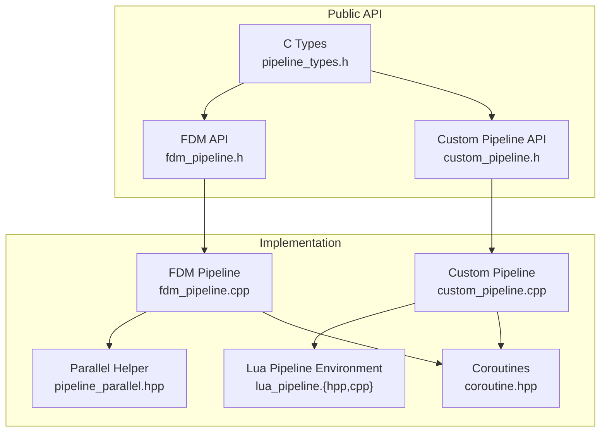
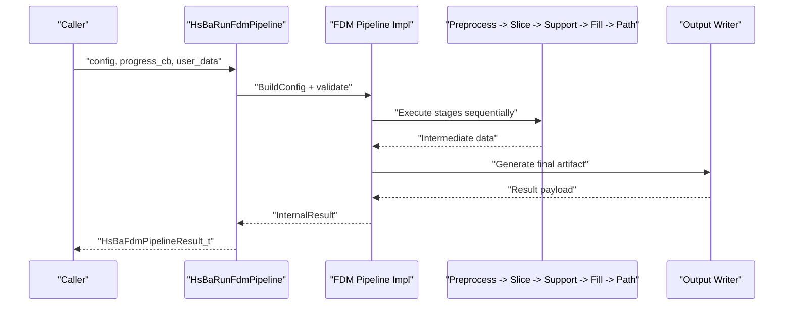
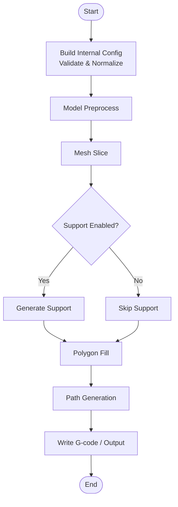
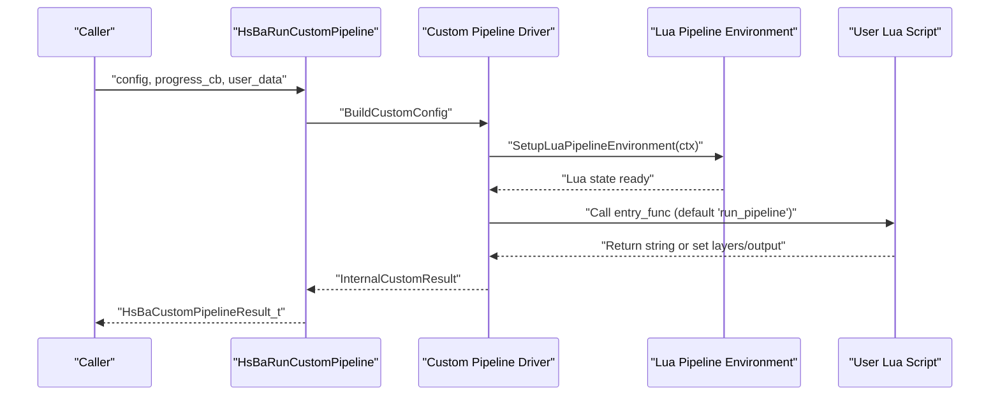
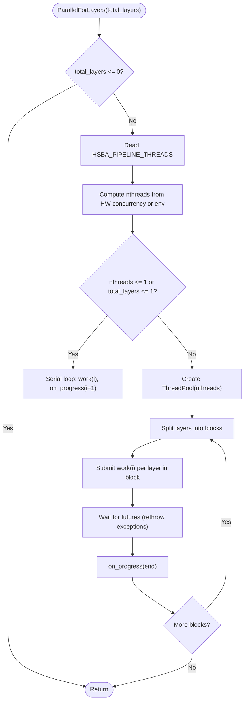
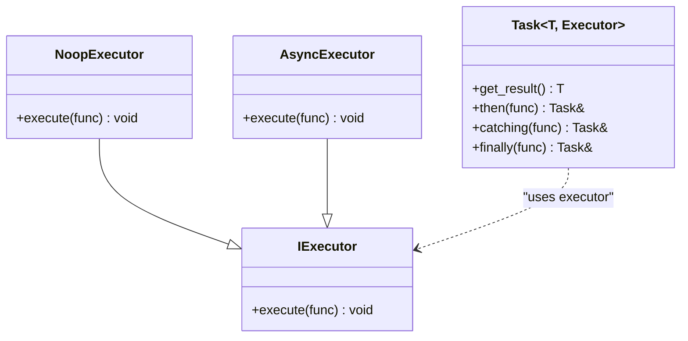
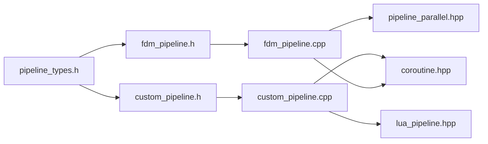

# Pipeline Architecture Pattern

<cite>
**Referenced Files in This Document**
- [pipeline_types.h](file://pipelinetypes/pipeline_types.h)
- [fdm_pipeline.h](file://DllHsBaSlicer/fdm_pipeline.h)
- [fdm_pipeline.cpp](file://DllHsBaSlicer/fdm_pipeline.cpp)
- [custom_pipeline.h](file://DllHsBaSlicer/custom_pipeline.h)
- [custom_pipeline.cpp](file://DllHsBaSlicer/custom_pipeline.cpp)
- [lua_pipeline.hpp](file://LibHsBaSlicer/Extends/lua_pipeline.hpp)
- [lua_pipeline.cpp](file://LibHsBaSlicer/Extends/lua_pipeline.cpp)
- [pipeline_parallel.hpp](file://DllHsBaSlicer/pipeline_parallel.hpp)
- [coroutine.hpp](file://base/coroutine.hpp)
</cite>

## Table of Contents
1. [Introduction](#introduction)
2. [Project Structure](#project-structure)
3. [Core Components](#core-components)
4. [Architecture Overview](#architecture-overview)
5. [Detailed Component Analysis](#detailed-component-analysis)
6. [Dependency Analysis](#dependency-analysis)
7. [Performance Considerations](#performance-considerations)
8. [Troubleshooting Guide](#troubleshooting-guide)
9. [Conclusion](#conclusion)

## Introduction
This document explains the pipeline architecture pattern used throughout HsBaSlicer. The system implements a stage-based processing model where complex manufacturing workflows are decomposed into sequential or parallel stages. It supports both fixed C++ pipelines (for example, FDM slicing and path generation) and fully Lua-driven custom pipelines that let users define arbitrary stage order and logic. Data flows through input validation, intermediate processing, and final output generation. A shared configuration system controls behavior and parameter passing between stages. Error handling is centralized around structured results and progress callbacks. Parallelism is provided at two levels: asynchronous task orchestration via coroutines and per-layer parallel execution for hot paths.

## Project Structure
The pipeline surface is exposed as C-compatible APIs with internal C++ implementations. Configuration and result types are defined centrally so downstream modules can use them without depending on the DLL.

**Diagram sources**
- [pipeline_types.h:1-120](file://pipelinetypes/pipeline_types.h#L1-L120)
- [fdm_pipeline.h:1-68](file://DllHsBaSlicer/fdm_pipeline.h#L1-L68)
- [custom_pipeline.h:1-69](file://DllHsBaSlicer/custom_pipeline.h#L1-L69)
- [fdm_pipeline.cpp:1-27](file://DllHsBaSlicer/fdm_pipeline.cpp#L1-L27)
- [custom_pipeline.cpp:1-17](file://DllHsBaSlicer/custom_pipeline.cpp#L1-L17)
- [lua_pipeline.hpp:1-88](file://LibHsBaSlicer/Extends/lua_pipeline.hpp#L1-L88)
- [lua_pipeline.cpp:1-39](file://LibHsBaSlicer/Extends/lua_pipeline.cpp#L1-L39)
- [pipeline_parallel.hpp:1-40](file://DllHsBaSlicer/pipeline_parallel.hpp#L1-L40)
- [coroutine.hpp:1-40](file://base/coroutine.hpp#L1-L40)

**Section sources**
- [pipeline_types.h:1-120](file://pipelinetypes/pipeline_types.h#L1-L120)
- [fdm_pipeline.h:1-68](file://DllHsBaSlicer/fdm_pipeline.h#L1-L68)
- [custom_pipeline.h:1-69](file://DllHsBaSlicer/custom_pipeline.h#L1-L69)

## Core Components
- Configuration and result types: Centralized C-compatible structs define inputs, outputs, and callback signatures for each pipeline family (FDM, SLA, SLS, SLM, LOM, TDP, WAAM, File Transfer, Custom).
- Fixed C++ pipelines: For example, FDM exposes synchronous and asynchronous run functions and a free function for result memory management.
- Fully Lua-driven custom pipeline: Exposes a minimal C ABI to create config, run synchronously or asynchronously, and free results. Internally it builds a Lua environment exposing all building blocks (model loading, slicing, support, fill, floor, path output, packaging).
- Parallel helper: Header-only utility to distribute independent layer work across a thread pool while serializing progress updates.
- Coroutines: Task abstraction enabling async orchestration, chaining, and error propagation.

Key responsibilities:
- Input validation and normalization occur when converting public configs to internal structures.
- Intermediate processing is implemented by LibHsBaSlicer components (preprocess, slice, support, fill, path generation).
- Final output generation writes G-code, images, robot programs, or other artifacts based on the pipeline type.
- Progress reporting uses typed callbacks; errors are returned in structured result objects.

**Section sources**
- [pipeline_types.h:1-120](file://pipelinetypes/pipeline_types.h#L1-L120)
- [pipeline_types.h:129-140](file://pipelinetypes/pipeline_types.h#L129-L140)
- [pipeline_types.h:165-232](file://pipelinetypes/pipeline_types.h#L165-L232)
- [pipeline_types.h:259-297](file://pipelinetypes/pipeline_types.h#L259-L297)
- [pipeline_types.h:359-388](file://pipelinetypes/pipeline_types.h#L359-L388)
- [pipeline_types.h:419-448](file://pipelinetypes/pipeline_types.h#L419-L448)
- [pipeline_types.h:480-508](file://pipelinetypes/pipeline_types.h#L480-L508)
- [pipeline_types.h:578-612](file://pipelinetypes/pipeline_types.h#L578-L612)
- [pipeline_types.h:636-674](file://pipelinetypes/pipeline_types.h#L636-L674)
- [pipeline_types.h:689-732](file://pipelinetypes/pipeline_types.h#L689-L732)
- [fdm_pipeline.h:17-61](file://DllHsBaSlicer/fdm_pipeline.h#L17-L61)
- [custom_pipeline.h:17-62](file://DllHsBaSlicer/custom_pipeline.h#L17-L62)
- [lua_pipeline.hpp:19-83](file://LibHsBaSlicer/Extends/lua_pipeline.hpp#L19-L83)
- [pipeline_parallel.hpp:22-40](file://DllHsBaSlicer/pipeline_parallel.hpp#L22-L40)
- [coroutine.hpp:41-73](file://base/coroutine.hpp#L41-L73)

## Architecture Overview
The pipeline architecture follows a consistent pattern:
- Public C API accepts typed configuration and optional progress/result callbacks.
- Implementation converts public configs to internal structures and validates required fields.
- Processing stages execute sequentially unless parallelized within a stage (e.g., per-layer work).
- Results are converted back to C-compatible structs with allocated strings that callers must free.
- Errors are captured in result objects and surfaced via success flags and error messages.

**Diagram sources**
- [fdm_pipeline.h:23-35](file://DllHsBaSlicer/fdm_pipeline.h#L23-L35)
- [fdm_pipeline.cpp:137-191](file://DllHsBaSlicer/fdm_pipeline.cpp#L137-L191)

## Detailed Component Analysis

### FDM Pipeline (Fixed Stage Order)
The FDM pipeline demonstrates the canonical stage sequence: preprocess, slice, support, fill, and path generation. It provides synchronous and asynchronous entry points and a dedicated free function for result memory.

**Diagram sources**
- [fdm_pipeline.h:23-35](file://DllHsBaSlicer/fdm_pipeline.h#L23-L35)
- [fdm_pipeline.cpp:137-191](file://DllHsBaSlicer/fdm_pipeline.cpp#L137-L191)

Key implementation details:
- Public config is mapped to an internal structure containing slice, support, path, printer, firmware, and output settings.
- Progress is reported through a typed callback with percentage and stage description.
- Result conversion allocates UTF-8 strings for content and error messages; callers must free them.

**Section sources**
- [fdm_pipeline.h:17-61](file://DllHsBaSlicer/fdm_pipeline.h#L17-L61)
- [fdm_pipeline.cpp:31-68](file://DllHsBaSlicer/fdm_pipeline.cpp#L31-L68)
- [fdm_pipeline.cpp:127-133](file://DllHsBaSlicer/fdm_pipeline.cpp#L127-L133)
- [fdm_pipeline.cpp:137-191](file://DllHsBaSlicer/fdm_pipeline.cpp#L137-L191)

### Custom Lua Pipeline (Fully Scriptable Workflow)
The custom pipeline delegates the entire workflow to a Lua entry function. The C++ side only sets up a Lua environment exposing all pipeline building blocks and runs the script.

**Diagram sources**
- [custom_pipeline.h:23-55](file://DllHsBaSlicer/custom_pipeline.h#L23-L55)
- [custom_pipeline.cpp:85-98](file://DllHsBaSlicer/custom_pipeline.cpp#L85-L98)
- [custom_pipeline.cpp:116-158](file://DllHsBaSlicer/custom_pipeline.cpp#L116-L158)
- [lua_pipeline.hpp:53-83](file://LibHsBaSlicer/Extends/lua_pipeline.hpp#L53-L83)

Important behaviors:
- If neither script file nor inline source is provided, the driver returns an error message immediately.
- The Lua environment receives context fields such as model name/path, output path, and JSON configuration.
- Progress from Lua is forwarded to the C callback.

**Section sources**
- [custom_pipeline.h:17-62](file://DllHsBaSlicer/custom_pipeline.h#L17-L62)
- [custom_pipeline.cpp:21-42](file://DllHsBaSlicer/custom_pipeline.cpp#L21-L42)
- [custom_pipeline.cpp:85-114](file://DllHsBaSlicer/custom_pipeline.cpp#L85-L114)
- [custom_pipeline.cpp:116-158](file://DllHsBaSlicer/custom_pipeline.cpp#L116-L158)
- [lua_pipeline.hpp:19-83](file://LibHsBaSlicer/Extends/lua_pipeline.hpp#L19-L83)

### Per-Layer Parallel Execution
Hot paths like slicing and filling iterate over independent layers. The parallel helper distributes work across a thread pool and serializes progress updates.

**Diagram sources**
- [pipeline_parallel.hpp:41-117](file://DllHsBaSlicer/pipeline_parallel.hpp#L41-L117)

Usage constraints:
- Work functors must be thread-safe and write only to their own layer index.
- Progress callbacks are invoked serially on the calling thread after each block completes.

**Section sources**
- [pipeline_parallel.hpp:22-40](file://DllHsBaSlicer/pipeline_parallel.hpp#L22-L40)
- [pipeline_parallel.hpp:41-117](file://DllHsBaSlicer/pipeline_parallel.hpp#L41-L117)

### Asynchronous Orchestration with Coroutines
Pipelines use a coroutine-based Task abstraction to implement non-blocking execution, chaining callbacks, and exception propagation.

**Diagram sources**
- [coroutine.hpp:47-73](file://base/coroutine.hpp#L47-L73)
- [coroutine.hpp:200-382](file://base/coroutine.hpp#L200-L382)

How pipelines use it:
- Synchronous API calls wait on Task completion.
- Asynchronous API chains completion callbacks using then().
- Exceptions thrown inside tasks are propagated to callers via catching() or get_result().

**Section sources**
- [coroutine.hpp:47-73](file://base/coroutine.hpp#L47-L73)
- [coroutine.hpp:200-382](file://base/coroutine.hpp#L200-L382)

## Dependency Analysis
The following diagram shows how public APIs depend on central types and internal implementations.

**Diagram sources**
- [pipeline_types.h:1-120](file://pipelinetypes/pipeline_types.h#L1-L120)
- [fdm_pipeline.h:1-68](file://DllHsBaSlicer/fdm_pipeline.h#L1-L68)
- [custom_pipeline.h:1-69](file://DllHsBaSlicer/custom_pipeline.h#L1-L69)
- [fdm_pipeline.cpp:1-27](file://DllHsBaSlicer/fdm_pipeline.cpp#L1-L27)
- [custom_pipeline.cpp:1-17](file://DllHsBaSlicer/custom_pipeline.cpp#L1-L17)
- [lua_pipeline.hpp:1-88](file://LibHsBaSlicer/Extends/lua_pipeline.hpp#L1-L88)
- [pipeline_parallel.hpp:1-40](file://DllHsBaSlicer/pipeline_parallel.hpp#L1-L40)
- [coroutine.hpp:1-40](file://base/coroutine.hpp#L1-L40)

Coupling and cohesion:
- High cohesion within each pipeline module (FDM, Custom).
- Low coupling to external libraries via well-defined C types and small adapters.
- Shared dependencies (coroutines, parallel helper) are reused across pipelines.

Potential circular dependencies:
- None observed among the analyzed files; dependencies flow from API headers to implementations and shared utilities.

External integration points:
- Lua environment for custom pipelines.
- Thread pool for parallel layer work.
- Filesystem and IO for reading models and writing outputs.

**Section sources**
- [pipeline_types.h:1-120](file://pipelinetypes/pipeline_types.h#L1-L120)
- [fdm_pipeline.h:1-68](file://DllHsBaSlicer/fdm_pipeline.h#L1-L68)
- [custom_pipeline.h:1-69](file://DllHsBaSlicer/custom_pipeline.h#L1-L69)
- [fdm_pipeline.cpp:1-27](file://DllHsBaSlicer/fdm_pipeline.cpp#L1-L27)
- [custom_pipeline.cpp:1-17](file://DllHsBaSlicer/custom_pipeline.cpp#L1-L17)
- [lua_pipeline.hpp:1-88](file://LibHsBaSlicer/Extends/lua_pipeline.hpp#L1-L88)
- [pipeline_parallel.hpp:1-40](file://DllHsBaSlicer/pipeline_parallel.hpp#L1-L40)
- [coroutine.hpp:1-40](file://base/coroutine.hpp#L1-L40)

## Performance Considerations
- Parallelization strategy: Use per-layer parallelism for independent workloads. The helper automatically falls back to serial execution when threads or layers are insufficient.
- Controlling worker count: An environment variable allows forcing serial execution for benchmarking or debugging.
- Progress callback overhead: Batching progress updates reduces callback frequency and avoids frequent cross-thread synchronization.
- Memory management: Allocated strings in results must be freed by callers to prevent leaks.
- Coroutine overhead: Tasks provide lightweight async orchestration; avoid excessive nesting to minimize stack usage.

[No sources needed since this section provides general guidance]

## Troubleshooting Guide
Common issues and resolutions:
- Missing Lua script or source in custom pipeline: The driver returns an error message if neither is provided. Ensure either script file or inline source is set.
- Incorrect result freeing: Always call the corresponding free function for pipeline results to release allocated strings.
- Progress not updating: Verify that the progress callback is provided and that stages report progress. In parallel mode, progress is updated per block.
- Unexpected performance: Check the environment variable controlling thread count and ensure hardware concurrency is available.

Error handling patterns:
- Structured results include success flags and error messages.
- Exceptions in worker tasks are rethrown to the caller via futures or task results.
- Lua errors are captured and returned in the custom pipeline result.

**Section sources**
- [custom_pipeline.cpp:124-130](file://DllHsBaSlicer/custom_pipeline.cpp#L124-L130)
- [custom_pipeline.cpp:196-203](file://DllHsBaSlicer/custom_pipeline.cpp#L196-L203)
- [pipeline_parallel.hpp:108-115](file://DllHsBaSlicer/pipeline_parallel.hpp#L108-L115)
- [coroutine.hpp:277-285](file://base/coroutine.hpp#L277-L285)

## Conclusion
HsBaSlicer’s pipeline architecture combines a clear stage-based model with flexible customization. Fixed pipelines like FDM enforce a proven sequence of operations, while the custom Lua pipeline enables arbitrary workflows. Shared infrastructure—typed configurations, coroutines, and parallel helpers—ensures consistent behavior, performance, and reliability. By adhering to the documented interfaces and resource management rules, integrators can extend or compose pipelines safely and efficiently.