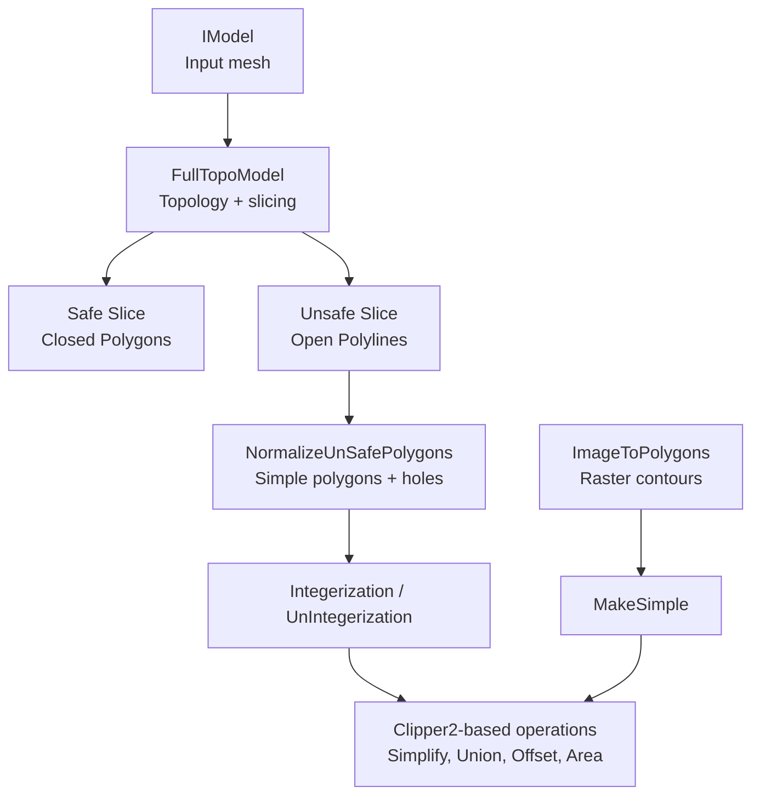
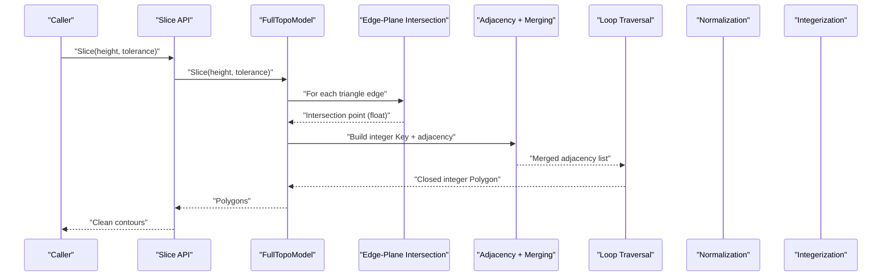
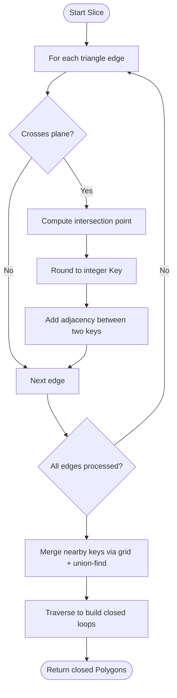
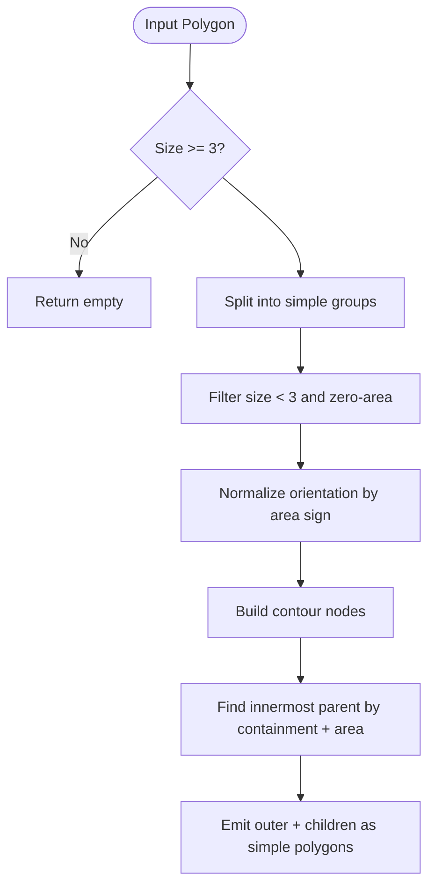
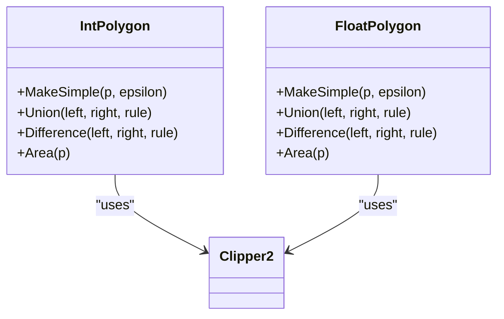
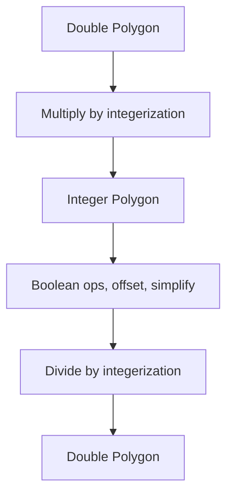
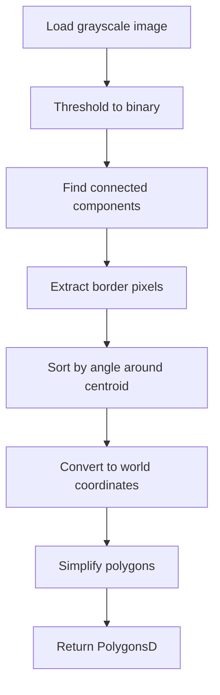
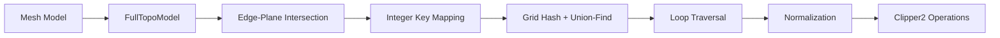

# Contour Extraction Methods

<cite>
**Referenced Files in This Document**
- [mesh_slice.cpp](file://LibHsBaSlicer/Slice/mesh_slice.cpp)
- [FullTopoModel.cpp](file://meshmodel/FullTopoModel.cpp)
- [IntPolygon.hpp](file://2D/IntPolygon.hpp)
- [IntPolygon.cpp](file://2D/IntPolygon.cpp)
- [FloatPolygons.hpp](file://2D/FloatPolygons.hpp)
- [FloatPolygons.cpp](file://2D/FloatPolygons.cpp)
- [ImageToPolygons.cpp](file://2D/ImageToPolygons.cpp)
</cite>

## Table of Contents
1. [Introduction](#introduction)
2. [Project Structure](#project-structure)
3. [Core Components](#core-components)
4. [Architecture Overview](#architecture-overview)
5. [Detailed Component Analysis](#detailed-component-analysis)
6. [Dependency Analysis](#dependency-analysis)
7. [Performance Considerations](#performance-considerations)
8. [Troubleshooting Guide](#troubleshooting-guide)
9. [Conclusion](#conclusion)

## Introduction
This document explains how HsBaSlicer converts raw 3D slice intersections into clean, ordered polygon contours suitable for downstream processing such as filling, offsetting, and export. It covers:
- How raw intersection points are collected from mesh edges at a given height.
- How floating-point coordinates are converted to integer coordinates for robust geometric operations.
- How adjacency graphs are built, merged, and traversed to extract closed loops.
- How self-intersecting or degenerate polygons are normalized into simple polygons with correct hole relationships.
- How floating-point and integer coordinate systems are used across different stages.
- Error handling and robustness strategies for real-world 3D models.

## Project Structure
The contour extraction pipeline spans three main layers:
- Slicing layer: computes raw intersections and returns either safe closed polygons or unsafe open polylines.
- Topology layer: reconstructs mesh topology and performs robust intersection detection and loop traversal.
- 2D polygon layer: provides simplification, boolean operations, integerization, and normalization utilities.

**Diagram sources**
- [mesh_slice.cpp:45-115](file://LibHsBaSlicer/Slice/mesh_slice.cpp#L45-L115)
- [FullTopoModel.cpp:328-600](file://meshmodel/FullTopoModel.cpp#L328-L600)
- [IntPolygon.cpp:19-26](file://2D/IntPolygon.cpp#L19-L26)
- [FloatPolygons.cpp:176-213](file://2D/FloatPolygons.cpp#L176-L213)
- [ImageToPolygons.cpp:87-174](file://2D/ImageToPolygons.cpp#L87-L174)

**Section sources**
- [mesh_slice.cpp:45-115](file://LibHsBaSlicer/Slice/mesh_slice.cpp#L45-L115)
- [FullTopoModel.cpp:328-600](file://meshmodel/FullTopoModel.cpp#L328-L600)
- [IntPolygon.hpp:16-26](file://2D/IntPolygon.hpp#L16-L26)
- [FloatPolygons.hpp:16-25](file://2D/FloatPolygons.hpp#L16-L25)
- [ImageToPolygons.cpp:87-174](file://2D/ImageToPolygons.cpp#L87-L174)

## Core Components
- Safe slicing: returns closed integer-coordinate polygons by walking the intersection graph.
- Unsafe slicing: returns open polylines that may contain self-intersections; later normalized.
- Integerization: scales double-precision coordinates by a fixed factor for exact arithmetic.
- Simplification: removes collinear vertices and reduces path complexity.
- Normalization: splits self-intersecting polygons, orders orientation, and assigns holes.

Key responsibilities:
- FullTopoModel: geometry kernel for edge-plane intersection, adjacency construction, merging nearby nodes, and loop traversal.
- IntPolygon: integer-coordinate boolean operations, simplification, normalization, and area/orientation helpers.
- FloatPolygons: double-coordinate wrappers around Clipper2, plus integerization/unintegerization.
- ImageToPolygons: raster-to-polygon conversion and optional simplification.

**Section sources**
- [FullTopoModel.cpp:246-272](file://meshmodel/FullTopoModel.cpp#L246-L272)
- [FullTopoModel.cpp:328-600](file://meshmodel/FullTopoModel.cpp#L328-L600)
- [IntPolygon.cpp:19-26](file://2D/IntPolygon.cpp#L19-L26)
- [IntPolygon.cpp:329-416](file://2D/IntPolygon.cpp#L329-L416)
- [FloatPolygons.cpp:176-213](file://2D/FloatPolygons.cpp#L176-L213)
- [ImageToPolygons.cpp:87-174](file://2D/ImageToPolygons.cpp#L87-L174)

## Architecture Overview
The end-to-end flow from 3D model to clean 2D contours is:

**Diagram sources**
- [mesh_slice.cpp:45-53](file://LibHsBaSlicer/Slice/mesh_slice.cpp#L45-L53)
- [FullTopoModel.cpp:328-600](file://meshmodel/FullTopoModel.cpp#L328-L600)

## Detailed Component Analysis

### Raw Intersection Collection and Ordering
Raw intersections are computed per triangle edge against the target plane. The algorithm:
- Checks whether an edge crosses the plane.
- Computes the intersection point in 3D.
- Rounds coordinates to integer keys using a scaling factor.
- Builds an adjacency map between neighboring intersection keys.
- Merges nearby keys using grid hashing and union-find to handle floating-point noise.
- Walks the merged adjacency graph to form closed loops, choosing the next vertex by minimizing the angle change relative to the incoming direction.

**Diagram sources**
- [FullTopoModel.cpp:246-272](file://meshmodel/FullTopoModel.cpp#L246-L272)
- [FullTopoModel.cpp:328-600](file://meshmodel/FullTopoModel.cpp#L328-L600)

**Section sources**
- [FullTopoModel.cpp:246-272](file://meshmodel/FullTopoModel.cpp#L246-L272)
- [FullTopoModel.cpp:328-600](file://meshmodel/FullTopoModel.cpp#L328-L600)

### Self-Intersection Removal and Hole Assignment
When unsafe slicing produces open polylines or when image-derived contours are self-intersecting, normalization ensures:
- Degenerate paths are discarded.
- Orientation is corrected based on signed area.
- Self-intersections are split into non-overlapping simple polygons.
- Holes are assigned by testing containment and selecting the smallest enclosing parent.

**Diagram sources**
- [IntPolygon.cpp:329-416](file://2D/IntPolygon.cpp#L329-L416)

**Section sources**
- [IntPolygon.cpp:329-416](file://2D/IntPolygon.cpp#L329-L416)

### Polygon Simplification
Simplification removes collinear vertices and reduces path complexity:
- For integer polygons, simplification uses Clipper2’s integer simplifier.
- For floating-point polygons, simplification uses Clipper2’s double simplifier.
- Default tolerances differ by coordinate type to match precision expectations.

**Diagram sources**
- [IntPolygon.cpp:19-26](file://2D/IntPolygon.cpp#L19-L26)
- [FloatPolygons.cpp:25-32](file://2D/FloatPolygons.cpp#L25-L32)

**Section sources**
- [IntPolygon.cpp:19-26](file://2D/IntPolygon.cpp#L19-L26)
- [FloatPolygons.cpp:25-32](file://2D/FloatPolygons.cpp#L25-L32)

### Conversion Between Floating-Point and Integer Coordinate Systems
HsBaSlicer uses two coordinate systems:
- Double-precision coordinates for high-level operations and user-facing APIs.
- 64-bit integer coordinates for robust boolean operations and simplification.

Conversion functions:
- Integerization: multiply coordinates by a constant scale factor.
- UnIntegerization: divide coordinates by the same scale factor.

**Diagram sources**
- [FloatPolygons.cpp:176-213](file://2D/FloatPolygons.cpp#L176-L213)
- [IntPolygon.hpp:16-26](file://2D/IntPolygon.hpp#L16-L26)

**Section sources**
- [FloatPolygons.cpp:176-213](file://2D/FloatPolygons.cpp#L176-L213)
- [IntPolygon.hpp:16-26](file://2D/IntPolygon.hpp#L16-L26)

### Raster-Based Contour Extraction
Image-based contours are extracted by:
- Loading grayscale images.
- Thresholding to binary masks.
- Finding connected components and border pixels.
- Sorting border pixels by polar angle around the component centroid.
- Converting pixel coordinates to world coordinates using pixel size.
- Simplifying resulting polygons.

**Diagram sources**
- [ImageToPolygons.cpp:87-174](file://2D/ImageToPolygons.cpp#L87-L174)

**Section sources**
- [ImageToPolygons.cpp:87-174](file://2D/ImageToPolygons.cpp#L87-L174)

## Dependency Analysis
The contour extraction pipeline depends on:
- Mesh topology reconstruction for accurate edge-face relationships.
- Robust intersection detection with tolerance-aware rounding.
- Grid hashing and union-find for merging near-coincident points.
- Clipper2 for integer and double polygon operations.
- Optional FreeType for text-to-polygon generation.

**Diagram sources**
- [FullTopoModel.cpp:328-600](file://meshmodel/FullTopoModel.cpp#L328-L600)
- [IntPolygon.cpp:19-26](file://2D/IntPolygon.cpp#L19-L26)
- [FloatPolygons.cpp:25-32](file://2D/FloatPolygons.cpp#L25-L32)

**Section sources**
- [FullTopoModel.cpp:328-600](file://meshmodel/FullTopoModel.cpp#L328-L600)
- [IntPolygon.cpp:19-26](file://2D/IntPolygon.cpp#L19-L26)
- [FloatPolygons.cpp:25-32](file://2D/FloatPolygons.cpp#L25-L32)

## Performance Considerations
- Tolerance selection: larger tolerances reduce fragmentation but may merge distinct features.
- Grid cell size: derived from tolerance; too small increases neighbor checks, too large merges unrelated points.
- Simplification epsilon: controls vertex reduction; too aggressive may distort geometry.
- Memory usage: adjacency maps and union-find structures scale with number of intersections.
- Raster resolution: higher pixel counts increase memory and processing time.

[No sources needed since this section provides general guidance]

## Troubleshooting Guide
Common issues and strategies:
- Open polylines from unsafe slicing: skip non-closed paths and normalize remaining segments.
- Degenerate polygons: filter out paths with fewer than three vertices or zero area.
- Floating-point noise: use tolerance-aware rounding and grid-based merging.
- External exceptions: wrap slicing calls to convert foreign exceptions into project error types.

Error handling patterns:
- Guard wrapper catches foreign exceptions and rethrows as IOError.
- Runtime errors are propagated unchanged.
- Lua integration validates script loading and function invocation.

**Section sources**
- [mesh_slice.cpp:27-42](file://LibHsBaSlicer/Slice/mesh_slice.cpp#L27-L42)
- [mesh_slice.cpp:85-103](file://LibHsBaSlicer/Slice/mesh_slice.cpp#L85-L103)
- [ImageToPolygons.cpp:417-478](file://2D/ImageToPolygons.cpp#L417-L478)

## Conclusion
HsBaSlicer’s contour extraction pipeline transforms raw 3D slice intersections into clean, ordered 2D polygons through a combination of robust geometric kernels, integerization for numerical stability, and careful normalization. The system handles real-world model imperfections by merging nearby points, splitting self-intersections, assigning holes, and simplifying paths. By separating concerns between slicing, topology, and 2D polygon operations, it remains extensible and maintainable while providing reliable outputs for downstream manufacturing workflows.

[No sources needed since this section summarizes without analyzing specific files]