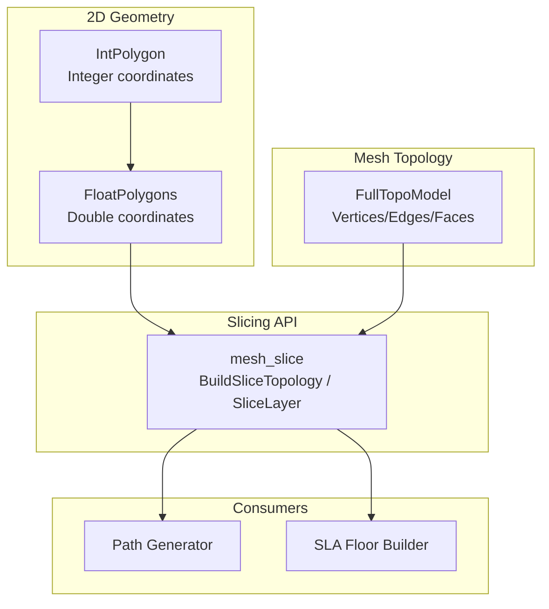
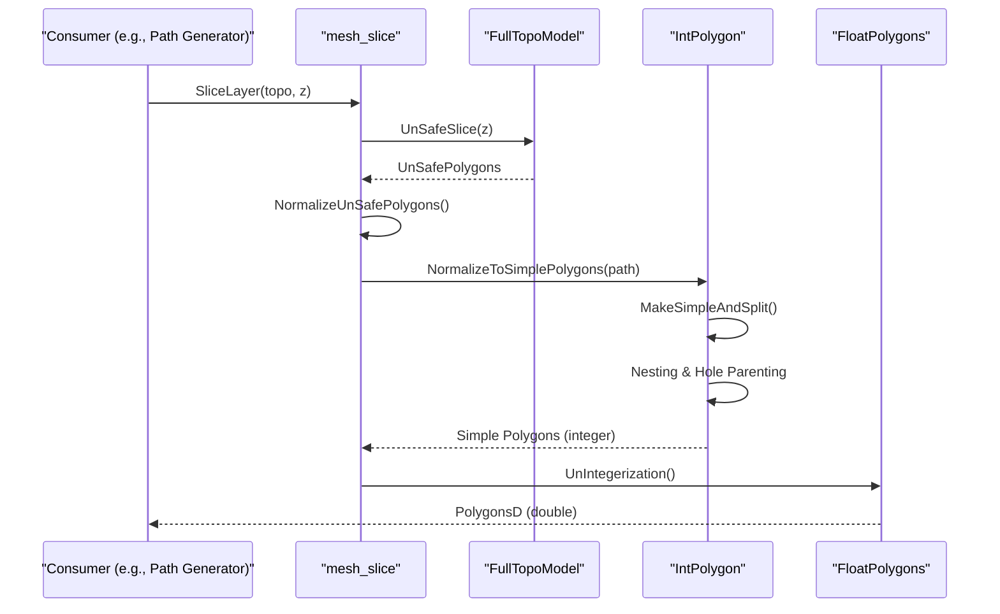
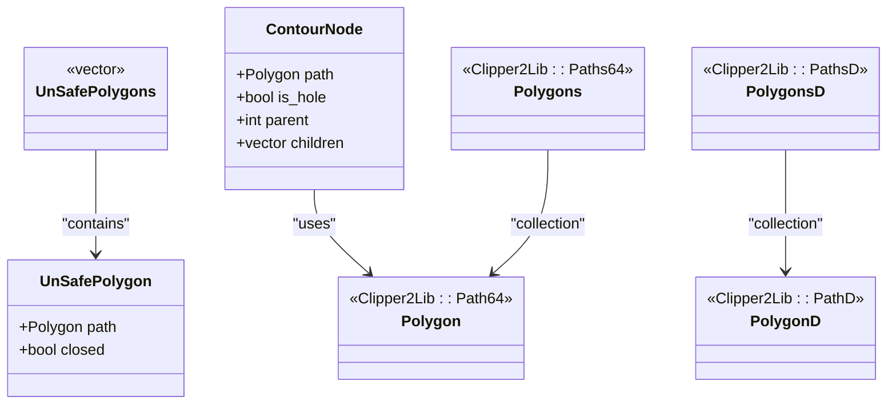
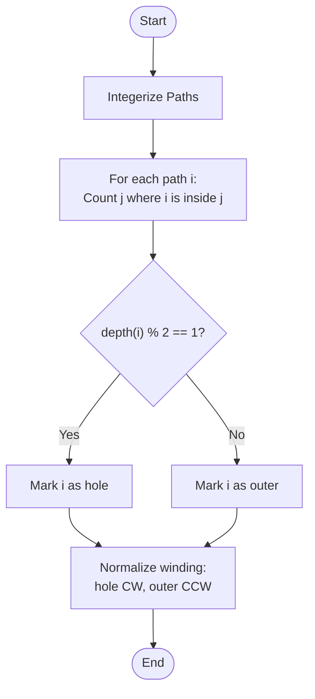
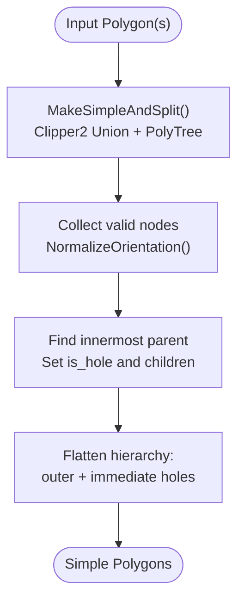
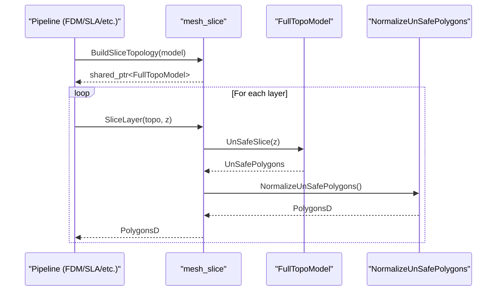
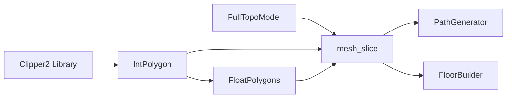

# Layer Topology Construction

<cite>
**Referenced Files in This Document**
- [IntPolygon.hpp](file://2D/IntPolygon.hpp)
- [IntPolygon.cpp](file://2D/IntPolygon.cpp)
- [FloatPolygons.hpp](file://2D/FloatPolygons.hpp)
- [FloatPolygons.cpp](file://2D/FloatPolygons.cpp)
- [FullTopoModel.hpp](file://meshmodel/FullTopoModel.hpp)
- [FullTopoModel.cpp](file://meshmodel/FullTopoModel.cpp)
- [CgalModel.cpp](file://meshmodel/CgalModel.cpp)
- [IglModel.cpp](file://meshmodel/IglModel.cpp)
- [mesh_slice.hpp](file://LibHsBaSlicer/Slice/mesh_slice.hpp)
- [mesh_slice.cpp](file://LibHsBaSlicer/Slice/mesh_slice.cpp)
- [path_generator.hpp](file://LibHsBaSlicer/Path/path_generator.hpp)
</cite>

## Table of Contents
1. [Introduction](#introduction)
2. [Project Structure](#project-structure)
3. [Core Components](#core-components)
4. [Architecture Overview](#architecture-overview)
5. [Detailed Component Analysis](#detailed-component-analysis)
6. [Dependency Analysis](#dependency-analysis)
7. [Performance Considerations](#performance-considerations)
8. [Troubleshooting Guide](#troubleshooting-guide)
9. [Conclusion](#conclusion)

## Introduction
This document explains how HsBaSlicer constructs layer topology from 2D polygon contours and organizes them into hierarchical structures representing outer boundaries, inner holes, and nested regions. It details the algorithms for polygon nesting detection, hole identification, orientation normalization, and topological relationships between different polygon regions. The data structures used to represent layer topology are described, along with how they facilitate efficient path generation for downstream slicing and toolpath creation.

## Project Structure
The layer topology construction spans several modules:
- 2D geometry primitives and operations (integer and double precision): IntPolygon and FloatPolygons
- Mesh topology model for slicing: FullTopoModel
- Slicing pipeline integration: mesh_slice API
- Downstream consumers that rely on normalized polygons: path generators and floor builders

**Diagram sources**
- [IntPolygon.hpp:1-241](file://2D/IntPolygon.hpp#L1-L241)
- [FloatPolygons.hpp:1-271](file://2D/FloatPolygons.hpp#L1-L271)
- [FullTopoModel.hpp:1-150](file://meshmodel/FullTopoModel.hpp#L1-L150)
- [mesh_slice.hpp:1-108](file://LibHsBaSlicer/Slice/mesh_slice.hpp#L1-L108)
- [path_generator.hpp:1-96](file://LibHsBaSlicer/Path/path_generator.hpp#L1-L96)

**Section sources**
- [IntPolygon.hpp:1-241](file://2D/IntPolygon.hpp#L1-L241)
- [FloatPolygons.hpp:1-271](file://2D/FloatPolygons.hpp#L1-L271)
- [FullTopoModel.hpp:1-150](file://meshmodel/FullTopoModel.hpp#L1-L150)
- [mesh_slice.hpp:1-108](file://LibHsBaSlicer/Slice/mesh_slice.hpp#L1-L108)
- [path_generator.hpp:1-96](file://LibHsBaSlicer/Path/path_generator.hpp#L1-L96)

## Core Components
- Integer-coordinate polygon types and operations: Point2, Polygon, Polygons; boolean ops, offset, area, point-in-polygon, simplification, splitting, and normalization to simple polygons with hierarchy.
- Double-precision polygon types and utilities: Point2D, PolygonD, PolygonsD; shape generators, text-to-polygons, integerization/un-integerization.
- FullTopoModel: a fully reconstructed mesh topology (vertices, edges, faces) enabling fast repeated slicing across layers.
- Slicing API: BuildSliceTopology and SliceLayer provide reusable topology and per-layer polygon extraction with normalization.

Key responsibilities:
- Normalize winding and identify holes via geometric containment and nesting depth parity.
- Split self-intersecting polygons into simple components and build parent-child relationships (outer boundary vs. holes).
- Provide clean PolygonsD outputs suitable for path generation.

**Section sources**
- [IntPolygon.hpp:1-241](file://2D/IntPolygon.hpp#L1-L241)
- [FloatPolygons.hpp:1-271](file://2D/FloatPolygons.hpp#L1-L271)
- [FullTopoModel.hpp:1-150](file://meshmodel/FullTopoModel.hpp#L1-L150)
- [mesh_slice.hpp:1-108](file://LibHsBaSlicer/Slice/mesh_slice.hpp#L1-L108)

## Architecture Overview
The layer topology construction follows this flow:
1. Input polygons may be integer or double precision.
2. For robust containment tests, double-precision paths are integerized using a scaling factor.
3. Hole identification uses nesting-depth parity based on majority-of-vertices containment checks.
4. Orientation is normalized so outer contours have positive signed area and holes negative signed area.
5. Self-intersecting polygons are split into simple components; a ContourNode tree captures parent-child relationships.
6. The final output is a list of simple polygons with correct hierarchy, ready for path generation.

**Diagram sources**
- [mesh_slice.cpp:85-115](file://LibHsBaSlicer/Slice/mesh_slice.cpp#L85-L115)
- [IntPolygon.cpp:265-416](file://2D/IntPolygon.cpp#L265-L416)
- [FloatPolygons.cpp:176-213](file://2D/FloatPolygons.cpp#L176-L213)

## Detailed Component Analysis

### Data Structures for Layer Topology
- UnSafePolygon and UnSafePolygons: raw slice results that may include open polylines and non-simple polygons.
- ContourNode: internal structure capturing a polygon’s path, whether it is a hole, its parent index, and children indices.
- Polygon/Polygons (integer) and PolygonD/PolygonsD (double): core containers for contour outlines and fills.

**Diagram sources**
- [FullTopoModel.hpp:25-41](file://meshmodel/FullTopoModel.hpp#L25-L41)
- [IntPolygon.cpp:282-288](file://2D/IntPolygon.cpp#L282-L288)
- [IntPolygon.hpp:19-26](file://2D/IntPolygon.hpp#L19-L26)
- [FloatPolygons.hpp:18-25](file://2D/FloatPolygons.hpp#L18-L25)

**Section sources**
- [FullTopoModel.hpp:25-41](file://meshmodel/FullTopoModel.hpp#L25-L41)
- [IntPolygon.cpp:282-288](file://2D/IntPolygon.cpp#L282-L288)
- [IntPolygon.hpp:19-26](file://2D/IntPolygon.hpp#L19-L26)
- [FloatPolygons.hpp:18-25](file://2D/FloatPolygons.hpp#L18-L25)

### Polygon Nesting Detection and Hole Identification
- Nesting depth parity determines whether a contour is a hole: odd depth means hole.
- Containment is evaluated by counting how many vertices of one polygon lie inside another; majority rule avoids misclassification when centroids fall inside inner sub-paths.
- Double-precision paths are integerized before containment testing to ensure exact arithmetic.

**Diagram sources**
- [CgalModel.cpp:746-787](file://meshmodel/CgalModel.cpp#L746-L787)
- [IglModel.cpp:729-770](file://meshmodel/IglModel.cpp#L729-L770)
- [FloatPolygons.cpp:176-213](file://2D/FloatPolygons.cpp#L176-L213)

**Section sources**
- [CgalModel.cpp:746-787](file://meshmodel/CgalModel.cpp#L746-L787)
- [IglModel.cpp:729-770](file://meshmodel/IglModel.cpp#L729-L770)
- [FloatPolygons.cpp:176-213](file://2D/FloatPolygons.cpp#L176-L213)

### Normalization to Simple Polygons and Hierarchical Relationships
- Self-intersecting polygons are simplified and split into simple components using Clipper2 union and PolyTree traversal.
- A ContourNode tree is built by finding the smallest-area container for each node, establishing parent-child relationships and marking holes.
- Orientation normalization ensures consistent signed areas: outer contours positive, holes negative.

**Diagram sources**
- [IntPolygon.cpp:235-278](file://2D/IntPolygon.cpp#L235-L278)
- [IntPolygon.cpp:315-326](file://2D/IntPolygon.cpp#L315-L326)
- [IntPolygon.cpp:329-404](file://2D/IntPolygon.cpp#L329-L404)

**Section sources**
- [IntPolygon.cpp:235-278](file://2D/IntPolygon.cpp#L235-L278)
- [IntPolygon.cpp:315-326](file://2D/IntPolygon.cpp#L315-L326)
- [IntPolygon.cpp:329-404](file://2D/IntPolygon.cpp#L329-L404)

### Slicing Pipeline Integration
- BuildSliceTopology constructs a reusable FullTopoModel once, avoiding repeated O(total_faces) rebuilds.
- SliceLayer extracts per-layer contours and normalizes them to PolygonsD.
- Consumers like path generators receive clean outlines and fills for efficient toolpath generation.

**Diagram sources**
- [mesh_slice.cpp:105-115](file://LibHsBaSlicer/Slice/mesh_slice.cpp#L105-L115)
- [mesh_slice.hpp:79-103](file://LibHsBaSlicer/Slice/mesh_slice.hpp#L79-L103)

**Section sources**
- [mesh_slice.cpp:105-115](file://LibHsBaSlicer/Slice/mesh_slice.cpp#L105-L115)
- [mesh_slice.hpp:79-103](file://LibHsBaSlicer/Slice/mesh_slice.hpp#L79-L103)

### Examples of Complex Geometries
- Bowtie self-intersection splits into two triangles; feeding multiple polygons preserves separate components while normalizing each.
- A pentagram star drives splitting into multiple regions and exercises nesting/hole-parent building, orientation normalization, and island recursion.
- Concave U-shapes challenge zigzag bridging logic due to changing connected components across scanlines.

These examples demonstrate how the topology system handles self-intersections, nested islands, and complex concavities, ensuring robust outputs for downstream processing.

**Section sources**
- [IntPolygon.cpp:329-404](file://2D/IntPolygon.cpp#L329-L404)
- [tests/IntPolygon/int_polygon_test.cpp:151-176](file://tests/IntPolygon/int_polygon_test.cpp#L151-L176)

## Dependency Analysis
- IntPolygon depends on Clipper2 for boolean operations, offset, area, and point-in-polygon tests.
- FloatPolygons provides double-precision wrappers and conversion utilities (integerization/un-integerization).
- FullTopoModel encapsulates mesh topology and exposes slicing APIs.
- mesh_slice integrates FullTopoModel and IntPolygon/FloatPolygons to produce normalized PolygonsD.
- Consumers (path generator, floor builder) depend on PolygonsD for toolpath generation.

**Diagram sources**
- [IntPolygon.cpp:15-16](file://2D/IntPolygon.cpp#L15-L16)
- [FloatPolygons.cpp:1-15](file://2D/FloatPolygons.cpp#L1-L15)
- [FullTopoModel.hpp:1-150](file://meshmodel/FullTopoModel.hpp#L1-L150)
- [mesh_slice.hpp:1-108](file://LibHsBaSlicer/Slice/mesh_slice.hpp#L1-L108)
- [path_generator.hpp:1-96](file://LibHsBaSlicer/Path/path_generator.hpp#L1-L96)

**Section sources**
- [IntPolygon.cpp:15-16](file://2D/IntPolygon.cpp#L15-L16)
- [FloatPolygons.cpp:1-15](file://2D/FloatPolygons.cpp#L1-L15)
- [FullTopoModel.hpp:1-150](file://meshmodel/FullTopoModel.hpp#L1-L150)
- [mesh_slice.hpp:1-108](file://LibHsBaSlicer/Slice/mesh_slice.hpp#L1-L108)
- [path_generator.hpp:1-96](file://LibHsBaSlicer/Path/path_generator.hpp#L1-L96)

## Performance Considerations
- Reuse FullTopoModel across layers to avoid repeated O(total_faces) topology rebuilds.
- Use integerization for containment tests to leverage exact arithmetic and avoid floating-point pitfalls.
- Simplify and split polygons early to reduce complexity during nesting and hole identification.
- Prefer even-odd fill rules and normalized winding to ensure consistent behavior with Clipper2 triangulation.

[No sources needed since this section provides general guidance]

## Troubleshooting Guide
- If triangulation fails after normalization, verify that outer contours are CCW and holes are CW; check nesting depth parity and majority-of-vertices containment logic.
- If open polylines appear in outputs, ensure NormalizeUnSafePolygons filters out open or degenerate polygons before downstream use.
- If point-in-polygon tests return unexpected results for double coordinates, confirm integerization is applied prior to containment checks.

**Section sources**
- [CgalModel.cpp:746-787](file://meshmodel/CgalModel.cpp#L746-L787)
- [IglModel.cpp:729-770](file://meshmodel/IglModel.cpp#L729-L770)
- [mesh_slice.cpp:85-103](file://LibHsBaSlicer/Slice/mesh_slice.cpp#L85-L103)

## Conclusion
HsBaSlicer’s layer topology construction combines robust 2D polygon operations with mesh-based slicing to deliver clean, hierarchically organized contours. By normalizing winding, identifying holes through nesting depth parity, and splitting self-intersecting polygons, the system produces reliable inputs for path generation. Reusing FullTopoModel across layers improves performance, while integerization ensures accurate containment tests. These design choices enable efficient and correct toolpath generation for diverse manufacturing processes.