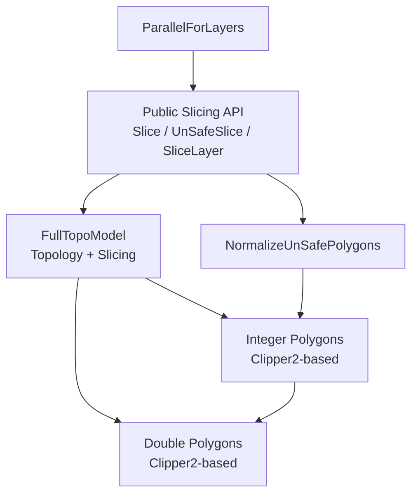
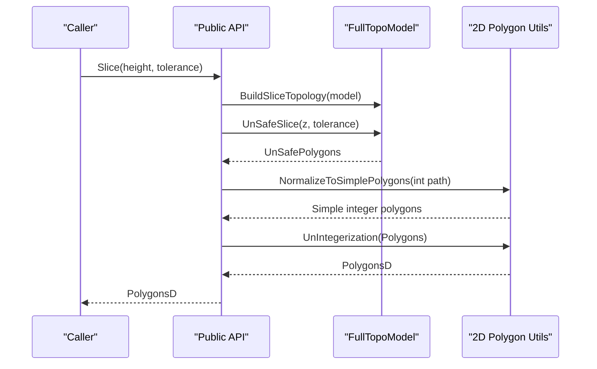
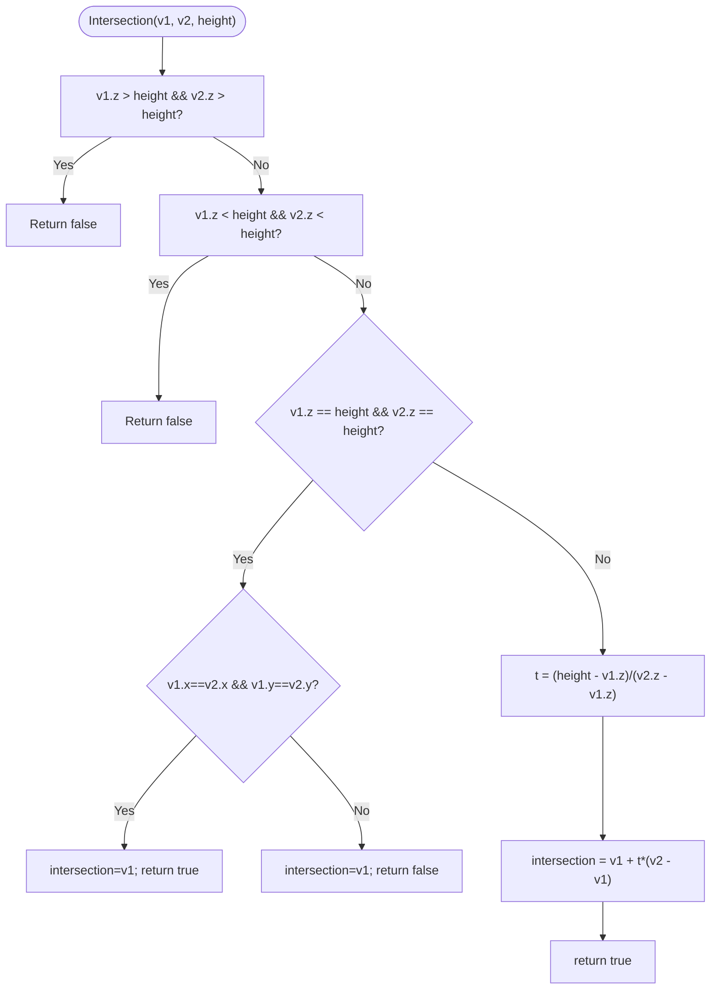
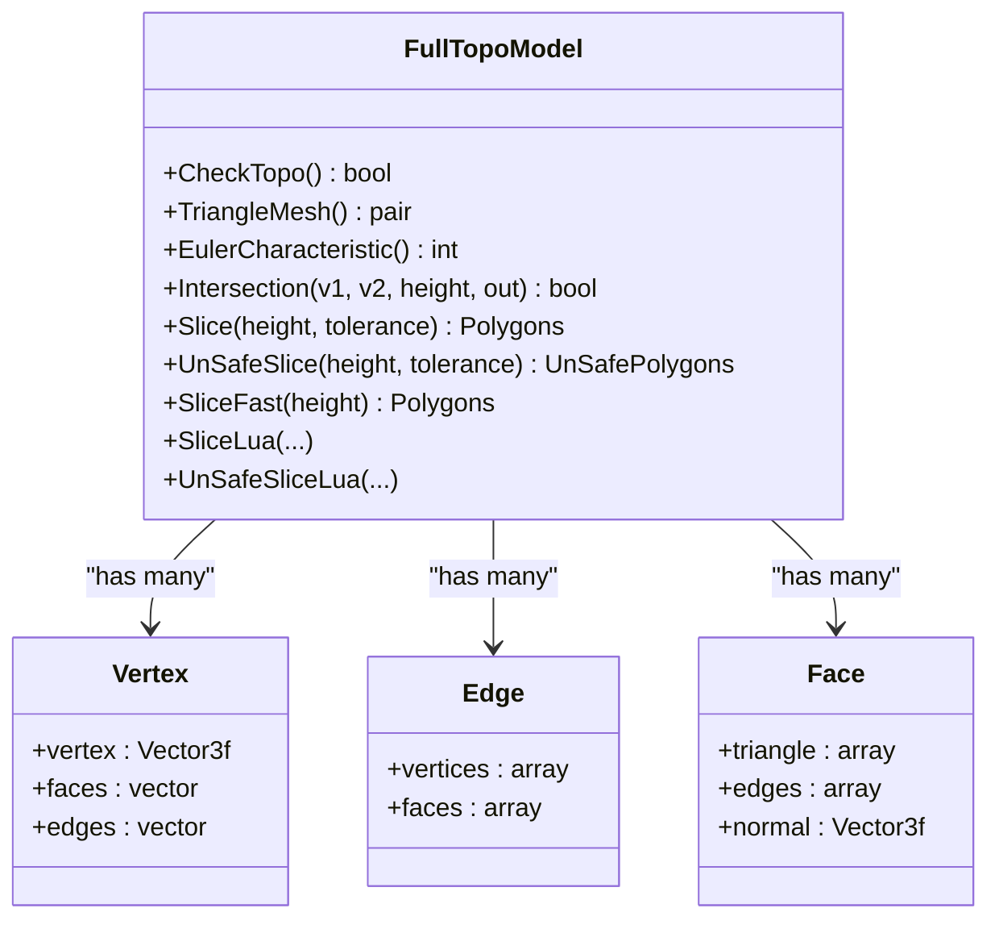
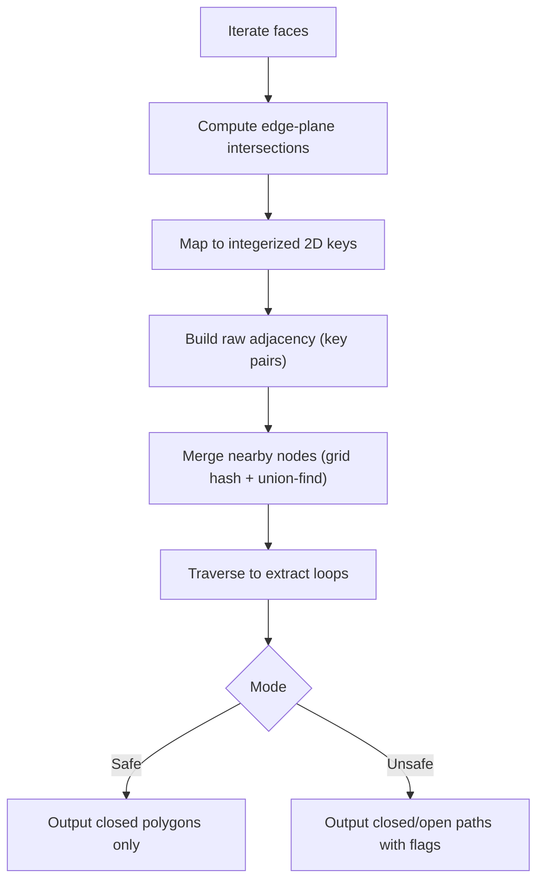
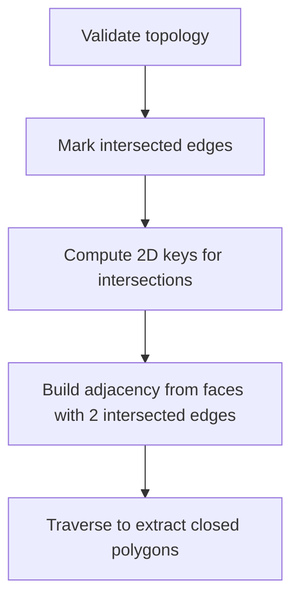
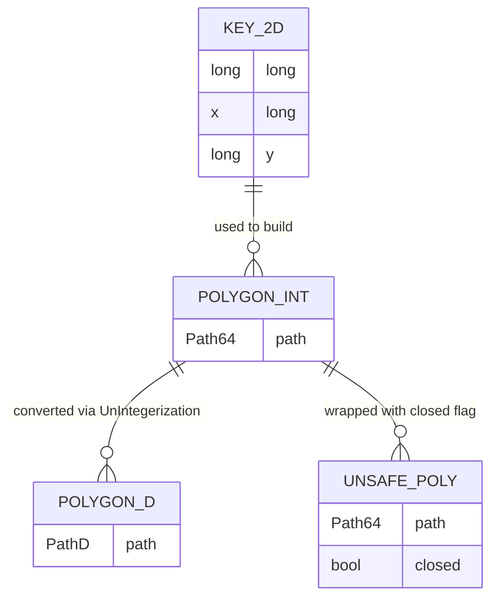
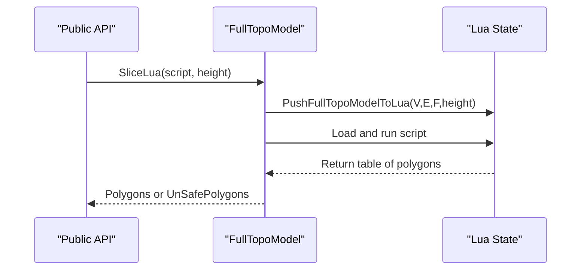
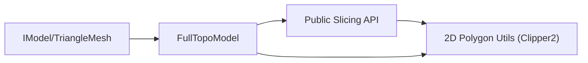
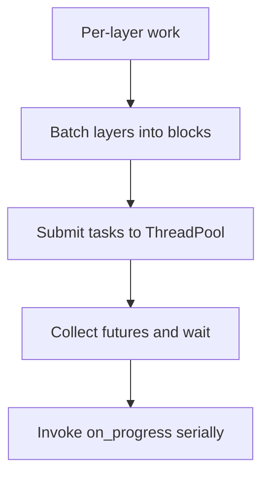

# Mesh Slicing Algorithms

<cite>
**Referenced Files in This Document**
- [mesh_slice.hpp](file://LibHsBaSlicer/Slice/mesh_slice.hpp)
- [mesh_slice.cpp](file://LibHsBaSlicer/Slice/mesh_slice.cpp)
- [FullTopoModel.hpp](file://meshmodel/FullTopoModel.hpp)
- [FullTopoModel.cpp](file://meshmodel/FullTopoModel.cpp)
- [IntPolygon.hpp](file://2D/IntPolygon.hpp)
- [FloatPolygons.hpp](file://2D/FloatPolygons.hpp)
- [FloatPolygons.cpp](file://2D/FloatPolygons.cpp)
- [pipeline_parallel.hpp](file://DllHsBaSlicer/pipeline_parallel.hpp)
</cite>

## Table of Contents
1. [Introduction](#introduction)
2. [Project Structure](#project-structure)
3. [Core Components](#core-components)
4. [Architecture Overview](#architecture-overview)
5. [Detailed Component Analysis](#detailed-component-analysis)
6. [Dependency Analysis](#dependency-analysis)
7. [Performance Considerations](#performance-considerations)
8. [Troubleshooting Guide](#troubleshooting-guide)
9. [Conclusion](#conclusion)

## Introduction
This document explains the mesh slicing algorithms used by HsBaSlicer, focusing on planar intersection with triangular meshes, data structures for slice intersections, and conversion to 2D geometry. It covers:
- Mathematical foundations of edge-plane intersection (ray-tracing style line segment intersection with a horizontal plane).
- Handling of different mesh types via a topology-reconstructed model.
- Edge cases such as degenerate triangles and parallel edges.
- Numerical precision strategies using integerized coordinates and tolerance-based merging.
- Data flow from 3D slices to 2D polygons.
- Performance optimizations including reusable topologies and layer-wise parallelism.

## Project Structure
The slicing subsystem is centered around:
- A public API that wraps slicing operations and normalizes results.
- A topology-reconstructed mesh model that provides safe and unsafe slicing plus Lua-driven customization.
- 2D polygon utilities for simplification, boolean operations, and coordinate conversions.
- A pipeline helper for parallelizing independent layers.

**Diagram sources**
- [mesh_slice.hpp:22-103](file://LibHsBaSlicer/Slice/mesh_slice.hpp#L22-L103)
- [mesh_slice.cpp:45-115](file://LibHsBaSlicer/Slice/mesh_slice.cpp#L45-L115)
- [FullTopoModel.hpp:23-146](file://meshmodel/FullTopoModel.hpp#L23-L146)
- [IntPolygon.hpp:16-27](file://2D/IntPolygon.hpp#L16-L27)
- [FloatPolygons.hpp:18-25](file://2D/FloatPolygons.hpp#L18-L25)
- [pipeline_parallel.hpp:22-42](file://DllHsBaSlicer/pipeline_parallel.hpp#L22-L42)

**Section sources**
- [mesh_slice.hpp:22-103](file://LibHsBaSlicer/Slice/mesh_slice.hpp#L22-L103)
- [mesh_slice.cpp:45-115](file://LibHsBaSlicer/Slice/mesh_slice.cpp#L45-L115)
- [FullTopoModel.hpp:23-146](file://meshmodel/FullTopoModel.hpp#L23-L146)
- [IntPolygon.hpp:16-27](file://2D/IntPolygon.hpp#L16-L27)
- [FloatPolygons.hpp:18-25](file://2D/FloatPolygons.hpp#L18-L25)
- [pipeline_parallel.hpp:22-42](file://DllHsBaSlicer/pipeline_parallel.hpp#L22-L42)

## Core Components
- Public slicing API:
  - Safe and unsafe slicing at a given height.
  - Lua-driven slicing.
  - Normalization of unsafe polygons to clean double-precision polygons.
  - Reusable topology construction and single-layer slicing.
- FullTopoModel:
  - Builds vertex/edge/face topology from a triangle mesh.
  - Provides Intersection for edge-plane tests.
  - Implements Slice, UnSafeSlice, SliceFast, and Lua variants.
- 2D Polygon Utilities:
  - Integer and double-precision polygon types.
  - Simplification, normalization, area, and conversion functions.
- Parallel Layer Execution:
  - Distributes independent layer work across threads.

**Section sources**
- [mesh_slice.hpp:22-103](file://LibHsBaSlicer/Slice/mesh_slice.hpp#L22-L103)
- [FullTopoModel.hpp:43-146](file://meshmodel/FullTopoModel.hpp#L43-L146)
- [IntPolygon.hpp:16-66](file://2D/IntPolygon.hpp#L16-L66)
- [FloatPolygons.hpp:18-25](file://2D/FloatPolygons.hpp#L18-L25)
- [pipeline_parallel.hpp:22-42](file://DllHsBaSlicer/pipeline_parallel.hpp#L22-L42)

## Architecture Overview
The slicing pipeline transforms a 3D triangle mesh into 2D closed or open contours per layer:

**Diagram sources**
- [mesh_slice.cpp:45-115](file://LibHsBaSlicer/Slice/mesh_slice.cpp#L45-L115)
- [FullTopoModel.cpp:604-873](file://meshmodel/FullTopoModel.cpp#L604-L873)
- [FloatPolygons.cpp:176-200](file://2D/FloatPolygons.cpp#L176-L200)

## Detailed Component Analysis

### Planar Mesh Intersection (Edge-Plane Ray Tracing)
The core mathematical operation is intersecting a line segment (triangle edge) with a horizontal plane at a given Z height. The algorithm:
- Rejects segments entirely above or below the plane.
- Handles parallel segments lying on the plane (returns false unless endpoints coincide).
- Computes the parametric position t along the segment and returns the intersection point.

**Diagram sources**
- [FullTopoModel.cpp:246-272](file://meshmodel/FullTopoModel.cpp#L246-L272)

**Section sources**
- [FullTopoModel.cpp:246-272](file://meshmodel/FullTopoModel.cpp#L246-L272)

### Topology-Reconstructed Mesh Model
FullTopoModel reconstructs a manifold-like structure with explicit vertices, edges, and faces:
- Vertices store positions and adjacency lists to faces and edges.
- Edges store vertex indices and incident face indices.
- Faces store triangle vertex indices, edge indices, and optional normals.

**Diagram sources**
- [FullTopoModel.hpp:53-142](file://meshmodel/FullTopoModel.hpp#L53-L142)

**Section sources**
- [FullTopoModel.hpp:53-142](file://meshmodel/FullTopoModel.hpp#L53-L142)
- [FullTopoModel.cpp:50-158](file://meshmodel/FullTopoModel.cpp#L50-L158)

### Safe and Unsafe Slicing Algorithms
Both Slice and UnSafeSlice follow a similar pipeline:
1. For each face, compute up to two intersection points with the plane.
2. Convert intersection points to integerized 2D keys (x,y scaled by integerization).
3. Build an adjacency list of these keys where each face contributes one edge between two distinct keys.
4. Merge nearby nodes using grid hashing and union-find based on tolerance.
5. Traverse the merged adjacency graph to extract loops:
   - Safe mode discards open polylines and only outputs closed polygons.
   - Unsafe mode preserves open polylines and marks them with a closed flag.

**Diagram sources**
- [FullTopoModel.cpp:328-600](file://meshmodel/FullTopoModel.cpp#L328-L600)
- [FullTopoModel.cpp:604-873](file://meshmodel/FullTopoModel.cpp#L604-L873)

**Section sources**
- [FullTopoModel.cpp:328-600](file://meshmodel/FullTopoModel.cpp#L328-L600)
- [FullTopoModel.cpp:604-873](file://meshmodel/FullTopoModel.cpp#L604-L873)

### Fast Slicing via Precomputed Edges
SliceFast assumes a valid topology and directly uses precomputed edges:
- Marks edges intersected by the plane and computes their 2D keys.
- Builds adjacency from faces whose two intersected edges yield distinct keys.
- Traverses to produce closed polygons.

**Diagram sources**
- [FullTopoModel.cpp:875-1025](file://meshmodel/FullTopoModel.cpp#L875-L1025)

**Section sources**
- [FullTopoModel.cpp:875-1025](file://meshmodel/FullTopoModel.cpp#L875-L1025)

### Data Structures for Slice Intersections and 2D Geometry
- Integerized 2D keys:
  - Coordinates are multiplied by a scaling factor (integerization) and rounded to integers for robust comparisons and merging.
- Polygon types:
  - Integer polygons (Path64) and double-precision polygons (PathD).
  - Collections (Paths64, PathsD).
- Conversion:
  - Integerization and UnIntegerization convert between coordinate systems.
  - Simplification and normalization ensure simple, non-self-intersecting polygons.

**Diagram sources**
- [IntPolygon.hpp:16-27](file://2D/IntPolygon.hpp#L16-L27)
- [FloatPolygons.hpp:18-25](file://2D/FloatPolygons.hpp#L18-L25)
- [FloatPolygons.cpp:176-200](file://2D/FloatPolygons.cpp#L176-L200)
- [FullTopoModel.hpp:25-41](file://meshmodel/FullTopoModel.hpp#L25-L41)

**Section sources**
- [IntPolygon.hpp:16-27](file://2D/IntPolygon.hpp#L16-L27)
- [FloatPolygons.hpp:18-25](file://2D/FloatPolygons.hpp#L18-L25)
- [FloatPolygons.cpp:176-200](file://2D/FloatPolygons.cpp#L176-L200)
- [FullTopoModel.hpp:25-41](file://meshmodel/FullTopoModel.hpp#L25-L41)

### Handling Different Mesh Types and Edge Cases
- Mesh input:
  - Any IModel providing TriangleMesh can be converted to FullTopoModel.
- Degenerate triangles:
  - Invalid vertex indices are skipped during topology construction.
- Parallel edges on the plane:
  - Intersection returns false when both endpoints lie on the plane unless they are identical.
- Tolerance and numerical precision:
  - Coordinate merging uses a tolerance scaled by integerization to avoid floating-point drift.
  - Grid hashing groups nearby keys within a tolerance radius for union-find merging.

**Section sources**
- [FullTopoModel.cpp:50-158](file://meshmodel/FullTopoModel.cpp#L50-L158)
- [FullTopoModel.cpp:246-272](file://meshmodel/FullTopoModel.cpp#L246-L272)
- [FullTopoModel.cpp:328-485](file://meshmodel/FullTopoModel.cpp#L328-L485)
- [FullTopoModel.cpp:604-755](file://meshmodel/FullTopoModel.cpp#L604-L755)

### Lua-Driven Slicing
- The model exposes V (vertices), E (edges), F (faces), and height to Lua scripts.
- Scripts can compute custom slice logic and return polygons.
- Both safe and unsafe modes are supported.

**Diagram sources**
- [FullTopoModel.cpp:274-324](file://meshmodel/FullTopoModel.cpp#L274-L324)
- [FullTopoModel.cpp:1027-1130](file://meshmodel/FullTopoModel.cpp#L1027-L1130)

**Section sources**
- [FullTopoModel.cpp:274-324](file://meshmodel/FullTopoModel.cpp#L274-L324)
- [FullTopoModel.cpp:1027-1130](file://meshmodel/FullTopoModel.cpp#L1027-L1130)

## Dependency Analysis
The slicing components depend on:
- 2D polygon utilities for simplification, boolean operations, and coordinate conversions.
- External libraries (Clipper2) for robust 2D geometry.
- Optional CAD/tessellation backends (CGAL/OCCT) for initial mesh extraction, which may throw foreign exceptions handled by the API wrapper.

**Diagram sources**
- [mesh_slice.cpp:18-42](file://LibHsBaSlicer/Slice/mesh_slice.cpp#L18-L42)
- [FloatPolygons.hpp:9-11](file://2D/FloatPolygons.hpp#L9-L11)
- [IntPolygon.hpp:9-11](file://2D/IntPolygon.hpp#L9-L11)

**Section sources**
- [mesh_slice.cpp:18-42](file://LibHsBaSlicer/Slice/mesh_slice.cpp#L18-L42)
- [FloatPolygons.hpp:9-11](file://2D/FloatPolygons.hpp#L9-L11)
- [IntPolygon.hpp:9-11](file://2D/IntPolygon.hpp#L9-L11)

## Performance Considerations
- Reusable topology:
  - BuildSliceTopology constructs the topology once and reuses it for multiple layers, avoiding repeated O(total_faces) rebuilds.
- Integerized coordinates:
  - Scaling and rounding reduce floating-point errors and enable efficient merging.
- Grid hashing and union-find:
  - Near-neighbor merging runs in near-linear time relative to the number of intersection points.
- Fast path:
  - SliceFast leverages precomputed edges to skip redundant computations.
- Parallel layer processing:
  - ParallelForLayers distributes independent layers across threads, batching progress callbacks.

**Diagram sources**
- [pipeline_parallel.hpp:41-117](file://DllHsBaSlicer/pipeline_parallel.hpp#L41-L117)

**Section sources**
- [mesh_slice.cpp:105-115](file://LibHsBaSlicer/Slice/mesh_slice.cpp#L105-L115)
- [FullTopoModel.cpp:875-1025](file://meshmodel/FullTopoModel.cpp#L875-L1025)
- [pipeline_parallel.hpp:41-117](file://DllHsBaSlicer/pipeline_parallel.hpp#L41-L117)

## Troubleshooting Guide
- Foreign exceptions from CGAL/OCCT:
  - The API wrapper converts external exceptions to project IOError types to maintain stable boundaries.
- Lua scripting errors:
  - Script load/runtime errors are reported as RuntimeError with details.
- Invalid topology:
  - SliceFast checks topology validity and throws if invalid.
- Degenerate or open contours:
  - NormalizeUnSafePolygons filters open polylines and non-simple polygons before converting to double precision.

**Section sources**
- [mesh_slice.cpp:18-42](file://LibHsBaSlicer/Slice/mesh_slice.cpp#L18-L42)
- [FullTopoModel.cpp:875-880](file://meshmodel/FullTopoModel.cpp#L875-L880)
- [mesh_slice.cpp:85-103](file://LibHsBaSlicer/Slice/mesh_slice.cpp#L85-L103)

## Conclusion
HsBaSlicer’s slicing system combines robust geometric primitives with efficient data structures and algorithms:
- Edge-plane intersection forms the foundation for planar slicing.
- A topology-reconstructed model enables safe traversal and loop extraction.
- Integerized coordinates and tolerance-aware merging ensure numerical stability.
- Reusable topologies and parallel layer execution provide strong performance characteristics.
- Lua scripting offers extensibility for custom slice logic.