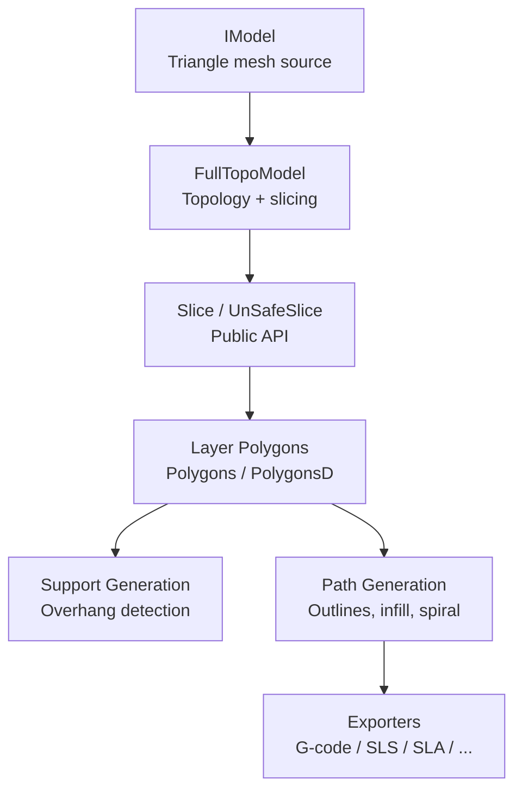
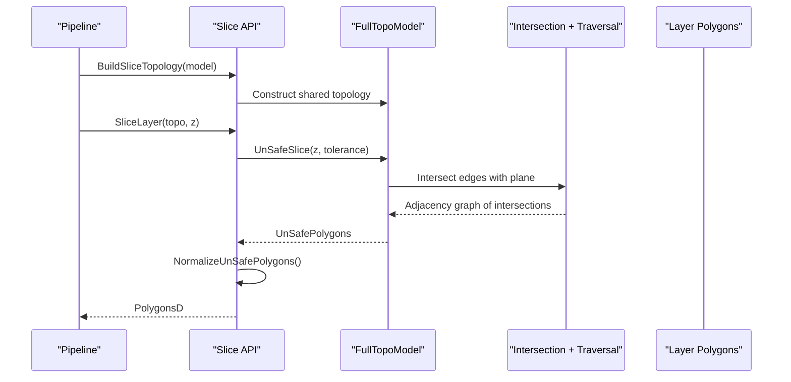
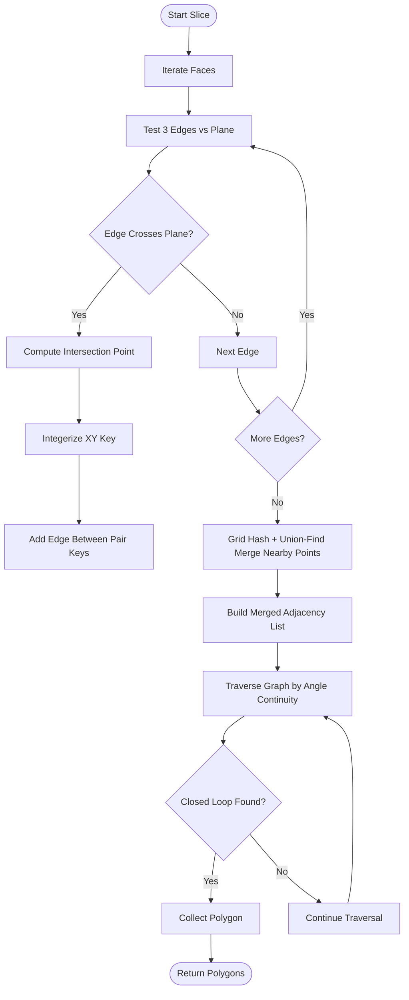
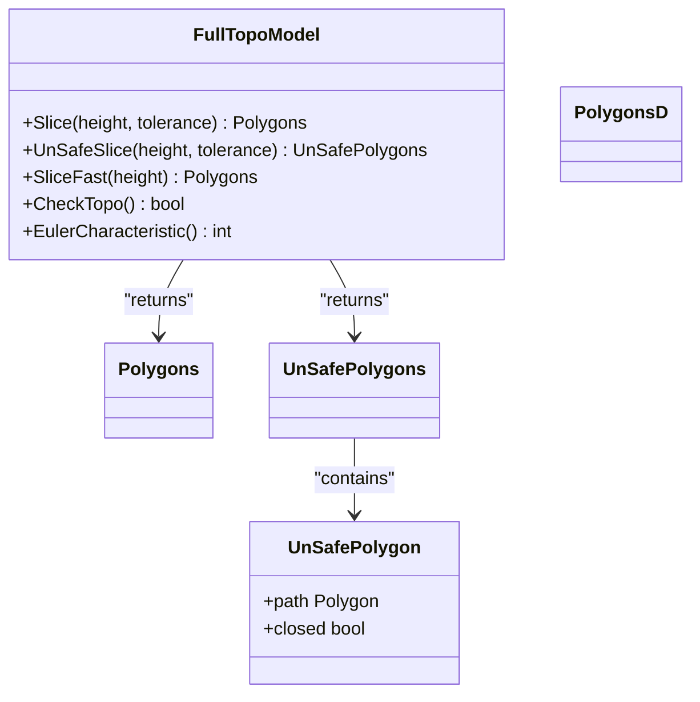
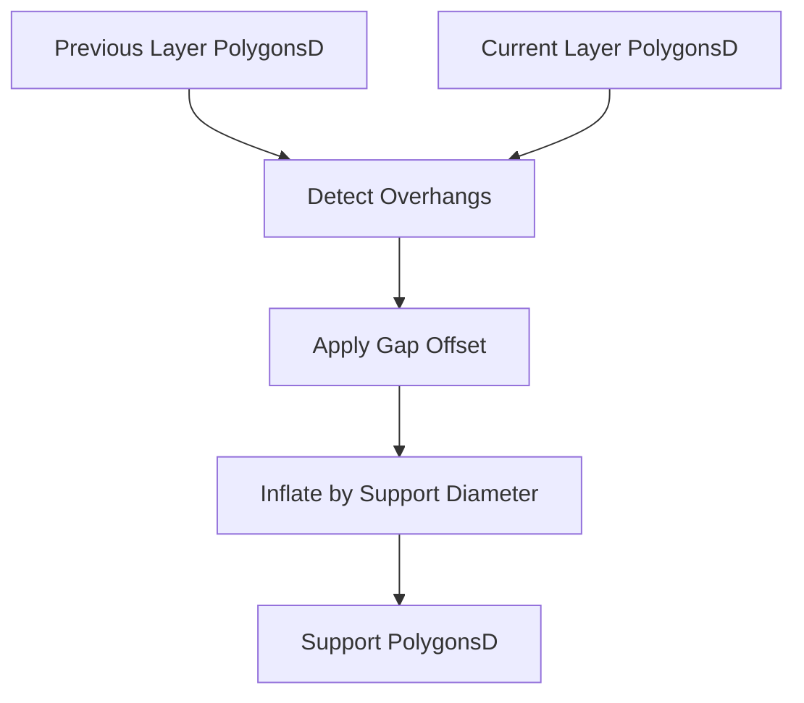
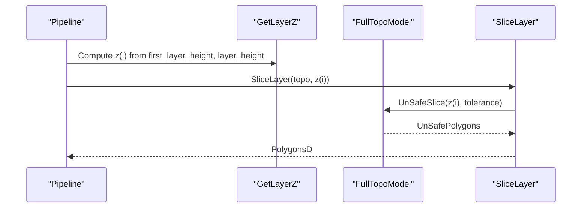
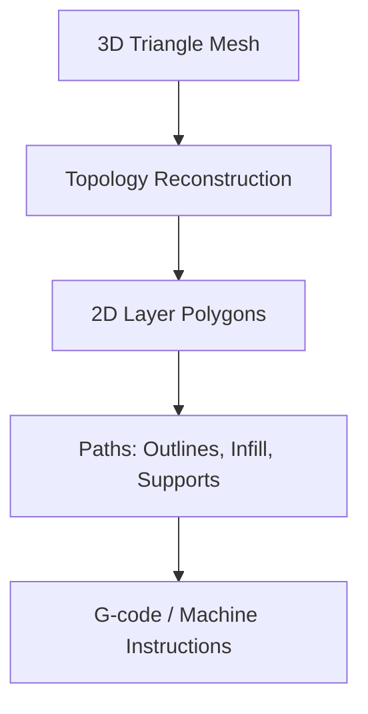
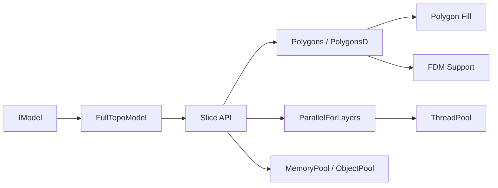

# Slicing Process Fundamentals

<cite>
**Referenced Files in This Document**
- [mesh_slice.hpp](file://LibHsBaSlicer/Slice/mesh_slice.hpp)
- [mesh_slice.cpp](file://LibHsBaSlicer/Slice/mesh_slice.cpp)
- [FullTopoModel.hpp](file://meshmodel/FullTopoModel.hpp)
- [FullTopoModel.cpp](file://meshmodel/FullTopoModel.cpp)
- [pipeline_parallel.hpp](file://DllHsBaSlicer/pipeline_parallel.hpp)
- [fdm_pipeline.cpp](file://DllHsBaSlicer/fdm_pipeline.cpp)
- [sla_pipeline.cpp](file://DllHsBaSlicer/sla_pipeline.cpp)
- [tdp_pipeline.cpp](file://DllHsBaSlicer/tdp_pipeline.cpp)
- [memory_pool.hpp](file://base/memory_pool.hpp)
- [object_pool.hpp](file://base/object_pool.hpp)
- [thread_pool.hpp](file://base/thread_pool.hpp)
- [FloatPolygons.hpp](file://2D/FloatPolygons.hpp)
- [IntPolygon.hpp](file://2D/IntPolygon.hpp)
- [FdmSupport.cpp](file://support/FdmSupport.cpp)
- [spiral_path.hpp](file://LibHsBaSlicer/Path/spiral_path.hpp)
- [main_header.cpp](file://samples/LibHsBaSlicer/main_header.cpp)
</cite>

## Table of Contents
1. [Introduction](#introduction)
2. [Project Structure](#project-structure)
3. [Core Components](#core-components)
4. [Architecture Overview](#architecture-overview)
5. [Detailed Component Analysis](#detailed-component-analysis)
6. [Dependency Analysis](#dependency-analysis)
7. [Performance Considerations](#performance-considerations)
8. [Troubleshooting Guide](#troubleshooting-guide)
9. [Conclusion](#conclusion)

## Introduction
This document explains the core slicing process in HsBaSlicer: how 3D models are converted into 2D layers by planar mesh slicing along the Z-axis, and how those layers become outlines, fills, supports, and eventually G-code or other machine instructions. It focuses on the geometry pipeline from 3D triangles to 2D polygon contours, the layer-based processing model, layer height and first-layer behavior, adaptive layering concepts, memory management, and performance optimization techniques used by the slicer.

## Project Structure
The slicing subsystem is centered around a reusable topology model and a thin public slicing API. The high-level pipelines (FDM, SLA, TDP, etc.) build the topology once and slice all layers in parallel.

**Diagram sources**
- [FullTopoModel.hpp:43-142](file://meshmodel/FullTopoModel.hpp#L43-L142)
- [mesh_slice.hpp:22-103](file://LibHsBaSlicer/Slice/mesh_slice.hpp#L22-L103)
- [fdm_pipeline.cpp:253-272](file://DllHsBaSlicer/fdm_pipeline.cpp#L253-L272)
- [sla_pipeline.cpp:321-352](file://DllHsBaSlicer/sla_pipeline.cpp#L321-L352)

**Section sources**
- [mesh_slice.hpp:22-103](file://LibHsBaSlicer/Slice/mesh_slice.hpp#L22-L103)
- [FullTopoModel.hpp:43-142](file://meshmodel/FullTopoModel.hpp#L43-L142)

## Core Components
- FullTopoModel: Reconstructs vertex/edge/face topology from a triangle mesh and provides safe and unsafe Z-slicing.
- Slice API: Safe and unsafe planar slicing, Lua-driven slicing, normalized output, and reusable topology slicing per layer.
- Layer Parallelism: A helper that distributes independent layer work across a thread pool.
- 2D Polygon Types: Integer and floating-point polygon containers used for contours, fills, and support generation.
- Support and Path Modules: Overhang detection, support generation, and path generation including spiral wall mode.

Key responsibilities:
- Geometry intersection and contour extraction live in FullTopoModel.
- Public slicing entry points live in mesh_slice.
- Pipeline orchestration lives in DllHsBaSlicer pipelines.
- Memory and concurrency primitives live under base/.

**Section sources**
- [FullTopoModel.hpp:25-142](file://meshmodel/FullTopoModel.hpp#L25-L142)
- [mesh_slice.hpp:22-103](file://LibHsBaSlicer/Slice/mesh_slice.hpp#L22-L103)
- [pipeline_parallel.hpp:22-42](file://DllHsBaSlicer/pipeline_parallel.hpp#L22-L42)
- [FloatPolygons.hpp](file://2D/FloatPolygons.hpp)
- [IntPolygon.hpp](file://2D/IntPolygon.hpp)

## Architecture Overview
The slicing architecture separates concerns between geometry reconstruction, per-layer slicing, and downstream path generation/export.

**Diagram sources**
- [mesh_slice.cpp:105-115](file://LibHsBaSlicer/Slice/mesh_slice.cpp#L105-L115)
- [FullTopoModel.cpp:246-272](file://meshmodel/FullTopoModel.cpp#L246-L272)
- [FullTopoModel.cpp:328-600](file://meshmodel/FullTopoModel.cpp#L328-L600)

## Detailed Component Analysis

### 3D Mesh to 2D Contours: Planar Slicing Algorithm
HsBaSlicer slices along the Z-axis by intersecting every triangle edge with the target plane, building an adjacency graph of intersection points, merging nearby points, and traversing the graph to extract closed loops.

Algorithm steps implemented in FullTopoModel:
1. Edge-plane intersection: For each triangle, test its three edges against the slice height. If an edge crosses the plane, compute the intersection point.
2. Key normalization: Convert intersection points to integer keys using a fixed integerization scale and coordinate tolerance.
3. Raw adjacency list: Connect pairs of intersection points belonging to the same triangle edge crossing.
4. Point merging: Use grid hashing plus union-find to merge nearly identical points within the tolerance.
5. Merged adjacency list: Remap raw edges through merged representatives and deduplicate neighbors.
6. Loop traversal: Walk the adjacency graph, choosing the next neighbor by minimal turning angle, and collect closed polygons.

**Diagram sources**
- [FullTopoModel.cpp:246-272](file://meshmodel/FullTopoModel.cpp#L246-L272)
- [FullTopoModel.cpp:328-600](file://meshmodel/FullTopoModel.cpp#L328-L600)
- [FullTopoModel.cpp:604-800](file://meshmodel/FullTopoModel.cpp#L604-L800)

**Section sources**
- [FullTopoModel.cpp:246-272](file://meshmodel/FullTopoModel.cpp#L246-L272)
- [FullTopoModel.cpp:328-600](file://meshmodel/FullTopoModel.cpp#L328-L600)
- [FullTopoModel.cpp:604-800](file://meshmodel/FullTopoModel.cpp#L604-L800)

### Safe vs Unsafe Slicing and Normalization
- Safe slicing returns only closed polygons; open polylines are discarded.
- Unsafe slicing includes open polylines, useful for material-fed processes where partial contours may be meaningful.
- NormalizeUnSafePolygons filters out invalid open polylines and non-simple polygons, then converts integer coordinates to double precision for downstream processing.

**Diagram sources**
- [FullTopoModel.hpp:25-41](file://meshmodel/FullTopoModel.hpp#L25-L41)
- [FullTopoModel.hpp:100-114](file://meshmodel/FullTopoModel.hpp#L100-L114)
- [mesh_slice.cpp:85-103](file://LibHsBaSlicer/Slice/mesh_slice.cpp#L85-L103)

**Section sources**
- [mesh_slice.cpp:45-63](file://LibHsBaSlicer/Slice/mesh_slice.cpp#L45-L63)
- [mesh_slice.cpp:85-103](file://LibHsBaSlicer/Slice/mesh_slice.cpp#L85-L103)
- [FullTopoModel.hpp:100-114](file://meshmodel/FullTopoModel.hpp#L100-L114)

### Layer-Based Processing Model
Each layer contains:
- Outlines: Outer and inner boundaries derived from sliced polygons.
- Fills: Infill patterns generated from polygon sets.
- Supports: Structures generated from overhang detection and offset operations.

In FDM pipelines:
- Outlines are extracted via slicing.
- Supports are generated by detecting overhangs between current and previous layers, applying gaps, and inflating to column cross-sections.

**Diagram sources**
- [FdmSupport.cpp:48-72](file://support/FdmSupport.cpp#L48-L72)

**Section sources**
- [FdmSupport.cpp:48-72](file://support/FdmSupport.cpp#L48-L72)

### Layer Height, First Layer Settings, and Adaptive Layering
- Layer height determines the vertical step between consecutive slices.
- First layer height can differ from subsequent layers to improve bed adhesion and surface quality.
- Pipelines compute layer Z positions using first_layer_height and layer_height, then add the model’s bounding box Z offset.
- Adaptive layering typically varies layer heights based on local geometry or print quality goals; while not explicitly implemented here, the pipeline infrastructure supports variable Z computation through GetLayerZ and per-layer outputs.

**Diagram sources**
- [fdm_pipeline.cpp:253-272](file://DllHsBaSlicer/fdm_pipeline.cpp#L253-L272)
- [sla_pipeline.cpp:321-352](file://DllHsBaSlicer/sla_pipeline.cpp#L321-L352)
- [tdp_pipeline.cpp:236-255](file://DllHsBaSlicer/tdp_pipeline.cpp#L236-L255)

**Section sources**
- [fdm_pipeline.cpp:253-272](file://DllHsBaSlicer/fdm_pipeline.cpp#L253-L272)
- [sla_pipeline.cpp:321-352](file://DllHsBaSlicer/sla_pipeline.cpp#L321-L352)
- [tdp_pipeline.cpp:236-255](file://DllHsBaSlicer/tdp_pipeline.cpp#L236-L255)

### From 3D Mesh to 2D Layers to G-code Instructions
The full flow from geometry to machine instructions involves:
1. Loading a 3D model and extracting a triangle mesh.
2. Building a reusable topology.
3. Slicing each layer into 2D polygons.
4. Generating paths (outlines, infill, supports).
5. Exporting to G-code or other formats.

**Diagram sources**
- [main_header.cpp:90-122](file://samples/LibHsBaSlicer/main_header.cpp#L90-L122)
- [spiral_path.hpp:39-58](file://LibHsBaSlicer/Path/spiral_path.hpp#L39-L58)

**Section sources**
- [main_header.cpp:90-122](file://samples/LibHsBaSlicer/main_header.cpp#L90-L122)
- [spiral_path.hpp:39-58](file://LibHsBaSlicer/Path/spiral_path.hpp#L39-L58)

## Dependency Analysis
The slicing subsystem depends on:
- Geometry kernels: CGAL and OCCT during tessellation and mesh repair.
- 2D polygon utilities: Integerization, simple polygon normalization, area and set operations.
- Concurrency: Thread pool and layer-parallel helper.
- Memory utilities: Memory pools and object pools for efficient allocation.

**Diagram sources**
- [FullTopoModel.hpp:43-142](file://meshmodel/FullTopoModel.hpp#L43-L142)
- [mesh_slice.hpp:22-103](file://LibHsBaSlicer/Slice/mesh_slice.hpp#L22-L103)
- [pipeline_parallel.hpp:22-42](file://DllHsBaSlicer/pipeline_parallel.hpp#L22-L42)
- [memory_pool.hpp:43-110](file://base/memory_pool.hpp#L43-L110)
- [object_pool.hpp:18-42](file://base/object_pool.hpp#L18-L42)

**Section sources**
- [mesh_slice.hpp:22-103](file://LibHsBaSlicer/Slice/mesh_slice.hpp#L22-L103)
- [pipeline_parallel.hpp:22-42](file://DllHsBaSlicer/pipeline_parallel.hpp#L22-L42)
- [memory_pool.hpp:43-110](file://base/memory_pool.hpp#L43-L110)
- [object_pool.hpp:18-42](file://base/object_pool.hpp#L18-L42)

## Performance Considerations
- Reusable topology: BuildSliceTopology constructs the topology once and reuses it across layers, avoiding O(total_faces) rebuild per layer.
- Parallel layer slicing: ParallelForLayers distributes independent layer work across threads, with progress callbacks serialized on the calling thread.
- Integerized coordinates: Using integer keys reduces floating-point noise and improves robustness of point merging and adjacency construction.
- Grid hashing and union-find: Efficiently merges nearby intersection points and builds a clean adjacency graph.
- Exception guarding: GuardSlice translates external exceptions from geometry kernels into project IOError types, preventing crashes at the pipeline boundary.

Recommendations:
- Prefer BuildSliceTopology + SliceLayer for multi-layer pipelines.
- Tune HSBA_PIPELINE_THREADS to control worker count for benchmarking or constrained environments.
- Adjust tolerance carefully: too small may leave spurious fragments; too large may merge distinct features.

**Section sources**
- [mesh_slice.cpp:105-115](file://LibHsBaSlicer/Slice/mesh_slice.cpp#L105-L115)
- [pipeline_parallel.hpp:41-117](file://DllHsBaSlicer/pipeline_parallel.hpp#L41-L117)
- [FullTopoModel.cpp:328-600](file://meshmodel/FullTopoModel.cpp#L328-L600)
- [FullTopoModel.cpp:604-800](file://meshmodel/FullTopoModel.cpp#L604-L800)
- [mesh_slice.cpp:27-42](file://LibHsBaSlicer/Slice/mesh_slice.cpp#L27-L42)

## Troubleshooting Guide
Common issues and mitigations:
- Open contours in FDM: Use NormalizeUnSafePolygons to filter open polylines and non-simple polygons before downstream processing.
- External geometry failures: GuardSlice wraps CGAL/OCCT exceptions and converts them to IOError; inspect error messages for root causes like invalid meshes.
- Excessive fragmentation or slow allocations: Consider using MemoryPool or ObjectPool for frequently allocated small objects in custom extensions.
- Slow slicing on many layers: Ensure BuildSliceTopology is used and layers are sliced via SliceLayer; verify ParallelForLayers is enabled and HSBA_PIPELINE_THREADS is configured appropriately.

**Section sources**
- [mesh_slice.cpp:85-103](file://LibHsBaSlicer/Slice/mesh_slice.cpp#L85-L103)
- [mesh_slice.cpp:27-42](file://LibHsBaSlicer/Slice/mesh_slice.cpp#L27-L42)
- [memory_pool.hpp:43-110](file://base/memory_pool.hpp#L43-L110)
- [object_pool.hpp:18-42](file://base/object_pool.hpp#L18-L42)
- [pipeline_parallel.hpp:41-117](file://DllHsBaSlicer/pipeline_parallel.hpp#L41-L117)

## Conclusion
HsBaSlicer’s slicing process transforms 3D triangle meshes into robust 2D layer contours through precise Z-axis planar intersection, integerized key normalization, grid-based point merging, and angle-continuous loop traversal. The system exposes both safe and unsafe slicing APIs, supports Lua-driven customization, and integrates with layer-parallel execution to maximize throughput. Layer-based processing produces outlines, fills, and supports, which are then transformed into machine instructions. Memory pools and object pools provide efficient allocation strategies, while exception guards ensure stability across external geometry libraries. By leveraging reusable topologies and parallel layer slicing, HsBaSlicer achieves scalable and reliable slicing performance suitable for diverse additive manufacturing workflows.