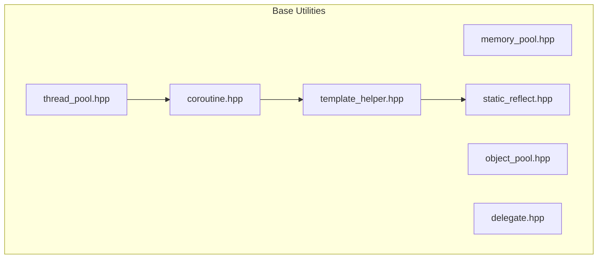
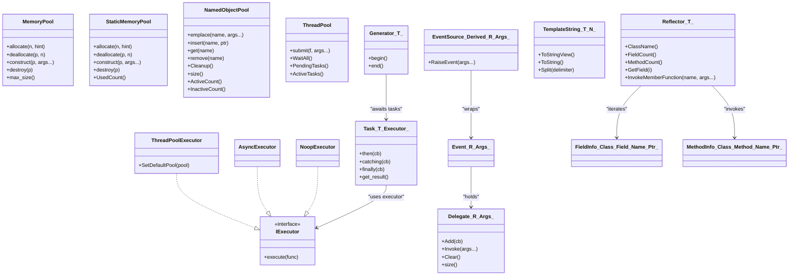
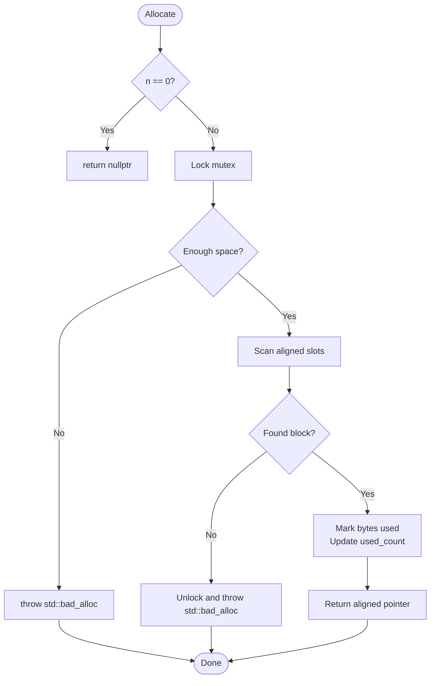
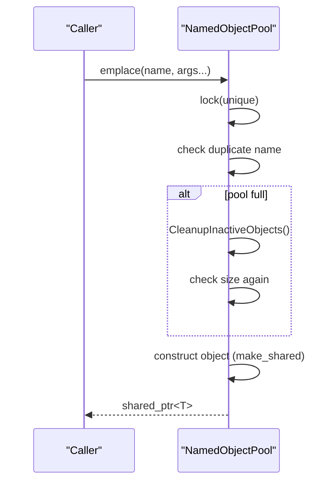
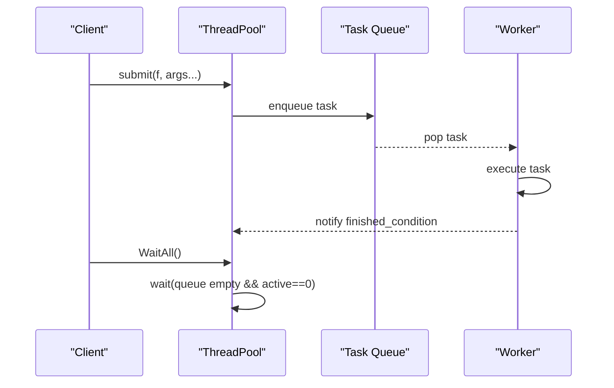
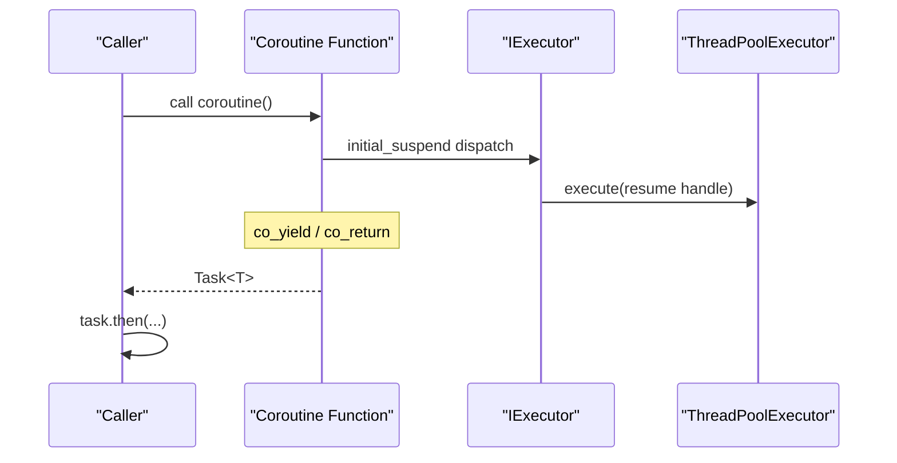
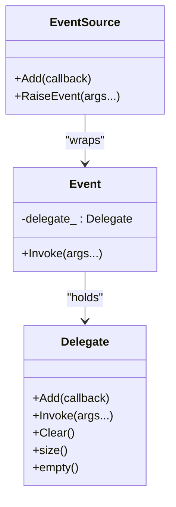
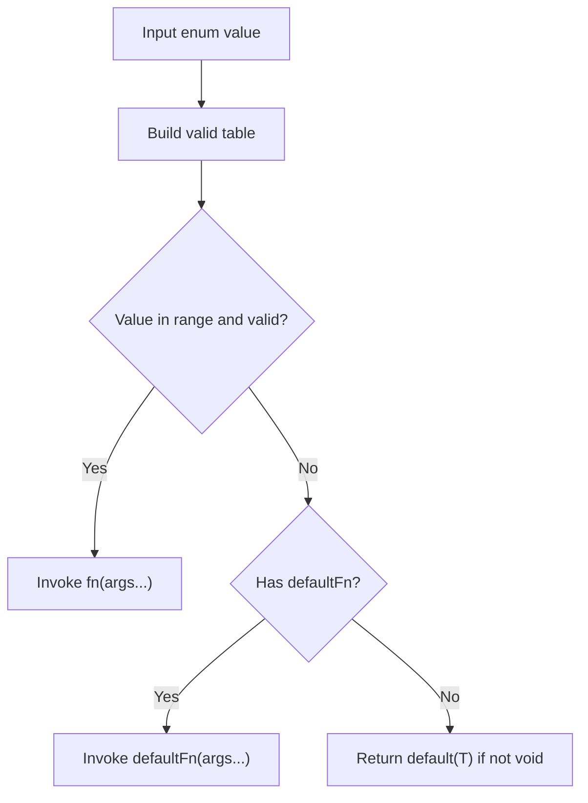
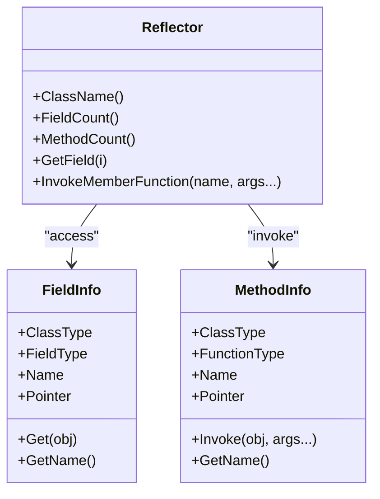
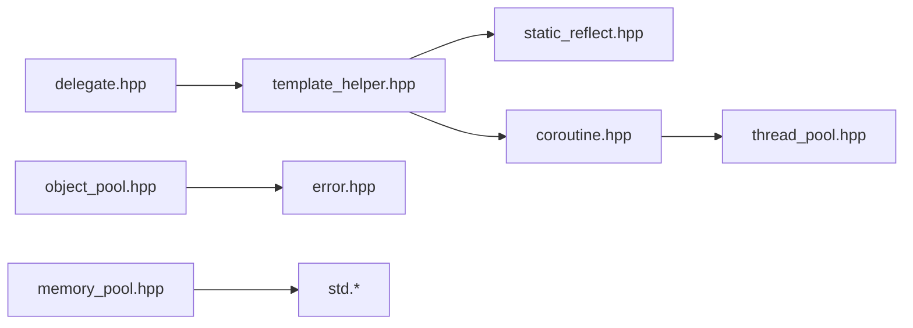

# Base Utilities

<cite>
**Referenced Files in This Document**
- [memory_pool.hpp](file://base/memory_pool.hpp)
- [object_pool.hpp](file://base/object_pool.hpp)
- [thread_pool.hpp](file://base/thread_pool.hpp)
- [coroutine.hpp](file://base/coroutine.hpp)
- [delegate.hpp](file://base/delegate.hpp)
- [static_reflect.hpp](file://base/static_reflect.hpp)
- [template_helper.hpp](file://base/template_helper.hpp)
- [README.md](file://docs/en/base/README.md)
</cite>

## Table of Contents
1. [Introduction](#introduction)
2. [Project Structure](#project-structure)
3. [Core Components](#core-components)
4. [Architecture Overview](#architecture-overview)
5. [Detailed Component Analysis](#detailed-component-analysis)
6. [Dependency Analysis](#dependency-analysis)
7. [Performance Considerations](#performance-considerations)
8. [Troubleshooting Guide](#troubleshooting-guide)
9. [Conclusion](#conclusion)

## Introduction
This document explains the base utility classes and primitives used by HsBaSlicer for memory management, threading, coroutines, delegates, template helpers, and static reflection. It focuses on:
- Memory allocation patterns with MemoryPool and StaticMemoryPool
- Object lifecycle management with NamedObjectPool
- Concurrency via ThreadPool and coroutine integration
- Event-driven programming with Delegate and EventSource
- Compile-time utilities including TemplateString and static reflection
- Practical usage patterns, performance considerations, and best practices for slicing workloads

## Project Structure
The base utilities are header-only components under the base directory. The documentation index lists all available base modules and their roles.

**Diagram sources**
- [README.md:5-17](file://docs/en/base/README.md#L5-L17)
- [thread_pool.hpp:22-23](file://base/thread_pool.hpp#L22-L23)
- [coroutine.hpp:25-25](file://base/coroutine.hpp#L25-L25)
- [static_reflect.hpp:20-21](file://base/static_reflect.hpp#L20-L21)

**Section sources**
- [README.md:1-37](file://docs/en/base/README.md#L1-L37)

## Core Components
- Memory pools: MemoryPool (shared state), StaticMemoryPool (global static pool)
- Object pool: NamedObjectPool (named, capacity-limited, auto-cleanup)
- Threading: ThreadPool (task queue + worker threads)
- Coroutines: Task, Generator, executors (IExecutor, AsyncExecutor, NoopExecutor, ThreadPoolExecutor)
- Delegates: Delegate (multicast callbacks), Event, EventSource
- Templates: TemplateString, enum helpers, named pointers, Y combinator
- Reflection: FieldInfo, MethodInfo, Reflector, Reflectable concept

**Section sources**
- [memory_pool.hpp:18-372](file://base/memory_pool.hpp#L18-L372)
- [object_pool.hpp:16-283](file://base/object_pool.hpp#L16-L283)
- [thread_pool.hpp:25-210](file://base/thread_pool.hpp#L25-L210)
- [coroutine.hpp:41-1089](file://base/coroutine.hpp#L41-L1089)
- [delegate.hpp:20-243](file://base/delegate.hpp#L20-L243)
- [template_helper.hpp:42-779](file://base/template_helper.hpp#L42-L779)
- [static_reflect.hpp:26-187](file://base/static_reflect.hpp#L26-L187)

## Architecture Overview
High-level relationships among core utilities:

**Diagram sources**
- [memory_pool.hpp:43-208](file://base/memory_pool.hpp#L43-L208)
- [memory_pool.hpp:215-372](file://base/memory_pool.hpp#L215-L372)
- [object_pool.hpp:22-283](file://base/object_pool.hpp#L22-L283)
- [thread_pool.hpp:29-162](file://base/thread_pool.hpp#L29-L162)
- [thread_pool.hpp:170-207](file://base/thread_pool.hpp#L170-L207)
- [coroutine.hpp:47-70](file://base/coroutine.hpp#L47-L70)
- [coroutine.hpp:205-382](file://base/coroutine.hpp#L205-L382)
- [coroutine.hpp:784-893](file://base/coroutine.hpp#L784-L893)
- [delegate.hpp:27-167](file://base/delegate.hpp#L27-L167)
- [delegate.hpp:173-243](file://base/delegate.hpp#L173-L243)
- [template_helper.hpp:50-305](file://base/template_helper.hpp#L50-L305)
- [static_reflect.hpp:35-96](file://base/static_reflect.hpp#L35-L96)
- [static_reflect.hpp:113-183](file://base/static_reflect.hpp#L113-L183)

## Detailed Component Analysis

### Memory Management: MemoryPool and StaticMemoryPool
Purpose:
- Provide fixed-size, thread-safe allocators that reduce heap fragmentation and allocation overhead for small, frequently allocated objects.

Key behaviors:
- MemoryPool uses a shared state to allow multiple instances to share the same underlying buffer.
- StaticMemoryPool is a global allocator where all instances are considered equal and share one static buffer.
- Both implement STL Allocator interface (allocate/deallocate/construct/destroy).
- Allocation scans aligned positions; throws std::bad_alloc when insufficient space remains.
- Deallocate validates pointer bounds and marks bytes as free.

Usage patterns:
- Direct allocation and construction: allocate -> construct -> use -> destroy -> deallocate.
- With STL containers: pass an instance of the pool as the container’s allocator.
- For global pooling across translation units: prefer StaticMemoryPool.

Best practices:
- Size PoolSize to expected peak usage to avoid frequent bad_alloc.
- Prefer contiguous allocations of similar-sized types.
- Monitor UsedCount (StaticMemoryPool) or track object lifetimes to detect leaks.

**Diagram sources**
- [memory_pool.hpp:111-142](file://base/memory_pool.hpp#L111-L142)
- [memory_pool.hpp:266-296](file://base/memory_pool.hpp#L266-L296)

Practical examples:
- Basic allocation and construction: see [memory_pool.hpp:111-198](file://base/memory_pool.hpp#L111-L198).
- Using with STL containers: see example in docs at [docs/en/base/memory_pool.md:119-151](file://docs/en/base/memory_pool.md#L119-L151).
- StaticMemoryPool usage and equality semantics: see [memory_pool.hpp:215-372](file://base/memory_pool.hpp#L215-L372) and [docs/en/base/memory_pool.md:190-229](file://docs/en/base/memory_pool.md#L190-L229).

**Section sources**
- [memory_pool.hpp:18-372](file://base/memory_pool.hpp#L18-L372)
- [docs/en/base/memory_pool.md:1-325](file://docs/en/base/memory_pool.md#L1-L325)

### Object Lifecycle: NamedObjectPool
Purpose:
- Manage named shared objects with capacity limits and automatic cleanup of inactive entries.

Key behaviors:
- emplace/insert/allocate create or insert objects keyed by name.
- get/operator[] retrieve shared_ptr by name.
- remove deletes entry by name.
- CleanupInactiveObjects removes entries whose shared reference count equals 1 (no external owners).
- Thread-safe via shared_mutex; read-heavy operations use shared_lock.

Usage patterns:
- Centralized resource registry (e.g., models, textures, buffers).
- Capacity-guarded creation with optional custom allocator support.

Best practices:
- Use unique names per object type to avoid collisions.
- Call Cleanup periodically if you need proactive reclamation.
- Avoid holding temporary weak references beyond scope; rely on shared_ptr ownership.

**Diagram sources**
- [object_pool.hpp:66-92](file://base/object_pool.hpp#L66-L92)
- [object_pool.hpp:262-279](file://base/object_pool.hpp#L262-L279)

Practical examples:
- See API surface and behavior in [object_pool.hpp:22-283](file://base/object_pool.hpp#L22-L283).
- Usage overview in [docs/en/base/object_pool.md:1-43](file://docs/en/base/object_pool.md#L1-L43).

**Section sources**
- [object_pool.hpp:16-283](file://base/object_pool.hpp#L16-L283)
- [docs/en/base/object_pool.md:1-43](file://docs/en/base/object_pool.md#L1-L43)

### Concurrency: ThreadPool
Purpose:
- Execute arbitrary tasks concurrently using a bounded set of worker threads.

Key behaviors:
- submit wraps callable into packaged_task and returns std::future.
- WorkerLoop waits on condition_variable, pops tasks, executes them, decrements active_tasks_, notifies WaitAll.
- WaitAll blocks until queue empty and no active tasks.
- ThreadPoolExecutor bridges ThreadPool to coroutine IExecutor.

Usage patterns:
- Parallelize CPU-bound workloads by chunking data and submitting partial computations.
- Integrate with coroutines via ThreadPoolExecutor for asynchronous scheduling.

Best practices:
- Set thread count near hardware_concurrency for CPU-bound tasks.
- Batch short tasks to reduce queue overhead.
- Handle exceptions from futures; task exceptions propagate through future.get().

**Diagram sources**
- [thread_pool.hpp:67-90](file://base/thread_pool.hpp#L67-L90)
- [thread_pool.hpp:117-154](file://base/thread_pool.hpp#L117-L154)

Practical examples:
- Submitting tasks and waiting: see [thread_pool.hpp:67-111](file://base/thread_pool.hpp#L67-L111).
- Coroutine executor integration: see [thread_pool.hpp:170-207](file://base/thread_pool.hpp#L170-L207).
- Documentation examples: [docs/en/base/thread_pool.md:166-243](file://docs/en/base/thread_pool.md#L166-L243).

**Section sources**
- [thread_pool.hpp:25-210](file://base/thread_pool.hpp#L25-L210)
- [docs/en/base/thread_pool.md:1-317](file://docs/en/base/thread_pool.md#L1-L317)

### Coroutines: Task, Generator, Executors
Purpose:
- Provide C++20 coroutine abstractions for asynchronous tasks and lazy generators, with pluggable executors.

Key components:
- IExecutor interface with implementations: NoopExecutor, AsyncExecutor, ThreadPoolExecutor.
- Task<T, Executor>: coroutine-based async result with then/catching/finally and await_transform for chaining.
- CustomAllocatorTask<T, Executor, Allocator>: Task variant that allocates promise with a custom allocator.
- Generator<T>: lazy iterator over yielded values; supports awaiting Tasks.
- CustomAllocatorGenerator<T, Allocator>: generator with custom allocator.

Usage patterns:
- Define coroutine functions returning Task<T>.
- Use then/catching/finally for chaining and error handling.
- Iterate Generator with range-for; it resumes the coroutine on demand.
- Configure ThreadPoolExecutor as default or per-task executor.

Best practices:
- Prefer ThreadPoolExecutor for CPU-bound work; AsyncExecutor for fire-and-forget.
- Use CustomAllocator variants when integrating with MemoryPool/StaticMemoryPool.
- Ensure cancellation hooks (onCancel) are set for long-running generators.

**Diagram sources**
- [coroutine.hpp:47-70](file://base/coroutine.hpp#L47-L70)
- [coroutine.hpp:205-382](file://base/coroutine.hpp#L205-L382)
- [coroutine.hpp:784-893](file://base/coroutine.hpp#L784-L893)
- [thread_pool.hpp:170-207](file://base/thread_pool.hpp#L170-L207)

Practical examples:
- Task API and chaining: [coroutine.hpp:205-382](file://base/coroutine.hpp#L205-L382).
- Generator iteration: [coroutine.hpp:784-893](file://base/coroutine.hpp#L784-L893).
- Custom allocator variants: [coroutine.hpp:563-772](file://base/coroutine.hpp#L563-L772), [coroutine.hpp:901-1042](file://base/coroutine.hpp#L901-L1042).

**Section sources**
- [coroutine.hpp:41-1089](file://base/coroutine.hpp#L41-L1089)
- [thread_pool.hpp:170-207](file://base/thread_pool.hpp#L170-L207)

### Delegates and Events: Delegate, Event, EventSource
Purpose:
- Provide multicast delegates and event-driven architecture with thread-safe callback management.

Key behaviors:
- Delegate stores multiple callbacks; Invoke runs all and aggregates results for addable return types; otherwise returns last result.
- Event encapsulates a Delegate; EventSource exposes Add/RaiseEvent for derived classes.
- Thread-safe via shared_mutex; copy/move semantics controlled.

Usage patterns:
- Subscribe with operator+= or Add; raise events with RaiseEvent.
- Use void-return delegates for side effects; non-void delegates for aggregations.

Best practices:
- Keep callbacks lightweight and thread-safe.
- Avoid Remove due to deprecation; manage subscription lifetimes explicitly.

**Diagram sources**
- [delegate.hpp:27-167](file://base/delegate.hpp#L27-L167)
- [delegate.hpp:173-243](file://base/delegate.hpp#L173-L243)

Practical examples:
- Basic delegate usage and event source pattern: [docs/en/base/delegate.md:1-82](file://docs/en/base/delegate.md#L1-L82).
- Implementation details: [delegate.hpp:20-243](file://base/delegate.hpp#L20-L243).

**Section sources**
- [delegate.hpp:20-243](file://base/delegate.hpp#L20-L243)
- [docs/en/base/delegate.md:1-82](file://docs/en/base/delegate.md#L1-L82)

### Template Helpers: TemplateString and Utilities
Purpose:
- Provide compile-time string handling, enum conversion utilities, named pointers, and other template helpers.

Highlights:
- TemplateString<T, N>: fixed-size string with conversions, splitting, case transforms, and formatter specialization.
- EnumName/EnumFromName: magic_enum-based conversions.
- AllValidEnum helpers: validate enum ranges and invoke callbacks accordingly.
- NamedRawPtr/NamedPtr: debuggable wrappers around raw/smart pointers with compile-time names.
- YCombinator: recursive lambda helper when explicit this parameter is unavailable.

Usage patterns:
- Use _ts literals to create TemplateString at compile time.
- Use AllValidEnum to branch on valid enum values safely.
- Wrap pointers with NamedPtr for diagnostics and logging.

Best practices:
- Prefer TemplateString for identifiers, keys, and configuration names.
- Validate enums before processing to avoid undefined behavior.

**Diagram sources**
- [template_helper.hpp:443-555](file://base/template_helper.hpp#L443-L555)

Practical examples:
- TemplateString and formatting: [template_helper.hpp:50-305](file://base/template_helper.hpp#L50-L305), [template_helper.hpp:743-779](file://base/template_helper.hpp#L743-L779).
- Enum utilities: [template_helper.hpp:380-555](file://base/template_helper.hpp#L380-L555).
- Named pointers: [template_helper.hpp:558-666](file://base/template_helper.hpp#L558-L666).

**Section sources**
- [template_helper.hpp:42-779](file://base/template_helper.hpp#L42-L779)

### Static Reflection: FieldInfo, MethodInfo, Reflector
Purpose:
- Enable compile-time introspection of fields and methods without RTTI.

Key components:
- FieldInfo<ClassT, FieldT, Name, Ptr>: accessors and name retrieval.
- MethodInfo<ClassT, FuncT, Name, Ptr>: invocation helpers and name retrieval.
- Reflector<T>: queries counts, names, field access, and method invocation by name.
- Reflectable concept: requires FieldList, MethodList, ClassName.

Usage patterns:
- Declare FieldList and MethodList tuples in your class.
- Use Reflector<T>::GetField<i>(obj) and InvokeMemberFunction<"name"_ts>(obj, args...).

Best practices:
- Keep FieldList/MethodList synchronized with actual members.
- Use TemplateString literals for consistent naming.

**Diagram sources**
- [static_reflect.hpp:35-96](file://base/static_reflect.hpp#L35-L96)
- [static_reflect.hpp:113-183](file://base/static_reflect.hpp#L113-L183)

Practical examples:
- Making classes reflectable and using Reflector: [docs/en/base/static_reflect.md:1-235](file://docs/en/base/static_reflect.md#L1-L235).
- Implementation: [static_reflect.hpp:26-187](file://base/static_reflect.hpp#L26-L187).

**Section sources**
- [static_reflect.hpp:26-187](file://base/static_reflect.hpp#L26-L187)
- [docs/en/base/static_reflect.md:1-235](file://docs/en/base/static_reflect.md#L1-L235)

## Dependency Analysis
- template_helper.hpp is foundational: used by static_reflect.hpp and coroutine.hpp.
- thread_pool.hpp depends on coroutine.hpp for ThreadPoolExecutor.
- delegate.hpp relies on concepts.hpp and standard library concurrency primitives.
- object_pool.hpp uses error.hpp and standard containers.
- memory_pool.hpp is self-contained except for standard library headers.

**Diagram sources**
- [static_reflect.hpp:20-21](file://base/static_reflect.hpp#L20-L21)
- [coroutine.hpp:25-25](file://base/coroutine.hpp#L25-L25)
- [thread_pool.hpp:22-23](file://base/thread_pool.hpp#L22-L23)
- [object_pool.hpp:14-14](file://base/object_pool.hpp#L14-L14)

**Section sources**
- [static_reflect.hpp:20-21](file://base/static_reflect.hpp#L20-L21)
- [coroutine.hpp:25-25](file://base/coroutine.hpp#L25-L25)
- [thread_pool.hpp:22-23](file://base/thread_pool.hpp#L22-L23)
- [object_pool.hpp:14-14](file://base/object_pool.hpp#L14-L14)

## Performance Considerations
- Memory pools:
  - Reduce allocation overhead and fragmentation for small, short-lived objects.
  - Choose PoolSize based on peak usage; monitor UsedCount for StaticMemoryPool.
  - Align requirements handled automatically; ensure objects are trivially destructible or explicitly destroyed.
- NamedObjectPool:
  - Automatic cleanup only triggers when adding new objects at capacity; call Cleanup proactively if needed.
  - Prefer shared_ptr ownership; weak references help detect inactive objects.
- ThreadPool:
  - Tune thread count to hardware_concurrency for CPU-bound tasks.
  - Batch work to minimize queue contention.
  - Exceptions in tasks are propagated via futures; handle appropriately.
- Coroutines:
  - Use ThreadPoolExecutor for CPU-bound tasks; AsyncExecutor for simple offloading.
  - CustomAllocatorTask/Generator integrate with memory pools for predictable allocation patterns.
  - Set onCancel for cancellable generators.
- Delegates:
  - Multicast invokes iterate all callbacks; keep handlers efficient.
  - Avoid Remove; manage subscriptions via scopes or explicit unsubscription strategies.
- Template helpers:
  - TemplateString avoids dynamic allocation for identifiers.
  - Enum validation prevents invalid branches and reduces runtime checks.

[No sources needed since this section provides general guidance]

## Troubleshooting Guide
Common issues and resolutions:
- MemoryPool/StaticMemoryPool allocation fails:
  - Cause: insufficient pool capacity or misaligned requests.
  - Action: increase PoolSize; verify object sizes and alignment; check UsedCount.
  - References: [memory_pool.hpp:111-142](file://base/memory_pool.hpp#L111-L142), [memory_pool.hpp:266-296](file://base/memory_pool.hpp#L266-L296).
- NamedObjectPool throws “pool is full”:
  - Cause: MaxSize reached and no inactive objects.
  - Action: call Cleanup(); reduce concurrent object lifetime; review naming strategy.
  - References: [object_pool.hpp:78-85](file://base/object_pool.hpp#L78-L85), [object_pool.hpp:262-279](file://base/object_pool.hpp#L262-L279).
- ThreadPool submits after destruction:
  - Cause: submitting to stopped pool.
  - Action: ensure pool lifetime covers all submissions; check PendingTasks/ActiveTasks.
  - References: [thread_pool.hpp:77-82](file://base/thread_pool.hpp#L77-L82).
- Coroutine executor not executing:
  - Cause: missing HSBA_ENABLE_THREAD_POOL_COROUTINE or no default pool set.
  - Action: define macro; set ThreadPoolExecutor::SetDefaultPool or pass pool explicitly.
  - References: [thread_pool.hpp:164-210](file://base/thread_pool.hpp#L164-L210).
- Delegate Remove not working:
  - Cause: Remove is deprecated due to std::function lacking operator==.
  - Action: manage subscriptions manually; avoid relying on Remove.
  - References: [delegate.hpp:46-56](file://base/delegate.hpp#L46-L56).
- Static reflection errors:
  - Cause: class does not satisfy Reflectable (missing FieldList/MethodList/ClassName).
  - Action: add required typedefs and ensure names match.
  - References: [static_reflect.hpp:101-107](file://base/static_reflect.hpp#L101-L107), [static_reflect.hpp:113-183](file://base/static_reflect.hpp#L113-L183).

**Section sources**
- [memory_pool.hpp:111-142](file://base/memory_pool.hpp#L111-L142)
- [memory_pool.hpp:266-296](file://base/memory_pool.hpp#L266-L296)
- [object_pool.hpp:78-85](file://base/object_pool.hpp#L78-L85)
- [object_pool.hpp:262-279](file://base/object_pool.hpp#L262-L279)
- [thread_pool.hpp:77-82](file://base/thread_pool.hpp#L77-L82)
- [thread_pool.hpp:164-210](file://base/thread_pool.hpp#L164-L210)
- [delegate.hpp:46-56](file://base/delegate.hpp#L46-L56)
- [static_reflect.hpp:101-107](file://base/static_reflect.hpp#L101-L107)
- [static_reflect.hpp:113-183](file://base/static_reflect.hpp#L113-L183)

## Conclusion
HsBaSlicer’s base utilities provide a cohesive toolkit for high-performance, memory-efficient, and concurrent programming:
- Use MemoryPool/StaticMemoryPool for predictable, low-overhead allocations.
- Manage shared resources with NamedObjectPool for centralized lifecycle control.
- Offload work with ThreadPool and integrate seamlessly with coroutines via ThreadPoolExecutor.
- Build event-driven systems with Delegate/EventSource for clean decoupling.
- Leverage TemplateString and static reflection for robust, compile-time-safe APIs.

Adopt the recommended patterns and constraints to achieve stable, scalable performance in slicing workflows.

[No sources needed since this section summarizes without analyzing specific files]