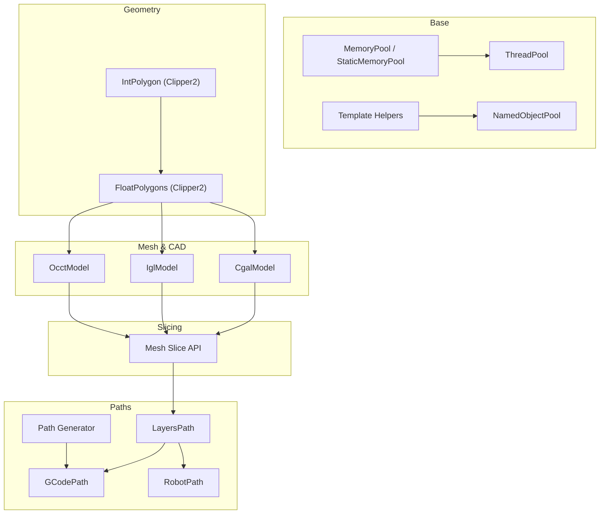
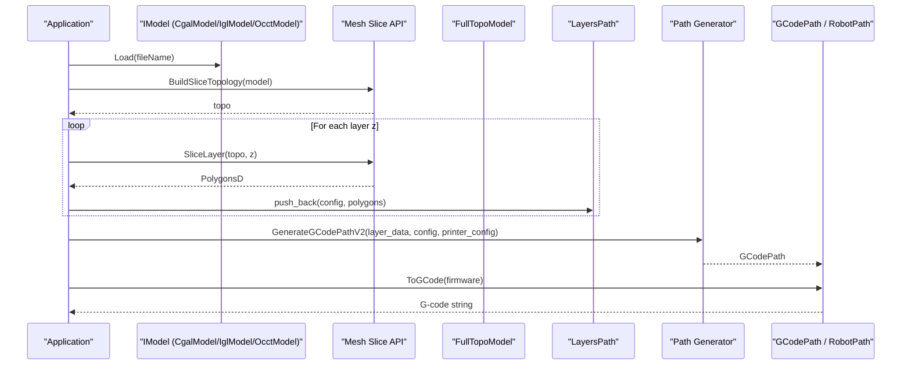
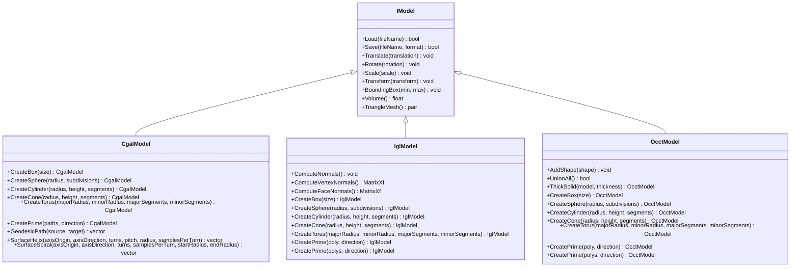
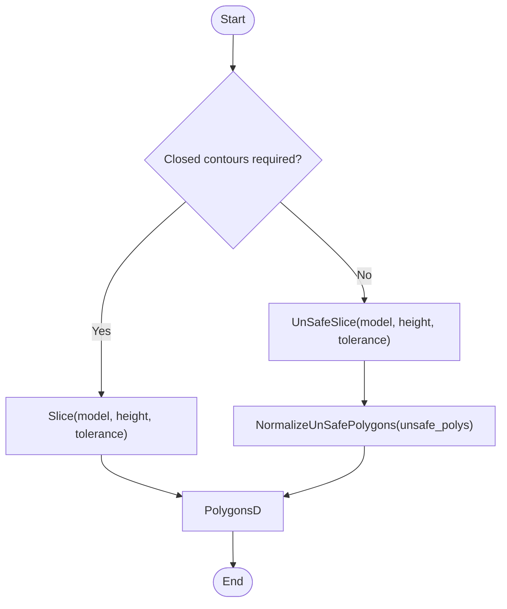
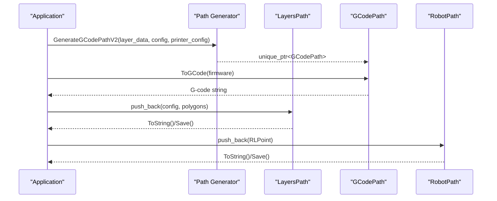
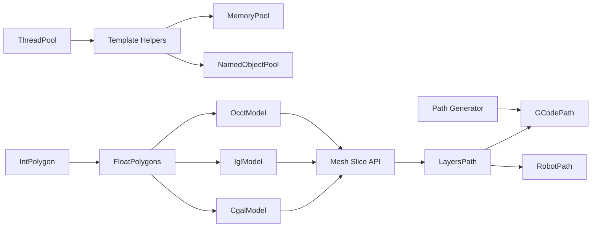

# Core Library Documentation

<cite>
**Referenced Files in This Document**
- [README.md](file://README.md)
- [memory_pool.hpp](file://base/memory_pool.hpp)
- [thread_pool.hpp](file://base/thread_pool.hpp)
- [template_helper.hpp](file://base/template_helper.hpp)
- [object_pool.hpp](file://base/object_pool.hpp)
- [FloatPolygons.hpp](file://2D/FloatPolygons.hpp)
- [IntPolygon.hpp](file://2D/IntPolygon.hpp)
- [CgalModel.hpp](file://meshmodel/CgalModel.hpp)
- [IglModel.hpp](file://meshmodel/IglModel.hpp)
- [OcctModel.hpp](file://cadmodel/OcctModel.hpp)
- [mesh_slice.hpp](file://LibHsBaSlicer/Slice/mesh_slice.hpp)
- [layerspath.hpp](file://paths/layerspath.hpp)
- [gcodepath.hpp](file://paths/gcodepath.hpp)
- [robotpath.hpp](file://paths/robotpath.hpp)
- [path_generator.hpp](file://LibHsBaSlicer/Path/path_generator.hpp)
</cite>

## Table of Contents
1. [Introduction](#introduction)
2. [Project Structure](#project-structure)
3. [Core Components](#core-components)
4. [Architecture Overview](#architecture-overview)
5. [Detailed Component Analysis](#detailed-component-analysis)
6. [Dependency Analysis](#dependency-analysis)
7. [Performance Considerations](#performance-considerations)
8. [Troubleshooting Guide](#troubleshooting-guide)
9. [Conclusion](#conclusion)

## Introduction
This document provides comprehensive documentation for HsBaSlicer’s core library components, focusing on:
- Base utilities: memory pools, threading primitives, template helpers, and utility classes
- Geometry processing: 2D polygon operations (Clipper2), mesh processing (CGAL/IGL backends), and CAD model support (OpenCASCADE)
- Slicing engine: mesh slicing algorithms, layer topology construction, and contour extraction
- Path generation system: G-code, robot paths, and image sequences
- API references with method signatures, parameters, return values, and usage examples
- Performance optimization techniques and best practices

The project is a modular, cross-platform C++ framework for high-performance 3D-printing slicers, exposing both a static C++ API (LibHsBaSlicer) and a dynamic C ABI (DllHsBaSlicer).

**Section sources**
- [README.md:19-39](file://README.md#L19-L39)

## Project Structure
Key modules relevant to this documentation:
- base: foundational types, allocators, concurrency, and templates
- 2D: 2D polygon operations using Clipper2
- meshmodel: CGAL and IGL-backed triangle meshes
- cadmodel: OpenCascade BRep models
- LibHsBaSlicer: core slicing and path generation APIs
- paths: output formats including layers, G-code, and robot programs

**Diagram sources**
- [memory_pool.hpp:43-208](file://base/memory_pool.hpp#L43-L208)
- [thread_pool.hpp:29-162](file://base/thread_pool.hpp#L29-L162)
- [template_helper.hpp:42-737](file://base/template_helper.hpp#L42-L737)
- [object_pool.hpp:22-283](file://base/object_pool.hpp#L22-L283)
- [IntPolygon.hpp:14-212](file://2D/IntPolygon.hpp#L14-L212)
- [FloatPolygons.hpp:16-240](file://2D/FloatPolygons.hpp#L16-L240)
- [CgalModel.hpp:34-155](file://meshmodel/CgalModel.hpp#L34-L155)
- [IglModel.hpp:26-121](file://meshmodel/IglModel.hpp#L26-L121)
- [OcctModel.hpp:30-124](file://cadmodel/OcctModel.hpp#L30-L124)
- [mesh_slice.hpp:22-103](file://LibHsBaSlicer/Slice/mesh_slice.hpp#L22-L103)
- [layerspath.hpp:25-60](file://paths/layerspath.hpp#L25-L60)
- [gcodepath.hpp:66-107](file://paths/gcodepath.hpp#L66-L107)
- [robotpath.hpp:61-104](file://paths/robotpath.hpp#L61-L104)
- [path_generator.hpp:23-91](file://LibHsBaSlicer/Path/path_generator.hpp#L23-L91)

**Section sources**
- [README.md:100-124](file://README.md#L100-L124)

## Core Components
This section documents the foundational building blocks used across geometry, slicing, and path generation.

### Memory Pools
- MemoryPool<T, PoolSize>: thread-safe, fixed-size pool allocator with per-instance state; supports allocation/deallocation, construction/destruction, equality semantics, and shared state via std::shared_ptr.
- StaticMemoryPool<T, PoolSize>: global/static pool with static buffer and counters; all instances are considered equal; includes UsedCount() for diagnostics.

Key behaviors:
- Allocation scans aligned offsets and marks bytes as used; throws std::bad_alloc when insufficient space.
- Deallocate validates pointer bounds and unmarks bytes; throws std::invalid_argument on invalid pointers.
- Both provide STL-compatible allocator interfaces (value_type, pointer, rebind, etc.).

Best practices:
- Use for short-lived, frequent allocations within slices or path generation.
- Prefer StaticMemoryPool for globally shared buffers; use MemoryPool for isolated contexts.

**Section sources**
- [memory_pool.hpp:28-208](file://base/memory_pool.hpp#L28-L208)
- [memory_pool.hpp:215-372](file://base/memory_pool.hpp#L215-L372)

### Threading Primitives
- ThreadPool: manages worker threads, task queue, futures, active/pending counts, and WaitAll synchronization. Supports coroutine executor integration via Utils::ThreadPoolExecutor (when enabled).
- ThreadPoolExecutor: implements IExecutor interface, defers execution to a ThreadPool instance (explicit or default).

API highlights:
- submit(f, args...) returns std::future<ReturnType>.
- PendingTasks(), ActiveTasks(), WaitAll().
- WorkerLoop handles exceptions without crashing the pool.

Best practices:
- Initialize with hardware_concurrency or tuned value.
- Avoid submitting tasks after destruction; check stop state implicitly via exception.

**Section sources**
- [thread_pool.hpp:29-162](file://base/thread_pool.hpp#L29-L162)
- [thread_pool.hpp:164-207](file://base/thread_pool.hpp#L164-L207)

### Template Helpers and Utility Classes
- TemplateString<T, N>: compile-time fixed-size string with conversions, splitting, case conversion, formatting, and user-defined literals ("_ts").
- NamedRawPtr<th, T> and NamedPtr<th, T, Ptr>: named wrappers around raw/smart pointers with Name(), Get(), operator*, operator->, bool conversion.
- EnumName/EnumFromName: magic_enum-based enum name utilities.
- AllValidEnum: validated dispatch over enums with optional default callback.
- YCombinator: enables recursive lambdas where explicit-this is unavailable.
- MakeNonCopyableArray: constructs arrays of non-copyable elements.

Best practices:
- Use TemplateString for zero-allocation identifiers and keys.
- Use NamedPtr/NamedRawPtr for debuggable ownership and logging.

**Section sources**
- [template_helper.hpp:42-305](file://base/template_helper.hpp#L42-L305)
- [template_helper.hpp:318-555](file://base/template_helper.hpp#L318-L555)
- [template_helper.hpp:558-666](file://base/template_helper.hpp#L558-L666)
- [template_helper.hpp:668-737](file://base/template_helper.hpp#L668-L737)
- [template_helper.hpp:743-778](file://base/template_helper.hpp#L743-L778)

### Named Object Pool
- NamedObjectPool<T, MaxSize>: thread-safe registry of named shared objects with automatic cleanup of inactive entries.
- Operations: emplace, insert, allocate, get, remove, Contains, size, InactiveCount, ActiveCount, Cleanup, GetNames.

Behavior:
- Uses shared_mutex for concurrent access.
- Cleans up inactive objects only when capacity is reached to avoid thrashing.

Best practices:
- Use for reusable resources (e.g., precomputed topologies, caches).
- Monitor InactiveCount to tune cleanup strategy.

**Section sources**
- [object_pool.hpp:22-283](file://base/object_pool.hpp#L22-L283)

## Architecture Overview
The slicing pipeline integrates geometry, mesh/CAD models, slicing, and path generation:

**Diagram sources**
- [CgalModel.hpp:34-155](file://meshmodel/CgalModel.hpp#L34-L155)
- [IglModel.hpp:26-121](file://meshmodel/IglModel.hpp#L26-L121)
- [OcctModel.hpp:30-124](file://cadmodel/OcctModel.hpp#L30-L124)
- [mesh_slice.hpp:89-103](file://LibHsBaSlicer/Slice/mesh_slice.hpp#L89-L103)
- [layerspath.hpp:25-60](file://paths/layerspath.hpp#L25-L60)
- [path_generator.hpp:50-62](file://LibHsBaSlicer/Path/path_generator.hpp#L50-L62)
- [gcodepath.hpp:66-107](file://paths/gcodepath.hpp#L66-L107)

## Detailed Component Analysis

### 2D Polygon Processing (Clipper2)
Provides integer and double-precision polygon types and operations:
- IntPolygon: Point2/Polygon/Polygons with boolean ops (Union/Intersection/Difference/Xor), Offset, Area, PointInPolygons, simplification utilities.
- FloatPolygons: Point2D/PolygonD/PolygonsD with similar ops plus shape generators (rectangle, circle, ellipse, regular polygon), text-to-polygons, and integerization/un-integerization.

API summary:
- Simplify: MakeSimple(Polygon/Polygons, epsilon)
- Boolean ops: Union/Intersection/Difference/Xor(Polygon/Polygons, fill_rule)
- Offset: Offset(Polygon/Polygons, delta, join_type, end_type)
- Area: Area(Polygon/Polygons)
- Text: TextToPolygons(utf8_text, font_file, font_size, x, y, curve_segments)
- Conversion: Integerization/UnIntegerization(PolygonD/PolygonsD <-> Polygon/Polygons)

Usage example (conceptual):
- Compute union of two polygons, offset by wall thickness, then convert to double precision for downstream processing.

**Section sources**
- [IntPolygon.hpp:14-212](file://2D/IntPolygon.hpp#L14-L212)
- [FloatPolygons.hpp:16-240](file://2D/FloatPolygons.hpp#L16-L240)

### Mesh Models (CGAL and IGL)
Both implement IModel and expose common operations:
- Transformations: Translate, Rotate, Scale, Transform(Isometry/Affine/Homogeneous)
- Queries: BoundingBox, Volume, TriangleMesh
- IO: Load, Save(ModelFormat)
- Boolean ops: Union/Intersection/Difference/Xor (friend functions)
- Primitives: CreateBox, CreateSphere, CreateCylinder, CreateCone, CreateTorus
- Extrusion: CreatePrime(PolygonD/PolygonsD, direction)

CGAL-specific:
- Uses Polyhedron_3 and Nef_polyhedron_3 for robust boolean operations.
- Surface geodesic/helix/spiral computations.

IGL-specific:
- Stores vertices/faces/normals as Eigen matrices.
- Normal computation utilities.

**Diagram sources**
- [CgalModel.hpp:34-155](file://meshmodel/CgalModel.hpp#L34-L155)
- [IglModel.hpp:26-121](file://meshmodel/IglModel.hpp#L26-L121)
- [OcctModel.hpp:30-124](file://cadmodel/OcctModel.hpp#L30-L124)

**Section sources**
- [CgalModel.hpp:34-155](file://meshmodel/CgalModel.hpp#L34-L155)
- [IglModel.hpp:26-121](file://meshmodel/IglModel.hpp#L26-L121)
- [OcctModel.hpp:30-124](file://cadmodel/OcctModel.hpp#L30-L124)

### Slicing Engine
Public API for planar slicing along Z:
- Slice(model, height, tolerance): closed contours only
- UnSafeSlice(model, height, tolerance): includes open contours
- SliceLua/UnSafeSliceLua: Lua-driven slicing
- NormalizeUnSafePolygons(unsafe_polys): cleans and converts to PolygonsD
- BuildSliceTopology(model): builds reusable topology
- SliceLayer(topo, z, tolerance): single-layer slice from prebuilt topology

**Diagram sources**
- [mesh_slice.hpp:22-77](file://LibHsBaSlicer/Slice/mesh_slice.hpp#L22-L77)

**Section sources**
- [mesh_slice.hpp:22-103](file://LibHsBaSlicer/Slice/mesh_slice.hpp#L22-L103)

### Path Generation System
Generates toolpaths for various outputs:
- FdmPathConfig: layer_height, line_width, print_speed, travel_speed, extrusion_multiplier, units
- LayerPathData: outlines, fills, supports, z_height
- GenerateGCodePath: returns PointsPath
- GenerateGCodePathV2: returns GCodePath with multi-firmware support
- GenerateGCodePathSpiral: continuous helical wall for vase mode
- PolygonsToGPoints: helper to convert PolygonsD to GPoint sequence

Output types:
- LayersPath: ordered per-layer polygons with config, native/Lua serialization
- GCodePath: firmware-specific G-code (Marlin/RRF/Klipper), spiralized walls
- RobotPath: ABB/KUKA/FANUC program generation

**Diagram sources**
- [path_generator.hpp:23-91](file://LibHsBaSlicer/Path/path_generator.hpp#L23-L91)
- [layerspath.hpp:25-60](file://paths/layerspath.hpp#L25-L60)
- [gcodepath.hpp:66-107](file://paths/gcodepath.hpp#L66-L107)
- [robotpath.hpp:61-104](file://paths/robotpath.hpp#L61-L104)

**Section sources**
- [path_generator.hpp:23-91](file://LibHsBaSlicer/Path/path_generator.hpp#L23-L91)
- [layerspath.hpp:25-60](file://paths/layerspath.hpp#L25-L60)
- [gcodepath.hpp:66-107](file://paths/gcodepath.hpp#L66-L107)
- [robotpath.hpp:61-104](file://paths/robotpath.hpp#L61-L104)

## Dependency Analysis
High-level dependencies among core components:

**Diagram sources**
- [template_helper.hpp:42-737](file://base/template_helper.hpp#L42-L737)
- [memory_pool.hpp:43-208](file://base/memory_pool.hpp#L43-L208)
- [object_pool.hpp:22-283](file://base/object_pool.hpp#L22-L283)
- [thread_pool.hpp:29-162](file://base/thread_pool.hpp#L29-L162)
- [IntPolygon.hpp:14-212](file://2D/IntPolygon.hpp#L14-L212)
- [FloatPolygons.hpp:16-240](file://2D/FloatPolygons.hpp#L16-L240)
- [CgalModel.hpp:34-155](file://meshmodel/CgalModel.hpp#L34-L155)
- [IglModel.hpp:26-121](file://meshmodel/IglModel.hpp#L26-L121)
- [OcctModel.hpp:30-124](file://cadmodel/OcctModel.hpp#L30-L124)
- [mesh_slice.hpp:22-103](file://LibHsBaSlicer/Slice/mesh_slice.hpp#L22-L103)
- [layerspath.hpp:25-60](file://paths/layerspath.hpp#L25-L60)
- [gcodepath.hpp:66-107](file://paths/gcodepath.hpp#L66-L107)
- [robotpath.hpp:61-104](file://paths/robotpath.hpp#L61-L104)
- [path_generator.hpp:23-91](file://LibHsBaSlicer/Path/path_generator.hpp#L23-L91)

**Section sources**
- [README.md:100-124](file://README.md#L100-L124)

## Performance Considerations
- Memory pools:
  - Use MemoryPool/StaticMemoryPool to reduce heap fragmentation and allocation overhead during intensive slicing and path generation.
  - Prefer StaticMemoryPool for global buffers; ensure PoolSize accommodates peak allocations.
- Threading:
  - Tune ThreadPool size based on workload; avoid oversubscription.
  - Use WaitAll to synchronize batched tasks; monitor ActiveTasks/PendingTasks for load balancing.
- Geometry:
  - Prefer integer-coordinate operations (Clipper2) for speed and precision; convert to double only when necessary.
  - Simplify polygons before boolean ops to reduce complexity.
- Mesh/CAD:
  - Reuse FullTopoModel across layers to avoid rebuilding topology per slice.
  - Use CGAL for robust boolean operations; IGL for lightweight mesh storage and normal computation.
- Path generation:
  - Batch layer data and generate G-code in one pass; leverage GenerateGCodePathV2 for multi-firmware output.
  - Spiralize outer walls for vase mode to minimize travel moves.

[No sources needed since this section provides general guidance]

## Troubleshooting Guide
Common issues and resolutions:
- Memory pool exhaustion:
  - Symptom: std::bad_alloc during allocate.
  - Resolution: Increase PoolSize or switch to StaticMemoryPool if sharing across instances.
- Invalid pointer deallocation:
  - Symptom: std::invalid_argument in deallocate.
  - Resolution: Ensure pointers originate from the same pool instance and are not double-freed.
- Thread pool misuse:
  - Symptom: RuntimeError when submitting to stopped pool.
  - Resolution: Do not submit tasks after destructor; manage lifecycle carefully.
- Slicing produces open contours:
  - Symptom: Unexpected open polylines in output.
  - Resolution: Use Slice for closed contours; otherwise normalize with NormalizeUnSafePolygons.
- G-code mismatch:
  - Symptom: Incorrect firmware-specific commands.
  - Resolution: Select correct GCodeFirmware and configure GCodePrinterConfig appropriately.

**Section sources**
- [memory_pool.hpp:111-175](file://base/memory_pool.hpp#L111-L175)
- [memory_pool.hpp:266-324](file://base/memory_pool.hpp#L266-L324)
- [thread_pool.hpp:67-90](file://base/thread_pool.hpp#L67-L90)
- [mesh_slice.hpp:22-77](file://LibHsBaSlicer/Slice/mesh_slice.hpp#L22-L77)
- [gcodepath.hpp:66-107](file://paths/gcodepath.hpp#L66-L107)

## Conclusion
HsBaSlicer’s core library provides a robust foundation for high-performance slicing pipelines:
- Efficient base utilities (memory pools, threading, templates)
- Powerful geometry processing (Clipper2) and flexible mesh/CAD backends (CGAL/IGL/OpenCASCADE)
- A clear slicing API supporting reusable topologies and Lua extensibility
- Comprehensive path generation for G-code and industrial robots

Adopting the recommended best practices ensures scalability, reliability, and maintainability across research and production environments.

[No sources needed since this section summarizes without analyzing specific files]